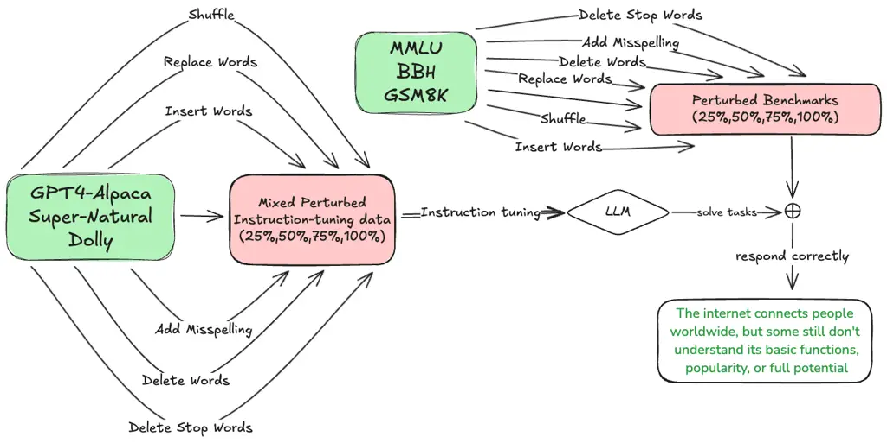

# Fine-Tuning on Noisy Instructions: Effects on Generalization and Performance

Ahmed Alajrami Affiliation: Department of Computer Science    Xingwei
Tan Affiliation: University of Sheffield, UK    Nikolaos Aletras
Affiliation:  {ajsalajrami1, xingwei.tan, n.aletras}@sheffield.ac.uk

###### Abstract

Instruction-tuning plays a vital role in enhancing the task-solving
abilities of large language models (LLMs), improving their usability in
generating helpful responses on various tasks. However, previous work
has demonstrated that they are sensitive to minor variations in
instruction phrasing. In this paper, we explore whether introducing
perturbations in instruction-tuning data can enhance LLMs’ resistance
against noisy instructions. We focus on how instruction-tuning with
perturbations, such as removing stop words or shuffling words, affects
LLMs’ performance on the original and perturbed versions of widely-used
benchmarks (MMLU, BBH, GSM8K). We further assess learning dynamics and
potential shifts in model behavior. Surprisingly, our results suggest
that instruction-tuning on perturbed instructions can, in some cases,
improve downstream performance. These findings highlight the importance
of including perturbed instructions in instruction-tuning, which can
make LLMs more resilient to noisy user inputs.¹¹ 1 Code is available
here:
[https://github.com/aajrami/finetuning-on-noisy-instructions/](https://github.com/aajrami/finetuning-on-noisy-instructions/)

## 1 Introduction

Instruction-tuning is widely adopted to enable LLMs to follow complex
instructions and respond properly (Sanh et al., 2022; Zhao et al., 2023;
Chang et al., 2023; Minaee et al., 2024; Zhang et al., 2024). During
instruction-tuning, LLMs are fine-tuned on datasets comprising various
task instructions and their corresponding responses.

Figure 1: Instruction-tuning on perturbed instructions can enhance LLM’s
resilience to noisy inputs.

LLMs have been shown to be sensitive to prompt variability, producing
inconsistent responses when given semantically equivalent prompts Sun et
al. (2024); Zhao et al. (2024); Yan et al. (2024). To remedy this,
recent instruction datasets are often generated with extensive
paraphrasing using LLMs to increase data diversity (Peng et al., 2023).
However, this paraphrased data is of high quality with minimal noise in
the instructions. A different line of work has explored the robustness
of instruction-tuned models to instruction variations during inference
by introducing different types of noise, such as deleting words (Gu et
al., 2023). However, how noisy data may affect LLMs during training has
yet to be explored.

In this paper, we focus on answering the following research question:
Can fine-tuning of base models on perturbed instructions improve their
resilience to noisy user inputs? Our question is theoretically motivated
by previous work that has shown that introducing noise during training
acts as a form of regularization (Bishop, 1995), which can prevent
overfitting and improve generalization.²² 2 We may interchangeably use
terms such as ‘resilience’ or ‘robustness’ to refer to the model’s
capacity to withstand and adapt to noisy user inputs without a
substantial drop in performance. The term ‘generalization’ refers to the
model’s capacity to perform a given task when presented with novel,
previously unseen phrasings or formats.

To evaluate the impact of instruction perturbation and simulate noisy
user inputs, we employ five strategies inspired by Gu et al. (2023): (1)
delete stop words, (2) shuffle words, (3) delete words, (4) replace
words, and (5) insert words. We further introduce a sixth perturbation
strategy by adding misspellings. These strategies allow us to simulate
and analyze various forms of perturbed instructions, including both
structural and semantic changes. We construct four perturbed
instruction-tuning datasets where GPT4-Alpaca (Peng et al., 2023),
Super-Natural (Wang et al., 2022), and Dolly (Conover et al., 2023) are
combined and then perturbed. We include versions of the data where 25%,
50%, 75%, and 100% of the instructions are perturbed respectively, which
allows us to compare how LLMs are affected by different proportions of
noisy instructions presented in instruction-tuning. We evaluate
performance across three widely-used language understanding benchmarks:
Massive Multitask Language Understanding (Hendrycks et al., 2021),
Big-Bench Hard (Suzgun et al., 2022), and Grade School Math (Cobbe et
al., 2021). Figure 1 shows the process of generating noisy
instruction-tuning data and LLM fine-tuning.

#### Contributions.

We make two key contributions. First, we conduct a systematic study of
how noisy instructions, by fundamentally altering their syntactic and
semantic structure during training, impact LLM performance on downstream
tasks. Second, our empirical analysis suggests that fine-tuning on noisy
instructions may offer a simple approach to enhance robustness. The
results of our study appear to offer insights into the nature of LLM
learning during instruction-tuning. They prompt a re-examination of the
widely held assumption that complete instruction comprehension is always
necessary for effective task learning. Specifically, our findings
suggest that LLMs can derive benefit from instruction modifications that
do not strictly preserve meaning, indicating a more nuanced relationship
between instruction and task performance than previously assumed.

[TABLE]

Table 1: Example of a task instruction from the GPT4-Alpaca dataset and
the corresponding perturbed instruction generated by each perturbation
strategy.

## 2 Related Work

### 2.1 Analyzing Instruction-tuning

Instruction fine-tuning enables LLMs to follow user instructions and
reduces the need for few-shot in-context examples Ouyang et al. (2022);
Wei et al. (2022a); Touvron et al. (2023a); Chung et al. (2024). The
instruction-tuning datasets contain instructions of various tasks and
their corresponding responses which can be human-annotated Mishra et al.
(2022) or synthetically generated Taori et al. (2023); Peng et al.
(2023).

AutoPrompt Shin et al. (2020), which applied a gradient-based search to
optimize the prompt for various tasks, usually finds prompts that are
hardly comprehensible by humans, indicating that language models have a
vastly different way to understand instructions. Recent studies have
investigated the internal mechanisms of instruction fine-tuning and
their influence on LLMs. By observing the output token distribution
shift of models before and after instruction-tuning, Lin et al. (2024)
found that most shifts occur with stylistic tokens (e.g. discourse
markers and transitional words), and knowledge content originates from
untuned LLMs. By introducing knowledge interventions, Ren et al. (2024)
also showed that instruction-tuning is a process of self-aligning the
instructions with existing parametric knowledge rather than introducing
new knowledge into the model.

### 2.2 Robustness of Instruction-tuned Models

Gu et al. (2023) investigated how instruction-tuned models handle
instruction perturbations and paraphrasing. After fine-tuning a model on
the original instructions training set and evaluating it on the
perturbed instructions test set, they found the model was relatively
robust in few-shot settings but notably sensitive in zero-shot
scenarios. Similarly, Sun et al. (2024) showed that paraphrased
instructions can disrupt model consistency and proposed a mitigation
strategy using soft prompt embeddings to align semantically similar
instructions. Wang et al. (2024) examined errors from speech recognition
and OCR, finding such noise significantly degrades LLMs performance.
They also explored using LLMs for zero-shot correction of noisy
instructions. In addition, Abedin et al. (2025) demonstrated that LLMs
are sensitive to noise in reasoning tasks by introducing random
punctuation perturbations into math problem prompts.

Yan et al. (2024) proposed contrastive instruction-tuning which align
the hidden representations of instruction-instance pairs that are
semantically equivalent but textually different while distinguishing
those that are semantically different. Zhao et al. (2024) proposed a
consistency alignment framework that incorporates instruction
augmentation through paraphrasing and automatic self-reward mechanisms.
Lou et al. (2024) introduced a dataset curation scheme that diversifies
task inputs across multiple facets to enhance instruction diversity. Kim
et al. (2024) presented instructive decoding, a method that strengthens
instruction-following abilities in instruction-tuned LLMs by contrasting
decoding paths without additional fine-tuning.

Luo et al. (2024) introduced a denoising framework that detects and
filters out low-quality samples, enabling more robust fine-tuning of
models on noisy downstream datasets. Similarly, Agrawal et al. (2025)
performed an empirical analysis focused on enhancing model robustness to
character- and word-level perturbations in classification tasks,
revealing that iterative self-denoising surpasses approaches like
ensembling and representation alignment.

Unlike previous studies, we investigate how training on noisy
instructions affects their ability to adapt to instruction
perturbations.

## 3 Instruction Perturbation Strategies

We investigate the impact of instruction fine-tuning on the performance
of LLMs when subjected to noisy input conditions. Following Gu et al.
(2023), we employ five instruction perturbation strategies: delete stop
words, shuffle words, delete words, replace words, and insert words.
Furthermore, we introduce misspelling as an additional noise injection
approach. Table 1 shows an example instruction from the GPT4-Alpaca
dataset (Peng et al., 2023). The model input consists of an instruction
and associated context. The perturbation strategies are applied
exclusively to the instruction component.

#### Delete Stop Words.

Stop words, such as “the”, “is”, and “of” are functional words that
mainly contribute to grammatical structure but have limited effects on
semantic content. Removing stop words leads to syntactically incomplete
instructions, allowing us to evaluate the model’s reliance on syntactic
cues and its ability to infer meaning from partial input. For instance,
the instruction Translate the sentence into French becomes Translate
sentence French.

#### Shuffle Words.

The second perturbation strategy is to randomly shuffle the words. By
changing the original word order, we aim to introduce both syntactic and
semantic alterations. We employ a 25% word shuffling of words within the
instruction, while the other words maintain their relative order. We cap
shuffling at 25%, enough to mimic the partial mix-up would be seen from
hurried typing, and realistic enough to test robustness without turning
the prompt into total gibberish. For instance, given the instruction
Summarize the following paragraph, this might result in following the
Summarize paragraph. This perturbation provides an assessment of how
sensitive models are to changes in word order and to what extent they
rely on the original structure to comprehend the instruction.

#### Delete Words.

In this perturbation strategy, 25% of the words within each instruction
are randomly deleted. In contrast to the targeted removal of stop words,
this approach introduces more significant distortions by potentially
eliminating both functional and semantic words, thereby disrupting the
semantic coherence of the instructions to a greater extent. This
strategy assesses the model’s capacity to infer task intent when
presented with incomplete syntactic and semantic structures.

#### Replace Words.

We randomly select 25% of the words from an instruction and replace them
using predictions from a pretrained BERT model (Devlin et al., 2019).
Following Gu et al. (2023), we use BERT’s masked language modeling head
to generate a contextually plausible substitute for all selected words.
The selected words are replaced by \[MASK\] tokens, then BERT predicts
replacement words in a forward pass. This strategy introduces minimal
semantic shifts to the instructions without relying on a lexicon, which
typically requires manual effort. This perturbation may or may not alter
the core meaning of the instruction, depending on the replaced words and
their context. The strategy allows us to investigate the model’s
sensitivity to nuanced lexical variations and its ability to generalize
under slightly altered task phrasing.

#### Insert Words.

We introduce additional words into the instruction by leveraging a
pretrained BERT model (Devlin et al., 2019). Specifically, we randomly
select positions between existing words, covering approximately 25% of
the total word count, and insert a \[MASK\] token at each selected
position. We then replace each \[MASK\] with words predicted by BERT,
resulting in an augmented instruction containing additional,
contextually plausible tokens. This perturbation may introduce noise,
redundancy, or shifts in meaning, challenging the model’s ability to
extract the core task intention from a more verbose or distorted input.

#### Add Misspelling.

Finally, to simulate noisy input that may more closely resemble
user-generated errors, we introduce typographical errors. We randomly
select 25% of the words within each instruction and introduce a typo
into each of these words. We apply simple character-level edits, such as
deleting a random letter, transposing adjacent letters, inserting a
random vowel, or substituting a character with a randomly selected one.
This strategy enables us to evaluate the model’s sensitivity to spelling
errors in the instructions and its ability to discern the intended
meaning from noisy input.

## 4 Experimental Setup

### 4.1 Models

We experiment with two open-weight base LLMs in two sizes: Qwen-2.5 (7B
and 72B) (Yang et al., 2024); and Llama-3.1 (8B and 70B) (Dubey et al.,
2024).

| Instruction Dataset       | \# Samples |
| ------------------------- | ---------- |
| GPT4-Alpaca               | 52,002     |
| Super-Natural Instruction | 55,793     |
| Dolly                     | 15,011     |
| Total                     | 122,806    |

Table 2: Number of samples in each dataset.

### 4.2 Instruction Datasets

We fine-tune all the base models using a combination of three standard
instruction datasets with distinct characteristics.

GPT4-Alpaca (Peng et al., 2023) is derived from Alpaca (Taori et al.,
2023), where the original examples are replaced with responses generated
by GPT-4. Super-Natural Instruction (Wang et al., 2022) contains diverse
tasks, including text classification and translation, with corresponding
instructions. It is designed to evaluate the LLM abilities across a wide
range of linguistic and functional contexts. Dolly (Conover et al., 2023) consists of instruction-following examples that reflect practical,
real-world tasks like brainstorming and creative writing. The
prompt-response pairs are high-quality and human-generated. Table 2
summarizes the number of samples in these datasets.

#### Perturbation Settings.

To simulate real-world settings where the perturbations could appear
altogether, we construct five different dataset mixtures, each
containing a different proportion of perturbed instructions: (1) the
original, unmodified instruction samples from all three datasets
considered as a baseline (0% Perturbation), (2) 25% of the instruction
samples are perturbed, while the remaining 75% are left unaltered (25%
Perturbation), (3) half of the instruction samples are perturbed (50%
Perturbation), (4) 75% of the samples are perturbed (75% Perturbation),
and (5) all instruction samples across the three datasets are perturbed
(100% Perturbation).

In all mixtures involving perturbations, the altered samples are evenly
distributed across the six different perturbation strategies (Section
3).

### 4.3 Implementation Details

We apply parameter-efficient fine-tuning methods for all experiments.
Specifically, we use LoRA (Hu et al., 2022) to fine-tune the 7B and 8B
models, and QLoRA (Dettmers et al., 2023) for the larger 70B and 72B
models. Each model is fine-tuned for one epoch on each dataset mixture
to ensure consistency across experiments. All fine-tuning runs were
performed on a single NVIDIA H100 GPU. Full details on the fine-tuning
hyperparameters are provided in Appendix A.

|           |              |               |              |              |              |              |              |              |              |              |              |              |              |              |              |              |
| --------- | ------------ | ------------- | ------------ | ------------ | ------------ | ------------ | ------------ | ------------ | ------------ | ------------ | ------------ | ------------ | ------------ | ------------ | ------------ | ------------ |
|           |              | MMLU (5-shot) |              |              |              |              | BBH (CoT)    |              |              |              |              | GSM8K (CoT)  |              |              |              |              |
|           | IT           | 0%            | 25%          | 50%          | 75%          | 100%         | 0%           | 25%          | 50%          | 75%          | 100%         | 0%           | 25%          | 50%          | 75%          | 100%         |
| Qwen 7B   | van          | 74.3 \_(0.0)  | 73.0 \_(0.1) | 71.5 \_(0.1) | 70.0 \_(0.4) | 68.6 \_(0.6) | 66.7 \_(0.1) | 63.9 \_(0.4) | 60.8 \_(0.4) | 57.7 \_(0.5) | 54.9 \_(0.5) | 79.9 \_(0.2) | 12.5 \_(0.3) | 22.9 \_(0.6) | 33.0 \_(1.4) | 42.7 \_(1.2) |
| 0%        | 74.3 \_(0.0) | 73.0 \_(0.1)  | 71.7 \_(0.1) | 70.2 \_(0.4) | 68.9 \_(0.7) | 66.8 \_(0.0) | 62.7 \_(0.2) | 58.7 \_(0.2) | 54.3 \_(0.5) | 50.6 \_(0.6) | 80.6 \_(0.0) | 12.6 \_(0.5) | 24.5 \_(0.5) | 34.6 \_(1.0) | 44.6 \_(1.2) |              |
| 25%       | 74.4 \_(0.0) | 73.0 \_(0.1)  | 71.8 \_(0.1) | 70.3 \_(0.5) | 69.1 \_(0.6) | 66.7 \_(0.0) | 63.3 \_(0.3) | 59.7 \_(0.2) | 55.9 \_(0.5) | 52.4 \_(0.6) | 81.1 \_(0.0) | 12.6 \_(0.4) | 24.7 \_(0.5) | 34.5 \_(1.2) | 44.2 \_(1.4) |              |
| 50%       | 74.4 \_(0.0) | 73.1 \_(0.1)  | 71.9 \_(0.1) | 70.5 \_(0.5) | 69.1 \_(0.7) | 67.0 \_(0.0) | 64.0 \_(0.2) | 61.1 \_(0.3) | 57.7 \_(0.6) | 54.8 \_(0.6) | 80.6 \_(0.0) | 12.6 \_(0.5) | 24.6 \_(0.5) | 34.3 \_(0.7) | 44.5 \_(1.1) |              |
| 75%       | 74.3 \_(0.0) | 73.0 \_(0.1)  | 71.8 \_(0.2) | 70.4 \_(0.5) | 69.1 \_(0.7) | 67.4 \_(0.0) | 63.9 \_(0.3) | 60.7 \_(0.2) | 57.6 \_(0.4) | 54.7 \_(0.6) | 80.5 \_(0.0) | 12.8 \_(0.5) | 24.4 \_(0.6) | 34.0 \_(0.9) | 44.4 \_(0.9) |              |
| 100%      | 74.3 \_(0.0) | 73.1 \_(0.0)  | 71.9 \_(0.1) | 70.5 \_(0.5) | 69.2 \_(0.6) | 66.6 \_(0.0) | 63.4 \_(0.2) | 60.3 \_(0.3) | 56.8 \_(0.4) | 53.8 \_(0.7) | 80.0 \_(0.0) | 12.6 \_(0.2) | 24.8 \_(0.6) | 34.3 \_(1.1) | 45.1 \_(0.8) |              |
| Llama 8B  | van          | 65.8 \_(0.0)  | 64.5 \_(0.1) | 63.1 \_(0.1) | 62.1 \_(0.3) | 60.8 \_(0.5) | 64.5 \_(0.1) | 62.5 \_(0.3) | 60.2 \_(0.4) | 57.5 \_(1.0) | 55.0 \_(0.9) | 56.3 \_(0.3) | 9.0 \_(0.7)  | 16.3 \_(0.6) | 23.5 \_(0.6) | 30.5 \_(1.2) |
|           | 0%           | 65.8 \_(0.0)  | 64.6 \_(0.2) | 63.3 \_(0.1) | 62.2 \_(0.2) | 60.7 \_(0.5) | 63.0 \_(0.4) | 63.4 \_(0.1) | 61.1 \_(0.3) | 58.7 \_(0.7) | 56.5 \_(0.6) | 58.4 \_(0.0) | 9.2 \_(0.1)  | 16.6 \_(0.7) | 23.8 \_(1.0) | 28.1 \_(1.0) |
|           | 25%          | 65.9 \_(0.0)  | 64.8 \_(0.3) | 63.4 \_(0.2) | 62.3 \_(0.2) | 60.9 \_(0.7) | 66.0 \_(0.1) | 60.5 \_(0.4) | 60.0 \_(1.9) | 59.1 \_(0.4) | 56.5 \_(0.6) | 58.5 \_(0.0) | 9.4 \_(0.2)  | 16.8 \_(0.8) | 23.9 \_(0.7) | 27.7 \_(0.9) |
|           | 50%          | 65.9 \_(0.0)  | 64.8 \_(0.2) | 63.6 \_(0.1) | 62.5 \_(0.2) | 61.0 \_(0.6) | 62.7 \_(0.0) | 64.4 \_(0.3) | 62.0 \_(0.5) | 59.3 \_(0.5) | 56.7 \_(0.5) | 58.2 \_(0.0) | 9.2 \_(0.2)  | 16.9 \_(0.6) | 24.0 \_(0.9) | 27.8 \_(1.0) |
|           | 75%          | 65.7 \_(0.0)  | 64.7 \_(0.2) | 63.6 \_(0.1) | 62.5 \_(0.2) | 61.2 \_(0.5) | 62.9 \_(0.4) | 64.1 \_(0.3) | 61.8 \_(0.3) | 59.1 \_(0.5) | 56.3 \_(0.5) | 57.4 \_(0.0) | 9.1 \_(0.2)  | 16.9 \_(0.7) | 23.8 \_(0.8) | 27.6 \_(1.2) |
|           | 100%         | 66.0 \_(0.0)  | 64.8 \_(0.3) | 63.7 \_(0.1) | 62.5 \_(0.3) | 61.2 \_(0.5) | 66.2 \_(0.1) | 64.2 \_(0.5) | 62.0 \_(0.5) | 59.2 \_(0.8) | 56.8 \_(0.4) | 58.4 \_(0.0) | 9.2 \_(0.2)  | 17.1 \_(0.6) | 23.7 \_(1.2) | 27.8 \_(1.5) |
| Qwen 72B  | van          | 85.7 \_(0.0)  | 84.5 \_(0.2) | 83.0 \_(0.3) | 81.8 \_(0.3) | 80.3 \_(0.4) | 82.7 \_(0.1) | 79.2 \_(0.2) | 75.4 \_(0.2) | 71.7 \_(0.4) | 68.1 \_(0.8) | 88.8 \_(0.2) | 14.9 \_(0.5) | 28.1 \_(0.7) | 40.8 \_(1.0) | 53.0 \_(1.5) |
|           | 0%           | 85.8 \_(0.0)  | 84.6 \_(0.2) | 83.1 \_(0.3) | 82.0 \_(0.2) | 80.5 \_(0.5) | 83.8 \_(0.1) | 80.5 \_(0.2) | 77.3 \_(0.3) | 73.8 \_(0.5) | 70.8 \_(1.1) | 90.0 \_(0.2) | 15.3 \_(0.4) | 29.0 \_(0.4) | 42.7 \_(1.1) | 55.0 \_(1.7) |
|           | 25%          | 85.7 \_(0.0)  | 84.6 \_(0.3) | 83.1 \_(0.3) | 82.0 \_(0.3) | 80.5 \_(0.6) | 83.8 \_(0.1) | 80.4 \_(0.2) | 77.4 \_(0.4) | 74.0 \_(0.8) | 70.8 \_(1.0) | 89.9 \_(0.2) | 15.3 \_(0.5) | 29.6 \_(0.4) | 43.0 \_(1.1) | 55.5 \_(1.6) |
|           | 50%          | 85.7 \_(0.0)  | 84.7 \_(0.3) | 83.1 \_(0.3) | 82.0 \_(0.3) | 80.7 \_(0.6) | 83.3 \_(0.1) | 80.2 \_(0.2) | 77.2 \_(0.2) | 73.7 \_(0.6) | 70.6 \_(0.8) | 89.9 \_(0.2) | 15.4 \_(0.4) | 29.3 \_(0.5) | 42.8 \_(1.4) | 55.5 \_(1.9) |
|           | 75%          | 85.8 \_(0.0)  | 84.7 \_(0.3) | 83.2 \_(0.3) | 82.1 \_(0.3) | 80.7 \_(0.5) | 83.6 \_(0.0) | 80.3 \_(0.2) | 77.2 \_(0.3) | 73.9 \_(0.6) | 70.4 \_(0.8) | 90.3 \_(0.3) | 15.6 \_(0.3) | 29.6 \_(0.7) | 42.9 \_(1.7) | 55.5 \_(2.3) |
|           | 100%         | 85.8 \_(0.0)  | 84.8 \_(0.2) | 83.2 \_(0.3) | 82.1 \_(0.4) | 80.6 \_(0.6) | 83.6 \_(0.0) | 80.4 \_(0.2) | 77.3 \_(0.2) | 73.8 \_(0.4) | 70.8 \_(0.8) | 90.2 \_(0.1) | 15.6 \_(0.5) | 29.7 \_(0.7) | 43.4 \_(1.8) | 55.9 \_(2.0) |
| Llama 70B | van          | 75.8 \_(0.0)  | 74.1 \_(0.1) | 72.2 \_(0.2) | 70.2 \_(0.4) | 68.5 \_(0.4) | 78.3 \_(0.1) | 75.7 \_(0.2) | 73.3 \_(0.2) | 70.3 \_(0.4) | 68.1 \_(0.4) | 80.2 \_(0.1) | 13.0 \_(0.3) | 24.1 \_(0.5) | 34.7 \_(1.5) | 43.9 \_(0.9) |
|           | 0%           | 78.1 \_(0.0)  | 76.7 \_(0.3) | 74.9 \_(0.3) | 73.0 \_(0.4) | 71.4 \_(0.5) | 81.8 \_(0.1) | 78.9 \_(0.1) | 75.9 \_(0.2) | 72.7 \_(0.4) | 70.1 \_(0.4) | 82.3 \_(0.2) | 13.7 \_(0.7) | 25.4 \_(0.4) | 37.0 \_(1.0) | 47.5 \_(1.0) |
|           | 25%          | 77.9 \_(0.0)  | 76.5 \_(0.2) | 74.8 \_(0.4) | 72.8 \_(0.3) | 71.2 \_(0.4) | 81.4 \_(0.1) | 78.7 \_(0.1) | 76.0 \_(0.3) | 72.8 \_(0.3) | 70.2 \_(0.5) | 82.1 \_(0.2) | 14.0 \_(0.6) | 25.5 \_(0.8) | 37.0 \_(1.3) | 47.7 \_(0.5) |
|           | 50%          | 78.0 \_(0.0)  | 76.6 \_(0.3) | 74.8 \_(0.4) | 73.0 \_(0.4) | 71.6 \_(0.4) | 81.2 \_(0.1) | 78.5 \_(0.2) | 75.9 \_(0.3) | 73.1 \_(0.4) | 70.6 \_(0.5) | 80.2 \_(0.3) | 13.5 \_(0.6) | 25.6 \_(0.7) | 37.0 \_(1.4) | 47.6 \_(1.0) |
|           | 75%          | 78.0 \_(0.0)  | 76.8 \_(0.3) | 75.1 \_(0.3) | 73.4 \_(0.4) | 71.8 \_(0.4) | 81.5 \_(0.1) | 78.9 \_(0.3) | 76.3 \_(0.2) | 73.3 \_(0.4) | 70.6 \_(0.7) | 81.6 \_(0.2) | 13.8 \_(0.4) | 25.6 \_(0.7) | 37.3 \_(1.1) | 48.2 \_(0.7) |
|           | 100%         | 78.6 \_(0.0)  | 77.3 \_(0.2) | 75.6 \_(0.3) | 74.1 \_(0.4) | 72.8 \_(0.3) | 81.7 \_(0.1) | 79.0 \_(0.2) | 76.4 \_(0.4) | 73.3 \_(0.5) | 70.8 \_(0.6) | 82.0 \_(0.2) | 13.7 \_(0.4) | 26.1 \_(0.6) | 38.1 \_(1.8) | 48.8 \_(1.2) |

Table 3: Results of evaluating the vanilla non-instruction-tuned
baselines (van) and the fine-tuned models under various instruction
perturbations using the MMLU, BBH and GSM8K evaluation benchmarks.
Results are reported on both the original evaluation instructions (0%)
and the various perturbed evaluation instructions with standard
deviations over three runs. Bold values denote the best performance
across each model.

### 4.4 Evaluation

#### General Benchmarks.

We assess downstream performance using:

#### Massive Multitask Language Understanding (MMLU; Hendrycks et al. 2021):

MMLU evaluates a model’s factual knowledge and reasoning across 57
subjects, ranging from elementary to professional-level difficulty,
using multiple-choice questions. We follow the original MMLU setup,
evaluating in 0-shot and 5-shot settings, and report average test
accuracy.

#### Big-Bench Hard (BBH; Suzgun et al. 2022):

A challenging subset of 23 tasks from the original BIG-Bench (Srivastava
et al., 2023), aimed at evaluating advanced reasoning in language
models. We assess both direct prompting and chain-of-thought (CoT) Wei
et al. (2022b), using official prompts with three in-context examples,
and report average exact match across sub-tasks.

#### Grade School Math (GSM8K; Cobbe et al. 2021):

A benchmark of 8.5K grade school-level word problems for testing
multi-step mathematical reasoning in language models. We evaluate with
direct prompting and CoT using eight in-context few-shot examples, and
we report the exact match.

We follow the same approach as in fine-tuning and create five evaluation
instruction sets with different perturbation settings: original
instructions (0%), 25% of the instructions are perturbed, 50% are
perturbed, 75% are perturbed, and all instructions are perturbed (100%).
The perturbed instructions are evenly distributed across the six
different approaches (see Section 3).

#### Safety and Bias.

Additionally, to analyze potential side effects of instruction-tuning on
noisy instructions, such as changes in toxicity or misinformation
generation, we evaluate the models on: (1) ToxiGen (Hartvigsen et al., 2022) which measures the extent to which models generate toxic language
and hate speech when explicitly prompted to do so across various
demographic groups. We report the percentage of toxic outputs identified
using a RoBERTa model (Liu et al., 2020) fine-tuned for toxicity
detection, as described by Hartvigsen et al. (2022); and (2) TruthfulQA
proposed by Lin et al. (2022) which assesses how effectively models can
refrain from generating known falsehoods caused by misconceptions or
false beliefs, while still generating informative and useful content. We
use two off-the-shelf task-specific judge models developed by AllenAI
based on Llama-2 (7B) (Touvron et al., 2023b) for measuring
truthfulness³³ 3
[https://huggingface.co/allenai/truthfulqa-truth-judge-llama2-7B](https://huggingface.co/allenai/truthfulqa-truth-judge-llama2-7B)
and informativeness, following the setup of Groeneveld et al. (2024). In
both datasets, we evaluate using only the original, unaltered prompts to
measure model toxicity and truthfulness.

## 5 Results

Table 3 presents the performance across three benchmarks: MMLU (5-shot),
BBH (CoT) and GSM8K (CoT) for each of our models. Full suite of results
including 0-shot and direct prompting are presented in Appendix B.

#### Fine-tuning on perturbed instructions may enhance robustness under noisy prompts.

We first observe that incorporating instruction perturbation during
fine-tuning often appears to enhance model robustness across the three
evaluation benchmarks and the various evaluation settings. For instance,
the Qwen-7B model fine-tuned with 50% perturbed instructions achieves
0.5% higher accuracy on MMLU compared to its vanilla (VAN) counterpart
when evaluated using 75% perturbed instructions. In the BBH (CoT)
benchmark, it is notable that the Llama-70B model fine-tuned with 100%
perturbed instructions achieves the highest scores when evaluated using
25%, 50%, 75% and 100% perturbed instructions. However, there are
exceptions where the model fine-tuned with the original unaltered
instructions still achieves slightly better performance. For example, in
the BBH (CoT), the Qwen-72B model fine-tuned on the original unaltered
instructions achieves the best overall performance when evaluated using
25% perturbed instructions.

#### Higher proportions of perturbed instructions appear to be beneficial in some contexts.

The results also surprisingly suggest that using a larger number of
perturbed instructions in the training mix can lead to improved
performance. For example, in both MMLU (5-shot) and BBH (CoT), Qwen-7B,
Llama-8B and Llama-70B models achieve their peak performance when
fine-tuned with 50% or more noisy instructions. However, for GSM8K
(CoT), smaller models such as Qwen-7B and Llama-8B appear to respond
more favorably to less perturbed instructions. One possible explanation
for this is that the GSM8K benchmark evaluates multi-step mathematical
reasoning, where incomplete or ambiguous instructions can be
particularly challenging and harmful for smaller models.

#### Observed gains on standard unperturbed benchmarks from noisy fine-tuning.

Moreover, the results across all the three benchmarks suggest that
fine-tuning on perturbed instructions not only can improve a model’s
performance under perturbed test conditions but also sometimes yields
gains when evaluated on the original, unaltered instructions. For
example, in the MMLU (5-shot), when evaluating using the original
unaltered instructions, both Llama-8B and Llama-70B models fine-tuned
with 100% perturbed instructions achieve their best performance of 66.0%
and 78.6% respectively. Similarly, the Qwen-7B model fine-tuned with 75%
perturbed instructions achieves a 0.6% higher performance than the model
variant fine-tuned on the original unaltered instructions when evaluated
on the BBH (CoT) benchmark.

#### CoT remains more effective than direct prompting.

Prior work has shown that CoT prompting outperforms direct prompting on
benchmarks like BBH and GSM8K Kojima et al. (2022); Wei et al. (2022b),
and our results confirm this, especially under instruction perturbation.
On BBH (CoT), models like Llama-70B fine-tuned with fully perturbed
instructions achieve the highest scores of 79.0% and 76.4% when
evaluated with 25% and 50% perturbed instructions, respectively,
indicating that CoT prompting benefits from increased robustness
introduced during training. While Qwen-72B performs best when fine-tuned
with less perturbed instructions, its relatively weaker performance
under direct prompting suggests that incorporating perturbation during
fine-tuning still contributes to improved generalization and reasoning
robustness.

#### Instruction-tuning yields uneven gains across tasks.

We observe that the impact of instruction-tuning seems to vary by task.
For example, MMLU shows relatively modest improvement from
instruction-tuning, regardless of whether or not perturbations are
applied. In contrast, BBH appears to consistently benefit from
instruction-tuning, especially for Llama models. This observation aligns
with findings from Sun and Dredze (2025), who suggest that certain tasks
are already well-represented in a model’s pre-training data, leaving
limited room for further gains through instruction-tuning. On the other
hand, tasks that are underrepresented or poorly learned during
pre-training can potentially see more substantial improvements as the
model acquires new task-specific capabilities during instruction-tuning.

(a) ToxiGen

(b) TruthfulQA

Figure 2: Vanilla non-instruction-tuned baselines (VAN) and the
fine-tuned models under various instruction perturbations on ToxiGen
benchmark (a) and TruthfulQA (b). Lower is better for toxicity, while
higher is better for informative and truthful.

## 6 Analysis

### 6.1 Safety and Bias

Figures 2(a) and 2(b) show model toxicity and truthfulness on the
ToxiGen and TruthfulQA benchmarks respectively, under various
instruction perturbations. Fine-tuning with perturbed instructions
appears to be associated with enhanced safety and truthfulness across
most models. On ToxiGen, models like Qwen-7B and Llama-8B exhibit lower
average toxicity when fine-tuned with 100% perturbed instructions, while
Llama-70B sees improved results with 75% perturbation. However, Qwen-72B
performs better with original instructions, which may indicate higher
sensitivity to perturbations.

Similarly, on TruthfulQA, three out of four models, including Llama-70B,
achieve higher truthfulness and informativeness when fine-tuned on fully
perturbed data. A possible interpretation is that noisy instructions
encourage LLMs to rely less on surface-level patterns and more on robust
reasoning. An exception is Qwen-7B, where the vanilla model outperforms
all fine-tuned variants, suggesting model-specific sensitivity to
instruction noise.

|             |           |              |              |              |                            |                          |
| ----------- | --------- | ------------ | ------------ | ------------ | -------------------------- | ------------------------ |
|             |           | MMLU         | BBH          | GSM8K        | TruthfulQA                 | ToxiGen                  |
|             | IT        | 5-shot       | CoT          | CoT          | % Info+True ($`\uparrow`$) | % Toxic ($`\downarrow`$) |
|             | van       | 65.8 \_(0.0) | 65.8 \_(1.5) | 55.8 \_(2.3) | 33.5 \_(0.0)               | 85.4 \_(0.1)             |
| Dolly       | orig      | 64.2 \_(0.0) | 62.5 \_(0.8) | 50.0 \_(1.6) | 32.8 \_(0.0)               | 87.4 \_(0.1)             |
|             | stop      | 64.6 \_(0.0) | 63.1 \_(1.1) | 50.5 \_(2.1) | 35.0 \_(0.0)               | 85.2 \_(0.3)             |
|             | shfl      | 64.3 \_(0.0) | 60.6 \_(0.9) | 50.5 \_(1.8) | 36.2 \_(0.0)               | 84.0 \_(0.1)             |
| GPT4-Alpaca | orig      | 64.4 \_(0.0) | 60.9 \_(1.3) | 56.0 \_(2.0) | 60.2 \_(0.0)               | 91.1 \_(0.1)             |
|             | shfl 25%  | 64.5 \_(0.0) | 61.0 \_(0.9) | 59.5 \_(2.3) | 59.5 \_(0.0)               | 90.6 \_(0.3)             |
|             | shfl 50%  | 64.8 \_(0.0) | 60.5 \_(1.3) | 60.5 \_(1.9) | 58.5 \_(0.0)               | 90.1 \_(0.1)             |
|             | shfl 75%  | 64.8 \_(0.0) | 62.4 \_(1.5) | 56.5 \_(2.1) | 58.9 \_(0.0)               | 90.0 \_(0.1)             |
|             | shfl 100% | 64.8 \_(0.0) | 62.3 \_(1.1) | 58.0 \_(2.0) | 61.3 \_(0.0)               | 90.2 \_(0.2)             |

Table 4: Llama-8B trained on Dolly using a single perturbation strategy,
removing stop words (STOP) or shuffling 25% of the words (SHFL) (top).
The same model trained on GPT4-Alpaca under varying levels of word
shuffling in the instructions (bottom). All instructions were perturbed
in each case.

### 6.2 Individual Perturbation Strategies

To better understand the impact of specific perturbation strategies on
model performance, we conduct an ablation study using two methods:
removing stop words (STOP) and shuffling 25% of the words in each
instruction (SHFL). We fine-tune Llama-8B on Dolly, applying each
perturbation strategy to all instructions in the dataset. As a baseline,
we also fine-tune the model on the original, unmodified instructions. We
evaluate the fine-tuned models on the original, unaltered evaluation
benchmarks.

The results in Table 4 are broadly consistent with the patterns observed
in our main findings (Section 5). Notably, the model trained on
STOP-perturbed instructions showed improved performance over the one
trained on the original dataset across several benchmarks, including
MMLU (5-shot), BBH (CoT), and GSM8K (CoT). Interestingly, the SHFL
strategy also yields encouraging results. Despite the disruption
introduced by shuffling 25% of the words, the model achieves the highest
scores on both the TruthfulQA and ToxiGen benchmarks. These findings
suggest that the model may be able to infer the intended task largely
from the input data itself, even when the instructions are perturbed.
While we initially hypothesized that introducing noise, through
stop-word removal or partial word shuffling, would hinder performance,
the results indicate a surprising degree of robustness. In some cases,
performance even appears to improve under perturbation, suggesting that
the model may not rely as heavily on surface-level instruction cues.

[TABLE]

Table 5: Generated answers by Llama-70B fine-tuned with 100% perturbed
instructions for the "Which sentence has the correct adjective order"
perturbed question from the BBH benchmark.

### 6.3 Perturbation Intensity Ablation

To investigate how the degree of instruction degradation affects model
performance, we perform an ablation study that systematically varies the
intensity of a word-shuffling perturbation. Specifically, we fine-tune
Llama-8B on GPT4-Alpaca with instructions in which 25%, 50%, 75%, and
100% of the words are randomly shuffled. As a control, we also fine-tune
the model on the original, unmodified instructions. All models are then
evaluated on the same set of original, unperturbed benchmarks.

The results in Table 4 suggest a counterintuitive yet noteworthy trend:
as the intensity of perturbation increases, we sometimes observe an
improvement in the model’s performance. Fine-tuning on instructions with
50% or more of the words shuffled often yields strong results across all
benchmarks. In some cases, the model trained on fully shuffled
instructions, where no coherent phrasing remains, performs better than
the model trained on the original unperturbed instructions. These
results are broadly consistent with the broader pattern we observed in
our main experiments and in the earlier ablation of individual
perturbation strategies: performance can improve as superficial
instruction cues are degraded. It is possible that heavy instruction
noise nudges the model toward the core semantics of the task, which may
reduce its dependence on any particular wording and discourage
overfitting to fixed prompt templates.

### 6.4 Qualitative Analysis

Table 5 presents example responses from the Llama-70B model, fine-tuned
with fully perturbed instructions, for a sample question from the BBH
benchmark. We observe that the model can often produce correct answers
even when instructions are altered by removing stop words or introducing
misspellings as in examples (1) and (3). However, its performance
appears to deteriorate when key words in the instruction are replaced or
deleted. For instance, substituting the word “correct” with “following”
as in example (2), or deleting the words “sentence” and “order” as in
example (4), seems to hinder the model’s ability to respond correctly.

## 7 Theoretical Grounding of Fine-Tuning on Noisy Instructions

Our findings suggest that incorporating perturbations during
instruction-tuning may not only enhance model robustness to noisy or
perturbed inputs but may also yield improvements on standard,
unperturbed instructions. A plausible explanation for this effect is
that noisy instruction-tuning serves as an implicit form of
regularization Bishop (1995), potentially encouraging models to move
beyond reliance on superficial linguistic patterns. Exposure to a wide
spectrum of instruction formulations, including those containing
syntactic or semantic anomalies, may discourage overfitting to narrow or
canonical phrasing. These perturbations effectively broaden the training
distribution, functioning as a form of data augmentation Dao et al.
(2019); Hernández-García and König (2018); Vaibhav et al. (2019), and
may thereby help LLMs to learn more robust and generalizable task
representations. A particularly noteworthy observation is that models
fine-tuned with 100% perturbed instructions often achieve high accuracy,
even when evaluated on standard instructions. This may suggest that the
perturbations could act not merely as noise, but as a potential source
of useful inductive bias that enhances generalization across prompt
formats.

However, the effectiveness of instruction perturbation appears not to be
uniform across all models. While larger models like Llama (70B) and Qwen
(72B) exhibit substantial benefits, smaller models, such as Llama (8B)
and Qwen (7B), show inconsistent gains. These variations underscore the
importance of model-specific calibration of perturbation levels. There
may be an upper limit beyond which perturbations become detrimental,
particularly for models with limited capacity or for tasks requiring
precise instruction-following behavior.

## 8 Conclusion

We explored the impact of instruction perturbation on the robustness and
generalization capabilities of instruction-tuned LLMs. By systematically
evaluating models of varying sizes across diverse benchmarks, our
findings suggest that fine-tuning on structurally perturbed instructions
can enhance model performance, particularly under noisy evaluation
conditions. Our results indicate that models trained on highly perturbed
instructions tend to perform better not only under noisy test conditions
but also with standard prompts, suggesting that instruction perturbation
encourages more flexible task representations.

These findings point to instruction perturbation as a simple yet
potentially effective strategy for enhancing model resilience,
particularly in real-world scenarios where user instructions may be
inconsistent or ambiguous. By questioning the assumption that clean
instructions are always optimal for tuning, this work offers a practical
step toward improving instruction-following reliability in large
language models. Future research could explore adaptive or
semantically-aware perturbation techniques. Such direction may help
refine instruction-tuning practices.

## Limitations

Our experiments were conducted solely with English instructions and
downstream tasks due to wide availability of diverse and publicly
available instruction-tuning data. We acknowledge that languages differ
in their sensitivity to word order and stop words, a factor not explored
in the current work. Chinese, for example, has fewer stop words and a
less rigid syntactic structure than English, allowing for greater
flexibility in word order. Therefore, the effects of perturbation should
be investigated with respect to the specific linguistic characteristics
of each language under consideration in future work.

## Acknowledgments

We thank Atsuki Yamaguchi and the anonymous reviewers for their
invaluable feedback.

AA is supported by the Centre for Doctoral Training in Speech and
Language Technologies (SLT) and their Applications funded by UK Research
and Innovation grant EP/S023062/1. XT and NA are supported by the EPSRC
\[grant number EP/Y009800/1\], through funding from Responsible AI UK
(KP0016) as a Keystone project. We acknowledge the IT Services at the
University of Sheffield for Supercomputing for the provision of HPC
services.

## References

- Abedin et al. (2025) Z. U. Abedin, S. Qamar, L. Flek, and A. Karimi
  Arithmattack: evaluating robustness of llms to noisy context in math
  problem solving. arXiv preprint arXiv:2501.08203. Cited by: §2.2.
- Agrawal et al. (2025) A. Agrawal, L. Alazraki, S. Honarvar, T.
  Mensink, and M. Rei Enhancing LLM robustness to perturbed
  instructions: an empirical study. In ICLR 2025 Workshop on Building
  Trust in Language Models and Applications, External Links:
  [Link](https://openreview.net/forum?id=abllmCsDp8) Cited by: §2.2.
- Bishop (1995) C. M. Bishop Training with noise is equivalent to
  Tikhonov regularization. Neural computation 7 (1), pp. 108–116. Cited
  by: §1, §7.
- Chang et al. (2023) Y. Chang, X. Wang, J. Wang, Y. Wu, K. Zhu, H.
  Chen, L. Yang, X. Yi, C. Wang, Y. Wang, W. Ye, Y. Zhang, Y.
  Chang, P. S. Yu, Q. Yang, and X. Xie A survey on evaluation of large
  language models. ACM Transactions on Intelligent Systems and
  Technology 15, pp. 1 – 45. External Links:
  [Link](https://api.semanticscholar.org/CorpusID:259360395) Cited by:
  §1.
- Chung et al. (2024) H. W. Chung, L. Hou, S. Longpre, B. Zoph, Y.
  Tay, W. Fedus, Y. Li, X. Wang, M. Dehghani, S. Brahma, et al. Scaling
  instruction-finetuned language models. Journal of Machine Learning
  Research 25 (70), pp. 1–53. Cited by: §2.1.
- Cobbe et al. (2021) K. Cobbe, V. Kosaraju, M. Bavarian, M. Chen, H.
  Jun, L. Kaiser, M. Plappert, J. Tworek, J. Hilton, R. Nakano, C.
  Hesse, and J. Schulman Training verifiers to solve math word problems.
  ArXiv abs/2110.14168. External Links:
  [Link](https://api.semanticscholar.org/CorpusID:239998651) Cited by:
  §1, §4.4.
- Conover et al. (2023) M. Conover, M. Hayes, A. Mathur, J. Xie, J.
  Wan, S. Shah, A. Ghodsi, P. Wendell, M. Zaharia, and R. Xin Free
  dolly: introducing the world’s first truly open instruction-tuned llm.
  Company Blog of Databricks. Cited by: §1, §4.2.
- Dao et al. (2019) T. Dao, A. Gu, A. Ratner, V. Smith, C. De Sa, and C.
  Re A kernel theory of modern data augmentation. In Proceedings of the
  36th International Conference on Machine Learning, K. Chaudhuri and R.
  Salakhutdinov (Eds.), Proceedings of Machine Learning Research, Vol.
  97, pp. 1528–1537. External Links:
  [Link](https://proceedings.mlr.press/v97/dao19b.html) Cited by: §7.
- Dettmers et al. (2023) T. Dettmers, A. Pagnoni, A. Holtzman, and L.
  Zettlemoyer QLoRA: efficient finetuning of quantized LLMs. In
  Thirty-seventh Conference on Neural Information Processing Systems,
  External Links: [Link](https://openreview.net/forum?id=OUIFPHEgJU)
  Cited by: §4.3.
- Devlin et al. (2019) J. Devlin, M. Chang, K. Lee, and K. Toutanova
  BERT: pre-training of deep bidirectional transformers for language
  understanding. In Proceedings of the 2019 Conference of the North
  American Chapter of the Association for Computational Linguistics:
  Human Language Technologies, Volume 1 (Long and Short Papers), J.
  Burstein, C. Doran, and T. Solorio (Eds.), Minneapolis, Minnesota,
  pp. 4171–4186. External Links:
  [Link](https://aclanthology.org/N19-1423/),
  [Document](https://dx.doi.org/10.18653/v1/N19-1423) Cited by: §3, §3.
- Dubey et al. (2024) A. Dubey, A. Jauhri, A. Pandey, A. Kadian, A.
  Al-Dahle, A. Letman, A. Mathur, A. Schelten, A. Yang, A. Fan, et al.
  The llama 3 herd of models. arXiv preprint arXiv:2407.21783. Cited by:
  §4.1.
- Groeneveld et al. (2024) D. Groeneveld, I. Beltagy, P. Walsh, A.
  Bhagia, R. Kinney, O. Tafjord, A. Jha, H. Ivison, I. Magnusson, Y.
  Wang, S. Arora, D. Atkinson, R. Authur, K. R. Chandu, A. Cohan, J.
  Dumas, Y. Elazar, Y. Gu, J. Hessel, T. Khot, W. Merrill, J. D.
  Morrison, N. Muennighoff, A. Naik, C. Nam, M. E. Peters, V.
  Pyatkin, A. Ravichander, D. Schwenk, S. Shah, W. Smith, E.
  Strubell, N. Subramani, M. Wortsman, P. Dasigi, N. Lambert, K.
  Richardson, L. S. Zettlemoyer, J. Dodge, K. Lo, L. Soldaini, N. A.
  Smith, and H. Hajishirzi OLMo: accelerating the science of language
  models. In Annual Meeting of the Association for Computational
  Linguistics, External Links:
  [Link](https://api.semanticscholar.org/CorpusID:267365485) Cited by:
  §4.4.
- Gu et al. (2023) J. Gu, H. Zhao, H. Xu, L. Nie, H. Mei, and W. Yin
  Robustness of learning from task instructions. In Findings of the
  Association for Computational Linguistics: ACL 2023, pp. 13935–13948.
  Cited by: §1, §1, §2.2, §3, §3.
- Hartvigsen et al. (2022) T. Hartvigsen, S. Gabriel, H. Palangi, M.
  Sap, D. Ray, and E. Kamar ToxiGen: a large-scale machine-generated
  dataset for adversarial and implicit hate speech detection. In
  Proceedings of the 60th Annual Meeting of the Association for
  Computational Linguistics (Volume 1: Long Papers), pp. 3309–3326.
  Cited by: §4.4.
- Hendrycks et al. (2021) D. Hendrycks, C. Burns, S. Basart, A. Zou, M.
  Mazeika, D. Song, and J. Steinhardt Measuring massive multitask
  language understanding. In International Conference on Learning
  Representations, External Links:
  [Link](https://openreview.net/forum?id=d7KBjmI3GmQ) Cited by: §1,
  §4.4.
- Hernández-García and König (2018) A. Hernández-García and P. König
  Data augmentation instead of explicit regularization. arXiv preprint
  arXiv:1806.03852. Cited by: §7.
- Hu et al. (2022) E. J. Hu, yelong shen, P. Wallis, Z. Allen-Zhu, Y.
  Li, S. Wang, L. Wang, and W. Chen LoRA: low-rank adaptation of large
  language models. In International Conference on Learning
  Representations, External Links:
  [Link](https://openreview.net/forum?id=nZeVKeeFYf9) Cited by: §4.3.
- Ivison et al. (2024) H. Ivison, Y. Wang, J. Liu, Z. Wu, V. Pyatkin, N.
  Lambert, N. A. Smith, Y. Choi, and H. Hajishirzi Unpacking DPO and
  PPO: disentangling best practices for learning from preference
  feedback. In The Thirty-eighth Annual Conference on Neural Information
  Processing Systems, External Links:
  [Link](https://openreview.net/forum?id=JMBWTlazjW) Cited by: Appendix
  A.
- Ivison et al. (2023) H. Ivison, Y. Wang, V. Pyatkin, N. Lambert, M.
  Peters, P. Dasigi, J. Jang, D. Wadden, N. A. Smith, I. Beltagy, and H.
  Hajishirzi Camels in a changing climate: enhancing lm adaptation with
  tulu 2. External Links: 2311.10702 Cited by: Appendix A.
- Kim et al. (2024) T. Kim, J. Kim, G. Lee, and S. Yun Instructive
  decoding: instruction-tuned large language models are self-refiner
  from noisy instructions. In The Twelfth International Conference on
  Learning Representations, Cited by: §2.2.
- Kojima et al. (2022) T. Kojima, S. (. Gu, M. Reid, Y. Matsuo, and Y.
  Iwasawa Large language models are zero-shot reasoners. In Advances in
  Neural Information Processing Systems, Vol. 35, pp. 22199–22213. Cited
  by: §5.
- Lambert et al. (2024) N. Lambert, J. D. Morrison, V. Pyatkin, S.
  Huang, H. Ivison, F. Brahman, L. J. V. Miranda, A. Liu, N. Dziri, X.
  Lyu, Y. Gu, S. Malik, V. Graf, J. D. Hwang, J. Yang, R. L. Bras, O.
  Tafjord, C. Wilhelm, L. Soldaini, N. A. Smith, Y. Wang, P. Dasigi,
  and H. Hajishirzi TÜlu 3: pushing frontiers in open language model
  post-training. ArXiv abs/2411.15124. External Links:
  [Link](https://api.semanticscholar.org/CorpusID:274192505) Cited by:
  Appendix A.
- Lin et al. (2024) B. Y. Lin, A. Ravichander, X. Lu, N. Dziri, M.
  Sclar, K. Chandu, C. Bhagavatula, and Y. Choi The unlocking spell on
  base LLMs: rethinking alignment via in-context learning. In The
  Twelfth International Conference on Learning Representations, External
  Links: [Link](https://openreview.net/forum?id=wxJ0eXwwda) Cited by:
  §2.1.
- Lin et al. (2022) S. Lin, J. Hilton, and O. Evans TruthfulQA:
  measuring how models mimic human falsehoods. In Proceedings of the
  60th Annual Meeting of the Association for Computational Linguistics
  (Volume 1: Long Papers), pp. 3214–3252. Cited by: §4.4.
- Liu et al. (2020) Y. Liu, M. Ott, N. Goyal, J. Du, M. Joshi, D.
  Chen, O. Levy, M. Lewis, L. Zettlemoyer, and V. Stoyanov RoBERTa: a
  robustly optimized BERT pretraining approach. External Links:
  [Link](https://openreview.net/forum?id=SyxS0T4tvS) Cited by: §4.4.
- Lou et al. (2024) R. Lou, K. Zhang, J. Xie, Y. Sun, J. Ahn, H. Xu, Y.
  Su, and W. Yin MUFFIN: curating multi-faceted instructions for
  improving instruction following. In The Twelfth International
  Conference on Learning Representations, External Links:
  [Link](https://openreview.net/forum?id=1vrS1zwekw) Cited by: §2.2.
- Luo et al. (2024) J. Luo, X. Luo, K. Ding, J. Yuan, Z. Xiao, and M.
  Zhang Robustft: robust supervised fine-tuning for large language
  models under noisy response. arXiv preprint arXiv:2412.14922. Cited
  by: §2.2.
- Minaee et al. (2024) S. Minaee, T. Mikolov, N. Nikzad, M.
  Chenaghlu, R. Socher, X. Amatriain, and J. Gao Large language models:
  a survey. arXiv preprint arXiv:2402.06196. Cited by: §1.
- Mishra et al. (2022) S. Mishra, D. Khashabi, C. Baral, and H.
  Hajishirzi Cross-task generalization via natural language
  crowdsourcing instructions. In Proceedings of the 60th Annual Meeting
  of the Association for Computational Linguistics (Volume 1: Long
  Papers), S. Muresan, P. Nakov, and A. Villavicencio (Eds.), Dublin,
  Ireland, pp. 3470–3487. External Links:
  [Link](https://aclanthology.org/2022.acl-long.244/),
  [Document](https://dx.doi.org/10.18653/v1/2022.acl-long.244) Cited by:
  §2.1.
- Ouyang et al. (2022) L. Ouyang, J. Wu, X. Jiang, D. Almeida, C.
  Wainwright, P. Mishkin, C. Zhang, S. Agarwal, K. Slama, A. Ray, et al.
  Training language models to follow instructions with human feedback.
  Advances in neural information processing systems 35, pp. 27730–27744.
  Cited by: §2.1.
- Peng et al. (2023) B. Peng, C. Li, P. He, M. Galley, and J. Gao
  Instruction tuning with gpt-4. arXiv preprint arXiv:2304.03277. Cited
  by: §1, §1, §2.1, §3, §4.2.
- Ren et al. (2024) M. Ren, B. Cao, H. Lin, C. Liu, X. Han, K. Zeng, W.
  Guanglu, X. Cai, and L. Sun Learning or self-aligning? rethinking
  instruction fine-tuning. In Proceedings of the 62nd Annual Meeting of
  the Association for Computational Linguistics (Volume 1: Long
  Papers), L. Ku, A. Martins, and V. Srikumar (Eds.), Bangkok, Thailand,
  pp. 6090–6105. External Links:
  [Link](https://aclanthology.org/2024.acl-long.330/),
  [Document](https://dx.doi.org/10.18653/v1/2024.acl-long.330) Cited by:
  §2.1.
- Sanh et al. (2022) V. Sanh, A. Webson, C. Raffel, S. Bach, L.
  Sutawika, Z. Alyafeai, A. Chaffin, A. Stiegler, A. Raja, M. Dey, M. S.
  Bari, C. Xu, U. Thakker, S. S. Sharma, E. Szczechla, T. Kim, G.
  Chhablani, N. Nayak, D. Datta, J. Chang, M. T. Jiang, H. Wang, M.
  Manica, S. Shen, Z. X. Yong, H. Pandey, R. Bawden, T. Wang, T.
  Neeraj, J. Rozen, A. Sharma, A. Santilli, T. Fevry, J. A. Fries, R.
  Teehan, T. L. Scao, S. Biderman, L. Gao, T. Wolf, and A. M. Rush
  Multitask prompted training enables zero-shot task generalization. In
  International Conference on Learning Representations, External Links:
  [Link](https://openreview.net/forum?id=9Vrb9D0WI4) Cited by: §1.
- Shin et al. (2020) T. Shin, Y. Razeghi, R. L. Logan IV, E. Wallace,
  and S. Singh AutoPrompt: Eliciting Knowledge from Language Models with
  Automatically Generated Prompts. In Proceedings of the 2020 Conference
  on Empirical Methods in Natural Language Processing (EMNLP), B.
  Webber, T. Cohn, Y. He, and Y. Liu (Eds.), Online, pp. 4222–4235.
  External Links: [Link](https://aclanthology.org/2020.emnlp-main.346/),
  [Document](https://dx.doi.org/10.18653/v1/2020.emnlp-main.346) Cited
  by: §2.1.
- Srivastava et al. (2023) A. Srivastava, A. Rastogi, A. Rao, A. A. M.
  Shoeb, A. Abid, A. Fisch, A. R. Brown, A. Santoro, A. Gupta, A.
  Garriga-Alonso, et al. Beyond the imitation game: quantifying and
  extrapolating the capabilities of language models. Transactions on
  Machine Learning Research. Note: Featured Certification External
  Links: ISSN 2835-8856,
  [Link](https://openreview.net/forum?id=uyTL5Bvosj) Cited by: §4.4.
- Sun et al. (2024) J. Sun, C. Shaib, and B. C. Wallace Evaluating the
  zero-shot robustness of instruction-tuned language models. In The
  Twelfth International Conference on Learning Representations, External
  Links: [Link](https://openreview.net/forum?id=g9diuvxN6D) Cited by:
  §1, §2.2.
- Sun and Dredze (2025) K. Sun and M. Dredze Amuro & char: analyzing the
  relationship between pre-training and fine-tuning of large language
  models. In Proceedings of the 10th Workshop on Representation Learning
  for NLP (RepL4NLP-2025), V. Adlakha, A. Chronopoulou, X. L. Li, B. P.
  Majumder, F. Shi, and G. Vernikos (Eds.), Albuquerque, NM,
  pp. 131–151. External Links:
  [Link](https://aclanthology.org/2025.repl4nlp-1.11/), ISBN
  979-8-89176-245-9 Cited by: §5.
- Suzgun et al. (2022) M. Suzgun, N. Scales, N. Scharli, S. Gehrmann, Y.
  Tay, H. W. Chung, A. Chowdhery, Q. V. Le, E. H. Chi, D. Zhou, and J.
  Wei Challenging big-bench tasks and whether chain-of-thought can solve
  them. In Annual Meeting of the Association for Computational
  Linguistics, External Links:
  [Link](https://api.semanticscholar.org/CorpusID:252917648) Cited by:
  §1, §4.4.
- Taori et al. (2023) R. Taori, I. Gulrajani, T. Zhang, Y. Dubois, X.
  Li, C. Guestrin, P. Liang, and T. B. Hashimoto Stanford alpaca: an
  instruction-following llama model. GitHub. Note:
  [https://github.com/tatsu-lab/stanford_alpaca](https://github.com/tatsu-lab/stanford_alpaca)
  Cited by: §2.1, §4.2.
- Touvron et al. (2023a) H. Touvron, T. Lavril, G. Izacard, X.
  Martinet, M. Lachaux, T. Lacroix, B. Rozière, N. Goyal, E. Hambro, F.
  Azhar, A. Rodriguez, A. Joulin, E. Grave, and G. Lample LLaMA: open
  and efficient foundation language models. External Links: 2302.13971,
  [Link](https://arxiv.org/abs/2302.13971) Cited by: §2.1.
- Touvron et al. (2023b) H. Touvron, L. Martin, K. Stone, P. Albert, A.
  Almahairi, Y. Babaei, N. Bashlykov, S. Batra, P. Bhargava, S. Bhosale,
  et al. Llama 2: open foundation and fine-tuned chat models. arXiv
  preprint arXiv:2307.09288. Cited by: §4.4.
- Vaibhav et al. (2019) V. Vaibhav, S. Singh, C. Stewart, and G. Neubig
  Improving robustness of machine translation with synthetic noise. In
  Proceedings of the 2019 Conference of the North American Chapter of
  the Association for Computational Linguistics: Human Language
  Technologies, Volume 1 (Long and Short Papers), J. Burstein, C. Doran,
  and T. Solorio (Eds.), Minneapolis, Minnesota, pp. 1916–1920. External
  Links: [Link](https://aclanthology.org/N19-1190/),
  [Document](https://dx.doi.org/10.18653/v1/N19-1190) Cited by: §7.
- Wang et al. (2024) B. Wang, C. Wei, Z. Liu, G. Lin, and N. F. Chen
  Resilience of large language models for noisy instructions. In
  Findings of the Association for Computational Linguistics: EMNLP
  2024, Y. Al-Onaizan, M. Bansal, and Y. Chen (Eds.), Miami, Florida,
  USA, pp. 11939–11950. External Links:
  [Link](https://aclanthology.org/2024.findings-emnlp.697/),
  [Document](https://dx.doi.org/10.18653/v1/2024.findings-emnlp.697)
  Cited by: §2.2.
- Wang et al. (2023) Y. Wang, H. Ivison, P. Dasigi, J. Hessel, T.
  Khot, K. Chandu, D. Wadden, K. MacMillan, N. A. Smith, I. Beltagy, et
  al. How far can camels go? exploring the state of instruction tuning
  on open resources. Advances in Neural Information Processing Systems
  36, pp. 74764–74786. Cited by: Appendix A.
- Wang et al. (2022) Y. Wang, S. Mishra, P. Alipoormolabashi, Y.
  Kordi, A. Mirzaei, A. Naik, A. Ashok, A. S. Dhanasekaran, A.
  Arunkumar, D. Stap, et al. Super-naturalinstructions: generalization
  via declarative instructions on 1600+ nlp tasks. In Proceedings of the
  2022 Conference on Empirical Methods in Natural Language Processing,
  pp. 5085–5109. Cited by: §1, §4.2.
- Wei et al. (2022a) J. Wei, M. Bosma, V. Zhao, K. Guu, A. W. Yu, B.
  Lester, N. Du, A. M. Dai, and Q. V. Le Finetuned language models are
  zero-shot learners. In International Conference on Learning
  Representations, External Links:
  [Link](https://openreview.net/forum?id=gEZrGCozdqR) Cited by: §2.1.
- Wei et al. (2022b) J. Wei, X. Wang, D. Schuurmans, M. Bosma, B.
  Ichter, F. Xia, E. H. Chi, Q. V. Le, and D. Zhou Chain-of-thought
  prompting elicits reasoning in large language models. In Proceedings
  of the 36th International Conference on Neural Information Processing
  Systems, NIPS ’22, Red Hook, NY, USA. External Links: ISBN
  9781713871088 Cited by: §4.4, §5.
- Yan et al. (2024) T. Yan, F. Wang, J. Y. Huang, W. Zhou, F. Yin, A.
  Galstyan, W. Yin, and M. Chen Contrastive instruction tuning. In
  Findings of the Association for Computational Linguistics: ACL
  2024, L. Ku, A. Martins, and V. Srikumar (Eds.), Bangkok, Thailand,
  pp. 10288–10302. External Links:
  [Link](https://aclanthology.org/2024.findings-acl.613/),
  [Document](https://dx.doi.org/10.18653/v1/2024.findings-acl.613) Cited
  by: §1, §2.2.
- Yang et al. (2024) A. Yang, B. Yang, B. Zhang, B. Hui, B. Zheng, B.
  Yu, C. Li, D. Liu, F. Huang, H. Wei, et al. Qwen2. 5 technical report.
  arXiv preprint arXiv:2412.15115. Cited by: §4.1.
- Zhang et al. (2024) S. Zhang, L. Dong, X. Li, S. Zhang, X. Sun, S.
  Wang, J. Li, R. Hu, T. Zhang, F. Wu, and G. Wang Instruction tuning
  for large language models: a survey. External Links: 2308.10792,
  [Link](https://arxiv.org/abs/2308.10792) Cited by: §1.
- Zhao et al. (2023) W. X. Zhao, K. Zhou, J. Li, T. Tang, X. Wang, Y.
  Hou, Y. Min, B. Zhang, J. Zhang, Z. Dong, et al. A survey of large
  language models. arXiv preprint arXiv:2303.18223. Cited by: §1.
- Zhao et al. (2024) Y. Zhao, L. Yan, W. Sun, G. Xing, S. Wang, C.
  Meng, Z. Cheng, Z. Ren, and D. Yin Improving the robustness of large
  language models via consistency alignment. In Proceedings of the 2024
  Joint International Conference on Computational Linguistics, Language
  Resources and Evaluation (LREC-COLING 2024), N. Calzolari, M. Kan, V.
  Hoste, A. Lenci, S. Sakti, and N. Xue (Eds.), Torino, Italia,
  pp. 8931–8941. External Links:
  [Link](https://aclanthology.org/2024.lrec-main.782/) Cited by: §1,
  §2.2.

## Appendix

## Appendix A Instruction-tuning Hyperparameters

For instruction-tuning and evaluation, we adopt the implementation from
Open Instruct (Wang et al., 2023; Ivison et al., 2023; Ivison et al.,
2024; Lambert et al., 2024). Table 6 shows the hyperparameters used in
our instruction fine-tuning experiments.

|                     |        |
| ------------------- | ------ |
| Hyperparameter      | Value  |
| learning rate       | 1e-5   |
| lr scheduler type   | linear |
| warmup ratio        | 0.03   |
| weight decay        | 0      |
| \# train epochs     | 1      |
| gradient acc. steps | 128    |
| max. seq. length    | 4,096  |
| temperature         | 0.01   |
| LoRA rank           | 64     |
| LoRA alpha          | 16     |
| LoRA dropout        | 0.1    |

Table 6: The instruction fine-tuning hyperparameters.

## Appendix B Full Results

In addition to the results on MMLU (5-shot), BBH (CoT) and GSM8K (CoT)
presented in Table 3, we present the full results on MMLU (Table 7), BBH
(Table 8) and GSM8K (Table 9).

|           |              |               |              |              |              |              |               |              |              |              |              |
| --------- | ------------ | ------------- | ------------ | ------------ | ------------ | ------------ | ------------- | ------------ | ------------ | ------------ | ------------ |
|           |              | MMLU (0-shot) |              |              |              |              | MMLU (5-shot) |              |              |              |              |
|           | IT           | 0%            | 25%          | 50%          | 75%          | 100%         | 0%            | 25%          | 50%          | 75%          | 100%         |
| Qwen 7B   | van.         | 72.0 \_(0.0)  | 70.6 \_(0.0) | 69.2 \_(0.3) | 67.8 \_(0.6) | 66.3 \_(0.4) | 74.3 \_(0.0)  | 73.0 \_(0.1) | 71.5 \_(0.1) | 70.0 \_(0.4) | 68.6 \_(0.6) |
| 0%        | 72.3 \_(0.0) | 71.0 \_(0.0)  | 69.8 \_(0.1) | 68.4 \_(0.6) | 66.9 \_(0.4) | 74.3 \_(0.0) | 73.0 \_(0.1)  | 71.7 \_(0.1) | 70.2 \_(0.4) | 68.9 \_(0.7) |              |
| 25%       | 72.3 \_(0.0) | 71.1 \_(0.1)  | 69.9 \_(0.2) | 68.3 \_(0.5) | 67.1 \_(0.4) | 74.4 \_(0.0) | 73.0 \_(0.1)  | 71.8 \_(0.1) | 70.3 \_(0.5) | 69.1 \_(0.6) |              |
| 50%       | 72.2 \_(0.0) | 71.0 \_(0.1)  | 69.8 \_(0.2) | 68.4 \_(0.6) | 67.1 \_(0.5) | 74.4 \_(0.0) | 73.1 \_(0.1)  | 71.9 \_(0.1) | 70.5 \_(0.5) | 69.1 \_(0.7) |              |
| 75%       | 72.4 \_(0.0) | 71.1 \_(0.2)  | 70.0 \_(0.2) | 68.5 \_(0.6) | 67.3 \_(0.3) | 74.3 \_(0.0) | 73.0 \_(0.1)  | 71.8 \_(0.2) | 70.4 \_(0.5) | 69.1 \_(0.7) |              |
| 100%      | 72.4 \_(0.0) | 71.1 \_(0.1)  | 70.0 \_(0.2) | 68.6 \_(0.5) | 67.4 \_(0.3) | 74.3 \_(0.0) | 73.1 \_(0.0)  | 71.9 \_(0.1) | 70.5 \_(0.5) | 69.2 \_(0.6) |              |
| Llama 8B  | van.         | 64.2 \_(0.0)  | 62.6 \_(0.1) | 60.9 \_(0.2) | 59.4 \_(0.0) | 57.5 \_(0.2) | 65.8 \_(0.0)  | 64.5 \_(0.1) | 63.1 \_(0.1) | 62.1 \_(0.3) | 60.8 \_(0.5) |
|           | 0%           | 65.1 \_(0.0)  | 63.6 \_(0.2) | 61.9 \_(0.4) | 60.3 \_(0.1) | 58.5 \_(0.3) | 65.8 \_(0.0)  | 64.6 \_(0.2) | 63.3 \_(0.1) | 62.2 \_(0.2) | 60.7 \_(0.5) |
|           | 25%          | 64.4 \_(0.0)  | 63.0 \_(0.2) | 61.5 \_(0.4) | 60.0 \_(0.3) | 58.4 \_(0.4) | 65.9 \_(0.0)  | 64.8 \_(0.3) | 63.4 \_(0.2) | 62.3 \_(0.2) | 60.9 \_(0.7) |
|           | 50%          | 64.3 \_(0.0)  | 62.9 \_(0.2) | 61.6 \_(0.4) | 60.2 \_(0.2) | 58.6 \_(0.3) | 65.9 \_(0.0)  | 64.8 \_(0.2) | 63.6 \_(0.1) | 62.5 \_(0.2) | 61.0 \_(0.6) |
|           | 75%          | 64.9 \_(0.0)  | 63.5 \_(0.2) | 62.0 \_(0.5) | 60.5 \_(0.1) | 58.8 \_(0.4) | 65.7 \_(0.0)  | 64.7 \_(0.2) | 63.6 \_(0.1) | 62.5 \_(0.2) | 61.2 \_(0.5) |
|           | 100%         | 64.7 \_(0.0)  | 63.4 \_(0.2) | 61.9 \_(0.5) | 60.6 \_(0.1) | 58.7 \_(0.3) | 66.0 \_(0.0)  | 64.8 \_(0.3) | 63.7 \_(0.1) | 62.5 \_(0.3) | 61.2 \_(0.5) |
| Qwen 72B  | van.         | 83.1 \_(0.0)  | 81.7 \_(0.2) | 80.5 \_(0.2) | 78.9 \_(0.3) | 77.3 \_(0.3) | 85.7 \_(0.0)  | 84.5 \_(0.2) | 83.0 \_(0.3) | 81.8 \_(0.3) | 80.3 \_(0.4) |
|           | 0%           | 83.8 \_(0.0)  | 82.4 \_(0.1) | 81.1 \_(0.2) | 79.5 \_(0.3) | 77.9 \_(0.3) | 85.8 \_(0.0)  | 84.6 \_(0.2) | 83.1 \_(0.3) | 82.0 \_(0.2) | 80.5 \_(0.5) |
|           | 25%          | 83.7 \_(0.0)  | 82.3 \_(0.1) | 81.1 \_(0.3) | 79.6 \_(0.4) | 78.0 \_(0.2) | 85.7 \_(0.0)  | 84.6 \_(0.3) | 83.1 \_(0.3) | 82.0 \_(0.3) | 80.5 \_(0.6) |
|           | 50%          | 83.6 \_(0.0)  | 82.3 \_(0.1) | 81.1 \_(0.3) | 79.7 \_(0.3) | 78.2 \_(0.2) | 85.7 \_(0.0)  | 84.7 \_(0.3) | 83.1 \_(0.3) | 82.0 \_(0.3) | 80.7 \_(0.6) |
|           | 75%          | 83.7 \_(0.0)  | 82.4 \_(0.2) | 81.2 \_(0.2) | 79.9 \_(0.3) | 78.3 \_(0.2) | 85.8 \_(0.0)  | 84.7 \_(0.3) | 83.2 \_(0.3) | 82.1 \_(0.3) | 80.7 \_(0.5) |
|           | 100%         | 83.8 \_(0.0)  | 82.4 \_(0.1) | 81.2 \_(0.2) | 80.0 \_(0.3) | 78.3 \_(0.2) | 85.8 \_(0.0)  | 84.8 \_(0.2) | 83.2 \_(0.3) | 82.1 \_(0.4) | 80.6 \_(0.6) |
| Llama 70B | van.         | 74.4 \_(0.0)  | 72.8 \_(0.2) | 71.1 \_(0.1) | 69.0 \_(0.2) | 67.3 \_(0.3) | 75.8 \_(0.0)  | 74.1 \_(0.1) | 72.2 \_(0.2) | 70.2 \_(0.4) | 68.5 \_(0.4) |
|           | 0%           | 75.7 \_(0.0)  | 74.0 \_(0.3) | 72.6 \_(0.2) | 70.8 \_(0.1) | 69.5 \_(0.3) | 78.1 \_(0.0)  | 76.7 \_(0.3) | 74.9 \_(0.3) | 73.0 \_(0.4) | 71.4 \_(0.5) |
|           | 25%          | 75.5 \_(0.0)  | 73.8 \_(0.3) | 72.4 \_(0.3) | 70.7 \_(0.1) | 69.2 \_(0.3) | 77.9 \_(0.0)  | 76.5 \_(0.2) | 74.8 \_(0.4) | 72.8 \_(0.3) | 71.2 \_(0.4) |
|           | 50%          | 75.4 \_(0.0)  | 73.9 \_(0.3) | 72.7 \_(0.1) | 70.9 \_(0.1) | 69.6 \_(0.3) | 78.0 \_(0.0)  | 76.6 \_(0.3) | 74.8 \_(0.4) | 73.0 \_(0.4) | 71.6 \_(0.4) |
|           | 75%          | 75.6 \_(0.0)  | 74.1 \_(0.2) | 72.8 \_(0.2) | 71.0 \_(0.1) | 69.7 \_(0.3) | 78.0 \_(0.0)  | 76.8 \_(0.3) | 75.1 \_(0.3) | 73.4 \_(0.4) | 71.8 \_(0.4) |
|           | 100%         | 76.6 \_(0.0)  | 75.1 \_(0.2) | 73.7 \_(0.1) | 72.0 \_(0.0) | 70.7 \_(0.3) | 78.6 \_(0.0)  | 77.3 \_(0.2) | 75.6 \_(0.3) | 74.1 \_(0.4) | 72.8 \_(0.3) |

Table 7: Results of evaluating the fine-tuned models under various
instruction perturbations using the MMLU evaluation benchmark. Accuracy
is reported on both the original evaluation instructions (0%) and the
various perturbed evaluation instructions. Bold values denote the best
performance across each model.

|           |              |              |              |              |              |              |              |              |              |              |              |
| --------- | ------------ | ------------ | ------------ | ------------ | ------------ | ------------ | ------------ | ------------ | ------------ | ------------ | ------------ |
|           |              | BBH (CoT)    |              |              |              |              | BBH (direct) |              |              |              |              |
|           | IT           | 0%           | 25%          | 50%          | 75%          | 100%         | 0%           | 25%          | 50%          | 75%          | 100%         |
| Qwen 7B   | van.         | 66.7 \_(0.1) | 63.9 \_(0.4) | 60.8 \_(0.4) | 57.7 \_(0.5) | 54.9 \_(0.5) | 31.0 \_(0.1) | 27.0 \_(0.1) | 22.9 \_(0.4) | 18.6 \_(0.2) | 14.5 \_(0.4) |
| 0%        | 66.8 \_(0.0) | 62.7 \_(0.2) | 58.7 \_(0.2) | 54.3 \_(0.5) | 50.6 \_(0.6) | 50.5 \_(0.0) | 48.9 \_(0.2) | 47.0 \_(0.3) | 45.1 \_(0.6) | 43.2 \_(0.7) |              |
| 25%       | 66.7 \_(0.0) | 63.3 \_(0.3) | 59.7 \_(0.2) | 55.9 \_(0.5) | 52.4 \_(0.6) | 50.2 \_(0.0) | 48.4 \_(0.1) | 46.5 \_(0.2) | 44.4 \_(0.7) | 42.3 \_(0.7) |              |
| 50%       | 67.0 \_(0.0) | 64.0 \_(0.2) | 61.1 \_(0.3) | 57.7 \_(0.6) | 54.8 \_(0.6) | 50.2 \_(0.0) | 48.3 \_(0.2) | 46.3 \_(0.2) | 43.9 \_(0.5) | 41.9 \_(0.7) |              |
| 75%       | 67.4 \_(0.0) | 63.9 \_(0.3) | 60.7 \_(0.2) | 57.6 \_(0.4) | 54.7 \_(0.6) | 50.4 \_(0.0) | 48.7 \_(0.2) | 46.9 \_(0.3) | 44.9 \_(0.7) | 43.2 \_(0.7) |              |
| 100%      | 66.6 \_(0.0) | 63.4 \_(0.2) | 60.3 \_(0.3) | 56.8 \_(0.4) | 53.8 \_(0.7) | 50.0 \_(0.0) | 48.2 \_(0.2) | 46.4 \_(0.2) | 44.1 \_(0.3) | 42.1 \_(0.5) |              |
| Llama 8B  | van.         | 64.5 \_(0.1) | 62.5 \_(0.3) | 60.2 \_(0.4) | 57.5 \_(1.0) | 55.0 \_(0.9) | 45.7 \_(0.1) | 44.4 \_(0.3) | 43.0 \_(0.2) | 41.4 \_(0.3) | 40.1 \_(0.7) |
|           | 0%           | 63.0 \_(0.4) | 63.4 \_(0.1) | 61.1 \_(0.3) | 58.7 \_(0.7) | 56.5 \_(0.6) | 45.1 \_(0.4) | 46.0 \_(0.3) | 44.2 \_(0.3) | 42.3 \_(0.1) | 40.7 \_(0.5) |
|           | 25%          | 66.0 \_(0.1) | 60.5 \_(0.4) | 60.0 \_(1.9) | 59.1 \_(0.4) | 56.5 \_(0.6) | 47.4 \_(0.1) | 44.3 \_(0.3) | 43.6 \_(0.8) | 42.6 \_(0.3) | 41.3 \_(0.4) |
|           | 50%          | 62.7 \_(0.0) | 64.4 \_(0.3) | 62.0 \_(0.5) | 59.3 \_(0.5) | 56.7 \_(0.5) | 46.1 \_(0.1) | 46.3 \_(0.2) | 44.6 \_(0.2) | 42.8 \_(0.3) | 41.5 \_(0.3) |
|           | 75%          | 62.9 \_(0.4) | 64.1 \_(0.3) | 61.8 \_(0.3) | 59.1 \_(0.5) | 56.3 \_(0.5) | 45.3 \_(0.5) | 45.8 \_(0.1) | 44.3 \_(0.4) | 42.4 \_(0.1) | 40.9 \_(0.3) |
|           | 100%         | 66.2 \_(0.1) | 64.2 \_(0.5) | 62.0 \_(0.5) | 59.2 \_(0.8) | 56.8 \_(0.4) | 47.3 \_(0.1) | 45.8 \_(0.3) | 44.5 \_(0.2) | 42.6 \_(0.1) | 41.2 \_(0.5) |
| Qwen 72B  | van.         | 82.7 \_(0.1) | 79.2 \_(0.2) | 75.4 \_(0.2) | 71.7 \_(0.4) | 68.1 \_(0.8) | 26.4 \_(0.1) | 23.8 \_(0.4) | 21.2 \_(0.4) | 18.4 \_(0.4) | 15.8 \_(0.2) |
|           | 0%           | 83.8 \_(0.1) | 80.5 \_(0.2) | 77.3 \_(0.3) | 73.8 \_(0.5) | 70.8 \_(1.1) | 66.6 \_(0.1) | 64.5 \_(0.2) | 62.2 \_(0.2) | 59.7 \_(0.4) | 57.6 \_(0.8) |
|           | 25%          | 83.8 \_(0.1) | 80.4 \_(0.2) | 77.4 \_(0.4) | 74.0 \_(0.8) | 70.8 \_(1.0) | 66.5 \_(0.0) | 64.5 \_(0.2) | 62.2 \_(0.2) | 59.7 \_(0.6) | 57.5 \_(0.8) |
|           | 50%          | 83.3 \_(0.1) | 80.2 \_(0.2) | 77.2 \_(0.2) | 73.7 \_(0.6) | 70.6 \_(0.8) | 66.5 \_(0.1) | 64.4 \_(0.3) | 62.2 \_(0.5) | 59.9 \_(0.6) | 57.6 \_(0.7) |
|           | 75%          | 83.6 \_(0.0) | 80.3 \_(0.2) | 77.2 \_(0.3) | 73.9 \_(0.6) | 70.4 \_(0.8) | 66.5 \_(0.0) | 64.5 \_(0.2) | 62.2 \_(0.5) | 60.0 \_(0.6) | 57.6 \_(0.8) |
|           | 100%         | 83.6 \_(0.0) | 80.4 \_(0.2) | 77.3 \_(0.2) | 73.8 \_(0.4) | 70.8 \_(0.8) | 67.1 \_(0.0) | 65.0 \_(0.3) | 62.7 \_(0.5) | 60.3 \_(0.4) | 58.0 \_(0.6) |
| Llama 70B | van.         | 78.3 \_(0.1) | 75.7 \_(0.2) | 73.3 \_(0.2) | 70.3 \_(0.4) | 68.1 \_(0.4) | 58.1 \_(0.1) | 56.5 \_(0.3) | 54.9 \_(0.5) | 53.0 \_(0.8) | 51.3 \_(0.8) |
|           | 0%           | 81.8 \_(0.1) | 78.9 \_(0.1) | 75.9 \_(0.2) | 72.7 \_(0.4) | 70.1 \_(0.4) | 63.9 \_(0.1) | 61.7 \_(0.2) | 59.2 \_(0.5) | 56.3 \_(0.7) | 53.7 \_(0.4) |
|           | 25%          | 81.4 \_(0.1) | 78.7 \_(0.1) | 76.0 \_(0.3) | 72.8 \_(0.3) | 70.2 \_(0.5) | 63.2 \_(0.1) | 61.1 \_(0.2) | 58.9 \_(0.6) | 56.5 \_(0.4) | 54.2 \_(0.5) |
|           | 50%          | 81.2 \_(0.1) | 78.5 \_(0.2) | 75.9 \_(0.3) | 73.1 \_(0.4) | 70.6 \_(0.5) | 63.1 \_(0.1) | 61.2 \_(0.3) | 58.9 \_(0.6) | 56.2 \_(0.5) | 54.0 \_(0.7) |
|           | 75%          | 81.5 \_(0.1) | 78.9 \_(0.3) | 76.3 \_(0.2) | 73.3 \_(0.4) | 70.6 \_(0.7) | 63.4 \_(0.1) | 61.4 \_(0.3) | 59.1 \_(0.7) | 56.6 \_(0.5) | 54.4 \_(0.7) |
|           | 100%         | 81.7 \_(0.1) | 79.0 \_(0.2) | 76.4 \_(0.4) | 73.3 \_(0.5) | 70.8 \_(0.6) | 64.7 \_(0.0) | 62.7 \_(0.3) | 60.3 \_(0.8) | 57.9 \_(0.3) | 55.4 \_(0.7) |

Table 8: Results of evaluating the fine-tuned models under various
instruction perturbations using the BBH evaluation benchmark. The
average exact match (EM) is reported on both the original evaluation
instructions (0%) and the various perturbed evaluation instructions.
Bold values denote the best performance across each model.

|           |              |              |              |              |              |              |                |             |              |              |              |
| --------- | ------------ | ------------ | ------------ | ------------ | ------------ | ------------ | -------------- | ----------- | ------------ | ------------ | ------------ |
|           |              | GSM8K (CoT)  |              |              |              |              | GSM8K (direct) |             |              |              |              |
|           | IT           | 0%           | 25%          | 50%          | 75%          | 100%         | 0%             | 25%         | 50%          | 75%          | 100%         |
| Qwen 7B   | van.         | 79.9 \_(0.2) | 12.5 \_(0.3) | 22.9 \_(0.6) | 33.0 \_(1.4) | 42.7 \_(1.2) | 22.6 \_(0.0)   | 5.2 \_(0.3) | 8.1 \_(0.6)  | 10.6 \_(1.0) | 13.9 \_(0.6) |
| 0%        | 80.6 \_(0.0) | 12.6 \_(0.5) | 24.5 \_(0.5) | 34.6 \_(1.0) | 44.6 \_(1.2) | 25.0 \_(0.0) | 4.9 \_(0.3)    | 8.3 \_(0.6) | 11.8 \_(0.5) | 16.2 \_(0.9) |              |
| 25%       | 81.1 \_(0.0) | 12.6 \_(0.4) | 24.7 \_(0.5) | 34.5 \_(1.2) | 44.2 \_(1.4) | 24.9 \_(0.0) | 4.9 \_(0.3)    | 8.4 \_(0.6) | 11.8 \_(0.4) | 16.1 \_(1.1) |              |
| 50%       | 80.6 \_(0.0) | 12.6 \_(0.5) | 24.6 \_(0.5) | 34.3 \_(0.7) | 44.5 \_(1.1) | 25.3 \_(0.0) | 4.9 \_(0.2)    | 8.4 \_(0.7) | 11.7 \_(0.4) | 16.1 \_(0.9) |              |
| 75%       | 80.5 \_(0.0) | 12.8 \_(0.5) | 24.4 \_(0.6) | 34.0 \_(0.9) | 44.4 \_(0.9) | 24.9 \_(0.0) | 4.8 \_(0.3)    | 8.6 \_(0.6) | 12.1 \_(0.3) | 16.2 \_(1.1) |              |
| 100%      | 80.0 \_(0.0) | 12.6 \_(0.2) | 24.8 \_(0.6) | 34.3 \_(1.1) | 45.1 \_(0.8) | 25.7 \_(0.0) | 5.0 \_(0.3)    | 8.7 \_(0.5) | 12.1 \_(0.3) | 16.3 \_(0.9) |              |
| Llama 8B  | van.         | 56.3 \_(0.3) | 9.0 \_(0.7)  | 16.3 \_(0.6) | 23.5 \_(0.6) | 30.5 \_(1.2) | 14.3 \_(0.1)   | 3.9 \_(0.3) | 5.6 \_(0.7)  | 7.3 \_(0.6)  | 8.1 \_(0.5)  |
|           | 0%           | 58.4 \_(0.0) | 9.2 \_(0.1)  | 16.6 \_(0.7) | 23.8 \_(1.0) | 28.1 \_(1.0) | 14.3 \_(0.0)   | 3.6 \_(0.2) | 5.0 \_(0.3)  | 6.7 \_(0.5)  | 7.4 \_(1.0)  |
|           | 25%          | 58.5 \_(0.0) | 9.4 \_(0.2)  | 16.8 \_(0.8) | 23.9 \_(0.7) | 27.7 \_(0.9) | 14.6 \_(0.0)   | 3.9 \_(0.1) | 5.0 \_(0.4)  | 6.6 \_(0.4)  | 7.3 \_(1.0)  |
|           | 50%          | 58.2 \_(0.0) | 9.2 \_(0.2)  | 16.9 \_(0.6) | 24.0 \_(0.9) | 27.8 \_(1.0) | 14.1 \_(0.0)   | 3.5 \_(0.1) | 5.0 \_(0.4)  | 6.6 \_(0.4)  | 7.5 \_(1.1)  |
|           | 75%          | 57.4 \_(0.0) | 9.1 \_(0.2)  | 16.9 \_(0.7) | 23.8 \_(0.8) | 27.6 \_(1.2) | 14.1 \_(0.0)   | 3.7 \_(0.1) | 5.2 \_(0.4)  | 6.6 \_(0.4)  | 7.5 \_(1.1)  |
|           | 100%         | 58.4 \_(0.0) | 9.2 \_(0.2)  | 17.1 \_(0.6) | 23.7 \_(1.2) | 27.8 \_(1.5) | 14.2 \_(0.0)   | 3.6 \_(0.0) | 5.3 \_(0.3)  | 6.9 \_(0.3)  | 7.8 \_(1.0)  |
| Qwen 72B  | van.         | 88.8 \_(0.2) | 14.9 \_(0.5) | 28.1 \_(0.7) | 40.8 \_(1.0) | 53.0 \_(1.5) | 43.2 \_(0.0)   | 7.9 \_(0.3) | 14.0 \_(0.7) | 19.7 \_(1.0) | 25.5 \_(1.0) |
|           | 0%           | 90.0 \_(0.2) | 15.3 \_(0.4) | 29.0 \_(0.4) | 42.7 \_(1.1) | 55.0 \_(1.7) | 44.8 \_(0.2)   | 8.3 \_(0.7) | 15.3 \_(0.8) | 21.3 \_(0.9) | 27.6 \_(1.0) |
|           | 25%          | 89.9 \_(0.2) | 15.3 \_(0.5) | 29.6 \_(0.4) | 43.0 \_(1.1) | 55.5 \_(1.6) | 44.7 \_(0.1)   | 8.4 \_(0.6) | 15.1 \_(0.5) | 21.1 \_(0.7) | 27.5 \_(1.0) |
|           | 50%          | 89.9 \_(0.2) | 15.4 \_(0.4) | 29.3 \_(0.5) | 42.8 \_(1.4) | 55.5 \_(1.9) | 44.2 \_(0.1)   | 8.3 \_(0.5) | 15.1 \_(0.4) | 21.4 \_(0.6) | 27.5 \_(0.9) |
|           | 75%          | 90.3 \_(0.3) | 15.6 \_(0.3) | 29.6 \_(0.7) | 42.9 \_(1.7) | 55.5 \_(2.3) | 43.7 \_(0.1)   | 8.5 \_(0.6) | 15.4 \_(0.5) | 21.4 \_(0.6) | 27.6 \_(0.8) |
|           | 100%         | 90.2 \_(0.1) | 15.6 \_(0.5) | 29.7 \_(0.7) | 43.4 \_(1.8) | 55.9 \_(2.0) | 44.0 \_(0.2)   | 8.4 \_(0.5) | 15.3 \_(0.5) | 21.4 \_(0.7) | 27.5 \_(1.0) |
| Llama 70B | van.         | 80.2 \_(0.1) | 13.0 \_(0.3) | 24.1 \_(0.5) | 34.7 \_(1.5) | 43.9 \_(0.9) | 34.4 \_(0.2)   | 6.6 \_(0.6) | 10.9 \_(0.6) | 14.7 \_(1.0) | 19.1 \_(1.2) |
|           | 0%           | 82.3 \_(0.2) | 13.7 \_(0.7) | 25.4 \_(0.4) | 37.0 \_(1.0) | 47.5 \_(1.0) | 35.3 \_(0.1)   | 6.8 \_(0.5) | 11.8 \_(0.4) | 16.2 \_(0.6) | 20.7 \_(0.8) |
|           | 25%          | 82.1 \_(0.2) | 14.0 \_(0.6) | 25.5 \_(0.8) | 37.0 \_(1.3) | 47.7 \_(0.5) | 35.0 \_(0.1)   | 7.0 \_(0.5) | 11.7 \_(0.7) | 16.3 \_(0.7) | 20.8 \_(0.8) |
|           | 50%          | 80.2 \_(0.3) | 13.5 \_(0.6) | 25.6 \_(0.7) | 37.0 \_(1.4) | 47.6 \_(1.0) | 34.3 \_(0.2)   | 7.0 \_(0.5) | 11.8 \_(0.8) | 16.4 \_(0.5) | 20.8 \_(0.8) |
|           | 75%          | 81.6 \_(0.2) | 13.8 \_(0.4) | 25.6 \_(0.7) | 37.3 \_(1.1) | 48.2 \_(0.7) | 34.4 \_(0.1)   | 7.1 \_(0.6) | 11.9 \_(0.5) | 16.6 \_(0.9) | 20.8 \_(0.8) |
|           | 100%         | 82.0 \_(0.2) | 13.7 \_(0.4) | 26.1 \_(0.6) | 38.1 \_(1.8) | 48.8 \_(1.2) | 34.5 \_(0.2)   | 7.0 \_(0.5) | 12.1 \_(0.9) | 16.4 \_(0.6) | 21.4 \_(0.7) |

Table 9: Results of evaluating the fine-tuned models under various
instruction perturbations using the GSM8K evaluation benchmark. The
exact match (EM) is reported on both the original evaluation
instructions (0%) and the various perturbed evaluation instructions.
Bold values denote the best performance across each model.
