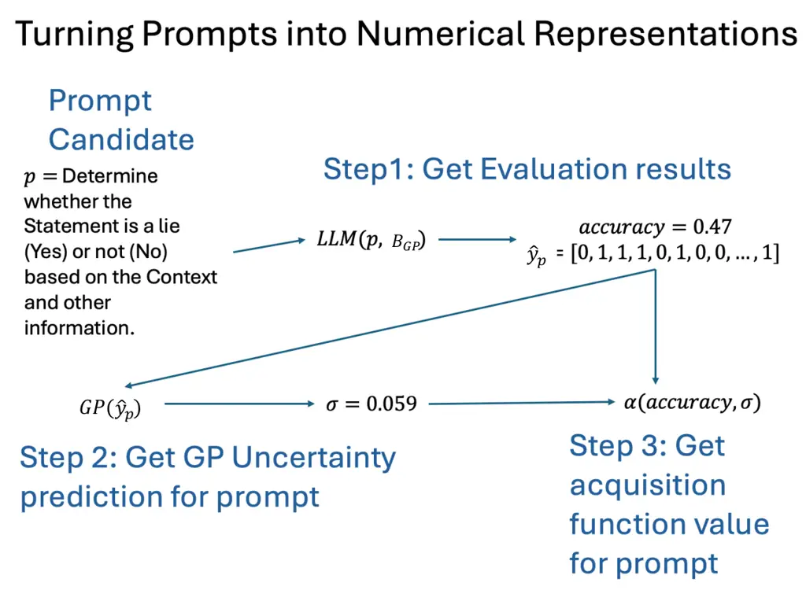
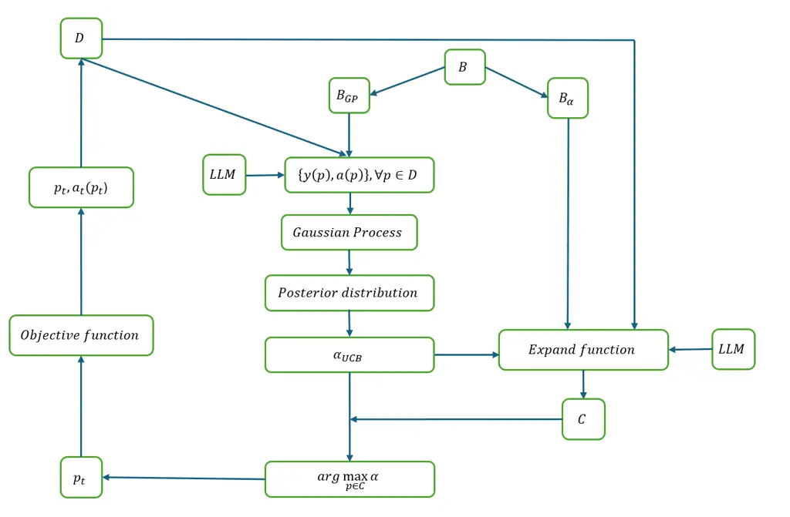
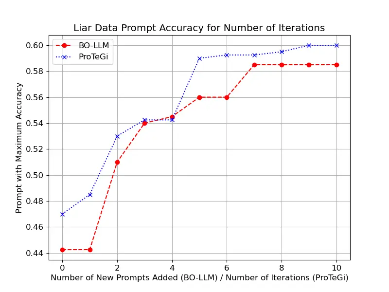
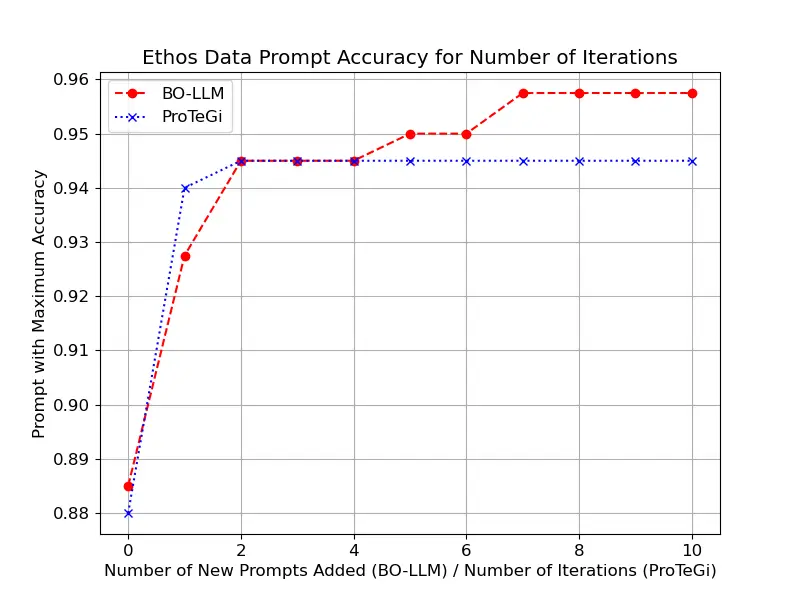
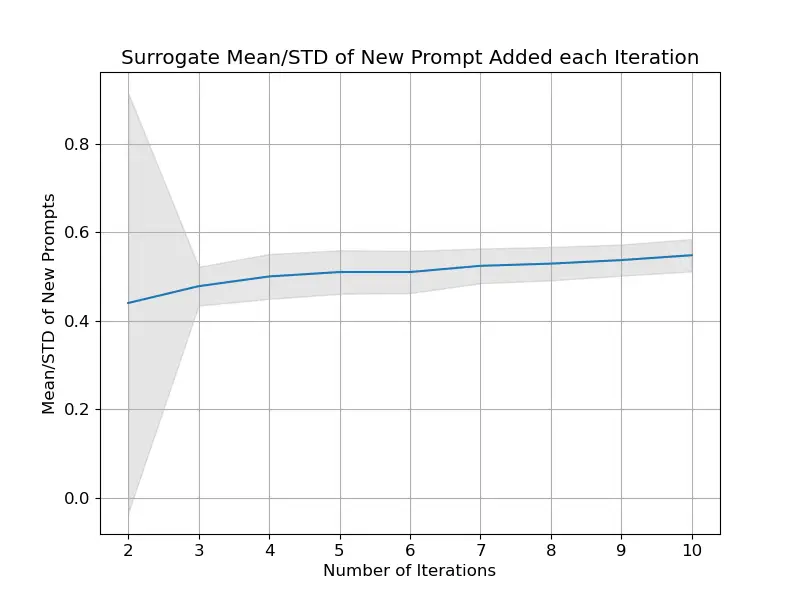

# LLM Based Bayesian Optimization for Prompt Search

Adam Ballew   Jingbo Wang   Shaogang Ren Affiliation: Department of
Computer Science and Engineering  
University of Tennessee at Chattanooga  
615 McCallie Ave, Chattanooga, TN 37403  
Email: adam.ballew94@gmail.com  ydk297@mocs.utc.edu
 shaogang-ren@utc.edu

###### Abstract

Bayesian Optimization (BO) has been widely used to efficiently optimize
expensive black-box functions with limited evaluations. In this paper,
we investigate the use of BO for prompt engineering to enhance text
classification with Large Language Models (LLMs). We employ an
LLM-powered Gaussian Process (GP) as the surrogate model to estimate the
performance of different prompt candidates. These candidates are
generated by an LLM through the expansion of a set of seed prompts and
are subsequently evaluated using an Upper Confidence Bound (UCB)
acquisition function in conjunction with the GP posterior. The
optimization process iteratively refines the prompts based on a subset
of the data, aiming to improve classification accuracy while reducing
the number of API calls by leveraging the prediction uncertainty of the
LLM-based GP. The proposed BO-LLM¹¹ 1
https://github.com/ShaogangRen/BO-LLM algorithm is evaluated on two
datasets, and its advantages are discussed in detail in this paper.

###### Index Terms: 

Bayesian Optimization, Prompt Engineering, LLM, Gaussian Process, Upper
Confidence Bound

## I Introduction

The advancements in Large Language Models (LLMs), such as OpenAI’s GPT,
have allowed their application in various Natural Language Processing
(NLP) tasks, including text classification \[1\], question
answering \[2\], and text generation \[3\]. However, the performance of
these models is highly sensitive to the structure and wording of the
prompt it is given, making prompt optimization an important problem to
solve \[4\].

To address this, we propose using Bayesian Optimization (BO), a powerful
framework for derivative-free optimization of expensive black-box
functions \[5\], to systematically refine prompts for binary
classification tasks. BO has been successfully applied to hyperparameter
tuning \[6\], neural architecture search \[7\], and model
calibration \[8, 9\], demonstrating its effectiveness in
high-dimensional discrete optimization problems. The key challenge lies
in optimizing the prompt structure to maximize classification accuracy
while minimizing the number of expensive API calls. BO offers an
efficient strategy by modeling the relationship between different
prompts and their classification performance using a Gaussian Process
(GP) as a surrogate function \[10\]. The optimization process is guided
by an Upper Confidence Bound (UCB) acquisition function \[11\], which
balances exploration (testing new prompts with high uncertainty) and
exploitation (selecting prompts with a high estimated accuracy) to
iteratively select prompt candidates. Our BO-LLM framework combines this
GP surrogate and UCB acquisition with an LLM-based expansion mechanism
to generate candidates.

Our contributions are: (i) introducing BO-LLM as a black-box prompt
optimization framework, (ii) evaluating it on LIAR \[12\] and
ETHOS \[13\] against ProTeGi \[14\], and (iii) showing adaptability to
multi-turn QA.

## II Background

### II-A Prompt Engineering

The quality of a prompt is crucial to LLM performance in fulfilling a
user’s request, with key aspects being its clarity, relevancy, and
structure. The specific wording has been shown to greatly affect the
quality of the response, and a prompt that clearly states the user’s
request with minimal irrelevant information generally yields better
outcomes \[15, 4\].

Prompt engineering is the practice of refining a prompt until the LLM’s
output is as close to the desired outcome as possible. Historically,
this has been a time-consuming process requiring human-driven
trial-and-error, where the user’s domain knowledge significantly
determines the quality of the final prompt. An automated prompt
engineering process can help to alleviate these problems by reducing or
completely removing this manual loop and leveraging the LLM’s vast
knowledge to generate effective prompts.

LLMs interact with users through a prompt–response paradigm, where the
prompt’s formulation strongly influences the output’s usefulness. For
example, prompts that clearly state the request first before providing
relevant context are consistently more effective. Given that manual
prompt crafting is both time-consuming and dependent on user expertise,
automated methods are desirable to improve efficiency and
reproducibility. This motivates the use of systematic frameworks, such
as BO, to automate the exploration of the prompt space.

### II-B Bayesian Optimization

BO is a sequential model-based optimization framework well-suited for
optimizing black-box functions that are expensive to evaluate. As
outlined by Brochu et al. \[5\], instead of directly optimizing the
objective function, BO constructs a surrogate model—commonly a
GP \[10\]—that approximates the objective based on prior observations.
This probabilistic model provides not only an estimation of the
function’s value but also its uncertainty across the input space. The
core steps are as follows:

Step 1: Initialization. A surrogate model, such as a GP, is chosen. The
GP is defined by a mean function $`\mu(x)`$ and a kernel (or covariance
function) $`k(x,x^{\prime})`$, which computes the relationship between
observation data point.

```math
f(x)\sim\mathcal{GP}(\mu(x),k(x,x^{\prime})) \tag{1}
```

An initial observation dataset $`D=\{(x_{i},y_{i})\}_{i=1}^{n}`$ is
collected, where $`x`$ represents an input (a feature vector or a
prompt) and $`y`$ is its corresponding evaluation from the objective
function (accuracy).

Step 2: Posterior Inference. Given the current dataset $`D`$ (the
prior), the GP is fitted to obtain a posterior distribution over the
objective function. This posterior captures our updated belief about the
function after observing the data.

Step 3: Acquisition Function. We adopt the Upper Confidence Bound
acquisition, which balances exploration and exploitation. See Eq. (8) in
Sec. III-F for the exact form used in our framework. UCB also enjoys
theoretical guarantees in the bandit setting \[11\].

Step 4: Sample Point Selection. Choose the next point by maximizing the
acquisition:

```math
x_{\text{next}}=\arg\max_{x}\alpha(x),
```

where $`\alpha(\cdot)`$ is the UCB acquisition defined in Eq. (8).

Step 5: Objective Evaluation and Update. The true objective function is
evaluated at $`x_{next}`$ to get a new observation $`y_{next}`$. This
new data point $`(x_{next},y_{next})`$ is added to the dataset $`D`$,
and the process repeats from Step 2\[5\]. This loop continues until a
termination condition, such as a fixed number of iterations, is met.

### II-C Related Work

Beyond manual crafting, several automated prompt optimization techniques
have emerged. One prominent approach is Automatic Prompt Engineer
(APE) \[16\], which leverages an LLM to generate a diverse set of
instruction candidates and then selects the best one based on a chosen
scoring function. This paradigm has been further explored in
Optimization by PROmpting (OPRO) \[17\], where the LLM iteratively
generates improved prompts based on past performance feedback. Unlike
our model-based approach, these methods rely on a generate-and-test loop
without an explicit surrogate model capturing prompt-performance
relationships.

Another line of work frames prompt optimization as a discrete search
problem. RLPrompt \[18\] trains a policy network using reinforcement
learning to generate prompts that maximize task accuracy. Prompt tuning
methods such as prefix-tuning \[19\] and soft prompts \[20\] optimize
continuous embeddings rather than discrete text, but require access to
model parameters. In contrast, our Bayesian approach treats the LLM as a
black box and leverages a GP surrogate for sample-efficient exploration
of the discrete prompt space.

ProTeGi is an algorithm that uses gradient-inspired edits and beam
search to automatically optimize prompts. It generates candidate prompts
from a seed by identifying errors on a small dataset, prompting an LLM
to generate “gradients” (i.e., critiques), and then using another LLM to
apply these critiques to edit the prompt. It performed well on several
binary classification tasks, including LIAR and ETHOS, which we use as a
baseline. BO-LLM uses components from ProTeGi, particularly its
expansion function, but replaces the heuristic search with a formal BO
framework\[14\].

## III Methodology

We propose BO-LLM, a framework that applies BO to prompt search. The
objective is to identify prompts that maximize classification accuracy.
Unlike heuristic methods, BO-LLM explicitly models the performance
landscape of candidate prompts with a GP surrogate, enabling
sample-efficient optimization. Figure 1 illustrates how prompts are
transformed from text to numerical representations for optimization.



Fig. 1: How prompts are transformed from texts to numerical
representation.

As illustrated in Fig. 1, each textual prompt $`p`$ is turned into a
numerical object in three complementary ways: (i) the prediction vector
$`\hat{y}_{p}`$ on the fixed control minibatch $`B_{GP}`$, (ii) the
surrogate’s posterior mean $`\mu(p)`$ and uncertainty $`\sigma(p)`$
computed from $`\hat{y}_{p}`$, and (iii) the acquisition score
$`\alpha(p)`$ derived from $`(\mu,\sigma)`$. These representations
jointly support sample-efficient selection during BO-LLM.

### III-A Bayesian Optimization Formulation

Let $`\mathcal{P}`$ denote the discrete prompt space. Given a labeled
dataset $`\mathcal{D}=\{(x_{i},y_{i})\}_{i=1}^{N}`$, our objective is to
maximize the test accuracy of an LLM queried with prompt
$`p\in\mathcal{P}`$:

```math
f(p)=\mathbb{E}_{(x,y)\sim\mathcal{D}}\big[\mathbbm{1}\{\mathrm{LLM}_{p}(x)=y\}\big]. \tag{2}
```

Each evaluation on a subset of $`\mathcal{D}`$, i.e.,
$`B_{\alpha}\subset\mathcal{D}`$, yields a noisy observation
$`a(p)=f(p)+\varepsilon`$, where
$`\varepsilon\sim\mathcal{N}(0,\sigma_{\varepsilon}^{2})`$. We maintain
a cache of observations $`D=\{(p_{i},a(p_{i})\}_{i=1}^{n}`$.

#### Data Representation

To build the surrogate model, each prompt $`p`$ is mapped to a
prediction vector $`\hat{y}_{p}\in\{0,1\}^{|B_{GP}|}`$ on a fixed
control minibatch $`B_{GP}\subset\mathcal{D}`$ \[5\]. This vector serves
as the prompt’s numerical representation. The similarity between two
prompts $`p_{i}`$ and $`p_{j}`$ is measured via a Radial Basis Function
(RBF) kernel:

```math
k(p_{i},p_{j})=\exp\left(-\frac{\|\hat{y}_{p_{i}}-\hat{y}_{p_{j}}\|_{2}^{2}}{2R}\right) \tag{3}
```

which captures the intuition that prompts with similar prediction
patterns on $`B_{GP}`$ have correlated accuracies. The kernel
hyperparameter $`R`$ was set empirically to 1.0 after preliminary runs
indicated stable performance at this value.

The mean of each prompt candidate’s prediction accuracy regarding
$`B_{GP}`$ is calculated as follows:

```math
~m(p)=\frac{1}{|B_{GP}|}\sum_{i\in B_{GP}}\mathbbm{1}\{\hat{y}_{i}=y_{i}\} \tag{4}
```

where $`\hat{y}_{i}`$ represents the predicted value for a given
sentence and $`y_{i}`$ represents the ground truth label.

#### Surrogate Model

Given observations $`D=\{(p_{i},a(p_{i}))\}_{i=1}^{n}`$, we update the
GP prior over $`f`$ using Bayes’ rule:

```math
P(f\,|\,D)\ \propto\ P(D\,|\,f)\,P(f). \tag{5}
```

Here $`P(f)`$ is the GP prior over functions and $`P(D\,|\,f)`$ is the
Gaussian likelihood with observation noise. Conditioning the joint
Gaussian yields the closed-form posterior used in our surrogate (see
Appendix -E).

We can further calculate the posterior mean for each prompt using:

```math
\mu(p)=m(p)+\mathbf{k}_{p}^{\top}(\mathbf{K}+\sigma_{\varepsilon}^{2}\mathbf{I})^{-1}(\mathbf{a}-\mathbf{m}) \tag{6}
```

where $`\mathbf{k}_{p}=[k(p,p_{1}),\ldots,k(p,p_{n})]^{\top}`$ is the
covariance vector between the new prompt $`p`$ and all observed prompts
in $`D`$, $`\mathbf{K}`$ is the $`n\times n`$ kernel matrix with entries
$`K_{ij}=k(p_{i},p_{j})`$,
$`\mathbf{a}=[a(p_{1}),\ldots,a(p_{n})]^{\top}`$ is the vector of
observed accuracies of the prompts in $`D`$ on set $`B_{\alpha}`$, and
$`\mathbf{m}=[m(p_{1}),\ldots,m(p_{n})]^{\top}`$ is the vector of
prediction accuracy of the prompts in $`D`$ on set $`B_{GP}`$ as given
in (4).

Given the observation history $`D`$, the GP posterior provides a
predictive distribution for any new prompt. The posterior mean
$`\mu(p)`$ and variance $`\sigma^{2}(p)`$ are calculated as follows:

```math
\sigma^{2}(p)=k(p,p)-\mathbf{k}_{p}^{\top}(\mathbf{K}+\sigma_{\varepsilon}^{2}\mathbf{I})^{-1}\mathbf{k}_{p} \tag{7}
```

#### Acquisition Function

After generating a set of new candidates, we use the GP posterior to
estimate their mean accuracy $`\mu(p)`$ and uncertainty $`\sigma(p)`$.
The Upper Confidence Bound acquisition function is the key component for
balancing exploration and exploitation:

```math
\alpha_{\text{UCB}}(p)=\mu(p)+\kappa\sigma(p) \tag{8}
```

where $`\kappa>0`$ controls the exploration-exploitation trade-off. The
first term $`\mu(p)`$ encourages _exploitation_ by favoring prompts with
high predicted accuracy, while the second term $`\kappa\sigma(p)`$
encourages _exploration_ by favoring prompts with high uncertainty. We
select the prompt $`p`$ that maximizes this score, evaluate its true
accuracy on $`B_{\alpha}`$, and add the result to our observation data
for the next round. UCB enjoys theoretical guarantees in the bandit
setting and is particularly robust under evaluation noise \[11\].

In our implementation, $`\kappa`$ is annealed linearly from 2.0 to 0.5
over the 10 optimization rounds, transitioning from exploration-heavy
behavior in early rounds to exploitation-focused selection as the
surrogate model becomes more confident.

#### Alternative Acquisition (EI)

Besides UCB, Expected Improvement (EI) is a standard choice \[6, 21\]:

```math
\mathrm{EI}(p)=\big(\mu(p)-f^{\star}-\xi\big)\Phi(Z)+\sigma(p)\phi(Z),\quad Z=\frac{\mu(p)-f^{\star}-\xi}{\sigma(p)}
```

where $`f^{\star}`$ is the best observed accuracy, $`\Phi/\phi`$ are the
standard normal CDF/PDF, and $`\xi\!\geq\!0`$ controls exploration. We
report UCB results for its robustness under evaluation noise, but EI is
drop-in compatible with our pipeline.

#### Surrogate Details and Model Parameter Learning

We optimize kernel parameters $`(R,\sigma^{2})`$ by maximizing the log
marginal likelihood:

```math
\log p(\mathbf{a}|\theta)=-\tfrac{1}{2}\mathbf{a}^{\top}K_{\theta}^{-1}\mathbf{a}-\tfrac{1}{2}\log|K_{\theta}|-\tfrac{n}{2}\log 2\pi.
```

Gradient:

```math
\frac{\partial\log p}{\partial\theta}=\tfrac{1}{2}\mathbf{a}^{\top}K_{\theta}^{-1}\tfrac{\partial K_{\theta}}{\partial\theta}K_{\theta}^{-1}\mathbf{a}-\tfrac{1}{2}\mathrm{tr}\!\left(K_{\theta}^{-1}\tfrac{\partial K_{\theta}}{\partial\theta}\right).
```

A full derivation is in Appendix -E.

### III-B Overall Algorithm

The optimization loop of BO-LLM proceeds in rounds. At each round the
surrogate GP is updated, new candidates are generated from current
seeds, and the most promising candidate is selected via the acquisition
function. The selected prompt is then evaluated and added to the cache.
This process is summarized in Algorithm 1.

1: Seeds $`S_{0}`$, control batch $`B_{GP}\subset\mathcal{D}`$,
evaluation batch $`B_{\alpha}\subset\mathcal{D}`$, rounds $`T`$

2: for $`t=1`$ to $`T`$ do

3:   Fit GP on cache $`D_{t-1}`$

4:   $`C_{t}\leftarrow\mathrm{Expand}(S_{t-1},B_{\alpha})`$

5:
  $`p_{t}\leftarrow\arg\max_{p\in C_{t}}\mu_{t}(p)+\kappa_{t}\sigma_{t}(p)`$

6:   Evaluate $`a(p_{t})`$ on $`B_{\alpha}`$, update $`D_{t}`$

7:   Update seeds $`S_{t}`$

8: end for

Algorithm 1 BO-LLM: Overall Loop

The overall optimization loop is summarized in Algorithm 1. The process
is iterative, where in each round $`t`$ (from 1 to $`T`$), we update our
model based on the accumulated data. We maintain a cache, denoted as
$`D`$, which stores all prompt-accuracy pairs evaluated so far. At the
beginning of round $`t`$, we use the cache from the previous round,
$`D_{t-1}`$, to fit the GP surrogate model. A new prompt $`p_{t}`$ is
then selected and evaluated, and the cache is updated to $`D_{t}`$ by
adding the new observation $`(p_{t},a(p_{t}))`$.

## IV Implementation of BO-LLM

In this section, we discuss the implementation of the BO-LLM algorithm.

### IV-A System Architecture

Figure 2 presents the complete architecture of BO-LLM, illustrating the
interaction between key components: the dataset $`D`$, the two
evaluation minibatches ($`B_{GP}`$ and $`B_{\alpha}`$), the LLM-based
expansion function, the GP surrogate, and the UCB acquisition mechanism.
The bidirectional arrows indicate the iterative refinement process where
selected prompts $`p_{t}`$ are evaluated on the objective function, and
their observations are fed back to update the surrogate model.



Fig. 2: Complete system architecture showing data flow between BO-LLM
components.

1: $`sp`$: seed prompt; $`B_{\alpha}\subset\mathcal{D}`$: evaluation
batch

2: Evaluate prompt $`p`$ on $`B_{\alpha}`$ and collect errors:
$`e=\{(x_{i},y_{i}):(x_{i},y_{i})\in B_{\alpha}\wedge LLM_{p}(x_{i})\neq y_{i}\}`$

3: Get gradient-inspired edits:
$`\{g_{1},...,g_{m}\}=LLM_{\nabla}(sp,e)`$

4: Use edits to create new prompts:
$`\{p^{\prime}_{i1},...,p^{\prime}_{iq}\}=LLM_{\delta}(p,g_{i},e)`$

5: Get Monte Carlo successors for diversity:
$`\{p^{\prime\prime}_{ij1},...,p^{\prime\prime}_{ijm}\}=LLM_{mc}(p^{\prime}_{ij})`$

6: Remove seed prompt $`sp`$ to avoid re-testing

7: return
$`\{p^{\prime}_{11},...,p^{\prime}_{mq}\}\cup\{p^{\prime\prime}_{111},...,p^{\prime\prime}_{mqp}\}`$

Algorithm 2 Expand function

### IV-B Prompt Generation via Expansion

The optimization loop generates new candidate prompts from
high-performing seeds. The expansion process, outlined in Algorithm 2,
uses an LLM to generate edits inspired by classification errors on
minibatch $`B_{\alpha}`$, combined with Monte Carlo rewrites for
diversity.

Algorithm 3 integrates the expansion mechanism with the GP surrogate and
UCB acquisition. Starting from the top-3 seeds in the cache, it
generates candidates via the expand function, evaluates each on the
control minibatch $`B_{GP}`$ to obtain prediction vectors
$`\hat{y}_{p}`$, and uses the GP posterior to compute acquisition
scores. The candidate maximizing UCB is selected for evaluation on
$`B_{\alpha}`$.

1: Posterior GP over prompts via prediction vectors on $`B_{GP}`$;
evaluation batch $`B_{\alpha}\subset\mathcal{D}`$; seed pool
$`\tilde{D}_{t}`$

2: $`C\leftarrow\varnothing`$ $`\triangleright`$ candidate set

3: Select $`n{=}3`$ best seeds by observed accuracy in $`\tilde{D}_{t}`$

4: for each seed $`sp`$ do

5:
  $`e\leftarrow\{(x,y)\!\in\!B_{\alpha}:\ \mathrm{LLM}_{sp}(x)\!\neq\!y\}`$

6:   $`\{g_{i}\}_{i=1}^{4}\leftarrow\mathrm{LLM}_{\nabla}(sp,e)`$

7:   for each $`g_{i}`$ do

8:    $`p^{\prime}\leftarrow\mathrm{LLM}_{\delta}(sp,g_{i},e)`$

9:
   $`\{p^{\prime\prime}_{j}\}_{j=1}^{2}\leftarrow\mathrm{LLM}_{mc}(p^{\prime})`$

10:
   $`C\leftarrow C\cup\{p^{\prime},p^{\prime\prime}_{1},p^{\prime\prime}_{2}\}`$

11:   end for

12: end for

13: for $`p\in C`$ do

14:   $`\hat{y}_{p}\leftarrow\mathrm{evaluate}(p,B_{GP})`$

15: end for

16: Compute $`\mu(p),\sigma(p)`$ from GP on $`\{\hat{y}_{p}\}_{p\in C}`$

17: return $`p_{t}=\arg\max_{p\in C}\big[\mu(p)+\kappa\,\sigma(p)\big]`$

Algorithm 3 Acquisition Optimization (UCB with GP over prediction
vectors)

### IV-C Flowchart

Figure 3 summarizes the iterative optimization process of BO-LLM. The
algorithm proceeds in a closed loop where each round consists of: (1)
generating candidate prompts via the Expand function, (2) fitting a GP
surrogate on cached observations, (3) selecting the highest-scoring
candidate via UCB, (4) evaluating the selected prompt on minibatch
$`B_{\alpha}`$, and (5) updating the cache and seed pool. The backward
edge from ”Update cache and seeds” to ”Expand” represents the iterative
refinement process that continues until convergence or a maximum number
of rounds is reached.


Fig. 3: BO-LLM optimization loop.

### IV-D Additional Details

During the expansion phase, each seed prompt generates candidates
through a cascade of LLM operations with the following parameters:

- •
  4 gradient-inspired edits per seed (via $`LLM_{\nabla}`$)
- •
  1 edit application step per gradient (via $`LLM_{\delta}`$)
- •
  2 Monte Carlo paraphrases per edited prompt (via $`LLM_{mc}`$)
- •
  Resulting in approximately 3 unique candidates per seed after
  deduplication

The prompts are evaluated using a Cached01Scorer that maintains a cache
of previously evaluated prompt-accuracy pairs to avoid redundant API
calls. The UCB hyperparameter $`\kappa`$ is annealed linearly from 2.0
to 0.5 over 10 rounds, transitioning from exploration to exploitation.

For the expansion function, we generate 4 $`g`$ gradients, with 1
gradient per error, 1 step per gradient, 2 Monte Carlo samples per stem,
and 3 prompt generations per seed prompt. The evaluator is set to UCB
and the scorer is set to the Cached01Scorer.

### IV-E Comparison with ProTeGi

ProTeGi proceeds in multiple candidates per round: gradient-inspired
edits, beam search, and Monte-Carlo rewrites. It keeps top-$`k`$ as new
seeds, improving stability but with $`m`$-fold higher API cost. BO-LLM
differs by fitting a surrogate and selecting one candidate per round.

#### ProTeGi pipeline (gradient, edits, MC).

ProTeGi \[14\] operates in rounds starting from seed prompts $`sp`$ and
an eval minibatch $`B_{\alpha}`$ with three LLM roles:

- •
  $`\mathbf{LLM}_{\nabla}`$ (_gradient-inspired edits_): consume
  $`(sp,e)`$ where
  $`e=\{(x,y)\in B_{\alpha}:\ \mathrm{LLM}_{sp}(x)\neq y\}`$ and propose
  textual “gradients” $`g_{1},\dots,g_{m}`$;
- •
  $`\mathbf{LLM}_{\delta}`$ (_edit applier_): apply $`g_{i}`$ to $`sp`$
  to form candidates $`p^{\prime}_{i1},\dots,p^{\prime}_{iq}`$;
- •
  $`\mathbf{LLM}_{mc}`$ (_Monte-Carlo rewrites_): paraphrase
  $`p^{\prime}_{ij}`$ to explore local neighborhoods, producing
  $`p^{\prime\prime}_{ij1},\dots,p^{\prime\prime}_{ijr}`$.

Candidates are scored on a minibatch; a beam/top-$`k`$ policy keeps
several high scorers as next-round seeds. This multi-candidate policy
improves stability at the cost of higher API usage. BO-LLM instead fits
a surrogate on prediction patterns and typically selects a single
most-informative candidate via UCB.

### IV-F Practical Considerations

#### Evaluation noise.

Even with identical prompts, we observed 5–10% variation in accuracy due
to LLM nondeterminism. To mitigate this, BO-LLM applies a variance floor
$`\sigma_{\min}=0.02`$ and allows repeated evaluation when the UCB
margin is small.

#### Label-reversal pitfalls.

Occasionally a candidate prompt implicitly reverses labels (e.g.,
mapping “true” to 0 and “false” to 1). Such prompts may achieve
misleading minibatch accuracy and contaminate the seed pool. We detect
these cases by checking confusion patterns against a reference prompt.

#### Stability vs. cost.

Selecting only one candidate per round yields $`\mathcal{O}(T)`$ API
calls, but is more prone to local maxima. Batch-UCB with $`m=3`$
improves stability but requires $`\approx 3\times`$ calls. This
trade-off is analyzed further in our ablation studies.

## V Experiments

### V-A Setup and Datasets

We compare BO-LLM with ProTeGi on LIAR \[12\] and ETHOS \[13\]. The LIAR
dataset contains 12.8k political statements labeled for truthfulness,
which we map to a binary task (true vs. false). The ETHOS dataset
contains over 8k social media comments labeled for hate speech (hate vs.
non-hate).

Each algorithm is run for 10 rounds, starting with the same initial
prompt for fair comparison. For BO-LLM, the control minibatch $`B_{GP}`$
has 75 items, and the evaluation minibatch $`B_{\alpha}`$ has 50 items.
To mitigate potential biases from class imbalance, the control minibatch
$`B_{GP}`$ was sampled to maintain the original dataset’s label
distribution. Accuracy is reported on held-out test sets, averaged over
three runs.

### V-B Evaluation Protocol

We report test accuracy from three independent runs with different
random seeds. Both BO-LLM and ProTeGi start from the same initial seed
prompt for fair comparison. Each algorithm runs for $`T=10`$ rounds with
identical API budgets. For BO-LLM, the control minibatch $`B_{GP}`$
contains 75 items, and the evaluation minibatch $`B_{\alpha}`$ contains
50 items.

For each run, we record the best accuracy achieved across all rounds.
The reported results show the trajectory of the best prompt found up to
each round, averaged across the three runs. We also report the standard
deviation to capture the variance in LLM evaluations, which ranges from
5–10% even for identical prompts due to model nondeterminism \[22\].
This protocol ensures a fair and statistically robust comparison between
methods.

### V-C Results





Fig. 4: Comparison of BO-LLM and ProTeGi on LIAR and ETHOS datasets over
10 rounds.

#### LIAR Dataset

On the LIAR dataset, both algorithms show similar upward trends in
accuracy over 10 rounds. ProTeGi reached a peak accuracy of 60.0% at
round 9, while BO-LLM peaked at 58.5% at round 7. Compared to the
initial prompt’s performance, BO-LLM achieved a 32% relative improvement
versus 27.7% for ProTeGi. The variance across rounds remains high for
both, reflecting the ambiguous nature of political statements.

#### ETHOS Dataset

On the ETHOS dataset, BO-LLM slightly outperformed ProTeGi, achieving a
peak accuracy of 95.75% at round 7 compared to ProTeGi’s 94.5% at round 2. The relative accuracy gains over the initial prompt were 8.2% for
BO-LLM and 7.4% for ProTeGi. BO-LLM also appeared to converge more
quickly, with accuracy stabilizing by round 5.

It must be noted that the initial prompt for the BO-LLM and ProTeGi
algorithms are the same. The variability in LLM accuracy with the same
prompt on the LIAR dataset can be seen on the 0th round as the two
algorithms began with the same prompt yet the LLM obtained slightly
different accuracies for it. This will therefore influence the relative
accuracy increase both algorithms were able to achieve.

### V-D Prompt Evolution Analysis

Table I shows how BO-LLM iteratively refines prompts on the LIAR
dataset, incorporating task-relevant features that progressively improve
accuracy.

| Iter. | Prompt                                                                                                                                                                              | Acc.  |
| ----- | ----------------------------------------------------------------------------------------------------------------------------------------------------------------------------------- | ----- |
| 0     | Determine whether the Statement is a lie (Yes) or not (No) based on the Context and other information.                                                                              | 0.470 |
| 1     | Determine whether the Statement is a lie (Yes) or not (No) based on the Context, the individual’s Job title, State, and Party affiliation.                                          | 0.535 |
| 3     | Determine whether the Statement is a lie (Yes) or not (No) based on the source’s job title, state, party affiliation, and context. Consider the credibility and bias of the source. | 0.540 |
| 5     | Decide if the Statement is false (Yes) or true (No) by considering the credibility and bias of the source, along with the content and factual accuracy.                             | 0.570 |

TABLE I: Prompt evolution on LIAR dataset

#### Key Findings

The table shows a +21.3% relative improvement from baseline (0.47) to
iteration 5 (0.57). The algorithm progressively identifies relevant
features: job title and party affiliation (Iter. 1), source credibility
considerations (Iter. 3), and factual accuracy emphasis (Iter. 5).

### V-E Analysis of Posterior Dynamics

To better understand the optimization dynamics of BO-LLM, we analyze the
surrogate model’s posterior mean and variance. Figure 5 illustrates this
process on the LIAR dataset.



Fig. 5: Surrogate posterior mean and STD of prompts selected by UCB
(LIAR dataset).

We observe that the posterior variance decreases rapidly during the
first three rounds and then tapers off, reflecting the transition from
exploration to exploitation. This indicates the surrogate model quickly
gains confidence. Concurrently, the posterior mean continues to rise,
showing that the acquisition strategy successfully identifies
increasingly better prompts. However, this also reveals a potential
failure mode: if the variance shrinks too quickly around a misleading
candidate, the optimization can converge to a suboptimal plateau.

### V-F Multi-Turn Extension

We instantiate BO-LLM on a clarification QA pattern. Given an ambiguous
user query $`q`$ (e.g., “Tell me about Apple”), a good system prompt
should first ask a clarifying question before answering. We define a
binary score $`s(p,q)\!\in\!\{0,1\}`$ that equals $`1`$ if the model’s
_first_ turn asks for clarification (detected by a heuristic/regex or a
lightweight classifier), and $`0`$ otherwise. For a fixed set of
ambiguous queries $`\mathcal{Q}`$, the objective is

```math
f(p)=\frac{1}{|\mathcal{Q}|}\sum_{q\in\mathcal{Q}}s(p,q).
```

BO-LLM proceeds unchanged: candidates from _Expand_ are run on a control
subset $`B_{GP}\!\subset\!\mathcal{Q}`$ to obtain prediction vectors
$`\hat{y}_{p}`$; the GP posterior $`(\mu,\sigma)`$ feeds UCB (or EI) to
select the next candidate; evaluation uses a disjoint subset
$`B_{\alpha}\!\subset\!\mathcal{Q}`$. A minimal seed template is:

> “You will first ask exactly one clarifying question if the user’s
> intent is ambiguous; only after receiving the answer, you will respond
> to the original request.”

This demonstrates how BO-LLM extends beyond single-turn classification
to instruction-level, procedural behaviors.

## VI Discussion and Conclusion

### VI-A Discussion

Our experiments show that BO-LLM achieves competitive accuracy, but its
performance is subject to several factors. A central theme is the
trade-off between stability and efficiency.

#### Failure Modes

A notable failure mode is the generation of ”reversed-label” prompts,
which unintentionally flip the intended labeling scheme (e.g., answering
”true” with a ”0” and ”false” with a ”1”). An example prompt that caused
this was ”Determine if this statement is true or false depending on the
context included.”. While usually scoring poorly, such a prompt can
occasionally achieve high minibatch accuracy by chance. If selected
early, it can poison the seed pool and lead to suboptimal local maxima.
Because BO-LLM evaluates only a single candidate per iteration, it may
be more susceptible to this than multi-candidate strategies like
ProTeGi. This phenomenon was particularly true for the LIAR dataset.
During the expansion portion of the algorithm, it was not uncommon for
the LLM to generate a prompt that reversed the answering of each
statement. For example, if the prompt was required to assign 1 for false
statements and 0 for true statements, it would generate a prompt that
would answer the opposite. This was normally not a problem as the prompt
would score poorly upon evaluation. Occasionally, however, the prompt
would gain a relatively high accuracy, and as a result would be used as
a seed prompt. This was more likely if such a prompt was selected
earlier on. The BO-LLM algorithm may be more susceptible to this when
compared to ProTeGi based on only one prompt being selected each round
for BO-LLM while ProTeGi selects 4. This phenomenon was not observed
with the ETHOS dataset.

#### Illustrative Example of Reversed-Label Prompts.

```ltx_verbatim
Correct: "Classify the following statement
as True or False:"
Reversed-label: "Respond ’True’ if the
statement is false,
and ’False’ if the statement is true:"
```

The latter achieves misleading minibatch accuracy but poisons the
surrogate.

#### Evaluation Variance

We observed high variability in LLM evaluations, even for identical
prompts. For the initial prompt on the LIAR dataset, the starting
accuracy sometimes differed by as much as 10% between runs. This
nondeterminism, also noted in other work \[22, 23\], introduces noise
that can bias the surrogate model and mislead the acquisition function.
The variation in evaluation with the same prompt was noticed as well.
Both algorithms began with the same starter prompt for both datasets,
yet the LLM used to evaluate the initial prompt would assign accuracies
with as much as a 10% difference in some cases. This instability was
present within the performance of both classification tasks.

#### Trade-offs in Stability and Efficiency

To mitigate getting stuck in local maxima, one could evaluate multiple
candidates per round instead of just one. While this increases
stability, it multiplies the number of expensive API calls, sacrificing
sample efficiency\]. There is an inherent trade-off between the
robustness gained from more evaluations and the cost-efficiency of a
single-candidate approach, which is worth investigating in future
studies.

#### API Cost Considerations.

Evaluating $`m`$ candidates per round yields $`\mathcal{O}(mT)`$ API
calls vs. $`\mathcal{O}(T)`$ for single-candidate BO-LLM. For academic
datasets, $`m=3`$ or $`5`$ is affordable and stabilizes learning. In
production with costly APIs, sample-efficient single-candidate BO-LLM is
preferable. The balance depends on application needs:
robustness-critical vs. budget-constrained settings.

#### Complexity and stability.

Full GP updates cost $`\mathcal{O}(n^{3})`$ with $`n`$ observations;
rank-one Cholesky updates amortize to $`\mathcal{O}(n^{2})`$ per round.
After factorization, scoring $`|C_{t}|`$ candidates is
$`\mathcal{O}(|C_{t}|\,n)`$. Stability can be improved with small
batch-UCB (evaluate top-$`m`$ per round), repeated evaluations with
majority voting, a floor on predictive variance to avoid premature
collapse, and periodic random restarts of seed prompts.

### VI-B Limitations and Future Work

Our study is limited to two binary classification datasets. However, the
framework naturally extends to multi-class problems. This can be
achieved by modifying the prediction vector $`\hat{y}_{p}`$ from a
binary value to a one-hot encoding of the predicted class, with
corresponding adjustments to the distance metric in the kernel.

The GP surrogate’s computational complexity ($`O(n^{3})`$ with $`n`$
observations) also poses challenges for scaling. Exact GP updates scale
cubically with the number of observations, making large-scale runs
computationally challenging. Evaluation variance across identical
prompts introduces noise into the surrogate and acquisition steps. In
addition, relying on a single candidate per round increases
vulnerability to local maxima compared to multi-candidate approaches.

Future work should extend BO-LLM to more diverse tasks, such as
summarization and dialogue. We plan to investigate stabilization
strategies like batch-UCB selection and variance reduction techniques.
Exploring alternative acquisition functions and more scalable surrogates
are also promising directions. These limitations highlight future
directions such as batch selection, variance reduction, and more
scalable surrogate models.

### VI-C Conclusion

This paper demonstrates that BO-LLM, a framework applying BO to prompt
search, achieves performance comparable to the heuristic-based ProTeGi.
The primary advantage of the BO framework is its potential for sample
efficiency, guided by a probabilistic surrogate model. However, it is
susceptible to local maxima, particularly on noisy datasets, and is
sensitive to the high variance of LLM evaluations. Despite these
drawbacks, this work illustrates that BO is a viable and principled
framework for automated prompt engineering, offering a distinct,
model-based alternative to heuristic search methods. BO-LLM, however,
was susceptible to more frequent problems. When testing on the LIAR
dataset, BO-LLM would occasionally find itself in a local maximum in
which the prompt would not be specific enough to answer in the correct
way, yet occur in an earlier round making it a seed prompt for later
rounds. This may be caused by the fact that a single prompt is selected
for each round with BO-LLM.

### -D Dataset Descriptions

LIAR Dataset. The LIAR dataset consists of 12,836 short statements from
various political contexts \[12\]. We collapse the original six
truthfulness categories into a binary label (true vs. false). An example
is:

```ltx_verbatim
{"label": 1, "text": "Statement: Says the
Annies List political group supports third-
trimester abortions on demand.\nJob title:
State representative\nState: Texas\nParty:
republican\nContext: a mailer"}
```

ETHOS Dataset. The ETHOS dataset contains over 8,000 English social
media comments labeled for hate speech detection \[13\]. We use the
binary (hate vs. non-hate) setting. An example is:

```ltx_verbatim
Gosh you guys are getting less funny with
each episode.;0.0
```

### -E Hyperparameters and Sketch of GP Posterior Derivation

We run each algorithm for 10 rounds, using the same initial seed prompts
for both methods. For BO-LLM, the control minibatch $`B_{GP}`$ size is
75 and the evaluation minibatch $`B_{\alpha}`$ size is 50. During
expansion, we generate 4 gradient-inspired edits, 1 edit step per
gradient, and 2 Monte Carlo samples, producing 3 new candidates per seed
prompt. The UCB hyperparameter $`\kappa`$ is annealed from 2.0 to 0.5.
All experiments are repeated with 3 random seeds, and we report the
average of the highest-performing prompt’s accuracy at each round.

Let $`\mathbf{a}=[a(p_{1}),...,a(p_{n})]^{\top}`$,
$`f_{\star}=f(p_{\star})`$, $`m_{*}=m(p_{*})`$, and
$`\mathbf{k}_{*}=[k(p_{*},p_{1}),\ldots,k(p_{*},p_{n})]^{\top}`$ .

```math
\begin{bmatrix}\mathbf{a}\\
f_{\star}\end{bmatrix}\!\sim\!\mathcal{N}\!\left(\begin{bmatrix}\mathbf{m}\\
m_{*}\end{bmatrix},\begin{bmatrix}K+\sigma^{2}I&\mathbf{k}_{\star}\\
\mathbf{k}_{\star}^{\top}&k(p_{\star},p_{\star})\end{bmatrix}\right).
```

Conditioning gives the posterior mean and variance in the main text.

## References

- \[1\] Z. Wang, Y. Pang, and Y. Lin, “Large language models are
  zero-shot text classifiers,” 2023. \[Online\]. Available:
  https://arxiv.org/abs/2312.01044
- \[2\] T. Brown, B. Mann, N. Ryder, M. Subbiah, J. D. Kaplan,
  P. Dhariwal, A. Neelakantan, P. Shyam, G. Sastry, A. Askell _et al._,
  “Language models are few-shot learners,” _Advances in neural
  information processing systems_, vol. 33, pp. 1877–1901, 2020.
- \[3\] L. Ouyang, J. Wu, X. Jiang, D. Almeida, C. Wainwright,
  P. Mishkin, C. Zhang, S. Agarwal, K. Slama, A. Ray _et al._, “Training
  language models to follow instructions with human feedback,” _Advances
  in Neural Information Processing Systems_, vol. 35, pp.
  27 730–27 744, 2022.
- \[4\] N. Knoth, A. Tolzin, A. Janson, and J. M. Leimeister, “Ai
  literacy and its implications for prompt engineering strategies,”
  _Computers and Education: Artificial Intelligence_, vol. 6, p.
  100225, 2024. \[Online\]. Available:
  https://www.sciencedirect.com/science/article/pii/S2666920X24000262
- \[5\] E. Brochu, V. M. Cora, and N. de Freitas, “A tutorial on
  bayesian optimization of expensive cost functions, with application to
  active user modeling and hierarchical reinforcement learning,” 2010.
  \[Online\]. Available: https://arxiv.org/abs/1012.2599
- \[6\] J. Snoek, H. Larochelle, and R. P. Adams, “Practical bayesian
  optimization of machine learning algorithms,” in _Advances in neural
  information processing systems_, vol. 25, 2012.
- \[7\] K. Kandasamy, W. Neiswinger, J. Schneider, B. Poczos, and E. P.
  Xing, “Neural architecture search with bayesian optimisation and
  optimal transport,” in _Advances in Neural Information Processing
  Systems_, vol. 31, 2018, pp. 2755–2765.
- \[8\] R. Astudillo and P. Frazier, “Bayesian optimization of function
  networks,” _Advances in neural information processing systems_,
  vol. 34, pp. 14 463–14 475, 2021.
- \[9\] S. Ren and X. Qian, “Causal bayesian optimization via exogenous
  distribution learning,” _arXiv preprint arXiv:2402.02277_, 2024.
- \[10\] C. E. Rasmussen and C. K. Williams, _Gaussian processes for
  machine learning_. MIT press Cambridge, MA, 2006, vol. 1.
- \[11\] N. Srinivas, A. Krause, S. M. Kakade, and M. Seeger, “Gaussian
  process optimization in the bandit setting: No regret and experimental
  design,” in _Proceedings of the 27th International Conference on
  Machine Learning (ICML-10)_, 2010, pp. 1015–1022.
- \[12\] W. Y. Wang, “”liar, liar pants on fire”: A new benchmark
  dataset for fake news detection,” 2017. \[Online\]. Available:
  https://arxiv.org/abs/1705.00648
- \[13\] I. Mollas, Z. Chrysopoulou, S. Karlos, and G. Tsoumakas,
  “Ethos: a multi-label hate speech detection dataset,” _Complex &
  Intelligent Systems_, vol. 8, no. 6, pp. 4663–4678, jan 2022.
  \[Online\]. Available: http://dx.doi.org/10.1007/s40747-021-00608-2
- \[14\] R. Pryzant, D. Iter, J. Li, Y. T. Lee, C. Zhu, and M. Zeng,
  “Automatic prompt optimization with ”gradient descent” and beam
  search,” 2023. \[Online\]. Available: https://arxiv.org/abs/2305.03495
- \[15\] X. Amatriain, “Prompt design and engineering: Introduction and
  advanced methods,” 2024. \[Online\]. Available:
  https://arxiv.org/abs/2401.14423
- \[16\] Y. Zhou, A. I. Muresanu, Z. Han, K. Paster, S. Pitis, H. Chan,
  and J. Ba, “Large language models are human-level prompt engineers,”
  _arXiv preprint arXiv:2211.01910_, 2023.
- \[17\] C. Yang, X. Wang, Y. Lu, H. Liu, Q. V. Le, D. Zhou, and
  X. Chen, “Large language models as optimizers,” _arXiv preprint
  arXiv:2309.03409_, 2023.
- \[18\] M. Deng, J. Wang, C.-P. Hsieh, Y. Wang, H. Guo, T. Shu,
  M. Song, E. P. Xing, and Z. Sun, “Rlprompt: Optimizing discrete text
  prompts with reinforcement learning,” _arXiv preprint
  arXiv:2205.12548_, 2022.
- \[19\] X. L. Li and P. Liang, “Prefix-tuning: Optimizing continuous
  prompts for generation,” in _Proceedings of the 59th Annual Meeting of
  the Association for Computational Linguistics and the 11th
  International Joint Conference on Natural Language Processing (Volume
  1: Long Papers)_, 2021, pp. 4582–4597.
- \[20\] B. Lester, R. Al-Rfou, and N. Constant, “The power of scale for
  parameter-efficient prompt tuning,” in _Proceedings of the 2021
  Conference on Empirical Methods in Natural Language Processing_, 2021,
  pp. 3045–3059.
- \[21\] B. Shahriari, K. Swersky, Z. Wang, R. P. Adams, and
  N. De Freitas, “Taking the human out of the loop: A review of bayesian
  optimization,” _Proceedings of the IEEE_, vol. 104, no. 1, pp.
  148–175, 2016.
- \[22\] B. Atil, S. Aykent, A. Chittams, L. Fu, R. J. Passonneau,
  E. Radcliffe, G. R. Rajagopal, A. Sloan, T. Tudrej, F. Ture, Z. Wu,
  L. Xu, and B. Baldwin, “Non-determinism of ”deterministic” llm
  settings,” 2025. \[Online\]. Available:
  https://arxiv.org/abs/2408.04667
- \[23\] L. Zheng, W.-L. Chiang, Y. Sheng, S. Zhuang, Z. Wu, Y. Zhuang,
  Z. Lin, Z. Li, D. Li, E. Xing _et al._, “Judging llm-as-a-judge with
  mt-bench and chatbot arena,” _arXiv preprint arXiv:2306.05685_, 2023.
