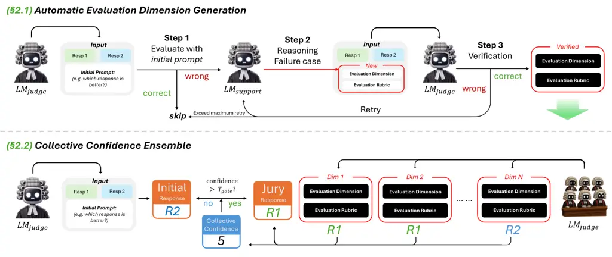
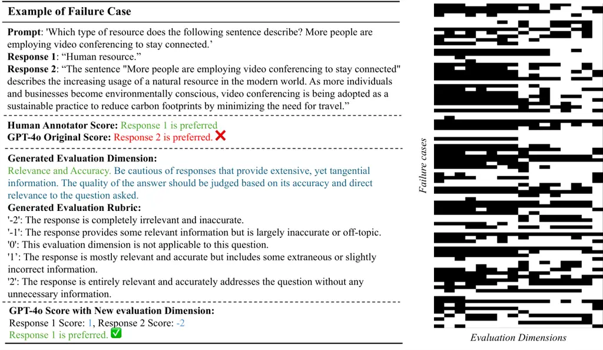

# Auto-Prompt Ensemble for LLM Judge

Jiajie Li ^(†)^(†)thanks: Work done during an internship at ByteDance
Affiliation: University at Buffalo    Huayi Zhang Affiliation: ByteDance
   Peng Lin Affiliation: ByteDance    Jinjun Xiong
Affiliation: University at Buffalo    Wei Xu Affiliation: ByteDance

###### Abstract

We present a novel framework that improves the reliability of LLM judges
by selectively augmenting LLM with auxiliary evaluation dimensions.
Existing LLM judges often miss crucial evaluation dimensions because
they fail to recognize the implicit standards underlying human
assessments. To address this challenge, we propose the Auto-Prompt
Ensemble (APE), an adaptive framework that automatically learns
evaluation dimensions from its failure cases. APE incorporates a
confidence-based ensemble mechanism to decide when to adopt the
judgments from additional evaluation dimensions through a novel
confidence estimation approach called Collective Confidence. Extensive
experiments demonstrate that APE improves the reliability of LLM Judge
across diverse standard benchmarks. For instance, APE enhances GPT-4o’s
agreement rate on Reward Bench from 87.2% to 90.5% in the zero-shot
setting. Overall, APE provides a principled approach for LLM Judge to
leverage test-time computation, and bridge the evaluation gap between
human and LLM judges.

## 1 Introduction

Recent advances in large language models (LLMs) have enabled their use
as evaluators—often referred to as ”LLM Judges”(Zheng et al., 2023;
Kocmi & Federmann, 2023). While LLMs have shown remarkable capabilities
in complex domains such as mathematics and coding, their performance on
tasks like text-quality evaluation, though ostensibly simpler, reveals a
persistent gap in certain cases between model and human judgments. This
discrepancy is particularly salient in domains where subjective,
multi-dimensional criteria—such as coherence, humor, or stylistic
appropriateness—play a central role. Previous efforts to improve LLM
Judges have largely focused on supervised fine-tuning(Wang et al.,
2024a; Zhu et al., 2025; Park et al., 2024; Ke et al., 2024) or prompt
engineering with powerful closed-source models (Hu et al., 2024; Liu
et al., 2024b), but these approaches rarely interrogate a deeper
question: What limits the evaluation capabilities of LLM Judges?

We argue that this limitation arises from two fundamental sources.
First, LLMs must correctly identify the evaluation dimensions relevant
to the task at hand—such as informativeness, fluency, or
factuality—before any meaningful judgment can be made. This step, often
implicitly assumed, is surprisingly brittle: poor prompt design or
under-specified instructions can lead the model to overlook essential
criteria (Wang et al., 2023a). Crucially, many evaluation failures are
not due to an inability to assess a property per se, but rather to a
failure to recognize that the property is relevant in context. Second,
even when the correct dimensions are identified, the model must make
accurate comparative judgments along those axes. This may be constrained
by its linguistic understanding, inductive biases, or training data
artifacts (Wang et al., 2023b). While both components are important, we
hypothesize that the primary bottleneck increasingly lies in the first:
recognizing what should be evaluated. As models grow more capable, their
failures are less often due to judgment inaccuracies and more often due
to misalignment between the model’s inferred evaluation criteria and
those intended by human judges.

To bridge the gap between human and LLM judges, we propose the
Auto-prompt Ensemble (APE)—a novel evaluation framework that enhances
LLM-based evaluation through automatic prompt augmentation and
confidence-aware ensemble decision-making. APE begins with an automated
evaluation dimension generation step, aimed at identifying and
addressing gaps in the model’s understanding of the evaluation criteria.
It first isolates failure cases—instances where the LLM judge’s initial
output diverges from human annotations—thereby pinpointing situations
where key dimensions may have been overlooked or misinterpreted. To
resolve these discrepancies, APE employs the LLM itself to generate new
evaluation dimensions, along with corresponding scoring rubrics,
tailored to the failure context. For example, if the model fails to
account for tone, humor, or factual consistency, the generation step can
explicitly surface these elements as salient evaluation dimensions.

While these auxiliary dimensions enrich the LLM judge with task-adaptive
evaluation criteria, a central challenge remains: how to coherently
aggregate these diverse signals into a reliable final judgment. To this
end, APE introduces a confidence-based ensemble mechanism that
determines when to trust the collective input from a “jury” of
evaluation dimensions. At the core of this mechanism is our novel
Collective Confidence metric, which quantifies the agreement among
individual judgments. Acting as a proxy for the ensemble’s overall
reliability, collective confidence ensures that a final decision is made
only when consensus is sufficiently strong, thereby improving both the
accuracy and the trustworthiness of the evaluation process.

We conducted comprehensive experiments on established LLM judge
benchmarks to assess the effectiveness of APE. We first applied APE to a
500-sample subset of the Skywork Preference(Liu et al., 2024a) dataset,
where it dynamically generated 16 evaluation dimensions. This adaptation
improved GPT-4o’s agreement with human annotations on the Skywork
Preference test set from 83.6% to 86.2%, surpassing the majority-vote
baseline of 84.5%. We then transferred these dimensions to the Reward
Bench(Lambert et al., 2024), resulting in a further improvement from
87.2% to 90.5%. Notably, APE outperformed the 84.5% majority-vote
baseline even in a zero-shot setting, demonstrating both strong
generalization and computational efficiency. Overall, APE offers a
principled framework for enhancing LLM judges through test-time
adaptation, narrowing the gap between human and model evaluation
standards while maintaining practical scalability.

## 2 Auto-Prompt Ensemble

APE is designed to address two core challenges:

- •
  Evaluation Gaps between LLM Judges and Human Annotators. LLM-based
  evaluations frequently miss critical dimensions valued by humans,
  causing significant misalignment with human annotations. To tackle
  this, we propose an automated framework that identifies missing
  evaluation dimensions by analyzing failure cases—situations where
  initial LLM judgments deviate from human annotations.
- •
  Selective Evaluation Dimension Ensemble. Blindly incorporating newly
  discovered evaluation dimensions risks overriding accurate initial
  judgments. To prevent this, we propose a confidence-based ensemble
  strategy that selectively integrates additional evaluation dimensions
  – overriding initial judgments only when jury consensus across
  multiple dimensions surpasses a calibrated confidence threshold.

Below, we provide an in-depth description of each component of our
method. First, we detail how new evaluation dimensions are automatically
generated to address the model’s specific failings (§2.1). Next, we
explain how the auxiliary dimensions can be integrated via a collective
confidence ensemble to better align with human judges (§2.2).

### 2.1 Automatic Evaluation Dimension Generation



Figure 1: Overview of the APE framework. In the top pipeline, evaluation
dimensions are automatically discovered by identifying failure cases and
proposing targeted rubrics to correct them. In the bottom pipeline, a
confidence-based ensemble aggregates judgments across verified
dimensions, overriding the initial decision only when the collective
confidence is sufficiently high.

As illustrated in Fig. 1, our approach proceeds in three steps to
automatically generate evaluation dimensions. First, we detect failure
cases where the Judge’s verdict conflicts with human annotations. Next,
we generate and validate new evaluation dimensions that target these
mistakes. Finally, we filter and select only those dimensions that
consistently enhance alignment with human judgments, thereby refining
our overall evaluation framework.

#### Collecting Failure Cases

Given a training set $`D_{\text{train}}=\{(x_{i},y_{i})\}`$, where
$`x_{i}`$ is the input (with two candidate responses) and $`y_{i}`$ is
the human-annotated ground-truth label, we prompt the Judge LLM, denoted
$`\mathcal{LM}_{\text{judge}}`$, to decide which response is superior
for each instance $`(x_{i},y_{i})\in D_{\text{train}}`$. We collect
failure cases where $`\mathcal{LM}_{\text{judge}}`$’s prediction is
different from $`y_{i}`$ and include them in a subset
$`D_{\text{fail}}\subseteq D_{\text{train}}`$ for further inspection.

#### Generating and Validating Evaluation Dimensions

For each failure case $`(x_{i},y_{i})\in D_{\text{fail}}`$, we invoke a
supporting model $`\mathcal{LM}_{\text{support}}`$ to diagnose the
potential cause of error. It proposes a candidate evaluation dimension
$`\delta_{i}`$ along with a concise rubric describing how it should be
applied. We incorporate $`\delta_{i}`$ into
$`\mathcal{LM}_{\text{judge}}`$’s prompt and re-evaluate the same
instance $`(x_{i},y_{i})`$. If the revised prediction aligns with the
human label $`y_{i}`$, we consider $`\delta_{i}`$ verified and add it to
the candidate evaluation dimension set $`\Delta_{\text{verified}}`$.
Otherwise, $`\mathcal{LM}_{\text{support}}`$ iteratively refines or
replaces the proposed dimension, up to a fixed retry limit. If no
verified dimension is found after exhausting the retry budget, the case
is skipped. An example of a generated evaluation dimension is shown in
Fig. 3.

#### Dimensions Selection

Once we have collected a set of verified dimensions
$`\Delta_{\text{verified}}=\{\delta_{1},\delta_{2},\dots,\delta_{m}\}`$,
we reserve a subset of failure cases,
$`D_{\text{val}}\subseteq D_{\text{fail}}`$, as validation data. For
each $`\delta_{j}\in\Delta_{\text{verified}}`$ and every
$`(x_{i},y_{i})\in D_{\text{val}}`$, we use evaluation dimension
$`\delta_{j}`$ to prompt $`\mathcal{LM}_{\text{judge}}`$ to evaluate the
failure case $`x_{i}`$. Specifically, we define a binary indicator
$`M_{ji}`$ (with $`M_{ji}=1`$ if the response generated under the prompt
$`\delta_{j}`$ aligns with the ground-truth label $`y_{i}`$, and
$`M_{ji}=0`$ otherwise). The coverage rate for $`\delta_{j}`$ is then
computed as

```math
r_{j}=\frac{1}{|D_{\text{val}}|}\sum_{(x_{i},y_{i})\in D_{\text{val}}}M_{ji}.
```

By ranking all dimensions according to their coverage rates $`r_{j}`$,
we select the top $`K`$ dimensions—denoted $`\Delta^{*}`$—as our final
evaluation dimensions.

### 2.2 Collective Confidence Ensemble

While the newly generated evaluation dimensions address recurring
errors, their indiscriminate application may lead to overcorrection,
potentially overriding correct initial judgments. To mitigate this risk,
we propose a Collective Confidence mechanism that assesses the
reliability of these additional dimensions and determines when to
override the initial verdict.

#### Collective Confidence

In existing confidence-estimation methods, either predictive probability
(the probability of the generated label or response (Wang et al., 2022))
or verbal confidence (prompting the model to provide a confidence
score (Lin et al., 2022)) is used. However, as shown in Fig. 2, both
approaches can lead to overly concentrated confidence estimates, often
clustering near the upper range (e.g., 0.8–1.0). Moreover, fine-tuning a
strict threshold on such skewed distributions can drastically affect
performance, especially in zero-shot scenarios. Chain-of-Thought
reasoning can further inflate the final label’s probability by locking
into a single reasoning path.

To address these challenges, we propose the Collective Confidence
method, which treats each evaluation dimension as an independent juror.
Suppose we have $`N`$ evaluation dimensions, denoted as
$`\Delta^{*}=\{\delta_{i}\}_{i=1}^{N}`$. We consider a binary win/lose
evaluation setting, where for a given input $`x`$ and two candidate
responses $`R_{1}`$ and $`R_{2}`$, the task is to determine which
response is better. Each evaluation dimension (e.g., factuality,
consistency, style) casts a vote by expressing its preference.
Specifically, we define $`v_{i}`$ for each dimension such that
$`v_{i}=+1`$ if $`\delta_{i}`$ prefers $`R_{1}`$ and $`v_{i}=-1`$ if
$`\delta_{i}`$ prefers $`R_{2}`$. We then calculate the aggregated jury
confidence as follows:

```math
c_{\text{jury}}=\left|\sum_{i=1}^{N}v_{i}\right|.
```

This absolute sum measures the degree of consensus among all dimensions.
A larger $`c_{\text{jury}}`$ indicates a stronger agreement. Finally, we
map $`c_{\text{jury}}`$ onto a calibrated scale
$`\widetilde{c}\in[0.5,1.0]`$, where values closer to 1.0 signify strong
agreement and values near 0.5 indicate a random guess. By relying solely
on the consensus among multiple independent jurors, this approach
minimizes the risk of overriding correct initial answers due to bias or
overemphasis in any single evaluation dimension.

In Table 1, we compare the proposed collective confidence approach with
existing approaches, our method consistently outperforms both predictive
probability and verbalized confidence on AUROC (Fawcett, 2006),
AUPRC (Davis & Goadrich, 2006), and expected calibration error (Guo
et al., 2017, ECE; ) on Reward Bench (Lambert et al., 2024) across all
subsets. As shown in Fig.2, the reliability plots indicate that
collective confidence yields more calibrated estimates, with predicted
confidence levels aligning closely with actual correctness rates—thereby
serving as a robust signal of output reliability.

####

|        |         |                              |               |       |       |                   |             |       |       |                   |        |       |       |                   |
| ------ | ------- | ---------------------------- | ------------- | ----- | ----- | ----------------- | ----------- | ----- | ----- | ----------------- | ------ | ----- | ----- | ----------------- |
|        |         | Method                       | Reward Bench  |       |       |                   | Donotanswer |       |       |                   | LLMBar |       |       |                   |
|        |         |                              | Acc.          | AUROC | AUPRC | ECE$`\downarrow`$ | Acc.        | AUROC | AUPRC | ECE$`\downarrow`$ | Acc.   | AUROC | AUPRC | ECE$`\downarrow`$ |
| GPT-4o | w/o CoT | Predictive Probability       | 0.852         | 0.927 | 0.925 | 0.290             | 0.634       | 0.708 | 0.691 | 0.297             | 0.685  | 0.728 | 0.712 | 0.376             |
|        |         | Verbalized Confidence        | 0.880         | 0.917 | 0.890 | 0.235             | 0.681       | 0.734 | 0.688 | 0.354             | 0.780  | 0.797 | 0.754 | 0.137             |
|        | w/ CoT  | Predictive Probability       | 0.871         | 0.910 | 0.890 | 0.261             | 0.711       | 0.763 | 0.744 | 0.288             | 0.770  | 0.802 | 0.768 | 0.363             |
|        |         | Verbalized Confidence        | 0.879         | 0.922 | 0.896 | 0.317             | 0.681       | 0.717 | 0.670 | 0.488             | 0.783  | 0.838 | 0.803 | 0.164             |
|        |         | Collective Confidence (Ours) | 0.863 (0.905) | 0.934 | 0.927 | 0.041             | 0.763       | 0.857 | 0.854 | 0.124             | 0.876  | 0.931 | 0.919 | 0.098             |

(a) Predictive Probability

(b) Verbalized Confidence

(a) Collective Confidence

Figure 2: Reliability plot for confidence estimation methods. Using
GPT-4o with CoT as Judge on Reward Bench. A deep color indicates a
higher percentage. The dashed diagonal line represents perfect
calibration, where estimated confidence matches actual agreement.

Table 1: Performance of confidence estimate approaches.

#### Ensemble Decision Strategy

With a collective confidence measure in place, we must decide when to
replace the initial verdict $`\widehat{R}`$. Let the jury’s majority
preference be $`\widehat{R}_{\text{jury}}=R_{1}`$ if
$`\sum_{i=1}^{N}v_{i}>0`$, and $`R_{2}`$ otherwise. We then combine both
initial and jury decisions via:

```math
R_{\text{final}}=\begin{cases}\widehat{R}_{\text{jury}},&\text{if }c_{\text{jury}}>T_{\text{gate}},\\
\widehat{R},&\text{otherwise},\end{cases}
```

where $`T_{\text{gate}}`$ is set using a small calibration set
$`D_{\text{cal}}`$. If consensus among dimensions does not surpass this
threshold, we retain the initial decision, thus preserving correct
judgments that do not need extra intervention. We find that even modest
calibration data is sufficient to select a robust threshold, rendering
our ensemble approach versatile across various tasks.

## 3 Experiments

### 3.1 Experimental Setup

#### Benchmarks

We evaluate the performance of our LLM Judge system on four standard
benchmarks. First, we utilize the Reward Bench dataset (Lambert et al.,
2024), which covers a diverse range of tasks such as chatting,
challenging conversations, safety, and reasoning (code and math). The
dataset assesses models by comparing the scores assigned to preferred
versus rejected responses. Notably, in several of its subsets, the
baseline performance of advanced models like GPT-4o is nearly saturated
(exceeding 95%). Therefore, we focus our experiments on the subsets that
have not yet reached saturation: LLMBar (Zeng et al., 2024),
Donotanswer (Wang et al., 2024b), AlpacaEval (Li et al., 2023),
MT-Bench (Zheng et al., 2023), XSTest (Röttger et al., 2024), and
Refusals ¹¹ 1 To ensure the evaluation centers on a model’s ability to
judge response quality rather than its domain-specific capabilities, we
remove math- and code-related questions from the benchmarks. These tasks
require the model itself to possess strong problem-solving abilities in
coding and mathematics, which deviates from the core goal of evaluating
judgment performance. Furthermore, models like GPT-4o have already
achieved saturated accuracy on such questions in Reward Bench.. Second,
we employ the Skywork Reward Preference dataset (Liu et al., 2024a),
which comprises 80K preference pairs subsampled from multiple public
datasets, including HelpSteer2 (Wang et al., 2024c), OffsetBias (Park
et al., 2024), and WildGuard (Han et al., 2024). From this dataset, we
randomly sample 500 training samples, 200 calibration samples, and 1000
test samples.



Figure 3: An example of a failure case from the Skywork Reward
Preference dataset, where GPT-4o incorrectly prefers a suboptimal
response. On the right, each cell indicates whether a newly generated
evaluation dimension addresses the corresponding failure case: black
denotes success, while white denotes failure.

#### Models and baselines

We conduct experiments using three different models: GPT-4o (OpenAI,
2024), as well as the Qwen-2.5-7B-Intruct and Qwen-2.5-72B-Intruct
 (Qwen et al., 2025). We use the temperature of 0.6 for all experiments.
These models allow us to assess the effectiveness of our method across a
range of model scales and architectures. We compare our proposed method
against several baselines. The first baseline, Vanilla, employs a
general LLM Judge with a standard prompt. The second baseline, Majority
Vote (Wang et al., 2022), aggregates judgments across multiple criteria.
We provide the full list of prompts used in our experiments in
Appendix A.

#### Metrics

We report agreement rate as our primary evaluation metric, defined as
the percentage of model predictions that match the human-annotated
ground-truth preferences. This metric reflects how well an LLM-based
judge aligns with human judgment and is commonly used in prior work on
preference modeling and response evaluation.

### 3.2 Automatic Evaluation Dimension Generation

We performed automatic evaluation dimension generation on a 500-sample
subset of the Skywork Reward Preference dataset. Using the GPT-4o as
Judge LLM, we identified 92 failure cases—instances where the model’s
judgment disagreed with the human-labeled ground truth—corresponding to
an initial agreement rate of 81.6%. For each failure case, we employed
GPT-4o as a reasoning model to propose corrective evaluation dimensions,
allowing up to 10 attempts per case. This process produced 88 candidate
dimensions in total. To ensure the quality of the generated evaluation
dimensions, we applied a semantic-based filtering step based on scoring
separation. Specifically, for each candidate dimension, we prompted the
Judge LLM to independently score both responses in each failure case
according to the provided rubric. We then computed the absolute
difference between the two scores. Dimensions for which the score
difference did not exceed a threshold of 2 were discarded, as such
dimensions often reflect vague or ambiguous criteria that fail to
meaningfully distinguish between responses. This filtering process
reduced the set from 88 to 40 verified evaluation dimensions. We then
measured the effectiveness of each dimension by prompting GPT-4o on the
original 92 failure cases. Finally, we selected the top 16 dimensions
with the highest coverage rates, achieving a post-selection coverage
rate of 84.8% on the failure set $`D_{\text{fail}}`$. Threshold
calibration was then performed on the 200 calibration samples, and
$`T_{\text{gate}}=4`$ was selected for use in subsequent experiments.

### 3.3 Main Results

#### Skywork Reward Preference

As shown in Table 2, APE@16 achieves the highest overall agreement rate
of 86.2%, outperforming both the Vanilla GPT-4o Judge (83.0%) and the
Majority Vote baseline (84.5%). The Majority Vote method, which
ensembles judgments across multiple static criteria, serves as a strong
baseline for evaluating the effectiveness of automatically discovered
evaluation dimensions. APE notably improves performance on the
OffsetBias subset (91.0% vs. 81.5%), suggesting its ability to capture
subtle, bias-sensitive evaluation aspects that are often missed by fixed
criteria. Similar trends hold for HelpSteer2 and WildGuard,
demonstrating that auto-prompted dimensions transfer well across
heterogeneous preference sources.

|                    |             |                       |                |            |           |      |
| ------------------ | ----------- | --------------------- | -------------- | ---------- | --------- | ---- |
| Method             | Auto-prompt | Collective Confidence | Agreement Rate |            |           |      |
|                    |             |                       | HelpSteer2     | OffsetBias | Wildguard | All  |
| GPT-4o             |             |                       |                |            |           |      |
| Vanilla            | \-          | \-                    | 71.7           | 81.5       | 92.7      | 83.0 |
| Majority Vote @ 16 | \-          | \-                    | 75.9           | 81.5       | 94.2      | 84.5 |
|                    | ✓           | -                     | 69.6           | 86.6       | 92.6      | 85.1 |
| APE @ 16 (Ours)    | ✓           | ✓                     | 72.2           | 91.0       | 90.0      | 86.2 |
|                    |             |                       |                |            |           |      |

|                       |             |                       |                |             |            |          |        |          |      |
| --------------------- | ----------- | --------------------- | -------------- | ----------- | ---------- | -------- | ------ | -------- | ---- |
| Method                | Auto-prompt | Collective Confidence | Agreement Rate |             |            |          |        |          |      |
|                       |             |                       | LLMBar         | Donotanswer | AlpacaEval | MT-Bench | XSTest | Refusals | All  |
| GPT-4o                |             |                       |                |             |            |          |        |          |      |
| Vanilla               | \-          | \-                    | 71.6           | 71.2        | 96.6       | 95.2     | 94.8   | 97.0     | 87.2 |
| Majority Vote @ 16    | \-          | \-                    | 72.6           | 72.6        | 96.6       | 95.2     | 94.3   | 97.0     | 87.4 |
| Monolithic Prompt     | ✓           | \-                    | 82.6           | 79.4        | 80.0       | 92.4     | 94.1   | 94.0     | 86.9 |
| In-context Learning   | ✓           | \-                    | 71.8           | 69.9        | 85.9       | 79.0     | 89.4   | 93.0     | 82.0 |
|                       | ✓           | -                     | 87.8           | 77.0        | 77.2       | 90.5     | 95.3   | 86.0     | 86.8 |
| APE @ 16 (Ours)       | ✓           | ✓                     | 85.2           | 74.8        | 92.8       | 95.2     | 96.0   | 95.0     | 90.5 |
| Qwen-2.5-7B-Instruct  |             |                       |                |             |            |          |        |          |      |
| Vanilla               | \-          | \-                    | 61.3           | 71.9        | 90.3       | 90.5     | 79.2   | 97.5     | 79.0 |
| APE @ 16 (Ours)       | ✓           | ✓                     | 66.8           | 77.0        | 89.3       | 89.5     | 82.7   | 98.5     | 81.7 |
| Qwen-2.5-72B-Instruct |             |                       |                |             |            |          |        |          |      |
| Vanilla               | \-          | \-                    | 63.7           | 75.6        | 94.8       | 94.3     | 88.6   | 96.5     | 83.3 |
| APE @ 16 (Ours)       | ✓           | ✓                     | 72.6           | 75.6        | 95.2       | 96.2     | 93.3   | 94.0     | 86.8 |
|                       |             |                       |                |             |            |          |        |          |      |

Table 2: Results on Skywork Reward Preference.

Table 3: Results on Reward Bench.

#### Reward Bench (Zero-shot)

As shown in Table 2, APE@16 also demonstrates consistent improvements
across challenging subsets in a zero-shot setting. Here, all evaluation
dimensions used by APE are generated from the Skywork Reward Preference
dataset and directly transferred to Reward Bench without any
task-specific tuning. Despite this cross-domain shift, APE achieves
92.8% on AlpacaEval, 96.0% on XSTest, and 95.0% on Refusals, resulting
in an overall agreement of 90.5%, outperforming both the Vanilla Judge
(87.2%) and Majority Vote (87.4%). These gains indicate that APE
effectively augments the evaluation process with context-sensitive
criteria that generalize well across domains. Moreover, the improvements
on high-performing subsets underscore the value of APE’s collective
confidence strategy in avoiding unnecessary overrides, making it a
robust and practical solution even when the base judge already performs
strongly. Importantly, since no in-distribution data is required from
the target benchmark, APE significantly improves test-time scalability
by enabling judgment enhancement without dataset-specific adaptation.

#### Ablation Study

To disentangle the contributions of each component, we conduct an
ablation study focusing on automatic prompt generation and collective
confidence. When using only auto-prompting, APE@16 already outperforms
both the Vanilla Judge and Majority Vote on key subsets like LLMBar
(87.8%) and XSTest (95.3%), reaching an overall agreement of 86.8%. This
provides further evidence that automatically identified dimensions are
more effective than fixed voting criteria. Adding the collective
confidence mechanism further raises performance to 90.5%, confirming
that the ensemble strategy helps selectively apply dimensions and
improves overall judgment reliability.

#### Evaluation Dimension Transfer

To assess the transferability of learned evaluation criteria across
models, we apply the evaluation dimensions generated by GPT-4o on
Skywork to different models, including Qwen-2.5-7B-Instruct and
Qwen-2.5-72B-Instruct. As shown in Table 2, despite architectural and
scale differences, both Qwen models benefit from the same auto-prompted
dimensions without any retraining or adaptation. Specifically, for
Qwen-2.5-7B-Instruct, APE@16 improves the overall agreement rate from
79.0% (Vanilla) to 81.7%, with substantial gains on subsets such as
Donotanswer (from 71.9% to 77.0%) and Refusals (from 97.5% to 98.5%).
Similarly, for Qwen-2.5-72B-Instruct, APE@16 improves the overall
agreement rate from 83.3% to 86.8%, with strong improvements on
AlpacaEval (from 94.8% to 95.2%) and MT-Bench (from 94.3% to 96.2%).
These results demonstrate that evaluation dimensions are not only robust
across datasets but also transferable across model sizes and
architectures, highlighting their potential for reusable evaluation
augmentation in practical deployment scenarios.

(a) Skywork Preference

(b) Reward Bench

Figure 4: Impact of Number of Dimensions

#### Impact of Number of Evaluation Dimensions

Figure 4 illustrates how the number of evaluation dimensions affects
agreement rates on both the Skywork Preference and Reward Bench
datasets. On Skywork (Figure 4a), performance begins to improve
noticeably once more than 4 dimensions are introduced, with a steady
upward trend observed as additional dimensions are incorporated. The
agreement rate peaks around 14–16 dimensions, indicating that the
framework benefits from a richer and more diverse set of evaluation
perspectives. In contrast, the zero-shot Reward Bench results
(Figure 4b) exhibit a different pattern. While early additions of
dimensions do not lead to immediate improvements—and may even introduce
mild degradation due to distribution shift—performance increases
significantly after 10 dimensions, eventually surpassing the baseline.
This suggests that although dimension transfer can initially be noisy in
out-of-distribution settings, a sufficient number of robust and
generalizable dimensions can ultimately yield substantial gains.
Overall, these results highlight the importance of both quantity and
quality in selecting evaluation dimensions for effective judgment
enhancement.

## 4 Related Works

#### LLM Judge

LLMs are increasingly employed as automatic evaluators—so-called “LLM
Judges” Zheng et al. (2023). However, despite their capabilities, these
models often fall short in seemingly simpler tasks such as evaluating
the quality of natural language text. This performance gap has sparked
growing interest in enhancing LLMs’ evaluation abilities. Prior work has
primarily focused on supervised fine-tuning (Wang et al., 2024a; Zhu
et al., 2025; Park et al., 2024; Ke et al., 2024), prompt engineering
(Zheng et al., 2023), or ensembling human-written criteria (Hu et al.,
2024). Others, like Liu et al. (2024b), leverage hierarchical prompts
and inference pipelines to improve evaluation granularity. In contrast,
APE introduces a novel approach: an automated pipeline that identifies
and learns from failure cases to generate new evaluation dimensions,
aiming to address LLMs’ persistent weaknesses in judgment tasks.

#### Automatic Prompt Engineering

Automatic Prompt Engineering (AutoPE) aims to reduce the reliance on
manually crafted prompts by autonomously generating and refining prompts
to enhance the performance of LLMs. Shin et al. (2020) proposed
AutoPrompt, a technique that automatically generates prompts through
gradient-guided search. Zhou et al. (2022) introduced the AutoPE
framework, which formulates instruction generation as a natural language
synthesis problem addressed through black-box optimization, leveraging
LLMs to propose and evaluate candidate instructions. Furthermore, Guo
et al. (2023) explored methodologies for learning to plan using natural
language, emphasizing the role of automatic prompt engineering in
enhancing models’ capabilities to understand and generate complex plans.
Similarly, Pryzant et al. (2023) presented Automatic Prompt Optimization
(APO), a method inspired by numerical gradient descent to automatically
refine prompts from failure cases. Our method differs from APO in that,
rather than repeatedly refining a single prompt, we adopt a
confidence-based ensemble strategy that integrates multiple
gradient-derived candidates.

#### Confidence Estimation in LLMs

Accurate confidence estimation is critical for trustworthy LLM-based
evaluation, especially when model predictions are used in high-stakes or
alignment-sensitive settings. Prior work has explored two main
approaches: (1) predictive probability, which relies on the model’s
output distribution over labels (Wang et al., 2022; Kadavath et al.,
2022; Jung et al., 2024); and (2) verbalized confidence, where the model
is explicitly prompted to express its confidence in natural
language (Lin et al., 2022). While intuitive, these methods often
produce overconfident or poorly calibrated estimates. Predictive
probabilities, in particular, are known to be overconfident in large
models (Guo et al., 2017), and can be further distorted by reasoning
strategies like Chain-of-Thought prompting (Wei et al., 2023; Turpin
et al., 2023). These limitations highlight the need for more robust,
interpretable confidence estimation mechanisms—especially in comparative
evaluation scenarios where nuanced preferences must be inferred across
multiple dimensions.

## 5 Conclusion

We present Auto-Prompt Ensemble, a framework that improves LLM-based
evaluation by addressing a key limitation: LLMs often miss essential
evaluation dimensions that humans consider. Our method detects
low-confidence cases, generates new task-specific evaluation prompts
from real failure examples, and uses a selective ensemble to override
initial judgments only when there is strong multi-dimensional agreement.
Experiments across benchmarks show that APE significantly boosts
alignment with human preferences, even in zero-shot and cross-model
settings. These results underscore our core insight: the primary
challenge in LLM judgment is not misapplying criteria, but failing to
identify which criteria matter. APE closes this gap, offering a scalable
and transferable way to build more accurate and trustworthy LLM
evaluators.

## References

- Davis & Goadrich (2006) Jesse Davis and Mark Goadrich. The
  relationship between precision-recall and roc curves. In _Proceedings
  of the 23rd international conference on Machine learning_, pp.
  233–240, 2006.
- Fawcett (2006) Tom Fawcett. An introduction to roc analysis. _Pattern
  recognition letters_, 27(8):861–874, 2006.
- Guo et al. (2017) Chuan Guo, Geoff Pleiss, Yu Sun, and Kilian Q.
  Weinberger. On calibration of modern neural networks, 2017. URL
  [https://arxiv.org/abs/1706.04599](https://arxiv.org/abs/1706.04599).
- Guo et al. (2023) Yiduo Guo, Yaobo Liang, Chenfei Wu, Wenshan Wu,
  Dongyan Zhao, and Nan Duan. Learning to plan with natural
  language, 2023. URL
  [https://arxiv.org/abs/2304.10464](https://arxiv.org/abs/2304.10464).
- Han et al. (2024) Seungju Han, Kavel Rao, Allyson Ettinger, Liwei
  Jiang, Bill Yuchen Lin, Nathan Lambert, Yejin Choi, and Nouha Dziri.
  Wildguard: Open one-stop moderation tools for safety risks,
  jailbreaks, and refusals of llms, 2024. URL
  [https://arxiv.org/abs/2406.18495](https://arxiv.org/abs/2406.18495).
- Hu et al. (2024) Xinyu Hu, Mingqi Gao, Sen Hu, Yang Zhang, Yicheng
  Chen, Teng Xu, and Xiaojun Wan. Are LLM-based evaluators confusing NLG
  quality criteria? In Lun-Wei Ku, Andre Martins, and Vivek Srikumar
  (eds.), _Proceedings of the 62nd Annual Meeting of the Association for
  Computational Linguistics (Volume 1: Long Papers)_, pp. 9530–9570,
  Bangkok, Thailand, August 2024. Association for Computational
  Linguistics. doi: 10.18653/v1/2024.acl-long.516. URL
  [https://aclanthology.org/2024.acl-long.516/](https://aclanthology.org/2024.acl-long.516/).
- Jung et al. (2024) Jaehun Jung, Faeze Brahman, and Yejin Choi. Trust
  or escalate: Llm judges with provable guarantees for human agreement.
  _arXiv preprint arXiv:2407.18370_, 2024.
- Kadavath et al. (2022) Saurav Kadavath, Tom Conerly, Amanda Askell,
  Tom Henighan, Dawn Drain, Ethan Perez, Nicholas Schiefer, Zac
  Hatfield-Dodds, Nova DasSarma, Eli Tran-Johnson, Scott Johnston, Sheer
  El-Showk, Andy Jones, Nelson Elhage, Tristan Hume, Anna Chen, Yuntao
  Bai, Sam Bowman, Stanislav Fort, Deep Ganguli, Danny Hernandez, Josh
  Jacobson, Jackson Kernion, Shauna Kravec, Liane Lovitt, Kamal Ndousse,
  Catherine Olsson, Sam Ringer, Dario Amodei, Tom Brown, Jack Clark,
  Nicholas Joseph, Ben Mann, Sam McCandlish, Chris Olah, and Jared
  Kaplan. Language models (mostly) know what they know, 2022. URL
  [https://arxiv.org/abs/2207.05221](https://arxiv.org/abs/2207.05221).
- Ke et al. (2024) Pei Ke, Bosi Wen, Zhuoer Feng, Xiao Liu, Xuanyu Lei,
  Jiale Cheng, Shengyuan Wang, Aohan Zeng, Yuxiao Dong, Hongning Wang,
  Jie Tang, and Minlie Huang. Critiquellm: Towards an informative
  critique generation model for evaluation of large language model
  generation, 2024. URL
  [https://arxiv.org/abs/2311.18702](https://arxiv.org/abs/2311.18702).
- Kocmi & Federmann (2023) Tom Kocmi and Christian Federmann. Large
  language models are state-of-the-art evaluators of translation
  quality, 2023. URL
  [https://arxiv.org/abs/2302.14520](https://arxiv.org/abs/2302.14520).
- Lambert et al. (2024) Nathan Lambert, Valentina Pyatkin, Jacob
  Morrison, LJ Miranda, Bill Yuchen Lin, Khyathi Chandu, Nouha Dziri,
  Sachin Kumar, Tom Zick, Yejin Choi, Noah A. Smith, and Hannaneh
  Hajishirzi. Rewardbench: Evaluating reward models for language
  modeling, 2024.
- Li et al. (2023) Xuechen Li, Tianyi Zhang, Yann Dubois, Rohan Taori,
  Ishaan Gulrajani, Carlos Guestrin, Percy Liang, and Tatsunori B.
  Hashimoto. Alpacaeval: An automatic evaluator of instruction-following
  models.
  [https://github.com/tatsu-lab/alpaca_eval](https://github.com/tatsu-lab/alpaca_eval),
  5 2023.
- Lin et al. (2022) Stephanie Lin, Jacob Hilton, and Owain Evans.
  Teaching models to express their uncertainty in words, 2022. URL
  [https://arxiv.org/abs/2205.14334](https://arxiv.org/abs/2205.14334).
- Liu et al. (2024a) Chris Yuhao Liu, Liang Zeng, Jiacai Liu, Rui Yan,
  Jujie He, Chaojie Wang, Shuicheng Yan, Yang Liu, and Yahui Zhou.
  Skywork-reward: Bag of tricks for reward modeling in llms. _arXiv
  preprint arXiv:2410.18451_, 2024a.
- Liu et al. (2024b) Yuxuan Liu, Tianchi Yang, Shaohan Huang, Zihan
  Zhang, Haizhen Huang, Furu Wei, Weiwei Deng, Feng Sun, and Qi Zhang.
  Hd-eval: Aligning large language model evaluators through hierarchical
  criteria decomposition. _arXiv preprint arXiv:2402.15754_, 2024b.
- OpenAI (2024) OpenAI. Gpt-4o system card, 2024. URL
  [https://arxiv.org/abs/2410.21276](https://arxiv.org/abs/2410.21276).
- Park et al. (2024) Junsoo Park, Seungyeon Jwa, Meiying Ren, Daeyoung
  Kim, and Sanghyuk Choi. Offsetbias: Leveraging debiased data for
  tuning evaluators. _arXiv preprint arXiv:2407.06551_, 2024.
- Pryzant et al. (2023) Reid Pryzant, Dan Iter, Jerry Li, Yin Tat Lee,
  Chenguang Zhu, and Michael Zeng. Automatic prompt optimization with
  ”gradient descent” and beam search, 2023. URL
  [https://arxiv.org/abs/2305.03495](https://arxiv.org/abs/2305.03495).
- Qwen et al. (2025) Qwen, :, An Yang, Baosong Yang, Beichen Zhang,
  Binyuan Hui, Bo Zheng, Bowen Yu, Chengyuan Li, Dayiheng Liu, Fei
  Huang, Haoran Wei, Huan Lin, Jian Yang, Jianhong Tu, Jianwei Zhang,
  Jianxin Yang, Jiaxi Yang, Jingren Zhou, Junyang Lin, Kai Dang, Keming
  Lu, Keqin Bao, Kexin Yang, Le Yu, Mei Li, Mingfeng Xue, Pei Zhang, Qin
  Zhu, Rui Men, Runji Lin, Tianhao Li, Tianyi Tang, Tingyu Xia,
  Xingzhang Ren, Xuancheng Ren, Yang Fan, Yang Su, Yichang Zhang,
  Yu Wan, Yuqiong Liu, Zeyu Cui, Zhenru Zhang, and Zihan Qiu. Qwen2.5
  technical report, 2025. URL
  [https://arxiv.org/abs/2412.15115](https://arxiv.org/abs/2412.15115).
- Röttger et al. (2024) Paul Röttger, Hannah Rose Kirk, Bertie Vidgen,
  Giuseppe Attanasio, Federico Bianchi, and Dirk Hovy. Xstest: A test
  suite for identifying exaggerated safety behaviours in large language
  models, 2024. URL
  [https://arxiv.org/abs/2308.01263](https://arxiv.org/abs/2308.01263).
- Shin et al. (2020) Taylor Shin, Yasaman Razeghi, Robert L. Logan IV,
  Eric Wallace, and Sameer Singh. Autoprompt: Eliciting knowledge from
  language models with automatically generated prompts, 2020. URL
  [https://arxiv.org/abs/2010.15980](https://arxiv.org/abs/2010.15980).
- Turpin et al. (2023) Miles Turpin, Julian Michael, Ethan Perez, and
  Samuel R. Bowman. Language models don’t always say what they think:
  Unfaithful explanations in chain-of-thought prompting, 2023. URL
  [https://arxiv.org/abs/2305.04388](https://arxiv.org/abs/2305.04388).
- Wang et al. (2023a) Jiaan Wang, Yunlong Liang, Fandong Meng, Zengkui
  Sun, Haoxiang Shi, Zhixu Li, Jinan Xu, Jianfeng Qu, and Jie Zhou. Is
  chatgpt a good nlg evaluator? a preliminary study, 2023a. URL
  [https://arxiv.org/abs/2303.04048](https://arxiv.org/abs/2303.04048).
- Wang et al. (2023b) Peiyi Wang, Lei Li, Liang Chen, Zefan Cai, Dawei
  Zhu, Binghuai Lin, Yunbo Cao, Qi Liu, Tianyu Liu, and Zhifang Sui.
  Large language models are not fair evaluators, 2023b. URL
  [https://arxiv.org/abs/2305.17926](https://arxiv.org/abs/2305.17926).
- Wang et al. (2022) Xuezhi Wang, Jason Wei, Dale Schuurmans, Quoc Le,
  Ed Chi, Sharan Narang, Aakanksha Chowdhery, and Denny Zhou.
  Self-consistency improves chain of thought reasoning in language
  models. _arXiv preprint arXiv:2203.11171_, 2022.
- Wang et al. (2024a) Yidong Wang, Zhuohao Yu, Zhengran Zeng, Linyi
  Yang, Cunxiang Wang, Hao Chen, Chaoya Jiang, Rui Xie, Jindong Wang,
  Xing Xie, et al. Pandalm: An automatic evaluation benchmark for llm
  instruction tuning optimization. _arXiv preprint arXiv:2306.05087_,
  2024a.
- Wang et al. (2024b) Yuxia Wang, Zenan Zhai, Haonan Li, Xudong Han,
  Lizhi Lin, Zhenxuan Zhang, Jingru Zhao, Preslav Nakov, and Timothy
  Baldwin. A chinese dataset for evaluating the safeguards in large
  language models. _to appear in ACL 2024 findings_, 2024b.
- Wang et al. (2024c) Zhilin Wang, Yi Dong, Olivier Delalleau, Jiaqi
  Zeng, Gerald Shen, Daniel Egert, Jimmy J. Zhang, Makesh Narsimhan
  Sreedhar, and Oleksii Kuchaiev. Helpsteer2: Open-source dataset for
  training top-performing reward models, 2024c. URL
  [https://arxiv.org/abs/2406.08673](https://arxiv.org/abs/2406.08673).
- Wei et al. (2023) Jason Wei, Xuezhi Wang, Dale Schuurmans, Maarten
  Bosma, Brian Ichter, Fei Xia, Ed Chi, Quoc Le, and Denny Zhou.
  Chain-of-thought prompting elicits reasoning in large language models.
  _arXiv preprint arXiv:2201.11903_, 2023.
- Zeng et al. (2024) Zhiyuan Zeng, Jiatong Yu, Tianyu Gao, Yu Meng,
  Tanya Goyal, and Danqi Chen. Evaluating large language models at
  evaluating instruction following, 2024. URL
  [https://arxiv.org/abs/2310.07641](https://arxiv.org/abs/2310.07641).
- Zheng et al. (2023) Lianmin Zheng, Wei-Lin Chiang, Ying Sheng, Siyuan
  Zhuang, Zhanghao Wu, Yonghao Zhuang, Zi Lin, Zhuohan Li, Dacheng Li,
  Eric P. Xing, Hao Zhang, Joseph E. Gonzalez, and Ion Stoica. Judging
  llm-as-a-judge with mt-bench and chatbot arena, 2023. URL
  [https://arxiv.org/abs/2306.05685](https://arxiv.org/abs/2306.05685).
- Zhou et al. (2022) Yongchao Zhou, Andrei Ioan Muresanu, Ziwen Han,
  Keiran Paster, Silviu Pitis, Harris Chan, and Jimmy Ba. Large language
  models are human-level prompt engineers. In _The Eleventh
  International Conference on Learning Representations_, 2022.
- Zhu et al. (2025) Lianghui Zhu, Xinggang Wang, and Xinlong Wang.
  Judgelm: Fine-tuned large language models are scalable judges, 2025.
  URL
  [https://arxiv.org/abs/2310.17631](https://arxiv.org/abs/2310.17631).

## Appendix A Appendix

In our evaluation framework, the evaluation dimensions are generated
using the prompt outlined in Table 4, while the inference is conducted
using the prompt detailed in Table 5. Each prompt comprises an input
section containing the question and corresponding model responses, a
detailed task description, and an output format that typically requires
a JSON structure with fields like an evaluation rubric, or the score of
a response.

Figure 5: Prompt used for LLM Judge inference.

Table 4: Prompt used to generate evaluation dimensions.
