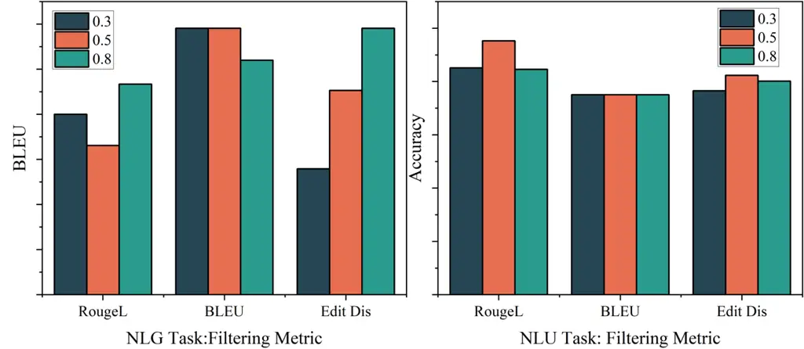
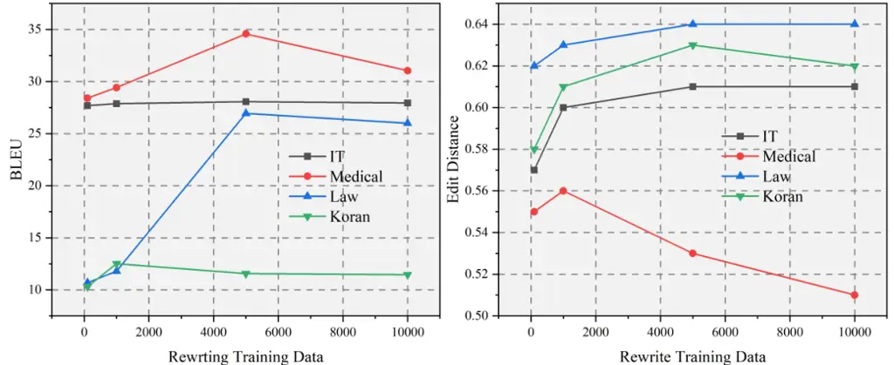

# Learning to Rewrite Prompts for Bootstrapping LLMs on Downstream Tasks

Qinhao Zhou    Xiang Xiang ^(†)^(†)thanks: Correspondence to
[xex@hust.edu.cn](mailto:xex@hust.edu.cn). Project done at HUST AI &
Visual Learning (HAIV) Lab.    Kun He & John E. Hopcroft
Affiliation: Hopcroft Center on Computing Science Affiliation: Huazhong
University of Science and Technology (HUST), China

###### Abstract

In recent years, the growing interest in Large Language Models (LLMs)
has significantly advanced prompt engineering, transitioning from manual
design to model-based optimization. Prompts for LLMs generally comprise
two components: the instruction, which defines the task or objective,
and the input, which is tailored to the instruction type. In natural
language generation (NLG) tasks such as machine translation, the input
component is particularly critical, while the instruction component
tends to be concise. Existing prompt engineering methods primarily focus
on optimizing the instruction component for general tasks, often
requiring large-parameter LLMs as auxiliary tools. However, these
approaches exhibit limited applicability for tasks like machine
translation, where the input component plays a more pivotal role. To
address this limitation, this paper introduces a novel prompt
optimization method specifically designed for machine translation tasks.
The proposed approach employs a small-parameter model trained using a
back-translation-based strategy, significantly reducing training
overhead for single-task optimization while delivering highly effective
performance. With certain adaptations, this method can also be extended
to other downstream tasks.

## 1 Introduction

LLMs Brown et al. (2020); Touvron et al. (2023); Chowdhery et al.
(2022); Bai et al. (2023); Du et al. (2021) have achieved groundbreaking
progress across a myriad of pattern recognition tasks. These LLMs, such
as GPT-3.5 OpenAI (2022), typically use manually crafted or predefined
prompt templates as directives to guide the model in accomplishing
various tasks. Compared to task-specific models, LLMs possess broader
knowledge and enhanced expressive capabilities. In traditional NLG and
NLU tasks, LLMs can outperform smaller models designed for specific
tasks. Furthermore, when subjected to downstream task-specific
fine-tuning, LLMs achieve even more competitive results Alves et al.
(2024).

While LLMs have demonstrated remarkable performance, researchers Qin &
Eisner (2021); Liu et al. (2021c) have found that prompts play a
critical role in enabling LLMs to accomplish various downstream tasks.
Additionally, LLMs exhibit significant sensitivity to prompts, where
even minor modifications can lead to entirely different outputs. To
enhance the performance of LLMs on downstream tasks, a significant body
of work has proposed various prompt engineering methods. For example,
soft prompts Qin & Eisner (2021) convert discrete prompt words into
continuous vectors, enabling end-to-end training. Prefix Tuning Li &
Liang (2021) inserts a series of continuous task-specific prefixes at
the beginning of the input, then fine-tunes these prefixes while keeping
the other parameters frozen. Furthermore, APO Pryzant et al. (2023)
optimizes the prompt by using the discrete feedback of the LLMs as
gradient updates. RLPrompt Deng et al. (2022) employs reinforcement
learning to conduct a directionless Monte Carlo search in the semantic
space. These methods focus on optimizing the entire prompt for general
downstream tasks, achieving highly effective results.

Figure 1: The example on the left illustrates the sensitivity of LLMs to
input data. In the context of the same translation task, providing more
detailed input (bottom) leads to better results. The right figure shows
the performance improvement of the LLMs on various translation datasets
after rewriting.

In the context of using LLMs, prompts typically consist of two
components Wei et al. (2021): instruction and input. These two
components are usually concatenated and fed into the LLMs. The
aforementioned approaches primarily optimize the $`instruction`$ to
achieve improved results. However, in specific NLG tasks like machine
translation, the model is equally sensitive to the $`input`$. As
depicted in Figure 1 left, in the task of translating German to English,
LLMs provide better responses when the original German text is modified
while preserving the original meaning. In tasks such as machine
translation, summarization and abstraction, the instruction component is
typically short and may not require significant modifications. However,
the input component plays a major role in the input tokens in these
tasks. Therefore, keeping prompt fixed and optimizing the input part is
crucial for enhancing LLMs performance in these tasks.

Inspired by Augmented Language Models (ALMs) Mialon et al. (2023), we
propose the Rewriting Original Inputs (ROI) strategy, which aims to
optimize the critical input component before feeding it into LLMs. This
strategy leverages either a smaller parameter model or the LLM itself to
reformulate the original input, aligning it more closely with the
model’s inherent preferences. We first employ the LLM itself to optimize
input for various tasks. We find that for shorter inputs in NLG tasks,
the LLMs produces better reformulations. However, for longer inputs, the
lack of fine-tuning for rewriting tasks often leads to hallucinations or
alterations of the original meaning. To address this issue, we fine-tune
a rewriting model specifically for optimizing the input. Since the
rewriting model is focused solely on this task, we can use a smaller
parameter model, thereby reducing the fine-tuning overhead. We draw
inspiration from back translation in machine translation and use this
way to construct rewriting data and train the rewriting model. As shown
in Fig. 1 right, on several translation datasets, the results of LLMs
show varying degrees of improvement when the original input data is
rewritten while keeping the original meaning. For NLU tasks such as
sentiment analysis and syntactic parsing, the input part is relatively
short, and in tasks like causal reasoning, the input is often divided
into segments. Consequently, using smaller models for rewriting yields
unsatisfactory results. Therefore, for NLU tasks, we utilize the LLM
itself to reformulate the input without altering the content of the
instructions.

Additionally, recognizing that rewriting is not universally effective,
we introduce a filtering module that employs text similarity metrics to
assess the quality of rewritten text. This module is designed to
identify and eliminate instances of hallucinations and noise, thereby
ensuring the integrity and reliability of the rewritten content.
Specifically, the filtering mechanism evaluates the semantic consistency
between the rewritten text and the original input, discarding outputs
that deviate significantly from the intended meaning. For texts that
remain noisy or inconsistent after multiple rewriting attempts, we
revert to the original input to maintain the fidelity of the data.

Regarding the contributions of this paper, we observe that existing
prompt engineering methods yield limited benefits for tasks where the
input component plays a predominant role. Building upon this
observation, we then introduce the Rewrite Original Input (ROI) module,
coupled with a filtering algorithm, to boostrap the performance of LLMs
on these downstream tasks. In this method, there is no need to train any
parameters in the LLMs and the framework is applicable to a wide range
of different LLMs. The experimental results on both NLU and NLG tasks
verify that the ROI module effectively transforms ambiguous data into
more precise and explicit input prompts. Compared to the original input,
our ROI method reaches consistent and notable performance improvements
across all tasks.

## 2 Related Work

Augmenting LLMs with Prompt Tuning. The utilization of a shared model
across tasks has significantly propelled the application and development
of LLMs. However, the reliance on textual prompts requires manual
design, and even with carefully crafted prompts, their performance still
falls short compared to model fine-tuning. As a result, current work
primarily aims to enhance the performance of LLMs through differentiable
tuning of prompts. Lester et al. (2021) and Li & Liang (2021) propose a
method called prefix tuning to adjust soft prompts for tuning frozen
models. The tokens of soft prompts are learnable vectors, and they
append the soft prompt vectors at the beginning of the input text,
inputting the combined sequence into the model, thus realizing
end-to-end training on the training set. Similarly, P-Tuning Liu et al.
(2021c); Liu et al. (2021b) adds an encoder module in front of LLMs to
fine-tune prompts at the embedding level, which is more flexible
compared to prefix tuning. In addition, APE Zhou et al. (2022) and
RLPrompt Deng et al. (2022) incorporate reinforcement learning into
prompt optimization. They design scoring functions in response to model
feedback and make discrete-level corrections to prompts.

Augmenting LLMs without Training. Training LLMs from scratch poses a
significant challenge for researchers due to their massive parameter
size and the need for extensive pre-training data. LLMs exhibit
excellent context-learning capabilities, allowing the completion of
specific tasks through contextual prompts, known as in-context learning
(ICL) Dong et al. (2022). Unlike supervised learning, in-context
learning does not require parameter updates but directly uses LLMs for
prediction. LLMs can understand given demonstrations and make accurate
predictions. The performance of ICL heavily depends on the nature of
demonstrations, including both their format and sequence. KATE Liu
et al. (2021a) indicates that the selection of nearest-neighbor samples
as context instances can significantly enhance the performance of LLMs.
Additionally, Gonen et al. (2022) proposes selecting instances with low
perplexity, while Rubin et al. (2021) puts forth a two-stage,
retrieval-based method for demonstration selection. To handle specific
inputs, an unsupervised retriever is first constructed to identify
examples similar to candidate instances, following this, a supervised
retriever selects appropriate demonstrations among these candidates.

Rewriting Techniques Applied in LLMs. The strategy of rewriting is
widely applicable across various domains. Kong et al. (2024) propose a
rewriting framework utilizing reinforcement learning, achieving
impressive results. Learning2Rewrite Hao et al. (2024) proposes a
comprehensive framework for detecting AI-generated text. By leveraging
the differences in how LLMs rewrite human-authored text versus
AI-generated text, it achieves robust performance in unseen domains.
RewriteLM Shu et al. (2024) enhances the performance of LLMs in
cross-sentence rewriting tasks through instruction tuning and
reinforcement learning strategies, positioning it as an effective
rewriting model. APOHF Lin et al. (2024) is a method that optimizes
prompts using human feedback, offering greater alignment with real-world
applications and achieving impressive results through rapid iteration.

## 3 Methodology

We investigate the performance of 7B-13B parameter LLMs on tasks such as
machine translation and summarization, revealing that these models still
exhibit performance gaps compared to specialized models in certain
domains. Fine-tuning such LLMs risks compromising their general
knowledge while incurring significant computational costs. To address
this, we employ smaller traditional language models to perform dedicated
input rewriting tasks. By replacing original inputs with rewritten
versions that better align with LLMs’ preferences, we facilitate
improved generation quality without modifying the LLMs themselves.

### 3.1 Rewriting Original Input with Small Models

We first introduce our rewriting module in detail. For clarity in our
discussion, we formally define the prompt $`P`$ input to LLMs as
consisting of two distinct components:

```math
P=(I,X).
```

Where $`I`$ represents the instruction part specifying the task
requirements. $`X`$ denotes the input part containing the content to be
processed. Previous studies have demonstrated that the LLMs are highly
sensitive to the instruction $`I`$, highlighting that even slight
modifications can result in significant variations in the outputs of the
model. As a consequence, a considerable amount of research has emerged
that aims to optimize the design of instruction prompts. However, for
traditional NLU and NLG tasks such as translation and sentiment
analysis, the instruction $`I`$ is relatively fixed, the benefits of
optimizing this aspect are limited. Instead, the input $`X`$ emerges as
more crucial.

Figure 2: The pipeline of our proposed method for boostrapping Large
Language Models. 1) The raw data is first input to the LLMs to construct
the rewriting data. The generated rewritten data is then used to train
the rewriting model. 2) The filtering process is applied to retain only
the rewritten data that demonstrates improved performance, while the
remaining data continues to utilize the original data. 3) During
testing, the original data is first input to the rewriting model to
obtain rewritten sentences. These rewritten sentences are subsequently
input to the LLMs to generate the final results.

We observe that input sentences expressing the same meaning may elicit
different responses from the LLMs under the same instruction template.
In other words, LLMs are also sensitive to input components. In
real-world scenarios, LLMs face the challenge of handling diverse user
writing styles and preferences, requiring them to produce coherent and
sensible outputs for these varied expressions. To this end, we propose
to modify the input data before it is processed by the LLMs,
transforming it into the most accessible for the model. We introduce a
rewriting module that operates on the input data. This can be expressed
by the following equation:

```math
y_{j}=argmax_{y_{j}\in V}P_{M}(y_{j}|R(X),y_{<j}). \tag{1}
```

Where $`V`$ denotes the vocabulary, $`y_{i}`$ represents the next token,
$`X_{Prompt}`$ indicates the initial input, and $`R(\cdot)`$ signfies
the rewriting of the initial input. We hypothesize that LLMs have their
own preferences regarding the data they process, which may diverge from
conventional human expression patterns. Therefore, we design a process
where the original input data is rewritten using either a language model
with fewer parameters or the LLMs itself. Specifically, inspired by the
technique of back translation in machine translation, we utilize LLMs to
write back the training set output as input and re-word the rewritten
data with the original input of the training set. We then use this train
set to fine-tune a language model with fewer parameters and we call this
model a rewriting model. The rewriting model learns the preferences of
the LLMs towards input data. When new test data is available, we first
input the input component to the rewriting model and then pass the
rewritten result to LLMs for further processing. Figure 2 shows the
overall process.

We give an example of our rewriting method. For the machine translation
task from German to English, we first back-translate the training data
from English to German and combine it with the original German input to
form the rewritten data. This data is used to train the rewriting model
and the rewriting model is a compact model designed solely for the
rewriting task. During testing, the input is first rewritten by the
rewriting model to align with the model’s preferences, and then it is
fed into the LLMs.

For judgment tasks involving grammar, sentiment, etc., there is no
one-to-one correspondence between input and output. In this scenario,
where it is not possible to construct a rewriting dataset, we leverage
the capabilities of the LLMs themselves to perform rewriting, so that
the input component adapts to the preferences of LLMs themselves. For
instance, in SST task, when dealing with data exhibiting a positive
emotional tendency, the prompt is formulated as ”Modify the input
sentence to enhance its positive emotional tendency without altering the
original meaning.” Conversely, when the data exhibits a negative
emotional tendency, the prompt is adjusted to ”Modify the input sentence
to amplify its negative emotional tendency without changing the original
meaning.”

Our method is not applicable to tasks involving reasoning, planning, and
other abilities. In these tasks, the input component is relatively
fixed, and prompts need to focus more on activating the reasoning
capabilities of the LLMs, so methods such as Chain of Thoughts Wei
et al. (2022) are more suitable. Furthermore, we have found that not all
data receive positive benefits from rewriting. Due to the unstable
output of LLMs, they sometimes produce so-called hallucinations.
Therefore, it is necessary to filter and select the data after
rewriting.

0:  Rewrite dataset $`\mathcal{R}=\{\emptyset\}`$, Rwrite function
$`\mathcal{F}`$, Original dataset
$`\mathcal{D}=\{{(x_{1},y_{1}),(x_{2},y_{2}),...,(x_{n},y_{n})}\}`$

0:  Rewrite dataset $`\mathcal{R}`$

1:  Rewrite the original statement and qualify it

2:  for $`(x_{i},y_{i})\in D`$ do

3:   $`r_{i}=F_{task}(x_{i})`$ or $`r_{i}=F_{task}(x_{i},y_{i})`$;

4:   $`sim_{score}=metric(r_{i},x_{i})`$;

5:   if $`sim_{score}<\gamma`$ then

6:    $`R_{i}=x_{i}`$;

7:   else

8:    $`R_{i}=r_{i}`$;

9:   end if

10:  end for

11:  return $`R`$;

Algorithm 1 Filtering Algorithm

### 3.2 Filtering Noise with Similarity Computation

During the rewriting process, it is inevitable that some noise data will
be generated, and not all rewrites are beneficial. To address this, we
introduce a filtering mechanism that follows the rewriting model.
Specifically, for different tasks, we calculate similarity using
pertinent evaluation metrics and set thresholds for filtering. For
instance, in a translation task, we can use word-level edit distance to
calculate the similarity between the original text and the rewritten
sentences. When the similarity between the rewritten sentences and the
original text is low, it might be because LLMs have outputted
hallucinations, or that extensive rewriting increases the training
difficulty for the rewriting model. Therefore, we replace them with the
original text, preserving only the rewritten data that have a small
degree of change and are effective. We conduct filtering texts using
three metrics: RougeL, BLEU, and word-level edit distance. We utilize
the ROUGE-L metric to calculate the similarity. Only when the ROUGE-L
score between the original and the rewritten sentence surpasses a
certain threshold, we add it to the rewritten dataset. Furthermore, as
rewriting is analogous to a language translation task, we use BLEU as
another metric to evaluate similarity. Rewriting often involves
rearranging word orders, deleting inappropriate words, adding new terms,
etc., which is directly related to the concept of edit distance.
Therefore, we also adopt edit distance as a similarity measure. Suppose
$`s`$ and $`t`$ are two sentences and the relevant formula is as
follows:

```math
ER=\frac{D(s,t)}{|s_{len}|}. \tag{2}
```

Where $`|s_{len}|`$ is the length of sentence $`s`$ and $`D(s,t)`$ is
the edit distance function, which is computed as follows:

```math
D(i,j)=\begin{cases}\max(i,j)&\text{if }\min(i,j)=0,\\
D(i-1,j-1)&\text{if }s[i]=t[j],\\
1+\min\big(D(i-1,j),D(i,j-1),D(i-1,j-1)\big)&\text{otherwise.}\end{cases} \tag{3}
```

Where $`i`$ and $`j`$ are the index of the two sentences. The filtering
process is detailed in Algorithm 1.

## 4 Experiments

### 4.1 Datasets and Setup

We conduct experiments on both NLG and NLU tasks to investigate the
impact of our method on various downstream tasks. For NLG tasks, we
conduct experiments on machine translation and summarization tasks. For
translation task, we utilize four different domain-specific
German-to-English translation datasets: IT, Medical, Koran, and Law.
Tab. 1 shows the divisions of four de-en translation datasets that we
used. Both the IT and Medical domains have over $`20000`$ training
samples, while Laws has over $`46000`$. The Koran dataset is relatively
smaller with only $`17982`$ training data points. For summarization
task, we conduct experiments on Xsum Narayan et al. (2018) dataset. It
consists of BBC news articles paired with single-sentence summaries,
which is widely used in summarization tasks. For the NLU task, we chose
the GLUE benchmark Wang et al. (2018), consisting of nine different NLU
tasks. It combines instruction prompts and data inputs. Therefore, we
modify and optimize the entire input. We report the BLEU score, Edit
Rate and RougeL for NLG tasks and the average accuracy and average F1
score for NLU tasks.

|         |          |          |         |          |
| ------- | -------- | -------- | ------- | -------- |
| Dataset | IT       | Medical  | Koran   | Laws     |
| Train   | 222, 927 | 248, 009 | 17, 982 | 467, 309 |
| Test    | 2000     | 2000     | 2000    | 2000     |

Table 1: Statistics of dataset in different domains for translation
task.

### 4.2 Implementation Details

We conduct experiments on different versions of the Alpaca Taori et al.
(2023) model with varying parameter sizes. The original alpaca model is
based on the LLaMA model and is fine-tuned with $`52k`$ instructions.
For the rewrite models, we select models with fewer parameters, such as
mBart Liu et al. (2020) and mT5 Xue et al. (2020). For different
versions of the alpaca model, we set the temperature coefficient to
$`0.1`$ and the number beams to $`4`$. The initial learning rate is set
to $`2e^{-5}`$, the batch size is $`4`$, and the dropout is $`0.3`$.

### 4.3 Main Results

The experimental results of using ROI in NLG tasks are presented in
Table 2. In NLG task, the input part plays a crucial role in determining
the quality of the output and it can be seen that optimizing input
significantly enhances the model’s output evaluation performance. In
Medical dataset, compared to using the original inputs, the ROI method
achieves a BLEU score increase of $`2.9`$ and an improvement of $`1\%`$
in Edit Rate. In Xsum summarization task, the RougeL increased by
$`0.28`$ after rewriting input. We observe that our method shows limited
effectiveness in some domains. In the Koran domain, our method shows a
positive enhancement of $`0.14`$ in BLEU and a slight decrease in edit
distance. In the IT domain, our method has an improvement of $`0.31`$ in
BLUE and a slight decrease in edit distance. We attribute this to the
varying difficulty of data across different domains and the extent of
rewriting required. For particularly challenging data, such as the
Koran, rewriting the original text is relatively difficult. Conversely,
for data that requires minimal rewriting, such as IT texts, the impact
of rewriting is limited.

|         |         |       |           |        |
| ------- | ------- | ----- | --------- | ------ |
|         |         | BLEU  | Edit Rate | RougeL |
| IT      | origin  | 27.75 | 0.62      | \-     |
|         | rewrite | 28.06 | 0.61      | \-     |
| Koran   | origin  | 12.37 | 0.57      | \-     |
|         | rewrite | 12.51 | 0.56      | \-     |
| Medical | origin  | 31.67 | 0.63      | \-     |
|         | rewrite | 34.57 | 0.64      | \-     |
| Law     | origin  | 24.21 | 0.63      | \-     |
|         | rewrite | 26.94 | 0.63      | \-     |
| Xsum    | origin  | \-    | \-        | 0.13   |
|         | rewrite | \-    | \-        | 0.41   |

Table 2: The experimental results for NLG tasks.

|                  |         |          |          |
| ---------------- | ------- | -------- | -------- |
|                  |         | Accuracy | F1 Score |
| llama-7b-hf      | origin  | 57.87    | 52.93    |
|                  | rewrite | 59.02    | 57.44    |
| flan-alpaca-gpt4 | origin  | 56.43    | 50.39    |
|                  | rewrite | 57.07    | 50.79    |

Table 3: The experimental results for NLU tasks.

Table 3 presents the average accuracy and F1 score of ROI and original
inputs on various NLU tasks. We use the same set of training parameters
for all tasks and the table show the average performance across all NLU
tasks we test. For each model and each evaluation metric, the original
and our rewritten results are listed separately. The results demonstrate
that ROI can be applied to various downstream tasks. Both accuracy and
F1 score show improvements with our method compared to using the
original input. Additionally, our approach achieves favorable results
across different LLMs. In the Llama-7B-HF model, rewriting yields a
$`1.16\%`$ increase in accuracy and a $`4.51`$ improvement in F1 score.
Additionally, in the Flan-Alpaca-GPT-4 model, rewriting results in a
$`0.6\%`$ increase in accuracy and a $`0.4`$ improvement in F1 score.



Figure 3: Results under different filtering metrics. We use three
thresholds: $`0.3`$, $`0.5`$ and $`0.8`$.

### 4.4 Ablation Studies

Figure 3 left shows the effects of using different filtering evaluation
metrics at various thresholds for NLG tasks, with experiments conducted
on the IT translation dataset. We find that using BLEU as a filtering
metric in translation tasks yields stable results across thresholds of
$`0.3`$, $`0.5`$, and $`0.8`$. Additionally, Edit Distance improves with
higher thresholds, achieving better results than BLEU at a threshold of
$`0.8`$. RougeL shows insensitivity in NLG tasks, failing to reach an
acceptable level regardless of the threshold used. Its performance is
unstable across thresholds, lacking a consistent trend in variation.

|            |        |       |         |           |         |
| ---------- | ------ | ----- | ------- | --------- | ------- |
|            | Params | BLEU  |         | Edit Rate |         |
|            |        | IT    | Medical | IT        | Medical |
| Origin     | \-     | 27.75 | 31.67   | 0.62      | 0.63    |
| Mbart      | 406M   | 28.06 | 34.57   | 0.61      | 0.64    |
| Tiny-Mbart | 60M    | 26.23 | 29.36   | 0.55      | 0.58    |
| mT5        | 220M   | 26.9  | 32.25   | 0.61      | 0.63    |
|            |        | Law   | Koran   | Law       | Koran   |
| Origin     | \-     | 24.21 | 12.37   | 0.63      | 0.57    |
| Mbart      | 406M   | 26.94 | 12.51   | 0.63      | 0.56    |
| Tiny-Mbart | 60M    | 23.32 | 11.20   | 0.55      | 0.48    |
| mT5        | 220M   | 26.83 | 11.90   | 0.62      | 0.56    |

Table 4: The experimental results with mbart tiny-mbart and mT5
rewriting models.

We also conduct comparative experiments on different filtering metrics
in NLU tasks. The results, shown in Figure 3 right, illustrate the
comparative outcomes for the sentiment analysis task. We find that using
BLEU as a filtering metric in NLU tasks yields the same results across
thresholds of $`0.3`$, $`0.5`$, and $`0.8`$, with minimal impact on
outcomes. Additionally, Edit Distance remains relatively stable, with
threshold variations causing minimal performance fluctuations. In NLU
tasks, RougeL is more sensitive, achieving optimal results at a
threshold of $`0.5`$.

We compare the performance of rewriting models across different
architectures and the experimental results in the translation task are
presented in Table 4. We select three language models with different
parameter sizes and pre-training data. the results show that the large
parameter rewrite model outperforms the small parameter rewrite model
significantly. On the four datasets, the performance of using
mbart-cc-25 is significantly higher than that of using tiny-mbart. We
analyze that the large parameter model has a more abundant pre-training
dataset and stronger understanding ability. In addition, when the
parameter sizes are comparable, the rewrite performance of mbart is
better than that of mT5. It can be seen that using mbart performs
significantly better than using mT5 on the four domains.



Figure 4: Translation performance when training a rewriting model using
100, 1000, 5000, and 10000 pieces of rewritten data, respectively.

To systematically evaluate the practical utility of our ROI framework,
we perform extensive experiments on multi-domain translation datasets by
progressively scaling the size of training data for the rewriting model.
Our experimental protocol initiates with a minimal set of randomly
sampled data processed through ROI, followed by incremental expansions
of the training corpus. As shown in Figure 4, we observe a positive
correlation between training data volume and both rewriting quality and
downstream translation performance. Notably, it achieves superior
translation performance compared to using original inputs across
multiple domains with only approximately 5,000 instances of rewritten
data. This finding suggests that the rewriting model can effectively
capture appropriate reformulation patterns from a relatively small
curated dataset. However, our analysis reveals a performance plateau
when scaling beyond 10,000 rewritten instances, attributable to quality
inconsistency. This observation provides empirical validation for the
necessity of our proposed filtering algorithm in maintaining
high-quality training instances. The non-monotonic improvement pattern
further confirms that indiscriminate expansion of training data without
quality control may introduce noise that diminishes model effectiveness.

## 5 Conclusion

In this paper, we propose original input rewriting with filtering, a
simple and versatile framework for optimizing input components to LLMs.
This method mainly focuses on tasks in that the instruction component is
relatively simple but the input part is important. We optimize the input
component by rewriting model to make it more consistant with the
preferences of LLMs for data. Through extensive experiments on multiple
NLU and NLG datasets, we validate its effectiveness. The simplicity and
efficacy of our framework make it a promising approach with substantial
potential.

Limitations. Our proposed method has demonstrated promising performance
on various versions of the Alpaca model. However, we acknowledge that we
have not yet conducted experiments on larger-scale LLMs like GPT-3.5. At
the same time, our method is primarily limited to single-turn
question-answering language tasks. We look forward to addressing these
issues in the future.

## References

- Alves et al. (2024) Duarte M. Alves, José P. Pombal, Nuno M.
  Guerreiro, Pedro Henrique Martins, João Alves, Amin Farajian, Ben
  Peters, Ricardo Rei, Patrick Fernandes, Sweta Agrawal, Pierre Colombo,
  José G. C. de Souza, and André Martins. Tower: An open multilingual
  large language model for translation-related tasks. _Conference on
  Language Modeling_, abs/2402.17733, 2024. URL
  [https://api.semanticscholar.org/CorpusID:268031976](https://api.semanticscholar.org/CorpusID:268031976).
- Bai et al. (2023) Jinze Bai, Shuai Bai, Yunfei Chu, Zeyu Cui, Kai
  Dang, Xiaodong Deng, Yang Fan, Wenbin Ge, Yu Han, Fei Huang, et al.
  Qwen technical report. _arXiv preprint arXiv:2309.16609_, 2023.
- Brown et al. (2020) Tom Brown, Benjamin Mann, Nick Ryder, Melanie
  Subbiah, Jared D Kaplan, Prafulla Dhariwal, Arvind Neelakantan, Pranav
  Shyam, Girish Sastry, Amanda Askell, et al. Language models are
  few-shot learners. _Advances in neural information processing
  systems_, 33:1877–1901, 2020.
- Chowdhery et al. (2022) Aakanksha Chowdhery, Sharan Narang, Jacob
  Devlin, Maarten Bosma, Gaurav Mishra, Adam Roberts, Paul Barham,
  Hyung Won Chung, Charles Sutton, Sebastian Gehrmann, et al. Palm:
  Scaling language modeling with pathways. _arXiv preprint
  arXiv:2204.02311_, 2022.
- Deng et al. (2022) Mingkai Deng, Jianyu Wang, Cheng-Ping Hsieh, Yihan
  Wang, Han Guo, Tianmin Shu, Meng Song, Eric P Xing, and Zhiting Hu.
  Rlprompt: Optimizing discrete text prompts with reinforcement
  learning. _arXiv preprint arXiv:2205.12548_, 2022.
- Dong et al. (2022) Qingxiu Dong, Lei Li, Damai Dai, Ce Zheng, Zhiyong
  Wu, Baobao Chang, Xu Sun, Jingjing Xu, and Zhifang Sui. A survey for
  in-context learning. _arXiv preprint arXiv:2301.00234_, 2022.
- Du et al. (2021) Zhengxiao Du, Yujie Qian, Xiao Liu, Ming Ding,
  Jiezhong Qiu, Zhilin Yang, and Jie Tang. Glm: General language model
  pretraining with autoregressive blank infilling. _arXiv preprint
  arXiv:2103.10360_, 2021.
- Gonen et al. (2022) Hila Gonen, Srini Iyer, Terra Blevins, Noah A
  Smith, and Luke Zettlemoyer. Demystifying prompts in language models
  via perplexity estimation. _arXiv preprint arXiv:2212.04037_, 2022.
- Hao et al. (2024) Wei Hao, Ran Li, Weiliang Zhao, Junfeng Yang, and
  Chengzhi Mao. Learning to rewrite: Generalized llm-generated text
  detection. _ArXiv_, abs/2408.04237, 2024. URL
  [https://api.semanticscholar.org/CorpusID:271768845](https://api.semanticscholar.org/CorpusID:271768845).
- Kong et al. (2024) Weize Kong, Spurthi Amba Hombaiah, Mingyang Zhang,
  Qiaozhu Mei, and Michael Bendersky. Prewrite: Prompt rewriting with
  reinforcement learning. In _Annual Meeting of the Association for
  Computational Linguistics_, 2024. URL
  [https://api.semanticscholar.org/CorpusID:267028561](https://api.semanticscholar.org/CorpusID:267028561).
- Lester et al. (2021) Brian Lester, Rami Al-Rfou, and Noah Constant.
  The power of scale for parameter-efficient prompt tuning. _arXiv
  preprint arXiv:2104.08691_, 2021.
- Li & Liang (2021) Xiang Lisa Li and Percy Liang. Prefix-tuning:
  Optimizing continuous prompts for generation. _arXiv preprint
  arXiv:2101.00190_, 2021.
- Lin et al. (2024) Xiaoqiang Lin, Zhongxiang Dai, Arun Verma, See-Kiong
  Ng, Patrick Jaillet, and Bryan Kian Hsiang Low. Prompt optimization
  with human feedback. _arXiv preprint arXiv:2405.17346_, 2024.
- Liu et al. (2021a) Jiachang Liu, Dinghan Shen, Yizhe Zhang, Bill
  Dolan, Lawrence Carin, and Weizhu Chen. What makes good in-context
  examples for gpt-$`3`$? _arXiv preprint arXiv:2101.06804_, 2021a.
- Liu et al. (2021b) Xiao Liu, Kaixuan Ji, Yicheng Fu, Weng Lam Tam,
  Zhengxiao Du, Zhilin Yang, and Jie Tang. P-tuning v2: Prompt tuning
  can be comparable to fine-tuning universally across scales and tasks.
  _arXiv preprint arXiv:2110.07602_, 2021b.
- Liu et al. (2021c) Xiao Liu, Yanan Zheng, Zhengxiao Du, Ming Ding,
  Yujie Qian, Zhilin Yang, and Jie Tang. Gpt understands, too. _arXiv
  preprint arXiv:2103.10385_, 2021c.
- Liu et al. (2020) Yinhan Liu, Jiatao Gu, Naman Goyal, Xian Li, Sergey
  Edunov, Marjan Ghazvininejad, Mike Lewis, and Luke Zettlemoyer.
  Multilingual denoising pre-training for neural machine translation.
  _Transactions of the Association for Computational Linguistics_,
  8:726–742, 2020.
- Mialon et al. (2023) Grégoire Mialon, Roberto Dessì, Maria Lomeli,
  Christoforos Nalmpantis, Ram Pasunuru, Roberta Raileanu, Baptiste
  Rozière, Timo Schick, Jane Dwivedi-Yu, Asli Celikyilmaz, et al.
  Augmented language models: a survey. _arXiv preprint
  arXiv:2302.07842_, 2023.
- Narayan et al. (2018) Shashi Narayan, Shay B. Cohen, and Mirella
  Lapata. Don’t give me the details, just the summary! topic-aware
  convolutional neural networks for extreme summarization. _ArXiv_,
  abs/1808.08745, 2018. URL
  [https://api.semanticscholar.org/CorpusID:215768182](https://api.semanticscholar.org/CorpusID:215768182).
- OpenAI (2022) OpenAI. Introducing chatgpt. 2022.
- Pryzant et al. (2023) Reid Pryzant, Dan Iter, Jerry Li, Yin Tat Lee,
  Chenguang Zhu, and Michael Zeng. Automatic prompt optimization with”
  gradient descent” and beam search. _arXiv preprint
  arXiv:2305.03495_, 2023.
- Qin & Eisner (2021) Guanghui Qin and Jason Eisner. Learning how to
  ask: Querying lms with mixtures of soft prompts. _arXiv preprint
  arXiv:2104.06599_, 2021.
- Rubin et al. (2021) Ohad Rubin, Jonathan Herzig, and Jonathan Berant.
  Learning to retrieve prompts for in-context learning. _arXiv preprint
  arXiv:2112.08633_, 2021.
- Shu et al. (2024) Lei Shu, Liangchen Luo, Jayakumar Hoskere, Yun Zhu,
  Yinxiao Liu, Simon Tong, Jindong Chen, and Lei Meng. Rewritelm: An
  instruction-tuned large language model for text rewriting. In
  _Proceedings of the AAAI Conference on Artificial Intelligence_,
  volume 38, pp. 18970–18980, 2024.
- Taori et al. (2023) Rohan Taori, Ishaan Gulrajani, Tianyi Zhang, Yann
  Dubois, Xuechen Li, Carlos Guestrin, Percy Liang, and Tatsunori B
  Hashimoto. Alpaca: A strong, replicable instruction-following model.
  _Stanford Center for Research on Foundation Models. https://crfm.
  stanford. edu/2023/03/13/alpaca. html_, 3(6):7, 2023.
- Touvron et al. (2023) Hugo Touvron, Thibaut Lavril, Gautier Izacard,
  Xavier Martinet, Marie-Anne Lachaux, Timothée Lacroix, Baptiste
  Rozière, Naman Goyal, Eric Hambro, Faisal Azhar, et al. Llama: Open
  and efficient foundation language models. _arXiv preprint
  arXiv:2302.13971_, 2023.
- Wang et al. (2018) Alex Wang, Amanpreet Singh, Julian Michael, Felix
  Hill, Omer Levy, and Samuel R Bowman. Glue: A multi-task benchmark and
  analysis platform for natural language understanding. _arXiv preprint
  arXiv:1804.07461_, 2018.
- Wei et al. (2021) Jason Wei, Maarten Bosma, Vincent Y Zhao, Kelvin
  Guu, Adams Wei Yu, Brian Lester, Nan Du, Andrew M Dai, and Quoc V Le.
  Finetuned language models are zero-shot learners. _arXiv preprint
  arXiv:2109.01652_, 2021.
- Wei et al. (2022) Jason Wei, Xuezhi Wang, Dale Schuurmans, Maarten
  Bosma, Fei Xia, Ed Chi, Quoc V Le, Denny Zhou, et al. Chain-of-thought
  prompting elicits reasoning in large language models. _Advances in
  Neural Information Processing Systems_, 35:24824–24837, 2022.
- Xue et al. (2020) Linting Xue, Noah Constant, Adam Roberts, Mihir
  Kale, Rami Al-Rfou, Aditya Siddhant, Aditya Barua, and Colin Raffel.
  mt5: A massively multilingual pre-trained text-to-text transformer.
  _arXiv preprint arXiv:2010.11934_, 2020.
- Zhou et al. (2022) Yongchao Zhou, Andrei Ioan Muresanu, Ziwen Han,
  Keiran Paster, Silviu Pitis, Harris Chan, and Jimmy Ba. Large language
  models are human-level prompt engineers. _arXiv preprint
  arXiv:2211.01910_, 2022.
