# GenPilot: A Multi-Agent System for Test-Time Prompt Optimization in Image Generation

Wen Ye Affiliation: New Laboratory of Pattern Recognition (NLPR),
Institute of Automation    Zhaocheng Liu
Email: [chaoyang.zhao@nlpr.ia.ac.cn](mailto:)    Yuwei Gui
Affiliation: Beijing University of Posts and Telecommunications
Email: [qiang.liu@nlpr.ia.ac.cn](mailto:)    Tingyu Yuan
Affiliation: Foundation Model Research Center, Institute of Automation
Email: [wangliang@nlpr.ia.ac.cn](mailto:)    Yunyue Su Affiliation: New
Laboratory of Pattern Recognition (NLPR), Institute of Automation   
Bowen Fang Affiliation: New Laboratory of Pattern Recognition (NLPR),
Institute of Automation    Chaoyang Zhao Affiliation: Foundation Model
Research Center, Institute of Automation    Qiang Liu Affiliation: New
Laboratory of Pattern Recognition (NLPR), Institute of Automation   
Liang Wang ^(†)^(†)thanks: Corresponding author. Affiliation: New
Laboratory of Pattern Recognition (NLPR), Institute of Automation   
Chinese Academy of Sciences (CASIA) School of Artificial Intelligence   
University of Chinese Academy of Sciences Baichuan Inc    Chinese
Academy of Sciences (CASIA) Objecteye.Inc Email: [yewen2025@ia.ac.cn,
lio.h.zen@gmail.com, guiyuwei@bupt.edu.cn{yuantingyu2024,
yunyue.su,}@ia.ac.cn, bwn.fang@gmail.com](mailto:,%0A)

###### Abstract

Text-to-image synthesis has made remarkable progress, yet accurately
interpreting complex and lengthy prompts remains challenging, often
resulting in semantic inconsistencies and missing details. Existing
solutions, such as fine-tuning, are model-specific and require training,
while prior automatic prompt optimization (APO) approaches typically
lack systematic error analysis and refinement strategies, resulting in
limited reliability and effectiveness. Meanwhile, test-time scaling
methods operate on fixed prompts and on noise or sample numbers,
limiting their interpretability and adaptability. To solve these, we
introduce a flexible and efficient test-time prompt optimization
strategy that operates directly on the input text. We propose a
plug-and-play multi-agent system called GenPilot, integrating error
analysis, clustering-based adaptive exploration, fine-grained
verification, and a memory module for iterative optimization. Our
approach is model-agnostic, interpretable, and well-suited for handling
long and complex prompts. Simultaneously, we summarize the common
patterns of errors and the refinement strategy, offering more experience
and encouraging further exploration. Experiments on DPG-bench and
Geneval with improvements of up to 16.9% and 5.7% demonstrate the strong
capability of our methods in enhancing the text and image consistency
and structural coherence of generated images, revealing the
effectiveness of our test-time prompt optimization strategy. The code is
available at
[https://github.com/27yw/GenPilot](https://github.com/27yw/GenPilot).

## 1 Introduction

Recently, text-to-image generation models Ho et al. (2020); Rombach
et al. (2022); Ramesh et al. (2022) have witnessed remarkable
developments, indicating their excellent performance across a multitude
of applications. Nevertheless, translating complex and compositional
prompts into semantically aligned, high-fidelity images remains a
significant challenge. As prompt complexity increases, existing models
struggle to preserve semantic coherence, exposing a persistent semantic
gap and resulting in compositionality catastrophe. These limitations are
further exacerbated by architectural inconsistencies across models,
which hinder the development of a unified and generalizable framework
adaptable to diverse T2I paradigms.

To improve multimodal alignment in T2I generation, existing efforts
Mañas et al. (2024); Fu et al. (2024a); Saharia et al. (2022) can be
broadly categorized into fine-tuning and prompting. While fine-tuning or
retraining model parameters to capture detailed semantics information,
it is often computationally intensive and model-specific. In contrast,
manual prompting relies heavily on human intuition, lacking scalability
across prompts, tasks, and architectures. Recent works, such as
OPT2I Mañas et al. (2024), DPO-Diff Wang et al. (2024b), and
AP-Adapter Fu et al. (2024a), explore automatic prompt optimization to
enhance generation quality. However, most approaches require additional
training and are designed for certain models, also often lack systematic
error analysis.

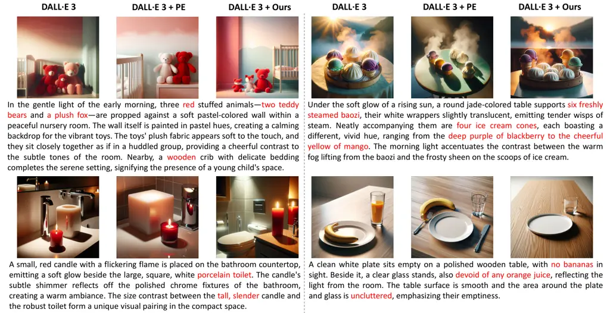

Figure 1: Visualized examples from DALL-E 3 Betker et al. (2023) with
GenPilot processing complicated and lengthy prompts. Compared to the
prompt engineering (PE), generative models with GenPilot successfully
achieve accurate results, addressing both the semantic gap and even the
challenging tasks of exclusion of certain objects.

With the advancement of large language models, test-time scaling has
been explored in various scenarios by leveraging additional
computational resources and inference-time adjustments to improve
performance. Some studies extend this idea to image generation. SANA-1.5
Xie et al. (2025) generates many samples and a verifier selects the best
sample.

Although recent progress in automatic prompt optimization (APO) and
test-time scaling (TTS) has improved image generation, they still suffer
from limitations such as reliance on random exploration or fixed
prompts, lack of systematic error identification, or coarse-grained
verification, hindering flexibility and interoperability. To address
these, we propose GenPilot, a plug-and-play multi-agent system that
brings test-time scaling into the prompt space by formulating the prompt
optimization as a search problem, enabling dynamic and interpretable
prompt refinement. GenPilot is broadly applicable across diverse models
without model training to improve the prompts for image generation.
Examples are presented in Figure 1.

Our system contains two main stages: the error analysis module and the
test-time prompt optimization module. In Error Analysis, GenPilot
decomposes the initial prompt, leverages visual question answering (VQA)
and captioning to detect and localize semantic inconsistencies. During
test-time optimization, GenPilot iteratively refines the prompt based on
errors and memory feedback with a multi-modal large language model
(MLLM) Bai et al. (2025) scorer, cluster, and memory.

The main contributions are three-fold:

- •
  We propose GenPilot, a plug-and-play multi-agent system that performs
  test-time prompt optimization as a search problem for interpretable
  results, improving image consistency without training across diverse
  T2I models.
- •
  GenPilot introduces systematic error analysis and fine-grained
  verification, enabling dynamic prompt exploration via clustering and
  iterative feedback, and memory updates.
- •
  Experiments on both long prompts from DPG-bench Hu et al. (2024) and
  short prompts from Geneval Ghosh et al. (2023) show that GenPilot
  consistently improves performance across models, demonstrating
  robustness and generalizability for T2I tasks.

## 2 Related Work

### 2.1 Text to Image Generation

Recently, text-to-image models (T2I models) have developed rapidly.
Nonetheless, their performance is restricted not only by architectural
design but also by the quality of the input prompts. Early methods such
as Stable Diffusion models (SD) Rombach et al. (2022) rely on CLIP-based
Radford et al. (2021) encoder and latent diffusion models. DALL-E 2
Ramesh et al. (2022) employs unCLIP while DALL-E 3 Betker et al. (2023)
and PixArt-$`\alpha`$ Chen et al. (2023) introduce T5 Raffel et al.
(2023) to enhance alignment. More recently, FLUX.1 dev ¹¹ 1
[https://huggingface.co/black-forest-labs/FLUX.1-dev](https://huggingface.co/black-forest-labs/FLUX.1-dev)
introduces RoPE Su et al. (2023) to enhance spatial coherence, while
FLUX.1 schnell ²² 2
[https://huggingface.co/black-forest-labs/FLUX.1-schnell](https://huggingface.co/black-forest-labs/FLUX.1-schnell)
increases inference speed within 1 to 4 steps.

### 2.2 Automatic Prompt Optimization for Image Generation

T2I models are still facing challenges in text-to-image consistency Wu
et al. (2023), therefore, Automatic Prompt Optimization (APO) Pryzant
et al. (2023), an automatic technique to optimize the performance of
models without training Ramnath et al. (2025), has been explored.
Existing APO studies include backpropagation-free optimization method
Mañas et al. (2024), Proximal Policy Optimization (PPO)-based Schulman
et al. (2017) reinforcement method Hao et al. (2023); Cao et al. (2023),
adapters Fu et al. (2024b), and some products such as MagicPrompt³³ 3
[https://huggingface.co/Gustavosta/MagicPrompt-Stable-Diffusion](https://huggingface.co/Gustavosta/MagicPrompt-Stable-Diffusion)
and PromptPerfect⁴⁴ 4
[https://promptperfect.jina.ai/](https://promptperfect.jina.ai/).
However, most existing methods lack error analysis, are limited to
specific models, and often rely on coarse-grained evaluators such as
CLIPScore Hessel et al. (2022) or FID Heusel et al. (2017), which
provide limited reliability in assessing image-text alignment Mañas
et al. (2024).

### 2.3 Test-Time Scaling for Image Generation

In recent years, test-time scaling has been extensively studied in large
language models Zhao et al. (2025) with multiple inference samples and a
selection mechanism to find the suitable result Lightman et al. (2023).
The study Ma et al. (2025) formulates the task as a search problem in
noise space and selects the best in $`N`$ samples. SANA-1.5 Xie et al.
(2025) repeats the number of samples rather than denoising steps to
scale up the performance. Also, FK STEERING Singhal et al. (2025)
employs FK-IPS Moral (2004) to guide the sample path with the high
reward. However, different from those methods operating in the noise
space with a fixed input, we formulate the scaling into the input space,
which we call “test-time prompt optimization” to generate $`N`$ samples
and cluster them to find the optimal one.

## 3 Method

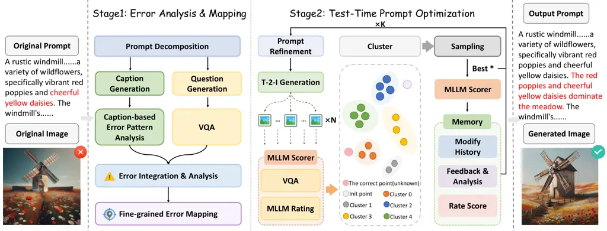

Figure 2: Overview of our proposed multi-agent system for test-time
prompt optimization. GenPilot utilizes a multimodal large language model
as the agent. In stage 1, we first decompose the prompt, then we
introduce the error integration strategy based on image caption and VQA
results, and map the error to the original prompt. In stage 2, we
introduce the test-time scaling by formulating the problem as a search
problem and operating on the input text space. The test-time prompt
optimization is iteratively processed with a refinement agent, an MLLM
scorer, a clustering algorithm MacQueen (1967), and the memory module to
sample the optimal currently.

### 3.1 How to Scale at Inference Time for Prompt

For test-time scaling of textual prompts, we formulate it as a search
problem aimed at finding the optimal input for diverse image generation
models, which is unknown. Unlike the prior work, such as Ma et al.
(2025), which scales the sample noise, our method focuses on the
exploration and refinement of the textual inputs. We operate within a
predefined discrete text space, and the prompt is scaled through an
iterative process. GenPilot generates multiple candidate prompts and
scores them, then the candidates are clustered to help identify an
optimal one. This optimal candidate then serves as the basis for the
subsequent round of optimization. Consequently, performance is expected
to scale positively with the progression of this prompt optimization
process.

### 3.2 Overall Framework

As illustrated in Figure 2, GenPilot operates in two coarse-grained
stages: Error Analysis and Test-Time Prompt Optimization.

Beginning at an initial prompt and image, GenPilot decomposes the prompt
into “meta-sentences” with an AI agent Wang et al. (2024a). Based on
these units, GenPilot performs parallel error detection via VQA and
captioning, named the error integration strategy. The VQA-based branch
queries object-level details, while the caption-based branch compares
captions with the original prompt. An error-integration agent aggregates
the inconsistencies into a comprehensive error list, with another agent
mapping each error back to specific prompt segments. In the test-time
prompt optimization stage, a refinement agent generates candidate
prompts based on the metadata, including the original prompt and image,
and error analysis and mapping. Detailed definitions and metadata
formats are provided in Appendix A. These candidates are evaluated by an
MLLM scorer through VQA and a rating strategy. GenPilot clusters the
prompts and selects the optimal cluster for sampling and image
generation. The memory module is iteratively updated with visual and
textual feedback until convergence or a maximum iteration threshold is
reached. The system prompt can be found in Appendix G.

### 3.3 Error Analysis and Mapping

#### 3.3.1 Prompt Decomposition

Prior work Wang et al. (2024c) decomposes prompts into object and
background details, but often ignores inter-object relationships,
causing semantic errors. In contrast, we design a coarser-grained prompt
decomposition into pieces with an agent that contains objects,
relationships, and background information. For example, given a prompt
$`P`$, the agent segments it as:

```math
P=\{s_{1},s_{2},\dots,s_{n}\} \tag{1}
```

where $`s_{n}`$ denotes sentence pieces. A more detailed and
fine-grained mapping is subsequently performed during the error mapping
stage.

#### 3.3.2 Error Integration and Localization

Evaluating text-image alignment by VQA with MLLMs is constrained in
complex scenes, leading to unreliable scores. Therefore, we design an
integrated error analysis strategy that combines VQA-based and
caption-based detection.

##### Question Generation.

Inspired by DSG Cho et al. (2024), we introduce an MLLM agent to
generate full coverage questions. Given a decomposed prompt, the
question-generator agent identifies the objects and formulates yes/no
questions about object existence, attributes, states, spatial relations,
and background information for precise analysis.

##### VQA Analysis.

Each generated question is passed to another MLLM that serves as the VQA
agent, who provides a label from $`\{\texttt{YES},\texttt{NO}\}`$ and
brief explanations to the errors, in the form:

```math
e_{vqa_{i}}=(\text{type}_{i},\text{explanation}_{i}) \tag{2}
```

where $`\text{type}_{i}`$ is the type of inconsistency and
$`\text{explanation}_{i}`$ refers to the detailed errors. The full error
set $`\mathcal{E}_{vqa}`$ is represented as:

```math
\mathcal{E}_{vqa}=\{e_{vqa_{1}},e_{vqa_{2}},\dots,e_{vqa_{n}}\} \tag{3}
```

##### Caption-Based Error Analysis.

For caption-based error analysis, an MLLM generates a detailed caption
$`C_{i}`$ for image $`I_{i}`$, then a comparison agent contrasts
$`C_{i}`$ with the original prompt $`P_{i}`$ to detect semantic
discrepancies. The full error set from caption $`\mathcal{E}_{c}`$ is
represented as:

```math
\mathcal{E}_{c}=\{e_{c_{1}},e_{c_{2}},\dots,e_{c_{n}}\} \tag{4}
```

where $`e_{c_{i}}`$ = $`(\text{type}_{i},\text{explanation}_{i})`$ and
$`e_{c_{i}}`$ denotes the error analyzed from the comparison agent.

##### Integrated Error Identification.

In this stage, an MLLM agent functions as an error-integration agent,
tasked with synthesizing information from multiple analytical sources,
formulated as:

```math
\mathcal{E}_{u}=A_{error}(I,P,\mathcal{E}_{c},\mathcal{E}_{vqa}) \tag{5}
```

where $`\mathcal{E}_{u}`$ is the finalized error set, $`I`$ is the
original image, and $`P`$ is the original prompt. $`\mathcal{E}_{c}`$
and $`\mathcal{E}_{vqa}`$ are the error sets from caption- and VQA-based
detection. $`A_{error}`$ is the error-integration agent.

##### Error Mapping.

Error localization maps an identified error to the pieces of the
original prompt that lead to it, bridging the abstract error and
concrete prompt to support the refinement module.

### 3.4 Test-time Prompt Optimization

##### Prompt Refinement.

We first introduce a prompt refinement agent based on metadata to modify
the error mapping sentence $`m_{i}\in M`$ and generate $`N`$ diverse
candidate modifications $`\{m_{i}^{1},m_{i}^{2},\dots,m_{i}^{N}\}`$,
using multiple references to enhance diversity. Next, each sentence
$`m_{i}^{j}`$ is merged into the original prompt $`P`$ by a branch-merge
agent, the process can be formulated as:

```math
P_{i}^{j}=A_{merge}(P,m_{i}^{j}),\quad j=1,2,\dots,N \tag{6}
```

where $`P_{i}^{j}`$ denotes the candidate prompts generated by the
branch-merge agent $`A_{merge}`$, which are then passed to T2I model to
generate images.

##### MLLM scorer.

Subsequently, GenPilot employs an MLLM scorer that acts as a test-time
verifier to indirectly evaluate prompt quality via the generated images.
Inspired by T2I-CompBench Huang et al. (2025), we design our evaluation
rules from the following three aspects: attribute binding including
color, number, shape, state, and texture of the object, relationship and
position, and background information and style including the background
description, the style, and atmosphere. A more detailed explanation is
provided in Appendix B.

For each candidate prompt and image pair, the VQA agent analyzes
potential inconsistencies based on the question list generated, and a
rating agent provides more reliable scores. The whole scoring process is
defined as:

```math
\mathcal{S}(P_{i}^{j})=avg(A_{rate}(I_{i}^{j},P,A_{vqa}(I_{i}^{j},P))) \tag{7}
```

where $`A_{rate}`$ is the rating agent, $`A_{vqa}`$ denotes the VQA
agent, $`P_{i}^{j}`$ is the candidate prompts and $`I_{i}^{j}`$ refers
to the corresponding images, and $`P`$ is the original prompt.

##### Clustering.

The scored candidate prompts are then processed with K-Means clustering
MacQueen (1967), including Bayesian updates to progressively identify
high-potential prompt candidates. Initially, each cluster $`j`$ is
assigned the prior probability $`P_{j}=1/K`$, and the candidates are
clustered into $`K`$ groups using K-Means. Then posterior probabilities
$`P_{j}^{\text{post}}`$ are computed using the Bayesian update rule,
formulated as:

```math
\displaystyle P_{j}^{\text{post}}=\frac{L_{j}P_{j}}{\sum_{k}L_{k}P_{k}} \tag{8}
```

where $`L_{j}`$ refers to the likelihood. The cluster $`j^{*}`$ with the
highest posterior probability is identified as the best cluster in this
round, shown as:

```math
\displaystyle j^{*}=\arg\max_{j}P_{j}^{\text{post}} \tag{9}
```

Following that, a sampled prompt set $`s^{*}`$, which contains $`m`$
candidate sampled prompts from the cluster $`j^{*}`$. The
$`P_{j}^{\text{post}}`$ serves as the prior distribution for the next
round.

##### Memory.

For each prompt in the $`m`$ sample set, we employ the T2I models to
generate the image and evaluate them by MLLM scorer. The average rating
and detailed error analysis are stored in the memory module, serving as
a historical reference for the subsequent optimization iterations, which
can be formulated as:

```math
\mathcal{M}\leftarrow\mathcal{M}\cup\{(s^{*},I_{s^{*}},\mathcal{S}(s^{*}),A_{sum}(\mathcal{E}_{s^{*}})\} \tag{10}
```

where $`s^{*}`$ denotes the sampled prompt set, $`I_{s^{*}}`$ refers to
the corresponding images and $`A_{sum}`$ refers to an agent who
summarizes the error analyses for $`s^{*}`$.

## 4 Experiment

### 4.1 Implementation Details

In the experiment, we employ Qwen2-VL-72B-Instruct Bai et al. (2025) as
the MLLM agent. Our method operates with 20 candidate prompts, 5 cluster
labels, and undergoes 10 modification cycles. Given that users often
tend to optimize an image only when initial outputs are unsatisfactory,
we construct a challenging subset of 264 prompts selected from the
DPG-bench Hu et al. (2024) dataset, with most prompts falling below a
threshold of $`0.81`$, posing significant challenges even for the
state-of-the-art models. Though our method is principally designed for
complex and lengthy prompts, we also extended our evaluation to short
prompts on the GenEval benchmark Ghosh et al. (2023) to ensure a
comprehensive assessment of its capabilities. The results are conducted
three times to calculate the average score. All the system prompts are
shown in Appendix G.

### 4.2 Comparison on DPG-bench subset

|                                         |         |        |        |           |          |       |
| --------------------------------------- | ------- | ------ | ------ | --------- | -------- | ----- |
| Model                                   | Average | Global | Entity | Attribute | Relation | Other |
| DALL-E 3                                | 72.04   | 89.47  | 82.54  | 79.97     | 90.41    | 63.41 |
| DALL-E 3 + PE                           | 72.29   | 85.37  | 82.89  | 82.98     | 88.88    | 66.45 |
| DALL-E 3 + Ours                         | 74.08   | 89.47  | 83.73  | 81.96     | 88.70    | 60.98 |
| FLUX.1 schnell                          | 68.16   | 79.12  | 80.33  | 81.02     | 88.24    | 65.75 |
| FLUX.1 schnell + PE                     | 68.38   | 81.32  | 79.69  | 77.54     | 85.99    | 61.64 |
| FLUX.1 schnell + TTS                    | 70.26   | 82.41  | 81.59  | 80.77     | 90.33    | 64.38 |
| FLUX.1 schnell + Ours                   | 73.32   | 79.12  | 82.42  | 83.20     | 89.86    | 61.64 |
| Stable Diffusion v1.4                   | 53.16   | 85.71  | 65.23  | 65.70     | 78.63    | 47.37 |
| Stable Diffusion v1.4 + MagicPrompt     | 53.61   | 92.85  | 66.57  | 64.42     | 77.86    | 47.37 |
| Stable Diffusion v1.4 + BeautifulPrompt | 55.99   | 85.71  | 66.04  | 66.67     | 81.68    | 52.63 |
| Stable Diffusion v1.4 + PE              | 56.08   | 85.71  | 69.27  | 70.83     | 88.55    | 47.37 |
| Stable Diffusion v1.4 + TTS             | 55.00   | 71.42  | 66.37  | 66.47     | 77.29    | 41.09 |
| Stable Diffusion v1.4 + Ours            | 62.12   | 100.00 | 71.43  | 67.94     | 79.39    | 57.89 |
| Stable Diffusion v2.1                   | 57.24   | 93.75  | 71.92  | 70.04     | 82.83    | 46.15 |
| Stable Diffusion v2.1 + MagicPrompt     | 58.93   | 93.75  | 70.88  | 71.81     | 78.79    | 42.31 |
| Stable Diffusion v2.1 + BeautifulPrompt | 58.04   | 90.63  | 71.58  | 68.94     | 82.32    | 46.15 |
| Stable Diffusion v2.1 + PE              | 56.49   | 96.88  | 71.23  | 69.60     | 85.35    | 30.77 |
| Stable Diffusion v2.1 + Ours            | 61.72   | 96.88  | 76.26  | 71.16     | 77.78    | 53.85 |
| Stable Diffusion 3                      | 58.81   | 79.63  | 71.15  | 73.02     | 84.01    | 51.42 |
| Stable Diffusion 3 + MagicPrompt        | 59.26   | 83.33  | 72.82  | 73.02     | 81.41    | 42.86 |
| Stable Diffusion 3 + BeautifulPrompt    | 60.49   | 87.04  | 71.54  | 73.51     | 80.67    | 48.58 |
| Stable Diffusion 3 + PE                 | 58.81   | 81.48  | 70.26  | 70.60     | 82.16    | 31.43 |
| Stable Diffusion 3 + Ours               | 62.89   | 88.89  | 72.31  | 68.98     | 79.55    | 51.43 |
| Sana-1.0 1.6B                           | 73.98   | 85.71  | 83.44  | 81.83     | 91.63    | 67.12 |
| Sana-1.0 1.6B + Ours                    | 75.38   | 83.78  | 85.16  | 83.23     | 90.69    | 70.97 |

Table 1: Quantitative evaluation of T2I generation performance on
DPG-bench challenging dataset comparing GenPilot with generative models
and other enhancement methods. Our approach consistently achieves
superior Average performance and demonstrates notable improvements
across various models.

#### 4.2.1 Quantitative Evaluation

We evaluate GenPilot on a wide range of T2I models and compare it with
the Prompt Engineering method (PE), naive test time scaling methods
(TTS), and SD-based methods: MagicPrompt and BeautifulPrompt Cao et al.
(2023). According to Table 1, GenPilot successfully improves the
performance in the overall “Average” score on all models tested. For
example, the average score improves from $`72.04`$ to $`74.08`$ on
DALL-E 3, from $`68.16`$ to $`73.32`$ on FLUX.1 ($`68.38`$ by PE and
$`70.26`$ by TTS), from $`73.98`$ to $`75.38`$ on Sana-1.0 1.6B, and
from $`53.16`$ to $`62.12`$ on SDv1.4 ($`55.99`$ and $`53.61`$ by
BeautifulPrompt and MagicPrompt, respectively). Similar gains are
observed on SDv2.1 and SD3, indicating the robustness and
generalizability of GenPilot, revealing its ability to enhance weaker
models while refining top-tier ones. Compared to Sana-1.0 1.6B
($`73.98`$), GenPilot enables DALL-E 3 ($`74.08`$) to surpass it and
FLUX.1 schnell ($`73.32`$) to perform comparably, highlighting
GenPilot’s effectiveness through test-time prompt optimization. Although
some subcategories show slightly lower scores, GenPilot achieves the
highest performance on average, revealing a balance in optimization
across different aspects.

#### 4.2.2 Qualitative Evaluation

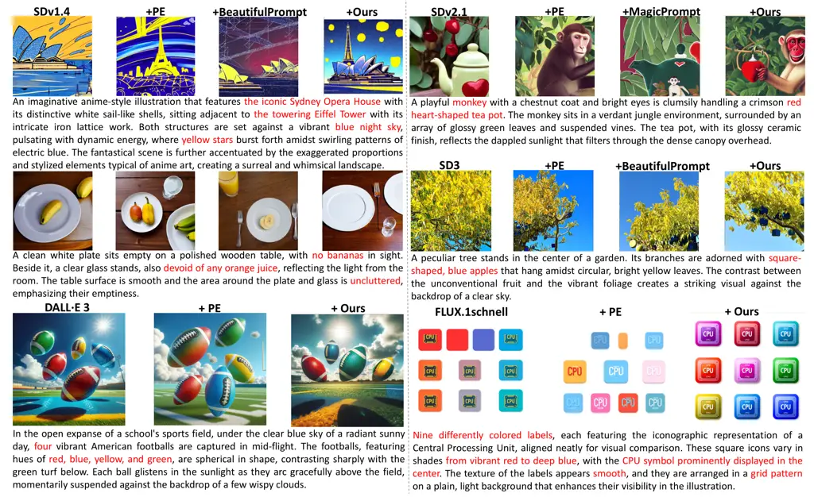

Figure 3: Qualitative comparison with different methods on the DPG-bench
challenging dataset on different generative models. The left columns
display two generations from SDv1.4 and one from DALL-E 3. The right
columns present the results from SDv2.1, SD3, and FLUX.1 schnell. For
the SD series, we select the best from BeautifulPrompt and MagicPrompt,
along with the PE methods for comparison. GenPilot consistently
generates error-free images across all scenarios, demonstrating its
superiority in synthesizing high-quality and accurate images.

On the second row on the left in Figure 3, the image generated by SDv1.4
with GenPilot effectively excludes the unwanted items, in contrast to
the other three images, which fail this exclusion and contain them to
varying extents. These qualitative examples in Figure 3 vividly
illustrate the effectiveness and generalization ability of GenPilot in
handling challenging prompts, including accurate attribute binding such
as counting, complex compositions, spatial reasoning, unrealistic
description and the effective processing of negative constraints. More
qualitative analysis can be found at Appendix I.

### 4.3 Comparison on GenEval benchmark

#### 4.3.1 Quantitative Evaluation

| Model                    | Overall | Position | Color_Attr | Colors | Sin_Obj | Two_Obj | Counting |
| ------------------------ | ------- | -------- | ---------- | ------ | ------- | ------- | -------- |
| FLUX.1 schnell           | 65.82   | 29.00    | 44.50      | 76.06  | 99.69   | 86.62   | 59.06    |
| FLUX.1 schnell + PE      | 66.59   | 31.75    | 46.50      | 80.32  | 99.06   | 85.35   | 56.56    |
| FLUX.1 schnell + Ours    | 69.60   | 41.50    | 52.25      | 81.38  | 97.19   | 84.60   | 60.62    |
| PixArt-$`\alpha`$        | 46.73   | 8.25     | 7.00       | 77.66  | 98.44   | 50.00   | 39.06    |
| PixArt-$`\alpha`$ + PE   | 45.98   | 8.50     | 8.50       | 71.54  | 97.81   | 45.45   | 44.06    |
| PixArt-$`\alpha`$ + Ours | 48.54   | 9.25     | 9.25       | 81.91  | 95.31   | 49.24   | 46.25    |

Table 2: Quantitative results on GenEval benchmark. All scores are
reported as percentages (%). The ‘%’ symbol is omitted for brevity.
Sin_Obj refers to a single object, and Two_Obj represents two objects.
Color_attr is the color attribute in short. GenPilot demonstrates
superior overall generation ability both on FLUX.1 schnell and
PixArt-$`\alpha`$, with a great improvement on most of the
subcategories.

#### 4.3.2 Qualitative Evaluation

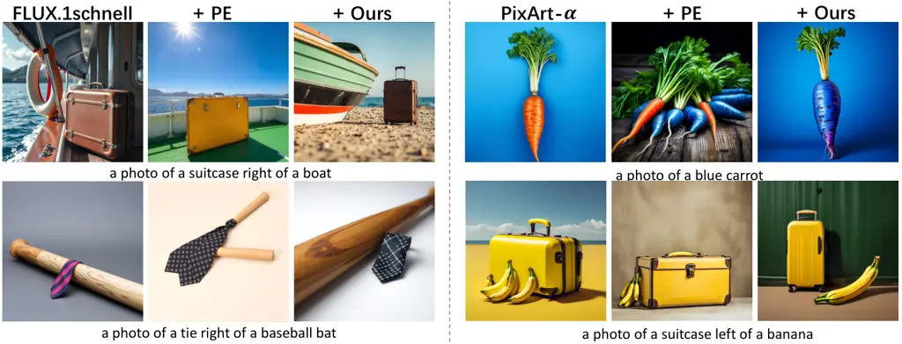

Figure 4: Qualitative examples on GenEval. The left columns show the
comparison of FLUX.1 schnell, FLUX.1 schnell and PE for enhancement, and
FLUX.1 schnell with GenPilot. The right columns provide the results of
PixArt-$`\alpha`$, PixArt-$`\alpha`$ and PE for enhancement, and
PixArt-$`\alpha`$ with GenPilot. GenPilot achieves great success in both
position processing and unrealistic prompt generation, highlighting its
potential and generalization to improve the quality of images.

| Model          | Overall | Position | Color_Attr | Colors | Sin_Obj | Two_Obj | Counting |
| -------------- | ------- | -------- | ---------- | ------ | ------- | ------- | -------- |
| FLUX.1 schnell | 65.82   | 29       | 44.5       | 76.06  | 99.69   | 86.62   | 59.06    |
| \+ Ours-M      | 66.05   | 35.75    | 46.75      | 74.73  | 98.44   | 82.83   | 57.81    |
| \+ Ours-C      | 66.27   | 35.75    | 46.75      | 77.66  | 97.19   | 83.08   | 57.19    |
| + Ours         | 69.60   | 41.50    | 52.25      | 81.38  | 97.19   | 84.60   | 60.62    |

Table 3: Ablation study results on different variants of our method on
GenEval with ‘%’ omitted. “+ Ours-M” refers to FLUX.1 schnell with
GenPilot but removing the memory module, and “+ Ours-C” represents the
variant without clustering. GenPilot performs the best with
comprehensive improvements, illustrating the effectiveness of these
modules.

| Model             | Average | Global | Entity | Attribute | Relation | Other |
| ----------------- | ------- | ------ | ------ | --------- | -------- | ----- |
| FLUX.1 schnell    | 68.16   | 79.12  | 80.33  | 81.02     | 88.24    | 65.75 |
| \+ MiniCPM-V 2.0  | 69.82   | 76.92  | 82.32  | 82.01     | 84.00    | 76.92 |
| \+ Qwen2.5-VL-72B | 73.32   | 79.12  | 82.42  | 83.20     | 89.86    | 61.64 |

Table 4: Ablation study on different MLLM agents and captioners in
GenPilot. MiniCPM-V 2.0 achieves competitive results compared to
Qwen2.5-VL-72B.

As illustrated in Table 2, GenPilot applied to the two base models on
GenEval, including FLUX.1 schnell and PixArt-$`\alpha`$, compared to the
Prompt Engineering(PE). GenPilot improves FLUX.1 schnell from
$`65.82\%`$ to $`69.60\%`$, outperforming PE ($`66.59\%`$) with notable
gains in position, color, and number-related tasks. Similarly,
PixArt-$`\alpha`$ with GenPilot achieves $`48.54\%`$, surpassing both
the base model ($`46.73\%`$) and its PE-enhanced version ($`45.98\%`$).
These results highlight the capability of GenPilot to improve the image
quality and text-to-image consistency across models and prompt types.
However, in subcategories such as single- and dual-object scenes, where
the base models are already highly proficient, GenPilot shows comparable
or slightly lower performance, aligning with its design goal of refining
unsatisfactory generations.

| Iter | Cand. | Clust. | AvgTime (s) | GenRatio (%) | AvgOptTime (s) |
| ---- | ----- | ------ | ----------- | ------------ | -------------- |
| 1    | 1     | 1      | 29.0        | 52.4         | 13.8           |
| 3    | 1     | 1      | 100.0       | 30.4         | 69.6           |
| 5    | 1     | 1      | 117.4       | 41.6         | 68.6           |
| 7    | 3     | 3      | 128.4       | 38.0         | 79.6           |

Table 5: Latency analysis of GenPilot under different configurations.
Iter: iteration number; Cand.: candidate prompts; Clust.: number of
clusters. AvgTime includes both T2I generation and optimization time,
while AvgOptTime isolates optimization overhead.

| Model                 | Average |
| --------------------- | ------- |
| FLUX.1 schnell        | 68.16   |
| \+ BLIP-2 (Captioner) | 69.22   |
| \+ Qwen2.5-VL-72B     | 73.32   |

Table 6: Ablation study on different captioner modules in GenPilot.
Replacing the captioner with BLIP-2 improves over the baseline but
remains below Qwen.

|           |               |             |
| --------- | ------------- | ----------- |
| VQA-based | Caption-based | Integration |
| 3.78      | 3.95          | 4.62        |

Table 7: Comparison on the accuracy and coverage of error analysis rated
by GPT-4o on VQA-based methods, caption-based method, and the
integration, highlighting the importance of components in GenPilot.

Figure 4 shows the qualitative results of FLUX.1 schnell and
PixArt-$`\alpha`$ on the GenEval benchmark. As shown in Figure 4, with
GenPilot, FLUX.1 schnell and PixArt-$`\alpha`$ can accurately generate
the position-related image and unrealistic prompt, compared to failures
in PE and base models. The qualitative results reveal the potential of
the generalization ability and effectiveness of GenPilot to improve the
text-to-image alignment. More qualitative results are in Appendix J.

### 4.4 Ablation Study

To comprehensively evaluate the contributions of each core component in
GenPilot, we conduct ablation studies on the GenEval benchmark, using
FLUX.1 schnell. In this section, we systematically evaluate the impact
of the error integration, the clustering, and the memory module. As
shown in Table 3, GenPilot achieves the highest score of $`69.60\%`$,
and the score without memory is $`66.05\%`$, and the score without
clustering is $`66.27\%`$, declining across various subcategories. The
results demonstrate the significance of the memory module and clustering
algorithm, as the memory provides references and clustering optimizes
the search space on text, iteratively scaling up the performance of
optimization. Simultaneously, even removing those key components,
GenPilot variants still outperform the base model, revealing the
effectiveness of the rest modules in GenPilot.

We further study the effect of different MLLM agents and captioners in
GenPilot. As shown in Table 4, replacing Qwen2.5-VL-72B-Instruct with
MiniCPM-V 2.0 Yao et al. (2024) yields slightly lower performance but
still outperforms FLUX.1 schnell, demonstrating the flexibility of
GenPilot across different MLLM backbones. Moreover, as shown in Table 6,
replacing the captioning module with BLIP-2 Li et al. (2023) also
improves over the baseline, though its relatively simpler captions
result in lower gains compared to Qwen. These results highlight the
modularity of GenPilot in adapting to different components.

We further investigate the latency of GenPilot. Table 5 reports the
average time under different configurations. During the inference stage,
the time cost of optimization increases based on the number of
iterations, error, candidate prompt, sentence, the T2I models, and the
image batch size. Moreover, we employ parallelization and early stopping
strategies to alleviate the time cost in practice.

Meanwhile, we explore the performance of the error integration strategy
by GPT-4o OpenAI et al. (2024) to score the quality of error analysis in
VQA-based, caption-based, and integration results from 1 to 5, and 5 is
regarded as the best. As illustrated in Table 7, though analysis from
both methods provides effective information, the integration strategy
highlights the effectiveness of full coverage and accuracy with a
$`4.62`$ score. A qualitative comparison example can be found at
Appendix H.

More experiments on visualization of clustering are provided on Appendix
C, semantic analysis on embedding is at Appendix D, and analysis on POS
distribution shift is shown in Appendix E.

### 4.5 Patterns on Error Analysis and Refinement

We release 35 patterns and their corresponding refinement strategy
summarized by GPT-4o, along with cases for better understanding in
Appendix K.

## 5 Conclusion

In this work, we propose GenPilot, a flexible and effective test-time
prompt optimization multi-agent system for enhanced text-to-image
generation, aiming to address the semantic gap and the compositionality
catastrophe, especially for complicated and lengthy prompts. Unlike
previous approaches, GenPilot performs test-time scaling directly on the
input prompt space, formulating it as a search problem to find the
optimal prompts for T2I models, iteratively refining the prompt with
clustering algorithm. The system integrates modular agents for error
analysis, prompt editing, multi-modal LLM scoring, and memory-based
feedback to support dynamic adjustment. Extensive experiments on GenEval
and DPG-bench demonstrate the effectiveness and superiority of GenPilot
over other methods, highlighting the potential of test-time prompt
optimization for enhancing T2I generation. We further release a set of
common error patterns and refinement strategies, providing a practical
resource for future research on prompt controllability and optimization.

## Limitations

Despite the improved performance of GenPilot in various scenarios, there
are still a few challenges to address. Firstly, although our framework
avoids model fine-tuning, it introduces additional computation time
during inference, which may be non-trivial in latency-sensitive
applications. Meanwhile, the performance of GenPilot is influenced by
the multimodal large language models used for the agent, which may harm
the performance if users utilize a less capable MLLM that lacks
sufficient understanding of multimodal information.

## Ethics Statement

In this work, we utilize Qwen2-VL 72B Instruct and GPT-4o as tools for
agent or evaluation, along with the dpg-bench and GenEval datasets. We
fully considered the ethical problems when applying the large language
models. The DPG-bench dataset is licensed under Apache 2.0, and the
GenEval dataset is available under the MIT license. Our usage strictly
follows the licenses and their intended purposes. The data we utilize do
not contain any information about unique individual people.

## Acknowledgements

This work is jointly sponsored by National Natural Science Foundation of
China (62141608, 62236010, 62576339), and Beijing Natural Science
Foundation (L252033).

## References

- Bai et al. (2025) Shuai Bai, Keqin Chen, Xuejing Liu, Jialin Wang,
  Wenbin Ge, Sibo Song, Kai Dang, Peng Wang, Shijie Wang, Jun Tang,
  Humen Zhong, Yuanzhi Zhu, Mingkun Yang, Zhaohai Li, Jianqiang Wan,
  Pengfei Wang, Wei Ding, Zheren Fu, Yiheng Xu, and 8 others. 2025.
  [Qwen2.5-vl technical report](https://arxiv.org/abs/2502.13923).
  _Preprint_, arXiv:2502.13923.
- Betker et al. (2023) James Betker, Gabriel Goh, Li Jing, Tim Brooks,
  Jianfeng Wang, Linjie Li, Long Ouyang, Juntang Zhuang, Joyce Lee,
  Yufei Guo, and 1 others. 2023. Improving image generation with better
  captions. _Computer Science. https://cdn. openai. com/papers/dall-e-3.
  pdf_, 2(3):8.
- Bird (2006) Steven Bird. 2006. Nltk: the natural language toolkit. In
  _Proceedings of the COLING/ACL 2006 interactive presentation
  sessions_, pages 69–72.
- Cao et al. (2023) Tingfeng Cao, Chengyu Wang, Bingyan Liu, Ziheng Wu,
  Jinhui Zhu, and Jun Huang. 2023. [Beautifulprompt: Towards automatic
  prompt engineering for text-to-image
  synthesis](https://arxiv.org/abs/2311.06752). _Preprint_,
  arXiv:2311.06752.
- Chen et al. (2023) Junsong Chen, Jincheng Yu, Chongjian Ge, Lewei Yao,
  Enze Xie, Yue Wu, Zhongdao Wang, James Kwok, Ping Luo, Huchuan Lu, and
  Zhenguo Li. 2023. [Pixart-$`\alpha`$: Fast training of diffusion
  transformer for photorealistic text-to-image
  synthesis](https://arxiv.org/abs/2310.00426). _Preprint_,
  arXiv:2310.00426.
- Cho et al. (2024) Jaemin Cho, Yushi Hu, Roopal Garg, Peter Anderson,
  Ranjay Krishna, Jason Baldridge, Mohit Bansal, Jordi Pont-Tuset, and
  Su Wang. 2024. [Davidsonian scene graph: Improving reliability in
  fine-grained evaluation for text-to-image
  generation](https://arxiv.org/abs/2310.18235). _Preprint_,
  arXiv:2310.18235.
- Fu et al. (2024a) Yuchen Fu, Zhiwei Jiang, Yuliang Liu, Cong Wang,
  Zexuan Deng, Zhaoling Chen, and Qing Gu. 2024a. Ap-adapter: Improving
  generalization of automatic prompts on unseen text-to-image diffusion
  models. _Advances in Neural Information Processing Systems_,
  37:98320–98346.
- Fu et al. (2024b) Yuchen Fu, Zhiwei Jiang, Yuliang Liu, Cong Wang,
  Zexuan Deng, Zhaoling Chen, and Qing Gu. 2024b. [Ap-adapter: Improving
  generalization of automatic prompts on unseen text-to-image diffusion
  models](https://proceedings.neurips.cc/paper_files/paper/2024/file/b2077e6d66da612fcb701589efa9ce88-Paper-Conference.pdf).
  In _Advances in Neural Information Processing Systems_, volume 37,
  pages 98320–98346. Curran Associates, Inc.
- Ghosh et al. (2023) Dhruba Ghosh, Hanna Hajishirzi, and Ludwig
  Schmidt. 2023. [Geneval: An object-focused framework for evaluating
  text-to-image alignment](https://arxiv.org/abs/2310.11513).
  _Preprint_, arXiv:2310.11513.
- Hao et al. (2023) Yaru Hao, Zewen Chi, Li Dong, and Furu Wei. 2023.
  [Optimizing prompts for text-to-image
  generation](https://arxiv.org/abs/2212.09611). _Preprint_,
  arXiv:2212.09611.
- Hessel et al. (2022) Jack Hessel, Ari Holtzman, Maxwell Forbes,
  Ronan Le Bras, and Yejin Choi. 2022. [Clipscore: A reference-free
  evaluation metric for image
  captioning](https://arxiv.org/abs/2104.08718). _Preprint_,
  arXiv:2104.08718.
- Heusel et al. (2017) Martin Heusel, Hubert Ramsauer, Thomas
  Unterthiner, Bernhard Nessler, and Sepp Hochreiter. 2017. Gans trained
  by a two time-scale update rule converge to a local nash equilibrium.
  _Advances in neural information processing systems_, 30.
- Ho et al. (2020) Jonathan Ho, Ajay Jain, and Pieter Abbeel. 2020.
  [Denoising diffusion probabilistic
  models](https://arxiv.org/abs/2006.11239). _Preprint_,
  arXiv:2006.11239.
- Hu et al. (2024) Xiwei Hu, Rui Wang, Yixiao Fang, Bin Fu, Pei Cheng,
  and Gang Yu. 2024. [Ella: Equip diffusion models with llm for enhanced
  semantic alignment](https://arxiv.org/abs/2403.05135). _Preprint_,
  arXiv:2403.05135.
- Huang et al. (2025) Kaiyi Huang, Chengqi Duan, Kaiyue Sun, Enze Xie,
  Zhenguo Li, and Xihui Liu. 2025. [T2i-compbench++: An enhanced and
  comprehensive benchmark for compositional text-to-image
  generation](https://arxiv.org/abs/2307.06350). _Preprint_,
  arXiv:2307.06350.
- Li et al. (2023) Junnan Li, Dongxu Li, Silvio Savarese, and Steven
  Hoi. 2023. Blip-2: Bootstrapping language-image pre-training with
  frozen image encoders and large language models. In _International
  conference on machine learning_, pages 19730–19742. PMLR.
- Lightman et al. (2023) Hunter Lightman, Vineet Kosaraju, Yura Burda,
  Harri Edwards, Bowen Baker, Teddy Lee, Jan Leike, John Schulman, Ilya
  Sutskever, and Karl Cobbe. 2023. [Let’s verify step by
  step](https://arxiv.org/abs/2305.20050). _Preprint_, arXiv:2305.20050.
- Ma et al. (2025) Nanye Ma, Shangyuan Tong, Haolin Jia, Hexiang Hu,
  Yu-Chuan Su, Mingda Zhang, Xuan Yang, Yandong Li, Tommi Jaakkola,
  Xuhui Jia, and Saining Xie. 2025. [Inference-time scaling for
  diffusion models beyond scaling denoising
  steps](https://arxiv.org/abs/2501.09732). _Preprint_,
  arXiv:2501.09732.
- MacQueen (1967) James MacQueen. 1967. Some methods for classification
  and analysis of multivariate observations. In _Proceedings of the
  Fifth Berkeley Symposium on Mathematical Statistics and Probability,
  Volume 1: Statistics_, volume 5, pages 281–298. University of
  California press.
- Mañas et al. (2024) Oscar Mañas, Pietro Astolfi, Melissa Hall, Candace
  Ross, Jack Urbanek, Adina Williams, Aishwarya Agrawal, Adriana
  Romero-Soriano, and Michal Drozdzal. 2024. [Improving text-to-image
  consistency via automatic prompt
  optimization](https://arxiv.org/abs/2403.17804). _Preprint_,
  arXiv:2403.17804.
- Moral (2004) Pierre Moral. 2004. _Feynman-Kac formulae: genealogical
  and interacting particle systems with applications_. Springer.
- OpenAI et al. (2024) OpenAI, Josh Achiam, Steven Adler, Sandhini
  Agarwal, Lama Ahmad, Ilge Akkaya, Florencia Leoni Aleman, Diogo
  Almeida, Janko Altenschmidt, Sam Altman, Shyamal Anadkat, Red Avila,
  Igor Babuschkin, Suchir Balaji, Valerie Balcom, Paul Baltescu, Haiming
  Bao, Mohammad Bavarian, Jeff Belgum, and 262 others. 2024. [Gpt-4
  technical report](https://arxiv.org/abs/2303.08774). _Preprint_,
  arXiv:2303.08774.
- Pryzant et al. (2023) Reid Pryzant, Dan Iter, Jerry Li, Yin Tat Lee,
  Chenguang Zhu, and Michael Zeng. 2023. [Automatic prompt optimization
  with "gradient descent" and beam
  search](https://arxiv.org/abs/2305.03495). _Preprint_,
  arXiv:2305.03495.
- Radford et al. (2021) Alec Radford, Jong Wook Kim, Chris Hallacy,
  Aditya Ramesh, Gabriel Goh, Sandhini Agarwal, Girish Sastry, Amanda
  Askell, Pamela Mishkin, Jack Clark, Gretchen Krueger, and Ilya
  Sutskever. 2021. [Learning transferable visual models from natural
  language supervision](https://arxiv.org/abs/2103.00020). _Preprint_,
  arXiv:2103.00020.
- Raffel et al. (2023) Colin Raffel, Noam Shazeer, Adam Roberts,
  Katherine Lee, Sharan Narang, Michael Matena, Yanqi Zhou, Wei Li, and
  Peter J. Liu. 2023. [Exploring the limits of transfer learning with a
  unified text-to-text transformer](https://arxiv.org/abs/1910.10683).
  _Preprint_, arXiv:1910.10683.
- Ramesh et al. (2022) Aditya Ramesh, Prafulla Dhariwal, Alex Nichol,
  Casey Chu, and Mark Chen. 2022. Hierarchical text-conditional image
  generation with clip latents. _arXiv preprint arXiv:2204.06125_,
  1(2):3.
- Ramnath et al. (2025) Kiran Ramnath, Kang Zhou, Sheng Guan,
  Soumya Smruti Mishra, Xuan Qi, Zhengyuan Shen, Shuai Wang, Sangmin
  Woo, Sullam Jeoung, Yawei Wang, Haozhu Wang, Han Ding, Yuzhe Lu,
  Zhichao Xu, Yun Zhou, Balasubramaniam Srinivasan, Qiaojing Yan, Yueyan
  Chen, Haibo Ding, and 2 others. 2025. [A systematic survey of
  automatic prompt optimization
  techniques](https://arxiv.org/abs/2502.16923). _Preprint_,
  arXiv:2502.16923.
- Rombach et al. (2022) Robin Rombach, Andreas Blattmann, Dominik
  Lorenz, Patrick Esser, and Björn Ommer. 2022. [High-resolution image
  synthesis with latent diffusion
  models](https://arxiv.org/abs/2112.10752). _Preprint_,
  arXiv:2112.10752.
- Saharia et al. (2022) Chitwan Saharia, William Chan, Saurabh Saxena,
  Lala Li, Jay Whang, Emily Denton, Seyed Kamyar Seyed Ghasemipour,
  Burcu Karagol Ayan, S. Sara Mahdavi, Rapha Gontijo Lopes, Tim
  Salimans, Jonathan Ho, David J Fleet, and Mohammad Norouzi. 2022.
  [Photorealistic text-to-image diffusion models with deep language
  understanding](https://arxiv.org/abs/2205.11487). _Preprint_,
  arXiv:2205.11487.
- Schulman et al. (2017) John Schulman, Filip Wolski, Prafulla Dhariwal,
  Alec Radford, and Oleg Klimov. 2017. [Proximal policy optimization
  algorithms](https://arxiv.org/abs/1707.06347). _Preprint_,
  arXiv:1707.06347.
- Singhal et al. (2025) Raghav Singhal, Zachary Horvitz, Ryan Teehan,
  Mengye Ren, Zhou Yu, Kathleen McKeown, and Rajesh Ranganath. 2025. [A
  general framework for inference-time scaling and steering of diffusion
  models](https://arxiv.org/abs/2501.06848). _Preprint_,
  arXiv:2501.06848.
- Su et al. (2023) Jianlin Su, Yu Lu, Shengfeng Pan, Ahmed Murtadha,
  Bo Wen, and Yunfeng Liu. 2023. [Roformer: Enhanced transformer with
  rotary position embedding](https://arxiv.org/abs/2104.09864).
  _Preprint_, arXiv:2104.09864.
- Wang et al. (2024a) Lei Wang, Chen Ma, Xueyang Feng, Zeyu Zhang, Hao
  Yang, Jingsen Zhang, Zhiyuan Chen, Jiakai Tang, Xu Chen, Yankai Lin,
  Wayne Xin Zhao, Zhewei Wei, and Jirong Wen. 2024a. [A survey on large
  language model based autonomous
  agents](https://doi.org/10.1007/s11704-024-40231-1). _Frontiers of
  Computer Science_, 18(6).
- Wang et al. (2024b) Ruochen Wang, Ting Liu, Cho-Jui Hsieh, and Boqing
  Gong. 2024b. [On discrete prompt optimization for diffusion
  models](https://arxiv.org/abs/2407.01606). _Preprint_,
  arXiv:2407.01606.
- Wang et al. (2024c) Zhenyu Wang, Aoxue Li, Zhenguo Li, and Xihui Liu.
  2024c. [Genartist: Multimodal llm as an agent for unified image
  generation and editing](https://arxiv.org/abs/2407.05600). _Preprint_,
  arXiv:2407.05600.
- Wu et al. (2023) Qiucheng Wu, Yujian Liu, Handong Zhao, Trung Bui, Zhe
  Lin, Yang Zhang, and Shiyu Chang. 2023. [Harnessing the
  spatial-temporal attention of diffusion models for high-fidelity
  text-to-image synthesis](https://arxiv.org/abs/2304.03869).
  _Preprint_, arXiv:2304.03869.
- Xie et al. (2025) Enze Xie, Junsong Chen, Yuyang Zhao, Jincheng Yu,
  Ligeng Zhu, Chengyue Wu, Yujun Lin, Zhekai Zhang, Muyang Li, Junyu
  Chen, Han Cai, Bingchen Liu, Daquan Zhou, and Song Han. 2025. [Sana
  1.5: Efficient scaling of training-time and inference-time compute in
  linear diffusion transformer](https://arxiv.org/abs/2501.18427).
  _Preprint_, arXiv:2501.18427.
- Yao et al. (2024) Yuan Yao, Tianyu Yu, Ao Zhang, Chongyi Wang, Junbo
  Cui, Hongji Zhu, Tianchi Cai, Haoyu Li, Weilin Zhao, Zhihui He, and 1
  others. 2024. Minicpm-v: A gpt-4v level mllm on your phone. _arXiv
  preprint arXiv:2408.01800_.
- Zhao et al. (2025) Wayne Xin Zhao, Kun Zhou, Junyi Li, Tianyi Tang,
  Xiaolei Wang, Yupeng Hou, Yingqian Min, Beichen Zhang, Junjie Zhang,
  Zican Dong, Yifan Du, Chen Yang, Yushuo Chen, Zhipeng Chen, Jinhao
  Jiang, Ruiyang Ren, Yifan Li, Xinyu Tang, Zikang Liu, and 3
  others. 2025. [A survey of large language
  models](https://arxiv.org/abs/2303.18223). _Preprint_,
  arXiv:2303.18223.

## Appendix A A Detailed Explanation of Metadata

To offer more structural data for the agent to better understand, we
design a structural data called metadata. Initially, the main components
in metadata are error analysis, error mapping, question list, history
feedback, the original prompt, and the original image generated from
that prompt. We provide the error analysis and mapping, along with the
original prompt, image, and history for prompt refinement, and offer the
question list for the MLLM scorer. With the structured metadata, the
agent is capable of better understanding the context and efficiently
retrieving data.

## Appendix B A Detailed Explanation of Scorer Subcategory

We design the rules from the following three aspects inspired by
T2I-CompBench Huang et al. (2025).

Attribute binding: Attribute binding refers to the ability to correctly
associate specific properties with the object as described in the
prompt, including color, number, shape, state, and texture of the
object.

- •
  The color is used to evaluate whether the correct color is applied to
  a certain object or not, especially when multiple objects have
  different color specifications.
- •
  The number specifies the exact count of objects. Models might struggle
  with precise counts, failing to make the very approximate number of
  different objects.
- •
  The shape refers to the external form or geometric shape of an object,
  ranging from simple and concrete forms to complex and abstract
  structures. For example, in the prompt “A person with a muscular
  build”, muscular build refers to the shape of the human.
- •
  The state is a broad category referring to the condition, mode of
  being, phase, or dynamic activity of an object or entity at a
  particular time. It contains physical conditions for instance, “ripe”
  in “ripe bananas”, the action, such as the “running” in the prompt “A
  dog running in a field”, the emotional state, for example, the
  “surprised” in “A surprised cat”, and the functional state such as
  “open” in “An open door”, and the texture describes the surface of the
  object, including smoothness, roughness, softness and so on.

Relationship and position: In addition to the attribute of the object,
prompts often include information about how these objects are
interconnected and their positions within the scene. These relationships
involve various types of interactions. For example, one object acting
upon another, such as “a dog catching a ball”, and the objects in
occlusion, such as “a tree partially obscuring a view of the house”, and
simple containment or support, such as “Apples in a basket”. Similarly,
positional information describes where the object is located, either
relative to one another or at the absolute position within the image
frame.

Background information and style: Finally, we also defined a further
descriptive aspect, the background information and style. The background
information encompasses details about the scene that are distinct from
the main object, including the style and overall atmosphere in the
image.

## Appendix C Clustering Analysis

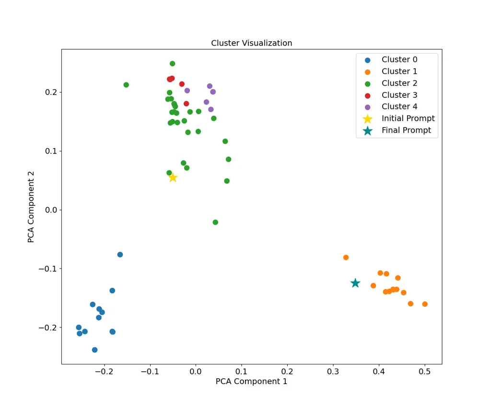

Figure 5: Visualization of clustering result on one case with the number
of clusters set to be 5.

Figure 5 vividly shows how our clustering algorithm works. The initial
prompt (the yellow star) is close to cluster 2 in green, next to cluster
3 in red and cluster 4 in purple. However, cluster 0 in blue and cluster
1 in orange are far from the initial point. The relevant score of
cluster 1 is 5.0 on average, which indicates it as the best prompt this
turn, while clusters 2, 3, and 4 with a lower score, such as 4.3 on
average. Initially, the candidate prompts generated from the prompt
refinement agent might still predominantly cluster around. As iterations
progress, GenPilot explores more directions, including the clusters 0
and 1 illustrated in Figure 5. In this case, cluster 1 represents the
optimized area that T2I models prefer to generate high-quality images.
By generating multiple samples and scoring them into clusters, GenPilot
successfully scales the prompts and optimizes them, revealing the
effectiveness and potential of the test-time prompt optimization for
improving the image quality.

Another example with an image and a prompt can be found at Appendix F.

## Appendix D Semantic Analysis on Embedding

| Method          | GenEval | DPG-bench |
| --------------- | ------- | --------- |
| Origin          | 0.2443  | 0.3705    |
| BeautifulPrompt | 0.2573  | 0.3527    |
| PE              | 0.3193  | 0.3724    |
| Ours            | 0.2981  | 0.3944    |

Table 8: Comparison of the semantic similarity analysis with extremely
detailed descriptions by GPT-4o.

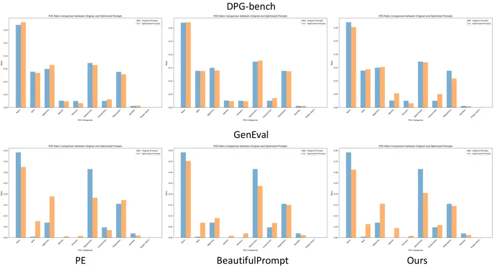

Figure 6: Analysis on POS Distribution Shift of PE, BeautifulPrompt, and
Ours compared to original prompt on DPG-bench challenging subset and
GenEval benchmark.

We conduct a semantic similarity analysis at the embedding level to
evaluate whether prompt optimization leads to richer textual
descriptions on the GenEval and DPG benchmark. We generate extremely
detailed and specific descriptions as reference prompts using GPT-4o
with the particular instruction shown in Appendix G. We then measure the
cosine similarity between each method’s prompt embeddings and the
reference for completeness and semantic content. As shown in Table 8,
our method achieves the highest average similarity scores on DPG-bench,
given the highest score of performance on DPG-bench in Table 1,
indicating that GenPilot introduces meaningful and effective details
into the original prompt. And GenPilot is highly competitive on GenEval
(0.2981) against other methods like Origin, BeautifulPrompt, and PE.
When the prompt is relatively short and simple, rewriting or expanding
the abstract prompts significantly improves semantic richness, which
positively influences generation. However, on GenEval, we observe that
though PE reaches the highest score of similarity, the whole performance
of PE is lower than ours when the generative model is FLUX.1 schnell,
and even lower than PixArt-$`\alpha`$ itself. Therefore, higher semantic
similarity for more information included does not always lead to better
visual results. Simply expanding the prompt, especially for complex and
lengthy prompts, may not enhance the image result obviously. In
contrast, GenPilot consistently turns the semantic gains into meaningful
performance improvements, highlighting its effectiveness and necessity.

## Appendix E Analysis on POS Distribution Shift

To explore the impact of the linguistic structure of generated prompts,
we conduct a part-of-speech (POS) level analysis comparing the original
prompts and the optimized ones with NLTK Bird (2006). All tools and
functions were used with default settings. We focus on adjectives,
nouns, verbs, adverbs, pronouns, and so on. A common trend can be found
among PE, BeautifulPrompt, and Ours, revealing that adding adjectives
may help with more specific information for image generation. Both on
DPG-bench and GenEval, our method increases the proportion of adjectives
and proper nouns, indicating that prompts generated by GenPilot tend to
be more descriptive via adjectives and more specific via proper nouns.

## Appendix F More Detailed Case Analysis

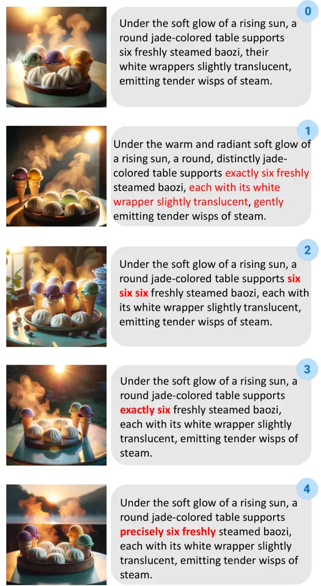

Figure 7: A detailed sample of iterations and the results. 0 represents
the initial start point. GenPilot optimizes the sentence with the error
“the number of baozi” and achieves the accurate synthesis on the fourth
round.

In this section, we provide a more detailed case during the iterations,
as shown in Figure 7. The main error, according to the error mapping
sentence in the original picture in the first row, is the number of
baozi. In the original prompt, baozi should be 6, while in the image, it
only has three. The best sampled prompt in the next round modified the
prompt with “exactly” and some other specific descriptions, rated 4.1 in
the end. In the second round, the prompt optimization agent tries to
emphasize the number by repeating the keyword of six. However, it
remains 5 baozi in the image, rated 4.3 by the MLLM scorer. Next round,
the prompt optimization agent concludes the failures of the previous
round, and makes an attempt to emphasize by adding an adverb. In round
three, an image with 5 clearly visible baozi is generated, which is a
minor improvement compared to the earlier round. For round 4, prompt
optimization tries to change the adverb, which turn out to be
successful, rated 5 in the end. After that, the correct modification,
the image, and candidate prompt will be stored, as a stop signal for
this error.

## Appendix G System Prompt Template

Figure 8: The system prompt for prompt engineering (PE) with the initial
prompt and image as the input.

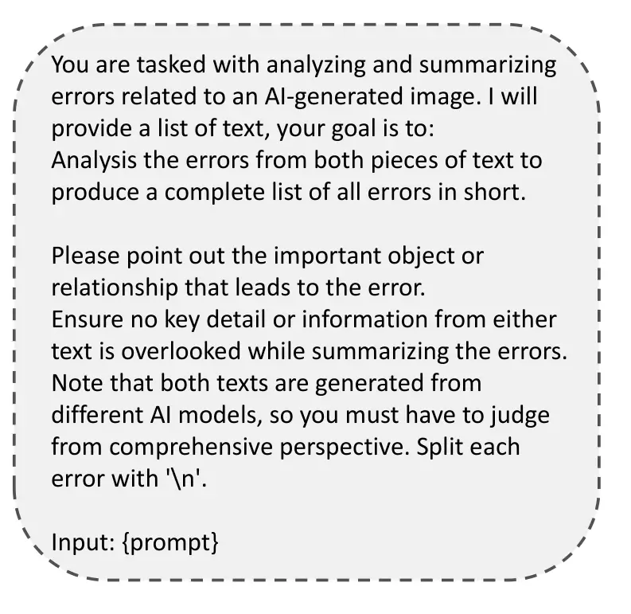

Figure 9: The system prompt to summarize and explain the reasons for the
MLLM agent rating score.

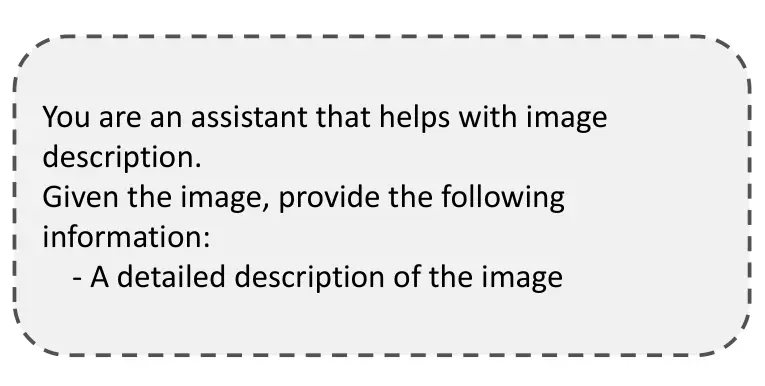

Figure 10: The system prompt for generating the corresponding caption of
the image.

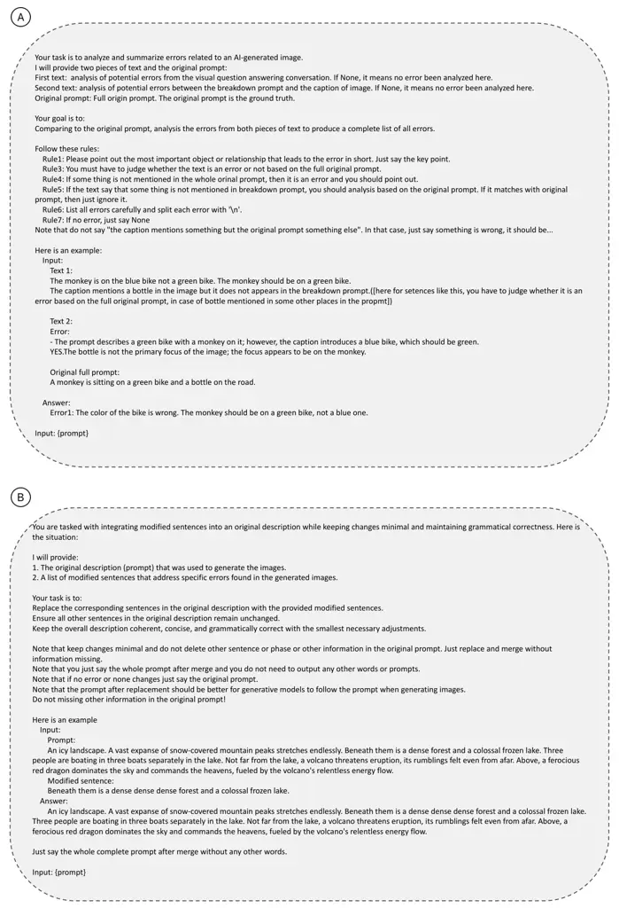

Figure 11: The system prompt for integration error analysis (A), which
combines and verifies the error analysis from VQA-based methods and
caption-based analysis, and the instructions for the branch-merge agent
for merging the modifications into the original prompt (B).

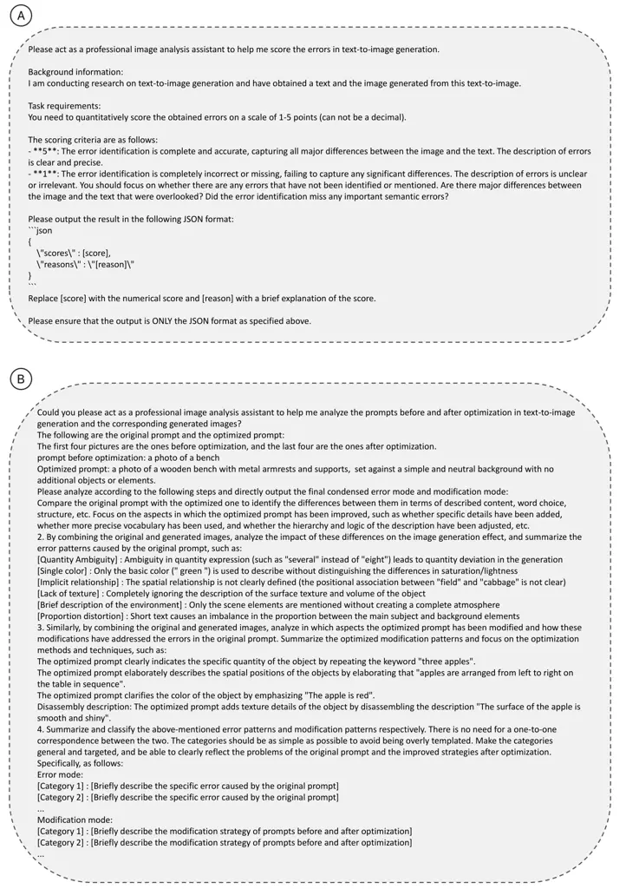

Figure 12: The system prompt designed for evaluating the accuracy and
coverage of error analysis (A), and the instructions to summarize the
systematic patterns of errors and optimization strategies (B).

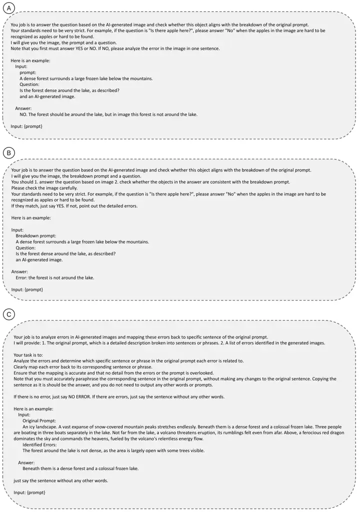

Figure 13: The system prompt for the VQA module in MLLM scorer (A), the
VQA-based error detection (B), and the error mapping (C).

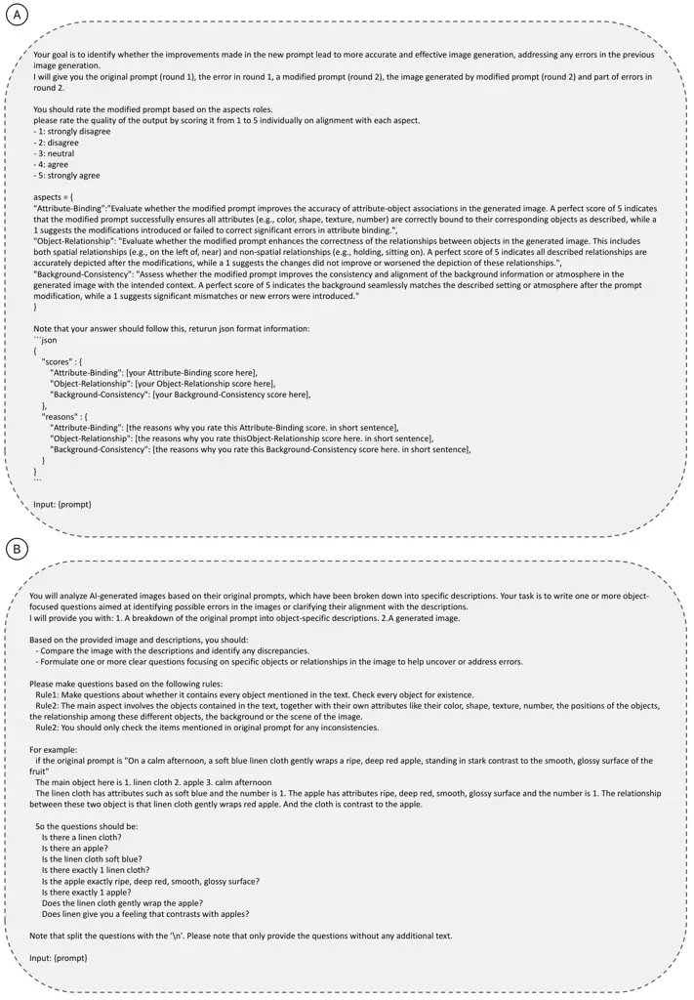

Figure 14: The rules and strategy for rating the generated images (A)
and the structural output in JSON format. B represents how we generate
the question centered on the object.

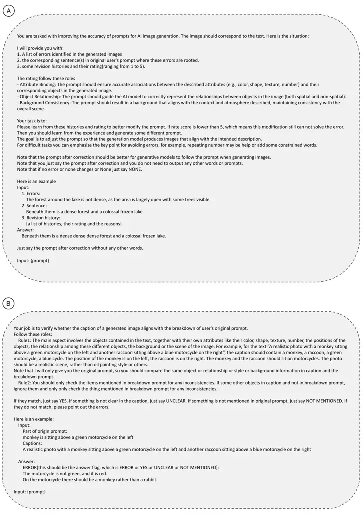

Figure 15: The system prompt for prompt refinement based on the prompt,
image, error analysis, error mapping and revision history, including
rate score, feedback, and modified history (A). And B refers to the
system prompt used for caption-based error detection.

In this section, we provide the system prompt used in GenPilot to guide
the agent. Figure 8 represents the system prompt we use for prompt
engineering (PE) in the experiment. PE takes the original image and
prompt as the input and generates the optimized prompts.

In Figure 9, we design the instruction for the memory module to store
the summary of the detailed errors that occurred, offering a
comprehensive reference for the next iteration.

Figure 10 is the system prompt we use to generate the detailed
descriptive caption of the image.

In Figure 11, part a represents the instructions for the error
integration agent to verify and summarize the errors. The agent will
produce a complete list of errors, including patterns and details. Part
B in this figure plays the role of the branch merge agent to combine the
modified sentence into the complete prompt.

The instructions for GPT-4o to summarize the error pattern and the
refinement pattern are shown in Figure 12, part B. The system prompt in
A in the Figure 12 is used to rate the accuracy and coverage of
VQA-based, caption-based, and integration results.

Following the sequence of A, B, and C, Figure 13 shows the prompt used
for the VQA in MLLM scorer, the VQA in error detection, and the error
mapping.

In Figure 14, we provide the instructions for MLLM rating (A) and
question list generation (B).

Figure 15 shows the system prompt for prompt refinement agent (A) and
caption-based error detection (B).

## Appendix H Detailed Example on Comparison for Error Analysis Methods

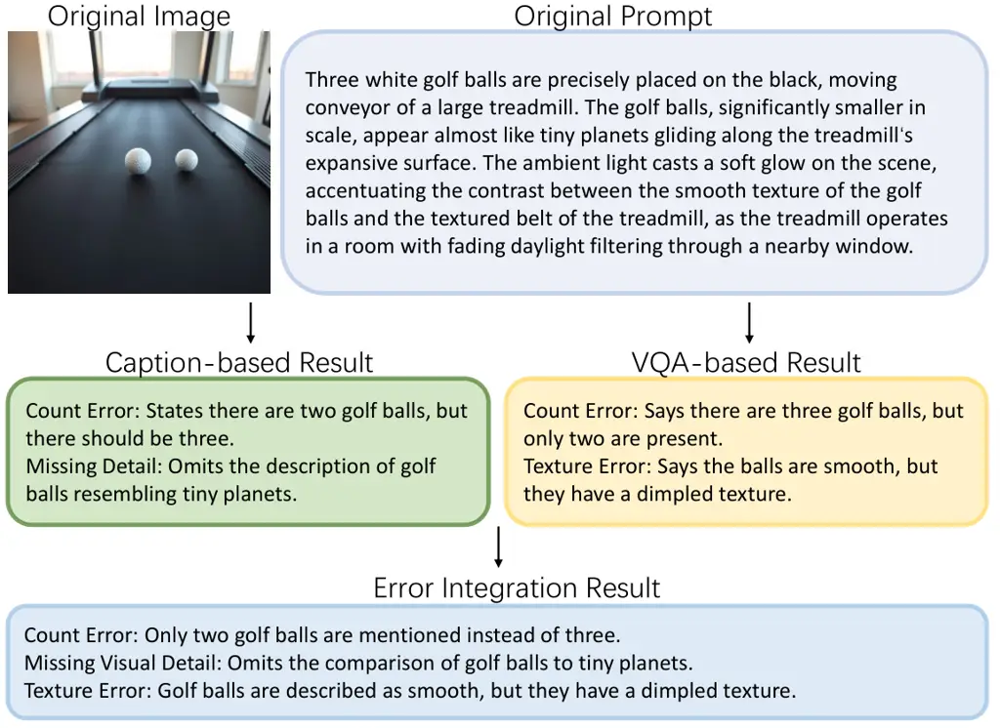

Figure 16: An example that compares the error analysis from the
VQA-based method, the caption-based method, and GenPilot. According to
the original prompt, the inconsistencies are the number, the texture,
and the details of golf balls. VQA-based method misses the details
errors and the caption-based method ignores the texture errors. Based on
these two analyses, GenPilot is able to perform accurate error analysis.

As shown in Figure 16, GenPilot takes advantage of both methods and
verifies each result to generate a complete error analysis.

## Appendix I More Results on DPG-bench

In this section, more results conducted on the DPG-bench are
illustrated. As shown in Figure 19, we compare the FLUX.1 schnell with
PE-optimized and GenPilot-optimized images. For the first row, the main
objects in the original prompt are the Pyramids, the Sphinx, an
astronaut, and Earth. Our method clearly renders the iconic Great
Pyramids, the Sphinx, the astronaut from behind, and a vividly
contrasting Earth, while PE provides an astronaut from the front, and
the FLUX image mistakenly combines the Pyramids and the Sphinx together.
In the second row, our approach successfully generates “two
square-shaped pink erasers” next to a toilet, compared to the square
erasers on the toilet in the FLUX image and the tube-shaped erasers in
the PE image. Moreover, PE image misses the blue bath mat and the handle
in the background. Finally, in the challenging prompt of an aged room
with multiple projectors and keyboards in the third row, GenPilot
accurately generates 4 spherical, silver projectors, in contrast to the
5 and 2 in FLUX image and PE image. These qualitative comparisons in
Figure 19 demonstrate the superior ability of GenPilot to interpret
complex prompts for enhanced image generation. Our approach accurately
renders distinct objects with their specified attributes, correct
spatial relationships, and the precise number, revealing the
effectiveness and potential of GenPilot to improve image quality in
text-to-image synthesis.

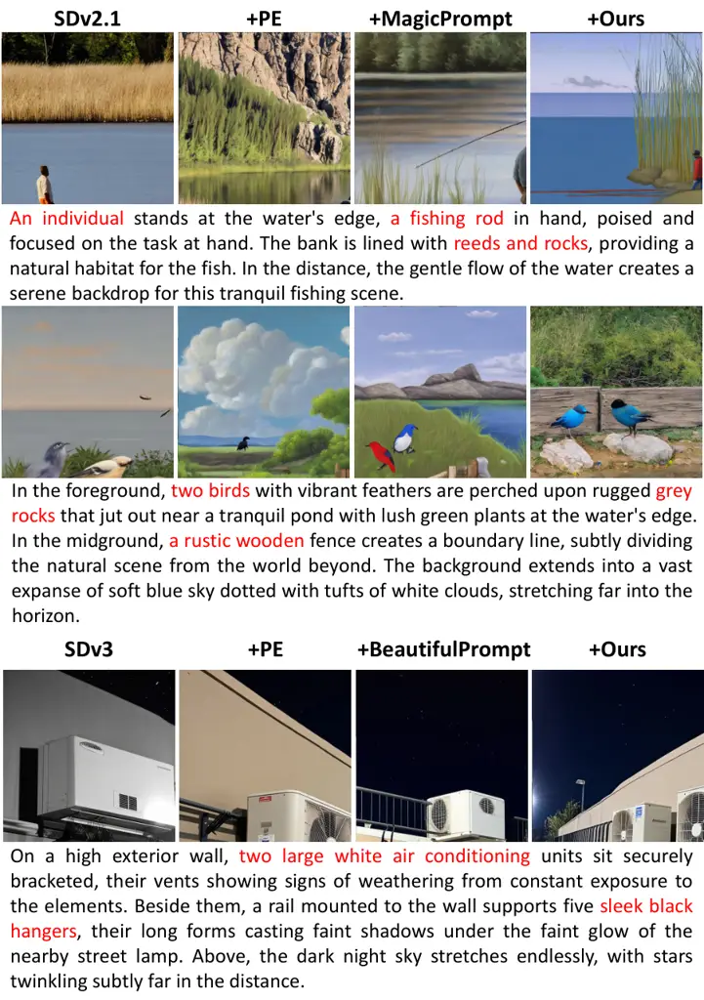

Figure 17: The additional examples on DPG-bench challenging dataset with
SDv2.1 in the first and second row, and with SD3 on the last row. For
comparison, we choose the higher baseline method from BeautifulPrompt
and MagicPrompt. The results highlight the superiority of GenPilot in
accurately rendering complicated scenes compared to generative models
and other enhancement methods.

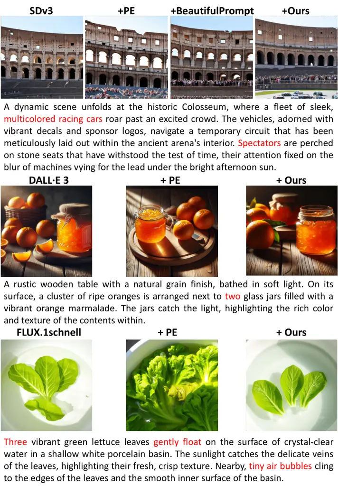

Figure 18: More qualitative results on DPG-bench challenging dataset
with SD3 in the first row, DALL-E 3 on the second row, and FLUX.1
schnell on the last row. The results clearly demonstrate the significant
advantages of our method over the FLUX.1 schnell and the PE method.
Specifically, our approach accurately renders key details from the
prompt, such as “three”.

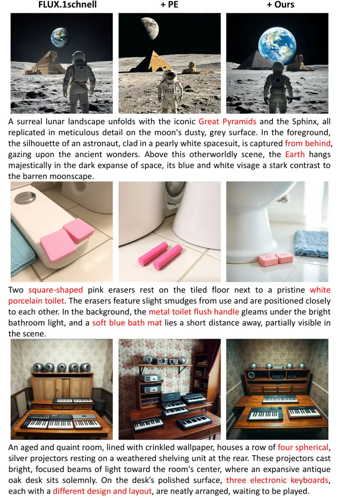

Figure 19: Qualitative results for complex and long prompts on DPG-bench
challenging dataset compared to PE and FLUX.1 schenell. GenPilot
exhibits superior faithfulness to the detailed textual description, for
example “from behind” and “metal toilet flush handle” can be accurately
generated with the test-time prompt optimization.

## Appendix J More Results on GenEval

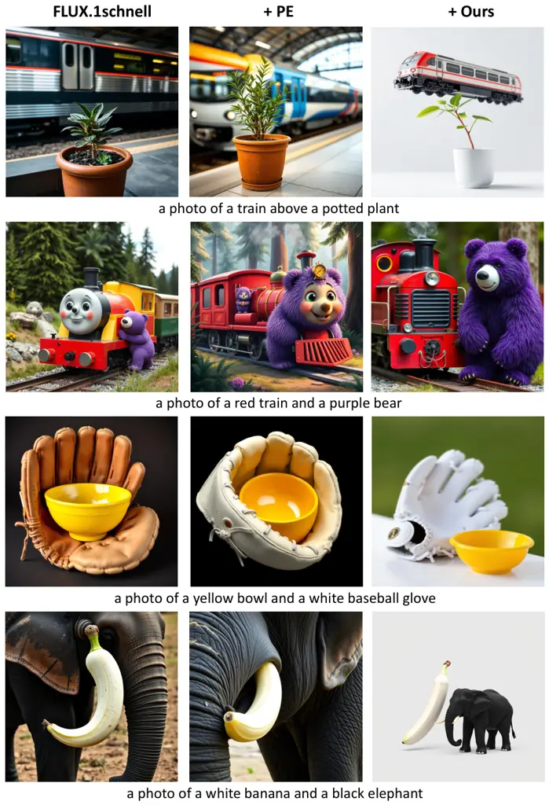

Figure 20: The qualitative results on GenEval with FLUX.1 schnell,
FLUX.1 schnell with PE, and FLUX.1 schnell with GenPilot. Our system
accurately synthesizes the unrealistic image, demonstrating the
significant superiority of our method in understanding and generating
images.

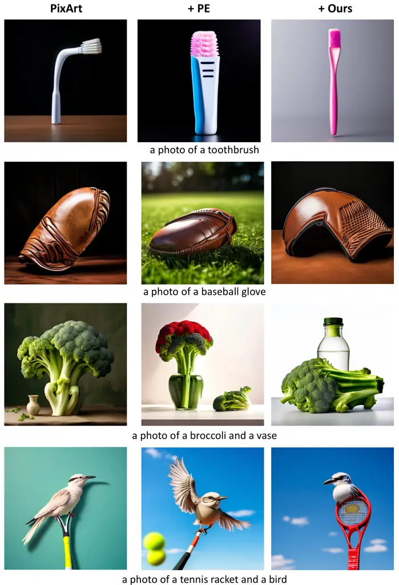

Figure 21: Additional examples on GenEval with PixArt-$`\alpha`$ and
enhancement methods PE and GenPilot. The results reveal the advantages
of dealing with the details, such as the baseball glove of GenPilot.

In this section, we provide more qualitative experimental results on the
GenEval benchmark, as shown in Figure 20 and Figure 21. Though Flux.1
schnell and PixArt-$`\alpha`$ have achieved relatively great
performance, sometimes they may fail, such as in the unrealistic ones
and position-related prompts. In Figure 20, when the prompt describes an
uncommon scene, “a photo of a train above a potted plant”, Flux.1
schnell generates an image of a train behind a plant, which is
consistent with real-world principles. With GenPilot, Flux.1 schnell can
accurately generate an unreal scene with a train floating above a plant.

PixArt-$`\alpha`$ in Figure 21 is not skilled in drawing shapes and
details, especially for the combination of multiple objects. In
contrast, with GenPilot, PixArt-$`\alpha`$ is capable of generating
specific details, for example, the image in the second row of a baseball
glove.

The qualitative results highlight the effectiveness and capability of
seamlessly applying to various models.

## Appendix K Detailed Pattern on Error and Optimization Analysis

In this section, we list the patterns of errors and the refinement
strategy summarized by GPT-4o based on the original prompt and optimized
prompt. The system prompt for GPT-4o can be found at Appendix G. We
release 35 patterns and their corresponding refinement strategy, along
with cases for better understanding.

Quantity Errors: Quantity Errors refer to the number of objects in the
generated image that does not match the description in the prompt. To
address this issue, the optimized prompt employs a strategy of repeating
quantity keywords and incorporates the adverbs “exactly” and “precisely”
to enhance precision. For example, the original prompt did not guarantee
the correct depiction of exactly eight chairs. The optimized prompt
emphasizes the exact number of “eight chairs” and uses “exactly” to
reinforce the precision of the quantity, thereby ensuring that the
generated image accurately reflects the specified number of objects.

Spatial Positioning Errors: Spatial Positioning Errors arise when
objects in the generated image are placed incorrectly relative to one
another. The optimized prompt addresses this by introducing a more
systematic approach to spatial description. It explicitly defines
objects’ coordinates, angles, and distances to other objects within a
three-dimensional framework. For example, the original prompt caused
errors in the depiction of the boy’s position relative to the woman,
resulting in inconsistencies with the intended positioning. The
optimized prompt clarifies spatial positions with terms like “precisely”
and “directly behind” to reduce ambiguity and ensures that spatial
relationships are conveyed unambiguously, thereby minimizing spatial
positioning errors and eliminating inconsistencies in the generated
image.

Texture Errors: Texture Errors happen when the surface textures of
objects in the generated image do not match real-world expectations or
appear missing. The optimized prompt tackles this issue by introducing
more detailed texture descriptions and emphasizing them. For example,
the original prompt failed to highlight the frosty texture on the
boards, which is inadequately visible. The optimized prompt provides
more detailed descriptions of the texture and repeatedly emphasizes the
frosty texture on both ice and boards to correct texture visibility
errors and make the generated image more realistic.

Color Errors: Color Errors mean the colors of objects in the generated
image deviate from the specified requirements. The optimized prompt
introduces a more systematic approach to color description by
incorporating precise color terminology and describing colors across
multiple dimensions such as hue, brightness, and saturation. For
example, the original prompt’s lack of specificity in defining the
pear’s color resulted in variations and potential color mismatches in
the output. To address this, the optimized prompt employs exact color
references like “Pantone 376C” to specify the pear’s color, thereby
reducing ambiguity and enhancing color accuracy in the generated image.

Shape Errors: Shape Errors occur when the shapes of objects in the
generated image do not meet the requirements or are illogical. The
optimized prompt tackles this issue by repeatedly emphasizing the unique
shape of the object and adding detailed descriptions. For example, the
glasses on the horse were not clearly differentiated in terms of color
and shape from the original prompt. The optimized prompt provides a
clearer distinction for the types of glasses by detailing their specific
colors and frame shapes through expanded descriptions, thereby enhancing
the accuracy and logic of the object’s shape in the generated image.

Proportion Errors: Proportion Errors refer to the scale and size of
objects in the generated image are imbalanced or illogical. The
optimized prompt addresses this by providing detailed descriptions of
object proportions and introducing specific measurement references. For
example, the original prompt failed to effectively depict the size
relationship between the oversized blue rubber ball and the net and
hoop. The optimized prompt emphasizes the impossibility of the ball
passing through the hoop by enhancing the description of the ball’s
oversized nature, thereby ensuring a more realistic representation of
proportions in the generated image.

Action or Pose Errors: Action or Pose Errors occur when the movements or
postures of figures or animals in the generated image do not align with
the description or logical expectations. The optimized prompt addresses
this by incorporating detailed action descriptions and emphasizing
dynamic balance. For example, the original prompt resulted in
ambiguities related to spatial relationships between body parts,
especially in arm and leg positioning, which affected the sense of
balance. The optimized prompt utilizes specific descriptions to define
spatial relationships and emphasizes precise alignment and balance,
thereby enhancing the overall dynamic and harmonic posture in the
generated image.

Scene Element Omissions: Scene Element Omissions occur when key
components of a scene are missing or underrepresented in the generated
image. The optimized prompt solves this by explicitly listing all
critical elements required in the scene and reiterating their quantity
and spatial relationships. For example, the original prompt mentioned
tools and metal racks but failed to highlight their prominence,
resulting in a minimalist scene that deviated from the intended
complexity. The optimized prompt explicitly lists elements like “tools”
and “metal racks” through repetition, ensuring they are visually
emphasized and properly positioned, thereby enriching the scene and
aligning it with the detailed description provided

Extraneous Scene Elements: Extraneous Scene Elements arise when the
generated image includes objects or components not specified in the
prompt. The optimized prompt addresses this issue by explicitly
excluding unnecessary elements and emphasizing their absence. For
example, the original prompt failed to specify the absence of other
furniture or objects in the room, leading to the inclusion of unintended
elements. The optimized prompt distinctly stated the absence of other
elements like benches or lighting in the room, thereby preventing
superfluous additions and ensuring the scene remains faithful to the
intended description.

Indistinct Background Errors: Indistinct Background Errors mean the
background details in the generated image are unclear or underdeveloped.
The optimized prompt solves this by explicitly enumerating background
elements and emphasizing their characteristics, positions, and spatial
relationships relative to the foreground. For example, the original
prompt’s vague description of the evening sky and surrounding foliage
resulted in inconsistent or underdeveloped background details. The
optimized prompt added precise descriptions of elements like “large,
reflective aviator sunglasses” and the cat’s “small, furry face”
ensuring these features are clearly generated while also detailing the
background to enhance overall image coherence.

Lighting Errors: Lighting Errors arise when the generated image features
lighting that does not align with the intended direction or intensity as
described in the prompt. The optimized prompt addresses this by
explicitly defining the light source, direction, intensity, color, and
its interplay with objects in the scene. For example, the original
prompt failed to effectively capture the interaction between light and
mist, which is critical for creating a misty atmosphere. The optimized
prompt greatly enhances the accuracy of the lighting elements by
specifically defining the light’s origin, direction, intensity, color,
and interaction with mist.

Shadow Errors: Shadow Errors happen when the position and shape of
shadows in the generated image don’t match the light source and objects.
The optimized prompt tackles this issue by clearly specifying the light
source, direction, intensity, and the material and shape of objects. For
instance, the original prompt’s lighting didn’t consistently emphasize
the bristles or cast long shadows, leading to inaccurate shadow
patterns. The optimized prompt highlights the monitor’s soft glow as the
main light source for highlighting the bristles and casting shadows,
enhancing shadow depiction accuracy, and ensuring light sources,
objects, and their shadows are consistent in the generated image.

Reflection Errors: Reflection Errors occur when the reflection on object
surfaces does not comply with physical laws. The optimized prompt
addresses this by strengthening the description of the reflection
process and detailing the light source’s origin, direction, intensity,
and the object’s material and surface properties. For instance, the
original prompt failed to effectively capture the reflection of lighting
on the desk’s surface due to a lack of emphasis on reflective qualities.
The optimized prompt enhances the description of lighting reflection by
using phrases like “clearly reflecting the soft glow” thereby improving
clarity on reflective surfaces and ensuring the generated image adheres
to physical reflection principles.

Object Blurriness: Object Blurriness happens when object outlines and
details are unclear in the generated image. The optimized prompt
addresses this by emphasizing clear contours and layered details,
introducing terms like “sharpness” and “high resolution” while providing
multi-level descriptions of local details. For example, the original
prompt resulted in a blurred depiction of the anime character’s facial
features. The optimized prompt emphasizes “ultra-high-definition
rendering” and specifies details like “distinct eyelash strands” and
“subtle skin pores visible under studio lighting” to ensure clarity in
both macro and micro details of the object.

Style Errors: Style Errors arise when the overall style or specific
elements in the generated image deviate from the intended aesthetic. The
optimized prompt addresses this by introducing stylized keywords and
specifying style characteristics such as line thickness, color
saturation, and lighting treatment, all while emphasizing stylistic
uniformity. For example, the original prompt led to inconsistencies in
the steampunk style of the clockwork mechanism. The optimized prompt
specifies features like “hyper-detailed brass gears with visible rivets”
and “soft Edison bulb illumination” to enforce stylistic coherence
across all components, ensuring a unified visual style in the generated
image.

Material Errors: Material Errors happen when the generated image
inaccurately represents the material properties of objects. The
optimized prompt addresses this by explicitly specifying the physical
attributes of materials, such as roughness, glossiness, and
transparency. For example, the original prompt failed to render the
metallic texture of the samurai armor. The optimized prompt uses precise
material descriptors like “matte blackened steel with brushed titanium
accents” to refine material fidelity, ensuring the generated image
accurately reflects the intended texture and finish.

Composition Errors: Composition Errors arise when the layout of the
scene in the generated image does not meet the requirements or defies
common sense. The optimized prompt resolves this issue by combining
composition keywords with quantified object placement and proportion,
and by clarifying the hierarchical relationship between the main subject
and the background. For example, the original prompt resulted in an
unbalanced composition with the main subject positioned at the edge of
the frame. The optimized prompt specifies “precise frame composition
with the subject centered at the golden ratio point” to achieve harmonic
visual balance, ensuring the layout aligns with the intended design
principles.

Interaction Errors: Interaction Errors occur when the relationships
between objects in the generated image are incorrectly portrayed. The
optimized prompt addresses this by using emphasis and contrast to
enhance the description of interaction details, ensuring vivid and
accurate depictions of how objects interact. For example, the faint
trail of damp grass left on the ball as it moves was entirely missing in
the original prompt. The optimized prompt includes a clearer depiction
of the interaction between the damp grass and the rolling baseball,
ensuring the faint trail is distinctly noticeable and the interaction
between the two elements is portrayed realistically.

Ambiguous Object States: Ambiguous Object States occur when the
condition or status of objects in the generated image is unclear. The
optimized prompt addresses this by explicitly defining the specific
state of objects, such as motion, power status, or deformation, and
incorporating dynamic descriptions. For example, the original prompt led
to ambiguity in whether the lamp was on or off. The optimized prompt
specifies “the lamp is in an on state with warm light” to clarify its
operational status, ensuring the generated image accurately reflects the
intended state of the object.

Object Fusion Errors: Object Fusion Errors happen when multiple objects
in the generated image are incorrectly merged together. The optimized
prompt addresses this by emphasizing the independence and boundaries of
objects, employing clear separation descriptions. For example, the
original prompt caused the cat and the dog to merge into a single
indistinct shape. The optimized prompt specifies “next to” and enforces
“visible fur texture differentiation” to maintain their individual
identities, preserving the distinctness of each object in the generated
image.

Emphasis Errors: Emphasis Errors occur when elements that should be
highlighted in the generated image are not sufficiently emphasized. The
optimized prompt addresses this issue by incorporating emphasis keywords
such as “highlight” and “emphasize”, combined with contrastive
descriptions to draw attention to focal points. For example, the
original prompt failed to highlight the majestic appearance of the
dragon. The optimized prompt emphasizes “the dragon’s scales gleaming
with iridescent hues” to ensure it stands out as the focal point,
thereby enhancing the visual impact and ensuring the intended elements
are prominently featured in the generated image.

Atmospheric Mismatch Errors: Atmospheric Mismatch Errors occur when the
generated image fails to align with the intended mood or atmosphere
described in the prompt. The optimized prompt addresses this by
incorporating explicit atmospheric keywords like “mood” and “atmosphere”
alongside detailed descriptions of environmental elements such as
lighting, color tones, and specific details. For example, the original
prompt failed to create the intended mysterious forest atmosphere. The
optimized prompt emphasizes “a dark and mysterious atmosphere with fog
swirling around ancient tree roots” and specifies “dappled moonlight
filtering through dense branches with a cool blue tone” to enhance the
intended mood, ensuring the generated image effectively conveys the
desired atmosphere.

Cluttered Background Errors: Cluttered Background Errors arise when
background elements in the generated image are excessive or disorderly,
detracting from the main focus. The optimized prompt addresses this by
defining a neutral and clean background and imposing restrictions on
background elements. For example, inadequate details in the original
prompt led to distracting background elements that interfered with the
scene’s focus. The optimized prompt defined a neutral and uncluttered
background to emphasize the piano and bench, preventing distractions and
ensuring the main subjects remain the focal point in the generated
image.

Partial Object Generation: Partial Object Generation happens when parts
of objects in the generated image are missing. The optimized prompt
addresses this by detailing the object’s overall structure and each
part’s specifics, clarifying the connections between parts, and
repeatedly emphasizing the object’s completeness. For example, the
original prompt caused the generation of a bicycle with a missing rear
wheel. The optimized prompt specifies the “complete structure of a
bicycle with two wheels” and repeatedly emphasizes that “all components,
including handlebars, seat, pedals, and both wheels, are fully intact
and firmly attached” to ensure no part is omitted in the generated
image.

Object Occlusion Errors: Object Occlusion Errors occur when key parts of
objects in the generated image are inappropriately blocked by other
elements. The optimized prompt addresses this by explicitly defining the
spatial hierarchy between objects and emphasizing the visibility of
critical items. For example, the original prompt caused the woman’s face
to be partially obscured by the vase in the foreground. The optimized
prompt specifies the “woman positioned in the foreground with a clear,
unobstructed view of her face” and adjusts the spatial arrangement by
stating “the vase placed behind the woman” ensuring key elements remain
visible and the intended focus is maintained in the generated image.

Unwanted Brand Elements: Unwanted Brand Elements occur when brand logos
or identifiers appear inappropriately in the generated image. The
optimized prompt addresses this by explicitly stating the exclusion of
any brand characteristics and emphasizing their absence. In this case,
the original image features undesired brand symbols such as “NEFE” on
the paintbrush, which were not specified in the original prompt. The
optimized prompt explicitly excludes brand names or symbols, leading to
cleaner results without unwanted visual elements.

Temporal Ambiguity Errors: Temporal Ambiguity Errors occur when the time
setting in the generated image is unclear or inaccurately represented.
The optimized prompt addresses this by explicitly specifying the exact
time point or time period to eliminate ambiguity. For example, the
original prompt inadequately linked the scene to a clear midnight
context, creating ambiguity regarding the setting. In the optimized
prompt, midnight context details were reinforced with references to the
moon’s alignment, object illumination, and atmospheric serenity,
ensuring a precise and unambiguous temporal setting in the generated
image.

Seasonal Element Errors: Seasonal Element Errors occur when elements
related to seasons in the generated image are illogical or inconsistent.
The optimized prompt addresses this by explicitly specifying the exact
season and detailing natural characteristics, climate conditions, and
typical activities associated with that season. For example, the
original prompt led to confusion over specific items associated with
each season, resulting in misplaced elements like pumpkins in spring and
summer images. The optimized prompt explicitly rejects inappropriate
additional objects and emphasizes relevant seasonal motifs and colors,
ensuring the generated image accurately reflects the intended season.

Facial Expression Errors: Facial Expression Errors occur when the facial
expressions of characters in the generated image do not align with the
intended emotions described in the prompt. The optimized prompt
addresses this by providing detailed descriptions of facial features and
utilizing environmental contrasts to highlight the desired expression.
For example, the original prompt failed to fully convey the fierce
expression of fiery vengeance, particularly in the eyes and mouth area.
The optimized prompt intensely highlighted key facial features with
flames to enhance the skull’s menacing and vengeful expression, ensuring
the generated image accurately reflects the intended emotion through
detailed facial rendering and environmental emphasis.

Transparency Errors: Transparency Errors occur when the transparency of
objects in the generated image is depicted unreasonably. The optimized
prompt addresses this by emphasizing the transparent effects of objects
and providing details on how light refracts and reflects through them,
as well as how other objects are reflected. For example, the astronaut’s
helmet does not correctly reflect or have transparency showing the lunar
landscape. The improved prompt focuses on the helmet’s transparency
property, ensuring its integration with the lunar landscape.

Background Inconsistency Errors: Background Inconsistency Errors happen
when the style and elements of the background in the generated image are
not unified. The optimized prompt addresses this issue by emphasizing
the need for background consistency and setting an overall style theme.
For instance, the original prompt failed to ensure the entire scene,
including the background, maintained visual coherence. The optimized
prompt establishes “a historical 15th-century European setting” and
stresses the importance of keeping the background consistent with this
theme, thereby achieving visual harmony in the generated image.

Contrast Errors: Contrast Errors arise when the overall contrast in the
generated image is inappropriate, leading to poorly defined distinctions
between elements. The optimized prompt resolves this by explicitly
specifying the desired contrast and reinforcing related descriptions.
For example, the lack of emphasis on visual contrast between apples and
leaves resulted in less defined distinctions in the images. The
optimized prompt highlights the contrast between the circular leaves and
square apples to improve visual discrepancy, ensuring the generated
image reflects the intended clarity and distinction through enhanced
contrast.

Color Disharmony Errors: Color Disharmony Errors occur when colors in
the generated image clash or fail to create a harmonious visual effect.
The optimized prompt addresses this by emphasizing the need for overall
color coordination and providing a harmonious color scheme. For example,
the lack of emphasis on color harmony between elements led to disjointed
visual tone representations. By emphasizing color harmony and warm
tones, the optimized prompt established better visual and thematic
coherence.

Emotional Tone Errors: Emotional Tone Errors occur when the overall
image fails to convey the intended emotional tone. The optimized prompt
addresses this by elaborately describing the emotional atmosphere and
integrating elements like color, lighting, and composition, while
emphasizing emotional keywords. For example, the original prompt failed
to capture the intended sadness in the scene of a solitary figure by the
window. The optimized prompt counters this by specifying “a melancholic
atmosphere with soft blue and gray tones,” ensuring the generated image
aligns with the desired emotional impact through cohesive use of color
and lighting.

Object Boundary Errors: Object Boundary Errors occur when the boundaries
of objects in the generated image are unclear or incomplete. The
optimized prompt addresses this by detailing the object’s contours, edge
characteristics, and contrast with the background, thereby emphasizing
clear boundaries. For instance, the original prompt resulted in a tree
whose edges blended ambiguously with the background, making the boundary
unclear. The optimized prompt specifies that the tree should have
“crisp, well-defined edges with high contrast against the sky” ensuring
the object stands out distinctly in the generated image.
