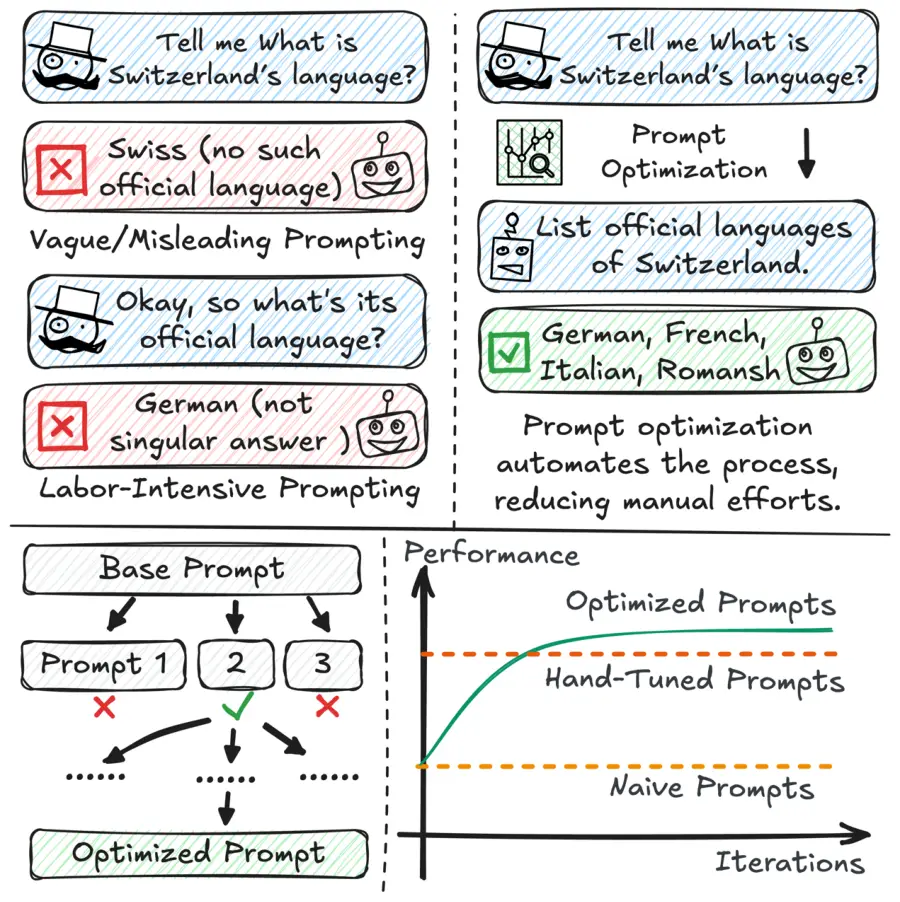
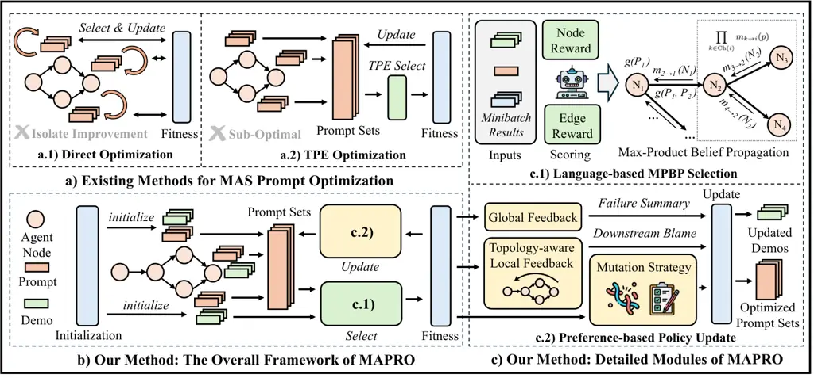
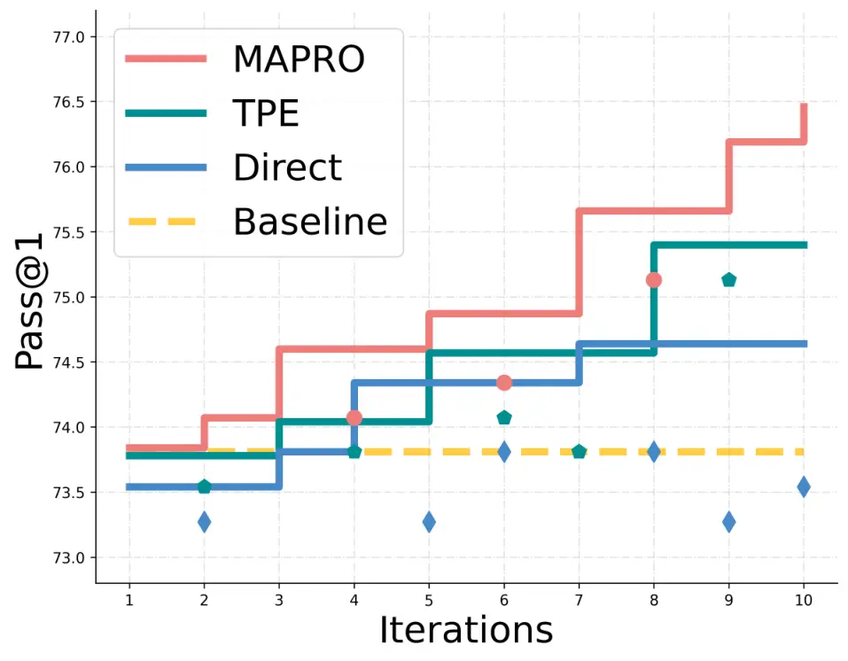

# MAPRO: Recasting Multi-Agent Prompt Optimization as Maximum a Posteriori Inference

Zheyuan Zhang Affiliation: University of Notre Dame
Email: <zzhang42@nd.edu>    Lin Ge Affiliation: Amazon
Email: <yye7@nd.edu>    Hongjiang Li Affiliation: Amazon    Weicheng Zhu
Affiliation: Amazon    Chuxu Zhang Affiliation: University of
Connecticut    Yanfang Ye Affiliation: University of Notre Dame
Affiliation: Corresponding Author

###### Abstract

Large language models (LLMs) have demonstrated remarkable capabilities
across diverse tasks, and LLM-based agents further extend these
abilities to various practical workflows. While recent progress shows
that multi-agent systems (MAS) can outperform single agents by
coordinating specialized roles, designing effective MAS remains
difficult due to prompt sensitivity and the compounded instability MAS
creates. To cope with the challenge, recent efforts in automated prompt
design have reduced manual effort. However, multi-agent prompt
optimization remains largely unexplored. Challenges like exponentially
expanding search space and ambiguous credit assignment together make
systematic design intractable without principled methods. Therefore, we
introduce Multi-Agent PRompt Optimization (MAPRO), a four-stage
framework that first formulates MAS prompt optimization as a Maximum a
Posteriori (MAP) inference problem and solves it using a language-guided
variant of max-product belief propagation algorithm. To address credit
assignment and updates the system iteratively, MAPRO employs a
topology-aware refinement mechanism that integrates execution feedback
and downstream blames to selectively update agent prompts. Through this
process, MAPRO progressively converges to a coordinated set of
agent-specific prompt policies. Across benchmarks in various tasks,
MAPRO achieves state-of-the-art performance, consistently surpassing
manually engineered baselines and recent automated alternatives. Beyond
performance, our MAP-based formulation also delivers general guidelines
for building more reliable and principled multi-agent systems in the
future ¹¹ 1 Work done during internship at Amazon..



Figure 1: Prompt quality governs agent reliability: (top-left) vague,
manually revised prompts are error-prone and costly; (top-right)
automated prompt optimization search and produce correct answers;
(bottom-left) the optimizer explores and selects among candidate
rewrites; (bottom-right) performance improves over iterations,
surpassing hand-tuned prompting.

## 1 Introduction

Large language models (LLMs) have emerged as powerful general-purpose
learners, excelling at tasks that require reasoning, comprehension, and
text generation. Their rapid progress has reshaped both research and
practice across domains ranging from scientific discovery to software
development (Kojima et al., 2022; Ouyang et al., 2022). Building upon
this foundation, LLM-based agents have gained prominence for their
ability to autonomously plan, interact, and solve complex problems with
minimal human supervision. Such agents extend the reach of LLMs into
practical workflows, enabling applications such as program synthesis and
debugging, retrieval-augmented generation, data-centric analysis and
interactive decision-making (Jimenez et al., 2024; Singh et al., 2025;
Guo et al., 2024b; Li et al., 2024). While single agents are useful,
orchestrating multiple LLM agents in a coordinated system has shown even
greater promise (Hong et al., 2024a; Zhong et al., 2024; Wang et al.,
2024b). Multi-agent systems (MAS) leverage diverse perspectives and
roles, such as critics, verifiers, or debaters, to collectively
outperform single-agent counterparts in reasoning, exploration, and
robustness Shinn et al. (2023); Qian et al. (2025); Wang et al. (2025).
Yet, constructing effective MAS is far from straightforward. A recurring
difficulty lies in prompt sensitivity, where small variations in
instructions can drastically alter behavior and degrade performance
(Zhou et al., 2024). In multi-agent settings, where outputs cascade
across agents, such fragility may be compounded, amplifying instability
across the system (Zhou et al., 2025).

To mitigate these challenges, recent work has explored various forms of
automated prompt design and system adaptation. Broadly, these approaches
aim to reduce reliance on manual engineering by algorithmically refining
prompts, adjusting agent roles, or restructuring interaction patterns
(Khattab et al., 2024; Hu et al., 2025). However, despite these
advances, the problem of prompt optimization in multi-agent settings
remains largely underexplored. This gap arises from two core challenges:
(1) the search space grows combinatorially as each agent maintains its
own set of prompt candidates, making it extremely difficult to navigate
efficiently and leaving the system vulnerable to suboptimal local
choices rather than coordinated global improvement; (2) credit
assignment is highly uncertain, since it is rarely clear which agent’s
prompt should be targeted for refinement, how it should be modified, or
whether adjustments at the individual level will even translate into
system-wide gains.

To tackle these challenges, in this paper, we propose Multi-Agent PRompt
Optimization (MAPRO), a four-stage framework that jointly explores the
multi-agent prompt space, propagates feedback signals, and iteratively
refines prompt policy of each agent. By grounding optimization in a
principled inference process, MAPRO provides a structured approach for
navigating the otherwise intractable combinatorial landscape of MAS
design. Specifically, to cope with the exponential search space, we
formalize multi-agent prompt optimization as a Maximum a Posteriori
(MAP) inference problem over Directed Acyclic Graphs (DAGs), and develop
a language-guided variant of the max-product belief propagation (MPBP)
algorithm. This design leverages agent-level and interaction-level
reward models to efficiently approximate globally optimal prompt
assignments in polynomial time complexity. Furthermore, to address the
inherent ambiguity in credit assignment, MAPRO introduces a
topology-aware refinement procedure that maintains distinct prompt
policies for each agent rather than collapsing the system into a single
global policy. By distributing credit by incorporating the blames from
downstream agents, MAPRO progressively converging toward a set of
coordinated yet agent-specific prompt policies that enhance overall
system robustness and performance. Through iterative optimization, MAPRO
produces multi-agent systems that achieve state-of-the-art performance,
surpassing both manually engineered MAS baselines and automatically
generated alternatives in single- and multi-agent settings. These
improvements are consistently demonstrated across diverse tasks,
including mathematical reasoning, question answering, and code
generation. Our contributions can be summarized as follows:

- •
  MAP Inference Formulation. To our best knowledge, we are the first to
  cast multi-agent prompt optimization as a Maximum a Posteriori (MAP)
  inference problem. This formulation provides a principled objective
  for navigating the combinatorial search space, enables efficient
  approximation of globally optimal prompt sets, and offers general
  guidelines for systematic prompt optimization design.
- •
  Topology-aware Credit Assignment. We propose a novel refinement
  mechanism that integrate execution feedback and downstream blames,
  which alleviate the challenge of ambiguous credit assignment, enabling
  targeted improvements to specific agents with distinct prompt
  policies.
- •
  State-of-the-Art Performance. On diverse benchmarks—including
  mathematical reasoning, question answering, and code generation—MAPRO
  consistently surpasses manually engineered MAS baselines and recent
  automated alternatives, establishing new state-of-the-art results in
  multi-agent prompt optimization.

## 2 Preliminary

### 2.1 Multi-agent System as Directed Graph

We study a _multi-agent system_ (MAS) composed of $`N`$
large-language-model agents that collaborate on a shared code-generation
workflow. Let the index set of agents be $`\mathcal{A}=\{1,\dots,N\}`$.
For every agent $`i\in\mathcal{A}`$, the agent-specific _prompt
candidate pool_ is defined as

```math
P_{i}\;=\;\bigl\{\,p_{i}^{1},\,p_{i}^{2},\,\dots,\,p_{i}^{K}\bigr\}, \tag{1}
```

where $`p_{i}^{(k)}`$ is the $`k`$-th candidate prompt ($`k=1,\dots,K`$)
and $`K`$ is the uniform pool size. For clarity, we denote by
$`p_{i}^{*}`$ the optimal prompt candidate, while $`\tilde{p}_{i}`$
represents a selected prompt candidate drawn from the candidate pool.
Because collaboration unfolds through directed hand-offs of textual
outputs, we encode these dependencies as a directed graph
$`G=(\mathcal{V},\mathcal{E}),\mathcal{V}=\mathcal{A}`$, in which each
vertex $`i\in\mathcal{V}`$ corresponds to agent $`i`$, and a directed
edge $`(i,j)\in\mathcal{E}`$ signifies that the output of agent $`i`$ is
consumed as (part of) the input of agent $`j`$. This graph abstraction
concisely captures the information-flow topology that underpins the
subsequent optimization problem.

### 2.2 MAS Prompt Optimization

A prompt set $`\tilde{P}=(\tilde{p}_{1},\dots,\tilde{p}_{N})`$ is
considered successful if the entire workflow executed successfully and
correctly. Unlike single-agent settings, failures in MAS stem from two
sources: 1) Agent Incompetence—producing incorrect code even from
well-formed input, thereby propagating errors; and 2) Defective
Interaction — an upstream agent returning semantically irrelevant text
that blocks downstream progress. Both hazards need to be properly
addressed to achieve good performance.

To make these notions quantitative, we define the _agent score_ to
record the empirical quality of the $`k`$-th prompt of agent $`i`$ as
$`\boldsymbol{g(p_{i}^{k})}`$, and the _edge score_ to measure the
reliability of the corresponding hand-off between the $`k`$-th prompt of
agent $`i`$ and the $`l`$-th prompt of agent $`j`$ as
$`\boldsymbol{g(p_{i}^{k},p_{j}^{l})}`$. Both measures lie in $`[0,1]`$,
where the value 1 denotes flawless behavior. To maximize the system
performance and to reflect that the overall workflow is only as reliable
as its weakest link, we propose the _Joint Quality Score_ for the
multi-agent system as:

```math
\mathcal{T}(\tilde{P})\;=\;\Bigl(\prod_{i=1}^{N}g(\tilde{p}_{i})\Bigr)\Bigl(\prod_{(i,j)\in\mathcal{E}}g(\tilde{p}_{i},\tilde{p}_{j})\Bigr). \tag{2}
```

Note that we put $`\tilde{p}`$ in the equation here and omit $`k`$ and
$`l`$ for simplicity. Intuitively, the performance
$`\mathcal{T}(\tilde{P})`$ of a MAS is good when every agent is
competent and every hand-off is clean, because a single failure at any
node or edge derails the execution. In practice, for agent $`i`$, there
will be $`K`$ agent scores, and the same logic applies for the edge
scores as well, so for $`(i,j)`$, there will be $`K^{2}`$ edge scores.
Therefore, the objective of MAS prompt optimization can be defined as:

```math
P^{*}\;=\;argmax_{P\in P_{1}\times\dots\times P_{N}}\mathcal{T}(P). \tag{3}
```

Equation (3) can be viewed as the _posterior likelihood_ that the entire
system completes the evaluation batch without error, conditioned on the
hidden prompt set $`P`$. Indeed, if we regard each agent outcome and
each edge hand-off as independent Bernoulli events given $`P`$, then
under a uniform prior over prompt sets, maximizing
$`\boldsymbol{\mathcal{T}(P)}`$ is thus equivalent to the classical
maximum-a-posteriori (MAP) problem (Proved in Appendix-C.1)

Why is this problem challenging?

As can be seen, the brute-force search space
$`P_{1}\times\cdots\times P_{N}`$ contains $`K^{N}`$ discrete
combinations. Moreover, the factors are highly interdependent: changing
a single prompt $`p_{i}`$ can affect many downstream agents, making
greedy or local strategies prone to failure. As the objective is
non-convex, discontinuous, and combinatorial, effective optimization
must exploit additional structure—here, the acyclic topology of the
graph $`G`$ (with a prescribed iteration limit)—to prune the search
space and assign credit correctly among interacting prompts. In the next
section, we present an algorithm that leverages these properties to
approximate $`P^{*}`$ in polynomial time.



Figure 2: The Overall Framework of MAPRO. Specifically, a) shows the
existing methods of prompt optimization for MAS and their drawbacks; b)
shows the overall framework of MAPRO compared with existing methods; and
c) demonstrate the detailed modules used in MAPRO.

## 3 Methodology

Now that we have formalized the optimization objective for multi-agent
prompt optimization and highlighted the challenges, we proceed to detail
our proposed framework, Multi-Agent PRompt Optimization (MAPRO). MAPRO
addresses the Multi-agent System (MAS) prompt-optimization problem by
formulating it as a discrete _maximum-a-posteriori_ (MAP) inference over
the joint prompt space and solving it via an iterative, LLM-guided
algorithm. In particular, our method comprises four stages: (1)
Initialization of prompt candidates and reward models; (2)
Language-based MAP selection, which employs LLM-based reward models to
conduct max-product belief-propagation algorithm to efficiently find the
optimal prompt combination (Figure-2 c.1); (3) Preference-based prompt
policy update, which updates the prompt pools and reward models based on
multi-level feedback (Figure-2 c.2); and (4) Termination, which defines
stopping criteria and yields the final optimized prompt set for
downstream left-out testing. We next describe each stage in detail.

### 3.1 Initialization

#### Prompt Candidate Pool Setup.

MAPRO is designed as a plug-and-play setting atop any given MAS. We
assume an established MAS as $`G=(\mathcal{V},\mathcal{E})`$ (as defined
in the preliminaries) and an initial set of base prompts
$`P^{0}=\{p_{1}^{0},\dots,p_{N}^{0}\}`$ for the $`N`$ agents. The first
step is to construct a diverse prompt candidate pool $`P_{i}`$ for each
agent $`i`$ by mutating its original prompt to $`K`$ candidates
following standard practice (Wang et al., 2024c; Xiang et al., 2025),
yielding semantically similar variants
$`P_{i}=\bigl\{p_{i}^{1},\,p_{i}^{2},\,\dots,\,p_{i}^{K}\bigr\}.`$

#### Preference Demonstration Pool Setup.

Inspired by the reward model design of TPO (Li et al., 2025), which
demonstrate human preferences can be aligned during inference without
retraining and achieve comparable results, we instantiate a reward model
$`R`$ and seed the reward model with a set of _accepted_ (positive) and
_rejected_ (negative) example prompt as few-shot _preference
demonstrations_ to guide it to generate scalar scores for each agent
node and edge. Intuitively, it will judge the quality of an agent’s
output in isolation, and the quality of a hand-off between agents.

To initialize these examples, we first run the MAS on a mini-batch of
training tasks $`\mathcal{B}`$ using a few random draws from the prompt
pool $`P_{i}`$. and collect their full interaction traces if the entire
task is solved correctly end-to-end on $`\mathcal{B}`$ Each such
successful trace serves as the initial positive exemplars - the prompt
$`p_{i}`$ used is considered $`d^{+}`$ and the output produced can be
recorded as a _desirable response_ for that agent; likewise, for every
edge, the message serves as an initial example of a good hand-off. To
obtain complementary failure example prompts, we then generate synthetic
negatives by perturbing the successful prompts as $`d^{-}`$. Thus we
obtain, for each agent and edge, a pool of preference prompt responses
$`\mathcal{D}=\{d^{+},\,d^{-}\}`$. The detailed input of the reward
model are provided in the section below.

### 3.2 Language-based MAP Selection

Given the MAP formulation of prompt optimization from above, during the
action selection phase, our goal is to efficiently find the prompt
assignment
$`P^{*}=\bigl\{p_{1}^{*},\,p_{2}^{*},\,\dots,\,p_{N}^{*}\bigr\}`$ that
maximizes the joint quality score. As previously discussed, directly
searching the exponentially large space
$`P_{1}\times\cdots\times P_{N}`$ is intractable. Therefore, we exploit
the factorized structure of the multi-agent system (MAS) and introduce
LLM-guided Max-Product Belief Propagation (LMPBP), which consists of two
steps, specifically, reward model scoring and optimal prompt searching.

#### Reward Model Scoring.

In the first stage, we prompt the reward model $`R`$ to assign numerical
scores between 0 to 1. For each agent $`i`$, the reward model $`R_{i}`$
will rank each prompt $`p_{i}^{k}\in P_{i}`$ and evaluates how well the
prompt would enable agent $`i`$ to fulfill its role. This evaluation is
conditioned on the preference demonstrations $`\mathcal{D}_{i}`$ and the
corresponding input $`x_{i}`$ and desirable response $`y_{i}`$:

```math
g(p_{i}^{k})=R_{i}(x_{i};y_{i};\mathcal{D}_{i};P_{i}), \tag{4}
```

Similarly, for each directed edge $`(i\to j)`$, the reward model
$`R_{ij}`$ produces a score $`g(p_{i}^{k},p_{j}^{l})`$ reflecting how
well agent $`i`$’s output under prompt $`p_{i}`$ would set up agent
$`j`$ for success. Concretely, we have:

```math
g(p_{i}^{k},p_{j}^{l})=R_{ij}(y_{i},\mathcal{D}_{j};P_{j}), \tag{5}
```

This way, we have obtained the reward scores for factors required in the
searching step.

#### Optimal Prompt Searching

After the reward scores are secured, the second stage applies LMPBP to
find the global optimum $`\mathcal{T}(P)`$ exactly in the DAG by passing
local messages that aggregate optimal sub-solutions. For MAS with
multiple parent dependencies, we convert the structure to equivalent
tree-structured via a junction-tree transformation (Implementation
details and equivalence proof in Appendix-C.2). The message-passing
process works as follows: First, it goes through a leaf-to-root pass.
(Note here the notations have different meanings) Assume agent $`i`$
receives messages from all of its children (downstream agents for which
$`i`$ is an input), and then sends an aggregated message up to its own
parent $`j`$. Specifically, for each possible prompt choice of its
parent, agent $`i`$ computes

```math
m_{i\to j}(p_{j})=\max\Bigl[g(p_{i})g(p_{i},p_{j})\!\!\!\!\!\!\prod_{k\in\text{{Child}}(i)}\!\!\!\!\!\!m_{k\to i}(p_{i})\Bigr]. \tag{6}
```

Here $`\text{{Child}}(i)`$ denotes the set of agents that depend on
$`i`$’s output. Intuitively, $`m_{i\to j}(p_{j})`$ represents the best
achievable joint score of the entire subtree rooted at $`i`$, given that
$`i`$’s parent $`j`$ is fixed to prompt $`p_{j}`$. In other words, $`i`$
considers all its own prompt options and those of its descendants, and
encapsulates the optimal outcome (in terms of product of local scores)
in a message indexed by $`p_{j}`$. Once the upward messages reach the
designated root agent $`r`$ (the entry point of MAS), we calculate the
root belief and that agent can evaluate the total score for each of its
prompt candidates using equation-6.

This combines $`r`$’s own goodness score with the messages from all its
children (each of which already accounts for the best configuration of
that child’s subtree). We then select the highest-belief prompt for the
root:

```math
p_{r}^{*}\;=\;\arg\max\beta_{r}(p_{r}). \tag{7}
```

Finally, we perform a downward pass to fix the prompts of the remaining
agents based on the root decision. We visit each child $`i`$ of the root
and choose the prompt that attained the maximum in
$`m_{i\to r}(p_{r})`$:

```math
p_{i}^{*}=\arg\max\Bigl[g(p_{i})\,g(p_{i},p_{r}^{*})\!\!\!\!\!\!\!\prod_{k\in\text{{Child}}(i)}\!\!\!\!\!\!m_{k\to i}(p_{i})\Bigr]. \tag{8}
```

This gives the optimal prompt for agent $`i`$ assuming the root was
$`p_{r}^{*}`$. We then recursively select their best prompt given
$`p_{i}^{*}`$, and so on, until all agents in the graph have an assigned
prompt. This backtracking procedure propagates the optimal choices down
the tree, yielding the globally optimal prompt set $`P^{*}`$ (Proved in
Appendix-C.3). This selected prompt set will next be used in the
refinement stage to collect feedback and further improve the prompt
pools and reward models.

1: Initialization: Set up prompt pools $`P`$, and demonstration
preferences $`\mathcal{D}`$.

2: while termination condition not met, do

3:   // Language-based MAP Selection

4:   Retrieve reward scores $`g(p_{i})`$ and $`g(p_{i},p_{j})`$.

5:   Upward pass to retrieve localized optimal

6:    score $`m_{i\to j}(p_{j})`$ at each node.

7:   Downward pass to assign best prompt $`p*`$

8:    given parents’ choices.

9:   Run with $`P^{\star}`$ on task $`\mathcal{B}`$; update score
$`S(t)`$.

10:   // Preference-guided Policy Update

11:   Update $`\mathcal{D}\leftarrow Critic(\mathcal{D};P;g(P))`$.

12:   Get
$`P\leftarrow\bigl\{Mutate(\mathcal{M}(P^{*}),f_{g},f_{l}),P^{*}\bigr\}`$

13:   if improvements $`\leq\varepsilon`$ over $`T`$ steps then

14:    break

15:   end if

16:   $`t\leftarrow t+1`$

17: end while

18: Inference: Freeze $`P^{\star}`$; test on held-out tasks.

Algorithm 1 MAPRO Overall Process

### 3.3 Preference-based Policy Update

The MAP selection phase yields the global optimal prompt set $`P^{*}`$,
along with an explicit assessment of each agent prompt and hand-offs via
the reward scores. In the prompt policy refinement phase, we leverage
this information, together with actual execution feedback or diffs on
tasks, to update and improve the prompt pools and reward models. The key
idea is to incorporate feedback from multiple levels: (i) global-wise
execution results, (ii) downstream agent blames, and (iii) controlled
prompt mutation strategy to force small edits. By integrating the
multi-level feedback, we can introduce targeted prompt variations to
explore new parts of the search space. After refinement, the MAS is
ready to perform another round of MAP-based selection with updated
components. We detail the feedback collection and update steps below.

#### Reward and Expected Output Update.

We evaluate the performance given $`P^{*}`$ on a set of representative
tasks (e.g., the training question batch $`\mathcal{B}`$) and we update
each agent’s outputs $`y_{i}`$ as the new _desirable response_ for next
cycle of updates. We then use the reward scores as standards to update
the accepted and rejected prompt responses for each agent. Specifically,
we use a critic LLM model to judge if for agent $`i`$, the prompt
$`p_{i}^{k}`$ should be updated as $`d^{+}`$ or $`d^{-}`$. Formally,

```math
\mathcal{D}_{i}\leftarrow Critic(\mathcal{D}_{i};P_{i};g(P_{i})). \tag{9}
```

This process make sure the preference demonstrations are continually
updated so that the reward scores are more closely align with actual
task success.

#### Prompt Pool Refinement.

We improve the prompt candidate pool by generating new variations using
a mutate LLM model with innovative feedback design from three aspects:
global feedback $`f_{g}`$ indicating the final execution feedback; local
feedback $`f_{l}`$ which takes the reversed topology and ask each agent
to generate blames to it upstream agents based on their generated input
and $`f_{g}`$, achieving fine-grained credit assignment; and a
predefined mutation strategy set with small edits $`\mathcal{M}`$ which
mimics the idea of _trust region_ in MAP policy optimization, keep the
prompt variations from drifting afar. Formally, we invoke an LLM-based
prompt mutation function to produce a refined prompt pools $`P^{new}`$
that modifies $`P^{*}`$:

```math
P_{i}^{new}=\bigl\{Mutate(\mathcal{M}(p_{i}^{*}),f_{g},f_{l}),p_{i}^{*}\bigr\}. \tag{10}
```

Through such prompt augmentation, the MAS explores new prompts that are
informed by past failures yet remain close to proven good prompts,
thereby continuously improving robustness. Finally, the updated prompt
pools are then used in the next iteration of MAP-based selection.

### 3.4 Termination

We iterate the select–update loop until the improvements in the joint
reward have saturated, indicating convergence to an optimal prompt
policy. To formalize the stopping criterion, let $`S^{(t)}`$ denote the
joint validation score (e.g., pass rate) obtained by the best prompt set
at iteration $`t`$. We define $`\Delta S_{t}=S^{(t)}-S^{(t-1)}`$ as the
improvement in reward compared to the previous iteration. We choose a
fixed _patience window_ size $`T`$ (e.g., $`T=3`$) and a small tolerance
$`\varepsilon\!\geq\!0`$. After each iteration $`t\!\geq\!T`$, collect
the recent gains $`\{\Delta S_{t-T+1},\dots,\Delta S_{t}\}.`$ and we
terminate the optimization loop when

```math
\max_{i=1,\dots,T}\;\Delta S_{t-i+1}\;\leq\;\varepsilon, \tag{11}
```

which means no improvement exceeding $`\varepsilon`$ has been observed
in the last $`T`$ iterations. This rule halts exactly when the system
has shown no progress over the specified window, ensuring that
computation stops once the prompt policy has plateaued. After
termination, we obtain the final optimized prompt set $`P^{*}`$ for
test-time inference on unseen tasks. By locking in $`P^{*}`$, we ensure
the efficiency of the system that no additional time is required during
inference. The time complexity of training phase is analyzed in
Appendix-C.4

|                            |     |           |                    |                    |                    |                    |                    |                    |                    |
| -------------------------- | --- | --------- | ------------------ | ------------------ | ------------------ | ------------------ | ------------------ | ------------------ | ------------------ |
| Backbone: Claude Haiku 3.5 |     |           | Code Generation    |                    |                    | Question Answering |                    | Math Reasoning     |                    |
| Model                      | MAS | Optimized | HumanEval-ET       | MBPP-Plus          | CodeContest        | NewsQA             | WebQuestion        | MATH               | GSM8K              |
| Raw                        | ✗   | ✗         | 69.38 $`\pm`$ 3.24 | 70.93 $`\pm`$ 0.34 | 20.36 $`\pm`$ 2.29 | 49.12 $`\pm`$ 0.11 | 33.50 $`\pm`$ 0.41 | 59.54 $`\pm`$ 1.10 | 88.57 $`\pm`$ 0.53 |
| CoT                        | ✗   | ✗         | 70.31 $`\pm`$ 1.91 | 71.98 $`\pm`$ 0.39 | 22.91 $`\pm`$ 1.46 | 54.44 $`\pm`$ 0.30 | 33.22 $`\pm`$ 0.32 | 60.25 $`\pm`$ 0.56 | 90.71 $`\pm`$ 0.34 |
| ReAct                      | ✗   | ✗         | 72.19 $`\pm`$ 1.71 | 71.02 $`\pm`$ 0.31 | 21.21 $`\pm`$ 0.61 | 58.72 $`\pm`$ 0.30 | 33.60 $`\pm`$ 0.34 | 61.29 $`\pm`$ 1.03 | 91.50 $`\pm`$ 0.39 |
| EvoPrompt                  | ✗   | ✓         | 75.63 $`\pm`$ 2.10 | 73.97 $`\pm`$ 0.48 | 22.18 $`\pm`$ 1.26 | 60.44 $`\pm`$ 0.74 | 34.99 $`\pm`$ 0.39 | 60.81 $`\pm`$ 1.66 | 92.37 $`\pm`$ 0.31 |
| PromptBreeder              | ✗   | ✓         | 75.31 $`\pm`$ 0.70 | 74.13 $`\pm`$ 0.22 | 21.45 $`\pm`$ 1.47 | 60.76 $`\pm`$ 0.17 | 35.12 $`\pm`$ 0.51 | 60.43 $`\pm`$ 0.52 | 92.24 $`\pm`$ 0.18 |
| Chain                      | ✓   | ✗         | 71.88 $`\pm`$ 1.10 | 74.34 $`\pm`$ 1.14 | 28.85 $`\pm`$ 2.29 | 60.88 $`\pm`$ 0.72 | 34.85 $`\pm`$ 0.40 | 62.82 $`\pm`$ 0.89 | 92.06 $`\pm`$ 0.27 |
| w/t Direct                 | ✓   | ✓         | 73.96 $`\pm`$ 2.30 | 74.87 $`\pm`$ 0.53 | 29.70 $`\pm`$ 0.61 | 62.20 $`\pm`$ 1.31 | 34.25 $`\pm`$ 0.21 | 63.80 $`\pm`$ 0.21 | 92.76 $`\pm`$ 0.14 |
| w/t TPE                    | ✓   | ✓         | 75.00 $`\pm`$ 1.56 | 75.22 $`\pm`$ 0.40 | 29.90 $`\pm`$ 0.93 | 63.80 $`\pm`$ 0.20 | 34.01 $`\pm`$ 0.13 | 62.81 $`\pm`$ 0.37 | 92.72 $`\pm`$ 0.21 |
| w/t MAPRO                  | ✓   | ✓         | 80.21 $`\pm`$ 0.90 | 76.54 $`\pm`$ 0.67 | 31.52 $`\pm`$ 0.61 | 64.00 $`\pm`$ 0.35 | 34.65 $`\pm`$ 0.30 | 64.30 $`\pm`$ 0.59 | 93.48 $`\pm`$ 0.42 |
| DMAD                       | ✓   | ✗         | 72.19 $`\pm`$ 1.31 | 73.02 $`\pm`$ 0.37 | 36.77 $`\pm`$ 0.93 | 60.40 $`\pm`$ 0.37 | 34.43 $`\pm`$ 0.44 | 61.08 $`\pm`$ 0.39 | 90.39 $`\pm`$ 0.46 |
| w/t Direct                 | ✓   | ✓         | 73.44 $`\pm`$ 1.56 | 74.07 $`\pm`$ 0.27 | 38.79 $`\pm`$ 0.61 | 62.20 $`\pm`$ 0.20 | 34.91 $`\pm`$ 0.07 | 62.85 $`\pm`$ 0.11 | 91.19 $`\pm`$ 0.36 |
| w/t TPE                    | ✓   | ✓         | 72.92 $`\pm`$ 2.39 | 73.54 $`\pm`$ 0.53 | 37.58 $`\pm`$ 0.61 | 61.80 $`\pm`$ 0.35 | 35.22 $`\pm`$ 0.13 | 62.81 $`\pm`$ 0.37 | 91.87 $`\pm`$ 0.29 |
| w/t MAPRO                  | ✓   | ✓         | 77.08 $`\pm`$ 1.81 | 74.60 $`\pm`$ 0.27 | 38.99 $`\pm`$ 1.95 | 62.93 $`\pm`$ 0.12 | 35.50 $`\pm`$ 0.33 | 63.33 $`\pm`$ 0.46 | 91.96 $`\pm`$ 0.58 |
| ChatEval (Swarm)           | ✓   | ✗         | 73.44 $`\pm`$ 1.10 | 72.60 $`\pm`$ 0.34 | 38.79 $`\pm`$ 1.05 | 60.36 $`\pm`$ 0.26 | 33.33 $`\pm`$ 0.34 | 62.62 $`\pm`$ 0.97 | 91.59 $`\pm`$ 0.89 |
| w/t Direct                 | ✓   | ✓         | 74.48 $`\pm`$ 2.38 | 73.19 $`\pm`$ 0.46 | 38.18 $`\pm`$ 0.61 | 61.80 $`\pm`$ 0.20 | 34.17 $`\pm`$ 0.29 | 63.83 $`\pm`$ 0.84 | 91.42 $`\pm`$ 0.47 |
| w/t TPE                    | ✓   | ✓         | 76.04 $`\pm`$ 0.90 | 73.28 $`\pm`$ 0.26 | 40.61 $`\pm`$ 0.61 | 62.53 $`\pm`$ 0.31 | 34.35 $`\pm`$ 0.18 | 62.68 $`\pm`$ 0.58 | 91.31 $`\pm`$ 0.62 |
| w/t MAPRO                  | ✓   | ✓         | 78.13 $`\pm`$ 1.56 | 73.98 $`\pm`$ 0.15 | 41.41 $`\pm`$ 0.93 | 62.67 $`\pm`$ 0.31 | 34.52 $`\pm`$ 0.20 | 63.13 $`\pm`$ 0.84 | 91.73 $`\pm`$ 0.41 |

Table 1: Performance results with baseline methods on Claude Haiku 3.5.
We report the mean and standard deviation for all results. The best
performance is bolded and runner-ups are underlined.

| Prompt Optimization Example                                                                                                                                                                                                                                                                                                                                    |
| -------------------------------------------------------------------------------------------------------------------------------------------------------------------------------------------------------------------------------------------------------------------------------------------------------------------------------------------------------------- |
| Base instruction:                                                                                                                                                                                                                                                                                                                                              |
| You are a Python programmer. Write pure, runnable Python code that solves the task.                                                                                                                                                                                                                                                                            |
| Adding:                                                                                                                                                                                                                                                                                                                                                        |
| You are a Python programmer. Write pure, runnable Python code that solves the task. Ensure the solution is a single function named solution with robust input validation, direct implementation, and no type hints. Handle edge cases explicitly and provide clear, executable code.                                                                           |
| Replacement:                                                                                                                                                                                                                                                                                                                                                   |
| You are a Python programmer. Write pure, runnable Python code that solves the task. Ensure the solution is a single function named solution with robust input validation using isinstance() checks, type conversion fallbacks, and comprehensive error handling. Use try-except blocks with specific exception types, provide default values for edge cases, … |

Table 2: "Adding" appends guidance to the prompt while "Replacement"
rewrites previous parts with better instructions. Colors highlight the
modified texts.

## 4 Experiments

### 4.1 Experimental Setup

Benchmarks. We conduct experiments on an extensive collection of tasks:
HumanEval-ET, MBPP-Plus and CodeContest for code generation task, NewsQA
and WebQuesion for question answering task, and MATH and GSK8K for math
reasoning task. Since we are focusing on the prompt optimization and
have a training scheme, we discuss the split of sets with other details
including citations of these benchmarks in Appendix-B.1.

Baselines. We consider the following types of baselines: 1) Single
agents without prompt optimization, including the raw model, and the
most classical baselines CoT and ReAct; 2) Single agents with prompt
optimization, including two most recent SOTA baselines EvoPrompt, and
PromptBreeder. 3) Classical Multi-agent baselines without prompt
optimization. While there are many MAS, we hope to choose the ones that
are designed for general tasks, recent SOTA and covering as many types
of common topologies as possible, therefore we choose Chain Design,
DMAD, and the "swarm" version of ChatEval, which is
Simultaneous-Talk-with-Summarizer. 4) Prompt optimization for MAS
baselines. Since we only consider prompt optimization²² 2 In this paper,
we consider the plug-and-play settings an unique advantage and don’t
update the topology because this is more friendly to industry scenarios
where teams already have their developed MAS implemented and in
production., we adopt the direct optimization method from GPTSwarm and
Tree-structured Parzen Estimator (TPE) methods used in MASS and MIPRO to
each of the MAS we described above to make a comprehensive comparison.
More details including the citations of the baselines are in
Appendix-B.2.



Figure 3: Optimization trajectories on the MBPP+ benchmark. We report
the first ten optimization iterations using the chain MAS framework.
MAPRO exhibits a more consistent and steady improvement compared to
alternative methods.

|                         |     |           |                    |                    |                    |                    |                    |                    |                    |
| ----------------------- | --- | --------- | ------------------ | ------------------ | ------------------ | ------------------ | ------------------ | ------------------ | ------------------ |
| Backbone: Llama 3.3-70b |     |           | Code Generation    |                    |                    | Question Answering |                    | Math Reasoning     |                    |
| Model                   | MAS | Optimized | HumanEval-ET       | MBPP-Plus          | CodeContest        | NewsQA             | WebQuestion        | MATH               | GSM8K              |
| Raw                     | ✗   | ✗         | 67.81 $`\pm`$ 0.86 | 68.04 $`\pm`$ 0.68 | 19.76 $`\pm`$ 2.08 | 58.65 $`\pm`$ 0.96 | 33.15 $`\pm`$ 0.50 | 67.56 $`\pm`$ 1.44 | 91.71 $`\pm`$ 0.37 |
| CoT                     | ✗   | ✗         | 68.44 $`\pm`$ 1.31 | 68.04 $`\pm`$ 0.22 | 21.09 $`\pm`$ 1.31 | 60.56 $`\pm`$ 0.35 | 34.35 $`\pm`$ 0.47 | 69.01 $`\pm`$ 0.66 | 92.06 $`\pm`$ 0.29 |
| ReAct                   | ✗   | ✗         | 69.06 $`\pm`$ 0.70 | 68.15 $`\pm`$ 0.44 | 20.36 $`\pm`$ 0.69 | 62.06 $`\pm`$ 0.28 | 35.84 $`\pm`$ 0.54 | 69.26 $`\pm`$ 0.84 | 92.34 $`\pm`$ 0.27 |
| EvoPrompt               | ✗   | ✓         | 72.19 $`\pm`$ 1.71 | 69.74 $`\pm`$ 0.64 | 20.85 $`\pm`$ 1.33 | 64.37 $`\pm`$ 0.34 | 35.47 $`\pm`$ 0.41 | 71.62 $`\pm`$ 0.38 | 93.12 $`\pm`$ 0.19 |
| PromptBreeder           | ✗   | ✓         | 71.88 $`\pm`$ 1.10 | 69.10 $`\pm`$ 0.29 | 20.85 $`\pm`$ 1.40 | 64.53 $`\pm`$ 0.43 | 35.77 $`\pm`$ 0.16 | 71.01 $`\pm`$ 0.44 | 93.05 $`\pm`$ 0.23 |
| Chain                   | ✓   | ✗         | 70.00 $`\pm`$ 1.31 | 68.68 $`\pm`$ 0.14 | 27.52 $`\pm`$ 2.08 | 63.20 $`\pm`$ 0.45 | 35.24 $`\pm`$ 0.28 | 71.45 $`\pm`$ 1.04 | 93.71 $`\pm`$ 0.25 |
| w/t Direct              | ✓   | ✓         | 71.35 $`\pm`$ 1.80 | 69.58 $`\pm`$ 0.46 | 28.08 $`\pm`$ 0.70 | 63.62 $`\pm`$ 0.27 | 36.16 $`\pm`$ 0.18 | 70.37 $`\pm`$ 0.57 | 93.89 $`\pm`$ 0.31 |
| w/t TPE                 | ✓   | ✓         | 71.88 $`\pm`$ 1.56 | 70.28 $`\pm`$ 0.40 | 28.69 $`\pm`$ 0.93 | 63.80 $`\pm`$ 0.21 | 36.04 $`\pm`$ 0.03 | 71.64 $`\pm`$ 0.62 | 93.42 $`\pm`$ 0.22 |
| w/t MAPRO               | ✓   | ✓         | 75.00 $`\pm`$ 1.56 | 72.31 $`\pm`$ 0.55 | 30.10 $`\pm`$ 0.70 | 63.82 $`\pm`$ 0.54 | 36.22 $`\pm`$ 0.30 | 71.87 $`\pm`$ 0.35 | 93.56 $`\pm`$ 0.34 |
| DMAD                    | ✓   | ✗         | 70.94 $`\pm`$ 0.86 | 70.37 $`\pm`$ 0.46 | 34.06 $`\pm`$ 0.90 | 63.82 $`\pm`$ 0.54 | 35.56 $`\pm`$ 0.11 | 69.85 $`\pm`$ 0.42 | 94.12 $`\pm`$ 0.19 |
| w/t Direct              | ✓   | ✓         | 71.88 $`\pm`$ 1.56 | 70.90 $`\pm`$ 0.26 | 35.35 $`\pm`$ 0.70 | 64.12 $`\pm`$ 0.35 | 36.02 $`\pm`$ 0.20 | 70.99 $`\pm`$ 0.33 | 94.93 $`\pm`$ 0.33 |
| w/t TPE                 | ✓   | ✓         | 71.35 $`\pm`$ 1.80 | 70.55 $`\pm`$ 0.40 | 34.55 $`\pm`$ 0.61 | 64.30 $`\pm`$ 0.29 | 36.14 $`\pm`$ 0.22 | 71.32 $`\pm`$ 0.26 | 94.67 $`\pm`$ 0.28 |
| w/t MAPRO               | ✓   | ✓         | 73.96 $`\pm`$ 0.90 | 71.60 $`\pm`$ 0.31 | 35.96 $`\pm`$ 1.53 | 65.10 $`\pm`$ 0.24 | 36.22 $`\pm`$ 0.28 | 72.99 $`\pm`$ 0.33 | 95.91 $`\pm`$ 0.30 |
| ChatEval (Swarm)        | ✓   | ✗         | 71.25 $`\pm`$ 0.86 | 71.43 $`\pm`$ 0.19 | 34.91 $`\pm`$ 1.01 | 63.73 $`\pm`$ 0.43 | 36.44 $`\pm`$ 0.32 | 71.32 $`\pm`$ 0.26 | 93.14 $`\pm`$ 0.31 |
| w/t Direct              | ✓   | ✓         | 72.92 $`\pm`$ 0.90 | 70.99 $`\pm`$ 0.31 | 35.15 $`\pm`$ 0.61 | 64.02 $`\pm`$ 0.26 | 36.36 $`\pm`$ 0.27 | 71.73 $`\pm`$ 0.57 | 92.58 $`\pm`$ 0.37 |
| w/t TPE                 | ✓   | ✓         | 72.40 $`\pm`$ 2.39 | 71.78 $`\pm`$ 0.31 | 36.36 $`\pm`$ 0.61 | 64.18 $`\pm`$ 0.31 | 36.41 $`\pm`$ 0.27 | 71.48 $`\pm`$ 0.80 | 92.45 $`\pm`$ 0.34 |
| w/t MAPRO               | ✓   | ✓         | 75.00 $`\pm`$ 1.56 | 72.22 $`\pm`$ 0.26 | 37.17 $`\pm`$ 0.93 | 65.45 $`\pm`$ 0.09 | 36.55 $`\pm`$ 0.29 | 72.26 $`\pm`$ 0.71 | 92.38 $`\pm`$ 0.40 |

Table 3: Performance results with baseline methods on Llama 3.3-70b. We
report the mean and standard deviation for all results. The best
performance is bolded and runner-ups are underlined.

| Method    | HumanEval-ET       | MBPP-Plus          | CodeContest        | NewsQA             | WebQuestion        | MATH               | GSM8K              |
| --------- | ------------------ | ------------------ | ------------------ | ------------------ | ------------------ | ------------------ | ------------------ |
| MAPRO     | 80.21 $`\pm`$ 0.90 | 76.54 $`\pm`$ 0.67 | 31.52 $`\pm`$ 0.61 | 64.00 $`\pm`$ 0.35 | 34.65 $`\pm`$ 0.30 | 64.30 $`\pm`$ 0.59 | 93.48 $`\pm`$ 0.42 |
| w/o demos | 76.04 $`\pm`$ 0.90 | 75.22 $`\pm`$ 0.31 | 29.70 $`\pm`$ 0.61 | 62.33 $`\pm`$ 0.31 | 34.20 $`\pm`$ 0.35 | 63.87 $`\pm`$ 0.23 | 92.86 $`\pm`$ 0.15 |
| Drop (%)  | 5.20%              | 1.72%              | 5.78%              | 2.61%              | 1.30%              | 0.67%              | 0.66%              |

Table 4: Ablation study results showing the performance drop when
removing demonstration-guided reward. Numbers are reported with mean
$`\pm`$ standard deviation, and relative drops are given in percentage.

### 4.2 Main Results

We present the main results of MAPRO against baselines in Table 1 and
Table 3. Across all benchmarks, MAPRO consistently achieves superior
performance, often setting the best results within the same MAS,
underscoring the strength of our approach. Several additional insights
emerge. In terms of MAS structure, while topology exerts a stronger
influence on overall accuracy than prompts, our plug-and-play design
offers unmatched flexibility and extensibility, avoiding the heavy cost
of topology optimization and enabling efficient deployment. As for task
characteristics, MAPRO delivers the largest gains on reasoning-intensive
tasks (e.g., WebQuestions, MBPP-Plus) compared to knowledge-heavy ones
(e.g., NewsQA, CodeContest), highlighting the unique advantage of prompt
optimization in complex reasoning. For LLM backbones, the results
reaffirm general trends—Haiku excels in code, whereas Llama is stronger
in reasoning—but also show that MAPRO adapts well across both. Notably,
the optimal MAS under Llama shifted toward more sophisticated designs,
suggesting that stronger reasoning models further amplify the benefits
of our framework. Overall, these results validate MAPRO as both more
effective and more versatile than existing methods, with significant
potential for even greater gains on future LLMs.

### 4.3 Optimization Trajectory

We visualize the optimization trajectory of MAPRO as shown in Figure-3.
MAPRO’s trajectory demonstrates a more steady trend of optimization that
gradually improves the validation performance towards better prompt
sets, whereas we observe more fluctuations when it comes to other
optimization methods, as they have a hard time capturing complicate
interplays between agents. We further inspect an example of optimized
prompt trajectory of an agent node in Table-2. As can be seen, the
prompt evolves overtime with more precise instructions that provides
task-specific insights. These insights, especially the repeatedly
occurring refinements, in practice, can be ingested into knowledge base
which facilitates human-in-the-loop process and bring in more
reliability and robustness to the system.

### 4.4 Reward Model Analysis

To assess the incremental gains of the reward models, we conducted an
ablation study across all tasks. As shown in Table 4, the results
underscore the critical role of demonstration-guided reward, consistent
with TPO (Li et al., 2025). A key insight is that the contribution of
demonstrations varies across tasks, likely due to the relative
simplicity of certain benchmarks such as those in the math domain. We
also examined the consistency of the scoring process: under a low
temperature setting, the selection procedure produced nearly identical
outcomes across tasks and MAS configurations, so we omit ablation on
that front. This robustness, together with the ablation results,
demonstrate the efficacy of our reward model design.

## 5 Conclusion

We introduced MAPRO, a principled framework that first recasts
multi-agent prompt optimization as a MAP inference problem and resolves
it through language-guided belief propagation and topology-aware
refinement. Across diverse downstream tasks, MAPRO consistently
surpasses all types of baselines, demonstrating its effectiveness and
generality. Beyond strong empirical gains, MAPRO delivers a
plug-and-play setting that balances accuracy with flexibility. This
flexibility, together with the interpretability provided by the
optimization trajectories, making MAPRO especially practical for
real-world MAS deployment and improvement.

## Limitations

In this section, we discuss the limitations of our work and outline
promising directions for future research. First, our study focuses
exclusively on optimizing prompts for MASs while keeping the agent
topology fixed. The results suggest that additional gains could be
achieved through more deliberate choices of MAS topology. However,
updating the topology requires reconfiguring the entire system, which is
substantially more complex and resource-intensive. In many industrial
applications where MAS designs are already deployed or constrained by
fixed requirements, such re-establishment is impractical. This reflects
a fundamental trade-off between flexibility, extensibility, efficiency,
and performance. Nevertheless, extending MAPRO to jointly optimize both
prompts and topologies would be an exciting avenue for future
exploration. Second, while we employed LLM-based agents as reward models
and demonstrated their efficacy and consistency, it would be valuable to
investigate fine-tuned alternatives. In particular, approaches such as
Max a Posteriori Policy Optimization (Abdolmaleki et al., 2018) offer a
principled framework that could replace our current reward mechanism and
integrate more seamlessly into the overall optimization process.
Exploring such directions could further enhance the robustness and
generality of our approach.

## References

- Abdolmaleki et al. (2018) Abbas Abdolmaleki, Jost Tobias Springenberg,
  Yuval Tassa, Remi Munos, Nicolas Heess, and Martin Riedmiller. 2018.
  Maximum a posteriori policy optimisation. In _ICLR_.
- Berant et al. (2013) Jonathan Berant, Andrew Chou, Roy Frostig, and
  Percy Liang. 2013. Semantic parsing on freebase from question-answer
  pairs. In _EMNLP_.
- Chan et al. (2024) Chi-Min Chan, Weize Chen, Yusheng Su, Jianxuan Yu,
  Wei Xue, Shanghang Zhang, Jie Fu, and Zhiyuan Liu. 2024. Chateval:
  Towards better llm-based evaluators through multi-agent debate. In
  _ICLR_.
- Chen et al. (2024a) Jingchang Chen, Hongxuan Tang, Zheng Chu,
  Qianglong Chen, Zekun Wang, Ming Liu, and Bing Qin. 2024a.
  Divide-and-conquer meets consensus: Unleashing the power of functions
  in code generation. In _NeurIPS_.
- Chen et al. (2024b) Yongchao Chen, Jacob Arkin, Yilun Hao, Yang Zhang,
  Nicholas Roy, and Chuchu Fan. 2024b. Prompt optimization in multi-step
  tasks (promst): Integrating human feedback and heuristic-based
  sampling. In _EMNLP_.
- Cobbe et al. (2021) Karl Cobbe, Vineet Kosaraju, Mohammad Bavarian,
  Mark Chen, Heewoo Jun, Lukasz Kaiser, Matthias Plappert, Jerry Tworek,
  Jacob Hilton, Reiichiro Nakano, et al. 2021. Training verifiers to
  solve math word problems. _arXiv preprint arXiv:2110.14168_.
- Cui et al. (2025) Wendi Cui, Jiaxin Zhang, Zhuohang Li, Hao Sun,
  Damien Lopez, Kamalika Das, Bradley A Malin, and Sricharan
  Kumar. 2025. Automatic prompt optimization via heuristic search: A
  survey. _arXiv_.
- Dainese et al. (2024) Nicola Dainese, Matteo Merler, Minttu
  Alakuijala, and Pekka Marttinen. 2024. Generating code world models
  with large language models guided by monte carlo tree search. In
  _NeurIPS_.
- Dong et al. (2025) Yihong Dong, Jiazheng Ding, Xue Jiang, Ge Li, Zhuo
  Li, and Zhi Jin. 2025. Codescore: Evaluating code generation by
  learning code execution. _ACM Transactions on Software Engineering and
  Methodology_.
- Feng et al. (2024) Xidong Feng, Bo Liu, Yan Song, Haotian Fu, Ziyu
  Wan, Girish A Koushik, Zhiyuan Hu, Mengyue Yang, Ying Wen, and Jun
  Wang. 2024. Natural language reinforcement learning. _arXiv preprint
  arXiv:2411.14251_.
- Fernando et al. (2024) Chrisantha Fernando, Dylan Banarse, Henryk
  Michalewski, Simon Osindero, and Tim Rocktäschel. 2024. Promptbreeder:
  self-referential self-improvement via prompt evolution. In _ICML_.
- Ge et al. (2025) Lin Ge, Hengrui Cai, Runzhe Wan, Yang Xu, and Rui
  Song. 2025. A review of causal decision making. _arXiv preprint
  arXiv:2502.16156_.
- Guo et al. (2024a) Qingyan Guo, Rui Wang, Junliang Guo, Bei Li, Kaitao
  Song, Xu Tan, Guoqing Liu, Jiang Bian, and Yujiu Yang. 2024a.
  Connecting large language models with evolutionary algorithms yields
  powerful prompt optimizers. In _ICLR_.
- Guo et al. (2025) Qingyan Guo, Rui Wang, Junliang Guo, Bei Li, Kaitao
  Song, Xu Tan, Guoqing Liu, Jiang Bian, and Yujiu Yang. 2025.
  Evoprompt: Connecting llms with evolutionary algorithms yields
  powerful prompt optimizers. _arXiv_.
- Guo et al. (2024b) Siyuan Guo, Cheng Deng, Ying Wen, Hechang Chen,
  Yi Chang, and Jun Wang. 2024b. Ds-agent: automated data science by
  empowering large language models with case-based reasoning. In _ICML_.
- Hendrycks et al. (2021) Dan Hendrycks, Collin Burns, Saurav Kadavath,
  Akul Arora, Steven Basart, Eric Tang, Dawn Song, and Jacob
  Steinhardt. 2021. Measuring mathematical problem solving with the math
  dataset. In _NeuralIPS_.
- Hong et al. (2024a) Sirui Hong, Mingchen Zhuge, Jonathan Chen, Xiawu
  Zheng, Yuheng Cheng, Jinlin Wang, Ceyao Zhang, Zili Wang, Steven
  Ka Shing Yau, Zijuan Lin, et al. 2024a. Metagpt: Meta programming for
  a multi-agent collaborative framework. In _ICLR_.
- Hong et al. (2024b) Sirui Hong, Mingchen Zhuge, Jonathan Chen, Xiawu
  Zheng, Yuheng Cheng, Jinlin Wang, Ceyao Zhang, Zili Wang, Steven
  Ka Shing Yau, Zijuan Lin, et al. 2024b. Metagpt: Meta programming for
  a multi-agent collaborative framework. In _ICLR_.
- Hu et al. (2025) Shengran Hu, Cong Lu, and Jeff Clune. 2025. Automated
  design of agentic systems. In _ICLR_.
- Jiang et al. (2024) Haitao Jiang, Lin Ge, Yuhe Gao, Jianian Wang, and
  Rui Song. 2024. Llm4causal: Democratized causal tools for everyone via
  large language model. In _CoLM_.
- Jimenez et al. (2024) Carlos E Jimenez, John Yang, Alexander Wettig,
  Shunyu Yao, Kexin Pei, Ofir Press, and Karthik R Narasimhan. 2024.
  Swe-bench: Can language models resolve real-world github issues? In
  _ICLR_.
- Khattab et al. (2024) Omar Khattab, Arnav Singhvi, Paridhi Maheshwari,
  Zhiyuan Zhang, Keshav Santhanam, Saiful Haq, Ashutosh Sharma, Thomas T
  Joshi, Hanna Moazam, Heather Miller, et al. 2024. Dspy: Compiling
  declarative language model calls into state-of-the-art pipelines. In
  _ICLR_.
- Kojima et al. (2022) Takeshi Kojima, Shixiang Shane Gu, Machel Reid,
  Yutaka Matsuo, and Yusuke Iwasawa. 2022. Large language models are
  zero-shot reasoners. _NeurIPS_.
- Lei et al. (2025) Chao Lei, Yanchuan Chang, Nir Lipovetzky, and
  Krista A Ehinger. 2025. Planning-driven programming: A large language
  model programming workflow. _ACL_.
- Li et al. (2024) Manling Li, Shiyu Zhao, Qineng Wang, Kangrui Wang,
  Yu Zhou, Sanjana Srivastava, Cem Gokmen, Tony Lee, Li Erran Li, Ruohan
  Zhang, et al. 2024. Embodied agent interface: benchmarking llms for
  embodied decision making. In _NeuralIPS_.
- Li et al. (2025) Yafu Li, Xuyang Hu, Xiaoye Qu, Linjie Li, and
  Yu Cheng. 2025. Test-time preference optimization: On-the-fly
  alignment via iterative textual feedback. In _ICML_.
- Li et al. (2022) Yujia Li, David Choi, Junyoung Chung, Nate Kushman,
  Julian Schrittwieser, Rémi Leblond, Tom Eccles, James Keeling, Felix
  Gimeno, Agustin Dal Lago, et al. 2022. Competition-level code
  generation with alphacode. _Science_.
- Liu et al. (2023) Jiawei Liu, Chunqiu Steven Xia, Yuyao Wang, and
  Lingming Zhang. 2023. Is your code generated by chatgpt really
  correct? rigorous evaluation of large language models for code
  generation. _NeuralIPS_.
- Liu et al. (2025a) Xiangyan Liu, Bo Lan, Zhiyuan Hu, Yang Liu,
  Zhicheng Zhang, Fei Wang, Michael Shieh, and Wenmeng Zhou. 2025a.
  Codexgraph: Bridging large language models and code repositories via
  code graph databases. _NAACL_.
- Liu et al. (2025b) Yexiang Liu, Jie Cao, Zekun Li, Ran He, and Tieniu
  Tan. 2025b. Breaking mental set to improve reasoning through diverse
  multi-agent debate. In _ICLR_.
- Madaan et al. (2023) Aman Madaan, Niket Tandon, Prakhar Gupta, Skyler
  Hallinan, Luyu Gao, Sarah Wiegreffe, Uri Alon, Nouha Dziri, Shrimai
  Prabhumoye, Yiming Yang, et al. 2023. Self-refine: Iterative
  refinement with self-feedback. _NeurIPS_.
- Opsahl-Ong et al. (2024) Krista Opsahl-Ong, Michael Ryan, Josh
  Purtell, David Broman, Christopher Potts, Matei Zaharia, and Omar
  Khattab. 2024. Optimizing instructions and demonstrations for
  multi-stage language model programs. In _EMNLP_.
- Ouyang et al. (2022) Long Ouyang, Jeffrey Wu, Xu Jiang, Diogo Almeida,
  Carroll Wainwright, Pamela Mishkin, Chong Zhang, Sandhini Agarwal,
  Katarina Slama, Alex Ray, et al. 2022. Training language models to
  follow instructions with human feedback. _NeuralIPS_.
- Ouyang et al. (2025) Siru Ouyang, Wenhao Yu, Kaixin Ma, Zilin Xiao,
  Zhihan Zhang, Mengzhao Jia, Jiawei Han, Hongming Zhang, and Dong
  Yu. 2025. Repograph: Enhancing ai software engineering with
  repository-level code graph. _ICLR_.
- Qian et al. (2024) Chen Qian, Wei Liu, Hongzhang Liu, Nuo Chen, Yufan
  Dang, Jiahao Li, Cheng Yang, Weize Chen, Yusheng Su, Xin Cong,
  et al. 2024. Chatdev: Communicative agents for software development.
  In _ACL_.
- Qian et al. (2025) Chen Qian, Zihao Xie, YiFei Wang, Wei Liu, Kunlun
  Zhu, Hanchen Xia, Yufan Dang, Zhuoyun Du, Weize Chen, Cheng Yang,
  et al. 2025. Scaling large language model-based multi-agent
  collaboration. In _ICLR_.
- Shinn et al. (2023) Noah Shinn, Federico Cassano, Ashwin Gopinath,
  Karthik Narasimhan, and Shunyu Yao. 2023. Reflexion: Language agents
  with verbal reinforcement learning. _NeurIPS_.
- Singh et al. (2025) Aditi Singh, Abul Ehtesham, Saket Kumar, and
  Tala Talaei Khoei. 2025. Agentic retrieval-augmented generation: A
  survey on agentic rag. _arXiv_.
- Song et al. (2025) Feifan Song, Yuxuan Fan, Xin Zhang, Peiyi Wang, and
  Houfeng Wang. 2025. Instantly learning preference alignment via
  in-context dpo. In _NAACL_.
- Trischler et al. (2016) Adam Trischler, Tong Wang, Xingdi Yuan, Justin
  Harris, Alessandro Sordoni, Philip Bachman, and Kaheer Suleman. 2016.
  Newsqa: A machine comprehension dataset. _arXiv_.
- Wang et al. (2025) Junlin Wang, WANG Jue, Ben Athiwaratkun, Ce Zhang,
  and James Zou. 2025. Mixture-of-agents enhances large language model
  capabilities. In _ICLR_.
- Wang et al. (2024a) Ruochen Wang, Sohyun An, Minhao Cheng, Tianyi
  Zhou, Sung Ju Hwang, and Cho-Jui Hsieh. 2024a. One prompt is not
  enough: automated construction of a mixture-of-expert prompts. In
  _ICML_.
- Wang et al. (2024b) Xingyao Wang, Yangyi Chen, Lifan Yuan, Yizhe
  Zhang, Yunzhu Li, Hao Peng, and Heng Ji. 2024b. Executable code
  actions elicit better llm agents. In _ICML_.
- Wang et al. (2024c) Xinyuan Wang, Chenxi Li, Zhen Wang, Fan Bai,
  Haotian Luo, Jiayou Zhang, Nebojsa Jojic, Eric Xing, and Zhiting Hu.
  2024c. Promptagent: Strategic planning with language models enables
  expert-level prompt optimization. In _ICLR_.
- Wei et al. (2022) Jason Wei, Xuezhi Wang, Dale Schuurmans, Maarten
  Bosma, Fei Xia, Ed Chi, Quoc V Le, Denny Zhou, et al. 2022.
  Chain-of-thought prompting elicits reasoning in large language models.
  _NeuralIPS_.
- Wu et al. (2024) Zhaoxuan Wu, Xiaoqiang Lin, Zhongxiang Dai, Wenyang
  Hu, Yao Shu, See-Kiong Ng, Patrick Jaillet, and Bryan Kian Hsiang
  Low. 2024. Prompt optimization with ease? efficient ordering-aware
  automated selection of exemplars. In _NeurIPS_.
- Xiang et al. (2025) Jinyu Xiang, Jiayi Zhang, Zhaoyang Yu, Fengwei
  Teng, Jinhao Tu, Xinbing Liang, Sirui Hong, Chenglin Wu, and Yuyu
  Luo. 2025. Self-supervised prompt optimization. _arXiv_.
- Yao et al. (2023) Shunyu Yao, Jeffrey Zhao, Dian Yu, Nan Du, Izhak
  Shafran, Karthik Narasimhan, and Yuan Cao. 2023. React: Synergizing
  reasoning and acting in language models. In _ICLR_.
- Zhang et al. (2025a) Guibin Zhang, Yanwei Yue, Xiangguo Sun, Guancheng
  Wan, Miao Yu, Junfeng Fang, Kun Wang, Tianlong Chen, and Dawei Cheng.
  2025a. G-designer: Architecting multi-agent communication topologies
  via graph neural networks. _ICML_.
- Zhang et al. (2025b) Zheyuan Zhang, Tianyi Ma, Zehong Wang, Yiyang Li,
  Shifu Hou, Weixiang Sun, Kaiwen Shi, Yijun Ma, Wei Song, Ahmed Abbasi,
  et al. 2025b. Llms4all: A review on large language models for research
  and applications in academic disciplines. _arXiv preprint
  arXiv:2509.19580_.
- Zhang et al. (2025c) Zheyuan Zhang, Kaiwen Shi, Zhengqing Yuan, Zehong
  Wang, Tianyi Ma, Keerthiram Murugesan, Vincent Galassi, Chuxu Zhang,
  and Yanfang Ye. 2025c. Agentrouter: A knowledge-graph-guided llm
  router for collaborative multi-agent question answering. _arXiv_.
- Zheng et al. (2025) Kunhao Zheng, Juliette Decugis, Jonas Gehring,
  Taco Cohen, Gabriel Synnaeve, et al. 2025. What makes large language
  models reason in (multi-turn) code generation? In _The Thirteenth
  International Conference on Learning Representations_.
- Zhong et al. (2024) Li Zhong, Zilong Wang, and Jingbo Shang. 2024.
  Debug like a human: A large language model debugger via verifying
  runtime execution step by step. In _Findings of ACL_.
- Zhou et al. (2024) Han Zhou, Xingchen Wan, Lev Proleev, Diana Mincu,
  Jilin Chen, Katherine A Heller, and Subhrajit Roy. 2024. Batch
  calibration: Rethinking calibration for in-context learning and prompt
  engineering. In _ICLR_.
- Zhou et al. (2025) Han Zhou, Xingchen Wan, Ruoxi Sun, Hamid Palangi,
  Shariq Iqbal, Ivan Vulić, Anna Korhonen, and Sercan Ö Arık. 2025.
  Multi-agent design: Optimizing agents with better prompts and
  topologies. _arXiv_.
- Zhuge et al. (2024) Mingchen Zhuge, Wenyi Wang, Louis Kirsch,
  Francesco Faccio, Dmitrii Khizbullin, and Jürgen Schmidhuber. 2024.
  Gptswarm: language agents as optimizable graphs. In _ICML_.

## Appendix A Related Work

### A.1 Prompt Optimization for MAS

Recent progress in large language models (LLMs) has enabled multi-agent
systems (MAS), in which cooperating agents consistently outperform
single agents on demanding reasoning and software-engineering tasks
(Zhang et al., 2025c; Zhang et al., 2025b; Zhong et al., 2024; Wang
et al., 2024b). This performance, however, depends on labor-intensive
prompt engineering: each agent needs carefully crafted role
instructions, and this effort grows rapidly as the number of agents
increases, because aligning coordination between them becomes
increasingly complex. To ease this burden, many studies now frame prompt
design as an optimization problem and use heuristic search algorithms to
explore and refine prompts with minimal human effort and oversight.

Prompt optimization in LLMs generally falls into two main categories:
soft-prompt tuning in continuous space and discrete prompt optimization
in text space. Soft tuning supports gradient-based updates but
sacrifices transparency and portability, as its learned vectors are
opaque, model-specific, and require gradient access that most black-box
APIs do not provide (Cui et al., 2025). To work around this, researchers
approximate gradients with LLM feedback and develop gradient-like
strategies suited for non-differentiable settings. For example, some
works apply beam search for step-wise refinement (Chen et al., 2024b;
Wang et al., 2024c), while others explore alternative optimization
strategies, such as evolutionary algorithms (Guo et al., 2025; Fernando
et al., 2024) and other heuristic algorithms (Opsahl-Ong et al., 2024;
Li et al., 2025), to adapt prompts iteratively. Another related line of
work focuses on prompt selection, searching a pool of variants to pick
the best one (Wu et al., 2024; Wang et al., 2024a; Song et al., 2025).

However, most existing methods target a single agent, while prompt
optimization for MAS as a whole remains under-explored. Among the few
efforts in this area, Mass (Zhou et al., 2025) warms each agent’s role
prompt, prunes the interaction graph, and then jointly fine-tunes all
prompts, showing that layered optimization boosts group performance.
GPTSwarm (Zhuge et al., 2024) treats agents as a graph and updates
node-level prompts and edge connections together, letting prompts
co-evolve with coordination patterns. We argue that the importance of
proper prompt design has been significantly under-studied in these prior
works. Specifically, current approaches still overlook two key issues:
even minor lexical edits upstream can shift the distributions seen by
downstream agents, and, to the best of our knowledge, none of the
methods searches for a globally optimal set of prompts for the full
system.

### A.2 LLM Agents for Code Generation Tasks

Code generation has emerged as a core application for large language
model (LLM) agents because it links natural-language reasoning with
concrete, testable outputs and promises to automate sizable portions of
software engineering and data-science workflows. Early studies tackled
this task with single-agent or minimally interactive pipelines—such as
Self-Refine (Madaan et al., 2023), Reflexion (Shinn et al., 2023), and
CoT-Zero (Kojima et al., 2022)—that plan, execute, and iteratively
repair their own code until unit tests pass. These works showed that
even simple agent interactions can improve reliability when the agent
can inspect failures and revise its output, a process that loosely
aligns with causal reasoning Ge et al. (2025); Jiang et al. (2024): the
model infers potential sources of error and adjusts its generation in
response.

As multi-agent systems advance, the trend has shifted toward complex MAS
with carefully designed role-play interactions. Frameworks like CodeAct
(Wang et al., 2024b), MetaGPT (Hong et al., 2024b), and ChatDev (Qian
et al., 2024) assign specialized roles—planner, coder, tester,
reviewer—and let agents converse in plain language, mimicking real
software teams. These orchestrated exchanges boost division of labor and
help solve coding problems that demand sophisticated reasoning, though
they impose substantial overhead in prompt design. Building on these
frameworks, recent work explores several directions. Some studies
enhance individual modules through richer planning (Lei et al., 2025;
Chen et al., 2024a), stronger verification (Dainese et al., 2024; Zheng
et al., 2025), or improved knowledge bases (Ouyang et al., 2025; Liu
et al., 2025a). Others introduce supervised signals into the framework,
such as reinforcement learning (Feng et al., 2024), to guide agent
behavior.

However, across all phases, prompt design remains a bottleneck: each
role prompt must be carefully crafted, and even minor edits can ripple
through the workflow. Consequently, a growing body of research now
investigates automatic prompt optimization (Zhang et al., 2025a; Zhou
et al., 2025) to unlock more reliable and generalizable
agent-collaboration schemes for real-world coding tasks.

## Appendix B Implementation Details

### B.1 Benchmarks

HumanEval-ET Dong et al. (2025) is an extended benchmark for evaluating
code generation. It builds upon the original HumanEval dataset by
introducing more challenging variations and refined evaluation
protocols, particularly emphasizing error tolerance and execution-based
correctness. The dataset is specifically designed to better capture the
robustness of large language models (LLMs) under real-world coding
scenarios, where multiple correct implementations may exist and minor
deviations from reference solutions should not necessarily be penalized.
By incorporating these refinements, HumanEval-ET provides a more
reliable and nuanced measure of code generation quality. Since this
dataset doesn’t provide a train-test split, we used the first 100
records for optimization and the rest 64 for zero-shot left-out testing.

MBPP-Plus (Liu et al., 2023) extends the "Mostly Basic Python Problems"
(MBPP) dataset into a larger and more diverse collection. While MBPP was
originally created to evaluate basic programming competency using short
Python functions, MBPP-Plus expands both the scale and variety of tasks
to cover more intricate programming constructs, edge cases, and
multi-step logic. This augmentation addresses the limitations of the
original dataset by providing a broader set of problems that better
reflect practical coding challenges, thereby serving as a more
comprehensive benchmark for evaluating code generation models.

CodeContest (Li et al., 2022) is a benchmark derived from real
competitive programming problems, representing a significant increase in
difficulty compared to synthetic or basic coding datasets. It contains
tasks sampled from programming competitions, where problems are designed
to require algorithmic reasoning, data structure manipulation, and
efficiency considerations. The inclusion of strict input–output
constraints and hidden test cases makes CodeContest a rigorous benchmark
that challenges LLMs to go beyond template-based solutions and
demonstrate genuine problem-solving ability. Given the large volume of
this dataset’s training set, we sample the same records as the test set
from training for optimization.

NewsQA (Trischler et al., 2016) is a large-scale question answering
dataset constructed from CNN news articles. It consists of over 100,000
human-generated questions paired with answers derived from corresponding
news passages. Unlike earlier QA datasets that focus on simple fact
extraction, NewsQA emphasizes reasoning, inference, and synthesis across
multiple sentences within an article. Its design introduces ambiguity,
unanswerable questions, and multi-sentence reasoning, making it a
challenging benchmark for evaluating reading comprehension and
open-domain question answering systems. Given the large volume of this
dataset, we sample the first 500 records to use as optimization and
left-out testing.

WebQuestions (Berant et al., 2013) is a benchmark dataset for semantic
parsing and knowledge-base question answering. It contains around 6,000
natural language questions paired with answers sourced from Freebase,
covering a diverse range of topics. The dataset is notable for requiring
models to bridge the gap between natural language queries and structured
knowledge graph representations, thereby testing a system’s ability to
perform entity linking, relation extraction, and logical reasoning. As
one of the earliest large-scale QA datasets grounded in knowledge bases,
WebQuestions has been widely adopted as a standard benchmark for
semantic parsing and open-domain QA research. Given the large volume of
this dataset, we sample the first 500 records to use as optimization and
left-out testing.

MATH (Hendrycks et al., 2021) is a dataset specifically designed to
evaluate advanced mathematical reasoning in LLMs. It contains
approximately 12,000 competition-style problems, ranging from high
school mathematics to Olympiad-level challenges, with step-by-step
solutions provided. Unlike arithmetic-focused datasets, MATH covers a
broad spectrum of topics including algebra, geometry, number theory, and
calculus, requiring multi-step reasoning and symbolic manipulation. Its
complexity makes it one of the most rigorous benchmarks for assessing
the capacity of LLMs to handle formal reasoning and mathematical
problem-solving. Given the large volume of this dataset’s training set,
we sample the same records as the test set from training for
optimization.

GSM8K (Cobbe et al., 2021) (Grade School Math 8K) is a benchmark
comprising 8.5k carefully crafted grade-school-level math word problems.
Each problem is designed to require multi-step reasoning with arithmetic
operations, testing a model’s ability to parse natural language
descriptions, translate them into formal reasoning steps, and compute
the correct answer. The dataset emphasizes chain-of-thought reasoning
and has become a standard testbed for evaluating LLMs’ ability to
perform reliable symbolic reasoning in relatively simple but
compositional tasks. Its structured design and moderate difficulty level
make GSM8K complementary to more advanced datasets like MATH. Given the
large volume of this dataset’s training set, we sample the same records
as the test set from training for optimization.

### B.2 Baselines

Chain-of-Thought (CoT) (Wei et al., 2022) is a prompting paradigm that
encourages large language models (LLMs) to generate intermediate
reasoning steps before arriving at final answers. Unlike direct-answer
prompting, CoT exposes the model’s latent reasoning process, which has
been shown to substantially improve performance on tasks requiring
multi-step deduction such as arithmetic, commonsense inference, and
symbolic reasoning. The introduction of CoT has established a new
standard for eliciting reasoning from LLMs, making it a fundamental
baseline in subsequent research. Its effectiveness also highlights a
broader principle: structured prompting can significantly extend the
reasoning capability of LLMs without the need for additional training.

ReAct (Yao et al., 2023) builds upon CoT by integrating reasoning with
acting. Specifically, ReAct enables agents to interleave
chain-of-thought reasoning with concrete actions, such as querying
external knowledge sources, interacting with environments, or calling
tools. This synergy allows models to dynamically refine their reasoning
based on external feedback, thereby reducing hallucinations and
improving factual grounding. ReAct has been validated across diverse
tasks including knowledge-intensive QA, fact verification, and embodied
agent settings, where its reasoning-and-acting paradigm consistently
outperforms reasoning-only or acting-only strategies. As a baseline,
ReAct represents an important step toward interactive and tool-augmented
LLM systems.

EvoPrompt (Guo et al., 2024a) frames prompt optimization as an
evolutionary search process, where a population of prompts is
iteratively mutated and recombined to generate stronger candidates. The
method relies on large language models themselves as operators for
variation, while selection mechanisms ensure gradual improvement. This
makes EvoPrompt effective for black-box single-agent prompt
optimization. However, its design remains confined to evolving isolated
prompts, and it does not extend naturally to multi-agent settings where
inter-agent coordination and topology play central roles.

PromptBreeder (Fernando et al., 2024) extends evolutionary prompt
optimization by introducing self-referential mutation. In this
framework, not only task-prompts but also the mutation-prompts that
generate them are evolved, enabling the system to adapt its own
optimization strategy over time. This self-referential design yields a
flexible and automated process for refining prompts in single-agent
contexts. Nevertheless, PromptBreeder is inherently tailored to
optimizing individual prompts and does not address the complexities of
scaling to multi-agent systems.

Chain (Shinn et al., 2023) represents the simplest combination topology
of MAS. In our study, it combines the reasoning-and-acting paradigm of
ReAct with a self-reflection module. After completing a task, the agent
revisits its reasoning trajectory, identifies mistakes, and integrates
corrective feedback into subsequent attempts. By incorporating the
simple reflection module into the loop, Chain improves both robustness
and sample efficiency. In our experiments, we adopt this variant as a
baseline to capture the benefits of the effectiveness of simple MAS,
compared with other MAS choices.

DMAD (Liu et al., 2025b) (Diverse Multi-Agent Debate) is a recent
state-of-the-art framework designed to overcome the inherent limitations
of multi-agent debate (MAD). Traditional MAD setups often fall prey to a
mental set, where agents—even if assigned different personas—rely on
similar reasoning strategies, limiting their ability to explore
alternative solutions. DMAD explicitly addresses this by requiring each
agent to employ a distinct reasoning method (e.g., Chain-of-Thought,
Step-Back Prompting, Program-of-Thought), thereby fostering genuine
diversity in problem-solving. This represents an intermediate-complexity
MAS topology that balances complexity and expressiveness. Given its
robustness and state-of-the-art results, we consider DMAD an essential
MAS base structure for evaluating MAS-level optimization.

ChatEval (Chan et al., 2024) is a multi-agent evaluation framework that
leverages structured dialogue among diverse LLM agents to produce more
reliable judgments. In our study, we adopt the
Simultaneous-Talk-with-Summarizer variant, which we call SWARM, where
agents contribute in parallel and a summarizer condenses their
discussion into a concise shared history. In this setting, each agent
interacts with each other in a dense format, making this baseline a
typical and representative topology type, as it emphasizes on the
richness of multi-agent discussion with strong reasoning and
expressiveness.

GPTSwarm (Zhuge et al., 2024) frames language agents as computational
graphs, where each node corresponds to an operation such as an LLM
query, and edges capture the flow of information across agents. This
framework is intended for optimizing both topology and prompts. To
enable a fair comparison, we focus solely on the prompt optimization
parts of this work. Within this framework, Direct Optimization is
employed to refine the prompts associated with each node individually,
using input–output histories and iterative updates to improve local
performance. This strategy allows each operation to self-improve in
isolation, but it treats prompts largely as independent units and does
not account for the interdependencies across the wider agent graph. In
contrast, our MAPRO framework explicitly models prompt optimization as a
joint inference problem over the entire MAS topology, propagating credit
and dependencies across nodes and edges. Thus, while GPTSwarm provides a
strong formulation of node-level direct optimization, our approach
generalizes this idea to coordinated optimization across multi-agent
systems, addressing the limitations of local-only updates

TPE Optimization (Zhou et al., 2025; Opsahl-Ong et al., 2024) applies a
Tree-structured Parzen Estimator (TPE)–based Bayesian search strategy to
optimize prompts in multi-agent systems. In these frameworks, prompts
(instructions and demonstrations) are treated as discrete parameters,
and TPE is used to model the joint contribution of different parameter
settings to downstream performance. This surrogate-based approach
efficiently explores the search space by prioritizing promising
configurations from past evaluations. Unlike Direct Optimization, which
treats node prompts independently, TPE can partially capture
dependencies between variables through its probabilistic modeling.
However, TPE optimization still operates over a fixed pool of candidate
proposals, limiting its ability to propagate credit across agents or
adapt proposals dynamically. In contrast, our MAPRO framework formulates
prompt optimization as a joint inference problem across the entire MAS
topology, explicitly propagating dependencies and credit signals across
nodes and edges. This enables coordinated optimization beyond the local
or surrogate-based updates employed by TPE methods, addressing their
limitations in capturing the full structure of multi-agent interactions.

### B.3 Training Protocol

We limit the number of preference demonstrations to 3 and candidates to 5. We limit the agent number smaller than 10. We set model temperature
at 0.2, maximum output tokens at 2048. We implement the same LLM
backbone as both evaluator and executors in all phases. The optimized
MAS is reported on the held-out test set over three runs, while other
baselines over five runs. Given our mission to optimize the prompts, we
didn’t spend too much effort on prompt engineering, which mimics the
real-life scenarios where a general prompt is adopted to a specific
downstream tasks. The specific prompt designs can be seen in Appendix-D.

## Appendix C Proof

### C.1 Proof of MAP Equivalence

By Bayes’ rule, the classic MAP estimate chooses the hypothesis $`P`$
that maximizes the posterior:

```math
\displaystyle\widehat{P}_{\mathrm{MAP}} \displaystyle\in\arg\max_{P}\;\Pr(P\mid S) \tag{12}
```

```math
\displaystyle=\arg\max_{P}\;\Pr(S\mid P)\,\pi(P),
```

where $`S`$ is the observed event and $`\pi(P)`$ is the prior on $`P`$.
This way MAP finds the most probable explanation (the most likely hidden
variable assignment) given what one observed.

In our case, $`P=(p_{1},\dots,p_{N})\in P_{1}\times\cdots\times P_{N}`$
is a joint prompt assignment and $`S`$ denote the event that the system
succeeds on the batch. By construction of the node/edge success scores
$`g(\cdot),g(\cdot,\cdot)`$,

```math
\displaystyle\Pr(S\mid P) \displaystyle=\prod_{i=1}^{N}\Pr(X_{i}{=}1\mid P)\ \!\!\!\!\prod_{(i,j)\in\mathcal{E}}\!\!\!\Pr(Y_{ij}{=}1\mid P) \tag{13}
```

```math
\displaystyle=\prod_{i=1}^{N}g(p_{i})\;\!\!\!\!\prod_{(i,j)\in\mathcal{E}}\!\!\!g(p_{i},p_{j})
```

```math
\displaystyle=:\mathcal{T}(P).
```

Since we do not assume one prompt set is inherently better than another
(we have no prior knowledge). The most neutral choice is to use a
uniform prior, and under a uniform prior, every
$`P\in P_{1}\times\cdots\times P_{N}`$ is assigned the same positive
probability. Thus $`\pi(P)=c`$ for some constant $`c>0`$ independent of
$`P`$. Since multiplying by a constant does not affect an $`\arg\max`$,
we have

```math
\arg\max_{P}f(P)\,c=\arg\max_{P}f(P).
```

Therefore, given $`\mathcal{T}(P)=\Pr(S\mid P)`$,

```math
\displaystyle\arg\max_{P}\Pr(P\mid S) \displaystyle=\arg\max_{P}\Pr(S\mid P)\,\pi(P) \tag{14}
```

```math
\displaystyle=\arg\max_{P}\Pr(S\mid P)\,c
```

```math
\displaystyle=\arg\max_{P}\Pr(S\mid P)
```

```math
\displaystyle=\arg\max_{P}\mathcal{T}(P).
```

Thus, maximizing the Joint Quality Score is exactly a MAP estimate of
$`P`$.

### C.2 Proof of Junction Tree MAP

Max-product belief propagation (MPBP) is guaranteed to compute the exact
MAP assignment only on tree-structured factor graphs. For a DAG
$`G=(\mathcal{V},\mathcal{E})`$, the factorization ($`\mathcal{T}(P)`$)
generally induces cycles, since a node $`j`$ with multiple parents
couples the variables $`\{p_{i}:(i,j)\in\mathcal{E}\}`$ together.
Formally, one first moralizes and triangulates the DAG to ensure a
chordal structure admitting a junction tree.

The junction-tree construction converts this DAG factorization into an
equivalent tree-structured form. The procedure groups variables into
clusters $`C\subseteq\mathcal{V}`$, each associated with a potential
$`\psi_{C}`$ defined as

```math
\psi_{C}(P_{C}):=\prod_{i\in C}g(p_{i})\;\!\!\!\!\!\prod_{\begin{subarray}{c}(i,j)\in\mathcal{E}\\
\{i,j\}\subseteq C\end{subarray}}\!\!\!g(p_{i},p_{j}), \tag{15}
```

where $`P_{C}=\{p_{i}:i\in C\}`$. In words, every factor is assigned to
exactly one cluster that contains its variables. Clusters are arranged
in a tree $`\mathcal{T}_{\text{JT}}`$ satisfying the _running
intersection property_: if a variable $`p_{i}`$ appears in two clusters
$`C_{1},C_{2}`$, then it appears in every cluster on the unique path
between $`C_{1}`$ and $`C_{2}`$ in $`\mathcal{T}_{\text{JT}}`$.

The resulting representation is an exact refactorization:

```math
\mathcal{T}(P)=\prod_{C\in\mathcal{C}}\psi_{C}(P_{C})\,/\prod_{s\in\mathcal{S}}\psi_{s}(P_{s}), \tag{16}
```

where $`\mathcal{S}`$ denotes the separator sets (intersections of
adjacent clusters). Here each separator potential $`\psi_{s}`$ is
defined as the product of factors assigned to $`s`$, ensuring no double
counting. The division by separators ensures that no factor is
double-counted and that the product reproduces exactly
$`\mathcal{T}(P)`$. Since this is equivalent to the original joint score
$`\mathcal{T}(P)`$ but expressed on a tree-structured factor graph,
applying MPBP to $`\{\psi_{C}\}`$ on the junction tree yields

```math
\arg\max_{P}\;\mathcal{T}(P)=\arg\max_{P}\;\frac{\prod_{C\in\mathcal{C}}\psi_{C}(P_{C})}{\prod_{s\in\mathcal{S}}\psi_{S}(P_{s})}. \tag{17}
```

which recovers the exact MAP assignment of $`P`$. Hence, the
junction-tree transformation converts a general DAG into a
tree-structured model where MPBP can be applied directly and exactly.
This ratio form follows from the junction-tree theorem, which guarantees
that clique potentials multiplied and corrected by separator terms
reproduce the exact joint distribution.

### C.3 Proof of MAP Global Optimality

_Lemma (optimal-subtree property)._ Assume the reward factorization is
finite and has no negative factors, for any edge $`i\!\to\!j`$ and any
$`p_{j}`$, $`m_{i\to j}(p_{j})`$ equals the maximum of the product of
factors contained in the subtree rooted at $`i`$, conditioned on
$`p_{j}`$.

_Proof._ Assume $`i`$ is a leaf agent node, (6) reduces to
$`\max_{p_{i}}g(p_{i})g(p_{i},p_{j})`$, the best score of the leaf edge
given $`p_{j}`$. Assume the claim holds for all children
$`k\in\text{{Child}}(i)`$. Then the product inside (6) equals, for each
fixed $`p_{i}`$, the optimal contributions of all child sub-trees
consistent with $`p_{i}`$; maximizing over $`p_{i}`$ yields the optimal
value of the entire subtree at $`i`$ given $`p_{j}`$.

_Theorem (global MAP optimality)._ Let
$`p_{r}^{*}\in\arg\max_{p_{r}}\beta_{r}(p_{r}).`$ Then there exists an
assignment $`P^{\star}`$ obtained by the standard downward backtracking
that satisfies $`P^{*}\in\arg\max_{P}\mathcal{T}(P),`$

since the root collects optimal contributions from all disjoint
subtrees. Thus

```math
\max_{p_{r}}\beta_{r}(p_{r})=\max_{P}\mathcal{T}(P).
```

During the upward pass, for every edge $`i\!\to\!j`$ and parent value
$`p_{j}`$, the maximizer(s) achieving (6) define a witness choice
$`p_{i}^{\star}(p_{j})`$. Starting from
$`p_{r}^{*}\in\arg\max\beta_{r}(p_{r})`$ and recursing
$`p_{i}^{\star}\!\left(p_{j}^{*}\right)`$ along edges away from $`r`$
yields a full assignment $`P^{*}`$ that realizes the global maximum
(ties broken arbitrarily).

_Remark (junction tree)._ In the clique/sepset form, replace nodes $`i`$
by cliques $`C`$, parent $`j`$ by neighbor $`D`$, $`p_{i}`$ by
$`P_{C}`$, and $`g`$ by $`\psi`$; messages are

```math
m_{C\to D}(P_{S_{CD}})\!\!=\!\!\max_{P_{C\setminus S_{CD}}}\!\!\bigl[\psi_{C}(P_{C})\!\!\!\!\!\!\!\!\!\!\prod_{B\in\mathrm{nb}(C)\setminus\{D\}}\!\!\!\!\!\!\!\!\!\!m_{B\to C}(P_{S_{BC}})\bigr],
```

and the same induction establishes exact MAP for the original DAG via
the established equivalence.

### C.4 Time Complexity Analysis

MPBP on a tree. Let $`N=|\mathcal{V}|`$ be the number of agents,
$`E=|\mathcal{E}|`$ the number of edges, and $`K=\max_{i}|P_{i}|`$ the
maximum size of any agent’s prompt pool. On a tree-structured factor
graph, each edge passes one message in each direction. Updating a single
message requires comparing all prompt pairs $`(p_{i},p_{j})`$, which
costs $`O(K^{2})`$. Since there are $`O(E)`$ such messages in total, the
overall complexity is

```math
O(EK^{2}).
```

Junction-Tree MAP (general DAG). For a DAG, we convert the graph into a
junction tree whose clique set is denoted $`\mathcal{C}`$. Let $`w`$ be
the induced treewidth, i.e. the size of the largest clique minus one.
Each message update involves marginalizing/maximizing over a clique
table of size $`O(K^{w+1})`$, and there are $`O(|\mathcal{C}|)`$ such
cliques (at most linear in $`N`$). Thus the complexity is

```math
O(|\mathcal{C}|\,K^{w+1}),
```

with storage requirements of the same order.

The treewidth $`w`$ reflects how many agents must be grouped into a
single clique to remove cycles. For instance, if two agents both depend
on the same parent, they may be merged into a summary clique of size
three, so $`w=2`$. If a node has three parents, then a clique containing
all four variables may be needed, giving $`w=3`$. In general, sparse MAS
graphs usually have small $`w`$ (often $`2`$ or $`3`$), so the
exponential factor $`K^{w+1}`$ remains modest. This means that in
practical multi-agent settings, where each agent only interacts with a
few neighbors, junction-tree MAP is efficient and scales nearly linearly
with $`N`$ once $`w`$ is bounded.

In summary, we control both selection and update phase in polynomial
time complexity and it scales well the increase of the density of
interactions as well as the size of candidate pools, which emphasize the
scalability and efficiency of our MAPRO framework.

## Appendix D Prompt Designs


Figure 4: Unified Reward Modeling Prompts for MAPRO: node-level (left)
and edge-level (right), merging each module’s header and reward prefix
verbatim.


Figure 5: Feedback system prompts in MAPRO (for coding tasks): global
feedback, local feedback, and mutation strategy.


Figure 6: Initialization prompts in MAPRO: variation (left) for diverse
positive variants and neg_variation (right) for intentionally degraded
variants.


Figure 7: Unified coding prompt suite for coding solutions. The five
roles (RAW, CoT, ReAct, Reflect, Note) ensure silent planning, strict
code-only output, conservative review, and precise conformance to I/O
constraints.


Figure 8: Unified math prompt suite for exact, well-formatted solutions.
The five roles (RAW, CoT, ReAct, Reflect, Note) enforce silent planning,
precise symbolic work, and a canonical boxed final answer. Different
from coding prompts, prompts for question answering are rather similar
to math prompts as they both relate to reasoning, thus we skip the
demonstration here.
