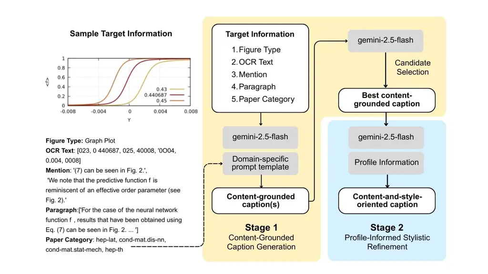

# Leveraging Author-Specific Context for Scientific Figure Caption Generation: 3rd SciCap Challenge

Watcharapong Timklaypachara   Monrada Chiewhawan   Nopporn Lekuthai
Affiliation: Department of Biomedical Engineering, Faculty of
Engineering, Mahidol University Affiliation: Faculty of Medicine
Ramathibodi Hospital, Mahidol University, Bangkok, Thailand    Titipat
Achakulvisut Affiliation: Department of Biomedical Engineering, Faculty
of Engineering, Mahidol University

###### Abstract

Scientific figure captions require both accuracy and stylistic
consistency to convey visual information. Here, we present a
domain-specific caption generation system for the 3rd SciCap Challenge
that integrates figure-related textual context with author-specific
writing styles using the LaMP-Cap dataset. Our approach uses a two-stage
pipeline: Stage 1 combines context filtering, category-specific prompt
optimization via DSPy’s MIPROv2 and SIMBA, and caption candidate
selection; Stage 2 applies few-shot prompting with profile figures for
stylistic refinement. Our experiments demonstrate that category-specific
prompts outperform both zero-shot and general optimized approaches,
improving ROUGE-1 recall by +8.3% while limiting precision loss to -2.8%
and BLEU-4 reduction to -10.9%. Profile-informed stylistic refinement
gains of 40–48% in BLEU scores and 25–27% in ROUGE. Our system
demonstrates that combining contextual understanding with
author-specific stylistic adaptation can generate captions that are
scientifically accurate and stylistically faithful to the source paper.

 [https://github.com/biodatlab/scicap-titipapa](https://github.com/biodatlab/scicap-titipapa)

## 1 Introduction

Scientific figure captions play a crucial role in helping diverse
audiences interpret and understand complex visual information (Lundgard
& Satyanarayan, 2021). However, manual caption writing is time-consuming
and often inconsistent, particularly when authors must generate numerous
captions while maintaining stylistic coherence throughout their
manuscripts. Automatic caption generation provides a promising solution
to enhance scientific communication efficiency and reduce the burden on
researchers (Hsu et al., 2021). Recent advances in large language models
(LLMs) have demonstrated the ability to comprehend complex scientific
content and adapt to distinctive linguistic patterns (Zanotto &
Aroyehun, 2024). This capability enables the development of
context-aware systems that can generate specific author writing styles,
potentially reducing manual editing. Our approach uses the LaMP-Cap
dataset with contextual information to generate context-grounded and
personalized scientific captions. Here, we present a two-stage
scientific figure caption generation at the 3rd SciCap Challenge. The
first stage involves context filtering, prompt optimization to generate
category-focused captions, and candidate selection. The second stage
incorporates relevant profile information to improve stylistic elements
consistent with the source paper. We found that combining these
approaches improves the alignment of the generated caption.

## 2 Data Processing

We used the LaMP-CAP dataset for caption generation. The dataset
consists of 110,828 scientific articles with 80:10:10
train/test/validation splits. Each article includes one target figure
and up to three associated profile figures. Each figure contains
mentioned text, accompanying paragraph, OCR texts, caption length, and
figure type as a context for the caption generation. During prompt
optimization, we exclusively used the training set to generate
instruction templates per paper category. This dataset contains 8 fields
including Computer Science, Economics, Electrical Engineering and
Systems Science, Mathematics, Physics, Quantitative Biology,
Quantitative Finance, and Statistics. There are 155 unique categories
with 50,110 single category papers and 60,718 papers with multiple
categories (1.83 ± 0.95 categories per paper on average).

## 3 Methodology

Zero-shot prompting with paragraph information produces noisy captions
with irrelevant content and hallucinations. We developed a two-stage
pipeline to address this issue (Figure 1). Stage 1 generates
content-grounded captions while minimizing irrelevant content. Stage 2
refines captions using profile-informed stylistic adjustments for
factual accuracy and author alignment.

Figure 1: Overview of our multi-stage caption generation framework

### 3.1 Stage 1: Content-Grounded Caption Generation

#### 3.1.1 Filtering Irrelevant Information

We adapted sentence-based filtering from Li et al. (2024) using Flan T5
as a relevance scorer. Input paragraphs are segmented into chunks using
spaCy, and conditional log-likelihood between chunks and mentioning text
is estimated. Chunks are retained if they exceed baseline null-prompt
likelihood by threshold $`\lambda`$ = 1.2. This filter is applied only
to the training set to obtain category-specific prompt templates. We try
both filtering and non-filtering approaches in our experiments to
evaluate the impact on caption quality.

#### 3.1.2 Category-level Prompt Optimization

Scientific papers within domains share similar terminology and
structural patterns, but papers often span multiple categories (e.g.,
Mathematics, Computer Science, Economics). We develop category-focused
prompt templates using MIPROv2 and SIMBA from DSPy Toolkit (Opsahl-Ong
et al., 2024) (Vach, 2025). MIPROv2 creates instruction-example pairs
from bootstrap templates, optimizing for ROUGE-L precision via Bayesian
surrogate modeling. SIMBA then applies feedback-driven optimization to
generate reasoning paths and detect problematic cases, incorporating
improvement rules into the updated configurations. Papers with multiple
categories proceed to the caption candidate selection stage, while
single-category papers use their domain-specific caption directly.

#### 3.1.3 Caption Candidate Selection

One caption candidate is generated per paper category using its
corresponding category-focused prompt template. For papers with multiple
categories, we used an LLM to rank and output the best caption
candidate. Using Gemini-2.5 Flash, the LLM was given (i) the target
figure information without the ground-truth caption, (ii) the complete
list of category-wise candidates for that paper, and (iii) strict
instructions (See Appendix) to minimize hallucination and select a
single optimal caption to represent the paper. For papers with only one
category, the caption was taken directly from the optimized prompt for
that category.

### 3.2 Stage 2: Profile-Informed Stylistic Refinement

We hypothesized that content-grounded captions lacked personalization
and precision due to irrelevant content. To address this, we applied
few-shot prompting with two goals: (i) enforcing a ±15% caption length
limit for conciseness, and (ii) personalizing captions using
author-specific stylistic patterns from profile figures. Profile
captions served as structural references under the assumption of
consistent writing style within each paper.

## 4 Evaluation

We evaluate caption quality using BLEU-1 to BLEU-4 and ROUGE-1, ROUGE-2,
and ROUGE-L metrics to evaluate how closely the generated captions match
corresponding reference captions in terms of lexical overlap and
structural similarity. The ROUGE scores yield precision, recall, and
F1-score values to evaluate over- and under-generation tendencies.

### 4.1 Result of Development Set

#### 4.1.1 Effect of Sentence-Level Filtering on Prompt Optimization

We compared the impact of sentence-level filtering on paragraph data
with the effects of prompt optimization to evaluate their respective
contributions. We examined prompt optimization under two conditions: (a)
using the original target figure’s data, and (b) replacing the original
paragraph with its filtered version. The result (shown in Table 1)
indicated that the filtered paragraph setting (b) improved all ROUGE
score recalls: ROUGE-1 improved by 11.8% (0.4867 to 0.5443), ROUGE-2 by
15.7% (0.2223 to 0.2572), and ROUGE-L by (0.4068 to 0.4430). However, we
observe modest declines in BLEU (5.1 to 7.7% decrease) and ROUGE
precision (13.4 to 17.6% decrease). This trade-off indicates that
filtering during prompt optimization improves recall metrics while
reducing precision, suggesting a shift toward more comprehensive but
less precise outputs.

#### 4.1.2 Prompt Performance

We evaluated three prompting strategies under setting (b): (i) Zero Shot
i.e., using only target information without any profile information,
(ii) Non-category-focused (MIPROv2 and SIMBA), and (iii)
Category-focused (MIPROv2 and SIMBA). As shown in Table 1,
Category-focused achieved the best balance, keeping ROUGE-1 and ROUGE-L
precision within -2.8% and -2.9% of Zero Shot while limiting BLEU-4 loss
to -10.9% (vs. -27.3% for Non-category-focused). It improved recall by
+6.4% to +9.6% over (i) and limited F-measure drops to  4%. In contrast,
Non-category-focused produced inflated recall gains (+26–32%) but severe
precision drops (-35–39%), reflecting verbose and off-topic content.
These results support Category-focused prompting as a more controlled
way to enhance recall without sacrificing precision.

### 4.2 Result of Test Set

#### 4.2.1 Caption Candidate Selection Result

We evaluated caption quality using Gemini-2.5-flash as a reranker,
comparing the selected captions against the pool of all generated
captions. The selected captions achieved higher alignment performance
(Table 2). BLEU scores showed marginal improvements across all n-gram
levels (+0.13% to +1.56%). ROUGE precision exhibited more consistent
gains (+3.46% to +4.43%), and ROUGE F-measure improved modestly (+0.61%
to +1.51%). In contrast, ROUGE recall decreased slightly (-1.75% to
-2.37%), suggesting that the reranker prioritizes precision and
stylistic consistency at the expense of broader content coverage.

Condition B1 B2 B3 B4 R1-P R1-R R1-F Prompt Opt. – Orig. Para. (a)
0.2706 0.1721 0.1178 0.0840 0.3800 0.4867 0.3682 Prompt Opt. – Filt.
Para. (b) 0.2498 (-7.7%) 0.1614 (-6.2%) 0.1110 (-5.8%) 0.0805 (-5.1%)
0.3296 (-13.4%) 0.5443 (+11.8%) 0.3529 (-4.2%) Zero Shot (i) 0.2998
0.2004 0.1436 0.1088 0.4151 0.4599 0.3937 Non-cat. Prompt (ii) 0.2365
(-21.1%) 0.1547 (-22.8%) 0.1079 (-24.9%) 0.0791 (-27.3%) 0.2665 (-35.8%)
0.6089 (+32.4%) 0.3260 (-17.2%) Cat.-focused Prompt (iii) 0.2699
(-10.0%) 0.1819 (-9.3%) 0.1293 (-10.0%) 0.0970 (-10.9%) 0.4034 (-2.8%)
0.4979 (+8.3%) 0.3774 (-4.1%)

(a) (a) BLEU & ROUGE-1 results

Condition R2-P R2-R R2-F RL-P RL-R RL-F Prompt Opt. – Orig. Para. (a)
0.1800 0.2223 0.1740 0.3145 0.4068 0.3032 Prompt Opt. – Filt. Para. (b)
0.1522 (-15.4%) 0.2572 (+15.7%) 0.1636 (-6.0%) 0.2591 (-17.6%) 0.4430
(+8.9%) 0.2790 (-8.0%) Zero Shot (i) 0.2122 0.2359 0.2053 0.3378 0.3760
0.3210 Non-cat. Prompt (ii) 0.1298 (-38.8%) 0.2973 (+26.0%) 0.1612
(-21.5%) 0.2056 (-39.2%) 0.4822 (+28.3%) 0.2528 (-21.2%) Cat.-focused
Prompt (iii) 0.1972 (-7.1%) 0.2511 (+6.4%) 0.1904 (-7.2%) 0.3279 (-2.9%)
0.4119 (+9.6%) 0.3078 (-4.1%)

(b) (b) ROUGE-2 & ROUGE-L results

Table 1: Evaluation of captions under two settings: (1) paragraph choice
with original vs. filtered paragraphs, and (2) prompt strategies with
zero-shot, non-category-focused, and category-focused prompts.

#### 4.2.2 Personalized Caption with Profile Figure

We observed that the selected captions achieved high ROUGE-1, ROUGE-2,
and ROUGE-L recall scores (0.55, 0.30, and 0.47, respectively) but
comparatively lower ROUGE-1, ROUGE-2, and ROUGE-L precision scores
(0.40, 0.22, and 0.34, respectively) due to excessive irrelevant
content. Few-shot prompting with the profile figures’ information
improved BLEU scores (40–48% gain) and precision-based ROUGE metrics
(25–27% gain), while maintaining competitive recall (5.60% to 3.50%
loss), compared to the caption before refinement, indicating more
concise and relevant captions without sacrificing essential content
coverage.

Condition B1 B2 B3 B4 R1-P R1-R R1-F All Generated Captions 0.3008
(+0.13%) 0.2127 (+0.66%) 0.1621 (+1.12%) 0.1303 (+1.56%) 0.4217 (+3.46%)
0.5446 (-2.37%) 0.4103 (+0.61%) Selected Before Personalization 0.3004
0.2113 0.1603 0.1283 0.4000 0.5500 0.4078 Selected After Personalization
0.4226 (+40.6%) 0.3093 (+46.3%) 0.2377 (+48.3%) 0.1825 (+42.3%) 0.5090
(+24.9%) 0.5266 (-5.6%) 0.4972 (+21.9%)

(a) (a) BLEU & ROUGE-1 results

Condition R2-P R2-R R2-F RL-P RL-R RL-F All Generated Captions 0.2335
(+4.43%) 0.3035 (-1.75%) 0.2285 (+1.51%) 0.3563 (+4.26%) 0.4655 (-1.97%)
0.3479 (+1.28%) Selected Before Personalization 0.2200 0.3000 0.2251
0.3400 0.4700 0.3435 Selected After Personalization 0.2858 (+27.8%)
0.2982 (-3.5%) 0.2805 (+24.6%) 0.4351 (+27.3%) 0.4499 (-5.3%) 0.4254
(+23.9%)

(b) (b) ROUGE-2 & ROUGE-L results

Table 2: Comparison of caption performance (all, pre- vs.
post-personalization); percentages show changes vs. baseline, with
precision gains and recall losses.

## References

- Bogireddy et al. (2025) Bogireddy, S. P. T. R., Majeedi, A., Gajjala,
  V., Xu, Z., Rai, S., & Potlapalli, V. (2025). Neural at ArchEHR-QA
  2025: Agentic Prompt Optimization for Evidence-Grounded Clinical
  Question Answering. Proceedings of the 24th Workshop on Biomedical
  Language Processing (Shared Tasks), 104–109. Association for
  Computational Linguistics.
  [http://dx.doi.org/10.18653/v1/2025.bionlp-share.13](http://dx.doi.org/10.18653/v1/2025.bionlp-share.13)
- Hsu et al. (2025) Hsu, T. Y. E., Hsu, Y. L., Rohatgi, S., Huang, C.
  Y., Ng, H. Y. S., Rossi, R., …& Huang, T. H. K. (2025). Do large
  multimodal models solve caption generation for scientific figures?
  Lessons learned from SCICAP Challenge 2023. arXiv preprint
  arXiv:2501.19353. (Accepted to TACL 2025).
- Hsu et al. (2021) Hsu, T.-Y., Giles, C. L., & Huang, T.-H. (2021).
  SciCap: Generating captions for scientific figures. arXiv preprint
  arXiv:2110.11624.
- Li et al. (2024) Li, P., Li, T., Wang, J., Wang, B., & Yang, Y.
  (2024). Proposal report for the 2nd SciCap competition 2024. arXiv
  preprint arXiv:2407.01897.
- Lundgard & Satyanarayan (2021) Lundgard, A., & Satyanarayan, A.
  (2021). Accessible visualization via natural language descriptions: A
  four-level model of semantic content. IEEE Transactions on
  Visualization and Computer Graphics, 28(1), 1073–1083.
- Ng et al. (2025) Ng, H. Y., Hsu, T.-Y., Ramakrishnan, A. A., Kveton,
  B., Lipka, N., Dernoncourt, F., Lee, D., Yu, T., Kim, S., Rossi, R.
  A., & Huang, T.-H. (2025). LaMP-Cap: Personalized Figure Caption
  Generation With Multimodal Figure Profiles. arXiv preprint
  arXiv:2506.06561.
- Opsahl-Ong et al. (2024) Opsahl-Ong, K., Ryan, M. J., Purtell, J.,
  Broman, D., Potts, C., & Zaharia, M., et al. (2024). Optimizing
  Instructions and Demonstrations for Multi-Stage Language Model
  Programs. arXiv preprint arXiv:2406.11695. Available at:
  [https://arxiv.org/abs/2406.11695](https://arxiv.org/abs/2406.11695)
- Vach (2025) Vach, M. (2025). DSPy SIMBA explained. Available at:
  [https://blog.mariusvach.com/posts/dspy-simba](https://blog.mariusvach.com/posts/dspy-simba)
- Zanotto & Aroyehun (2024) Zanotto, S. E., & Aroyehun, S. (2024). Human
  variability vs. machine consistency: A linguistic analysis of texts
  generated by humans and large language models. arXiv preprint
  arXiv:2412.03025.

## Appendix A Appendix

Table 3: Prompt templates: (A) ranking and (B) refinement.
