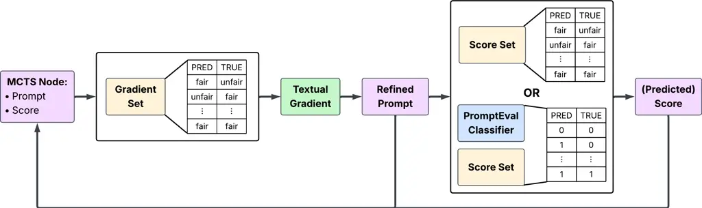
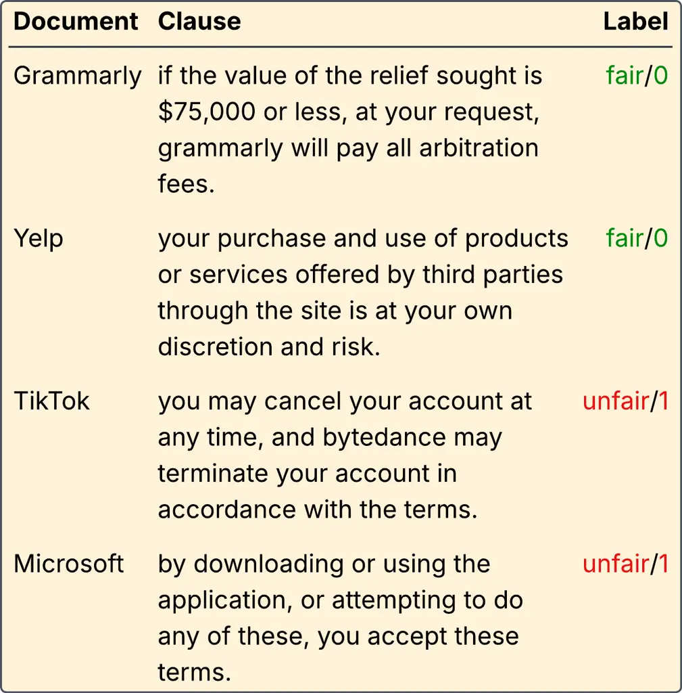
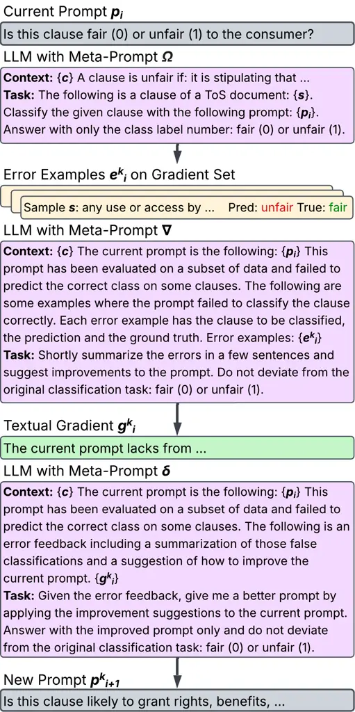

# Efficient Prompt Optimisation for Legal Text Classification with Proxy Prompt Evaluator

Hyunji Lee Email: [hyunji39.lee@tum.de](mailto:)    Kevin Li
Email: [kevinchenhao.li@tum.de](mailto:)    Matthias Grabmair
Affiliation: Technical University of Munich, Germany
Email: [matthias.grabmair@tum.de](mailto:)    Shanshan Xu
Affiliation: Technical University of Munich, Germany
Affiliation: Department of Computer Science, University of Copenhagen,
Copenhagen, Denmark Affiliation: Faculty of Law, University of
Copenhagen, Copenhagen, Denmark Email: [shanshan.xu@di.ku.dk](mailto:)

###### Abstract

Prompt optimization aims to systematically refine prompts to enhance a
language model’s performance on specific tasks. Fairness detection in
Terms of Service (ToS) clauses is a challenging legal NLP task that
demands carefully crafted prompts to ensure reliable results. However,
existing prompt optimization methods are often computationally expensive
due to inefficient search strategies and costly prompt candidate
scoring. In this paper, we propose a framework that combines Monte Carlo
Tree Search (MCTS) with a proxy prompt evaluator to more effectively
explore the prompt space while reducing evaluation costs. Experiments
demonstrate that our approach achieves higher classification accuracy
and efficiency than baseline methods under a constrained computation
budget.

^(\*)^(\*)footnotetext: These authors contributed equally to this work

## 1 Introduction

Terms of Service (ToS) agreements are lengthy, complex documents that
define the legal relationship between companies and consumers. While
these documents are critical for protecting consumer rights and
regulating corporate practices, clauses in ToS agreements are often
written in highly complex language, making them difficult for the users
to understand. As a result, unfair or potentially exploitative ToS
clauses, may go unnoticed. Detecting such unfair clauses is therefore
essential for promoting transparency, consumer protection, and
regulatory compliance.

Manual review of such documents is however extremely time-consuming and
requires legal knowledge. Large language models (LLMs) therefore offer a
promising alternative by automatically classifying unfair ToS clauses at
scale. Nevertheless, the performance of LLMs is highly sensitive to the
prompt design. Prior work has shown that even minor variation in prompt
wording and formatting can substantially affect accuracy and consistency
Salinas and Morstatter (2024); He et al. (2024).

Recently, there is growing research interest in prompt optimization,
which is the process of systematically refining prompts to improve a
language model’s performance on a specific task Prasad et al. (2023);
Pryzant et al. (2023); Yang et al. (2024); Ma et al. (2024); Choi et al.
(2025); Xiang et al. (2025). Prompt optimization is typically framed as
an iterative search process that involves modules such as generating
revised candidate prompts, evaluating prompt performance, and searching
for the best-performing candidates to guide subsequent refinements.

Despite recent advances, most optimization methods still struggle with
inefficient exploration of candidate prompts space. For example, beam
search, a widely used search strategy in prior work Pryzant et al.
(2023), often produces repetitive and untargeted edits, relying on
costly deterministic forward-only search. In this work, we adopt Monte
Carlo Tree Search (MCTS) Coulom (2006), inspired by PromptAgent Wang
et al. (2023) to improve the exploration efficiency of the candidate
prompts space. MCTS strategically models the search space as a tree and
updates future reward estimates through backpropagation.

Another major bottleneck in current prompt optimization methods is the
high computational cost of evaluating candidate prompts. Each evaluation
typically requires costly inference on LLMs and is repeated across a
large pool of candidates. To reduce computation, most methods assess
prompt performance using a small score set, a subset sampled from the
full validation set. While this approach is faster and cheaper, the
small size of the subset can cause performance estimates to fluctuate
depending on which samples are included. Moreover, prompts optimized on
a small score set may fail to generalize well to the full dataset.

To mitigate this, we augment our framework with a proxy prompt evaluator
based on a correctness classifier, inspired by PromptEval Polo et al.
(2024). This proxy scorer efficiently evaluates the performance of
prompt candidates by predicting their correctness on the target task,
reducing the need for repeatedly calling costly LLM and therefore
enabling evaluation of the prompts across the full validation set.

Our prompt optimization framework enables efficient exploration of the
prompt search space and streamlines evaluation. Our results show that
the MCTS approach discovers better-performing prompts than existing
optimization frameworks and, when combined with a proxy prompt
evaluator, achieves similar binary classification performance with
reduced computational cost.

## 2 Related Work

### 2.1 Unfair ToS Clause Detection

The detection of unfair clauses in ToS documents has been an active line
of research in legal natural language processing. A prominent benchmark
in this area is the CLAUDETTE dataset, which contains annotated clauses
from consumer contracts labeled as fair or unfair. Lippi et al. (2019)
first introduced this dataset and developed methods for unfairness
detection using machine learning techniques to support consumer
protection. Subsequent work by Ruggeri et al. (2022) extended this line
of research, refining both the dataset and the detection methods to
improve robustness and applicability using memory-augmented neural
networks. Nevertheless, later work on adversarial attacks have exposed a
significant weakness: these classification systems are highly sensitive
to perturbations in input phrasing Xu et al. (2022), questioning their
practical reliability. These findings highlighted the sensitivity of
legal text classification models and motivated further research into
methods for improving robustness.

### 2.2 Prompt Optimization

The general process of prompt optimization can be split into the
following key modules: prompt update, search strategy and prompt
evaluation.

#### 2.2.1 Prompt Update

The prompt updating methods used in prior work primarily fall into three
categories: resampling-based, explicit reflection-based, and implicit
reflection-based Ma et al. (2024).

##### Resampling-based

approaches apply random edit operations (e.g. deletion, swap,
paraphrase, addition) to the base prompt without directional feedback.
For example, GrIPS Prasad et al. (2023) repeatedly generates candidate
prompts via such edits, evaluates them on a held-out set, and selects
the best-performing one. However, the lack of guidance often leads to
ineffective edits and poor performance.

##### Implicit reflection-based

approaches, such as OPRO Yang et al. (2024), generate new prompts based
on the history of candidate prompts and their performance scores.
However, these methods do not require the prompt optimizer to explicitly
reflect on the errors of previous prompts. While this approach is more
guided than simple resampling strategies, it still lacks direct feedback
mechanisms that consider the nature of past mistakes.

##### Explicit reflection-based

approaches incorporate natural language feedback as textual gradients to
guide edits. ProTeGi Pryzant et al. (2023) exemplifies this idea by
using an LLM to identify weaknesses in a prompt and propose semantic
edits in the opposite direction. While more effective, recent work
indicates that such methods produce repetitive feedback and often
struggle to align improvements in prompt text with downstream model
behavior Ma et al. (2024).

#### 2.2.2 Search Strategy

The search strategy decides which prompt candidates are selected,
filtered and further expanded. Common strategies include the following:

##### Greedy search

is the simplest approach, where only the highest-scoring prompt from the
current iteration is selected for expansion in the next step, for
example used by OPRO Yang et al. (2024). While computationally
efficient, it risks premature convergence because potentially better
prompts in the search space are not reached.

##### Beam search

maintains a beam, consisting of top-performing prompts at each
iteration, expanding all of them in parallel, such as ProTeGi Pryzant
et al. (2023) and GrIPS Prasad et al. (2023). This allows it to explore
multiple promising paths simultaneously, reducing the chance of missing
promising prompts. However, the beam width is an important parameter, as
a narrow beam can still miss high-performing prompts, while a wide beam
increases computational cost.



Figure 1: Our framework with scoring on the score set or alternative
scoring with the trained PromptEval-based correctness classifier.

##### Tree-based search

strategies, such as Monte Carlo Tree Search (MCTS) Wang et al. (2023),
explicitly represent the space of prompt candidates as a tree. The prior
approaches often use a deterministic forward-only search strategy for
choosing the next prompt candidate, which limits their ability to
revisit and select the most promising prompts in the search space. In
contrast, MCTS is a search algorithm that balances exploration and
exploitation and revisits earlier prompts. This allows MCTS to identify
better prompts on alternative tree paths and potentially outperform the
current prompt candidate.

#### 2.2.3 Prompt Evaluation

A major source of cost in prompt optimization arises from repeatedly
querying an LLM on a evaluation set at every optimization step to assess
prompt performance. The challenge of high computation cost due to
repeatedly calling the LLM is not unique to prompt optimization.
Recently an increasing amount of research has been done on predicting
performance without running the full inference Beyer et al. (2025);
Berrada et al. (2025); Zhong et al. (2025).

PromptEval Polo et al. (2024) addresses this issue by introducing a
lightweight model to predict the performance of a given prompt on a
specific task. In this work, we train a prompt performance prediction
model and use it as a proxy prompt evaluation module, which enables fast
and efficient prompt performance evaluations without requiring costly
LLM inference on the whole evaluation set.

## 3 Dataset



Figure 2: Examples from the CLAUDETTE dataset.

We conduct our prompt optimization experiments on the CLAUDETTE dataset
Lippi et al. (2019), which contains 20,417 clauses extracted from 50 ToS
contracts of global online platforms. Each clause was manually labeled
by legal experts as fair or unfair.^(\*)^(\*) \* In the original
CLAUDETTE dataset from Lippi et al. 2019, the ToS clauses are annotated
in three labels: 1 standing for clearly fair, 2 for potentially unfair,
and 3 for clearly unfair. In our work, we merged the label of
potentially unfair and clearly unfair to unfair. A clause is labeled
unfair if it somehow introduces an unacceptable imbalance in the
parties’ rights and obligations, i.e., harms the user’s rights or
minimizes the online service’s obligations. In addition, each unfair
clause is annotated with one or more of nine unfairness categories
(e.g., arbitration, content removal, jurisdiction) depending on the
source of the unfairness. Figure 2 exhibits example ToS clauses for
CLAUDETTE. Notably, the label ratio in CLAUDETTE is extremely
imbalanced, with a distribution of roughly 9:1 (fair:unfair), as
displayed in Table 1.

| Split | \# of clauses | % fair | % unfair |
| ----- | ------------- | ------ | -------- |
| Train | 8,354         | 89.5%  | 10.5%    |
| Val   | 8,279         | 89.1%  | 10.9%    |
| Test  | 3,784         | 89.3%  | 10.7%    |

Table 1: CLAUDETTE statistics.

## 4 Methodology

We investigate the performance of our prompt optimization framework for
the task of unfair ToS clause detection. We begin with a simple initial
prompt "Is this clause fair (0) or unfair (1) to the consumer?". The key
modules of our prompt optimization process is illustrated in Figure 1.
Specifically, we update the prompt and generate various prompt
candidates using textual gradients Pryzant et al. (2023) (§4.1). To
efficiently search among candidate prompts, we employ Monte Carlo Tree
Search (MCTS) following Wang et al. 2023 (§4.2). A major bottleneck of
this approach is the high computational cost when evaluating among
candidate prompts. To mitigate this, we propose training an external
prompt grader model (PromptEval Polo et al. (2024)) as a proxy selection
module (§4.3).



Figure 3: Prompt update with textual gradients. The global context c is
"You are a prompt optimizer for legal documents. The task is to classify
clauses of Terms of Service documents according to the given prompt.".

### 4.1 Prompt Update with Textual Gradient

We updated the prompts using textual gradients Pryzant et al. (2023).
The term "textual gradient" refers to a natural language-based feedback
mechanism that require an LLM as prompt optimizer, to critique the
current prompt’s performance and suggests improvements. This feedback
meachnism is analogous to how numerical gradients guide optimization in
machine learning.

At each iteration $`i`$, we queried Llama-3-8B-Instruct AI@Meta (2024)
through DeepInfra’s API (version dated 2024-04-18) to evaluate the
current prompt $`p_{i}`$ on a minibatch $`m^{k}_{i}`$ of dataset samples
(hereafter referred to as the gradient set) using the meta-prompt
$`\Omega`$ (shown in Figure 3). This meta-prompt included a description
of different types of unfair clauses mentioned in Lippi et al. (2019).
To ensure structured outputs, it explicitly requested numerical
responses, making the results easier to parse. The false predictions on
the gradient set (hereafter referred to as error examples $`e^{k}_{i}`$)
were then passed to another meta-prompt $`\nabla`$, which produced a
natural language summary of the weaknesses in $`p_{i}`$ along with
improvement suggestions. This feedback served as the textual gradient
$`g^{k}_{i}`$.

We then applied the meta-prompt $`\delta`$ (detailed in Figure 3),
combining the current prompt $`p_{i}`$ and the textual gradient
$`g^{k}_{i}`$ to instruct the model to perform semantic edits that
address the identified flaws. This process yielded a set of improved
prompt candidates $`p_{i+1}^{k}`$, where $`k`$ denotes the number of
candidates generated at each iteration (we used 4 candidates per
iteration).

For the gradient set, we randomly sampled 20 clauses from the training
set, resampling at each iteration to ensure diverse feedback. The label
distribution of fair and unfair was maintained at 55:45, with the unfair
subset including 5% from each of the nine multi-label unfairness
categories.

### 4.2 Prompt Search with MCTS

We followed the implementation of MCTS described in Wang et al. (2023).
MCTS is a search algorithm that explores candidate prompts by building a
search tree. Each node in the tree represents a prompt with values such
as visit counts and estimated performance. The process consists of four
steps: selection (choosing a promising node), expansion (adding new
nodes), simulation (running rollouts to estimate outcomes), and
backpropagation (updating node values). By repeating this loop, MCTS
balances exploring new possibilities with exploiting known effective
prompts.

For expansion and simulation, we used the prompt update method with
textual gradients and the same meta-prompts to generate new prompts
(§4.1). Future performance of a prompt was estimated with a Q-value,
similar to a Markov Decision Process. For Q-value estimation, we
evaluated and scored each node’s prompt on a separate fixed batch of 200
random training samples (hereafter the score set), which was drawn to
match the distribution of the gradient set. The LLM was queried with the
same meta-prompt $`\Omega`$ for scoring (see Figure 3).

MCTS was run for 12 iterations, with 4 prompt candidate generations per
iteration and a depth limit of 8, starting from the initial prompt as
the root node at depth 0. An early stopping criterion with a patience of
5 was applied after each backpropagation step. For the performance
evaluation on the score set, three different scoring metrics were used:
macro F1, accuracy, and random scoring. We conducted five independent
runs for each metric. For the model settings, we set the temperature to
0.0 when evaluating on the score set to reduce noise and improve
consistency. We set the temperature to 1.0 during the generation of new
prompts to increase prompt diversity.

### 4.3 Proxy Prompt Evaluator

To reduce computational cost in evaluating prompt performance for unfair
ToS clause detection, we train a lightweight model based on PromptEval
Polo et al. (2024) to serve as a proxy evaluation module. This proxy
acts as a fast estimator that predicts whether the LLM would classify
each clause correctly under a given prompt.

Formally, given a ToS clause $`x_{j}`$, a prompt $`p_{i}`$, and the gold
fairness label $`y_{j}\in\{0,1\}`$, the LLM ToS fairness classifier
$`f`$ produces a prediction:

```math
\hat{y}_{i,j}=f(p_{i},x_{j}).
```

The correctness of this prediction is defined as:

```math
c_{i,j}=\mathbf{1}\{\hat{y}_{i,j}=y_{j}\}.
```

To approximate this correctness signal efficiently, we train a proxy
prompt evaluator $`\phi`$ as correctness classifier. Each training
instance is represented as:

```math
z_{i,j}=\big[e(p_{i})\;\|\;e(x_{j})\;\|\;(y_{j})\big],
```

where $`e(\cdot)`$ is an embedding function and $`\|`$ denotes
concatenation. The proxy prompt evaluator $`\phi`$ produces:

```math
\hat{c}_{i,j}=\phi(z_{i,j})\in[0,1],
```

which estimates the probability that the LLM classifier $`f`$ correctly
predicts the fairness of clause $`x_{j}`$ under prompt $`p_{i}`$.

The proxy prompt evaluator $`\phi`$ is trained using binary
cross-entropy loss, where $`\theta`$ are the parameters of $`\phi`$:

```math
\mathcal{L}(\theta)=-\sum_{i,j}\Big[c_{i,j}\log\hat{c}_{i,j}+(1-c_{i,j})\log(1-\hat{c}_{i,j})\Big].
```

By using the proxy promt evaluator $`\phi`$, we can evaluate candidate
prompts over the entire validation set without repeated expensive calls
to the LLM. In our experiments, the score set increased from 200 (as
used in the original MCTS method), to 8,279 samples, which is the full
validation set of CLAUDETTE. Thereby we managed to improve search
stability and reduce evaluation costs while keeping the overall
optimization procedure unchanged. Moreover, the bigger size of the score
set may also lead to the better generalization of the improved prompts.
To further improve efficiency, the system implements embedding caching:
once a prompt, sample, or label embedding is computed, it is stored in
memory and reused in future evaluations. Since many prompts are
evaluated repeatedly across the search tree, this avoids redundant
computations and significantly reduces total runtime.

#### 4.3.1 Constructing the Correctness Dataset

To train the proxy model, we required a dataset that records when the
LLM binary classifier succeeds or fails at fairness prediction under
different prompts. This correctness dataset is built by pairing
candidate prompts with clauses from the CLAUDETTE dataset, comparing the
LLM’s deterministic predictions to the gold labels, and assigning a
binary correctness indicator.

Each entry consists of: (1) an embedding of the prompt, (2) an embedding
of the clause, (3) a one-hot encoding of the gold fairness label, and
(4) a binary correctness label (1 if the LLM prediction matches the gold
label, 0 otherwise). These vectors are concatenated and passed to the
proxy classifier, which is trained to predict correctness directly.

To collect the data, we ran standard MCTS (without the proxy) and
sampled 30 unique prompts from different depths of the search tree to
capture a range from early, simple prompts to more complex ones
appearing later in the search. Each prompt was paired with 500 clauses
from the training split of CLAUDETTE (see Table 1), with a balanced
50:50 distribution of fair and unfair clauses to ensure performance for
the underrepresented unfair class. For each (prompt, clause)-pair, we
queried the LLM deterministically and assigned a correctness label based
on the dataset’s gold label. We also added the gold label as input to
the correctness dataset, yielding 15,000 (prompt, clause, label)-triples
for training. A validation set was built using the same procedure with
200 unseen clauses, sampled without enforcing label balance,
intentionally sampled without enforcing label balance to preserve the
natural distribution of LLM correctness and enable realistic evaluation.

During search inference, the trained proxy evaluates every (prompt,
clause, label)-triple in the score set. If the proxy predicts correct,
we retain the gold label. If it predicts incorrect, we flip it. The
resulting sequence of predictions is compared to the gold labels, and
the macro F1 score is used to estimate the performance of the prompt
within the MCTS loop.

#### 4.3.2 Model Structure of the Prompt Scorer

We tested two architectures for the proxy prompt evaluator: (1) a
logistic regression classifier as used in Polo et al. (2024), and (2) a
two-layer multilayer perceptron (MLP), inspired by Goodfellow et al.
(2016); Afzal et al. (2025). For the logistic regression model we used
the scikit-learn library implementation Pedregosa et al. (2011). For the
MLP classifier, we use a compact feed-forward neural network with three
hidden layers of 512, 256, and 128 units, each using ReLU activation
Agarap (2019) and dropout. The output layer is a single neuron with a
sigmoid function for binary classification. More details of the model
architectures can be found in Appendix A.1.

#### 4.3.3 Choice of Input Embeddings

We experimented with two different embeddings to encode the input of the
correctness dataset:

- •
  Sentence-BERT (SB) Reimers and Gurevych (2019), using the
  all-MiniLM-L6-v2 model Reimers (2020) from the sentence-transformers
  library. For Sentence-BERT, text is tokenized and processed through
  the pre-trained model to generate 384-dimensional embeddings.
- •
  Fine-tuned LEGAL-BERT (FLB). We also experimented with more
  domain-specific and task-informed embedding. We fine-tune LEGAL-BERT
  Chalkidis et al. (2020) by training it on the fairness prediction task
  on the CLAUDETTE dataset. We take the \[CLS\] token representation
  from the final layer, resulting in 768-dimensional embeddings. More
  details of the model architectures can be found in Appendix A.2.

We first conducted a preliminary study on embedding impact in Table 2.
We compared the performance of different embeddings when used with a
logistic regression correctness classifier. Across both accuracy and
macro F1, fine-tuned LEGAL-BERT embeddings yield the strongest results,
with a validation accuracy of 0.93 and a macro F1 score of 0.93,
outperforming Sentence-BERT. General-purpose embeddings like
Sentence-BERT underperform against domain- and task-specific embeddings.
The embedding choice therefore has a large impact on proxy model
performance.

|                |      |      |
| -------------- | ---- | ---- |
|                | SB   | FLB  |
| Train accuracy | 0.94 | 0.94 |
| Val accuracy   | 0.85 | 0.93 |
| Train macro F1 | 0.94 | 0.94 |
| Val macro F1   | 0.86 | 0.93 |

Table 2: Logistic regression performance using different input
embeddings

|     |        |      |
| --- | ------ | ---- |
|     | LogReg | MLP  |
| SB  | 0.85   | 0.93 |
| FLB | 0.93   | 0.91 |

Table 3: Validation accuracy of different classifier architectures.

While Table 2 shows that fine-tuned LEGAL-BERT is the strongest
embedding for a linear proxy, Table 3 shows that the combination of
embedding and architecture should also be considered. An MLP paired with
Sentence-BERT matches the validation accuracy of 0.93 set by logistic
regression with fine-tuned LEGAL-BERT. This result suggests that a
non-linear scorer can extract more signal even from a general-purpose
embedding, but gains less from the fine-tuned embeddings.

In the following experiments, we tested our prompt optimization using
the best two variants of the proxy scorer module (see Table 3): (1) a
logistic regression model with fine-tuned LEGAL-BERT embeddings, and (2)
a MLP classifier with Sentence-BERT embeddings.

## 5 Evaluation Results

In this section, we evaluate the effectiveness of our approach, which
integrates MCTS with a proxy scorer, on the task of ToS fairness
classification on the test set. We benchmark our method against three
baselines categories: (1) traditional classifiers finetuned on the whole
train set (SVM, BERT), (2) zero-shot LLM performance, and (3) baseline
prompt optimization methods (OPRO, GRIPS). For all prompt optimization
methods, we report the performance of the final highest-scoring prompts
identified by each method. We report both accuracy and macro F1, as the
test set is heavily class-imbalanced. In addition, we conduct an
ablation study to assess the contribution of the proxy scorer. Finally,
we complement the quantitative results with a qualitative analysis to
offer a concrete insights of the improved prompts.

|                          | Accuracy | Macro F1 |
| ------------------------ | -------- | -------- |
| SVM w TD-IDF Vectorizer  | 0.90     | 0.78     |
| Fine-tuned LEGAL-BERT    | 0.94     | 0.85     |
| Zero-Shot                | 0.64     | 0.53     |
| GrIPS                    | 0.22     | 0.22     |
| OPRO                     | 0.53     | 0.46     |
| MCTS w PromptEval-LogReg | 0.90     | 0.69     |
| MCTS w PromptEval-MLP    | 0.90     | 0.73     |

Table 4: Binary fairness classification performance of prompt
optimization approaches. SVM and BERT were trained on the whole training
set.

### 5.1 Overall Results

Table 4 demonstrates our main results. Both versions of our approach
outperformed the zero-shot, OPRO, and GrIPS baselines in binary
classification, with the MLP-based variant reaching comparable
performance to the SVM trained on the full dataset. Although the
proxy-based methods did not surpass fine-tuned LEGAL-BERT models, they
demonstrate that competitive performance can be achieved without
large-scale training and with substantially lower computational cost.
However, it is important to mention that the legal context provided to
the LLM for scoring the refined prompts in our framework was richer than
that used for the OPRO and GrIPS evaluations. This difference also
influenced performance, as even the zero-shot baseline outperformed
them.

### 5.2 Ablation Experiments

To ascertain the benefit of the proxy scorer, we isolate the
contribution of the proxy scorer to overall optimization quality and
efficiency by comparing MCTS variants that use full LLM-based scoring,
with our PromptEval-based proxy variants.

As shown in Table 4 and 5, MCTS with macro F1 achieves the highest
scores, and its binary performance is comparable to the SVM trained on
the full training split. It also outperforms OPRO and GrIPS, which lack
error feedback, underscoring its importance.

|                          | Accuracy | Macro F1 |
| ------------------------ | -------- | -------- |
| MCTS w random scores     | 0.81     | 0.67     |
| MCTS w PromptEval-LogReg | 0.90     | 0.69     |
| MCTS w accuracy scores   | 0.87     | 0.72     |
| MCTS w PromptEval-MLP    | 0.90     | 0.73     |
| MCTS w macro F1 scores   | 0.89     | 0.74     |

Table 5: Binary fairness classification performance of MCTS with
different scoring methods.

Although our MCTS implementation with the PromptEval-based scoring
modules could not beat the best performing standard MCTS implementation,
we still achieved an improvement over the random MCTS baseline. In
particular, the prompt found by the MLP proxy model achieves comparable
performance to the best prompt found through actual scoring. The
reduction in sampling noise yields more stable average rewards than the
limited score set in the standard MCTS approach. The execution time was
also greatly reduced by a factor of 3. However, since we called the LLM
via an API and ran the predictor model locally, it is hard to make
universal claims about the speedup and efficiency.

### 5.3 Qualitative Analysis

The initial prompt, as shown in §4, assumes the LLM inherently
understands the legal concept of fairness for the consumer in the
context of ToS agreements without any explicit guidance. The prompts
expanded by our approach (see Figure 4) give the LLM more context on
what exactly is meant by fairness. It was also observed that the length
of the final prompts depend on the tree depth that it was found at,
since prompts tend to get longer with increasing depth.


Figure 4: Final prompts found with our approach.

Despite the stated advantages of using a proxy model during scoring,
there are also limitations to consider. In particular, the computational
burden was shifted from the MCTS runs to the construction of the dataset
used to train our proxy model. If we quantify the cost in terms of
expensive LLM calls and disregard other comparatively small factors like
training, proxy model inference, and embedding generation with caching,
we calculate the break-even point as follows.

The cost for creating the dataset is defined by 30 prompts combined with
500 samples, resulting in $`30\cdot 500=15,000`$ LLM calls. The cost of
a single expansion step in standard MCTS includes 20 calls for the
gradient set, 2 calls to generate and apply the gradient, and 200 calls
for evaluation on the score set. With 4 candidates per expansion, this
totals $`(20+2+200)\cdot 4=888`$ calls. When using the proxy, the
evaluation on the score set is replaced by proxy inference, reducing the
total to $`(20+2)\cdot 4=88`$ calls (see Table 6).

|                         |               |           |
| ----------------------- | ------------- | --------- |
| Method (Score Set Size) | Train Dataset | Expansion |
|                         | Creation      | Step      |
| Standard MCTS (200)     | \-            | 888       |
| Standard MCTS (8,279)   | \-            | 33,204    |
| Proxy MCTS (8,279)      | 15,000        | 88        |

Table 6: Comparison of LLM calls between standard and proxy MCTS.

To reach the break-even point, we therefore need to use at least
$`15,000\div(888-88)=18.75<19`$ expansions. Our experiments show that
the average number of expansions per MCTS run is 35 due to early
stopping, indicating that the proxy approach becomes cost-efficient
within a single run. The efficiency is further increased by the
reusability of the proxy across MCTS runs and the ability to extend the
score set without additional LLM calls.

Furthermore, the model is vulnerable to outliers, as it might fail to
generalize, given the small number of prompts in the training data and
the large potential search space of prompts. If the model vastly
overestimates the performance of a certain prompt, this prompt is likely
to be chosen as the final prompt, if we replace all scoring with our
proxy. Since our chosen proxy variants exhibit black box
characteristics, it becomes hard to detect biases during the fast
scoring method.

## 6 Conclusion

In this paper, we propose augmenting a prompt optimization framework
with a proxy prompt scorer. Our experimental results show that using a
lightweight correctness prediction model as a proxy enables existing
prompt optimization techniques to avoid repeatedly querying an LLM over
the validation set, which is computationally expensive. In particular,
the MLP-based proxy evaluator achieves performance close to the
best-performing standard implementation that relies, while significantly
reducing computation time and cost, which highlighting the effectiveness
of our methodology.

For future work, several promising directions can be explored. First,
experimenting alternative proxy model architectures, including
Transformers or Bayesian Models to better capture the interaction
between prompt and task performance. Another promising direction is to
optimize the score set using active or curriculum learning strategies.
By selectively including the most informative or representative clauses,
active learning can reduce the number of evaluations required while
maintaining reliable performance estimates. Similarly, curriculum
learning can improve the proxy model’s stability by starting with easier
examples and progressively incorporating harder ones. These approaches
would allow for more efficient and effective prompt evaluation, reducing
computational cost while improving generalization to the full dataset.

## 7 Limitations

Our work was conducted on a small LLM with limited capabilities, making
it heavily dependent on the legal context provided and sensitive to the
precise wording of that context. The effectiveness of the proxy model is
likewise tied to the LLM it was trained on and the error patterns
specific to that model. Further research is needed to determine whether
our findings generalize to larger models.

Additionally, due to budget constraints, our MCTS framework and
PromptEval-based classifier relied only on a small subset of the
training and validation data to train and to generate the search space.
Using larger subsets may introduce more diversity and potentially
improve performance.

Another limitation is the multi-label classification task of unfairness
categories. Our quick scoring via proxy PromptEval-based models were
only conducted on the binary classification task. Predicting correctness
on multi-label classification is more difficult and it is left to see
whether the proxy could sufficiently predict correctness to draw useful
conclusions about the performance of a multi-label prompt.

## Acknowledgments

We thank the anonymous reviewers for valuable comments. SX is supported
by the Independent Research Fund Denmark (DFF) ALIKE grant 4260-00028B.

## References

- Afzal et al. (2025) Anum Afzal, Florian Matthes, Gal Chechik, and
  Yftah Ziser. 2025. [Knowing before saying: Llm representations encode
  information about chain-of-thought success before
  completion](https://arxiv.org/abs/2505.24362). _Preprint_,
  arXiv:2505.24362.
- Agarap (2019) Abien Fred Agarap. 2019. [Deep learning using rectified
  linear units (relu)](https://arxiv.org/abs/1803.08375). _Preprint_,
  arXiv:1803.08375.
- AI@Meta (2024) AI@Meta. 2024. [Llama 3 model
  card](https://github.com/meta-llama/llama3/blob/main/MODEL_CARD.md).
- Berrada et al. (2025) Gabrielle Berrada, Jannik Kossen, Muhammed
  Razzak, Freddie Bickford Smith, Yarin Gal, and Tom Rainforth. 2025.
  [Scaling up active testing to large language
  models](https://arxiv.org/abs/2508.09093). _Preprint_,
  arXiv:2508.09093.
- Beyer et al. (2025) Tim Beyer, Jan Schuchardt, Leo Schwinn, and
  Stephan Günnemann. 2025. [Fast proxies for llm robustness
  evaluation](https://arxiv.org/abs/2502.10487). _Preprint_,
  arXiv:2502.10487.
- Chalkidis et al. (2020) Ilias Chalkidis, Manos Fergadiotis, Prodromos
  Malakasiotis, Nikolaos Aletras, and Ion Androutsopoulos. 2020.
  [Legal-bert: The muppets straight out of law
  school](https://arxiv.org/abs/2010.02559). _Preprint_,
  arXiv:2010.02559.
- Choi et al. (2025) Yumin Choi, Jinheon Baek, and Sung Ju Hwang. 2025.
  [System prompt optimization with
  meta-learning](https://arxiv.org/abs/2505.09666). _Preprint_,
  arXiv:2505.09666.
- Coulom (2006) Rémi Coulom. 2006. Efficient selectivity and backup
  operators in monte-carlo tree search. In _International conference on
  computers and games_, pages 72–83. Springer.
- Goodfellow et al. (2016) Ian Goodfellow, Yoshua Bengio, and Aaron
  Courville. 2016. _Deep Learning_. MIT Press.
  [http://www.deeplearningbook.org](http://www.deeplearningbook.org).
- He et al. (2024) Jia He, Mukund Rungta, David Koleczek, Arshdeep
  Sekhon, Franklin X Wang, and Sadid Hasan. 2024. [Does prompt
  formatting have any impact on llm
  performance?](https://arxiv.org/abs/2411.10541) _Preprint_,
  arXiv:2411.10541.
- Lippi et al. (2019) Marco Lippi, Przemysław Pałka, Giuseppe Contissa,
  Francesca Lagioia, Hans-Wolfgang Micklitz, Giovanni Sartor, and Paolo
  Torroni. 2019. [Claudette: an automated detector of potentially unfair
  clauses in online terms of
  service](https://doi.org/10.1007/s10506-019-09243-2). _Artificial
  Intelligence and Law_, 27(2):117–139.
- Ma et al. (2024) Ruotian Ma, Xiaolei Wang, Xin Zhou, Jian Li, Nan Du,
  Tao Gui, Qi Zhang, and Xuanjing Huang. 2024. [Are large language
  models good prompt optimizers?](https://arxiv.org/abs/2402.02101)
  _Preprint_, arXiv:2402.02101.
- Pedregosa et al. (2011) F. Pedregosa, G. Varoquaux, A. Gramfort,
  V. Michel, B. Thirion, O. Grisel, M. Blondel, P. Prettenhofer,
  R. Weiss, V. Dubourg, J. Vanderplas, A. Passos, D. Cournapeau,
  M. Brucher, M. Perrot, and E. Duchesnay. 2011. Scikit-learn: Machine
  learning in Python. _Journal of Machine Learning Research_,
  12:2825–2830.
- Polo et al. (2024) Felipe Maia Polo, Ronald Xu, Lucas Weber, Mírian
  Silva, Onkar Bhardwaj, Leshem Choshen, Allysson Flavio Melo
  de Oliveira, Yuekai Sun, and Mikhail Yurochkin. 2024. [Efficient
  multi-prompt evaluation of llms](https://arxiv.org/abs/2405.17202).
  _Preprint_, arXiv:2405.17202.
- Prasad et al. (2023) Archiki Prasad, Peter Hase, Xiang Zhou, and Mohit
  Bansal. 2023. [Grips: Gradient-free, edit-based instruction search for
  prompting large language models](https://arxiv.org/abs/2203.07281).
  _Preprint_, arXiv:2203.07281.
- Pryzant et al. (2023) Reid Pryzant, Dan Iter, Jerry Li, Yin Tat Lee,
  Chenguang Zhu, and Michael Zeng. 2023. [Automatic prompt optimization
  with "gradient descent" and beam
  search](https://arxiv.org/abs/2305.03495). _Preprint_,
  arXiv:2305.03495.
- Reimers (2020) Nils Reimers. 2020. all-minilm-l6-v2.
  [https://huggingface.co/sentence-transformers/all-MiniLM-L6-v2](https://huggingface.co/sentence-transformers/all-MiniLM-L6-v2).
- Reimers and Gurevych (2019) Nils Reimers and Iryna Gurevych. 2019.
  [Sentence-bert: Sentence embeddings using siamese
  bert-networks](https://arxiv.org/abs/1908.10084). _Preprint_,
  arXiv:1908.10084.
- Ruggeri et al. (2022) Federico Ruggeri, Francesca Lagioia, Marco
  Lippi, and Paolo Torroni. 2022. Detecting and explaining unfairness in
  consumer contracts through memory networks. _Artificial Intelligence
  and Law_, 30(1):59–92.
- Salinas and Morstatter (2024) Abel Salinas and Fred Morstatter. 2024.
  [The butterfly effect of altering prompts: How small changes and
  jailbreaks affect large language model
  performance](https://arxiv.org/abs/2401.03729). _Preprint_,
  arXiv:2401.03729.
- Wang et al. (2023) Xinyuan Wang, Chenxi Li, Zhen Wang, Fan Bai,
  Haotian Luo, Jiayou Zhang, Nebojsa Jojic, Eric P. Xing, and Zhiting
  Hu. 2023. [Promptagent: Strategic planning with language models
  enables expert-level prompt
  optimization](https://arxiv.org/abs/2310.16427). _Preprint_,
  arXiv:2310.16427.
- Xiang et al. (2025) Jinyu Xiang, Jiayi Zhang, Zhaoyang Yu, Xinbing
  Liang, Fengwei Teng, Jinhao Tu, Fashen Ren, Xiangru Tang, Sirui Hong,
  Chenglin Wu, and Yuyu Luo. 2025. [Self-supervised prompt
  optimization](https://arxiv.org/abs/2502.06855). _Preprint_,
  arXiv:2502.06855.
- Xu et al. (2022) Shanshan Xu, Irina Broda, Rashid Haddad, Marco
  Negrini, and Matthias Grabmair. 2022. Attack on unfair tos clause
  detection: A case study using universal adversarial triggers. _arXiv
  preprint arXiv:2211.15556_.
- Yang et al. (2024) Chengrun Yang, Xuezhi Wang, Yifeng Lu, Hanxiao Liu,
  Quoc V. Le, Denny Zhou, and Xinyun Chen. 2024. [Large language models
  as optimizers](https://arxiv.org/abs/2309.03409). _Preprint_,
  arXiv:2309.03409.
- Zhong et al. (2025) Xu-Xiang Zhong, Chao Yi, and Han-Jia Ye. 2025.
  [Efficient evaluation of large language models via collaborative
  filtering](https://arxiv.org/abs/2504.08781). _Preprint_,
  arXiv:2504.08781.

## Appendix A Appendix

### A.1 Hyperparameters of Proxy Prompt Evaluator

For our logistic regression classifier, we used the standard LBFGS
solver that the Logistic Regression class from scikit-learn uses by
default. We set the maximum number of optimization iterations to 1000
and the L2-regularization parameter C to 1.0, which is the default as
well.

For our different MLP architectures, including the medium size one, we
used an Adam optimizer with a learning rate of 0.001, dropout rate of
0.3 and batch size of 32. We trained with early stopping with a patience
of 10 and a weight decay of 1e-4.

### A.2 Hyperparameters of finetuing LegalBERT

To get more domain-specific and task-informed embeddings, we finetune a
LegalBERT Chalkidis et al. (2020) by training it on the fairness
prediction task on the CLAUDETTE dataset. We trained the base
architecture with a classification head on the task of binary fairness
prediction for all training and validation clauses with cross-entropy
loss. We used AdamW with a learning rate of 2e-5 and decay of 0.01. The
model was trained for 3 epochs. To generate embeddings, we remove the
classifier head and proceed the same way as with base LEGAL-BERT.
