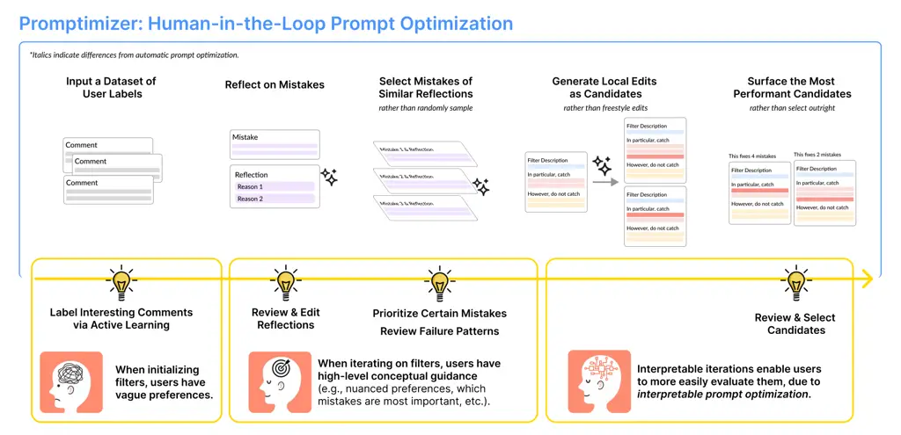
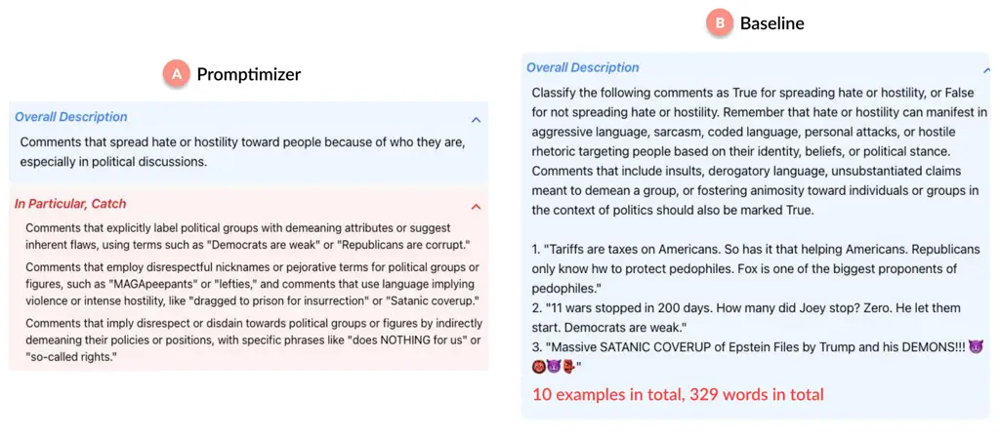
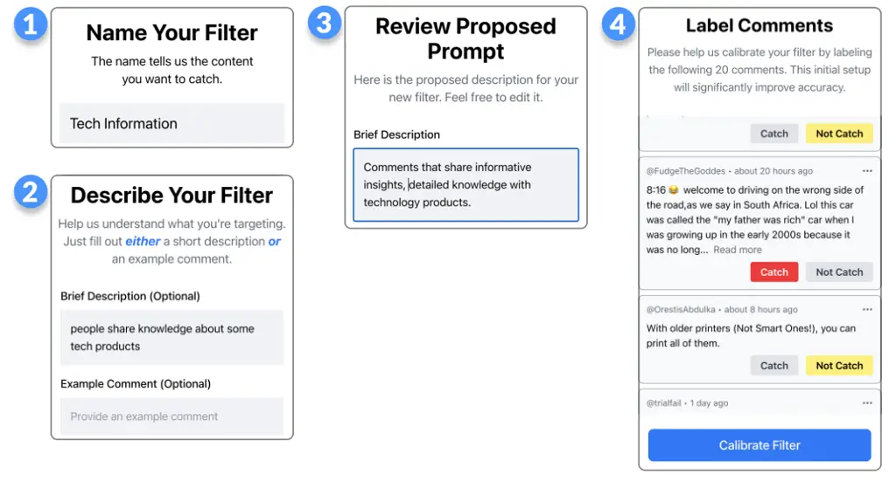
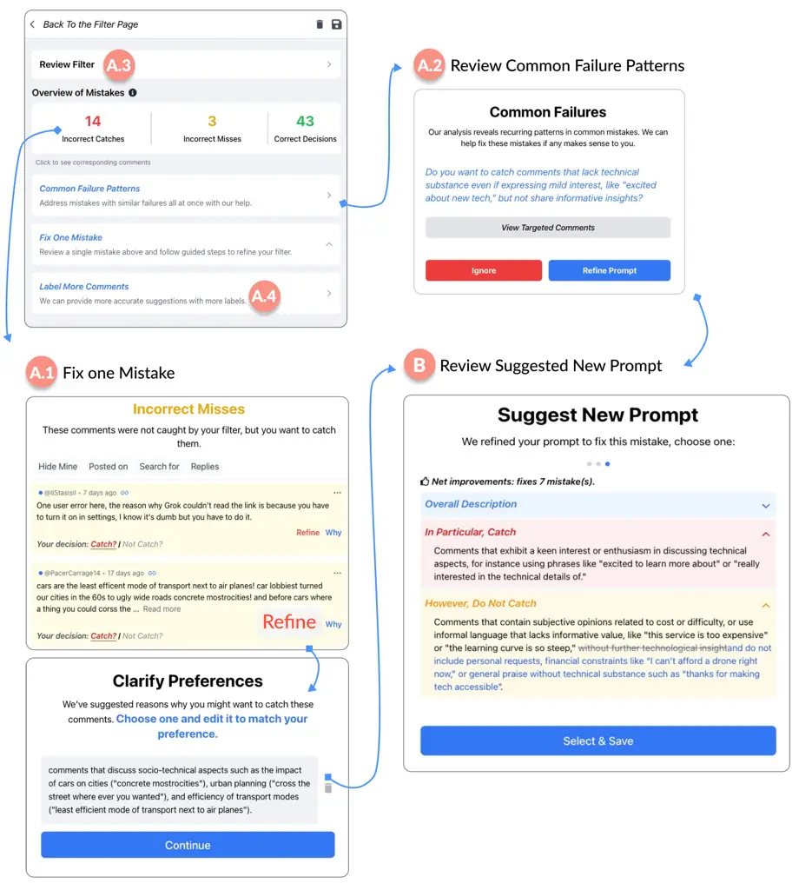
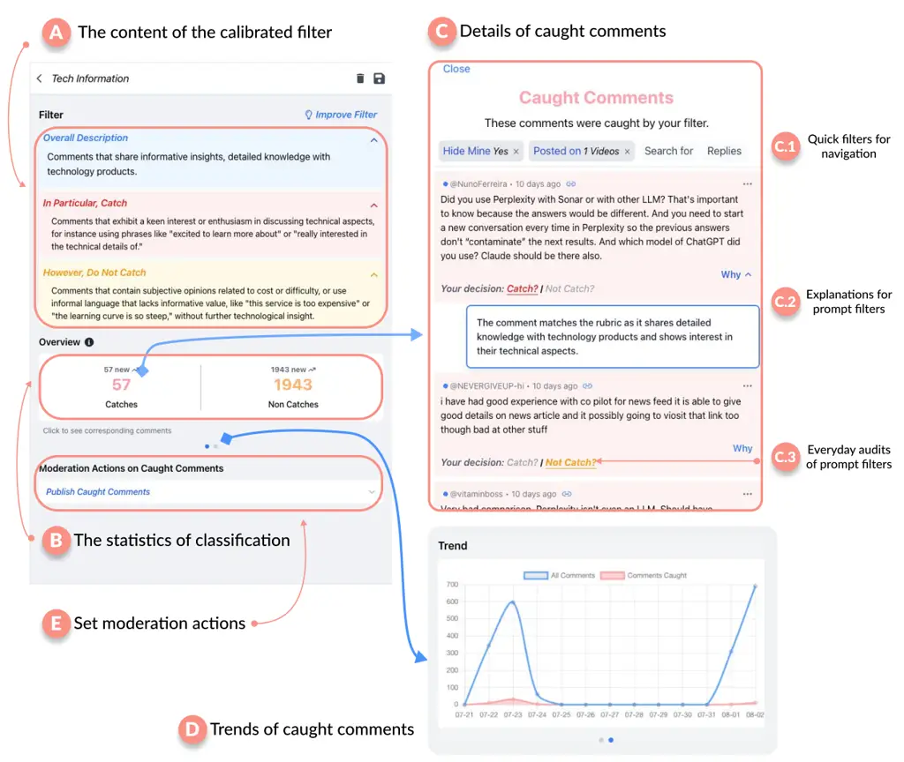

# Promptimizer: User-Led Prompt Optimization for Personal Content Classification

DOI: [XXXXXXX.XXXXXXX](https://doi.org/XXXXXXX.XXXXXXX)Conference: The
ACM CHI conference on Human Factors in Computing Systems; April 26–May
1st, 2024; Yokohama,
JapanPrice: 15.00ISBN: 978-1-4503-XXXX-X/18/06CCS: Human-centered
computing Collaborative and social computing systems and tools

Leijie Wang email: <leijiew@cs.washington.edu> Affiliation: University
of Washington, Seattle, United States , Kathryn Yurechko email:
<kathryn.yurechko@oii.ox.ac.uk> Affiliation: University of Oxford,
Oxford, United Kingdom and Amy X. Zhang email: <axz@cs.uw.edu>
Affiliation: University of Washington, Seattle, United States

2023

###### Abstract.

While LLMs now enable users to create content classifiers easily through
natural language, automatic prompt optimization techniques are often
necessary to create performant classifiers. However, such techniques can
fail to consider how social media users want to evolve their filters
over the course of usage, including desiring to steer them in different
ways during initialization and iteration. We introduce a user-centered
prompt optimization technique, Promptimizer, that maintains high
performance and ease-of-use but additionally (1) allows for user input
into the optimization process and (2) produces final prompts that are
interpretable. A lab experiment (n=16) found that users significantly
preferred Promptimizer’s human-in-the-loop optimization over a fully
automatic approach. We further implement Promptimizer into Puffin, a
tool to support YouTube content creators in creating and maintaining
personal classifiers to manage their comments. Over a 3-week deployment
with 10 creators, participants successfully created diverse filters to
better understand their audiences and protect their communities.

Figure 1. Illustration of Promptimizer: Human-in-the-Loop Prompt
Optimization. In our design of Promptimizer, we identify opportunities
within the prompt optimization workflow where users can communicate
their preferences in diverse and evolving ways. After collecting such
varied user feedback, Promptimizer then generates candidate prompts that
are performant, generalizable, and interpretable for user review.

## 1. Introduction

Internet users often rely on centralized automated filters to manage a
flood of digital content, ranging from moderation algorithms for harmful
social-media content (Google, 2018; Bickert, 2018) and spam filters for
email (Security and Trust, 2022) to curation algorithms for content
discovery (Eksombatchai et al., 2018). While effective at scale, these
one-size-fits-all approaches overlook the diverse preferences of
individual users (Neves and Reis, 2018; Kumar et al., 2021). To address
this gap, researchers have explored tools that support users in creating
personalized content classifiers for their own online
environments (Jhaver et al., 2022; He et al., 2023; Park et al., 2019;
Jhaver et al., 2019). These range from rule-based systems where users
provide phrases or even regular expressions (Jhaver et al., 2022; Song
et al., 2023; Chandrasekharan et al., 2019), to supervised machine
learning models where users provide training data (Smith-Renner et al.,
2020), to more recently, large language models (LLMs) where users can
prove natural language input (Wang et al., 2025a).

However, existing approaches do not take into account the context of how
end users understand and communicate their complex and evolving
preferences for content filters. When users first create a filter, they
typically have a vague intuition about what content they want to see or
avoid (Kulesza et al., 2014; Chen et al., 2021; Chang et al., 2017). For
that reason, they may struggle to come up with high-level descriptions
or concrete rules, as is typically expected in LLM-based or rule-based
systems, though can often make intuitive decisions about content
examples (Wang et al., 2025a). Later, as users see their filter in
action, they develop a more targeted understanding of how to refine
it (Lee et al., 2024; Daly et al., 2021; Piorkowski et al., 2023). For
instance, social media users discover filtering mistakes as they browse
their feeds regularly (Shen et al., 2021). As they encounter mistakes,
users may have specific ideas about what mistakes to focus on correcting
or a preference for greater precision or recall (Wang et al., 2025a).
Besides mistakes, user preferences may also evolve over time,
necessitating continuous iterations (Feng et al., 2024b). During this
iteration process, users no longer want to label many examples
tediously, as would be expected in interactive machine learning
systems (Smith-Renner et al., 2020), but prefer to articulate
corrections at a conceptual level (Ratner et al., 2017).

Given this context, we argue that the best solution for users would need
to incorporate the ability for flexible forms of user input, to cover
how users refine their preferences over time, as well as
interpretability so that users can grasp how their filter makes
decisions to be able to diagnose and target corrections (Kulesza et al.,
2015; Piorkowski et al., 2023; Amershi et al., 2014). Of the various
options, LLMs seem the most suited for taking a range of inputs and also
being able to make targeted edits to prompts for iterative
refinement (Kumar et al., 2023; OpenAI, 2024). But while it is trivial
for users to create a decently performing classifier, more complex
prompt engineering is needed to capture nuanced
preferences (Zamfirescu-Pereira et al., 2023b). For instance, providing
examples often helps improve accuracy but the selection and ordering of
these examples can significantly influence performance (Rubin et al.,
2021; Zhang et al., 2022; Lu et al., 2021). Additionally, users struggle
to refine LLM prompts at a fine-grained level once
created (Zamfirescu-Pereira et al., 2023a).

To address these challenges, researchers have proposed automatic prompt
optimization (APO) techniques that generate performant prompts given
small sets of user labels (Deng et al., 2022; Zhou et al., 2022; Prasad
et al., 2022; Pryzant et al., 2023). In each turn, APO algorithms
randomly sample a few mistakes, then ask an LLM to modify prompts in a
freestyle fashion to fix the mistakes. While these techniques could be
useful to create a new filter from scratch, they do not provide any way
for users to give input during iteration beyond adding more labels.
Moreover, their focus on performance on narrowly defined datasets
produces prompts that are difficult for users to interpret (Deng et al.,
2022; Shin et al., 2020; Shi et al., 2022) and might even overfit (Li
et al., 2023).

In this work, we propose Promptimizer, a human-in-the-loop (HiTL) prompt
optimization workflow that supports users in initializing and iterating
on content filters. In our design of Promptimizer, we seek to enable
users to express their complex and evolving preferences through diverse
forms of input, without needing to manage the low-level mechanics of
prompt optimization. We achieve this via the following two changes
compared to fully automated approaches:

- •
  User-Led Steering. During initialization, users provide an initial
  description and label a small set of examples surfaced through active
  learning—specifically, examples where LLMs have inconsistent
  predictions, reflecting potential ambiguities. As users identify
  mistakes during casual use, Promptimizer summarizes common failure
  patterns and asks for user review; users can also prioritize certain
  mistakes and clarify their preferences.
- •
  Interpretable Prompt Optimization. After collecting user feedback,
  Promptimizer generates candidate prompts that are performant,
  generalizable, and interpretable for user review. To promote
  interpretability, we analyze which prompt rubric relates most directly
  to user feedback and constrain LLMs to making generalizable iterations
  to those rubrics, unlike existing APO approaches that allow
  unconstrained edits. We then identify the most performant candidates
  for user selection by using established searching mechanisms in APO
  algorithms.

To understand how Promptimizer supports users to author performant and
interpretable filters, we conducted a within-subjects experiment with 16
social-media users, comparing Promptimizer against a state-of-the-art
APO algorithm. We found that participants unanimously preferred
Promptimizer over an APO workflow for filter iteration. They also
perceived Promptimizer as producing significantly more interpretable
iterations while achieving comparable performance. In post-study
interviews, participants spoke approvingly about how Promptimizer gave
them more control to pick their iteration strategy, including
prioritizing specific mistakes, navigating precision-recall trade-offs,
addressing failure patterns, and revising initial labels.

In order to understand how our filter authoring workflow would work in a
real social media context, we implemented Promptimizer into a tool
called Puffin built for YouTube content creators. We chose this context
as creators are a class of end users who have a particularly strong need
for personalized classifiers over their comments, due to their desire to
engage with their audience and moderate out harmful targeted
attacks (Jhaver et al., 2022). Puffin allows a creator to create content
filters for comments on their videos, view and monitor comments
separated out by their filters, and adjust their filters as they are
reviewing comments in the system and finding mistakes.

We conducted a three-week field study of Puffin with 10 YouTube content
creators with audiences ranging from under 500 to over 1 million
subscribers. We found that Puffin enabled creators to iteratively build
high-performing filters with ease as they naturally reviewed their
comments. All participants successfully created a diverse range of
filters in Puffin that helped them better understand their audiences and
protect their communities over the course of the study. Notably, six out
of ten participants are continuing to use or have expressed interest in
using Puffin beyond the study.

Looking forward, we envision that the Promptimizer workflow can
generalize beyond content classification to other LLM tasks,
particularly open-ended ones where user guidance is crucial (Guo et al.,
2025; Wang et al., 2025b). Prompt optimization also need not be limited
to a single user: groups could collectively deliberate on guidance and
review generated candidates. Such deliberation supports
consensus-building and thus can be especially valuable for aligning LLMs
with community values (Feng et al., 2024a; Sharma et al., 2024). We see
opportunities for Puffin to support not only creating personal filters
but also sharing and evaluating filters within communities that face
similar harms or share similar identities.

## 2. Related Work

### 2.1. Personal Content Classification

Personal content classification is the process by which an individual
selects, organizes, and filters their own view of content online (Jhaver
et al., 2023; Wang et al., 2025a). Beyond filtering out unwanted
content, such as removing harassing or spam emails (Park et al., 2019;
Mahar et al., 2018) and managing online conversations (Wang et al.,
2023), personally classifying content also entails curating interesting
content, such as relevant news articles (Sophia C. Volk and Strauß,
2024; Josephine B. Schmitt and Schneider, 2018) or personalizing content
recommendations on social media (Liu et al., 2025). Many content
classification tools, however, often operate in a centralized manner,
enacted top-down by platforms and therefore limiting users’ capability
to customize content filtering (Neves and Reis, 2018). In response,
researchers have increasingly called for tools that enable users to
customize their online content environments, especially on social
media (Jhaver et al., 2023; Jhaver and Zhang, 2023).

When designing personal content classifiers to enact user preferences,
it is essential to consider that user preferences are complex and
evolving. Users often begin with abstract ideas about which kinds of
content they want to moderate or curate (Kulesza et al., 2014; Chen
et al., 2021; Chang et al., 2017). Although reviewing content examples
can elicit users’ intuitive decisions, articulating preferences in
holistic descriptions often remains a challenge (Wang et al., 2025a).
However, with time and experiences like discovering filter mistakes
through naturally scrolling their social media feeds, users often want
to fix the mistakes that they viewed (Shen et al., 2021) and tend to
cultivate insights into how to refine their filters (Lee et al., 2024;
Daly et al., 2021; Piorkowski et al., 2023). Users’ preferences may also
change over time, especially amid online information ecosystems that
often evolve quickly, necessitating opportunities for iterating on their
initial filters (Feng et al., 2024b). In these cases, labeling numerous
redundant examples is not an ideal strategy; instead, users prefer to
offer higher-level feedback (Ratner et al., 2017). Because black-box
algorithms conceal how they make decisions, they impede users in making
such iterations effectively, as they cannot easily identify problems and
make informed improvements (Smith-Renner et al., 2020). Filters must
instead support users in diagnosing misalignments between their complex,
evolving preferences and filter decisions by making internal
decision-making interpretable (Kulesza et al., 2015; Piorkowski et al.,
2023; Amershi et al., 2014).

Rather than support complex and evolving user needs, current personal
content classifiers only offer a single, fixed mechanism for users to
convey their preferences. Some systems, like Reddit’s AutoMod (Jhaver
et al., 2019; Song et al., 2023), allow community moderators to write
regular expressions for inappropriate posts (Jhaver et al., 2019).
Similar keywords-based rule systems are common across social media
platforms (Jhaver et al., 2022). Though interpretable, such rule-based
classifiers do not align with how users prefer to communicate their
preferences. Users find it difficult to translate abstract initial
preferences into high-performing rules and update rules based on
specific needs (Jhaver et al., 2022; Song et al., 2023; Chandrasekharan
et al., 2019). Other systems utilize supervised machine learning (ML),
enabling users to provide labeled examples. They often incorporate
pretrained word-embeddings (Devlin et al., 2018) and active
learning (Settles, 2009) to learn from user labels more efficiently (Das
et al., 2013; Kulesza et al., 2014). Numerous others only allow users to
adjust a pre-trained filter’s sensitivity (Jhaver et al., 2023;
Instagram, 2024; Bodyguard, 2024). These black-box ML classifiers all
lack interpretability, hindering users in comprehending filter decisions
and iterating on their filters in accordance with their
preferences (Piorkowski et al., 2023; Kulesza et al., 2015).

### 2.2. User Prompting for Building Content Classifiers

LLMs have gained immense popularity due to their effectiveness in
natural language processing tasks (OpenAI, 2024). Instead of creating a
new model for each specific task, users can simply now customize an LLM
by providing a prompt with maybe a few examples at runtime, which is
known as in-context learning (Brown et al., 2020). Despite the apparent
simplicity of prompting, users face prompt engineering challenges that
impede them in leveraging LLMs to actualize their
preferences (Zamfirescu-Pereira et al., 2023b). Users typically create
prompts without a systematic plan, which hinders consistent
progress (Zamfirescu-Pereira et al., 2023b). Although they can include
labeled examples to help articulate their preferences, how they select
and order these examples significantly affects performance (Rubin
et al., 2021; Zhang et al., 2022; Lu et al., 2021). After creating
filters, users also struggle to refine their filters with
granularity (Zamfirescu-Pereira et al., 2023a). For example, when
designing prompts to build robust chatbots, users often solve 80% of the
problems but find it very difficult to fix the remaining
issues (Zamfirescu-Pereira et al., 2023a). When using an experimental
prompt-driven classifier, users resorted to adding misclassified
examples to their prompts or trying to write rule-like prompts in the
absence of structured refinement guidance (Wang et al., 2025a).
Ultimately, users become frustrated with LLMs’ inconsistent decisions on
identical content, struggling to comprehend such mistakes (Lu et al.,
2021; Errica et al., 2024; Zamfirescu-Pereira et al., 2023b).

As a result, a growing body of research investigates how to replace
demanding, manual prompt engineering with automatic prompt optimization
(APO) techniques, which automatically generate refined prompts based on
a dataset of ground-truth user labels (Deng et al., 2022; Zhou et al.,
2022; Prasad et al., 2022; Pryzant et al., 2023). One line of APO
research explores how to select the best example to add to a prompt, or
examine the order in which examples should be added (Lu et al., 2021).
For instance, active example selection (Zhang et al., 2022) aims to find
the most effective demonstrations in prompts via reinforcement learning
policies. However, adding too many examples can conceal high-level
patterns and is not sustainable, making it unsuitable for supporting
consistent iterations. Another line of APO involves writing more precise
instructions to communicate task requirements. For simple tasks, prompt
optimizations can easily be achieved through keyword and paraphrasing
perturbations (Mishra et al., 2023), whereas more complex tasks require
more substantial prompt edits. In particular, researchers have drawn
inspiration from stochastic gradient descent to train ML classifiers. In
each round, researchers randomly sample several mistakes, then ask LLMs
to reflect on these mistakes as natural language gradients. LLMs
generate a few prompt edits using backpropagation, ultimately evaluating
the prompts on the training data to select the best performing
candidates (Pryzant et al., 2023).

### 2.3. Human-in-the-Loop Prompt Optimization for Personal Content Classification

Automatic prompt optimization prioritizes the final performance of
resultant prompts and often minimizes any human intervention in the
process (Zhou et al., 2022; Prasad et al., 2022; Pryzant et al., 2023).
However, APO poses issues for the setting of personal content
classification that suggest the need for a more human-in-the-loop prompt
optimization approach.

#### 2.3.1. Initializing Performant Filters

APO widely assumes ground-truth labels that indicate the task
requirements that an ideal prompt should incorporate. Labeling examples
can indeed support users in initializing filters: casual social media
users, for example, often begin with unclear, intuitive preferences like
knowing that they want to avoid “hateful content” (Jhaver et al., 2023).
However, users often encounter much content that is irrelevant to their
preferences, requiring a more efficient way to sample examples worth
labeling. For instance, hate speech on Twitter/X at most accounts for
less than 2% of all posts (Tonneau et al., 2024), whereas around 6% of
Reddit comments violated a broad set of platform norms (Park et al.,
2022). Drawing inspirations from active learning, we prioritize and
present the most valuable examples (Lewis, 1995; Seung et al., 1992) for
user review during filter initialization.

#### 2.3.2. Iterating with Diverse Approaches

The ways in which users prefer to iterate on their content filters do
not align with APO algorithm requests for labeled examples. Though
examples can communicate intuitive preferences initially, users may
develop a more clear and targeted understanding of how to refine their
filters over time (Shen et al., 2021). In these cases, an easy iteration
for users would allow them to provide high-level conceptual guidance,
whereas labeling repetitive examples becomes less straightforward (Wang
et al., 2025a). Some systems, like ConstitutionalMaker (Petridis et al.,
2024), allow diverse user inputs, but such inputs are not used for
prompt optimization and suffer from conflicting feedback. Meanwhile,
high-level feedback is valuable because users can have a better idea
than algorithms about which filter mistakes should be prioritized in
iterations, potentially leading to better perceptions of algorithmic
performance. However, APO is not designed to incorporate this kind of
nuanced, high-level input. It solely optimizes on user labels, and when
iterating, the only approach is to run APO for more rounds, excluding
users from deciding which mistakes are most important or offering
additional guidance.

#### 2.3.3. Promoting Interpretability

APO involves LLMs articulating why a small number of randomly selected
mistakes were misclassified, attempting to fix the mistakes by
generating a few prompt candidates in a freestyle fashion (Zhou et al.,
2022; Prasad et al., 2022; Pryzant et al., 2023). While this method
promotes high performance, its lack of structure in generating prompt
edits often leads to less interpretable prompt iterations: they sample a
few mistakes from the training examples, then ask an LLM for free-form
edits (Zhou et al., 2022; Prasad et al., 2022; Pryzant et al., 2023).
Without a holistic understanding of underlying failure patterns, this
unguided process tends to produce lengthy, opaque changes (Deng et al.,
2022; Shin et al., 2020; Shi et al., 2022). For instance, LLMs might
make sweeping edits throughout a prompt to address distinct problems at
one time. In some cases, APO might even overfit to individual mistakes
by turning all mistakes into few-shot demonstrations (Li et al., 2023).
Interpretability also builds user trust in personal content filters and
enables meaningful user control over information consumption (Lim
et al., 2009). For instance, some social media users worry that
black-box filters might create echo chambers (Jhaver et al., 2023),
while numerous content creators fear these systems could mistakenly
remove legitimate audience comments and damage their reputation (Jhaver
et al., 2022).

## 3. Promptimizer: Human-in-the-Loop Prompt Optimization

We introduce Promptimizer, a novel human-in-the-loop prompt optimization
workflow, that supports users in easily initializing and iterating on
performant content classifiers. We consider initializing and iterating
on personal content classifiers as two distinct scenarios, where how
users communicate their preferences can vary greatly. Derived from our
arguments in the related work section, we present three design goals for
Promptimizer:

1.  (1)
    Support users in initializing performant content filters easily.
2.  (2)
    Enable users to iterate on content filters easily and accurately in
    diverse ways.
3.  (3)
    Provide interpretable content filters for users.

As illustrated in Figure 1, Promptimizer instantiates these design goals
through three interconnected algorithmic components. We now describe
these components in detail.

### 3.1. Performant Classification Algorithms

Since prompt optimization seeks the most performant prompt for content
classification, it depends heavily on the underlying classification
algorithm’s inherent performance. The interpretability of classification
algorithms also affects how accurately users can provide guidance and
how effectively the optimization algorithm can correct mistakes.

We first consider: how should we structure prompts to ensure
interpretability and enable targeted user corrections? We structured
each user-defined prompt in three parts: an overall description,
positive rubrics, and negative rubrics. These rubrics help decompose
nuanced, complex preferences into more interpretable components (Lee
et al., 2024; Toubal et al., 2024; Louie et al., 2024). This structure
also enables LLMs to make focused improvements during optimization
rather than wholesale prompt rewrites. We additionally include four
few-shot examples, as research has demonstrated performance gains from
this approach (Brown et al., 2020). We limit examples to four because
larger numbers reduce interpretability for users while only marginally
improving performance (Zhao et al., 2021).

Second, we ask: how should classification algorithms produce performant
and consistent predictions? While high-quality predictions can be
obtained with more computational resources, we needed to balance
prediction quality with cost. We experimented with different algorithmic
structures (e.g., chain of thought, aggregating predictions from
individual rubrics) and parameters using the Jigsaw toxicity
dataset (Borkan et al., 2019), selecting the approach with the highest
test performance. Our final algorithm combines user-created prompts with
a predefined system prompt and processes comments in batches of five.
For each batch, we run the prediction process five times with randomized
comment orderings, then aggregate results using majority voting. This
approach addresses several key challenges. Prior work shows that users
become frustrated when identical prompts yield inconsistent
decisions (Wang et al., 2025a). Majority voting reduces this randomness
and delivers more consistent, interpretable predictions (Wang et al.,
2022). Additionally, the level of agreement across runs provides a
natural confidence measure, as low-confidence predictions often signal
ambiguous user preferences and warrant user review (Yue et al., 2023).
While majority voting requires more computational resources, we mitigate
costs through batched prompting, which preserves performance while
reducing overhead (Cheng et al., 2023; Lin et al., 2023). Randomizing
comment order across runs prevents predictions from being influenced by
positional effects or comment context (Lu et al., 2021).

### 3.2. Interpretable Prompt Optimization

We focus on a simplified prompt optimization setting: Given a small set
of user labels and an initial prompt, how do we produce a prompt
iteration that is both performant and interpretable? As we argued in
Section 2.3.3, standard APO approaches tend to generate less
interpretable iterations. In contrast, our algorithm addresses
interpretability issues through structured iteration generation. First,
we identify mistakes that the initial prompt made on training examples
and elicit LLM reflections on why each mistake occurred. We then cluster
these reflections by semantic similarity using unsupervised
clustering (Khan et al., 2014). This ensures that each cluster
represents a coherent failure pattern that can be addressed through
focused edits. Since prompt filters decompose into positive and negative
rubrics, we constrain potential iterations to four directions: adding a
new positive or negative rubric, or editing an existing positive or
negative rubric. For each mistake cluster, we ask the LLM to generate
targeted iterations within these constraints. Finally, we select the top
iterations by evaluating their performance on the training set and
present them for user review.

### 3.3. Efficient Collection of Diverse User Guidance

As discussed in Section 2.3.1, standard APO methods assume the
availability of relevant ground-truth annotations, but content curation
involves much content that is irrelevant to users’ preferences. This
raises the question: How should we collect user labels most efficiently?
We draw inspiration from active learning (Lewis, 1995; Seung et al.,
1992), where uncertainty sampling prioritizes the most informative
examples for user labeling (Lewis, 1995; Seung et al., 1992). Here,
uncertainty arises naturally from our classification algorithm: each
comment’s label is predicted five times, and comments with inconsistent
outcomes across rounds reflect classifier uncertainty. These comments
are more likely to expose ambiguities in the current prompt that could
benefit most from user feedback. When too few uncertain cases exist, we
prioritize positive predictions over negative ones, since positive
examples are rare and therefore more valuable for
initialization (Tonneau et al., 2024; Park et al., 2022).

Additionally, users want to provide high-level conceptual guidance
rather than detailed labels during iterations as discussed in Section
2.3.2. We therefore ask: How can we help users easily provide diverse
and nuanced guidance? Our interpretable prompt optimization workflow
supports flexible user involvement at three points. First, noting that
our optimization algorithm clusters mistakes with similar failure
reasons, we summarize each cluster into a failure pattern for user
review. Second, users might want to address a specific mistake that they
view as especially important. Because optimizing on a single mistake
risks overfitting, we ask users to clarify their intent in natural
language. To minimize effort, they edit the LLM’s reflection on the
mistake instead of starting from scratch. Because generated iterations
are constrained to interpretable edits, users can evaluate candidates
not only by performance on a small dataset but also by how well the
candidates seem to align with their preferences.

## 4. Lab Evaluation of Promptimizer

We conducted a within-subjects experiment with 16 social-media users to
compare Promptimizer against an automatic prompt optimization baseline,
formulating the following research questions:

- •
  RQ1: Does Promptimizer support users to author more interpretable
  filters?
- •
  RQ2: Does Promptimizer support users to author more performant
  filters?
- •
  RQ3: Do users prefer Promptimizer for authoring their content filters?

### 4.1. Recruitment and Participants

We recruited 16 social-media users, labeled E1–E16, by advertising calls
for participation through instant-messaging channels to students at six
major universities in the U.S. and U.K. The group included nine female
and seven male-identifying participants, with most pursuing graduate
degrees and a few pursuing bachelor’s degrees. Regarding generative AI,
two participants reported that they used it every day, 6 every few days,
2 every few weeks, and 6 never or almost never. Sessions were conducted
individually over Zoom and lasted an average of 93 minutes. Participants
received a \$20 gift card as compensation. This study was reviewed by
our university IRB and deemed exempt.

### 4.2. Study Procedures and Evaluation Metrics

#### 4.2.1. Experiment Datasets

Participants created filters on two topics: political comments from
TheYoungTurks YouTube channel and food-related comments from YouTube’s
BestEverFoodReviewShow. For politics, the target description was about
political hate speech: “Comments that spread hate or hostility toward
people because of who they are, especially in political discussions.”
For food, it involved cultural food experiences: “Comments where people
share detailed and rich cultural experience and knowledge related to
food, cooking, or dining.” We selected these topics to represent
moderation and curation tasks, respectively. Both descriptions contain
intentionally vague language to allow participants to develop their own
nuanced preferences. Sampling from real comments allowed us to better
simulate real-world curation settings. We crawled all comments from the
most recent 20 videos on each channel. We then used LLMs in a zero-shot
setting to classify whether each comment matched the target description.
Although participants’ understanding of each topic can differ greatly,
we aimed to balance the dataset so that nearly half of the comments
would be in-scope as determined by LLM classifiers. From this pool, we
randomly sampled 200 comments per topic. For each participant, we split
these into three sets.

- •
  A training set of 20 comments for initializing filters. We ensured
  that it included at least 10 uncertain cases (inconsistent positive
  and negative predictions) to support our active learning requirement.
- •
  An audit set of 80 comments to simulate daily filter audits for
  iterative improvement.
- •
  A test set of 100 comments that were later fully labeled by
  participants to evaluate their final classifiers.

#### 4.2.2. Experiment Conditions

We compared Promptimizer with ProTeGi (Pryzant et al., 2023), a
state-of-the-art automatic prompt optimization library. ProTeGi is a
general-purpose, non-parametric algorithm that generates performant
prompts from user labels. In detail, it uses random batches of training
examples to produce “gradients” in natural language—which are
descriptions of the current prompts’ flaws regarding this batch—and then
edit the current prompt in the opposite semantic direction of the
gradient. In each round, it generates and evaluates several candidate
improvements, repeating this process for several rounds before selecting
the most performant prompt through beam search.

Since ProTeGi was not originally designed for content curation, we
adapted it to ensure a fair comparison. First, because the algorithm
assumes a task-specific evaluation component, we used our own
classification algorithms to estimate performance on the training
examples. Second, while ProTeGi assumes an ideal training dataset
reflecting task requirements, we instead applied our active learning
component to construct such a dataset during initialization. We
implemented this baseline condition following their open-source code on
GitHub¹¹ 1
[https://github.com/microsoft/LMOps/tree/main/prompt_optimization](https://github.com/microsoft/LMOps/tree/main/prompt_optimization)
and adopted most of its parameters. To ensure comparable search budgets
across conditions, we aligned beam search settings: each condition could
generate at most four prompt iterations and maintain a beam size of two.
Finally, both Promptimizer and the baseline were implemented in a
similar web interface for consistency.

#### 4.2.3. Study Procedures

We employed a within-subjects design with the two experiment conditions
described above.

Stage 1: Study Onboarding. We started the experiment by briefing the
participants and warning them of the possibility of encountering
profanity and hate speech. After obtaining their informed consent, we
asked participants to envision throughout the study that they were
managing YouTube comments and presented them with a choice between two
content classification tasks: political comments from TheYoungTurks
channel, or food comments from BestEverFoodReviewShow channel. Eight
participants chose each dataset.

Stage 2: Ground-Truth Labeling. Participants then labeled comments from
the three datasets listed in Section 4.2.1 as “Catch” or “Not Catch” to
indicate whether each comment matches their interpretation of the target
description. Since previous research suggests that users may label
examples inconsistently, thus harming algorithmic training  (Kulesza
et al., 2014), we emphasized that participants should try to label
comments in a consistent manner.

Stage 3: Initialization of Filters. The 20 training comments that
participants labeled were used to generate optimized prompts using the
two experimental conditions. We asked participants to review the two
resulting filters, with a counterbalanced design helping counter any
potential learning effects. For each filter, participants first read its
prompt, then reviewed its decisions on comments from the training and
audit dataset. They then reported their perceptions of each filter in a
survey (more details in Section 4.2.4).

Stage 4: Iteration on Filters. Next, participants were asked to iterate
on their filter using the methods in the Promptimizer condition and to
review the automatically refined filter in the baseline condition, with
the order of these conditions randomized. In the Promptimizer condition,
participants refined their filter three times using whichever
combination of fixing one mistake, reviewing common failure patterns, or
directly editing the overall description that they preferred, with the
goal of best aligning the filter to their classification preferences. In
the baseline condition, we ran the automatic prompt optimization
algorithm for three rounds on the same initialized filter. We did not
use the filter initialized in the baseline condition here so that we
could focus on measuring the effect of human interventions against
automatic iterations. Participants then reviewed the optimized prompt
and skimmed the decisions that the filter made. After finishing both
conditions, participants reported their perceptions of each approach
(see Section 4.2.4).

Stage 5: Semi-Structured Interviews. Finally, we asked participants
various questions to understand their perception of the initialized
filters and experience with iterating on their filters. Examples of
these questions include “Which filter’s overall description do you
prefer, and why?” and “What do you like or dislike about the fix one
mistake feature?” We also inquired whether there were any additional
features that participants might have liked in the iteration process.

#### 4.2.4. Evaluation Metrics

We use the following means to evaluate filter initialization and
iteration.

We measured the performance of the resultant filters from the
initialization stage and the iteration stage on the test dataset that
each participant labeled. We further gathered participants’ subjective
perceptions using a five-point Likert item (from Strongly Disagree to
Strongly Agree) about the following measures:

- •
  Performance Perception. To measure participants’ perception of filter
  performance, we asked participants to rate the level of performance
  with which each condition’s filter classified comments in the
  initialization stage, as well as how effectively the iteration
  approach in each condition improved their filter.
- •
  Interpretability. To assess the extent to which participants
  understood the decisions of the filters at the initialization stage,
  we asked participants to rate how easily they understood both the
  overall description of each filter and why each filter caught or did
  not catch comments. Regarding the iteration stage, we asked
  participants to rate how easily they understood both why Promptimizer
  suggested its iterations and why the baseline condition’s approach
  made its iterations.
- •
  Task Load. For the iteration stage, we also adopted two applicable
  items from the NASA-TLX survey (Hart and Staveland, 1988) regarding
  mental demand and effort, excluding irrelevant questions. We also
  asked participants’ preferences about iteration approaches in the end
  of experiments.

(a) At the end of the initialization and iteration stages, participants
evaluated the interpretability and perceived performance of the filters
generated by the two optimization approaches. Error bars show standard
errors; significance markers indicate paired comparisons. We found no
significant differences at initialization. By contrast, during the
iteration stage, participants rated Promptimizer filters as both more
interpretable and higher performing. This suggests that automatic prompt
optimization produces less interpretable edits as iterations accumulate.

(b) We also measured the task load of manual iteration for Promptimizer
and asked whether participants preferred iterating with it compared to
automatic optimization. We found that participants unanimously preferred
Promptimizer for iterations, although they reported that iterating with
Promptimizer was fairly mentally demanding.

Figure 2. Participant Ratings for Promptimizer and Automatic
Optimization.

| Comparison Groups    | Condition            | Accuracy  |           | Precision |           | Recall      |           | $`F_{1}`$ Score |           |
| -------------------- | -------------------- | --------- | --------- | --------- | --------- | ----------- | --------- | --------------- | --------- |
|                      |                      | Est.      | Std. Err. | Est.      | Std. Err. | Est.        | Std. Err. | Est.            | Std. Err. |
| After Initialization | Promptimizer         | 0.570     | 0.114     | 0.711\*   | 0.213     | 0.507       | 0.117     | 0.710           | 0.111     |
|                      | Baseline             | 0.604     | 0.140     | 0.652     | 0.231     | 0.619\*\*\* | 0.147     | 0.707           | 0.090     |
| After all Iterations | Promptimizer         | 0.638     | 0.128     | 0.717     | 0.210     | 0.599       | 0.091     | 0.756           | 0.066     |
|                      | Baseline             | 0.630     | 0.130     | 0.732     | 0.215     | 0.598       | 0.154     | 0.749           | 0.084     |
| Promptimizer         | After Initialization | 0.570     | 0.114     | 0.711     | 0.213     | 0.507       | 0.117     | 0.710           | 0.111     |
| Within               | After all Iterations | 0.638\*\* | 0.128     | 0.717     | 0.210     | 0.599\*\*   | 0.091     | 0.756\*\*       | 0.066     |

Table 1. Post-hoc paired t-test results for classifier performance on
the test dataset ($`n=16`$). We report pairwise differences in
performance metrics between Promptimizer and automatic prompt
optimization at both initialization and iteration, and show how three
rounds of Promptimizer iterations contributed to performance gains.
Significance: $`p<.001`$ (\*\*\*), $`p<.01`$ (\*\*), $`p<.05`$ (\*).

### 4.3. Data Analysis

#### 4.3.1. Quantitative Analysis

For our quantitative analysis, we used paired samples $`t`$-tests to
compare participants’ subjective ratings of filter interpretability and
perceived performance across the two conditions. Beyond subjective
perception of performance, we also evaluate objective classifier
performance on the held-out test dataset, including accuracy, precision,
recall, and $`F_{1}`$ score, and also compare them with a paired
$`t`$-test.

#### 4.3.2. Qualitative Coding

Our qualitative data comprised semi-structured interview data and
responses to open-ended questions in surveys. We employed a reflexive
thematic analysis approach (Braun et al., 2019) to explore participants’
experiences and challenges in initializing and improving personalized
classifiers with Promptimizer. Reflexive thematic analysis has been
widely used in HCI research to understand users’ experiences and views,
as well as factors that influence particular phenomena or
processes (Braun et al., 2019). During data collection, the first author
took detailed debriefing notes after each interview to document emerging
themes. The authors then collectively reviewed the debrief notes and
discussed themes in weekly group meetings. Recordings were automatically
transcribed into text. The first author then open-coded the data on a
line-by-line basis, and the remaining authors reviewed the transcripts
and added codes. 368 codes were generated from the open-coding process.
The authors clustered the open codes into high-level themes in a
codebook and iteratively improved the codebook through discussion.
Example codes are “Trade-offs between performance and agency” and
“Iterations: preferred ways of iterations.” Finally, the authors applied
the codes to the data to complete the thematic analysis.

### 4.4. Results

Figure 3. Initial Prompts from the Two Experimental Conditions. (A) This
is the prompt after three iterations in Promptimizer for one
participant, with the overall description, and three positive rubrics.
(B) The corresponding prompt after three rounds of iterations by the
baseline APO condition is a freestyle string of text, which simply chose
to add more examples as iterations.

#### 4.4.1. Users perceived Promptimizer as generating significantly more interpretable iterations than the automatic condition (see Figure 2(a))

The structured prompts in Promptimizer helped participants more easily
understand filter decisions. For reference, Figure 3 displays initial
prompts generated in the two experimental conditions for one
participant. As E13 explained, “I think having it structured with the
overall description and then rubrics for ‘catch’ and ‘do not catch’ is
really helpful because they emphasize some of the gray-area or edge
cases. I think it helps me be more certain in my decisions, and also
helps the filter itself make those decisions perfect.” Similarly, E15
found automated prompts less interpretable due to their lack of
structure: “I didn’t really like this huge block of text \[in the
automated condition\], and I found it a little bit hard to follow.”
Participants also emphasized that the structured format of Promptimizer
supported more targeted iterations. For instance, E16 noted, “It felt
useful that, in the interactive condition, the description of what to
catch was kept separate from the description of what not to catch,
because it made them into discrete standards that I could iterate on. ”
In addition, because participants directly influenced the direction of
prompt changes, they reported a stronger sense of the reason behind each
iteration. As E3 reflected, “When you don’t have the involvement, it
will give these vague explanations that you might not necessarily agree
with, whereas in the interactive approach, you can have more inputs back
and forth.” Despite these benefits in the iteration stage, we did not
find evidence that Promptimizer produced more interpretable prompts
during the initialization stage (see Figure 2). This is likely because
prompts at both conditions had not yet grown complex. As a result,
participants could easily interpret classification outcomes in both
conditions at this early stage.

#### 4.4.2. The performance of initialized and iterated filters within each condition were comparable (see Table 1).

To support interpretability, Promptimizer constrained the search space
of prompt optimization and incorporated multiple forms of user guidance.
Importantly, these benefits did not come at the cost of performance: on
participants’ test datasets, both conditions achieved comparable
performance. However, participants often perceived Promptimizer as
producing more performant iterations. On one hand, it might be because
that being involved in the iteration process helped them identify and
correct mistakes that they cared about most, even if such improvements
were not fully reflected in a small test dataset of only 100 comments.
Nevertheless, we cannot rule out the possibility that these perceptions
were shaped by a few salient examples rather than systematic
differences, or users were biased based on their efforts.

#### 4.4.3. Users unanimously preferred Promptimizer for iterating on their filters.

As Figure 2 indicates, all participants preferred Promptimizer over
automatic optimization, mostly because they enjoyed having control in
the classification process despite acknowledging its mental demand. Many
criticized the automatic condition for relying solely on their initial
labels, which provided limited guidance. In contrast, participants could
exert more control in the Promptimizer condition, where they could pick
mistakes that they wanted to fix, manually clarify their preferences,
and select which iterations they preferred. Consequently, participants
found that the automated approach failed to incorporate nuances of their
preferences. For instance, E7 explained, “I preferred interactive
because it allows the niche differences to be applied to the filters.”
Participants also noted that automatic optimization sometimes reinforced
outdated labels, whereas iteration in Promptimizer let them revise their
views. For instance, E16 updated their labels for some comments when
iterating on Promptimizer: “I was able to easily switch from ‘catch’ to
‘not catch’…when I realized I really should not have caught this
comment.” Promptimizer also enabled participants to better navigate
trade-offs between precision and recall, as they were able to choose
between addressing false positives and false negatives. E16 found this
an important part of his preferences: “I’m inclined to prefer
under-filtering \[high recall\] over over-filtering \[high precision\]…I
prefer the idea of having the option to exercise that control over what
I myself am seeing in specific ways.”

Additionally, Promptimizer supported participants in pursuing their
varied preferences about how they wanted to make iterations. Many
participants reported that fixing one mistake allowed them to prioritize
certain mistakes and thus steer their filters in a particular direction.
For instance, for the cultural food experience filter, E1 “wanted more
specific food comments, so \[he\] just picked those mistakes and hit
refine.” Similarly, E8 wanted to prioritize mistakes about xenophobia
and racism from the political hate speech filter over comments that were
simply mean. Iteration based on one mistake also allowed participants to
incorporate more nuances into their filters, since they could clarify
their preferences. As E3 said, “It’s nice that I could type and tell the
LLM, ‘Oh, well, I didn’t exclude these comments because of this, or I
did exclude these comments because of this.’” According to participants,
the automatically generated list of clarification candidates often
aligned with their preferences. These participants also feared that
common failure patterns might result in vague, overly broad filtering.
E7 prioritized precision over recall and thus elaborated on this:
“\[Fixing one mistake\] is more easy for me to visualize what comments
it will potentially exclude, \[whereas for common failure patterns\], I
don’t have as much control…I don’t know exactly what criteria are used.”

Meanwhile, other participants preferred iterating on their filters using
common failure patterns. They found that these failure patterns helped
generalize beyond details in a single mistake and surfaced important
iterations. For instance, E14 reported, “I personally like the common
failure patterns because they weren’t as general as the automated
approach but it was general enough to stimulate my thinking…Fixing one
mistake in the grand scheme of things will not generalize to multiple
mistakes.” Participants felt that this feature would be especially
useful if there were many mistakes. E3 explained that “when there are 10
mistakes, I have the ability to go in and fine-tune, but if it was one
thousand comments, then I would just want a better failure pattern to
recognize the commonalities.” In fact, these participants often found it
overwhelming to pick a particular mistake to fix with the
fix-one-mistake feature, as E9 mentioned: “There was not one particular
comment that stood out to me as a good use case of changing, so I will
just pick the first mistake I see.” They preferred common failure
patterns automatically picking mistakes with commonalities through
clustering. Additionally, participants proposed new ways of exploring
failure patterns that lie in between these two options, such as manually
selecting a set of mistakes and then collectively clarifying those
preferences.

## 5. Puffin: A System for Content Creators to Create Comment Filters

Figure 4. Puffin Initialization. To initialize filters, users begin by
naming them (1), then provide a short description or example comment
(2). These inputs allow Puffin to generate a more detailed draft
description of users’ preferences, which is open to users’ review and
edits (3). Since users find it easy to communicate nuances in their
preferences by labeling examples (Wang et al., 2025a), we surface 20
“interesting” examples and ask for users’ labels (4). We then
automatically optimize the initial description to better reflect users’
preferences.

We implemented our human-in-the-loop prompt optimization workflow into
Puffin, a system that supports YouTube content creators in creating
custom filters for curating and moderating comments on their videos. We
chose this as our test setting because content creators have a clear
need for easily authoring personal content filters. They face risks of
hate and harassment, making protection from unwanted comments especially
important (Thomas et al., 2022; Jhaver et al., 2022). Simultaneously,
they rely on curating relevant comments to better engage with and
understand their audiences (Choi et al., 2025). While high-profile
creators may have staff support for comment management, most creators
dedicate their time to video production and have limited expertise or
bandwidth for content classification (Weber et al., 2021). In
implementing Puffin, we conducted pilot studies through two group
sessions with our lab members and four YouTube content creators. These
sessions helped us iteratively develop a user-friendly system tailored
for creators.

Figure 5. Puffin Iteration. Puffin supports users in making meaningful
iterations on their filters in four ways. (A.1) Fix One Mistake. Puffin
asks users to clarify their rationale by providing a few candidates that
users can select and edit. Based on users’ clarifications, Puffin
generates a set of revised prompts for review, allowing users to select
the most suitable option, seen in (B). (A.2) Review Common Failure
Patterns. Puffin also summarizes common failure patterns for users’
review, followed by new prompt suggestions (B). (A.3) Manual Edits.
Additionally, users can modify their filter descriptions directly. (A.4)
Label More Comments. Users can label additional comments, similar to the
initialization stage.

### 5.1. System Walkthrough

We illustrate the workflow of Puffin through a walkthrough from the
perspective of Sarah, a content creator who wants to better understand
her audience’s opinions on different technological products.

#### 5.1.1. Initialization

Figure 4 shows how Sarah can initialize a personalized content filter.
She begins by naming the filter and describing her preferences. If she
finds this difficult, she can instead provide example comments that
reflect which content she wants to catch. These inputs allow Puffin to
generate a more detailed description of her preferences, which remains
open to further edits: “Comments that share informative insights,
detailed knowledge with technology products.” However, this description
may not fully capture Sarah’s nuanced preferences (Wang et al., 2025a;
Kumar et al., 2023). For example, Sarah considers electric vehicles as
technology products, while the LLM might not; similarly, terms like
“insights” or “detailed” may be interpreted differently. To communicate
these nuances, Puffin asks Sarah to review and label 20 “interesting”
comments selected using active learning. These labels allow Puffin to
automatically optimize the initial description so that it better
reflects Sarah’s preferences. Sarah can then review her initialized
filter (Figure 6), with positive and negative rubrics added according to
her initial labels. For example, Puffin infers that Sarah does not want
to catch comments that only mention cost or difficulty. Satisfied with
the description, Sarah deploys the filter.

#### 5.1.2. Iteration

As Sarah continues to use Puffin, she encounters new mistakes and seeks
to make improvements. As shown in Figure 5, the main page of Puffin
summarizes the number of false positives, false negatives, and correct
predictions from all comments she has annotated so far. It offers three
primary approaches for refinement.

Fix One Mistake. While reviewing mistakes, Sarah may find one that feels
especially important. Puffin prompts her to clarify her intent in more
detail. To reduce effort, Puffin provides several LLM-generated
candidate rationales that Sarah can select or edit (Figure 5 A.1). Based
on this clarification, Puffin creates new prompt suggestions targeted at
fixing the mistake (Figure 5 B). Each suggestion highlights the proposed
changes and estimates how many mistakes it resolves or introduces. Sarah
can then review and select her preferred iteration.

Review Common Failure Patterns. For Sarah, reviewing mistakes
individually can be overwhelming, especially when comments are
distressing or no single mistake feels especially important. To help,
Puffin clusters mistakes into common failure patterns and highlights
those that occur most frequently (Figure 5 A.2). Sarah can examine these
patterns and, if she selects one, she can review new prompt suggestions
generated by Puffin (Figure 5 B), similar to the “Fix One Mistake”
workflow. Unlike that workflow, however, explicit rationales are not
requested, since Sarah’s preferences are inferred from the clustered
mistakes.

Make Manual Edits. Puffin also allows Sarah to edit her filter
description directly (Figure 5 A.3). However, since manual prompt
engineering can be difficult, we keep this option secondary.

Label More Comments. Finally, Sarah might wish to refine her filter but
has seen few mistakes so far. Puffin can surface additional
“interesting” comments for review (Figure 5 A.4). This process uncovers
more mistakes while expanding the ground-truth dataset, enabling better
evaluation of iterations.

Figure 6. Puffin Audits. After users calibrate their initial
descriptions with labels, they can review their filter, deciding whether
they want to apply it to their comment sections. (A) The filter content
is displayed, including an overall description plus positive and
negative rubrics. (B) By applying this filter to their comments, users
can review statistics on how many comments were caught or not. (C)
Clicking on these numbers opens a sheet displaying the corresponding
comments. We offer quick filters for users to more easily navigate these
comments (C.1), provide explanations for predictions (C.2), and allow
users to audit their filters’ decisions, enabling future improvements
(C.3). (D) In the carousel on the main page, users can switch to a chart
showing trends in the number of caught comments over time. (E) Users can
assign moderation actions to caught comments, such as publishing or
holding them for review, if they grant Puffin the relevant YouTube
permissions.

#### 5.1.3. Audits

Sarah can learn more about her filters on the main filter page
(Figure 6). New comments are also automatically fetched from her channel
and classified every hour. Beyond the top section of filter
descriptions, the middle section shows summary statistics of caught and
uncaught comments. By clicking “57 catches,” Sarah can explore examples,
filter them by various criteria, and see explanations for why each
comment was included. She can also audit her filter by labeling whether
comments should or should not have been caught. Because she already
reviews comments as part of her routine, this becomes an ongoing,
lightweight audit. A toggle also lets her view a line chart of caught
comment trends over time. At the bottom, Sarah chooses moderation
actions for caught comments: do nothing, hold for review, delete,
publish (if comments are withheld by default), or reply with a template.
The do nothing option supports her when she wants to curate relevant
comments only for personal reference.

### 5.2. System Implementation

Puffin, hosted on a web server, consists of a frontend web interface in
React and a Django backend in Python. The backend authorizes YouTube
accounts, fetches comments, and performs moderation actions via Google
YouTube API. Throughout our implementation, we used OpenAI’s
gpt-4-1106-preview model.

## 6. Field Study with YouTube Content Creators

To investigate how people would use Puffin to classify content in their
daily workflow, we conducted a field study with 10 YouTube content
creators across three weeks to answer the following research questions:

- •
  RQ4: How does Puffin help content creators manage their comment
  sections?
- •
  RQ5: Does Puffin support content creators to author interpretable and
  performant filters in the wild?
- •
  RQ6: How do content creators find the Promptimizer workflow within
  Puffin to initialize and iterate on their filters?

### 6.1. Recruitment and Participants

We recruited 10 active YouTube content creators, labeled P1-P10,
primarily through purposive sampling, supplemented by snowball sampling.
We only selected participants whose channels displayed at least 100
comments to ensure that they had sufficient comments for Puffin to
filter. Our recruitment followed three strategies: posting calls for
participation on Discord and Reddit groups for YouTube creators,
advertising calls for participation through Slack, and directly
contacting YouTubers via LinkedIn messages and cold emails. Throughout
recruitment, we used a pre-screening survey to collect interest and help
verify eligibility and credibility, asking about individuals’ channel
ownership, content topics, and any existing comment management
practices. We discussed difficulties in our recruitment process and call
for more future research to investigate better practices in the Appendix
A.

Table 2 summarizes participant demographics. To preserve privacy, we
conceal names and channel details. All participants engaged with Puffin
over three weeks, with an average total involvement of three hours each.
They received a \$100 gift card as compensation. This study was reviewed
by our university IRB and deemed exempt.

| Participant | Gender | Subscriber Count | Video Count | Topics                      | Recruitment       |
| ----------- | ------ | ---------------- | ----------- | --------------------------- | ----------------- |
| P1          | Male   | 100k-200k        | 500-1k      | Gaming                      | Slack             |
| P2          | Male   | 10k-20k          | 60-70k      | Science                     | Discord           |
| P3          | Male   | 10k-20k          | \< 500      | Culture, Science, Self-Help | Slack             |
| P4          | Female | \> 1m            | \< 500      | Lifestyle                   | Email             |
| P5          | Male   | \< 500           | \< 500      | Gaming                      | Discord           |
| P6          | Female | 10k-20k          | 1k-10k      | Culture                     | Snowball Sampling |
| P7          | Female | 500-1k           | \< 500      | Dance, Lifestyle            | Email             |
| P8          | Male   | \< 500           | \< 500      | Teaching                    | Discord           |
| P9          | Male   | 10k-20k          | \< 500      | LGBTQ+, Lifestyle           | Email             |
| P10         | Male   | 300k-400k        | \< 500      | Disability, Lifestyle       | Email             |

Table 2. Participant Information. Demographic information of field-study
participants, who were active YouTube content creators at the time of
the study. “Topics” refers to the main topical focuses of participants’
channels. “Recruitment” indicates how participants were recruited.

### 6.2. Study Procedure

Stage 1: Study Onboarding. We began by briefing participants and walking
them through Puffin’s functionalities over Zoom. Participants were asked
to enter their YouTube username, which loaded their comments into
Puffin. They then tried each feature and raised any questions. We
concluded by explaining the field-study procedure and their weekly
tasks, emphasizing that participants could stop the study whenever they
wanted. We gained their explicit consent before proceeding.

Stage 2: System Use across Three Weeks. Over a three-week period,
participants completed the same weekly tasks: creating at least one new
filter, reviewing caught comments every other day to mark some mistakes,
and iterating on their filters at least three times using the provided
strategies. We confirmed this activity by verifying it in our user logs.
Since each participant entered the username for their personal YouTube
account, we let them decide individually whether they wanted Puffin’s
filtering actions to apply to their account’s comments. Participants
also completed a weekly survey about their experience using Puffin. It
included two items from the Usability Metric for User Experience (UMUX)
survey (Lewis, 2018) to measure system usability for creating and
iterating filters in Puffin, as well as Puffin’s general utility for
content curation. Participants also rated the interpretability of Puffin
and provided suggestions for improvement in an open-ended question.

Stage 3: Semi-Structured Interviews After the three weeks, we conducted
semi-structured interviews with each participant over Zoom. They
averaged 87 minutes. Interviews explored participants’ experiences with
creating and iterating on filters. Example questions include, “What
kinds of filters did you create?” and “How do you feel about the
experience of creating a filter in our system?” After their interviews,
participants also completed an end-of-study survey with all 10 SUS
items (Brooke et al., 1996) to measure the overall usability of Puffin.

### 6.3. Data Analysis

For qualitative data, we applied the same analysis procedure used in our
first study (see Section 4.3.2). Example codes are “Curation for
engaging with audience” and “Iteration: clarify preferences.” Because
the field study did not include a baseline condition for comparison, we
did not conduct statistical tests on the survey data.

### 6.4. Results

[TABLE]

Table 3. Content Filters Authored by Field Study Participants. We group
filters by intent into _moderation_ and _curation_. Similar filters are
merged with counts in parentheses. Private creator details were removed
from filter names.

#### 6.4.1. How does Puffin help content creators manage their comment sections?

Participants found that Puffin helped them easily remove unwanted
comments and curate interesting comments for review (see Figure 7). As
shown in Table 3, participants created a total of 41 filters with
Puffin, averaging 4.1 filters per person. Their filters can be broadly
categorized into content moderation and content curation.

Content Moderation. Most participants started by creating filters to
identify spam, scams, or hate speech, removing the need to manually read
through and discover unwanted comments. While YouTube allows
participants to create a list of blocked words or adjust their
sensitivity to inappropriate comments, participants found that Puffin
supported more niche moderation preferences. For instance, P2 runs a
channel that covers natural disasters and created a filter that “keeps
track of people that push agendas or conspiracy theories.” He said,
“It’s definitely helpful for niche specific comments, because a gaming
or a vlogging channel likely will not get the kind of comments I get,”
adding that “this is actually the first one of its kind, because with
YouTube’s built-in stuff, you just pretty much filter basic common
negative comments.” As another example, P4 created a filter that detects
sarcastic comments and another for comments promoting commercial
products.

Content Curation. As participants continued using Puffin, many began to
curate interesting comments to better engage with and understand their
audience. A few created filters to learn new content ideas, or to
collect constructive feedback from their audiences so that they could
create better content. P7 mentioned, “I was sort of seeing what the
comments would say for constructive criticism and the suggestions, so I
can apply that criticism to any future videos.” P6 used Puffin to
identify comments about his videos’ background music as part of
experiments on how his audience might respond differently to different
genres, explaining that “over time, I started maybe using a different
kind of music. It was good to quantify a progression of comments across
videos.” Participants also experienced joy in curating comments with
Puffin. For instance, P6 runs a channel about her travel experiences and
created filters to find and reply to sentimental comments where “people
shared their nice stories about a place where I visited.” P5 also
mentioned feeling joy, saying, “I think using this filter, it made me
smile multiple times because I saw old comments I had forgotten about.”

Continued Use. In the final interviews, we asked participants whether
they would continue using Puffin in their daily workflows. Out of 10
participants, 6 expressed interest in continued use. Several found the
system particularly helpful for exploring comments across videos,
including older ones that they might have otherwise overlooked. As P6
explained,“My comments go back to 2012 or somewhat…it has been a good
decade. I can go back and see what people have been saying in
\[Puffin\], and it was almost a nice refresher for me of how to keep
myself on track.” Others emphasized Puffin’s value for managing viral
videos that attracted much attention. As P2 noted, “It’s most helpful
whenever I have a video that goes a little bit more viral and gets a lot
more comments, so it’s a lot easier to filter out what is worth
highlighting.” Participants who did not plan to continue using Puffin
typically cited low comment volume as their reason. For example, P7
explained, “I think if I were to get way more comments in the future, I
would use the system more, but for now, I’m able to manually look at all
of them. So I just think it might be like extra hassle for me to go
through this program to look at the comments, versus just looking at
them as they come in.”

Figure 7. Participant Ratings for Puffin. We report participants’
average ratings across three weeks on Puffin’s ease of use,
interpretability, and support for content curation, filter
initialization, and filter iteration. We do not report weekly results
because we did not observe significant differences across weeks. Error
bars show standard error, with the x-axis truncated to 4–7 for
readability. Overall, participants agreed that the system helped them
curate content, generate interpretable filters, and easily initialize
and refine filters.

#### 6.4.2. Does Puffin support content creators to author interpretable and performant filters in the wild?

Perceived Filter Performance. Participants found that they could create
performant filters easily through initial bootstrapping and continual
iterations in Puffin, especially given its ability to accommodate their
often nuanced content preferences. For instance, P7 created two
conceptually similar filters—suggestions and constructive feedback—and
was impressed that Puffin was able to distinguish between the two
categories of comments.

However, participants noted that Puffin filters for preferences that
require context beyond the content of comments are not very performant.
For example, P5 reported, “I asked for comments that reference content
within the video, but it seemed like the system did not understand what
was in the video.” Similarly, P3 created a filter to remove comments
irrelevant to their corresponding videos but found that it was largely
ineffective. He then suggested that, using Puffin, “It’s a bit harder to
filter comments that are irrelevant. So it’s good to add the video
information when filtering comments.” Participants also wished that
Puffin would incorporate more information about a comment in its
decision-making process, including its number of likes and dislikes, the
number of comments that its author has posted (for detecting spam), or
the discussion thread in which it sits. For instance, P4 mentioned a
time when two users were arguing in a comment thread; while their
insults indeed fell within the scope of personal attacks, her filter
failed to recognize that these insults were not targeted at her
specifically.

Filter Interpretability. As illustrated in Figure 7, participants found
their filters interpretable, enabling them to better evaluate the
performance of their filters and decide which ones to deploy. For
instance, P2 found his initialized filter decently accurate after
observing that the calibration process “added on \[several rubrics\] to
what \[he\] was trying to get it to catch, \[such as\] the political
agendas and the conspiracy theory.” Puffin’s filter descriptions also
helped participants better understand why their filters caught or did
not catch each comment. As P4 said, “I think the fact that \[the filter
description\] is longer is actually helpful, because it’s specific about
what exactly it’s catching, instead of it being really vague.” P7
actively reviewed filter decisions in light of their filters’
descriptions: “I remember reading the descriptions for these filters and
being like, ’Oh, that’s how they caught this comment.’” When a few
filter decisions appeared mysterious, participants also appreciated that
Puffin generated explanations of comment classifications for their
review. Some participants suggested ways to further improve filter
descriptions. For instance, P4 complained that some ended up verbose.
She proposed “highlighting the key parts of the description” or
summarizing each rubric into a short name. P5 also noted that filter
descriptions extensively used logical connectors like “or,” “and,” and
“not,” suggesting that Puffin better convey such logic with visual aids.

#### 6.4.3. How do content creators find the Promptimizer workflow within Puffin to initialize and iterate on their content filters?

Participants reported that Puffin helped them easily initialize filters
that captured their nuanced preferences (see Figure 7). Many began with
abstract ideas, sometimes sparked by a random comment that they
encountered. They appreciated being able to provide a draft description
or even a single example comment, which Puffin then translated into a
more precise filter description. Labeling a set of 20 interesting
comments also assisted participants in further mapping out vague
preferences. Recalling the labeling experience, P2 described, “I thought
I had a good idea of what kinds of comments I want to catch when I
created the filter, but then when I had to make the selection of ‘catch’
and ‘don’t catch,’ I actually realized I myself don’t have very clearly
formed preferences.” Many participants appreciated that they did not
need to manually write nuances in their preferences but could simply
label examples in the initialization stage. At the same time,
participants observed that some filters were common across their niche
YouTube communities and suggested additional ways to initialize filters.
In particular, they proposed starting from in-built templates or
adapting filters shared by fellow creators.

Beyond initialization, participants liked being able to provide
conceptual guidance in multiple ways when iterating on their filters. As
P9 mentioned, “When improving the filters, we can watch those particular
comments, and clarify…if there’s a second thought in my mind, or
additional details I might not have exactly got in the initial filter.
That feature actually helped me a lot: the more you refine, the more
accurate the results are.” P1 also noted that iterating on his filters
helped adapt to constant shifts in how his audience commented: “I think
refining that helps, because it would help the AI to then understand
these new types of comments and filter those accordingly.” However, we
also found that the degree of control participants wanted varied with
the purpose and stakes of their filters. When filters directly affected
their public channels, participants preferred finer control; when
filters were used mainly for personal content curation, they favored
ease of use. As P10 explained, “The easiest thing would be the best
thing. I want to filter comments to get a better sense of some specific
questions I want to ask \[my audience\], so that extra control isn’t
going to matter as much,” whereas “if you’re going to be removing
something, you’d want it to be pretty precise.” Participants also sought
more control when their preferences were highly nuanced or personal. As
P9 articulated, “There are a lot of other things which are
conventionally abusive words or phrases. Once we feed our labels to the
machine, I feel it will make correct edits. But for the personal things,
I’d sit myself and improve the filter.”

## 7. Discussion

### 7.1. User Authoring of Personal Content Filters in Real-World Usage

Personal content classification systems arise as a critique of
centralized, platform-wide moderation (Jhaver et al., 2022). While many
of these personal systems allow users to tailor moderation to their own
preferences, they also place the burden on individuals to build filters
from scratch (Jhaver et al., 2023). Yet moderation preferences are not
always unique. Users with shared identities or experiences–such as
disabled communities or online content creators–often face similar forms
of harm (Heung et al., 2024; Heung et al., 2022). Consistent with this,
we observed in our field study that participants often created similar
filters to block hate speech or spam. These similarities suggest
opportunities for both research and design. Researchers have developed
hate-speech taxonomies for various user communities (Heung et al., 2024;
Heung et al., 2022), but there have not been many efforts to translate
these taxonomies into performant filters accessible to users. We
envision that community members could also adopt or build upon filters
authored by peers with similar experiences. In such a future, Puffin
could not only facilitate the creation of personal filters but also
support the sharing and evaluation of community filters. The
interpretability of its prompts could be especially valuable, enabling
users to compare filters, assess their assumptions, and decide which
best fit their own preferences. It would also be particularly useful for
content creators with small channels, which have fewer relevant comments
than what Promptimizer requires to even initialize a filter with active
learning.

Our findings also highlight the complex and volatile settings of
real-world content classification. Content creators increasingly
maintain presences across multiple platforms such as TikTok, YouTube,
and Instagram (Ma et al., 2023). Several participants in our study
struggled not only to manage distributed comments in one place but to
account for each platform’s distinct dynamics. While Puffin could be
extended as a cross-platform portal for comment classification, future
research should investigate how creators might want different strategies
to address varied platform contexts. Creators in our field study also
considered many contextual factors beyond the text of individual
comments, as discussed in previous research (Seering and Kairam, 2023).
Prior work has also explored account-level curation (Geiger, 2016), and
in our field study participants additionally weighed which video a
comment was posted on, how many likes and dislikes it received, and its
surrounding discussion thread. In contrast, existing personal content
filters treat each comment independently. Future work should examine how
such contextual factors can be surfaced and modeled to better support
user decision-making in content classification.

Finally, despite growing interest in LLMs for personal content
classification, our field study highlights that deployment costs remain
a major challenge. In our field study, we estimated an average cost of
\$20–30 per participant per week for LLM API usage. We implemented
various measures to reduce expenses, but these constraints occasionally
affected usability. For example, during onboarding we limited retrieval
to the most recent 1,000 comments instead of participants’ full comment
history to avoid excessive costs. Participants with over 10,000 comments
noted that the system would have been more useful if it could process
all of their comments. Similarly, we restricted the number of candidate
prompt edits explored in the optimization workflow, since evaluating
each candidate required as many LLM requests as the total number of user
labels in our classifier implementation. While our research lab was able
to support these costs for the duration of the study, sustaining such
expenses at scale would be prohibitive. Future research should explore
techniques such as LLM cascading or model distillation to maintain
performance while reducing costs. For instance, cheaper models could
handle less complex or lower-stakes preferences (Chen et al., 2023),
while distilled lightweight classifiers could support heavy users
without requiring repeated LLM calls (Xu et al., 2024).

### 7.2. Implications of Human-in-the-Loop Prompt Optimization Beyond Content Classification

Research on human–AI collaboration has long debated whether combining
human guidance and AI assistance leads to performance better than either
can attain alone (Lai et al., 2022; Hemmer et al., 2025). Some studies
also warn that human involvement can introduce biases (Zipperling
et al., 2025), over-reliance (Bansal et al., 2021), or shallow
engagement with model outputs (Poursabzi-Sangdeh et al., 2021). Our
results echo this broader tension: we did not observe significant
performance gains from user intervention compared to automatic prompt
optimization. This may reflect limitations in our experiment design. As
participants were only asked to imagine that they were managing YouTube
comments, they might not always have had clear, targeted feedback during
iterations. Several defaulted to addressing the first mistake that they
saw, rather than systematically refining their filters. It might also be
possible that we can observe more performance gains after several rounds
of iterations, or when there is a explicit distribution shift of the
comments (Li et al., 2023; Lai et al., 2022).

Despite no changes in measured performance, users still desired the
control and interpretability provided and even perceived that
performance was better in Promptimizer. Our results also point toward
additional opportunities to design richer forms of human–AI
collaboration in prompt optimization. Rather than only clustering
mistakes, future systems could generate a semantic graph of errors,
enabling users to see connections and identify emerging failure
patterns. Our current workflow also assumes a one-way interaction: users
can review and select iterations, but cannot critique or refine them
further. Likewise, the underlying models lack awareness of prior failed
attempts. Designing interactions where users and models build on one
another’s feedback may offer a path toward higher-quality prompt
optimizations.

Additionally, the Promptimizer workflow could potentially generalize
beyond content classification to other LLM tasks, especially more
open-ended ones where user guidance is crucial (Feng et al., 2024a). For
example, users naturally audit their personal writing assistants or
chatbots over time (Guo et al., 2025; Wang et al., 2025b), and this
accumulated feedback could similarly be aggregated into failure patterns
for review and prompt optimization. However, open-ended tasks such as
writing assistance or chatbots raise new challenges for evaluating
prompt quality. Whereas the performance of content classifiers can be
measured against a ground-truth dataset, users in open-ended tasks often
rely on more ambiguous criteria and struggle to provide “golden”
examples (Clark et al., 2021; Gehrmann et al., 2023). This makes
automatic evaluation of prompt iterations far more difficult. One
emerging direction is to leverage LLMs themselves as judges, applying
user-defined criteria to evaluate candidate prompts (Kim et al., 2024;
Shankar et al., 2024). Looking ahead, prompt optimization need not be
limited to a single user. We envision settings where groups of people
collectively deliberate over guidance and review generated candidates.
Such deliberation can support consensus-building and create a more
interactive optimization process, which may be especially valuable for
contexts like community chatbots or the development of LLM
policies (Feng et al., 2024a; Sharma et al., 2024).

## 8. Limitations

Our experiments have some limitations. First, we restricted our test
dataset to 100 comments to keep our experiments a reasonable length,
which may have limited our evaluation’s accuracy. Second, our lab sample
consisted primarily of undergraduate and graduate students, who are not
representative of the broader population of social media users. Future
work should conduct larger-scale studies with more diverse participants
to validate and extend our findings. We also constrained the
computational resources allocated to optimization algorithms in order to
support real-time interactions. Future work could explore whether more
powerful optimization methods would better support user iteration or
even reduce the need for manual intervention.

Our field study likewise has limitations. While we focused on YouTube
creators, other groups may benefit from our workflow but experience it
differently. For example, casual social media users may find the
workflow too demanding compared to content creators, who are more
motivated to manage comments (Jhaver et al., 2022). Future research
should explore integrating our workflow into everyday “teachable feed”
experiences that allow users to train classifiers through lightweight,
ongoing engagement (Feng et al., 2024b). Our sample of 10 participants
was small, and content creators themselves are a diverse group with
specialized needs (Heung et al., 2025); studying how particular creator
communities interact with Puffin could inform tailored design
interventions. Finally, our field study lasted three weeks due to
resource constraints and thus did not observe the long-term utility of
Puffin, such as how filters evolve across a wider range of comments and
shifting community norms. A future longitudinal study could better
capture these dynamics over extended use.

## 9. Conclusion

In this paper, we introduced Promptimizer, a human-in-the-loop prompt
optimization workflow built on the key insight that user steering and
prompt optimization should be decoupled. During initialization, users
can label examples to express their intuitive preferences; over time,
they can provide high-level conceptual feedback to iteratively refine
their filters. At each stage, Promptimizer translates this input into
candidate prompts that are performant, generalizable, and interpretable
for user review. In a controlled lab experiment, participants
unanimously preferred Promptimizer over a state-of-the-art automatic
prompt optimization baseline, citing its support for diverse iteration
strategies and significantly greater interpretability. A three-week
field study with YouTube creators further showed how Puffin enabled the
creation of diverse, high-performing filters that supported both
audience engagement and community protection. Looking ahead, we see
opportunities to extend our workflow to more open-ended LLM tasks and
collective settings, highlighting the importance of interpretability and
user-led steering in designing sustainable and trustworthy LLM-powered
applications.

###### Acknowledgements.

This research was supported by NSF award \#2236618. We would like to
thank members of the Social Futures Lab at the University of Washington
for their invaluable help in this project. We also would like to thank
our anonymous reviewers for their insightful feedback. Finally, we would
like to express our heartfelt thanks to all the participants who
dedicated their time and effort to participate in our study.

## References

- Amershi et al. (2014) Saleema Amershi, Maya Cakmak, William Bradley
  Knox, and Todd Kulesza. 2014. Power to the people: The role of humans
  in interactive machine learning. _AI magazine_ 35, 4 (2014), 105–120.
- Bansal et al. (2021) Gagan Bansal, Tongshuang Wu, Joyce Zhou, Raymond
  Fok, Besmira Nushi, Ece Kamar, Marco Tulio Ribeiro, and Daniel
  Weld. 2021. Does the whole exceed its parts? the effect of ai
  explanations on complementary team performance. In _Proceedings of the
  2021 CHI conference on human factors in computing systems_. 1–16.
- Bickert (2018) Monika Bickert. 2018. Publishing our internal
  enforcement guidelines and expanding our appeals process.
  [https://about.fb.com/news/2018/04/comprehensive-community-standards/](https://about.fb.com/news/2018/04/comprehensive-community-standards/)
- Bodyguard (2024) Bodyguard. 2024. Customized Content Moderation: One
  Size Doesn’t Fit All.
  [https://www.bodyguard.ai/blog/customized-content-moderation-one-size-doesnt-fit-all#](https://www.bodyguard.ai/blog/customized-content-moderation-one-size-doesnt-fit-all#).
  Accessed: 2024-03-09.
- Borkan et al. (2019) Daniel Borkan, Lucas Dixon, Jeffrey Sorensen,
  Nithum Thain, and Lucy Vasserman. 2019. Nuanced metrics for measuring
  unintended bias with real data for text classification. In _Companion
  proceedings of the 2019 world wide web conference_. 491–500.
- Braun et al. (2019) Virginia Braun, Victoria Clarke, Nikki Hayfield,
  and Gareth Terry. 2019. Thematic Analysis. In _Handbook of Research
  Methods in Health Social Sciences_, Pranee Liamputtong (Ed.). Springer
  Singapore, Singapore, 843–860.
  [https://doi.org/10.1007/978-981-10-5251-4_103](https://doi.org/10.1007/978-981-10-5251-4_103)
- Brooke et al. (1996) John Brooke et al. 1996. SUS-A quick and dirty
  usability scale. _Usability evaluation in industry_ 189, 194 (1996),
  4–7.
- Brown et al. (2020) Tom Brown, Benjamin Mann, Nick Ryder, Melanie
  Subbiah, Jared D Kaplan, Prafulla Dhariwal, Arvind Neelakantan, Pranav
  Shyam, Girish Sastry, Amanda Askell, et al. 2020. Language models are
  few-shot learners. _Advances in neural information processing systems_
  33 (2020), 1877–1901.
- Chandrasekharan et al. (2019) Eshwar Chandrasekharan, Chaitrali
  Gandhi, Matthew Wortley Mustelier, and Eric Gilbert. 2019. Crossmod: A
  cross-community learning-based system to assist reddit moderators.
  _Proceedings of the ACM on human-computer interaction_ 3, CSCW (2019),
  1–30.
- Chang et al. (2017) Joseph Chee Chang, Saleema Amershi, and Ece
  Kamar. 2017. Revolt: Collaborative crowdsourcing for labeling machine
  learning datasets. In _Proceedings of the 2017 CHI conference on human
  factors in computing systems_. 2334–2346.
- Chen et al. (2023) Lingjiao Chen, Matei Zaharia, and James Zou. 2023.
  Frugalgpt: How to use large language models while reducing cost and
  improving performance. _arXiv preprint arXiv:2305.05176_ (2023).
- Chen et al. (2021) Quan Ze Chen, Daniel S Weld, and Amy X Zhang. 2021.
  Goldilocks: Consistent crowdsourced scalar annotations with relative
  uncertainty. _Proceedings of the ACM on Human-Computer Interaction_ 5,
  CSCW2 (2021), 1–25.
- Cheng et al. (2023) Zhoujun Cheng, Jungo Kasai, and Tao Yu. 2023.
  Batch prompting: Efficient inference with large language model apis.
  _arXiv preprint arXiv:2301.08721_ (2023).
- Choi et al. (2025) Yoonseo Choi, Eun Jeong Kang, Seulgi Choi,
  Min Kyung Lee, and Juho Kim. 2025. Proxona: Supporting Creators’
  Sensemaking and Ideation with LLM-Powered Audience Personas. In
  _Proceedings of the 2025 CHI Conference on Human Factors in Computing
  Systems_. 1–32.
- Clark et al. (2021) Elizabeth Clark, Tal August, Sofia Serrano, Nikita
  Haduong, Suchin Gururangan, and Noah A Smith. 2021. All that’s’
  human’is not gold: Evaluating human evaluation of generated text.
  _arXiv preprint arXiv:2107.00061_ (2021).
- Daly et al. (2021) Elizabeth M Daly, Massimiliano Mattetti, Öznur
  Alkan, and Rahul Nair. 2021. User driven model adjustment via boolean
  rule explanations. In _Proceedings of the AAAI Conference on
  Artificial Intelligence_, Vol. 35. 5896–5904.
- Das et al. (2013) Shubhomoy Das, Travis Moore, Weng-Keen Wong, Simone
  Stumpf, Ian Oberst, Kevin McIntosh, and Margaret Burnett. 2013.
  End-user feature labeling: Supervised and semi-supervised approaches
  based on locally-weighted logistic regression. _Artificial
  Intelligence_ 204 (2013), 56–74.
- Deng et al. (2022) Mingkai Deng, Jianyu Wang, Cheng-Ping Hsieh, Yihan
  Wang, Han Guo, Tianmin Shu, Meng Song, Eric P Xing, and Zhiting
  Hu. 2022. Rlprompt: Optimizing discrete text prompts with
  reinforcement learning. _arXiv preprint arXiv:2205.12548_ (2022).
- Devlin et al. (2018) Jacob Devlin, Ming-Wei Chang, Kenton Lee, and
  Kristina Toutanova. 2018. Bert: Pre-training of deep bidirectional
  transformers for language understanding. _arXiv preprint
  arXiv:1810.04805_ (2018).
- Eksombatchai et al. (2018) Chantat Eksombatchai, Pranav Jindal,
  Jerry Zitao Liu, Yuchen Liu, Rahul Sharma, Charles Sugnet, Mark
  Ulrich, and Jure Leskovec. 2018. Pixie: A system for recommending 3+
  billion items to 200+ million users in real-time. In _Proceedings of
  the 2018 world wide web conference_. 1775–1784.
- Errica et al. (2024) Federico Errica, Giuseppe Siracusano, Davide
  Sanvito, and Roberto Bifulco. 2024. What did I do wrong? Quantifying
  LLMs’ sensitivity and consistency to prompt engineering. _arXiv
  preprint arXiv:2406.12334_ (2024).
- Feng et al. (2024a) KJ Feng, Inyoung Cheong, Quan Ze Chen, and Amy X
  Zhang. 2024a. Policy prototyping for llms: Pluralistic alignment via
  interactive and collaborative policymaking. _arXiv preprint
  arXiv:2409.08622_ (2024).
- Feng et al. (2024b) KJ Feng, Xander Koo, Lawrence Tan, Amy Bruckman,
  David W McDonald, and Amy X Zhang. 2024b. Mapping the Design Space of
  Teachable Social Media Feed Experiences. _arXiv preprint
  arXiv:2401.14000_ (2024).
- Gehrmann et al. (2023) Sebastian Gehrmann, Elizabeth Clark, and
  Thibault Sellam. 2023. Repairing the cracked foundation: A survey of
  obstacles in evaluation practices for generated text. _Journal of
  Artificial Intelligence Research_ 77 (2023), 103–166.
- Geiger (2016) R Stuart Geiger. 2016. Bot-based collective blocklists
  in Twitter: the counterpublic moderation of harassment in a networked
  public space. _Information, Communication & Society_ 19, 6 (2016),
  787–803.
- Goodwin et al. (2023) SR Goodwin, MJ Dwyer, SL Caliva, CA Burrows, and
  BR Raiff. 2023. Using Reddit as a recruitment strategy for addiction
  science research. _Journal of substance use and addiction treatment_
  148 (2023), 209011.
- Google (2018) Google. 2018. YouTube Community Guidelines enforcement
  in Google’s Tranparency Report for 2018.
  [https://transparencyreport.google.com/youtube-policy/removals/](https://transparencyreport.google.com/youtube-policy/removals/)
- Guo et al. (2025) Alicia Guo, Shreya Sathyanarayanan, Leijie Wang,
  Jeffrey Heer, and Amy X Zhang. 2025. From pen to prompt: how creative
  writers integrate AI into their writing practice. In _Proceedings of
  the 2025 Conference on Creativity and Cognition_. 527–545.
- Hart and Staveland (1988) Sandra G Hart and Lowell E Staveland. 1988.
  Development of NASA-TLX (Task Load Index): Results of empirical and
  theoretical research. In _Advances in psychology_. Vol. 52. Elsevier,
  139–183.
- He et al. (2023) Wanrong He, Mitchell L Gordon, Lindsay Popowski, and
  Michael S Bernstein. 2023. Cura: Curation at Social Media Scale.
  _Proceedings of the ACM on Human-Computer Interaction_ 7, CSCW2
  (2023), 1–33.
- Hemmer et al. (2025) Patrick Hemmer, Max Schemmer, Niklas Kühl,
  Michael Vössing, and Gerhard Satzger. 2025. Complementarity in
  human-AI collaboration: Concept, sources, and evidence. _European
  Journal of Information Systems_ (2025), 1–24.
- Heung et al. (2024) Sharon Heung, Lucy Jiang, Shiri Azenkot, and
  Aditya Vashistha. 2024. “Vulnerable, Victimized, and Objectified”:
  Understanding Ableist Hate and Harassment Experienced by Disabled
  Content Creators on Social Media. In _Proceedings of the 2024 CHI
  Conference on Human Factors in Computing Systems_. 1–19.
- Heung et al. (2025) Sharon Heung, Lucy Jiang, Shiri Azenkot, and
  Aditya Vashistha. 2025. " Ignorance is not Bliss": Designing
  Personalized Moderation to Address Ableist Hate on Social Media. In
  _Proceedings of the 2025 CHI Conference on Human Factors in Computing
  Systems_. 1–18.
- Heung et al. (2022) Sharon Heung, Mahika Phutane, Shiri Azenkot, Megh
  Marathe, and Aditya Vashistha. 2022. Nothing micro about it: Examining
  ableist microaggressions on social media. In _Proceedings of the 24th
  International ACM SIGACCESS Conference on Computers and
  Accessibility_. 1–14.
- Huang et al. (2025) Yinghui Huang, Jinyi Zhou, Wanghao Dong, Weiqing
  Li, Maomao Chi, Changbin Jiang, Weijun Wang, and Shasha Deng. 2025.
  Decoding LLMs’ verbal deception in online reviews. _Decision Support
  Systems_ (2025), 114529.
- Instagram (2024) Instagram. 2024. Introducing Sensitive Content
  Control.
  [https://about.instagram.com/blog/announcements/introducing-sensitive-content-control](https://about.instagram.com/blog/announcements/introducing-sensitive-content-control).
  Accessed: 2024-03-09.
- Jhaver et al. (2019) Shagun Jhaver, Iris Birman, Eric Gilbert, and Amy
  Bruckman. 2019. Human-machine collaboration for content regulation:
  The case of reddit automoderator. _ACM Transactions on Computer-Human
  Interaction (TOCHI)_ 26, 5 (2019), 1–35.
- Jhaver et al. (2022) Shagun Jhaver, Quan Ze Chen, Detlef Knauss, and
  Amy X Zhang. 2022. Designing word filter tools for creator-led comment
  moderation. In _Proceedings of the 2022 CHI conference on human
  factors in computing systems_. 1–21.
- Jhaver et al. (2023) Shagun Jhaver, Alice Qian Zhang, Quan Ze Chen,
  Nikhila Natarajan, Ruotong Wang, and Amy X Zhang. 2023. Personalizing
  content moderation on social media: User perspectives on moderation
  choices, interface design, and labor. _Proceedings of the ACM on
  Human-Computer Interaction_ 7, CSCW2 (2023), 1–33.
- Jhaver and Zhang (2023) Shagun Jhaver and Amy X Zhang. 2023. Do users
  want platform moderation or individual control? Examining the role of
  third-person effects and free speech support in shaping moderation
  preferences. _New Media & Society_ (2023), 14614448231217993.
- Josephine B. Schmitt and Schneider (2018) Christina A. Debbelt
  Josephine B. Schmitt and Frank M. Schneider. 2018. Too much
  information? Predictors of information overload in the context of
  online news exposure. _Information, Communication & Society_ 21, 8
  (2018), 1151–1167.
  [https://doi.org/10.1080/1369118X.2017.1305427](https://doi.org/10.1080/1369118X.2017.1305427)
  arXiv:https://doi.org/10.1080/1369118X.2017.1305427
- Khan et al. (2014) Kamran Khan, Saif Ur Rehman, Kamran Aziz, Simon
  Fong, and Sababady Sarasvady. 2014. DBSCAN: Past, present and future.
  In _The fifth international conference on the applications of digital
  information and web technologies (ICADIWT 2014)_. IEEE, 232–238.
- Kim et al. (2024) Tae Soo Kim, Yoonjoo Lee, Jamin Shin, Young-Ho Kim,
  and Juho Kim. 2024. Evallm: Interactive evaluation of large language
  model prompts on user-defined criteria. In _Proceedings of the 2024
  CHI Conference on Human Factors in Computing Systems_. 1–21.
- Kulesza et al. (2014) Todd Kulesza, Saleema Amershi, Rich Caruana,
  Danyel Fisher, and Denis Charles. 2014. Structured labeling for
  facilitating concept evolution in machine learning. In _Proceedings of
  the SIGCHI Conference on Human Factors in Computing Systems_.
  3075–3084.
- Kulesza et al. (2015) Todd Kulesza, Margaret Burnett, Weng-Keen Wong,
  and Simone Stumpf. 2015. Principles of Explanatory Debugging to
  Personalize Interactive Machine Learning. Association for Computing
  Machinery, New York, NY, USA, 126–137.
  [https://doi.org/10.1145/2678025.2701399](https://doi.org/10.1145/2678025.2701399)
- Kumar et al. (2023) Deepak Kumar, Yousef AbuHashem, and Zakir
  Durumeric. 2023. Watch your language: large language models and
  content moderation. _arXiv preprint arXiv:2309.14517_ (2023).
- Kumar et al. (2021) Deepak Kumar, Patrick Gage Kelley, Sunny Consolvo,
  Joshua Mason, Elie Bursztein, Zakir Durumeric, Kurt Thomas, and
  Michael Bailey. 2021. Designing toxic content classification for a
  diversity of perspectives. In _Seventeenth Symposium on Usable Privacy
  and Security (SOUPS 2021)_. 299–318.
- Lai et al. (2022) Vivian Lai, Samuel Carton, Rajat Bhatnagar, Q Vera
  Liao, Yunfeng Zhang, and Chenhao Tan. 2022. Human-ai collaboration via
  conditional delegation: A case study of content moderation. In
  _Proceedings of the 2022 CHI Conference on Human Factors in Computing
  Systems_. 1–18.
- Lee et al. (2024) Yoonho Lee, Michelle S Lam, Helena Vasconcelos,
  Michael S Bernstein, and Chelsea Finn. 2024. Clarify: Improving model
  robustness with natural language corrections. In _Proceedings of the
  37th Annual ACM Symposium on User Interface Software and Technology_.
  1–19.
- Lewis (1995) David D Lewis. 1995. A sequential algorithm for training
  text classifiers: Corrigendum and additional data. In _Acm Sigir
  Forum_, Vol. 29. ACM New York, NY, USA, 13–19.
- Lewis (2018) James R Lewis. 2018. Measuring perceived usability: The
  CSUQ, SUS, and UMUX. _International Journal of Human–Computer
  Interaction_ 34, 12 (2018), 1148–1156.
- Li et al. (2023) Moxin Li, Wenjie Wang, Fuli Feng, Yixin Cao, Jizhi
  Zhang, and Tat-Seng Chua. 2023. Robust prompt optimization for large
  language models against distribution shifts. _arXiv preprint
  arXiv:2305.13954_ (2023).
- Lim et al. (2009) Brian Y Lim, Anind K Dey, and Daniel Avrahami. 2009.
  Why and why not explanations improve the intelligibility of
  context-aware intelligent systems. In _Proceedings of the SIGCHI
  conference on human factors in computing systems_. 2119–2128.
- Lin et al. (2023) Jianzhe Lin, Maurice Diesendruck, Liang Du, and
  Robin Abraham. 2023. Batchprompt: Accomplish more with less. _arXiv
  preprint arXiv:2309.00384_ (2023).
- Liu et al. (2025) Jiahao Liu, Yiyang Shao, Peng Zhang, Dongsheng Li,
  Hansu Gu, Chao Chen, Longzhi Du, Tun Lu, and Ning Gu. 2025. Filtering
  Discomforting Recommendations with Large Language Models. In
  _Proceedings of the ACM on Web Conference 2025_. 3639–3650.
- Louie et al. (2024) Ryan Louie, Ananjan Nandi, William Fang, Cheng
  Chang, Emma Brunskill, and Diyi Yang. 2024. Roleplay-doh: Enabling
  domain-experts to create llm-simulated patients via eliciting and
  adhering to principles. _arXiv preprint arXiv:2407.00870_ (2024).
- Lu et al. (2021) Yao Lu, Max Bartolo, Alastair Moore, Sebastian
  Riedel, and Pontus Stenetorp. 2021. Fantastically ordered prompts and
  where to find them: Overcoming few-shot prompt order sensitivity.
  _arXiv preprint arXiv:2104.08786_ (2021).
- Ma et al. (2023) Renkai Ma, Xinning Gui, and Yubo Kou. 2023.
  Multi-platform content creation: the configuration of creator ecology
  through platform prioritization, content synchronization, and audience
  management. In _Proceedings of the 2023 CHI Conference on Human
  Factors in Computing Systems_. 1–19.
- Mahar et al. (2018) Kaitlin Mahar, Amy X Zhang, and David
  Karger. 2018. Squadbox: A tool to combat email harassment using
  friendsourced moderation. In _Proceedings of the 2018 CHI Conference
  on Human Factors in Computing Systems_. 1–13.
- Mishra et al. (2023) Aditi Mishra, Utkarsh Soni, Anjana Arunkumar,
  Jinbin Huang, Bum Chul Kwon, and Chris Bryan. 2023. Promptaid: Prompt
  exploration, perturbation, testing and iteration using visual
  analytics for large language models. _arXiv preprint arXiv:2304.01964_
  (2023).
- Neves and Reis (2018) Marco Neves and Maria Reis. 2018. Little Big
  Choices: Customization in Online User Experience. In _Design, User
  Experience, and Usability: Users, Contexts and Case Studies_, Aaron
  Marcus and Wentao Wang (Eds.). Springer International Publishing,
  Cham, 682–692.
- OpenAI (2024) OpenAI. 2024. Using GPT-4 for Content Moderation.
  [https://openai.com/blog/using-gpt-4-for-content-moderation](https://openai.com/blog/using-gpt-4-for-content-moderation).
  Accessed: 2024-03-09.
- Park et al. (2022) Joon Sung Park, Joseph Seering, and Michael S
  Bernstein. 2022. Measuring the prevalence of anti-social behavior in
  online communities. _Proceedings of the ACM on Human-Computer
  Interaction_ 6, CSCW2 (2022), 1–29.
- Park et al. (2019) Soya Park, Amy X Zhang, Luke S Murray, and David R
  Karger. 2019. Opportunities for automating email processing: A
  need-finding study. In _Proceedings of the 2019 CHI Conference on
  Human Factors in Computing Systems_. 1–12.
- Petridis et al. (2024) Savvas Petridis, Benjamin D Wedin, James
  Wexler, Mahima Pushkarna, Aaron Donsbach, Nitesh Goyal, Carrie J Cai,
  and Michael Terry. 2024. Constitutionmaker: Interactively critiquing
  large language models by converting feedback into principles. In
  _Proceedings of the 29th International Conference on Intelligent User
  Interfaces_. 853–868.
- Piorkowski et al. (2023) David Piorkowski, Inge Vejsbjerg, Owen
  Cornec, Elizabeth M Daly, and Öznur Alkan. 2023. AIMEE: An Exploratory
  Study of How Rules Support AI Developers to Explain and Edit Models.
  _Proceedings of the ACM on Human-Computer Interaction_ 7, CSCW2
  (2023), 1–25.
- Poursabzi-Sangdeh et al. (2021) Forough Poursabzi-Sangdeh, Daniel G
  Goldstein, Jake M Hofman, Jennifer Wortman Wortman Vaughan, and Hanna
  Wallach. 2021. Manipulating and measuring model interpretability. In
  _Proceedings of the 2021 CHI conference on human factors in computing
  systems_. 1–52.
- Prasad et al. (2022) Archiki Prasad, Peter Hase, Xiang Zhou, and Mohit
  Bansal. 2022. Grips: Gradient-free, edit-based instruction search for
  prompting large language models. _arXiv preprint arXiv:2203.07281_
  (2022).
- Pryzant et al. (2023) Reid Pryzant, Dan Iter, Jerry Li, Yin Tat Lee,
  Chenguang Zhu, and Michael Zeng. 2023. Automatic prompt optimization
  with" gradient descent" and beam search. _arXiv preprint
  arXiv:2305.03495_ (2023).
- Ratner et al. (2017) Alexander Ratner, Stephen H Bach, Henry
  Ehrenberg, Jason Fries, Sen Wu, and Christopher Ré. 2017. Snorkel:
  Rapid training data creation with weak supervision. In _Proceedings of
  the VLDB endowment. International conference on very large data
  bases_, Vol. 11. NIH Public Access, 269.
- Rubin et al. (2021) Ohad Rubin, Jonathan Herzig, and Jonathan
  Berant. 2021. Learning to retrieve prompts for in-context learning.
  _arXiv preprint arXiv:2112.08633_ (2021).
- Security and Trust (2022) Google Security and Trust. 2022.
  Understanding Gmail’s spam filters.
  [https://workspace.google.com/blog/identity-and-security/an-overview-of-gmails-spam-filters](https://workspace.google.com/blog/identity-and-security/an-overview-of-gmails-spam-filters)
- Seering and Kairam (2023) Joseph Seering and Sanjay R Kairam. 2023.
  Who moderates on Twitch and what do they do? Quantifying practices in
  community moderation on Twitch. _Proceedings of the ACM on
  Human-Computer Interaction_ 7, GROUP (2023), 1–18.
- Settles (2009) Burr Settles. 2009. Active learning literature survey.
  (2009).
- Seung et al. (1992) H Sebastian Seung, Manfred Opper, and Haim
  Sompolinsky. 1992. Query by committee. In _Proceedings of the fifth
  annual workshop on Computational learning theory_. 287–294.
- Shankar et al. (2024) Shreya Shankar, JD Zamfirescu-Pereira, Björn
  Hartmann, Aditya Parameswaran, and Ian Arawjo. 2024. Who validates the
  validators? aligning llm-assisted evaluation of llm outputs with human
  preferences. In _Proceedings of the 37th Annual ACM Symposium on User
  Interface Software and Technology_. 1–14.
- Sharma et al. (2024) Tanusree Sharma, Yujin Potter, Zachary Kilhoffer,
  Yun Huang, Dawn Song, and Yang Wang. 2024. From experts to the public:
  Governing multimodal language models in politically sensitive video
  analysis. _arXiv preprint arXiv:2410.01817_ (2024).
- Shen et al. (2021) Hong Shen, Alicia DeVos, Motahhare Eslami, and
  Kenneth Holstein. 2021. Everyday algorithm auditing: Understanding the
  power of everyday users in surfacing harmful algorithmic behaviors.
  _Proceedings of the ACM on Human-Computer Interaction_ 5, CSCW2
  (2021), 1–29.
- Shi et al. (2022) Weijia Shi, Xiaochuang Han, Hila Gonen, Ari
  Holtzman, Yulia Tsvetkov, and Luke Zettlemoyer. 2022. Toward Human
  Readable Prompt Tuning: Kubrick’s The Shining is a good movie, and a
  good prompt too? _arXiv preprint arXiv:2212.10539_ (2022).
- Shin et al. (2020) Taylor Shin, Yasaman Razeghi, Robert L Logan IV,
  Eric Wallace, and Sameer Singh. 2020. Autoprompt: Eliciting knowledge
  from language models with automatically generated prompts. _arXiv
  preprint arXiv:2010.15980_ (2020).
- Small (2009) Mario Luis Small. 2009. How many cases do I need?’ On
  science and the logic of case selection in field-based research.
  _Ethnography_ 10, 1 (2009), 5–38.
- Smith-Renner et al. (2020) Alison Smith-Renner, Ron Fan, Melissa
  Birchfield, Tongshuang Wu, Jordan Boyd-Graber, Daniel S Weld, and Leah
  Findlater. 2020. No explainability without accountability: An
  empirical study of explanations and feedback in interactive ml. In
  _Proceedings of the 2020 chi conference on human factors in computing
  systems_. 1–13.
- Soliman et al. (2024) Nouran Soliman, Hyeonsu B Kang, Matthew Latzke,
  Jonathan Bragg, Joseph Chee Chang, Amy Xian Zhang, and David R
  Karger. 2024. Mitigating Barriers to Public Social Interaction with
  Meronymous Communication. In _Proceedings of the 2024 CHI Conference
  on Human Factors in Computing Systems_. 1–26.
- Song et al. (2023) Jean Y Song, Sangwook Lee, Jisoo Lee, Mina Kim, and
  Juho Kim. 2023. ModSandbox: Facilitating Online Community Moderation
  Through Error Prediction and Improvement of Automated Rules. In
  _Proceedings of the 2023 CHI Conference on Human Factors in Computing
  Systems_. 1–20.
- Sophia C. Volk and Strauß (2024) Sina Blassnig Sarah Marschlich Minh
  Hao Nguyen Sophia C. Volk, Anne Schulz and Nadine Strauß. 2024.
  Selecting, avoiding, disconnecting: a focus group study of people’s
  strategies for dealing with information abundance in the contexts of
  news, entertainment, and personal communication. _Information,
  Communication & Society_ 0, 0 (2024), 1–20.
  [https://doi.org/10.1080/1369118X.2024.2358167](https://doi.org/10.1080/1369118X.2024.2358167)
  arXiv:https://doi.org/10.1080/1369118X.2024.2358167
- Steen et al. (2023) Ella Steen, Kathryn Yurechko, and Daniel
  Klug. 2023. You can (not) say what you want: Using algospeak to
  contest and evade algorithmic content moderation on TikTok. _Social
  Media+ Society_ 9, 3 (2023), 20563051231194586.
- Thomas et al. (2022) Kurt Thomas, Patrick Gage Kelley, Sunny Consolvo,
  Patrawat Samermit, and Elie Bursztein. 2022. “It’s common and a part
  of being a content creator”: Understanding How Creators Experience and
  Cope with Hate and Harassment Online. In _Proceedings of the 2022 CHI
  conference on human factors in computing systems_. 1–15.
- Tonneau et al. (2024) Manuel Tonneau, Diyi Liu, Niyati Malhotra,
  Scott A Hale, Samuel P Fraiberger, Victor Orozco-Olvera, and Paul
  Röttger. 2024. Hateday: Insights from a global hate speech dataset
  representative of a day on twitter. _arXiv preprint arXiv:2411.15462_
  (2024).
- Toubal et al. (2024) Imad Eddine Toubal, Aditya Avinash, Neil Gordon
  Alldrin, Jan Dlabal, Wenlei Zhou, Enming Luo, Otilia Stretcu, Hao
  Xiong, Chun-Ta Lu, Howard Zhou, et al. 2024. Modeling collaborator:
  Enabling subjective vision classification with minimal human effort
  via llm tool-use. In _Proceedings of the IEEE/CVF conference on
  computer vision and pattern recognition_. 17553–17563.
- Wang et al. (2023) Leijie Wang, Ruotong Wang, Sterling Williams-Ceci,
  Sanketh Menda, and Amy X. Zhang. 2023. "Is Reporting Worth the
  Sacrifice of Revealing What I’ve Sent?": Privacy Considerations When
  Reporting on End-to-End Encrypted Platforms. In _Nineteenth Symposium
  on Usable Privacy and Security (SOUPS 2023)_. USENIX Association,
  Anaheim, CA, 491–508.
  [https://www.usenix.org/conference/soups2023/presentation/wang](https://www.usenix.org/conference/soups2023/presentation/wang)
- Wang et al. (2025a) Leijie Wang, Kathryn Yurechko, Pranati Dani,
  Quan Ze Chen, and Amy X Zhang. 2025a. End User Authoring of
  Personalized Content Classifiers: Comparing Example Labeling, Rule
  Writing, and LLM Prompting. In _Proceedings of the 2025 CHI Conference
  on Human Factors in Computing Systems_. 1–21.
- Wang et al. (2025b) Ruotong Wang, Xinyi Zhou, Lin Qiu, Joseph Chee
  Chang, Jonathan Bragg, and Amy X Zhang. 2025b. Social-RAG: Retrieving
  from Group Interactions to Socially Ground AI Generation. In
  _Proceedings of the 2025 CHI Conference on Human Factors in Computing
  Systems_. 1–25.
- Wang et al. (2022) Xuezhi Wang, Jason Wei, Dale Schuurmans, Quoc Le,
  Ed Chi, Sharan Narang, Aakanksha Chowdhery, and Denny Zhou. 2022.
  Self-consistency improves chain of thought reasoning in language
  models. _arXiv preprint arXiv:2203.11171_ (2022).
- Weber et al. (2021) Philip Weber, Thomas Ludwig, Sabrina Brodesser,
  and Laura Grönewald. 2021. “It’s a Kind of Art!”: Understanding Food
  Influencers as Influential Content Creators. In _Proceedings of the
  2021 CHI Conference on Human Factors in Computing Systems_. 1–14.
- Xu et al. (2024) Xiaohan Xu, Ming Li, Chongyang Tao, Tao Shen, Reynold
  Cheng, Jinyang Li, Can Xu, Dacheng Tao, and Tianyi Zhou. 2024. A
  survey on knowledge distillation of large language models. _arXiv
  preprint arXiv:2402.13116_ (2024).
- Yue et al. (2023) Murong Yue, Jie Zhao, Min Zhang, Liang Du, and Ziyu
  Yao. 2023. Large language model cascades with mixture of thoughts
  representations for cost-efficient reasoning. _arXiv preprint
  arXiv:2310.03094_ (2023).
- Zamfirescu-Pereira et al. (2023a) JD Zamfirescu-Pereira, Heather Wei,
  Amy Xiao, Kitty Gu, Grace Jung, Matthew G Lee, Bjoern Hartmann, and
  Qian Yang. 2023a. Herding AI Cats: Lessons from Designing a Chatbot by
  Prompting GPT-3.(2023). _Google Scholar Google Scholar Reference_ 1
  (2023).
- Zamfirescu-Pereira et al. (2023b) JD Zamfirescu-Pereira, Richmond Y
  Wong, Bjoern Hartmann, and Qian Yang. 2023b. Why Johnny can’t prompt:
  how non-AI experts try (and fail) to design LLM prompts. In
  _Proceedings of the 2023 CHI Conference on Human Factors in Computing
  Systems_. 1–21.
- Zhang et al. (2022) Yiming Zhang, Shi Feng, and Chenhao Tan. 2022.
  Active example selection for in-context learning. _arXiv preprint
  arXiv:2211.04486_ (2022).
- Zhao et al. (2021) Tony Zhao, Eric Wallace, Shi Feng, Dan Klein, and
  Sameer Singh. 2021. Calibrate Before Use: Improving Few-Shot
  Performance of Language Models. _arXiv preprint arXiv:2102.09690_
  (2021).
- Zhou et al. (2022) Yongchao Zhou, Andrei Ioan Muresanu, Ziwen Han,
  Keiran Paster, Silviu Pitis, Harris Chan, and Jimmy Ba. 2022. Large
  language models are human-level prompt engineers. In _The eleventh
  international conference on learning representations_.
- Zipperling et al. (2025) Domenique Zipperling, Luca Deck, Julia Lanzl,
  and Niklas Kühl. 2025. It’s only fair when I think it’s fair: How
  Gender Bias Alignment Undermines Distributive Fairness in Human-AI
  Collaboration. In _Proceedings of the 2025 ACM Conference on Fairness,
  Accountability, and Transparency_. 1261–1274.

## Appendix A Difficulties of Recruiting Content Creators

Our field study highlights a critical challenge for designing and
evaluating tools like Puffin: recruiting content creators. Finding and
building trust with this community is difficult, and these challenges
have implications for future research in this area.

One major hurdle is that there are no clear best practices for
recruiting content creators. In our field study, we relied on a variety
of methods used in prior work, including directly messaging
creators (Steen et al., 2023; Jhaver et al., 2022) and posting in online
groups (Ma et al., 2023). Both were time-consuming and inefficient. We
emailed over 200 creators, with only 5 ultimately enrolling in the
study. In one case, we were banned from a Discord server for mistakenly
posting our recruitment message without moderator approval, violating
community guidelines. This emphasizes the importance of understanding
and respecting the norms of a community before trying to recruit from
it. Even with these understandings, there might still be little success.
In total, we contacted moderators of 17 Discord servers, but only 3
granted permission to post our recruitment message.

Another difficulty was building trust. Many online community members
were suspicious of our team, mistaking us for bots or spammers, even
after we sent links to our academic profiles to prove our credibility.
In one Discord community, moderators gave us a “researcher” badge to
vouch for us, but some members still did not trust us, even though
people typically become more receptive to a researcher when the latter
has been vouched for by a trusted connection as trustworthy (Small,
2009). Other members simply found our presence odd, which expands prior
research on being aware of a community’s culture for optimal and
respectful recruitment (Goodwin et al., 2023). We found that casually
chatting with channel members for a few weeks helped build rapport, but
this is not a feasible strategy for time-constrained studies.

Reciprocal trust was also an issue, as we struggled to verify that
people were not bots, spammers, or people lying to get compensation.
Although we used a pre-screening survey, about 90% of responses were
nonsensical, indicating that they were likely spam. We believe that some
respondents may have used LLMs to craft convincing responses, a problem
we only caught when they could not log into their YouTube accounts
during onboarding. If we had not caught this with an on-call credibility
check, it would have undermined the credibility of our findings about
the utility of Puffin for content creators. Future research could
explore ways to use LLMs themselves to detect such deception, for
example by scanning pre-screening survey responses for indicators of
non-human deception like pathological positivity (Huang et al., 2025).
Additionally, systems that facilitate meronymous communication, where
people systematically reveal conscientiously chosen details or rely on
trusted endorsers to vouch for their credibility (Soliman et al., 2024),
could foster reciprocal trust between researchers and potential
participants when recruiting online for system design and usability
studies.
