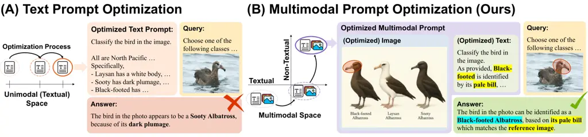
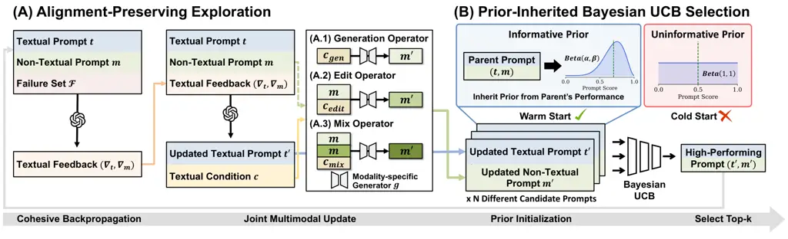
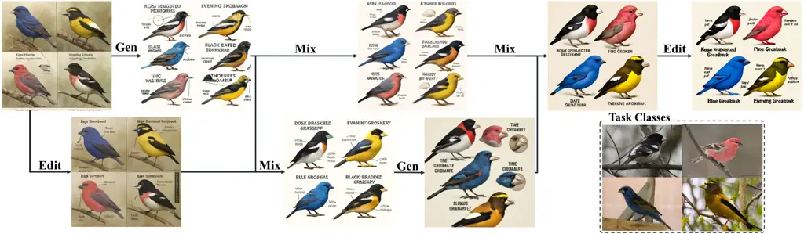
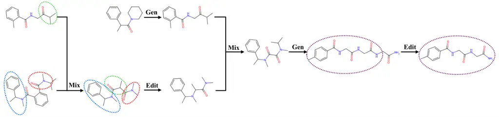

# Multimodal Prompt Optimization: Why Not Leverage Multiple Modalities for MLLMs

Yumin Choi ^(†)^(†)thanks: Equal Contribution; ^(†)Equal Advising; Code
is available at
[https://github.com/Dozi01/MPO](https://github.com/Dozi01/MPO).
Email: <yuminchoi@kaist.ac.kr>    Dongki Kim
Email: <cleverki@kaist.ac.kr>    Jinheon Baek
Email: <jinheon.baek@kaist.ac.kr>    Sung Ju Hwang
Affiliation: DeepAuto.ai Email: <sungju.hwang@kaist.ac.kr>
Affiliation: KAIST

###### Abstract

Large Language Models (LLMs) have shown remarkable success, and their
multimodal expansions (MLLMs) further unlock capabilities spanning
images, videos, and other modalities beyond text. However, despite this
shift, prompt optimization approaches, designed to reduce the burden of
manual prompt crafting while maximizing performance, remain confined to
text, ultimately limiting the full potential of MLLMs. Motivated by this
gap, we introduce the new problem of multimodal prompt optimization,
which expands the prior definition of prompt optimization to the
multimodal space defined by the pairs of textual and non-textual
prompts. To tackle this problem, we then propose the Multimodal Prompt
Optimizer (MPO), a unified framework that not only performs the joint
optimization of multimodal prompts through alignment-preserving updates
but also guides the selection process of candidate prompts by leveraging
earlier evaluations as priors in a Bayesian-based selection strategy.
Through extensive experiments across diverse modalities that go beyond
text, such as images, videos, and even molecules, we demonstrate that
MPO outperforms leading text-only optimization methods, establishing
multimodal prompt optimization as a crucial step to realizing the
potential of MLLMs.

|     |
| --- |
|     |

## 1 Introduction

Large Language Models (LLMs) have demonstrated outstanding capabilities
across a diverse range of tasks and domains (OpenAI, 2024; Grattafiori
and others, 2024; Yang et al., 2025). We note that a central factor in
unlocking their full potential lies in the design of prompts, which
directly influence model performance. However, crafting high-quality
prompts is often a labor-intensive and iterative process that requires
substantial human intervention. To address this limitation, the field of
Automatic Prompt Optimization (APO) has emerged, whose goal is to
automate the discovery of effective prompts (Pryzant et al., 2023;
Ramnath et al., 2025; Cui et al., 2025a; Li et al., 2025). For
example, Zhou et al. (2023) frames this challenge as an iterative search
problem, where at each step, a set of new candidate prompts is generated
or updated, evaluated on a target task, and the best-performing prompts
are selected to guide the next round of generation.

Recently, on top of the LLMs, Multimodal Large Language Models (MLLMs)
have been proposed, which process not only text but also images, videos,
and other modalities (such as molecules) (Kim et al., 2025; Zheng et
al., 2024; Song et al., 2025). Yet, despite these advances and their
wide-ranging applications, existing prompt optimization methods remain
restricted to the textual modality (Choi et al., 2025; Fernando et al.,
2024; Cui et al., 2025b), and overlook the richer expressive capacity
afforded by multimodal inputs (that text alone cannot capture). For
instance, as illustrated in Figure 1, describing the distinct
characteristics of a specific bird may require long and potentially
ambiguous text, while a single image can convey the same information far
more directly. By limiting optimization to text, existing methods are
prone to generating less effective, suboptimal prompts that fail to
fully exploit the multimodal space that MLLMs are inherently capable of
leveraging.

Motivated by this limitation, we first define the novel problem of
multimodal prompt optimization¹¹ 1 We define a multimodal prompt as a
pair of a discrete textual and non-textual prompts., which expands the
prompt optimization space beyond text to incorporate multiple
modalities. However, while this expanded space opens new opportunities,
it also introduces a couple of challenges for automatic optimization.
First, exploring the larger, combinatorial space of multimodal prompts
requires a prompt update strategy that can efficiently navigate
candidate prompts while maintaining cross-modal consistency.
Furthermore, selecting promising candidates becomes substantially more
difficult, as the enlarged search space makes optimal prompts
increasingly sparse, given the need to account for both the
effectiveness within each modality and the alignment across modalities,
which, in turn, calls for evaluation strategies that are both efficient
and accurate.



Figure 1: Concept Figure. (A) Existing prompt optimization approaches
restrict the optimization to the textual space, leaving MLLMs
underutilized by failing to provide rich contextual signals. (B) Our
multimodal prompt optimization expands the optimization space into
multimodality, allowing the discovery of salient multimodal context and
fully leveraging the expressive capacity of MLLMs.

To address these challenges, we propose Multimodal Prompt Optimizer
(MPO), a unified framework for optimizing prompts across both the
textual and non-textual modalities, which consists of the two key
components: (i) alignment-preserving exploration and (ii)
prior-inheritance-based selection. Specifically, for exploration, the
proposed MPO jointly updates the textual prompt, as well as its
associated non-textual counterparts by generating instructions to create
(or revise) the non-textual components of the multimodal prompt (unlike
prior approaches that refine only text), and notably, their updates are
guided by the single semantic gradient (i.e., feedback) to ensure their
alignment derived from the failure analysis of the current prompt.
Moreover, these updates are further diversified through complementary
operations, namely generation, editing, and mixing, to ensure the broad
and expressive exploration of the multimodal prompt space. Then,
building on this exploration with multiple candidate prompts updated,
MPO leverages the prior-inherited Bayesian-UCB as a prompt selection
strategy, which utilizes the performance score of parent prompts as a
prior (unlike conventional approaches that treat each candidate
independently), to reliably identify the high-performing prompts by
biasing the selection process toward more promising regions of the
multimodal space.

To validate MPO, we conduct extensive experiments benchmarking it
against leading text-only optimization methods across 10 datasets, and
our evaluation suite spans not only images and videos but also molecular
structures, ensuring broad coverage of diverse modalities. Across all
domains, MPO demonstrate consistent and significant performance gains,
empirically confirming our core hypothesis: expanding the prompt search
space into the multimodal domain is crucial to exploit the expanded
capacity of MLLMs. Further analyses show the efficacy of MPO components:
alignment-preserving exploration with complementary operators
facilitates the discovery of optimal multimodal prompts by not only
ensuring cross-modal consistency but also thoroughly probing the search
space; and the prior-inherited Bayesian-UCB accurately and efficiently
selects high-performing prompts, reducing evaluation budget by 42%
compared with a prior-free baseline. These results highlight MPO as an
effective framework for optimizing multimodal prompts, unlocking the
full capabilities of MLLMs.

## 2 Related Work

#### Multimodal Large Language Models

The development of MLLMs has significantly extended the capabilities of
traditional LLMs by enabling them to process and reason over diverse
non-textual modalities, including images, videos, audio, and more (Liu
et al., 2023; Chu et al., 2023; M. Bran et al., 2024). In particular,
these models are typically trained through large-scale multimodal
pre-training, which aligns modality-specific encoders (e.g., vision or
audio) with LLM backbones, followed by post-training stages such as
supervised fine-tuning and preference optimization to endow them with
multimodal instruction-following abilities (Gemini, 2025; Bai et al.,
2025; Zhu et al., 2025). Moreover, leveraging these capabilities, MLLMs
have achieved strong performance on a broad range of tasks, from
foundational ones such as classification and captioning, to
domain-specific, high-stakes applications such as medical image question
answering and pharmacological property prediction (Martin et al., 2019;
Liu et al., 2021; Corbière et al., 2025; Huang et al., 2021).

#### Automatic Prompt Optimization

To reduce the burden of manual prompt engineering and systematically
uncover the effective prompts, the field of Automatic Prompt
Optimization (APO) has emerged. Existing works can be broadly
categorized into two paradigms. The first is gradient-based
optimization, which learns continuous embedding vectors (i.e., soft
prompts) that are prepended to model inputs to steer behavior (Khattak
et al., 2023; Zeng et al., 2024; Wang et al., 2024). Yet, while
effective, they are computationally costly, yield uninterpretable
numerical vectors, and are restricted to open-source models with
accessible parameters. To overcome these drawbacks, gradient-free
approaches have been proposed, which iteratively generate, evaluate, and
refine candidate prompts using LLMs themselves (Zhou et al., 2023; Yang
et al., 2024). Also, some recent works enhance this process by analyzing
prompt failures to guide improvements (Khattab et al., 2024; Ye et al.,
2024; Cui et al., 2025b; Yuksekgonul et al., 2025), while others borrow
ideas from evolutionary algorithms (e.g., mutation and crossover) to
explore the prompt space (Guo et al., 2024; Fernando et al., 2024).
Despite this progress, current APO techniques are limited to text-only
settings, restricting optimization to purely linguistic information. In
contrast, our work expands prompt optimization into the multimodal
domain, enabling the prompt discovery that fully exploits the
capabilities of MLLMs.

#### Instance-Specific Prompting and Optimization

Distinct from task-level prompt optimization, another line of research
focuses on instance-specific prompting strategies that operate at
inference time to enhance reasoning on a per-query basis. For example,
MM-CoT (Zhang et al., 2024b) guides the model to generate an
intermediate textual rationale before producing the final answer. Also,
other methods augment visual inputs with query-dependent signals, such
as bounding boxes or points, to guide attention toward relevant regions
of an image (Zhou et al., 2024; Jiang et al., 2024; Lin et al., 2024).
Similar ideas have been explored in text-to-image and text-to-video
generation, where prompts are crafted and refined to produce outputs
more faithfully aligned with user intent (Mañas et al., 2024; Mo et al.,
2024; Gao et al., 2025). However, these techniques are query-specific,
designed to improve model performance for a single instance at a time.
By contrast, APO pursues a different objective: discovering a single,
reusable prompt that boosts performance across an entire task, and our
work advances this paradigm by extending it into the multimodal domain.



Figure 2: Overview of MPO, consisting of two components. (A)
Alignment-preserving exploration analyzes a failure set to generate
feedback, which is then used both to refine the textual prompt and to
guide a modality-specific generator to create a new non-textual prompt
with one of three operators. (B) Prior-Inherited Bayesian UCB Selection
leverages the parent’s performance as an informative prior,
warm-starting the search to effectively identify high-performing prompts
among candidates.

## 3 Methodology: Multimodal Prompt Optimizer

We present Multimodal Prompt Optimizer (MPO), composed of two modules:
alignment-preserving exploration of multimodal prompt space and prompt
selection with prior-inherited Bayesian UCB.

### 3.1 Problem Definition

We begin by formally describing MLLMs and then proposing a novel problem
of multimodal prompt optimization, which redefines and expands the
notion of existing prompt optimization beyond text.

#### Multimodal Large Language Models

Multimodal Large Language Models (MLLMs) extend the capabilities of LLMs
by processing inputs that combine text with non-textual modalities.
Formally, an MLLM can be represented as a parametric function
$`\mathtt{MLLM}:(\mathcal{T}\cup\mathcal{M})^{\ast}\rightarrow\mathcal{T}`$,
where $`\mathcal{T}`$ denotes the textual input space, $`\mathcal{M}`$
denotes the non-textual input space, and ^(∗) denotes the Kleene Star
(representing a finite sequence over the combined spaces). In other
words, given a multimodal query $`\bm{q}`$ and a prompt $`\bm{p}`$ (each
potentially containing both textual and non-textual components), the
model generates a textual output
$`\bm{y}=\mathtt{MLLM}(\bm{p},\bm{q})`$. It is worth noting that prior
work on prompt optimization has generally restricted $`\bm{p}`$ to a
purely textual form ($`\bm{p}=\bm{t}\in\mathcal{T}`$), leaving the
non-textual dimensions of $`\mathcal{M}`$ unused. This restriction
underutilizes the expressive capacity of MLLMs and fails to provide
richer contextual signals that are often crucial for real-world
multimodal tasks (See Figure 1).

#### Multimodal Prompt Optimization

Building on the expanded space of MLLMs, we extend the notion of a
prompt for optimization from text-only to multimodal. Specifically, we
define a multimodal prompt as a pair
$`\bm{p}=(\bm{t},\bm{m})\in\mathcal{T}\times\mathcal{M}`$, where
$`\bm{t}`$ is the textual prompt and $`\bm{m}`$ is the non-textual
prompt. Then, given a task dataset $`\mathcal{D}`$ consisting of
query–answer pairs $`(\bm{q},\bm{a})`$, the objective of multimodal
prompt optimization is to discover the optimal prompt
$`(\bm{t}^{*},\bm{m}^{*})`$ that maximizes performance:

```math
\displaystyle(\bm{t}^{*},\bm{m}^{*})\;=\;\operatorname*{argmax}_{(\bm{t},\bm{m})\in{\mathcal{T}\times\mathcal{M}}}\;\;\mathbb{E}_{(\bm{q},\bm{a})\sim\mathcal{D}}\Big[f\big(\mathtt{MLLM}(\bm{t},\bm{m},\bm{q}),\bm{a}\big)\Big],
```

where $`f`$ is a function for a task-specific evaluation metric, such as
accuracy or F1 scores.

Notably, compared to optimizing only textual prompts, the joint search
space $`\mathcal{T}\times\mathcal{M}`$ introduces an entirely new axis
of non-textual information, which in turn raises two fundamental
challenges. First, multimodal prompts must maintain cross-modal
consistency: textual and non-textual components should provide
complementary, not conflicting signals; however, expanding to the
combinatorial space greatly increases the risk of semantic misalignment.
Second, the enlarged space amplifies the difficulty of candidate
selection: high-quality prompts become sparse, and low-quality prompts
dominate, making it harder to efficiently identify promising candidates.
To overcome these, we now explain the proposed multimodal prompt
optimizer, designed to navigate this enlarged space below.

### 3.2 Alignment-Preserving Exploration of Multimodal Prompt Space

The first challenge in multimodal prompt optimization lies in exploring
the enlarged search space while preserving semantic consistency across
modalities; thus, a naive approach that independently updates textual
and non-textual components risks producing misaligned prompts, where one
modality contradicts the other. To tackle this, we introduce an
exploration framework that couples the update of textual and non-textual
prompts while supporting diverse operations (Figure 2).

#### Joint Optimization of Multimodal Prompt

Our MPO jointly updates the textual and non-textual prompts to ensure
that both evolve coherently, achieved through the following two
mechanisms:

- •
  Cohesive Backpropagation. We begin by identifying a failure set
  $`\mathcal{F}=\{(\bm{q},\bm{a},\bm{y})\mid\bm{y}\neq\bm{a}\}`$ for a
  multimodal prompt $`\bm{p}=(\bm{t},\bm{m})`$. Instead of treating
  errors separately for text and non-textual inputs, we then generate a
  unified feedback
  $`\nabla_{\bm{p}}=(\nabla_{\bm{t}},\nabla_{\bm{m}})=\mathtt{MLLM}(\bm{t},\bm{m};\mathcal{F})`$,
  which encodes cross-modal weaknesses in textual form. By doing so, we
  obtain the single supervisory signal that guides both modalities
  simultaneously, mitigating the risk of overfitting updates to one
  modality.
- •
  Joint Multimodal Update. Using the feedback, MPO jointly refines the
  textual prompt while deriving modality-specific conditions (in the
  textual form) that direct non-textual revisions. Specifically, the
  MLLM produces an updated textual prompt $`\bm{t}^{\prime}`$ and
  further a modality-specific condition $`\bm{c}`$ describing how the
  non-textual prompt should adapt:
  $`(\bm{t}^{\prime},\bm{c})=\mathtt{MLLM}(\bm{t},\bm{m};\mathcal{F},\nabla_{\bm{p}})`$.
  The condition $`\bm{c}`$ is then passed to modality-specific
  generators $`g`$ (such as text-to-image or text-to-molecule modules),
  which yield updated non-textual prompts $`\bm{m}^{\prime}=g(\bm{c})`$.
  This guarantees that updates to $`\bm{m}`$ remain consistent with the
  revised textual prompt $`\bm{t}^{\prime}`$, rather than being
  optimized in isolation.

For the optimization process, we adopt the beam search. Specifically, at
each iteration, we select top-$`b`$ best-performing multimdoal prompts
$`\{\bm{p}_{i}=(\bm{t}_{i},\bm{m}_{i})\}_{i=1}^{b}`$, and then apply the
cohesive backpropagation and the joint multimodal update to generate new
$`b^{2}`$ multimodal prompts
$`\{\bm{p}^{\prime}_{j}=(\bm{t}^{\prime}_{j},\bm{m}^{\prime}_{j})\}_{j=1}^{b^{2}}`$
from the top-$`b`$ multimodal prompts $`\bm{p}`$. We refer to $`\bm{p}`$
and $`\bm{p}^{\prime}`$ as parent and child prompts, respectively.

#### Exploration Operators

Ensuring that generated outputs remain consistent with the guiding
textual conditions is a necessary baseline, and effective optimization
further requires $`g`$ that actively explores diverse regions of the
multimodal space. To achieve this, we design three operators (namely,
generation, edit, and mix), which systematically expand, refine, and
recombine non-textual prompts.

- •
  Generation operator. This operator explores entirely new non-textual
  prompts, e.g., novel spatial arrangements in visual inputs or unique
  substructures in molecules. Specifically, conditioned only on the
  generation signal $`\bm{c}_{\text{gen}}`$, it creates a prompt from
  scratch without referencing prior candidates:

  ```math
  \displaystyle\bm{m}^{\prime}=g(\bm{c}_{\text{gen}},\varnothing),\;\text{where}\;(\bm{c}_{\text{gen}},\bm{t}^{\prime})=\mathtt{MLLM}(\bm{t},\bm{m};\nabla_{\bm{p}},\mathcal{F}).
  ```

  By decoupling from past candidates, it explores unexplored regions and
  avoids local optima, especially in early stages (where initial prompts
  are unavailable) or when the candidate pool is biased.

- •
  Edit operator. This operator performs fine-grained refinements of
  non-textual prompts (e.g., textures) while retaining useful structures
  from the prior prompt. Specifically, given the edit condition
  $`\bm{c}_{\text{edit}}`$, the update is performed by conditioning on
  the prior non-textual prompt:

  ```math
  \displaystyle\bm{m}^{\prime}=g(\bm{c}_{\text{edit}},\{\bm{m}\}),\;\text{where}\;(\bm{c}_{\text{edit}},\bm{t}^{\prime})=\mathtt{MLLM}(\bm{t},\bm{m};\nabla_{\bm{p}},\mathcal{F}).
  ```

  This enables targeted, incremental refinements, making it particularly
  effective when a prompt is already strong but requires adjustment on
  specific attributes rather than a complete redesign.

- •
  Mix operator. This operator blends the complementary strengths of
  multiple multimodal prompts. Specifically, it first leverages feedback
  from multiple prompts to generate a mixing condition
  $`\bm{c}_{\text{mix}}`$, which is then used by the generator to
  combine non-textual prompts as follows:

  ```math
  \displaystyle\bm{m}^{\prime}=g(\bm{c}_{\text{mix}},\{\bm{m}_{i}\}_{i=1}^{K}),\;\text{where}\;(\bm{c}_{\text{mix}},\bm{t}^{\prime})=\mathtt{MLLM}(\{\bm{t}_{i},\bm{m}_{i};\nabla_{\bm{p}_{i}},\mathcal{F}_{i}\}_{i=1}^{K}).
  ```

  By synthesizing multiple candidates, it yields balanced compositions,
  avoids over-reliance on a single candidate, and enables exploration of
  intermediate solutions better than individual ones.

It is worth noting that, for the generation and edit operators, we
randomly select one parent prompt from top-$`b`$ multimodal prompts of
the previous iteration to generate a child prompt (i.e.,
$`\bm{p}\rightarrow\bm{p^{\prime}})`$, while $`K`$ parent prompts are
selected for the mix operator (i.e.,
$`\{\bm{p}_{1},...,\bm{p}_{K}\}\rightarrow\bm{p}^{\prime}`$).

### 3.3 Effective Prompt Selection by Prior-Inherited Bayesian UCB

Another challenge in multimodal prompt optimization is to identify which
candidates should be prioritized for evaluation and carried
forward (Pryzant et al., 2023; Shi et al., 2024). Yet, this step is
non-trivial with the enlarged multimodal space, since high-quality
prompts become relatively sparse, and a large portion of the evaluation
budget risks being wasted on low-potential candidates. Existing
approaches typically adopt either (i) uniform allocation, where each
candidate is evaluated equally regardless of its prior likelihood of
success (Zhou et al., 2023; Cui et al., 2025b), or (ii) bandit-based
allocation, such as UCB (Auer, 2002; Bouneffouf and Féraud, 2025; Li et
al., 2026; Ashizawa et al., 2025), which adaptively balances exploration
and exploitation. However, both paradigms suffer from an inefficient
cold-start problem: newly generated prompts are treated as independent
arms with no prior information, leading to unproductive evaluations in
the early rounds.

Figure 3: Correlation of parent and child scores.

#### Parent-Child Correlation

We address this cold-start inefficiency by introducing informative
priors that warm-start the evaluation process. In particular, our
hypothesis is that the performance of a parent prompt is positively
correlated with that of its children. To test this, we analyze the
optimization trajectory, measuring the correlation between the
performance of parent prompts and the average performance of their
children. As shown in Figure 3, we observe a strong positive correlation
(Pearson’s $`r=0.88`$), providing concrete evidence that parent scores
could serve as highly informative priors for estimating child
performance.

#### Prior-Inherited Bayesian UCB

Motivated by this finding, we propose prior-inherited Bayesian
UCB (Kaufmann et al., 2012), a selection strategy that initializes the
score distribution of a new child prompt based on the posterior of its
parent (rather than uniform). Specifically, we model the expected score
of each multimodal prompt $`\bm{p}_{i}`$ as a Beta distribution,
$`\operatorname{Beta}(\alpha_{i},\beta_{i})`$, where $`\alpha_{i}`$ and
$`\beta_{i}`$ correspond to (pseudo-) counts of successful and failure
outcomes, respectively. Then, for a child prompt $`\bm{p}_{i}`$
originated from a parent prompt $`\bm{p}_{\texttt{par}(i)}`$²² 2 If a
child prompt is generated by the mix operator, we average the posterior
mean performance of multiple parent prompts., we initialize its prior
proportionally to the posterior mean performance of the parent
$`\hat{\mu}_{\texttt{par}(i)}`$, scaled by a prior strength
hyperparameter $`S>0`$, formalized as follows:

```math
\displaystyle\alpha_{i}=\hat{\mu}_{\texttt{par}(i)}\cdot S+1,\;\;\beta_{i}=(1-\hat{\mu}_{\texttt{par}(i)})\cdot S+1,\quad\text{where}\quad\hat{\mu}_{\texttt{par}(i)}=\frac{\alpha_{\texttt{par}(i)}}{\alpha_{\texttt{par}(i)}+\beta_{\texttt{par}(i)}}. \tag{1}
```

This prior-inherited mechanism provides $`S`$ pseudo-observations to
newly generated child prompts, effectively warm-starting the evaluation
process. With a fixed total budget, it then proceeds iteratively: at
each round, we select the prompt with the highest UCB score (an upper
quantile of its Beta posterior), evaluate it on a small batch of data,
and update its posterior parameters $`\alpha_{i}`$ and $`\beta_{i}`$.
Once the budget is exhausted, the candidate prompt with the highest
expected score is selected as the new parent for the next iteration of
optimization. Please refer to Algorithm 2 for the complete procedure.
The following proposition guarantees that our proposed selection
strategy leverages an informative parent prior (better than random
chance) to accelerate the selection of the best-promising prompt.

###### Proposition 3.1.

(Fewer Pulls via Prior-Inherited Bayesian UCB) With the prior of
Equation 1, and if the prior is more informative than uniform
($`\mathbb{E}_{i}\!\left[d(\mu_{i},\hat{\mu}_{\texttt{par}(i)})-d(\mu_{i},\tfrac{1}{2})\right]\leq 0`$),
the best-arm identification cost of Bayesian UCB is nonincreasing, where
$`d(p,q)`$ is the Bernoulli KL divergence.

The proof and detailed analysis are provided in Appendix B. Intuitively,
this guarantee demonstrates that informative parent priors accelerate
the discovery of high-quality prompts by reducing wasted evaluations on
low-potential candidates, which is particularly beneficial for
multimodal prompt optimization, where the combinatorial search space is
far larger than text-only settings. In other words, by rapidly
eliminating unpromising candidates and reallocating the budget toward
more promising regions, our method enables efficient exploration of the
vast multimodal prompt landscape.

## 4 Experiments

### 4.1 Experimental Setup 

#### Datasets

We conduct an extensive evaluation on MPO across a diverse set of
modalities, including images, videos, and molecules. For the image
modality, we consider both image classification and visual question
answering (VQA) tasks. Specifically, we use PlantVillage (Mohanty et
al., 2016) for diseased leaf identification and CUB-200-2011 (Wah et
al., 2011) for fine-grained bird classification; meanwhile, for VQA, we
evaluate on SLAKE (Liu et al., 2021), RSVQA (Lobry et al., 2020), and
DrivingVQA (Corbière et al., 2025), which cover radiology, remote
sensing, and dynamic driving scenes, respectively. For the video
modality, we evaluate on Drive&Act (Martin et al., 2019) for driver
action recognition and VANE-Bench (Gani et al., 2025) for abnormality
detection in video-based VQA. Finally, for the molecular modality, we
include three different property prediction tasks from TDC (Huang et
al., 2021), namely, Absorption (Hou et al., 2007; Ma et al., 2008;
Broccatelli et al., 2011; Siramshetty et al., 2021), BBBP (Martins et
al., 2012), and CYP inhibition tasks (Veith et al., 2009). Detailed
configurations for each dataset are provided in Appendix A.1.

#### Baselines

We benchmark MPO against both manually designed prompts and
representative automatic prompt optimization methods. For manual
prompting, we include Human, a simple hand-crafted prompt,
Chain-of-Thought (CoT) (Wei et al., 2022), which uses the widely adopted
phrase “Let’s think step by step,” and Few-Shot, which supplies
in-context examples drawn from the training data. For automatic methods,
we compare against leading LLM-based text-only optimizers, including
APE (Zhou et al., 2023), OPRO (Yang et al., 2024), EvoPrompt (Guo et
al., 2024), PE2 (Ye et al., 2024), ProTeGi (Pryzant et al., 2023), and
SEE (Cui et al., 2025b). Detailed descriptions of all baselines are
provided in Appendix A.2.

#### Implementation Details

For answer generation, we use Qwen2.5-VL (7B) (Bai et al., 2025) as the
base model for image and video tasks, and Qwen3 (8B) (Yang et al., 2025)
for molecular tasks. During optimization, GPT-4o mini (OpenAI, 2024)
serves as the prompt optimizer, responsible for analyzing failures and
refining multimodal prompts. For modality-specific generation, we employ
GPT-Image (OpenAI, 2025) for images, Wan2.1 (1.3B) (Wan et al., 2025)
for videos, and again GPT-4o mini for molecules. For the implementation
of the iterative optimization loop, we use the beam search (Pryzant et
al., 2023) with the beam size of $`b=3`$ and the number of iterations of
$`T=13`$. Also, at each iteration (except the first), $`b^{2}`$ child
prompts are produced by evenly applying the generation, edit, and mix
operators, after which the top-$`b`$ prompts are selected via
prior-inherited Bayesian-UCB. Meanwhile, in the first iteration, only
the generation operator is used to initialize multimodal prompts, since
no non-textual prompts exist yet. The complete optimization process is
summarized in Algorithm 1. To ensure fairness, we keep the number of
explored prompts consistent across all methods. In our case, each
candidate prompt is allocated an evaluation budget of 100, and the prior
strength for our prior inheritance is set to 10% of this budget
($`S=10`$). Reported results are averaged over three independent runs.
Please see Appendix A.3 for additional details.

|                           |                |       |         |            |       |           |       |              |      |      |      |                |      |      |
| ------------------------- | -------------- | ----- | ------- | ---------- | ----- | --------- | ----- | ------------ | ---- | ---- | ---- | -------------- | ---- | ---- |
|                           | Image          |       |         |            |       | Video     |       | Molecule     |      |      |      |                |      |      |
|                           | PlantVillage\* | CUB\* | SLAKE\* | DrivingVQA | RSVQA | Drive&Act | VANE. | Absorption\* |      | BBBP |      | CYP Inhibit.\* |      |      |
| Methods                   | Acc.           | Acc.  | Acc.    | Acc.       | Acc.  | Acc.      | Acc.  | Acc.         | F1   | Acc. | F1   | Acc.           | F1   | Avg. |
| Human                     | 42.2           | 47.9  | 35.2    | 49.7       | 51.0  | 47.3      | 47.0  | 38.5         | 36.3 | 39.4 | 38.6 | 43.1           | 37.1 | 44.1 |
| CoT                       | 43.1           | 49.0  | 30.8    | 52.9       | 49.6  | 37.2      | 31.6  | 39.6         | 36.7 | 33.6 | 32.5 | 40.1           | 32.3 | 40.8 |
| \[0.5pt/1pt\]  1-Shot     | 39.7           | 54.7  | 31.4    | 54.5       | 48.5  | 50.4      | 62.4  | 37.8         | 35.7 | 36.1 | 34.8 | 56.2           | 48.3 | 47.2 |
| 3-Shot                    | 48.2           | 58.8  | 30.6    | 53.9       | 52.2  | 54.2      | 56.0  | 46.1         | 44.2 | 42.7 | 42.6 | 51.9           | 47.3 | 49.5 |
| 5-Shot                    | 46.5           | 58.1  | 28.0    | 45.9       | 49.2  | 54.3      | 61.4  | 48.1         | 45.5 | 49.3 | 49.3 | 52.0           | 47.0 | 49.3 |
| \[0.5pt/1pt\]  APE        | 55.8           | 67.3  | 34.3    | 52.8       | 54.4  | 50.3      | 64.3  | 45.7         | 40.4 | 36.0 | 34.7 | 52.3           | 50.9 | 51.3 |
| OPRO                      | 54.1           | 59.7  | 33.9    | 52.7       | 51.0  | 46.4      | 51.0  | 37.6         | 35.4 | 39.2 | 38.3 | 43.0           | 37.1 | 46.9 |
| EvoPrompt                 | 56.1           | 59.6  | 34.8    | 52.9       | 50.5  | 46.7      | 56.5  | 48.2         | 46.5 | 38.7 | 37.7 | 51.1           | 49.7 | 49.5 |
| PE2                       | 67.9           | 71.6  | 35.8    | 53.7       | 55.2  | 50.8      | 63.0  | 64.5         | 56.8 | 61.3 | 58.2 | 58.5           | 55.1 | 58.2 |
| ProTeGi                   | 64.4           | 70.0  | 35.4    | 54.4       | 54.2  | 53.0      | 65.5  | 71.1         | 58.2 | 72.1 | 65.7 | 59.8           | 57.0 | 60.0 |
| SEE                       | 69.0           | 71.6  | 35.0    | 52.2       | 53.4  | 51.7      | 57.9  | 71.4         | 60.0 | 67.0 | 62.3 | 61.4           | 56.7 | 59.1 |
| \[0.5pt/1pt\]  MPO (Ours) | 76.4           | 78.6  | 38.2    | 56.0       | 55.9  | 58.3      | 71.2  | 76.7         | 64.5 | 75.3 | 67.6 | 64.3           | 60.2 | 65.1 |

Table 1: Main Results. Comparison of MPO with manual prompting, few-shot
prompting, and text-only APO baselines on diverse benchmarks across
image, video, and molecular modalities. Results are averaged over three
independent runs. \* denotes the average performance across multiple
subtasks within the benchmark. Avg. denotes the average accuracy over
all datasets except F1.

### 4.2 Experimental Results and Analyses

#### Main Results

As shown in Table 1, MPO consistently outperforms all baselines across
image, video, and molecular domains, confirming its effectiveness in
discovering prompts that more effectively harness the capabilities of
MLLMs. Specifically, compared to existing text-only optimization
methods, MPO achieves substantial gains, demonstrating that
incorporating non-textual signals into prompts provides stronger
contextual grounding and enhances task-specific reasoning. Moreover, MPO
outperforms exemplar-based Few-Shot prompting, showing that it can
capture richer cross-modal information and its underlying dependencies
beyond simple query–answer demonstrations. In both image and video
domains, MPO performs strongly on classification and QA tasks,
underscoring its robustness across diverse real-world scenarios.
Likewise, on molecular tasks, MPO surpasses all baselines, highlighting
its effectiveness in highly specialized applications.

|                        |                  |              |                    |              |
| ---------------------- | ---------------- | ------------ | ------------------ | ------------ |
|                        | Qwen2.5-VL (72B) | Gemma3 (12B) | InternVL-3.5 (14B) | GPT-4.1 nano |
| Human                  | 55.7             | 45.6         | 51.6               | 46.8         |
| \[0.5pt/1pt\]  1-shot  | 66.8             | 56.7         | 34.7               | 46.1         |
| 3-shot                 | 69.6             | 64.6         | 36.5               | 37.7         |
| 5-shot                 | 72.3             | 68.9         | 34.9               | 42.6         |
| \[0.5pt/1pt\]  ProTeGi | 74.1             | 68.2         | 71.9               | 61.0         |
| SEE                    | 73.6             | 68.1         | 70.8               | 61.6         |
| \[0.5pt/1pt\]  MPO     | 80.4             | 73.1         | 73.2               | 65.9         |

| Optimizer Model  | SEE  | MPO  |
| ---------------- | ---- | ---- |
| Qwen2.5-VL (7B)  | 65.2 | 69.1 |
| Gemini 2.5 Flash | 68.2 | 74.8 |
| GPT-4o mini      | 69.0 | 76.4 |
| GPT-4o           | 69.2 | 78.0 |

| T2I Generator                 | PlantVillage\* |
| ----------------------------- | -------------- |
| SEE (Text-only)               | 69.0           |
| \[0.5pt/1pt\]  SANA1.5 (1.6B) | 71.8           |
| Nano Banana                   | 72.9           |
| GPT-Image-Low                 | 76.4           |
| GPT-Image-Medium              | 76.6           |

Table 2: Generalizability results of MPO across components with
different backbones: (Top) base models; (Bottom Left) optimizer models;
(Bottom Right) modality-specific generators.

Figure 4: Relationship between cross-modal alignment and performance
gain. We report median values alongside Q1 and Q3.

#### Generalizability to Diverse Backbone Models

We further validate the generalizability of MPO by varying the backbone
models used in each component, namely, base models, optimizer models,
and modality-specific generators, and assessing its robustness under
these variations. First, as shown in Table 2 (Top), MPO maintains strong
performance across different architectures and exhibits even greater
effectiveness as model size increases, for example, with Qwen2.5-VL
(72B). Also, Table 2 (Bottom Left) further shows that MPO remains
effective regardless of the optimizer model, surpassing state-of-the-art
text-only methods (e.g., SEE) under diverse backbone models for
optimization. Finally, Table 2 (Bottom Right) demonstrates that MPO
generalizes well to modality-specific generators, including lightweight
open-source models such as SANA1.5 (1.6B), where it continues to
outperform textual optimization methods. These results highlight MPO as
a broadly generalizable and robust framework, effective across a wide
variety of base models and practical scenarios.

#### Analysis on Cross-Modal Alignment

Recall that MPO uses the alignment-preserving exploration to jointly
refine textual and non-textual components of multimodal prompts, and we
further analyze how this cross-modal alignment strategy contributes to
performance gains. To isolate this effect, we consider four variants:
(1) Sequential, where the textual prompt is optimized first and the
non-textual prompt is refined afterward; (2) Random Image Prompt, where
the image component is replaced with another optimized image prompt
(i.e., not jointly optimized with the text); (3) In-Distribution Image
Query, where it is replaced with an image sampled from the same task;
and (4) OOD Image Query, where it is replaced with an image sampled from
a different task. After that, we measure the relationship between
performance gain over the Human baseline, as well as the DSG score³³ 3
DSG decomposes the textual description into atomic, dependency-aware
queries and verifies each using an MLLM, enabling a precise assessment
of whether the visual content reflects the intended textual
details. (Cho et al., 2024), used as a standard metric for measuring
cross-modal alignment following prior work (Mañas et al., 2024). As
shown in Figure 4, MPO achieves both the highest alignment score and the
largest performance gains, followed by Sequential optimization and
Random Image Prompt, while In-Distribution and OOD Image Query lag
significantly behind. These results coAnfirm that stronger cross-modal
alignment directly translates to better task performance, and that
alignment-preserving updates (included in MPO) are crucial in promoting
modality consistency.

| Text  | Image | PlantVillage\* | CUB\* |
| ----- | ----- | -------------- | ----- |
| Human | \-    | 42.2           | 47.9  |
| Human | MPO   | 50.4           | 58.2  |
| MPO   | \-    | 55.6           | 64.2  |
| MPO   | MPO   | 76.4           | 78.6  |

Table 3: Ablation on the contribution of each modality in the optimized
multimodal prompt.

|                           | Apple | Corn | Grape | Potato | Avg. |
| ------------------------- | ----- | ---- | ----- | ------ | ---- |
| SEE                       | 76.4  | 75.9 | 48.0  | 75.7   | 69.0 |
| \[0.5pt/1pt\]  Generation | 76.9  | 77.9 | 53.7  | 83.6   | 73.3 |
| Edit                      | 77.2  | 76.3 | 56.2  | 80.1   | 72.5 |
| Mix                       | 74.0  | 77.9 | 65.1  | 79.8   | 74.8 |
| \[0.5pt/1pt\]  MPO (Full) | 77.7  | 78.2 | 65.9  | 84.0   | 76.4 |

Table 4: Ablation on three exploration operators, utilizing each one of
them individually.

Figure 5: Efficiency comparison of selection strategies.



Figure 6: Image prompt optimization process of the best-performing
multimodal prompt on a subtask (i.e., grosbeak species classification)
of CUB. “Task Classes” box contains the examples of four species: Rose
Breasted Grosbeak, Pine Grosbeak, Blue Grosbeak, and Evening Grosbeak.

#### Ablation on Modality Contributions in Prompts

To examine the contribution of each modality within optimized prompts,
we ablate the textual and non-textual components from the final
multimodal prompt. As shown in Table 3, using only a single modality
(either MPO text without image or human text combined with MPO image)
already surpasses the Human baseline, confirming that both modalities
independently provide useful signals. However, the full multimodal
prompt yields substantially higher performance, demonstrating that the
two modalities are not merely additive but mutually reinforcing, which
underscores the importance of jointly leveraging textual and non-textual
information to achieve performance gains beyond what either modality can
deliver alone.

#### Effect of Exploration Operators

To assess the contribution of the proposed exploration operators (such
as generation, edit, and mix), we conduct both qualitative and ablation
analyses. Qualitatively, as illustrated in Figure 6, we observe that
each operator serves a distinct role: the generation operator introduces
novel visual compositions, the edit operator fine-tunes local features
such as textures or visual characters, and the mix operator blends
broader attributes such as background or spatial layout. In addition to
this, the ablation study in Table 4 further confirms their complementary
effects: while each operator individually improves over the baseline,
combining all three within MPO leads to the best performance. This
demonstrates that the proposed operators jointly enable a more
comprehensive exploration of the multimodal prompt space, facilitating
the discovery of the optimal prompts. We observe a similar pattern in
molecular prompt optimization, shown in Figure 14, with concrete
examples of operator-driven updates (including textual conditions)
provided in Table 8.

#### Selection Strategies

We evaluate the effectiveness of our prior-inherited Bayesian UCB
strategy for candidate prompt selection by comparing it against three
alternatives: Uniform, which distributes the evaluation budget evenly
across candidates; UCB (Auer, 2002), a standard bandit algorithm; and an
ablated variant of ours w/o Prior. As shown in Figure 5, MPO achieves
the same performance as the Uniform strategy while using only 30% of the
evaluation budget, yielding a 70% reduction in resource cost. Moreover,
MPO consistently outperforms both UCB and w/o Prior, reaching their
performance levels with 52% and 42% less budget, respectively. These
results confirm that the warm start enabled by prior inheritance is
crucial for both efficiency and accuracy, allowing MPO to scale
effectively over the enlarged multimodal search space and reliably
identify high-quality prompts.

#### Train Dynamics of MPO

To better understand how MPO improves over the course of optimization,
we analyze its training dynamics in comparison to ProTeGi by tracking
the test performance of the top-1 prompt on the CUB dataset. As shown in
Figure 9, both methods improve during the early iterations; however,
ProTeGi quickly plateaus after the third iteration, with only a marginal
additional gain of 1.1 points. In contrast, MPO continues to improve
steadily, ultimately achieving a much higher final score, including an
additional 6.4-point gain beyond the third iteration. This comparison
result highlights that MPO effectively overcomes the performance ceiling
of text-only optimization methods by effectively navigating the
multimodal prompt space, enabling it to escape local optima (imposed by
the text-only strategy) and discover prompts closer to the global
optimum.

Figure 7: Train Curve of MPO compared to ProTeGi on CUB.

Figure 8: Visualization of hidden states in MLLMs by PCA.

Figure 9: Analysis of the prior strength ($`S`$) on performance.

#### Hidden State Visualization

To gain deeper insight into why optimized multimodal prompts yield
greater performance improvements than text-only prompts, we visualize
the hidden state of MLLMs by averaging intermediate-layer embeddings,
following Zhang et al. (2024a). As shown in Figure 9, hidden states
obtained from text-only methods (including the text-only component of
MPO) cluster together, suggesting that they guide the reasoning of MLLMs
within a similar yet limited semantic space. In contrast, the full
multimodal prompt from MPO shifts the hidden states into a distinct
region, indicating that the non-textual component introduces information
unavailable from text alone. In other words, the multimodal prompt
alters the internal representation space of models, enabling richer
reasoning pathways and ultimately leading to superior task performance.

#### Analysis of Prior Strength

Recall that in our prior-inherited selection strategy, the prior
strength $`S`$ determines the number of pseudo-observations used to
initialize the score distributions of child prompts, and we study its
effect by varying $`S`$ and reporting the resulting performance. As
shown in Figure 9, we first observe that a small $`S`$ under-utilizes
the parent prior, resulting in weaker guidance and suboptimal
performance. In contrast, an excessively large $`S`$ causes the model to
over-rely on the parent prior, limiting its ability to adapt to the
actual performance of child prompts. Consequently, the performance is
maximized at an intermediate $`S`$, where inherited knowledge provides a
strong warm start while still allowing sufficient flexibility to
incorporate new observations.

#### Qualitative Result

We provide qualitative examples for the optimized multimodal prompts for
the image modality in Table 9 of Appendix. From this, we observe that
the optimized multimodal prompts consistently supply task-critical
context in both textual and visual forms. Also, more importantly, the
textual prompts explicitly instruct the model to leverage non-textual
signals (e.g., Use the hybrid reference image for guidance), thereby
unlocking the full multimodal capacity of MLLMs. Additional examples for
the video and molecular modalities are presented in Tables 10, 11, and 12.

## 5 Conclusion

We introduced the novel problem of multimodal prompt optimization,
extending the optimization space beyond text to fully leverage the
capability of MLLMs. To tackle this, we proposed the Multimodal Prompt
Optimizer (MPO), a unified framework that jointly refines textual and
non-textual components through alignment-preserving exploration with
multiple generation operations and efficiently identifies high-quality
prompts via a prior-inherited Bayesian UCB strategy. Experiments across
diverse modalities (including images, videos, and molecules) demonstrate
that MPO consistently surpasses leading text-only prompt optimization
methods, validating its efficacy in diverse real-world multimodal
problems. We believe our work establishes multimodal prompt optimization
as a key direction for advancing the use of MLLMs, moving beyond
text-only prompting paradigms.

## Ethics Statement

Our study does not involve human subjects, personally identifiable data,
or sensitive information. All experiments were conducted on public
datasets and models under research-permissive licenses.

## Reproducibility Statement

We provide the public GitHub link to the code to ensure the
reproducibility of our work. Additionally, we provide a detailed
description of the experimental setup in Section 4.1. We further provide
additional implementation details in Appendix A.3, the dataset
configuration in Appendix A.1, the meta prompts to operationalize MPO in
Appendix A.4, and the full algorithms in Appendix A.5.

## Acknowledgement

This work was supported by the Institute for Information &
communications Technology Planning & Evaluation (IITP) grant funded by
the Korea government (MSIT) (RS-2019-II190075, Artificial Intelligence
Graduate School Program (KAIST) and RS-2022-II220713, Meta-learning
Applicable to Real-world Problems), the National Research Foundation of
Korea (NRF) grant funded by the Korea government (MSIT) (No.
RS-2023-00256259), the Korea Machine Learning Ledger Orchestration for
Drug Discovery Project (K-MELLODDY) funded by the Ministry of Health &
Welfare and Ministry of Science and ICT, Republic of Korea (No.
RS-2024-00460870), the Basic Science Research Program through the
National Research Foundation of Korea (NRF) funded by the Ministry of
Education (RS-2024-00414751), and the InnoCORE program of the Ministry
of Science and ICT (No. N10250156).

## References

- Ashizawa et al. (2025) R. Ashizawa, Y. Hirose, N. Yoshinari, K.
  Uchida, and S. Shirakawa Bandit-based prompt design strategy selection
  improves prompt optimizers. In Findings of the Association for
  Computational Linguistics, ACL, Cited by: §3.3.
- Auer (2002) P. Auer Using confidence bounds for
  exploitation-exploration trade-offs. Journal of Machine Learning
  Research. Cited by: §3.3, §4.2.
- Bai et al. (2025) S. Bai, K. Chen, X. Liu, J. Wang, W. Ge, S. Song, K.
  Dang, P. Wang, S. Wang, et al. Qwen2.5-vl technical report. arXiv.
  Cited by: §2, §4.1.
- Bouneffouf and Féraud (2025) D. Bouneffouf and R. Féraud Multi-armed
  bandits meet large language models. arXiv. Cited by: §3.3.
- Broccatelli et al. (2011) F. Broccatelli, E. Carosati, A. Neri, M.
  Frosini, L. Goracci, T. I. Oprea, and G. Cruciani A novel approach for
  predicting p-glycoprotein (abcb1) inhibition using molecular
  interaction fields. Journal of medicinal chemistry. Cited by: §4.1.
- Cho et al. (2024) J. Cho, Y. Hu, J. M. Baldridge, R. Garg, P.
  Anderson, R. Krishna, M. Bansal, J. Pont-Tuset, and S. Wang
  Davidsonian scene graph: improving reliability in fine-grained
  evaluation for text-to-image generation. In The Twelfth International
  Conference on Learning Representations, ICLR, Cited by: §4.2.
- Choi et al. (2025) Y. Choi, J. Baek, and S. J. Hwang System prompt
  optimization with meta-learning. In Annual Conference on Neural
  Information Processing Systems 2025, NeurIPS, Cited by: §1.
- Chu et al. (2023) Y. Chu, J. Xu, X. Zhou, Q. Yang, S. Zhang, Z.
  Yan, C. Zhou, and J. Zhou Qwen-audio: advancing universal audio
  understanding via unified large-scale audio-language models. arXiv.
  Cited by: §2.
- Corbière et al. (2025) C. Corbière, S. Roburin, S. Montariol, A.
  Bosselut, and A. Alahi DRIVINGVQA: analyzing visual chain-of-thought
  reasoning of vision language models in real-world scenarios with
  driving theory tests. arXiv. Cited by: §A.1, §2, §4.1.
- Cui et al. (2025a) W. Cui, J. Zhang, Z. Li, H. Sun, D. Lopez, K.
  Das, B. A. Malin, and K. Sricharan Automatic prompt optimization via
  heuristic search: A survey. In Findings of the Association for
  Computational Linguistics, ACL, Cited by: §1.
- Cui et al. (2025b) W. Cui, J. Zhang, Z. Li, H. Sun, D. Lopez, K.
  Das, B. A. Malin, and K. Sricharan SEE: strategic exploration and
  exploitation for cohesive in-context prompt optimization. In
  Proceedings of the 63rd Annual Meeting of the Association for
  Computational Linguistics ACL 2025, Cited by: 6th item, §1, §2, §3.3,
  §4.1.
- Fernando et al. (2024) C. Fernando, D. Banarse, H. Michalewski, S.
  Osindero, and T. Rocktäschel Promptbreeder: self-referential
  self-improvement via prompt evolution. In Forty-first International
  Conference on Machine Learning, ICML, Cited by: §1, §2.
- Gani et al. (2025) H. Gani, R. Bharadwaj, M. Naseer, F. S. Khan,
  and S. Khan VANE-bench: video anomaly evaluation benchmark for
  conversational lmms. In Findings of the Association for Computational
  Linguistics: NAACL 2025, Cited by: §A.1, §4.1.
- Gao et al. (2025) B. Gao, X. Gao, X. Wu, Y. Zhou, Y. Qiao, L. Niu, X.
  Chen, and Y. Wang The devil is in the prompts: retrieval-augmented
  prompt optimization for text-to-video generation. In Conference on
  Computer Vision and Pattern Recognition, Cited by: §2.
- Gemini (2025) T. Gemini Gemini 2.5: pushing the frontier with advanced
  reasoning, multimodality, long context, and next generation agentic
  capabilities. arXiv. Cited by: §2.
- Grattafiori et al. (2024) A. Grattafiori et al. The llama 3 herd of
  models. arXiv. Cited by: §1.
- Guo et al. (2024) Q. Guo, R. Wang, J. Guo, B. Li, K. Song, X. Tan, G.
  Liu, J. Bian, and Y. Yang Connecting large language models with
  evolutionary algorithms yields powerful prompt optimizers. In The
  Twelfth International Conference on Learning Representations, ICLR,
  Cited by: 3rd item, §2, §4.1.
- Hou et al. (2007) T. Hou, J. Wang, W. Zhang, and X. Xu ADME evaluation
  in drug discovery. 7. prediction of oral absorption by correlation and
  classification. Journal of chemical information and modeling. Cited
  by: §4.1.
- Huang et al. (2021) K. Huang, T. Fu, W. Gao, Y. Zhao, Y. Roohani, J.
  Leskovec, C. W. Coley, C. Xiao, J. Sun, and M. Zitnik Therapeutics
  data commons: machine learning datasets and tasks for drug discovery
  and development. Proceedings of Neural Information Processing Systems,
  NeurIPS Datasets and Benchmarks. Cited by: §A.1, §A.1, §A.1, §2, §4.1.
- Jiang et al. (2024) S. Jiang, Y. Zhang, C. Zhou, Y. Jin, Y. Feng, J.
  Wu, and Z. Liu Joint visual and text prompting for improved
  object-centric perception with multimodal large language models.
  arXiv. Cited by: §2.
- Kaufmann et al. (2012) E. Kaufmann, O. Cappé, and A. Garivier On
  bayesian upper confidence bounds for bandit problems. In Proceedings
  of the Fifteenth International Conference on Artificial Intelligence
  and Statistics, Cited by: §3.3.
- Khattab et al. (2024) O. Khattab, A. Singhvi, P. Maheshwari, Z.
  Zhang, K. Santhanam, S. Vardhamanan, S. Haq, A. Sharma, T. T.
  Joshi, H. Moazam, H. Miller, M. Zaharia, and C. Potts DSPy: compiling
  declarative language model calls into self-improving pipelines. In The
  Twelfth International Conference on Learning Representations, ICLR,
  Cited by: §2.
- Khattak et al. (2023) M. U. Khattak, H. A. Rasheed, M. Maaz, S. H.
  Khan, and F. S. Khan MaPLe: multi-modal prompt learning. In Conference
  on Computer Vision and Pattern Recognition, Cited by: §2.
- Kim et al. (2025) D. Kim, W. Lee, and S. J. Hwang Mol-llama: towards
  general understanding of molecules in large molecular language model.
  In Annual Conference on Neural Information Processing Systems 2025,
  NeurIPS, Cited by: §1.
- Li et al. (2026) D. Li, C. Shi, W. Ou, C. Shen, and J. Yang Efficient
  multi-objective prompt optimization via pure-exploration bandits. In
  The Fourteenth International Conference on Learning Representations,
  ICLR, Cited by: §3.3.
- Li et al. (2025) W. Li, X. Wang, W. Li, and B. Jin A survey of
  automatic prompt engineering: an optimization perspective. arXiv.
  Cited by: §1.
- Lin et al. (2024) Y. Lin, Y. Li, D. Chen, W. Xu, R. Clark, P. Torr,
  and L. Yuan Rethinking visual prompting for multimodal large language
  models with external knowledge. arXiv. Cited by: §2.
- Liu et al. (2021) B. Liu, L. Zhan, L. Xu, L. Ma, Y. Yang, and X. Wu
  SLAKE: A semantically-labeled knowledge-enhanced dataset for medical
  visual question answering. In 18th IEEE International Symposium on
  Biomedical Imaging, ISBI 2021, Cited by: §A.1, §2, §4.1.
- Liu et al. (2023) H. Liu, C. Li, Q. Wu, and Y. J. Lee Visual
  instruction tuning. In Annual Conference on Neural Information
  Processing Systems 2023, NeurIPS, Cited by: §2.
- Lobry et al. (2020) S. Lobry, D. Marcos, J. Murray, and D. Tuia RSVQA:
  visual question answering for remote sensing data. Transactions on
  Geoscience and Remote Sensing. Cited by: §A.1, §4.1.
- M. Bran et al. (2024) A. M. Bran, S. Cox, O. Schilter, C.
  Baldassari, A. D. White, and P. Schwaller Augmenting large language
  models with chemistry tools. Nature Machine Intelligence. Cited by:
  §2.
- Ma et al. (2008) C. Ma, S. Yang, H. Zhang, M. Xiang, Q. Huang, and Y.
  Wei Prediction models of human plasma protein binding rate and oral
  bioavailability derived by using ga–cg–svm method. Journal of
  pharmaceutical and biomedical analysis. Cited by: §4.1.
- Mañas et al. (2024) O. Mañas, P. Astolfi, M. Hall, C. Ross, J.
  Urbanek, A. Williams, A. Agrawal, A. Romero-Soriano, and M. Drozdzal
  Improving text-to-image consistency via automatic prompt optimization.
  Transactions on Machine Learning Research. Cited by: §2, §4.2.
- Martin et al. (2019) M. Martin, A. Roitberg, M. Haurilet, M. Horne, S.
  Reiß, M. Voit, and R. Stiefelhagen Drive&act: A multi-modal dataset
  for fine-grained driver behavior recognition in autonomous vehicles.
  In International Conference on Computer Vision, ICCV, Cited by: §A.1,
  §2, §4.1.
- Martins et al. (2012) I. F. Martins, A. L. Teixeira, L. Pinheiro,
  and A. O. Falcao A bayesian approach to in silico blood-brain barrier
  penetration modeling. Journal of chemical information and modeling.
  Cited by: §A.1, §4.1.
- Mo et al. (2024) W. Mo, T. Zhang, Y. Bai, B. Su, J. Wen, and Q. Yang
  Dynamic prompt optimizing for text-to-image generation. In Conference
  on Computer Vision and Pattern Recognition, Cited by: §2.
- Mohanty et al. (2016) S. P. Mohanty, D. P. Hughes, and M. Salathé
  Using deep learning for image-based plant disease detection. Frontiers
  in Plant Science. Cited by: §A.1, §4.1.
- OpenAI (2024) OpenAI GPT-4o system card. arXiv. Cited by: §1, §4.1.
- OpenAI (2025) OpenAI Introducing 4o image generation. External Links:
  [Link](https://openai.com/index/introducing-4o-image-generation/)
  Cited by: §4.1.
- Pryzant et al. (2023) R. Pryzant, D. Iter, J. Li, Y. T. Lee, C. Zhu,
  and M. Zeng Automatic prompt optimization with “gradient descent” and
  beam search. In Proceedings of the 2023 Conference on Empirical
  Methods in Natural Language Processing, EMNLP, Cited by: 5th item, §1,
  §3.3, §4.1, §4.1.
- Ramnath et al. (2025) K. Ramnath, K. Zhou, S. Guan, S. S. Mishra, X.
  Qi, Z. Shen, S. Wang, S. Woo, S. Jeoung, Y. Wang, H. Wang, H. Ding, Y.
  Lu, Z. Xu, Y. Zhou, B. Srinivasan, Q. Yan, Y. Chen, H. Ding, P. Xu,
  and L. L. Cheong A systematic survey of automatic prompt optimization
  techniques. In Proceedings of the 2025 Conference on Empirical Methods
  in Natural Language Processing, EMNLP 2025, C. Christodoulopoulos, T.
  Chakraborty, C. Rose, and V. Peng (Eds.), Cited by: §1.
- Shi et al. (2024) C. Shi, K. Yang, Z. Chen, J. Li, J. Yang, and C.
  Shen Efficient prompt optimization through the lens of best arm
  identification. In Annual Conference on Neural Information Processing
  Systems 2024, NeurIPS, Cited by: §3.3.
- Siramshetty et al. (2021) V. Siramshetty, J. Williams, D. Nguyen, J.
  Neyra, N. Southall, E. Mathé, X. Xu, and P. Shah Validating adme qsar
  models using marketed drugs. SLAS DISCOVERY: Advancing the Science of
  Drug Discovery. Cited by: §4.1.
- Song et al. (2025) S. Song, X. Li, S. Li, S. Zhao, J. Yu, J. Ma, X.
  Mao, W. Zhang, and M. Wang How to bridge the gap between modalities:
  survey on multimodal large language model. IEEE Transactions on
  Knowledge and Data Engineering. Cited by: §1.
- Veith et al. (2009) H. Veith, N. Southall, R. Huang, T. James, D.
  Fayne, N. Artemenko, M. Shen, J. Inglese, C. P. Austin, D. G. Lloyd,
  et al. Comprehensive characterization of cytochrome p450 isozyme
  selectivity across chemical libraries. Nature biotechnology. Cited by:
  §A.1, §4.1.
- Wah et al. (2011) C. Wah, S. Branson, P. Welinder, P. Perona, and S.
  Belongie Caltech-ucsd birds 200. Technical report California Institute
  of Technology. Cited by: §A.1, §4.1.
- Wan et al. (2025) T. Wan, A. Wang, B. Ai, B. Wen, C. Mao, C. Xie, D.
  Chen, F. Yu, H. Zhao, J. Yang, J. Zeng, J. Wang, J. Zhang, J. Zhou, J.
  Wang, et al. Wan: open and advanced large-scale video generative
  models. arXiv. Cited by: §4.1.
- Wang et al. (2024) T. Wang, Y. Liu, J. C. Liang, J. Zhao, Y. Cui, Y.
  Mao, S. Nie, J. Liu, F. Feng, Z. Xu, C. Han, L. Huang, Q. Wang, and D.
  Liu M$`{}^{2}`$PT: multimodal prompt tuning for zero-shot instruction
  learning. In Proceedings of the 2024 Conference on Empirical Methods
  in Natural Language Processing, EMNLP, Cited by: §2.
- Wei et al. (2022) J. Wei, X. Wang, D. Schuurmans, M. Bosma, B.
  Ichter, F. Xia, E. H. Chi, Q. V. Le, and D. Zhou Chain-of-thought
  prompting elicits reasoning in large language models. In Advances in
  Neural Information Processing Systems 35, NeurIPS, Cited by: §4.1.
- Yang et al. (2025) A. Yang, A. Li, B. Yang, B. Zhang, B. Hui, B.
  Zheng, B. Yu, C. Gao, C. Huang, C. Lv, et al. Qwen3 technical report.
  arXiv. Cited by: §1, §4.1.
- Yang et al. (2024) C. Yang, X. Wang, Y. Lu, H. Liu, Q. V. Le, D. Zhou,
  and X. Chen Large language models as optimizers. In The Twelfth
  International Conference on Learning Representations, ICLR, Cited by:
  2nd item, §2, §4.1.
- Ye et al. (2024) Q. Ye, M. Ahmed, R. Pryzant, and F. Khani Prompt
  engineering a prompt engineer. In Findings of the Association for
  Computational Linguistics, ACL 2024, Cited by: 4th item, §2, §4.1.
- Yuksekgonul et al. (2025) M. Yuksekgonul, F. Bianchi, J. Boen, S.
  Liu, P. Lu, Z. Huang, C. Guestrin, and J. Zou Optimizing generative ai
  by backpropagating language model feedback. Nature 639, pp. 609–616.
  Cited by: §2.
- Zeng et al. (2024) F. Zeng, F. Zhu, H. Guo, X. Zhang, and C. Liu
  ModalPrompt:dual-modality guided prompt for continual learning of
  large multimodal models. arXiv. Cited by: §2.
- Zhang et al. (2024a) L. Zhang, T. Ergen, L. Logeswaran, M. Lee, and D.
  Jurgens SPRIG: improving large language model performance by system
  prompt optimization. arXiv. Cited by: §4.2.
- Zhang et al. (2024b) Z. Zhang, A. Zhang, M. Li, H. Zhao, G. Karypis,
  and A. Smola Multimodal chain-of-thought reasoning in language models.
  Transactions on Machine Learning Research. Cited by: §2.
- Zheng et al. (2024) Y. Zheng, H. Y. Koh, M. Yang, L. Li, L. T.
  May, G. I. Webb, S. Pan, and G. Church Large language models in drug
  discovery and development: from disease mechanisms to clinical trials.
  arXiv. Cited by: §1.
- Zhou et al. (2024) Q. Zhou, R. Zhou, Z. Hu, P. Lu, S. Gao, and Y.
  Zhang Image-of-thought prompting for visual reasoning refinement in
  multimodal large language models. arXiv. Cited by: §2.
- Zhou et al. (2023) Y. Zhou, A. I. Muresanu, Z. Han, K. Paster, S.
  Pitis, H. Chan, and J. Ba Large language models are human-level prompt
  engineers. In The Eleventh International Conference on Learning
  Representations, ICLR, Cited by: 1st item, §1, §2, §3.3, §4.1.
- Zhu et al. (2025) J. Zhu, W. Wang, Z. Chen, Z. Liu, S. Ye, L. Gu, H.
  Tian, Y. Duan, W. Su, J. Shao, et al. InternVL3: exploring advanced
  training and test-time recipes for open-source multimodal models.
  arXiv. Cited by: §2.

## Appendix A Additional Experimental Details

### A.1 Details on Datasets

We provide a detailed description of the datasets used in our
experiments. To conduct a comprehensive evaluation, we compile a diverse
set of benchmarks for classification and question-answering tasks across
various modalities, including images, videos, and molecules. We use the
official training/test splits where available, and if not, we create our
own splits. For the image and video modality tasks, we sample 300 test
examples, whereas for the molecule modality, we use the entire test set.

#### PlantVillage

The PlantVillage dataset (Mohanty et al., 2016) contains 54,306 images
of plant leaves, spanning 38 disease categories across 14 crop species.
To construct a focused, fine-grained classification task, we design
subtasks by selecting four crop species, each having at least three
distinct classes (e.g., one healthy and two or more diseases). This
setup allows for a more controlled evaluation of the model’s ability to
identify specific plant diseases. Due to the lack of an official split,
we split this subset using the 50/50 ratio for training and testing.

#### CUB-200-2011

The CUB-200-2011 dataset (Wah et al., 2011) is a standard benchmark for
fine-grained bird species classification. To evaluate the capability of
MLLMs in distinguishing between visually similar species, we group birds
that share a common family name (e.g., “Hummingbird”), and select groups
containing three or four distinct species to ensure a balanced level of
difficulty, resulting in a total of 12 subtasks. Then, we divide the
samples for each subtask using a 50/50 ratio, curating them to contain
at least 80 instances for both training and test.

#### SLAKE

The SLAKE dataset (Liu et al., 2021) is an open-ended visual question
answering benchmark tailored for the medical domain from various
radiological modalities. To assess the performance of MLLMs across these
different modalities, we partition the dataset into distinct subsets
based on the modality, creating separate tasks for CT, MRI, and X-Ray
images.

#### DrivingVQA

The DrivingVQA dataset (Corbière et al., 2025) is a closed-ended visual
question answering benchmark with 3,931 multiple-choice questions based
on real-world driving scenarios. To avoid ambiguity in the evaluation
process, we filter the dataset to exclusively retain instances with a
single correct answer, resulting in a final dataset of 2,039 training
and 521 test instances.

#### RSVQA

We use the RSVQA dataset (Lobry et al., 2020) to evaluate performance on
the open-ended visual question answering task for remote sensing images.
Notably, the questions are designed to evaluate a model’s understanding
of various geospatial concepts, including land cover classification,
object counting, and relational reasoning between objects. For our
experiments, we utilize the low-resolution image set from the benchmark.

#### Drive&Act

For the video classification task, we use the Drive&Act dataset (Martin
et al., 2019), which provides comprehensive labels for driver behaviors
inside vehicles. We adhere to the official split of 6,642 training and
2,222 test instances, and preprocess the video clips by sampling frames
at a rate of 1 frame per second (fps).

#### VANE-Bench

The VANE-Bench dataset (Gani et al., 2025) is a closed-ended question
answering benchmark for video anomaly detection, whose samples (each
with a 10-frame clip from synthetic or real-world videos) show various
irregularities or distortions. We split the dataset into training and
test sets using the 60/40 ratio, resulting in 293 training and 263 test
instances.

#### Absorption

The Absorption task (Huang et al., 2021) is categorized into molecular
property prediction, designed to evaluate a model’s ability to estimate
pharmacokinetic characteristics related to drug absorption. It is
composed of four subtasks: PAMPA (Parallel Artificial Membrane
Permeability Assay), HIA (Human Intestinal Absorption), Pgp
(P-glycoprotein substrate classification), and Bioavailability, and we
use the official random split.

#### BBBP

BBBP (Martins et al., 2012) is a molecular classification task to
predict whether the given molecule can penetrate the blood-brain barrier
(BBB), which is a highly selective system. We use the official random
split from Huang et al. (2021), consisting of 1,453 train and 382 test
examples.

#### CYP Inhibit

The CYP Inhibition task (Veith et al., 2009) involves classifying
whether a molecule can inhibit Cytochrome P450 (CYP) enzymes, which play
key roles in metabolism. It comprises five subtasks: inhibition of CYP
2C19, CYP 2D6, CYP 3A4, CYP 1A2, and CYP 2C9. We adopt the official
random split provided in Huang et al. (2021).

### A.2 Details on Baselines

This subsection details the baseline methods used in our experiments.

- •
  APE (Zhou et al., 2023) generates candidate prompts by
  reverse-engineering instructions from examples and by paraphrasing
  existing prompts.
- •
  OPRO (Yang et al., 2024) leverages the LLM as an optimizer, guiding it
  with pairs of prompts and their performance scores to generate
  progressively better instructions.
- •
  EvoPrompt (Guo et al., 2024) utilizes an evolutionary algorithm where
  the LLM performs mutation and crossover operations on a population of
  prompts.
- •
  PE2 (Ye et al., 2024) focuses on optimizing the meta-prompt used to
  steer the LLM optimizer. It provides guidance through a structured
  template containing detailed task descriptions, context specification,
  and a step-by-step reasoning format.
- •
  ProTeGi (Pryzant et al., 2023) simulates gradient descent for discrete
  prompts. It uses the LLM to generate natural language critiques based
  on prompt failures (termed “textual gradients”), and subsequently
  edits the prompt in the opposite semantic direction.
- •
  SEE (Cui et al., 2025b) performs cohesive optimization of both the
  prompt instructions and the in-context examples. The method follows a
  four-phase process that strategically alternates between global
  exploration and local exploitation.

### A.3 Additional Implementation Details

In this subsection, we provide the additional implementation details in
our experiments. Regarding model temperature, we use a temperature value
of 0 for the base model to ensure consistency and 0.7 for the optimizer
model to encourage the generation of diverse candidate prompts. The
failure set size in the cohesive backpropagation process is fixed at 3.
While the evaluation budget is generally set to 100, for CUB subtasks
with fewer than 100 training samples, the budget for our MPO method is
specifically set to one-third of the available instances. For
modality-specific handling, we implement several strategies. In the
video task, when the video query is part of the failure set, we sample
three representative frames (first, middle, and last) from queries. In
video generation, to mitigate the high complexity of video editing and
mixing, we employ only the generation operator. We generate 5-second
videos at 16 fps, then downsample them to 5 frames at 1 fps to construct
the video prompt. For the molecule tasks, we represent chemical
structures using the 1D representation (i.e., SMILES) and utilize GPT-4o
mini for the molecule generator. Regarding optimization objectives, we
use accuracy for image and video modalities, and F1 for the molecular
modality to handle the class imbalance. Finally, to measure answer
correctness, we adopt task-specific evaluation criteria: the final
predefined label is extracted for standard classification, strict
formatting rules are applied for binary and closed-ended QA tasks, and
exact match is used for open-ended QA tasks. We select the
best-performing prompts on the training set and report their performance
on the test set. Our experiments are conducted on NVIDIA H100 80GB GPUs.

### A.4 Meta Prompts to Implement MPO 

This subsection details the meta-prompts to instantiate MPO, which
include a cohesive backpropagation prompt and three operator prompts
(generation, edit, mix) for update. We provide the meta prompt from
image modality as a representative example. The prompts for other
modalities, such as video and molecule, are based on this structure,
with minor, modality-specific wordings adjusted.

You are a Prompt Failure Analysis Agent specialized in multimodal prompt
optimization. Your task is to analyze the failure case of a Multimodal
Large Language Model (MLLM) and identify the potential reasons in the
prompt for the model’s incorrect prediction. Based on the given input,
output, and ground truth, analyze both the Text Prompt and the Image
Prompt used in the task.

\### Input Structure for MLLM:

\- Text Prompt: A task-specific textual instruction for the MLLM.

\- Image Prompt: A reference image that supports task understanding.

\- Input Query: The actual target instance (text, image, or both) on
which the MLLM must generate an answer.

\### Prompts:

\- Text Prompt : {text_prompt}

\- Image Prompt : {modality_prompt}

\### Wrong Examples:

{wrong_examples}

\### Output Format:

Text Prompt Analysis:

\- Identify missing information, vague instructions, or ambiguous
wording that could have misled the model.

\- Explain how weaknesses in the Text Prompt may have contributed to the
wrong output.

\- Suggest specific improvements (e.g., clearer task definition,
additional constraints, better examples) to help the model produce the
correct answer.

Image Prompt Analysis:

\- If an image Prompt was used, analyze its effectiveness.

\- Identify problems such as lack of clarity, poor composition,
irrelevant details, or missing key features.

\- If no image Prompt was used, suggest what kind of image (visual
content, attributes, composition) would help correct the failure.

Figure 10: Meta Prompt for Cohesive Backpropagation in MPO.

You are a Prompt-Improvement Agent specializing in multimodal prompt
optimization. Your task is to design improved prompts for both image
generation and text instruction, aimed at enhancing the performance of
Multimodal Large Language Model (MLLM).

\### Input Structure for MLLM:

\- Text Prompt: A task-specific textual instruction for the MLLM.

\- Image Prompt: A reference image that supports task understanding.

\- Input Query: The actual target instance (text, image, or both) on
which the MLLM must generate an answer.

\### Provided Material

\- Text Prompt: {text_prompt}

\- Image Prompt: {modality_prompt}

\- Wrong Examples: {wrong_examples}

\- Failure Analysis: {analysis}

\### Your Task

Your task is to review the failure analysis carefully to understand the
issues and create two improved prompts that directly address the issues
in the failure analysis:

1. Image Generation Prompt

- Write a detailed prompt for an image generator.

- Enhance or redesign the reference image to resolve issues found in
  the analysis.

- Ensure the image highlights critical visual features necessary for
  success.

- If no reference image is provided, suggest an appropriate one based
  on the failure analysis.

2. Improved Text Prompt

- Write a clear, concise, and unambiguous instruction for the MLLM.

- Resolve ambiguities found in the failure analysis.

- Elaborate on how the reference image should be interpreted.

\### Output Format

\<image_generation_prompt\>{image_generation_prompt}\</image_generation_prompt\>

\<improved_text_prompt\>{improved_text_prompt}\</improved_text_prompt\>

Figure 11: Meta Prompt for Generation Operator in MPO.

You are a Prompt-Improvement Agent specializing in multimodal prompt
optimization, with a focus on prompt editing. Your task is to design
improved prompts for both image editing and text instruction, aimed at
enhancing the performance of Multimodal Large Language Model (MLLM).

\### Input Structure for MLLM:

\- Text Prompt: A task-specific textual instruction for the MLLM.

\- Image Prompt: A reference image that supports task understanding.

\- Input Query: The actual target instance (text, image, or both) on
which the MLLM must generate an answer.

\### Provided Material

\- Text Prompt: {text_prompt}

\- Image Prompt: {modality_prompt}

\- Wrong Examples: {wrong_examples}

\- Failure Analysis: {analysis}

\### Your Task

Your task is to review the failure analysis carefully to understand the
issues and create two improved prompts that directly address the issues
in the failure analysis:

1. Image Editing Prompt:

- Write a precise and context-aware prompt instructing the image editor
  to modify the given reference image.

- Specify which visual components (e.g., objects, colors, textures,
  lighting, perspective, composition) should be added, removed, or
  replaced based on the failure analysis.

- Clearly identify any undesirable visual elements that led to the
  failure.

- Guide the editor on how to retain key features, proportions, or
  stylistic elements that are critical to the intended outcome.

2. Improved Text Prompt

- Write a clear, concise, and unambiguous instruction for the MLLM.

- Resolve ambiguities found in the failure analysis.

- Elaborate on how the reference image should be interpreted.

\### Output Format

\<image_edit_prompt\>{image_edit_prompt}\</image_edit_prompt\>

\<improved_text_prompt\>{improved_text_prompt}\</improved_text_prompt\>

Figure 12: Meta Prompt for Edit Operator in MPO.

You are a Prompt-Improvement Agent specializing in multimodal prompt
optimization, with a focus on cross-prompt fusion. Your task is to
create improved, mixed prompts for both image prompt and text
instruction, aimed at enhancing the performance of Multimodal Large
Language Model (MLLM).

\### Input Structure for MLLM:

\- Text Prompt: A task-specific textual instruction for the MLLM.

\- Image Prompt: A reference image that supports task understanding.

\- Input Query: The actual target instance (text, image, or both) on
which the MLLM must generate an answer.

\### Provided Material

\#### Prompt A

\- Text Prompt A: {text_prompt_A}

\- Image Prompt A: {modality_prompt_A}

\- Wrong Examples from Prompt A: {wrong_examples_A}

\- Failure Analysis for Prompt A: {analysis_A}

\#### Prompt B

\- Text Prompt B: {text_prompt_B}

\- Image Prompt B: {modality_prompt_B}

\- Wrong Examples from Prompt B: {wrong_examples_B}

\- Failure Analysis for Prompt B: {analysis_B}

\### Your Task

Your task is to review the failure analysis carefully to understand the
issues and create two improved prompts that directly address the issues
in the failure analysis:

1. Image Mixing Prompt:

- Write a guidance for the image generator to combine and improve both
  reference images.

- Address visual issues identified in both failure analyses.

- Guide the model to create a new hybrid image that merges key
  beneficial visual features from both references while mitigating their
  weaknesses.

- Explicitly state which visual elements from each image should be
  retained, modified, or discarded to achieve task success.

2. Improved Text Prompt

- Write a clear, concise, and unambiguous instruction for the MLLM.

- Incorporate key visual or task-relevant features identified in both
  failure analysis.

- Explain how the reference image should be used to assist the task.

\### Output Format

\<image_mixing_prompt\>{image_mixing_prompt}\</image_mixing_prompt\>

\<mixed_text_prompt\>{mixed_text_prompt}\</mixed_text_prompt\>

Figure 13: Meta Prompt for Mix Operator in MPO.

### A.5 Full Algorithm of MPO 

We provide the overall algorithm for MPO, with alignment-preserving
exploration (including the operators) described in Algorithm 1 and the
prior-inherited Bayesian UCB selection in Algorithm 2.

0:  Initial prompt $`({\bm{t}}_{0},\varnothing)`$, Number of iterations
$`T`$, Beam size $`b`$ Train dataset $`\mathcal{D}_{tr}`$, Metric
function $`f`$

1:
 $`{\bm{p}}\leftarrow({\bm{t}}_{0},\varnothing),\ \mathcal{P}\leftarrow\{{\bm{p}}\},\ \mathcal{C}\leftarrow{\varnothing},\ \hat{\mu}\leftarrow\mathbb{E}_{(\bm{q},\bm{a})\sim\mathcal{D}_{tr}}[f(\mathtt{MLLM}(\bm{t}_{0},\varnothing,\bm{q}),\bm{a})]`$

2:  for $`i=1..b^{2}`$ do

3:
  $`\mathcal{F}_{{\bm{p}}}\leftarrow\{({\bm{q}},{\bm{a}},{\bm{y}})\mid({\bm{q}},{\bm{a}})\!\sim\!\mathcal{D}_{tr},\ {\bm{y}}=\texttt{MLLM}({\bm{p}},{\bm{q}}),\ {\bm{y}}\neq{\bm{a}}\}`$

4:
  $`\nabla_{{\bm{p}}}\leftarrow\texttt{MLLM.Feedback}(\bm{t}_{0},\varnothing;\mathcal{F}_{{\bm{p}}})`$

5:
  $`({\bm{t}}^{\prime},{\bm{c}}_{\text{gen}})\leftarrow\texttt{MLLM.Generation}(\bm{t}_{0},\varnothing;\nabla_{{\bm{p}}},\mathcal{F}_{{\bm{p}}})`$; 
$`{\bm{m}}^{\prime}\leftarrow g({\bm{c}}_{\text{gen}},\varnothing)`$

6:
  $`\mathcal{C}\leftarrow\mathcal{C}\cup\{({\bm{t}}^{\prime},{\bm{m}}^{\prime})\}`$

7:  end for

8:
 $`\mathcal{P}\leftarrow\texttt{BayesianUCBSelect}(\mathcal{P},\mathcal{C},b)`$
$`\rhd`$ Select $`b`$ prompts for next step

9:  for $`\text{iter}=1..T`$ do

10:   $`\mathcal{C}\leftarrow{\varnothing}`$

11:   for all $`{\bm{p}}=({\bm{t}},{\bm{m}})\in\mathcal{P}`$ do

12:    for $`i=1..b`$ do

13:
    $`\mathcal{F}_{{\bm{p}}}\leftarrow\{({\bm{q}},{\bm{a}},{\bm{y}})\mid({\bm{q}},{\bm{a}})\!\sim\!\mathcal{D}_{tr},\ {\bm{y}}=\texttt{MLLM}({\bm{p}},{\bm{q}}),\ {\bm{y}}\neq{\bm{a}}\}`$

14:
    $`\nabla_{{\bm{p}}}\leftarrow\texttt{MLLM.Feedback}({\bm{t}},{\bm{m}};\mathcal{F}_{{\bm{p}}})`$
$`\rhd`$ Cohesive backpropagation

15:
    $`\texttt{op}\leftarrow\texttt{RandomSample}(\{\text{generation},\text{edit},\text{mix}\})`$
$`\rhd`$ Joint multimodal update

16:     if $`\texttt{op}=\text{generation}`$ then

17:
     $`({\bm{t}}^{\prime},{\bm{c}}_{\text{gen}})\leftarrow\texttt{MLLM.Generation}({\bm{t}},{\bm{m}};\nabla_{{\bm{p}}},\mathcal{F}_{{\bm{p}}})`$; 
$`{\bm{m}}^{\prime}\leftarrow g({\bm{c}}_{\text{gen}},\varnothing)`$

18:     else if $`\texttt{op}=\text{edit}`$ then

19:
     $`({\bm{t}}^{\prime},{\bm{c}}_{\text{edit}})\leftarrow\texttt{MLLM.Edit}({\bm{t}},{\bm{m}};\nabla_{{\bm{p}}},\mathcal{F}_{{\bm{p}}})`$; 
$`{\bm{m}}^{\prime}\leftarrow g({\bm{c}}_{\text{edit}},\{{\bm{m}}\})`$

20:     else if $`\texttt{op}=\text{mix}`$ then

21:
     $`\tilde{{\bm{p}}}\leftarrow\texttt{RandomSample}(\mathcal{P}\setminus\{{\bm{p}}\})`$

22:
     $`({\bm{t}}^{\prime},{\bm{c}}_{\text{mix}})\leftarrow\texttt{MLLM.Mix}(({\bm{t}},{\bm{m}};\nabla_{{\bm{p}}},\mathcal{F}_{{\bm{p}}}),\;(\tilde{{\bm{t}}},\tilde{{\bm{m}}};\nabla_{\tilde{{\bm{p}}}},\mathcal{F}_{\tilde{{\bm{p}}}}))`$;
$`{\bm{m}}^{\prime}\leftarrow g({\bm{c}}_{\text{mix}},\{{\bm{m}},\tilde{{\bm{m}}}\})`$

23:     end if

24:
    $`\mathcal{C}\leftarrow\mathcal{C}\cup\{({\bm{t}}^{\prime},{\bm{m}}^{\prime})\}`$

25:    end for

26:   end for

27:
  $`\mathcal{P}\leftarrow\texttt{BayesianUCBSelect}(\mathcal{P},\mathcal{C},b)`$
$`\rhd`$ Select $`b`$ prompts for next step

28:  end for

29:  return
$`{\bm{p}}^{*}\equiv({\bm{t}}^{*},{\bm{m}}^{*})\text{ where }{\bm{p}}^{*}=\operatorname*{arg\,max}_{{\bm{p}}\in\mathcal{P}}\hat{\mu}_{\bm{p}},\quad\hat{\mu}_{\bm{p}}=\frac{\alpha_{\bm{p}}}{\alpha_{\bm{p}}+\beta_{\bm{p}}}`$

Algorithm 1 MPO: Multimodal Prompt Optimizer

0:  Parent prompts $`\mathcal{P}`$, A set of $`k`$ child prompts
$`\mathcal{C}=\{{\bm{p}}_{i}\}_{i=1}^{k}`$, Beam size $`b`$Parent’s
performance $`\{\hat{\mu}_{\text{par}(i)}\}_{i=1}^{k}`$, Train dataset
$`\mathcal{D}_{tr}`$, Metric function $`f`$, Batch size $`B`$ Total
evaluation budget $`N`$, Prior strength $`S`$, Exploration parameter
$`c`$

1:  Initialize Beta priors for each child prompt
$`p_{i}\in\mathcal{P}`$:

2:  for $`i=1,\dots,k`$ do

3:
  $`\alpha_{i}\leftarrow\hat{\mu}_{\text{par}(i)}\cdot S+1\ ,\quad\beta_{i}\leftarrow(1-\hat{\mu}_{\text{par}(i)})\cdot S+1`$
$`\rhd`$ Inherit prior from parent

4:  end for

5:  for $`t=1,2,\dots,(N/B)`$ do

6:   $`q_{t}\leftarrow 1-\frac{1}{t(\log N)^{c}}`$

7:
  $`j\leftarrow\operatorname*{arg\,max}_{i\in\{1,..,k\}}\texttt{BetaQuantile}(q_{t};\alpha_{i},\beta_{i})`$
$`\rhd`$ Choose prompt with highest UCB

8:   $`\mathcal{D}_{mini}\leftarrow\texttt{Sample}(\mathcal{D}_{tr},B)`$

9:
  $`s_{t}\leftarrow\mathbb{E}_{(\bm{q},\bm{a})\sim\mathcal{D}_{mini}}[f(\mathtt{MLLM}(\bm{t},\bm{m},\bm{q}),\bm{a})]`$
$`\rhd`$ Evaluate on small data batch

10:
  $`\alpha_{j}\leftarrow\alpha_{j}+s_{t}\cdot B\ ,\quad\beta_{j}\leftarrow\beta_{j}+(1-s_{t})\cdot B`$
$`\rhd`$ Update posterior

11:  end for

12:  Return top-$`b`$ prompts from $`\mathcal{P}\ \cup\ \mathcal{C}`$
sorted by posterior mean
$`\hat{\mu}_{i}=\frac{\alpha_{i}}{\alpha_{i}+\beta_{i}}`$

Algorithm 2 Prior-Inherited Bayesian UCB Selection

## Appendix B Theoretical Analysis on Prior-Inherited Bayesian UCB

In this section, we provide the proof for Proposition 3.1, starting with
the formal problem setting.

#### Setting.

Let each arm $`i\in\{1,\dots,k\}`$ have an unknown Bernoulli mean reward
$`\mu_{i}\in(0,1)`$ and let $`i^{\star}\in\arg\max_{i}\mu_{i}`$ be an
optimal arm. Write the suboptimality gap as
$`\Delta_{i}=\mu_{i^{\star}}-\mu_{i}>0`$ for $`i\neq i^{\star}`$. As
shown in algorithm 2, the Bayesian UCB algorithm maintains a Beta
posterior distribution for each arm’s mean reward. At each round $`t`$,
Bayesian UCB selects the arm with the highest upper posterior quantile,
$`q_{t}`$, observes the resulting Bernoulli reward, and updates the
corresponding posterior.

#### Prior inheritance

For each child arm $`i`$, we initialize a Beta prior using the parent’s
posterior mean $`\hat{\mu}_{\mathrm{par}(i)}\in(0,1)`$ and a
pseudo-count $`S>0`$:

```math
\alpha_{0,i}=\hat{\mu}_{\mathrm{par}(i)}\,S+1,\qquad\beta_{0,i}=(1-\hat{\mu}_{\mathrm{par}(i)})\,S+1. \tag{2}
```

For comparison, a uninformative (or uniform) prior is
$`\mathrm{Beta}(1,1)`$. After $`N_{i}(t)`$ pulls with $`X_{i}(t)`$
successes by time $`t`$, the posterior parameters are
$`\alpha_{i}(t)=\alpha_{0,i}+X_{i}(t)`$ and
$`\beta_{i}(t)=\beta_{0,i}+N_{i}(t)-X_{i}(t)`$. Denote the posterior
mean $`\hat{\mu}_{t,i}=\alpha_{i}(t)/(\alpha_{i}(t)+\beta_{i}(t))`$, the
upper quantile
$`q_{t,i}=\mathrm{BetaQuantile}(q_{t};\alpha_{i}(t),\beta_{i}(t))`$, and
the lower quantile
$`\ell_{t,i}=\mathrm{BetaQuantile}(1-q_{t};\alpha_{i}(t),\beta_{i}(t))`$.

#### Average KL-closeness assumption.

Our analysis relies on the assumption that a parent’s posterior provides
a useful inductive bias for its children. We formalize this concept
using the Kullback-Leibler (KL) divergence for Bernoulli distributions,
defined as $`d(p,q)=p\log\!\tfrac{p}{q}+(1-p)\log\!\tfrac{1-p}{1-q}`$.
Let $`\mathcal{I}`$ be the population of child arms produced during
optimization. We assume the parent estimate is, _on average over
children_, KL-closer to the truth than the mean of the uninformative
prior:

```math
\mathbb{E}_{i\sim\mathcal{I}}\!\left[d\big(\mu_{i},\hat{\mu}_{\mathrm{par}(i)}\big)-d\big(\mu_{i},\tfrac{1}{2}\big)\right]\;\leq\;-\gamma\quad\text{for some }\gamma>0. \tag{3}
```

The assumption is empirically supported by the strong positive
correlation observed between parent and child scores (Figure 3).

### B.1 Two auxiliary lemmas

###### Lemma B.1 (Pseudo-counts shrink one-sided credible widths).

There exists a universal constant $`c>0`$ such that for all $`t\geq 2`$
and all arms $`i`$,

```math
q_{t,i}-\hat{\mu}_{t,i}\;\leq\;c\,\sqrt{\frac{\log t}{N_{i}(t)+S}},\qquad\hat{\mu}_{t,i}-\ell_{t,i}\;\leq\;c\,\sqrt{\frac{\log t}{N_{i}(t)+S}}. \tag{4}
```

The key implication is that the credible interval width scales with
$`1/\sqrt{N_{i}(t)+S}`$ rather than $`1/\sqrt{N_{i}(t)}`$. Thus, the
prior strength $`S`$ acts as an additive effective sample size,
shrinking the interval as if we had $`S`$ additional observations.

###### proof sketch.

The proof relies on standard concentration bounds for Beta posteriors.
The conjugacy of the Beta-Binomial model makes the posterior tractable,
allowing for the specific application of a Chernoff tail bound. For any
$`\varepsilon\in(0,1)`$, the probability that the upper posterior
quantile underestimates the true mean by at least

```math
\mathbb{P}\!\left\{\,q_{t,i}\leq\mu_{i}-\varepsilon\,\right\}\;\lesssim\;\exp\!\big(-(N_{i}(t)+S)\,d(\mu_{i}-\varepsilon,\mu_{i})\big), \tag{5}
```

with a symmetric bound holding for the lower quantile $`\ell_{t,i}`$.
The result is obtained by using the approximation
$`d(\mu_{i}-\varepsilon,\mu_{i})\gtrsim\varepsilon^{2}`$ for small
$`\varepsilon`$ and selecting the quantile level $`1-q_{t}=\Theta(1/t)`$
yields the stated $`\sqrt{\log t/(N_{i}(t)+S)}`$ bounds. ∎

###### Lemma B.2 (Effect of Informative Priors on Posterior Quantiles).

Under equation 3, for any fixed real counts $`(n,s)`$ with
$`s\sim\mathrm{Binom}(n,\mu_{i})`$, the posterior under prior
inheritance $`\mathrm{Beta}(\alpha_{0,i}+s,\beta_{0,i}+n-s)`$ is, on
average over $`i\sim\mathcal{I}`$, better centered around $`\mu_{i}`$
than the posterior under uninformative prior
$`\mathrm{Beta}(1+s,1+n-s)`$. Consequently,

```math
\mathbb{E}_{i\sim\mathcal{I}}\!\big[\ell^{(\mathrm{par})}_{t,i^{\star}}-\ell^{(\mathrm{unif})}_{t,i^{\star}}\big]\;\geq\;0,\qquad\mathbb{E}_{i\sim\mathcal{I}}\!\big[q^{(\mathrm{par})}_{t,i}-q^{(\mathrm{unif})}_{t,i}\big]\;\leq\;0\quad(i\neq i^{\star}), \tag{6}
```

with strict inequalities whenever $`\gamma>0`$ and $`S>0`$.

###### proof sketch.

The posterior mean under prior inheritance is
$`\hat{\mu}^{(\mathrm{par})}_{n,i}=\frac{S\hat{\mu}_{\mathrm{par}(i)}+s+1}{S+n+2}`$,
while the posterior mean under uninformative prior is
$`\hat{\mu}^{(\mathrm{unif})}_{n,i}=\frac{1+s}{n+2}`$. Taking
expectation over $`s`$ and then over $`i\sim\mathcal{I}`$ yields convex
combinations of $`\mu_{i}`$ with $`\hat{\mu}_{\mathrm{par}(i)}`$ versus
$`1/2`$. Our KL-closeness assumption equation 3 directly implies that
the posterior mean under prior inheritance is, in expectation, a better
estimate of $`\mu_{i}`$. Since the posterior quantiles are centered
around this mean, Lemma B.1 ensures that an improvement in the mean’s
centering translates to the stated shifts in the quantiles, holding in
expectation. ∎

### B.2 Sufficient Condition for Optimal Arm Identification

For the algorithm to correctly identify the optimal arm $`i^{\star}`$ by
the final round $`T`$, a sufficient condition is that the credible
intervals for the optimal and suboptimal arms are well-separated.
Formally, this occurs if the lower quantile of the optimal arm exceeds
the upper quantile of every suboptimal arm. This is the separation
event:

```math
\ell_{T,i^{\star}}\;>\;\max_{i\neq i^{\star}}q_{T,i}. \tag{7}
```

If this separation event fails, it implies that for some suboptimal arm
$`i`$, the credible intervals overlap. This allows us to bound the
suboptimality gap $`\Delta_{i}`$ by the sum of the one-sided credible
widths:

```math
\Delta_{i}\;\leq\;(\mu_{i^{\star}}-\ell_{T,i^{\star}})+(q_{T,i}-\mu_{i})\;\lesssim\;\sqrt{\frac{\log T}{N_{i^{\star}}(T)+S}}\;+\;\sqrt{\frac{\log T}{N_{i}(T)+S}}, \tag{8}
```

where the second inequality follows from Lemma B.1. This implies that to
guarantee separation, the credible interval widths must be sufficiently
small relative to the gap. Therefore, a deterministic sufficient
condition for equation 7 is: there exists a universal constant
$`c^{\prime}>0`$ such that,

```math
\sqrt{\frac{\log T}{N_{i^{\star}}(T)+S}}\;+\;\sqrt{\frac{\log T}{N_{i}(T)+S}}\;<\;c^{\prime}\,\Delta_{i}. \tag{9}
```

Crucially, combining this condition with the quantile shift from
Lemma B.2 reveals the benefit of our approach. Because the prior
inheritance yields better quantile estimates, the sample allocation
required to satisfy equation 9 is achieved no later than with an
uninformative prior.

### B.3 Proof of Proposition 3.1

###### Proof.

The prior inheritance improves the performance of Bayesian UCB through
two synergistic mechanisms:

(i) Tighter credible intervals at fixed counts. For any given allocation
of pulls, the prior strength $`S`$ acts as an additive effective sample
size. As established in Lemma B.1, this shrinks the credible interval
widths by effectively replacing the sample size $`N_{i}(T)`$ with
$`N_{i}(T)+S`$. This directly reduces the left-hand side of the
deterministic condition equation 9, making it easier to satisfy.

(ii) More efficient sample allocation. The informative prior also leads
to a better allocation of pull over time. Lemma B.2 shows that the
quantiles are favorably shifted on average: the lower bound for the
optimal arm $`i^{\star}`$ increases, while the upper bounds for
suboptimal arms decrease. This improved estimation guides the UCB policy
to allocate more pulls to $`i^{\star}`$ and waste fewer on suboptimal
arms, particularly in the early stages. Consequently, in expectation:

```math
\mathbb{E}\!\left[N_{i^{\star}}^{(\mathrm{par},S)}(T)\right]\;\geq\;\mathbb{E}\!\left[N_{i^{\star}}^{(\mathrm{unif})}(T)\right],\qquad\mathbb{E}\!\left[N_{i}^{(\mathrm{par},S)}(T)\right]\;\leq\;\mathbb{E}\!\left[N_{i}^{(\mathrm{unif})}(T)\right]\quad(i\neq i^{\star}), \tag{10}
```

with strict inequalities when the prior is strictly beneficial
($`\gamma>0`$ and $`S>0`$).

Together, these two mechanisms ensure that the separation condition
equation 7 is met more efficiently. The tighter intervals (i) make the
condition easier to satisfy for any given sample allocation, and the
improved allocation strategy (ii) finds a sufficient allocation faster.
As a result, for a sufficiently larger budget $`T`$, the total expected
number of pulls on suboptimal arms is reduced:

```math
\mathbb{E}\!\left[\sum_{i\neq i^{\star}}N_{i}^{(\mathrm{par},S)}(T)\right]\;\leq\;\mathbb{E}\!\left[\sum_{i\neq i^{\star}}N_{i}^{(\mathrm{unif})}(T)\right], \tag{11}
```

This is equivalent to stating that the expected cost of identifying the
best arm is non-increasing, and strictly decreases whenever the average
KL-closeness assumption holds. ∎

## Appendix C Additional Experimental Results and Analysis

### C.1 Comparison of Computational Costs

|            |                        |                 |                             |                  |
| ---------- | ---------------------- | --------------- | --------------------------- | ---------------- |
|            | Model Requests (Calls) |                 |                             |                  |
| Methods    | Base Model             | Optimizer Model | Modality-Specific Generator | Avg. Performance |
| APE        | 11.7k                  | 117             | N/A                         | 51.3             |
| ProTeGi    | 11.7k                  | 234             | N/A                         | 60.0             |
| SEE        | 11.7k                  | 153             | N/A                         | 59.1             |
| MPO (Ours) | 11.7k                  | 234             | 117                         | 65.1             |

Table 5: Comparison of the number of model requests (or calls) for MPO
and other baselines.

We analyze the number of model requests (or model calls) as a proxy for
computational cost, and report the results in Table 5. First, the base
model call is the same for all methods, as we fix the number of explored
prompts and the evaluation budget. For the optimizer model calls, APE
uses the one-step exploration (e.g., paraphrasing), requiring the number
of calls to be equal to the generated candidates. ProTeGi and our MPO
utilize a two-step process (e.g., feedback generation and refinement),
requiring twice the number of calls. SEE combines both approaches and
falls in between. Note that, although MPO incurs an additional
computational cost by calling a modality-specific generator to explore
non-textual prompts, this cost is manageable, as this process can
utilize lightweight, open-source generators such as SANA1.5 (1.6B) to
minimize the additional expense, while still outperforming text-only
prompt optimization methods as validated in Table 2 (Bottom Right). In
other words, despite the marginal increase in computation (which is also
manageable), MPO achieves a substantial performance improvement
unattainable by existing text-only optimization methods.

### C.2 Full Main Results

We provide the full results, including performance on individual
subtasks. The results for the image modality are presented in Table 6,
and for the molecule modality in Table 7.

|           |              |      |       |        |      |             |           |         |      |        |           |         |           |        |          |        |       |      |       |      |       |      |            |       |
| --------- | ------------ | ---- | ----- | ------ | ---- | ----------- | --------- | ------- | ---- | ------ | --------- | ------- | --------- | ------ | -------- | ------ | ----- | ---- | ----- | ---- | ----- | ---- | ---------- | ----- |
|           | PlantVillage |      |       |        |      | CUB         |           |         |      |        |           |         |           |        |          |        |       |      | SLAKE |      |       |      | DrivingVQA | RSVQA |
|           | Apple        | Corn | Grape | Potato | Avg  | hummingbird | albatross | bunting | jay  | cuckoo | cormorant | swallow | blackbird | auklet | grosbeak | oriole | grebe | Avg  | CT    | MRI  | X-Ray | Avg  | DrivingVQA | RSVQA |
| Human     | 47.4         | 40.5 | 29.1  | 51.7   | 42.2 | 50.4        | 42.8      | 74.0    | 90.4 | 12.2   | 35.0      | 50.0    | 32.5      | 31.8   | 68.3     | 40.1   | 46.9  | 47.9 | 35.7  | 30.0 | 39.9  | 35.2 | 49.7       | 51.0  |
| CoT       | 57.0         | 35.6 | 34.9  | 44.8   | 43.1 | 49.6        | 39.0      | 80.6    | 81.6 | 30.1   | 39.1      | 49.4    | 44.1      | 34.3   | 56.7     | 32.8   | 50.3  | 49.0 | 31.5  | 27.9 | 33.1  | 30.8 | 52.9       | 49.6  |
| 1-shot    | 48.6         | 35.4 | 27.1  | 47.8   | 39.7 | 56.3        | 49.6      | 68.2    | 87.0 | 48.4   | 44.0      | 33.6    | 69.3      | 32.3   | 72.5     | 46.8   | 47.8  | 54.7 | 32.6  | 22.8 | 38.9  | 31.4 | 54.5       | 48.5  |
| 3-shot    | 72.2         | 37.5 | 27.5  | 55.4   | 48.2 | 62.6        | 36.8      | 74.0    | 92.0 | 55.7   | 50.2      | 51.4    | 53.1      | 35.9   | 80.6     | 45.9   | 66.9  | 58.8 | 29.7  | 21.5 | 40.6  | 30.6 | 53.9       | 52.2  |
| 5-shot    | 69.8         | 38.8 | 23.2  | 54.3   | 46.5 | 67.0        | 46.2      | 78.3    | 95.1 | 56.9   | 48.5      | 53.4    | 36.8      | 45.5   | 71.7     | 46.8   | 51.4  | 58.1 | 26.3  | 16.2 | 41.3  | 28.0 | 45.9       | 49.2  |
| APE       | 70.7         | 66.0 | 33.8  | 52.9   | 55.8 | 80.4        | 56.4      | 89.2    | 96.9 | 46.1   | 56.0      | 54.4    | 80.0      | 41.9   | 87.5     | 45.7   | 73.1  | 67.3 | 35.9  | 28.9 | 38.1  | 34.3 | 52.8       | 54.4  |
| OPRO      | 68.2         | 63.1 | 31.2  | 53.9   | 54.1 | 57.4        | 47.7      | 87.6    | 90.2 | 34.6   | 53.9      | 56.7    | 75.1      | 34.3   | 77.8     | 45.1   | 55.6  | 59.7 | 35.2  | 28.0 | 38.3  | 33.9 | 52.7       | 51.0  |
| EvoPrompt | 70.9         | 65.7 | 32.8  | 55.1   | 56.1 | 61.3        | 41.5      | 90.5    | 87.9 | 41.3   | 45.3      | 50.6    | 62.6      | 34.3   | 88.3     | 44.3   | 67.2  | 59.6 | 35.2  | 29.9 | 39.3  | 34.8 | 52.9       | 50.5  |
| PE2       | 74.0         | 74.8 | 43.7  | 79.2   | 67.9 | 78.5        | 60.6      | 94.6    | 94.6 | 46.8   | 54.3      | 67.2    | 89.6      | 45.5   | 98.9     | 53.2   | 75.8  | 71.6 | 36.8  | 31.9 | 38.9  | 35.8 | 53.7       | 55.2  |
| ProTeGi   | 75.4         | 71.0 | 38.4  | 72.6   | 64.4 | 83.3        | 51.9      | 91.5    | 97.7 | 60.6   | 53.5      | 62.5    | 81.4      | 42.4   | 98.6     | 48.5   | 68.6  | 70.0 | 36.2  | 33.2 | 36.9  | 35.4 | 54.4       | 54.2  |
| SEE       | 76.4         | 75.9 | 48.0  | 75.7   | 69.0 | 78.9        | 56.8      | 93.4    | 95.0 | 61.0   | 60.5      | 64.7    | 86.7      | 47.0   | 98.1     | 48.2   | 69.2  | 71.6 | 36.3  | 31.8 | 36.9  | 35.0 | 52.2       | 53.4  |
| MPO       | 77.7         | 78.2 | 65.9  | 84.0   | 76.4 | 82.2        | 61.4      | 94.6    | 97.3 | 68.3   | 58.4      | 71.1    | 85.5      | 73.7   | 98.6     | 68.4   | 84.2  | 78.6 | 36.1  | 37.5 | 41.0  | 38.2 | 56.0       | 55.9  |

Table 6: Full experimental results on image modality benchmarks,
including subtasks, with all scores reported as the average accuracy
over three independent experiments.

|           |            |      |      |      |      |      |           |      |      |      |      |      |                |      |         |      |         |      |         |      |         |      |      |      |
| --------- | ---------- | ---- | ---- | ---- | ---- | ---- | --------- | ---- | ---- | ---- | ---- | ---- | -------------- | ---- | ------- | ---- | ------- | ---- | ------- | ---- | ------- | ---- | ---- | ---- |
|           | Absorption |      |      |      |      |      |           |      |      |      | BBBP |      | CYP Inhibition |      |         |      |         |      |         |      |         |      |      |      |
|           | PAMPA      |      | HIA  |      | Pgp  |      | Bioavail. |      | Avg  |      | BBBP |      | CYP 2C19       |      | CYP 2D6 |      | CYP 3A4 |      | CYP 1A2 |      | CYP 2C9 |      | Avg  |      |
|           | Acc        | F1   | Acc  | F1   | Acc  | F1   | Acc       | F1   | Acc  | F1   | Acc  | F1   | Acc            | F1   | Acc     | F1   | Acc     | F1   | Acc     | F1   | Acc     | F1   | Acc  | F1   |
| Human     | 18.2       | 16.8 | 41.1 | 40.7 | 55.6 | 49.4 | 39.1      | 38.2 | 38.5 | 36.3 | 39.4 | 38.6 | 52.6           | 46.2 | 25.8    | 25.1 | 43.6    | 33.5 | 52.9    | 43.7 | 40.5    | 37.1 | 43.1 | 37.1 |
| CoT       | 30.2       | 31.1 | 40.2 | 40.8 | 51.3 | 36.1 | 36.7      | 38.9 | 39.6 | 36.7 | 33.6 | 32.5 | 48.7           | 39.1 | 22.8    | 21.5 | 42.8    | 32.7 | 50.0    | 38.7 | 36.2    | 29.5 | 40.1 | 32.3 |
| 1-shot    | 16.0       | 14.0 | 40.2 | 39.7 | 58.6 | 55.4 | 36.2      | 33.6 | 37.8 | 35.7 | 36.1 | 34.8 | 56.8           | 50.9 | 61.4    | 37.6 | 54.9    | 52.5 | 56.3    | 50.4 | 51.8    | 50.4 | 56.2 | 48.3 |
| 3-shot    | 23.3       | 22.7 | 56.9 | 52.7 | 58.2 | 56.0 | 46.1      | 45.6 | 46.1 | 44.2 | 42.7 | 42.6 | 53.1           | 48.1 | 48.5    | 40.0 | 47.1    | 40.3 | 60.4    | 58.6 | 50.7    | 49.2 | 51.9 | 47.3 |
| 5-shot    | 23.3       | 23.1 | 66.7 | 59.2 | 58.8 | 56.3 | 43.8      | 43.5 | 48.1 | 45.5 | 49.3 | 49.3 | 55.7           | 53.1 | 44.2    | 38.3 | 48.3    | 42.8 | 55.3    | 48.3 | 56.4    | 52.7 | 52.0 | 47.0 |
| APE       | 17.7       | 16.2 | 73.6 | 55.2 | 52.4 | 51.7 | 39.1      | 38.6 | 45.7 | 40.4 | 36.0 | 34.7 | 54.3           | 53.6 | 49.4    | 44.7 | 49.3    | 49.1 | 56.2    | 56.2 | 52.3    | 50.9 | 52.3 | 50.9 |
| OPRO      | 18.0       | 16.6 | 40.2 | 39.9 | 56.3 | 50.0 | 35.9      | 34.9 | 37.6 | 35.4 | 39.2 | 38.3 | 52.6           | 46.3 | 25.7    | 25.0 | 43.5    | 33.4 | 52.9    | 43.7 | 40.5    | 37.1 | 43.0 | 37.1 |
| EvoPrompt | 36.4       | 35.8 | 55.8 | 51.8 | 52.4 | 50.6 | 48.4      | 47.6 | 48.2 | 46.5 | 38.7 | 37.7 | 52.8           | 52.1 | 46.3    | 42.8 | 48.8    | 46.9 | 57.7    | 57.2 | 49.8    | 49.4 | 51.1 | 49.7 |
| PE2       | 52.7       | 45.9 | 82.5 | 65.8 | 63.1 | 62.0 | 59.6      | 53.3 | 64.5 | 56.8 | 61.3 | 58.2 | 57.6           | 57.4 | 57.9    | 46.1 | 58.0    | 56.7 | 60.6    | 60.3 | 58.6    | 55.1 | 58.5 | 55.1 |
| ProTeGi   | 74.8       | 54.1 | 84.5 | 64.4 | 59.9 | 59.5 | 65.1      | 54.8 | 71.1 | 58.2 | 72.1 | 65.7 | 58.8           | 58.3 | 57.6    | 48.6 | 60.3    | 57.2 | 61.7    | 61.5 | 60.4    | 59.3 | 59.8 | 57.0 |
| SEE       | 68.8       | 52.5 | 85.1 | 69.7 | 65.4 | 65.1 | 66.4      | 52.6 | 71.4 | 60.0 | 67.0 | 62.3 | 56.4           | 56.4 | 70.7    | 51.1 | 57.7    | 57.7 | 62.1    | 61.7 | 59.8    | 56.8 | 61.4 | 56.7 |
| MPO       | 78.6       | 56.1 | 89.1 | 76.3 | 71.0 | 70.6 | 68.2      | 55.1 | 76.7 | 64.5 | 75.3 | 67.6 | 60.2           | 59.2 | 67.6    | 51.9 | 64.2    | 63.5 | 64.1    | 63.6 | 65.4    | 62.5 | 64.3 | 60.2 |

Table 7: Full experimental results on molecule modality benchmarks,
including subtasks, with all scores reported as the average accuracy
over three independent experiments.

### C.3 Qualitative Results

In this section, we present an additional comprehensive qualitative
analysis of MPO.

#### Additional Analysis in MPO

Figure 14 illustrates the optimization process in the molecular domain,
and Table 8 shows examples of textual conditions for the
modality-specific generator and the resulting image prompts.

#### Examples of Optimized Multimodal Prompts

The optimized multimodal prompts from MPO are presented for the image
(Table 9), video (Table 10), and molecular domains (Tables 11 and 12).

#### Comparison with Text-only Optimization Baseline

We compare the optimized prompts and responses of MPO with those of a
leading text-only optimization baseline (SEE) to investigate the
underlying reasons for the effectiveness of using multimodal prompts. As
shown in Tables 13 and 15, text-only methods must encode all necessary
visual cues solely through language, often resulting in verbose
descriptions and overly generic instructions (e.g., “Pay attention to
specific visual markers such as bill shape, color, and the feather crest
on the Crested Auklet…”). This reliance on vague textual features can
lead to coarse reasoning and eventual misclassification by the model
(e.g., wrongly identifying the bird as a “Rhinoceros Auklet” based on an
imprecise assessment of “robust body” and “horn-like projection”). In
contrast, as shown in Tables 14 and 16, MPO establishes a synergistic
interaction between modalities. It augments a concise textual
instruction with a direct visual reference, eliminating linguistic
ambiguity and instructing the model to ground its reasoning in concrete
visual evidence (e.g., “compare the size and shape of the bill with
those in the reference image”). This multimodal grounding shifts the
model’s focus, leading to more specific and visually-supported reasoning
(e.g., “The bill is relatively short and thick, with a slight curve at
the tip. This matches the description of the ‘crested auklet’ in the
reference image…”). In addition to this, importantly, on examples from
the Auklet subtask where SEE’s optimized prompt fails, MPO’s multimodal
approach successfully fixes 66.6% of the misclassifications,
demonstrating that multimodal cues can effectively resolve errors that
are inherently difficult for text-only optimization.



Figure 14: The optimization process for the best multimodal prompt on
the BBBP task. Inherited substructures from the parent molecule are
marked with the same colored circles.

| ![[Uncaptioned image]](arxiv-2510-09201v2--d11cbd15cded.figures/figure-5.webp)                                                                                                                                                                                                                                                                                                                                                                                                                                                  |
| ------------------------------------------------------------------------------------------------------------------------------------------------------------------------------------------------------------------------------------------------------------------------------------------------------------------------------------------------------------------------------------------------------------------------------------------------------------------------------------------------------------------------------- |
| \[0.5pt/1pt\]  $`\bm{c}_{\text{gen}}`$: Textual Condition for Generation Operator                                                                                                                                                                                                                                                                                                                                                                                                                                               |
| \[0.5pt/1pt\]  Create a detailed reference image showcasing various species of grosbeaks, ensuring each bird is clearly labeled with its common name and distinctive features. Highlight key visual characteristics such as:                                                                                                                                                                                                                                                                                                    |
| - Beak shape (e.g., wide, pointed)                                                                                                                                                                                                                                                                                                                                                                                                                                                                                              |
| - Color patterns (e.g., primary colors, unique markings)                                                                                                                                                                                                                                                                                                                                                                                                                                                                        |
| - Body size (e.g., small, medium, large)                                                                                                                                                                                                                                                                                                                                                                                                                                                                                        |
| Use arrows or circles to emphasize these features, especially where they differ from other species. The composition should be organized in a grid format for easy comparison, with a neutral background to avoid distractions from the birds themselves.                                                                                                                                                                                                                                                                        |
| ![[Uncaptioned image]](arxiv-2510-09201v2--d11cbd15cded.figures/figure-6.webp)                                                                                                                                                                                                                                                                                                                                                                                                                                                  |
| \[0.5pt/1pt\]  $`\bm{c}_{\text{edit}}`$: Textual Condition for Edit Operator                                                                                                                                                                                                                                                                                                                                                                                                                                                    |
| \[0.5pt/1pt\]  Enhance the reference image of grosbeaks by implementing the following modifications to improve clarity and usability for classification tasks:                                                                                                                                                                                                                                                                                                                                                                  |
| 1. Increase Resolution and Clarity: Use a higher-resolution image to ensure that all details of the birds are crisp and easily identifiable.                                                                                                                                                                                                                                                                                                                                                                                    |
| 2. Labeling: Clearly label each grosbeak species with bold, legible text. Ensure that the labels are positioned close to the respective birds and distinguishable from the background.                                                                                                                                                                                                                                                                                                                                          |
| 3. Consistent Postures: Arrange the birds in similar postures and angles to facilitate direct visual comparisons. Consider a uniform side view to best showcase the beak shapes and body sizes.                                                                                                                                                                                                                                                                                                                                 |
| 4. Highlight Distinctive Features: Add visual cues such as arrows or circles that point to unique characteristics (e.g., beak shape, wing colors, and markings). Include brief descriptions of these features near the labels.                                                                                                                                                                                                                                                                                                  |
| 5. Simplify Background: Remove any distracting elements from the background, opting for a neutral color that allows the birds to stand out more prominently.                                                                                                                                                                                                                                                                                                                                                                    |
| 6. Maintain Proportions: Ensure that the proportions of the birds remain accurate and consistent with their actual sizes to aid in the visual comparison.                                                                                                                                                                                                                                                                                                                                                                       |
| These changes aim to create a more effective reference image that enhances the classification of grosbeaks by making distinguishing features more accessible.                                                                                                                                                                                                                                                                                                                                                                   |
| ![[Uncaptioned image]](arxiv-2510-09201v2--d11cbd15cded.figures/figure-7.webp)                                                                                                                                                                                                                                                                                                                                                                                                                                                  |
| \[0.5pt/1pt\]  $`\bm{c}_{\text{mix}}`$: Textual Condition for Mix Operator                                                                                                                                                                                                                                                                                                                                                                                                                                                      |
| \[0.5pt/1pt\]  Create a new reference image that combines the best visual elements from both provided grosbeak images. Retain the clear anatomical labeling from Reference Image B, ensuring each grosbeak species is distinctly identified. Highlight key features such as color patterns and beak shapes using arrows and concise annotations.                                                                                                                                                                                |
| From Reference Image A, incorporate the variety of grosbeak species but arrange them in a less cluttered format, allowing for a clearer comparison of unique characteristics. Focus on using high-resolution images that showcase the birds in similar poses and angles. Ensure that the primary color, distinctive markings, and beak shapes are clearly visible and easily comparable to aid in accurate classification. Discard any elements that create visual confusion or do not add value to the identification process. |

Table 8: Operation examples for the image prompt update, including
parent image prompts, resulting child image prompts, and the textual
condition $`\bm{c}`$ to the modality-specific generator, i.e.,
GPT-Image.

| ![[Uncaptioned image]](arxiv-2510-09201v2--d11cbd15cded.figures/figure-8.webp)  | PlantVillage: Plant Leaf Images                                                                                                                                                                                                                                                                                                                                                                                                                                       |
| ------------------------------------------------------------------------------- | --------------------------------------------------------------------------------------------------------------------------------------------------------------------------------------------------------------------------------------------------------------------------------------------------------------------------------------------------------------------------------------------------------------------------------------------------------------------- |
| \[0.5pt/1pt\]                                                                   | Analyze the provided grape leaf image and classify it into one of the following categories: \[‘Healthy’, ‘Leaf Blight’, ‘Black Rot’, ‘Esca’\]. Use the hybrid reference image for guidance, focusing on the following critical visual features:                                                                                                                                                                                                                       |
|                                                                                 | 1. Healthy: Look for a vibrant, uniform green color and a smooth texture without blemishes.                                                                                                                                                                                                                                                                                                                                                                           |
|                                                                                 | 2. Leaf Blight: Identify distinct yellowing edges along with well-defined small dark spots that are clearly visible.                                                                                                                                                                                                                                                                                                                                                  |
|                                                                                 | 3. Black Rot: Check for sharply defined, dark, sunken lesions that are prominent on the leaf surface, often accompanied by slight shriveling.                                                                                                                                                                                                                                                                                                                         |
|                                                                                 | 4. Esca: Look for distinct irregular brown patches, significant necrosis, and curling of the leaf edges.                                                                                                                                                                                                                                                                                                                                                              |
|                                                                                 | In cases where symptoms overlap, prioritize the most severe characteristics. For example, if both dark spots and sunken lesions are present, classify based on the prominence of the lesions. Ensure that you assess each feature carefully, referencing the hybrid image to visualize these distinctions accurately.                                                                                                                                                 |
| ![[Uncaptioned image]](arxiv-2510-09201v2--d11cbd15cded.figures/figure-9.webp)  | CUB: Bird Images                                                                                                                                                                                                                                                                                                                                                                                                                                                      |
| \[0.5pt/1pt\]                                                                   | Classify the bird in the target image by comparing it with the hybrid reference image of grosbeaks. Follow these refined steps for accurate classification.                                                                                                                                                                                                                                                                                                           |
|                                                                                 | 1. Identify the Grosbeak Group: Refer to the hybrid image that displays the Rose Breasted Grosbeak, Pine Grosbeak, Blue Grosbeak, and Evening Grosbeak. Familiarize yourself with the specific traits of each species, including color patterns and markings.                                                                                                                                                                                                         |
|                                                                                 | 2. Analyze Visual Features: Focus on these critical features of the target bird:                                                                                                                                                                                                                                                                                                                                                                                      |
|                                                                                 | – Dominant Color and Markings: Note the primary color and any distinctive patterns, such as throat colors or wing designs.                                                                                                                                                                                                                                                                                                                                            |
|                                                                                 | – Beak Characteristics: Compare the shape and size of the beak with those in the reference image, as these can vary significantly among species.                                                                                                                                                                                                                                                                                                                      |
|                                                                                 | – Body Size Comparison: Assess the body size of the target bird relative to the reference birds, ensuring accurate size comparisons.                                                                                                                                                                                                                                                                                                                                  |
|                                                                                 | 3. Feature Prioritization:                                                                                                                                                                                                                                                                                                                                                                                                                                            |
|                                                                                 | – Prioritize color patterns first, as they are often the most telling feature.                                                                                                                                                                                                                                                                                                                                                                                        |
|                                                                                 | – If colors are similar, evaluate beak shape and size next.                                                                                                                                                                                                                                                                                                                                                                                                           |
|                                                                                 | – Finally, consider body size. If the target bird does not closely match any reference species, provide the name of the closest match or indicate ‘unknown’, based on the following criteria:                                                                                                                                                                                                                                                                         |
|                                                                                 | – Closeness is determined by the degree of similarity across all analyzed features, with color being the primary factor, followed by beak shape and size.                                                                                                                                                                                                                                                                                                             |
|                                                                                 | After analyzing these features, provide the name of the bird species that most closely matches the visual characteristics observed in the target image, supported by specific observations from the hybrid reference image.                                                                                                                                                                                                                                           |
| ![[Uncaptioned image]](arxiv-2510-09201v2--d11cbd15cded.figures/figure-10.webp) | SLAKE: Radiological Images                                                                                                                                                                                                                                                                                                                                                                                                                                            |
| \[0.5pt/1pt\]                                                                   | Given the MRI scan image, identify and list all visible abnormalities present in the brain. Your response should include specific conditions, such as edema and tumors, along with their locations (e.g., “Right Lobe” for edema). Refer to the labeled markers in the image to assist with your analysis. Aim to provide a comprehensive answer that covers all relevant conditions without omitting any visible feature. Ensure your response is clear and concise. |
|                                                                                 |                                                                                                                                                                                                                                                                                                                                                                                                                                                                       |
|                                                                                 |                                                                                                                                                                                                                                                                                                                                                                                                                                                                       |
|                                                                                 |                                                                                                                                                                                                                                                                                                                                                                                                                                                                       |
|                                                                                 |                                                                                                                                                                                                                                                                                                                                                                                                                                                                       |
| ![[Uncaptioned image]](arxiv-2510-09201v2--d11cbd15cded.figures/figure-11.webp) | DrivingVQA: Driving Images                                                                                                                                                                                                                                                                                                                                                                                                                                            |
| \[0.5pt/1pt\]                                                                   | Examine the provided image of a road scenario and determine the most appropriate action based on specific visual cues. Pay close attention to the following details:                                                                                                                                                                                                                                                                                                  |
|                                                                                 | 1. Lane Markings: Identify the lane markings; solid lines indicate a no-overtaking zone, while dashed lines indicate a safe area for overtaking. Clearly explain how these markings influence your decision.                                                                                                                                                                                                                                                          |
|                                                                                 | 2. Position of Vehicles: Assess the positions and distances of the vehicles. Determine if there is enough space and time to safely execute an overtaking maneuver based on their speeds and proximity.                                                                                                                                                                                                                                                                |
|                                                                                 | 3. Traffic Signs: Observe all visible traffic signs, particularly their meanings. For example, a triangular sign may indicate a hazard ahead, while a circular sign specifies speed limits. Explain how each sign influences your decision.                                                                                                                                                                                                                           |
|                                                                                 | Based on your observations, decide whether you would (A) continue the overtaking maneuver or (B) move to the right. Justify your choice with specific details from the image, ensuring clarity in your reasoning. Conclude your response with “The answer is \[answer\].” Use the image as a reference to support your analysis of lane markings, vehicle positions, and relevant traffic signs in this driving scenario.                                             |
| ![[Uncaptioned image]](arxiv-2510-09201v2--d11cbd15cded.figures/figure-12.webp) | RSVQA: Remote Sensing Images                                                                                                                                                                                                                                                                                                                                                                                                                                          |
| \[0.5pt/1pt\]                                                                   | Analyze the provided neighborhood map and respond to the following questions with accurate counts and concise answers:                                                                                                                                                                                                                                                                                                                                                |
|                                                                                 | 1. Count the total number of small roads (less than 5 feet wide), medium roads (5-10 feet wide), and large roads (greater than 10 feet wide). Indicate which category has the highest count. Use the legend provided to classify each road accurately.                                                                                                                                                                                                                |
|                                                                                 | 2. Identify if there is a commercial building (a structure used for business purposes, such as shops or offices) located to the left of any farmland area. Ensure you consider the top-down perspective of the map when determining placement.                                                                                                                                                                                                                        |
|                                                                                 | 3. For any presence or absence questions, provide a direct “Yes” or “No” response.                                                                                                                                                                                                                                                                                                                                                                                    |
|                                                                                 | Refer to the maps’s colors and labels, ensuring you utilize the legend for accurate identification of each category. Pay special attention to spatial relationships as defined in the map to avoid misinterpretations.                                                                                                                                                                                                                                                |

Table 9: Qualitative examples of the optimized multimodal (image and
text) prompts.

| Drive&Act: Driver’s Action Videos                                                                                                                                                                                                                                                                                                                                                                                                                                                                                                                                                                                                                                                                                                                                      |
| ---------------------------------------------------------------------------------------------------------------------------------------------------------------------------------------------------------------------------------------------------------------------------------------------------------------------------------------------------------------------------------------------------------------------------------------------------------------------------------------------------------------------------------------------------------------------------------------------------------------------------------------------------------------------------------------------------------------------------------------------------------------------- |
| \[0.5pt/1pt\]                                                                                                                                                                                                                                                                                                                                                                                                                                                                                                                                                                                                                                                                                                                                                          |
| ![[Uncaptioned image]](arxiv-2510-09201v2--d11cbd15cded.figures/figure-13.webp) Classify the primary action being performed in the video, focusing specifically on interactions with objects or devices. If multiple actions are present, prioritize the action that is most visually prominent or contextually relevant. For example, if a person is both eating and using a phone, classify the action of using the phone. Use the definitions provided for each action to guide your decision. Consider visual cues such as hand movements, object handling, and the overall context of the scene to help determine the primary action. If two actions appear equally relevant, choose the one that is visually dominant or crucial to understanding the situation. |
| VANEBench: Abnormal Videos                                                                                                                                                                                                                                                                                                                                                                                                                                                                                                                                                                                                                                                                                                                                             |
| \[0.5pt/1pt\]                                                                                                                                                                                                                                                                                                                                                                                                                                                                                                                                                                                                                                                                                                                                                          |
| ![[Uncaptioned image]](arxiv-2510-09201v2--d11cbd15cded.figures/figure-14.webp) Analyze the provided video to identify and describe specific actions or behaviors depicted. Focus particularly on actions that diverge from common social norms or expectations. For instance, typical actions might include greeting someone or making eye contact, while atypical actions could involve unexpected emotional reactions, erratic movements, or interactions that seem out of place. Consider the following examples:                                                                                                                                                                                                                                                  |
| - A) A person suddenly laughing in a serious situation.                                                                                                                                                                                                                                                                                                                                                                                                                                                                                                                                                                                                                                                                                                                |
| - B) Someone avoiding eye contact in a social setting.                                                                                                                                                                                                                                                                                                                                                                                                                                                                                                                                                                                                                                                                                                                 |
|   Please select the most striking anomaly from the provided options and present your answer in the format: “The answer is \[answer\].”                                                                                                                                                                                                                                                                                                                                                                                                                                                                                                                                                                                                                                 |

Table 10: Qualitative examples of the optimized multimodal (video and
text) prompts.

| ![[Uncaptioned image]](arxiv-2510-09201v2--d11cbd15cded.figures/figure-15.webp)                                                                                                                                                                                                                                                                                                                                                                                                                                                                                                                                                                                                                                                       | Absorption: Drug Absorption to Human                                                                                                                                                                                                                                                                 |
| ------------------------------------------------------------------------------------------------------------------------------------------------------------------------------------------------------------------------------------------------------------------------------------------------------------------------------------------------------------------------------------------------------------------------------------------------------------------------------------------------------------------------------------------------------------------------------------------------------------------------------------------------------------------------------------------------------------------------------------- | ---------------------------------------------------------------------------------------------------------------------------------------------------------------------------------------------------------------------------------------------------------------------------------------------------- |
| \[0.5pt/1pt\]                                                                                                                                                                                                                                                                                                                                                                                                                                                                                                                                                                                                                                                                                                                         | You are a drug discovery assistant tasked with predicting the human intestinal absorption (HIA) of a newly designed hybrid molecule. Your analysis should focus on the following physicochemical properties, taking into account both the strengths and limitations of previous reference molecules: |
|                                                                                                                                                                                                                                                                                                                                                                                                                                                                                                                                                                                                                                                                                                                                       | 1. Molecular Weight (MW): Calculate the molecular weight of the hybrid molecule. A molecular weight below 500 Da is generally favorable for absorption.                                                                                                                                              |
|                                                                                                                                                                                                                                                                                                                                                                                                                                                                                                                                                                                                                                                                                                                                       | 2. Lipophilicity (LogP): Estimate the LogP value of the hybrid molecule. Aim for a value between -2 and 5, ensuring that it balances contributions from both polar and non-polar functional groups.                                                                                                  |
|                                                                                                                                                                                                                                                                                                                                                                                                                                                                                                                                                                                                                                                                                                                                       | 3. Polarity and Solubility: Analyze the overall polarity of the molecule. While polar functional groups can enhance solubility, ensure that their presence does not excessively hinder absorption through lipid-rich environments.                                                                   |
| 4. Functional Groups: Identify and describe key functional groups present in the hybrid molecule. Focus on ionizable groups that can enhance solubility while ensuring that non-polar groups are balanced to facilitate membrane permeability. Discuss how these groups interact to affect absorption.                                                                                                                                                                                                                                                                                                                                                                                                                                |                                                                                                                                                                                                                                                                                                      |
| 5. Stereochemistry: Note any chiral centers present in the molecule. Different enantiomers may exhibit varying absorption profiles, so explain how stereochemistry could influence absorption.                                                                                                                                                                                                                                                                                                                                                                                                                                                                                                                                        |                                                                                                                                                                                                                                                                                                      |
| At the end of your analysis, provide a conclusion formatted as either ‘Final answer: Absorbed’ or ‘Final answer: Not absorbed.’ Ensure that your evaluation is comprehensive and considers the combined properties derived from the reference molecules to accurately predict the absorption potential of the hybrid molecule.                                                                                                                                                                                                                                                                                                                                                                                                        |                                                                                                                                                                                                                                                                                                      |
| Utilization of the Reference Molecule: This hybrid molecule is designed to improve predictions for human intestinal absorption (HIA) by integrating key features that enhance solubility and membrane permeability. The presence of two carboxylic acid groups increases the likelihood of ionization, which can improve solubility in the gastrointestinal tract, while the tertiary amine enhances interaction with transporters, facilitating absorption into the bloodstream.                                                                                                                                                                                                                                                     |                                                                                                                                                                                                                                                                                                      |
| The molecular weight is kept below 500 Da, aligning with favorable absorption criteria, and the LogP is balanced to ensure optimal lipophilicity. This design allows for a comprehensive analysis of the hybrid molecule’s physicochemical properties, which can be used to inform predictive models for HIA. By leveraging the strengths of both reference molecules, the hybrid is expected to yield more accurate predictions regarding absorption potential, thereby aiding in drug discovery efforts. The combination of polar and non-polar functional groups ensures that the molecule can effectively navigate the lipid-rich environments of the intestinal membrane while maintaining sufficient solubility for absorption. |                                                                                                                                                                                                                                                                                                      |

Table 11: Qualitative examples of the optimized multimodal (molecule and
text) prompts.

| ![[Uncaptioned image]](arxiv-2510-09201v2--d11cbd15cded.figures/figure-16.webp)                                                                                                                                                                                                                                                                                                                                                                                                                                                                                                                                                | BBBP: Penetration to Blood-Brain Barrier                                                                                                                                                                                                                                                  |
| ------------------------------------------------------------------------------------------------------------------------------------------------------------------------------------------------------------------------------------------------------------------------------------------------------------------------------------------------------------------------------------------------------------------------------------------------------------------------------------------------------------------------------------------------------------------------------------------------------------------------------ | ----------------------------------------------------------------------------------------------------------------------------------------------------------------------------------------------------------------------------------------------------------------------------------------- |
| \[0.5pt/1pt\]                                                                                                                                                                                                                                                                                                                                                                                                                                                                                                                                                                                                                  | You are a drug discovery assistant responsible for predicting the blood-brain barrier (BBB) penetration capability of a new hybrid molecule based on its physicochemical properties. Follow these detailed instructions to conduct your analysis effectively:                             |
|                                                                                                                                                                                                                                                                                                                                                                                                                                                                                                                                                                                                                                | \### Key Considerations for BBB Penetration:                                                                                                                                                                                                                                              |
|                                                                                                                                                                                                                                                                                                                                                                                                                                                                                                                                                                                                                                | 1. Lipophilicity (LogP): Estimate the lipophilicity of the hybrid molecule. Aim for a LogP between 1 and 5, which is optimal for BBB crossing. Use computational tools like ALOGPS or ChemDraw to report the estimated LogP value.                                                        |
|                                                                                                                                                                                                                                                                                                                                                                                                                                                                                                                                                                                                                                | 2. Molecular Weight: Check the molecular weight of the hybrid molecule. It should be below 450 Da. Provide the exact molecular weight in your analysis.                                                                                                                                   |
| 3. Hydrogen Bonding: Assess the number of hydrogen bond donors (HBDs) and acceptors (HBAs). Aim for 1-2 HBDs and 3-5 HBAs to enhance the likelihood of BBB penetration. If the counts exceed these ranges, note how this may affect permeability.                                                                                                                                                                                                                                                                                                                                                                              |                                                                                                                                                                                                                                                                                           |
| 4. Ionization State: Evaluate if the hybrid molecule is neutral or charged at physiological pH (~7.4). Clearly state the estimated ionization state and include pKa values for relevant groups.                                                                                                                                                                                                                                                                                                                                                                                                                                |                                                                                                                                                                                                                                                                                           |
| 5. Presence of Polar Groups: Identify polar functional groups and assess their overall impact on BBB permeability. Ensure a balanced presence to avoid excessive hydrophilicity.                                                                                                                                                                                                                                                                                                                                                                                                                                               |                                                                                                                                                                                                                                                                                           |
| \### Analysis Instructions:                                                                                                                                                                                                                                                                                                                                                                                                                                                                                                                                                                                                    |                                                                                                                                                                                                                                                                                           |
| - Analyze the provided hybrid molecular structure and evaluate how these properties collectively influence its ability to cross the BBB. Provide specific quantitative measures where applicable.                                                                                                                                                                                                                                                                                                                                                                                                                              |                                                                                                                                                                                                                                                                                           |
| - Compare the hybrid molecule’s characteristics with those of a well-characterized reference molecule known to cross the BBB, noting key differences in properties that may influence permeability.                                                                                                                                                                                                                                                                                                                                                                                                                            |                                                                                                                                                                                                                                                                                           |
| - Summarize your findings clearly, stating the implications of the physicochemical properties on BBB crossing capability.                                                                                                                                                                                                                                                                                                                                                                                                                                                                                                      |                                                                                                                                                                                                                                                                                           |
| \### Final Answer Format:                                                                                                                                                                                                                                                                                                                                                                                                                                                                                                                                                                                                      |                                                                                                                                                                                                                                                                                           |
| Conclude your analysis with a clear statement formatted as either: ‘Final answer: Can cross BBB’ or ‘Final answer: Cannot cross BBB.’                                                                                                                                                                                                                                                                                                                                                                                                                                                                                          |                                                                                                                                                                                                                                                                                           |
| Ensure that your analysis is thorough and based on the specific physicochemical properties outlined above to enhance the accuracy of your predictions.                                                                                                                                                                                                                                                                                                                                                                                                                                                                         |                                                                                                                                                                                                                                                                                           |
| Utilization of the Reference Molecule: This modified molecule enhances predictions for blood-brain barrier (BBB) penetration by addressing several key physicochemical properties.                                                                                                                                                                                                                                                                                                                                                                                                                                             |                                                                                                                                                                                                                                                                                           |
| 1. Lipophilicity (LogP): The addition of a methyl group (C) at the terminal position increases the hydrophobic character of the molecule, which can improve its LogP value, making it more favorable for BBB crossing. This change is aimed at achieving a LogP within the optimal range of 1-5.                                                                                                                                                                                                                                                                                                                               |                                                                                                                                                                                                                                                                                           |
| 2. Molecular Weight: The modified molecule maintains a molecular weight below 450 Da, ensuring compliance with a critical criterion for BBB penetration. This is essential as larger molecules often struggle to cross the barrier.                                                                                                                                                                                                                                                                                                                                                                                            |                                                                                                                                                                                                                                                                                           |
| 3. Hydrogen Bonding: The modification retains a balanced number of hydrogen bond donors (HBDs) and acceptors (HBAs). By keeping the HBDs to a minimum (1-2) and ensuring HBAs are within the optimal range (3-5), the likelihood of effective BBB penetration is increased.                                                                                                                                                                                                                                                                                                                                                    |                                                                                                                                                                                                                                                                                           |
| 4. Ionization State: The structural modifications aim to maintain the molecule in a neutral or partially ionized state at physiological pH, which is critical for enhancing lipophilicity and reducing the likelihood of charge-related hindrances to BBB penetration.                                                                                                                                                                                                                                                                                                                                                         |                                                                                                                                                                                                                                                                                           |
| 5. Presence of Polar Groups: The molecule has been adjusted to balance polar functional groups, reducing excessive hydrophilicity while retaining necessary polar characteristics for biological activity.                                                                                                                                                                                                                                                                                                                                                                                                                     |                                                                                                                                                                                                                                                                                           |
| By focusing on these modifications, the molecule is better positioned for predictive modeling of BBB penetration capabilities, as it aligns with established physicochemical parameters known to influence permeability. This can inform computational predictions and improve the accuracy of models assessing BBB crossing potential.                                                                                                                                                                                                                                                                                        |                                                                                                                                                                                                                                                                                           |
| ![[Uncaptioned image]](arxiv-2510-09201v2--d11cbd15cded.figures/figure-17.webp)                                                                                                                                                                                                                                                                                                                                                                                                                                                                                                                                                | CYP Inhibition: Inhibitory Effect to Cytochrome P450 (CYP) Enzymes                                                                                                                                                                                                                        |
| \[0.5pt/1pt\]                                                                                                                                                                                                                                                                                                                                                                                                                                                                                                                                                                                                                  | You are a drug discovery assistant tasked with predicting the CYP2C19 inhibition potential of a target molecule. Your analysis should focus on identifying and evaluating specific structural features that correlate with CYP2C19 inhibition. Address the following key characteristics: |
|                                                                                                                                                                                                                                                                                                                                                                                                                                                                                                                                                                                                                                | 1. Aromatic Rings: Identify the number and type of aromatic rings present in the target molecule. Multiple aromatic rings are important for $`\pi`$-$`\pi`$ stacking interactions with the CYP2C19 enzyme, enhancing inhibition potential.                                                |
|                                                                                                                                                                                                                                                                                                                                                                                                                                                                                                                                                                                                                                | 2. Functional Groups: Assess for the presence of functional groups known to enhance binding, such as:                                                                                                                                                                                     |
|                                                                                                                                                                                                                                                                                                                                                                                                                                                                                                                                                                                                                                | - Sulfonamide groups (–S(=O)₂–N–) and amide groups (–C(=O)N–), which facilitate hydrogen bonding and electrostatic interactions.                                                                                                                                                          |
|                                                                                                                                                                                                                                                                                                                                                                                                                                                                                                                                                                                                                                | - Highlight any other functional groups that may support or hinder binding.                                                                                                                                                                                                               |
| 3. Basic Nitrogen Atoms or Heterocycles: Determine if the molecule includes basic nitrogen atoms or heterocycles that could enhance binding affinity through electrostatic interactions.                                                                                                                                                                                                                                                                                                                                                                                                                                       |                                                                                                                                                                                                                                                                                           |
| 4. Comparison with Known Inhibitors: Compare the structural features of the target molecule with those of known CYP2C19 inhibitors like Omeprazole or Voriconazole. Pay close attention to similarities and differences in aromaticity, functional groups, and other relevant characteristics.                                                                                                                                                                                                                                                                                                                                 |                                                                                                                                                                                                                                                                                           |
| Conclude your analysis with a clear statement regarding the inhibition status of the target molecule, formatted as follows: ‘Final answer: Inhibits CYP2C19’ or ‘Final answer: Does not inhibit CYP2C19.’ Ensure your comparisons and conclusions are supported by your structural analysis.                                                                                                                                                                                                                                                                                                                                   |                                                                                                                                                                                                                                                                                           |
| Utilization of the Reference Molecule: This generated molecule, which contains multiple aromatic rings, a sulfonamide group, and an amide group, can significantly improve predictions for CYP2C19 inhibition potential. The presence of two aromatic rings enhances $`\pi`$-$`\pi`$ stacking interactions with the CYP2C19 enzyme, which is crucial for binding affinity. The sulfonamide group (–S(=O)₂–N–) is known to facilitate hydrogen bonding, while the amide group (–C(=O)N–) can participate in additional hydrogen bonding interactions, both of which are important for stabilizing the enzyme-inhibitor complex. |                                                                                                                                                                                                                                                                                           |
| Furthermore, the molecule incorporates basic nitrogen atoms in the amide and sulfonamide groups, which can engage in electrostatic interactions with the enzyme, further enhancing binding affinity. This structural design aligns with the characteristics observed in known CYP2C19 inhibitors like Omeprazole and Voriconazole, which also feature multiple aromatic systems and functional groups that promote hydrogen bonding.                                                                                                                                                                                           |                                                                                                                                                                                                                                                                                           |
| By comparing the generated molecule’s structural features with those of established inhibitors, we can derive insights into the molecular descriptors that correlate with inhibition potential. This molecule serves as a reference point for evaluating new compounds in terms of their predicted CYP2C19 inhibition, helping to refine predictive models and improve the accuracy of virtual screening processes. The combination of aromaticity, functional groups, and basic nitrogen atoms in this molecule provides a robust framework for understanding and predicting CYP2C19 inhibition.                              |                                                                                                                                                                                                                                                                                           |

Table 12: Qualitative examples of the optimized multimodal (molecule and
text) prompts.

[TABLE]

Table 13: Visualization of the SEE result on the CUB (Grosbeak) dataset.

[TABLE]

Table 14: Visualization of the MPO result on the CUB (Grosbeak) dataset.

[TABLE]

Table 15: Visualization of the SEE result on the CUB (Auklet) dataset.

[TABLE]

Table 16: Visualization of the MPO result on the CUB (Auklet) dataset.

## Appendix D Use of Large Language Models (LLMs)

We use large language models merely as a writing assistant. Its role is
confined to improving grammar and paraphrasing sentences for clarity,
and all the core ideas regarding problem definition, MPO framework,
experimental design, and interpretation of results are entirely our own.
