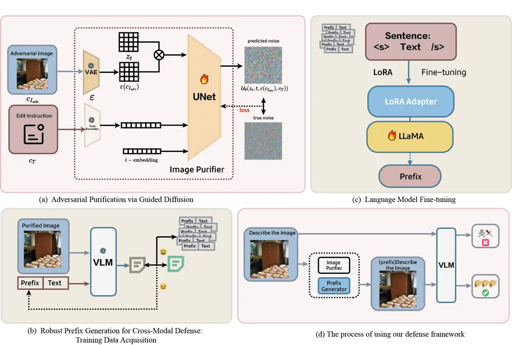
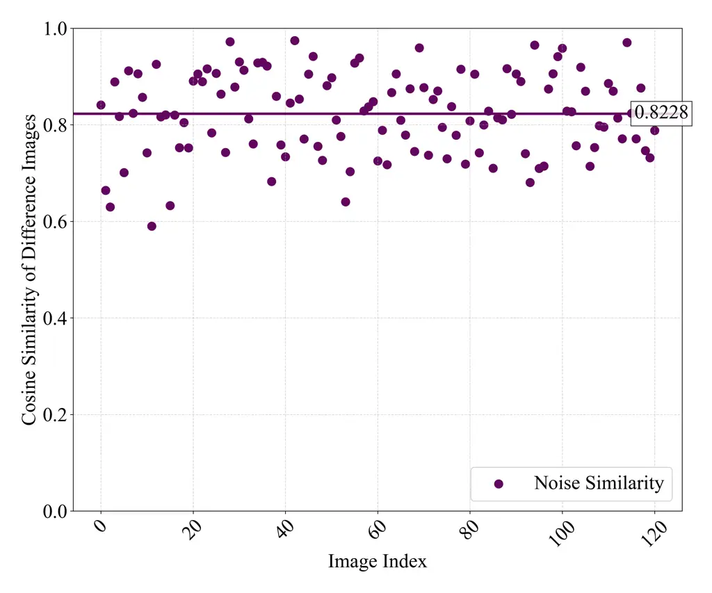
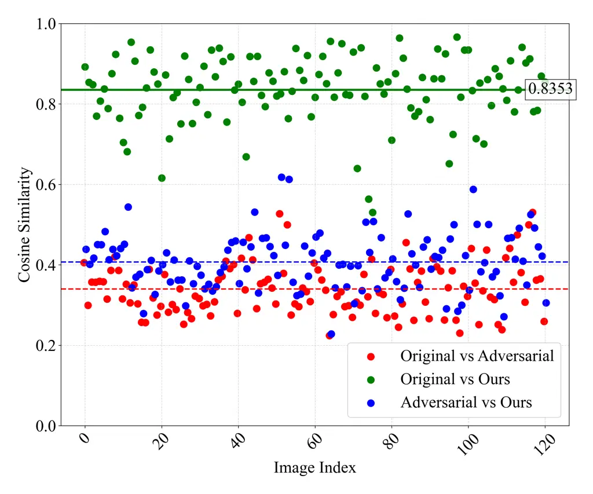

# CoDefend: Cross-Modal Collaborative Defense via Diffusion Purification and Prompt Optimization

Fengling Zhu Affiliation: School of Computer Science
Affiliation: Nanjing University Affiliation: Nanjing, Jiangsu 210023
Email: [fenglingzhu@smail.nju.edu.cn](mailto:)    Boshi Liu
Affiliation: Nanjing University Affiliation: Nanjing, Jiangsu 210023
Email: [liubs@smail.nju.edu.cn](mailto:)    Jingyu Hua
Affiliation: Nanjing University Affiliation: Nanjing, Jiangsu 210023
Email: [huajingyu@nju.edu.cn](mailto:)    Sheng Zhong
Affiliation: Nanjing University Affiliation: Nanjing, Jiangsu 210023
Email: [zhongsheng@nju.edu.cn](mailto:)

###### Abstract

Multimodal Large Language Models (MLLMs) have achieved remarkable
success in tasks such as image captioning, visual question answering,
and cross-modal reasoning by integrating visual and textual modalities.
However, their multimodal nature also exposes them to adversarial
threats, where attackers can perturb either modality—or both jointly—to
induce harmful, misleading, or policy-violating outputs. Existing
defense strategies, such as adversarial training and input purification,
face notable limitations: adversarial training typically improves
robustness only against known attacks while incurring high computational
costs, whereas conventional purification approaches often suffer from
degraded image quality and insufficient generalization to complex
multimodal tasks.

In this work, we focus on defending the visual modality, which
frequently serves as the primary entry point for adversarial
manipulation. We propose a supervised diffusion-based denoising
framework that leverages paired adversarial–clean image datasets to
fine-tune diffusion models with directional, task-specific guidance.
Unlike prior unsupervised purification methods such as DiffPure, our
approach achieves higher-quality reconstructions while significantly
improving defense robustness in multimodal tasks. Furthermore, we
incorporate prompt optimization as a complementary defense mechanism,
enhancing resistance against diverse and unseen attack strategies.

Extensive experiments on image captioning and visual question answering
demonstrate that our method not only substantially improves robustness
but also exhibits strong transferability to unknown adversarial attacks.
These results highlight the effectiveness of supervised diffusion-based
denoising for multimodal defense, paving the way for more reliable and
secure deployment of MLLMs in real-world applications.

   

|     |
| --- |
|     |

## 1 Introduction

In recent years, Multimodal Large Language Models (MLLMs) have achieved
remarkable breakthroughs in the field of artificial intelligence. By
integrating visual and linguistic modalities, these models demonstrate
strong cross-modal understanding and generation capabilities, and have
been widely applied in tasks such as visual question answering, image
captioning, and visual reasoning \[1, 2, 3\]. Representative examples
include BLIP \[4\], BLIP-2 \[5\], MiniGPT-4 \[6\], GPT-4V \[7\], and the
LLaVA series \[8\], which generally adopt the “image encoder + large
language model + cross-modal alignment” architecture to achieve unified
semantic modeling and natural language generation across multimodal
inputs.

However, while MLLMs push the boundaries of model capabilities, they
also introduce more complex and subtle security risks. Compared with
traditional language models, the attack surface of MLLMs is
significantly expanded. Attackers can not only manipulate text inputs,
but also inject perturbations into the image modality, or even craft
joint image-text perturbations to bypass content moderation mechanisms
or manipulate model outputs \[9, 10, 11, 12\]. Thus, enhancing the
robustness of multimodal large models against adversarial inputs and
developing efficient, generalizable defense mechanisms has become a core
challenge in current multimodal AI research.

Previous studies have proposed a variety of defense strategies for
multimodal models. For example, adversarial training introduces
perturbed samples during training, enabling the model to learn
resistance against known attacks \[13, 14, 15, 16\]. However, such
approaches face two key limitations: (1) adversarial training often
improves robustness only against specific or known attacks, with limited
effectiveness against unknown or out-of-distribution perturbations; (2)
the approach typically requires generating and iteratively incorporating
large volumes of adversarial samples during training, leading to heavy
computational costs that hinder large-scale deployment in
resource-constrained settings. Therefore, how to achieve generalizable
defenses against multimodal adversarial attacks while maintaining
efficiency remains an open problem.

In multimodal attacks, the image modality is often the most vulnerable
entry point for adversaries, making image purification an increasingly
important and effective defense strategy. The core idea is to preprocess
input images before model inference, thereby weakening or removing
potential adversarial perturbations and reducing attack success rates.
Compared with adversarial training or other model-dependent defenses,
image purification is model-agnostic and computationally lightweight,
making it highly suitable for direct deployment at inference time. As
such, it demonstrates greater flexibility and generality in practical
applications.

Existing image purification approaches can be broadly divided into three
categories. The first category is signal-processing-based strategies,
such as JPEG compression, filtering, downsampling, and resampling, which
improve robustness by disrupting the fine-grained patterns that
perturbations rely on \[17\]. The second category is learning-based
approaches, which train specialized denoising networks or
detection–correction modules to identify and remove perturbations,
achieving good performance under specific attack settings. The third
category leverages image transformation and denoising through generative
or diffusion models. In particular, image reconstruction via diffusion
models has recently gained significant attention, as it purifies inputs
at the feature level and restores representations closer to the original
semantics \[18, 19, 20, 21\], offering unique advantages against complex
perturbations.

Among existing studies, DiffPure \[18\] is one of the most
representative diffusion-based denoising approaches. It injects small
Gaussian noise into adversarial samples and employs the reverse
diffusion process to gradually reconstruct the image, thereby removing
adversarial perturbations while retaining semantic information. However,
subsequent theoretical analysis revealed inherent limitations: the
divergence between purified data and clean data can exceed that of the
original adversarial perturbations \[19\], leading to low-quality
reconstructions. To address this issue, \[19\] introduced a contrastive
learning-based refinement, guiding the diffusion model to perform more
effective denoising and significantly lowering attack success rates in
image classification tasks. Nevertheless, such methods remain primarily
focused on classification, with limited defensive effectiveness for more
complex vision-language tasks such as visual question answering.

To overcome these limitations, this paper proposes a supervised
diffusion-based denoising approach. Specifically, we construct a paired
dataset of adversarial–clean images and fine-tune Stable Diffusion on
this dataset, enabling the model to learn directional and task-specific
denoising capabilities during training. Unlike traditional unsupervised
diffusion denoising, the proposed method not only achieves superior
reconstruction quality, but also substantially enhances robustness in
multimodal tasks, particularly in image captioning and visual question
answering, where it exhibits stronger generalizability and defense
performance.

Experiments on image captioning and visual question answering tasks
demonstrate that our method not only improves robustness effectively but
also shows strong transferability, resisting a variety of unseen attack
strategies. The main contributions of this paper are summarized as
follows:

We propose a supervised, high-quality image adversarial denoiser and
apply it to visual question answering. Compared with classification,
visual question answering involves more complex multimodal interactions,
making robustness improvements both more challenging and more impactful.

In addition to the core denoising method, we introduce prompt
optimization as a complementary enhancement to further improve defensive
effectiveness.

We conduct systematic evaluations on image captioning and visual
question answering, and the experimental results verify the
effectiveness and superiority of the proposed method in improving
robustness and defensive transferability.

## 2 Related Work

This section reviews adversarial attacks and defense mechanisms for
multimodal large language models (VLMs), with a particular focus on
common attack strategies and existing defense methods.

Multimodal Adversarial Attacks. With the wide deployment of large-scale
vision-language models (e.g., GPT-4V, Gemini, LLaVA), their multimodal
input capabilities significantly enhance task performance but also
introduce more complex attack surfaces. Moreover, the objectives of
adversarial attacks have expanded from simple classification to more
sophisticated text generation and cross-modal reasoning tasks. Studies
have shown that adversaries can manipulate image and text modalities
separately or jointly to induce models into producing incorrect,
harmful, or even prohibited outputs. For instance, Dong et al. \[9\]
introduced fine-grained image perturbations to force the model to
generate malicious content, achieving targeted attacks. VLAttack \[11\]
further demonstrated the effectiveness of joint perturbations on both
image and text modalities, making models more susceptible to misleading
outputs. CroPA \[10\] incorporated prompt learning into perturbation
generation, enabling generalized misinterpretations even for unseen
prompt combinations. Collectively, these works reveal that the joint
manipulation of image and text modalities can greatly amplify attack
effectiveness and transferability.

In summary, existing research highlights the synergistic impact of
image-text perturbations in multimodal adversarial attacks. However,
among these, the image modality often plays a particularly critical
role: even subtle visual perturbations can substantially alter model
reasoning and generation, amplifying the overall impact of cross-modal
attacks. Consequently, researchers have initially focused on defenses
for the visual modality, seeking to mitigate adversarial effects and
improve robustness through techniques such as image preprocessing,
robust feature extraction, and input denoising.

Given that the image modality is the most exploitable entry point for
adversaries, image purification has gradually emerged as an important
and effective defense strategy. The core idea is to preprocess input
images before inference to suppress or remove potential adversarial
perturbations, thereby reducing attack success rates. Compared with
adversarial training and other model-dependent approaches, image
purification is model-agnostic and incurs relatively low computational
overhead at inference time, making it well-suited for deployment in
practical systems with higher flexibility and generality.

Existing research generally categorizes image purification methods into
three classes:

Signal processing-based approaches, such as JPEG compression, smoothing
filters, downsampling, and resampling, which disrupt fine-grained
perturbation patterns to enhance robustness \[17\]. These methods are
simple and efficient but are often less effective against adaptive
attacks.

Learning-based approaches, which train dedicated denoising networks or
detection–restoration modules to automatically identify and remove
perturbations. While effective in specific attack scenarios, their
generalization ability depends heavily on training data distributions,
leading to limited performance against unseen attacks.

Generative or diffusion-based approaches, which have gained increasing
attention in recent years. These methods leverage image reconstruction
to “purify” inputs at the feature level, recovering representations
closer to the original semantics \[18, 19, 20, 21\].

Among diffusion-based approaches, DiffPure \[18\] is the most
representative. It injects small Gaussian noise into adversarial samples
and applies the reverse diffusion process to gradually reconstruct
images, thereby removing adversarial perturbations while retaining
semantic information. However, subsequent theoretical analyses revealed
inherent limitations: the upper bound of differences between purified
and clean samples may even exceed that of the original adversarial
perturbation \[19\], leading to suboptimal image quality. To address
this, \[19\] proposed a contrastive learning enhancement, guiding the
diffusion model to perform more effective denoising, significantly
reducing attack success rates in classification tasks. Nevertheless,
these improvements remain primarily focused on classification scenarios,
with limited effectiveness in more complex vision-language tasks such as
visual question answering and cross-modal reasoning. Similarly,
multimodal defense frameworks like BlueSuffix \[20\] incorporate
DiffPure directly in their visual defense stage, inheriting its
drawbacks and resulting in subpar purified image quality.

To overcome these limitations, this paper proposes a supervised
diffusion-based denoising method. Specifically, we construct paired
datasets of adversarial samples and their corresponding clean images,
and fine-tune Stable Diffusion to learn task-oriented and directional
denoising during training. Unlike traditional unsupervised
diffusion-based purification, our approach achieves superior image
restoration quality while significantly enhancing defense performance in
multimodal tasks. In particular, it demonstrates stronger robustness and
generalizability in representative applications such as image captioning
and visual question answering.

## 3 Methodology

### 3.1 Preliminaries

Threat Model. Let $`G`$ represent a multimodal large language model
(MLLM), which takes an image $`\mathbf{I}`$ and a text prompt
$`\mathbf{T}`$ as inputs and generates a natural language response. An
attacker can inject small, imperceptible perturbations into
$`\mathbf{I}`$ or $`\mathbf{T}`$ to manipulate the model’s output,
either weakening performance (usability attacks) or inducing undesirable
content (jailbreak attacks).

Let $`\mathbf{y}`$ denote the model’s response to normal inputs, and
$`\mathbf{y^{\prime}}`$ the response to perturbed inputs
$`\mathbf{I^{\prime}}`$ and $`\mathbf{T^{\prime}}`$, where
$`\mathbf{I^{\prime}}=\mathbf{I}+\delta_{I}`$ and
$`\mathbf{T^{\prime}}=\mathbf{T}+\delta_{T}`$. The goal is to classify
attacks as either untargeted or targeted.

In untargeted attacks, the goal is to cause a deviation in the model’s
output, i.e., $`\mathbf{y^{\prime}}\neq\mathbf{y}`$, formalized as:

```math
\min_{\delta_{I},\delta_{T}}\mathcal{L}\left(G\left(\mathbf{I}+\delta_{I},\mathbf{T}+\delta_{T}\right),\mathbf{y}\right)\quad\text{s.t.}\quad\|\delta_{I}\|\leq\epsilon_{I},\|\delta_{T}\|\leq\epsilon_{T} \tag{1}
```

For targeted attacks, the aim is to force the model to generate a
specific target response $`\hat{\mathbf{y}}`$, i.e.,
$`\mathbf{y^{\prime}}=G(\mathbf{I^{\prime}},\mathbf{T^{\prime}})=\hat{\mathbf{y}}`$,
commonly seen in jailbreak attacks, where the attacker aims to bypass
the model’s filtering mechanism:

```math
\min_{\delta_{I},\delta_{T}}\mathcal{L}\left(G\left(\mathbf{I}+\delta_{I},\mathbf{T}+\delta_{T}\right),\hat{\mathbf{y}}\right)\quad\text{s.t.}\quad\|\delta_{I}\|\leq\epsilon_{I},\|\delta_{T}\|\leq\epsilon_{T} \tag{2}
```

In this study, we focus on black-box adversarial defense, assuming the
defender does not have access to the model’s parameters, gradients, or
structural information, and can only obtain outputs corresponding to
inputs through limited queries. In this setup, the attacker may use
either white-box or black-box methods to generate adversarial samples in
the image or text modalities, thereby misleading the multimodal large
language model into producing erroneous or inappropriate responses.

InstructPix2Pix. The original diffusion models (e.g., DDPM \[22\]) model
high-resolution images in pixel space, and while they have strong
generative capabilities, they incur significant computational costs,
leading to low training and inference efficiency. To alleviate this
issue, Latent Diffusion Models (LDMs) \[23\] proposed transferring the
diffusion process from the high-dimensional pixel space to a more
compact latent space, significantly reducing computational costs while
maintaining the quality of the generated images. The core idea of this
method is to use a pre-trained variational autoencoder (VAE) \[24\] to
compress the original image into a latent representation and then
perform diffusion modeling in the latent space.

Specifically, the autoencoder consists of an encoder $`\mathcal{E}`$ and
a decoder $`\mathcal{D}`$. The encoder maps the input image $`x`$ to a
latent vector $`z`$, i.e., $`z=\mathcal{E}(x)`$, and the decoder is
responsible for reconstructing the image from the latent vector, i.e.,
$`\hat{x}=\mathcal{D}(z)`$. This latent space modeling mechanism forms
the basis for current mainstream generative models such as Stable
Diffusion\[25\].

Within this framework, InstructPix2Pix \[26\] was the first to propose
fine-tuning Stable Diffusion to enable the model to perform
semantic-level editing on input images based on natural language
instructions. The training objective is to learn a conditional noise
prediction network $`\varepsilon_{\theta}`$ to predict additive noise in
the latent space, with the prediction process depending on both the
image condition $`c_{I}`$ and the text instruction condition $`c_{T}`$.
The training objective is optimized as follows:

```math
L=\mathbb{E}_{\mathcal{E}(x),\mathcal{E}(c_{I}),c_{T},\epsilon\sim\mathcal{N}(0,1),t}\left[\|\epsilon-\epsilon_{\theta}(z_{t},t,\mathcal{E}(c_{I}),c_{T}))\|_{2}^{2}\right] \tag{3}
```

where $`z_{t}`$ is the noisy latent vector at time step $`t`$, and
$`\epsilon`$ is the true Gaussian noise, with the model learning the
reverse diffusion process by fitting this noise.

InstructPix2Pix simplifies image editing by requiring only an image
\$c_I\$ and a text instruction \$c_T\$, generating results in a single
pass without the need for masks, target images, or fine-tuning. This
makes it efficient and ideal for human-computer interaction.However, the
pre-trained model excels at general tasks like style transfer and
semantic replacement but struggles with removing adversarial
perturbations, particularly fine-grained noise, due to limited
robustness and denoising capabilities.

To address this, we further fine-tunes InstructPix2Pix, enabling it not
only to understand "remove adversarial noise" instructions but also to
effectively recognize and remove adversarial perturbations from images
in latent space, while preserving the original semantic structure and
usability of the images. This design improves the model’s stability and
practicality when handling adversarial samples and provides an efficient
image purification solution for enhancing the security of multimodal
models.



Figure 1: An overview of CoDefend.

### 3.2 Adversarial Purification via Guided Diffusion

We develop a diffusion-based purification framework that learns to
remove adversarial perturbations through conditional denoising while
preserving semantic fidelity. Our approach leverages two intrinsic
properties of adversarial attacks in vision-language systems: (1) their
measurable deviations in joint feature-level spaces, as evidenced by the
0.340 vision-language feature similarity between adversarial samples and
original images shown in Figure 2(b), and (2) the structured patterns in
perturbation distribution that enable discriminative removal.

The framework operates through a modified UNet architecture
$`\mathcal{U}_{\theta}`$ trained on paired adversarial-original images
$`(I_{\text{adv}},I_{\text{clean}})`$, with the objective:

```math
\mathcal{L}_{\text{diff}}=\mathbb{E}_{\epsilon,t}\left[\left\lVert\epsilon-\mathcal{U}_{\theta}(z_{t},t,\varepsilon(c_{I_{\text{adv}}}),c_{T}))\right\rVert_{2}^{2}\right], \tag{4}
```

where $`z_{t}`$ contains perturbed clean latent features at diffusion
step $`t`$, and $`\varepsilon(c_{I_{\text{adv}}})`$ encodes adversarial
context, $`c_{T}`$ representing the image editing instruction.

To maintain semantic fidelity, we freeze all pre-trained vision-language
components and restrict optimization to the denoising network
parameters. This ensures stable feature representations while adapting
the purification process to multimodal defense requirements.



(a) Scatter plot depicting the similarity between adversarial
perturbations and removed noise.



(b) Scatter plot depicting the similarity among original, adversarial,
and purified images using our technique.

Figure 2: An assessment of feature-level purification efficacy of our
approach was conducted on 121 adversarial samples generated through the
BARD attack \[9\], utilizing the visual encoder of BLIP-2.

As quantified in Figure 2, empirical analysis confirms our method’s
efficacy in recovering semantic fidelity and discriminatively removing
adversarial noise. This approach ensures that the model maintains its
generative capacity while learning to suppress adversarial
perturbations, establishing a foundation and the most important part for
the multi-stage defense pipeline introduced in this work. Given that the
discussion takes place in a multimodal context, we also suggest a
defensive strategy as a supplementary measure for image purification
within the text modality.

### 3.3 Robust Prefix Generation for Cross-Modal Defense

Our defense framework centers on learning robust textual prefixes that
complement visual purification. The core methodology trains a LLaMA-2 7B
model \[27\] to generate protective prefixes using adversarial-resistant
vision-language pairs, constructed through three coordinated steps:

Training Data Acquisition. To enable prefix learning, we first create
paired data of purified images and optimized prompts through two
parallel processes. On the visual front, diffusion-based purification
removes adversarial perturbations from input $`x`$ to produce
$`\hat{x}_{\text{clean}}`$, preserving semantic content through
stochastic differential equations. For textual enhancement, we optimize
defense-aware prompts $`p_{\text{opt}}`$ via gradient-guided alignment
with BLIP/BLIP-2 models:

```math
p_{\text{opt}}=\arg\min_{p\in\mathcal{P}}\mathcal{L}_{\text{CE}}(\mathcal{B}(\hat{x}_{\text{clean}};p\oplus q),y_{\text{true}}) \tag{5}
```

where the prompt space $`\mathcal{P}`$ is constrained by trigger tokens
and semantic consistency bounds
$`\lVert p_{\text{opt}}-p_{\text{base}}\rVert_{2}\leq\delta`$. This
joint optimization employs HotFlip-based token replacement with
multi-round beam search, balancing attack resistance and linguistic
naturalness.

Language Model Fine-tuning. The generated pairs
$`\{(\hat{x}^{i}_{\text{clean}},p^{i}_{\text{opt}})\}`$ train a LLaMA-2
7B model to predict protective prefixes conditioned on visual-textual
context. We implement parameter-efficient tuning through Low-Rank
Adaptation (LoRA) on query/value projections:

```math
\mathcal{L}_{\text{LoRA}}=\mathbb{E}_{(q,p)}\left[-\sum_{t=1}^{T}\log P_{\mathcal{L}}(p_{t}\mid q,p_{<t})\right] \tag{6}
```

with rank $`r=8`$ and scaling factor $`\alpha=16`$. The instructional
template "Generate a protective prefix for: \<query\>" explicitly
conditions prefix generation on attack scenarios. During deployment, the
model prepends learned prefixes $`p_{\text{gen}}`$ to user queries,
modifying input semantics before reaching victim models.

The framework still operates in standard black-box settings: prompt
optimization relies on open-source BLIP/BLIP-2. No architectural
knowledge of protected models is needed during training or inference.

As outlined in Algorithm 1, the complete framework processes adversarial
images through three sequential stages: first, diffusion-based
purification removes visual perturbations; second, cross-modal prompt
optimization generates prefixes that semantically anchor the purified
images; finally, the language model aligns these prefixes with input
queries to construct robust inputs for the downstream visual-language
model. This cohesive architecture ensures adversarial perturbations are
mitigated across modalities, enabling reliable predictions from
contaminated inputs.

0:  Adversarial image $`x_{\text{adv}}`$, input query $`q`$, target text
$`y_{\text{true}}`$

0:  Robust prediction $`\hat{y}`$

1:
 $`\hat{x}_{\text{clean}}\leftarrow\text{DiffusionPurify}(x_{\text{adv}})`$
{Remove adversarial noise via guided diffusion (Sec 3.2)}

2:
 $`p_{\text{gen}}\leftarrow\text{PrefixGenerate}(q,\hat{x}_{\text{clean}})`$
{Generate defense prefix with fine-tuned LLaMA-2 (Sec 3.3)}

3:
 $`\hat{y}\leftarrow\text{VLM}(p_{\text{gen}}\oplus q,\hat{x}_{\text{clean}})`$
{Visual-language model inference with robust prefix}

Algorithm 1 Framework of CoDefend

## 4 Experiments

### 4.1 Experimental Setup

We implement our defense framework on a single NVIDIA A6000 GPU for
early training and deployment. The diffusion purification module is
fine-tuned for 4,000 epochs with AdamW optimizer (learning rate
$`5\times 10^{-5}`$, batch size 4), guided by the text prompt: "Remove
the adversarial noise while preserving original image details". For
prefix learning, we fine-tune LLaMA-2 7B for 100 epochs (batch size 4,
learning rate $`2\times 10^{-4}`$) using the instruction template:
"\<s\>\[INST\] Add prefix to: {question} \[/INST\] {prefix}\</s\>".

We assess three distinct configurations: (1) In-distribution testing,
where 80% of mixed samples from all attack methods are used for training
and 20% for evaluation; (2) Cross-attack generalization, involving
training solely on BARD and evaluating on itself and
VLATTACK/BSA/TRANSFER; and (3) Evaluation on clean images to ascertain
any side effects on image caption tasks with the fine-tuned model
obtained from the previous experiment. Table 1 summarizes attack
characteristics: BARD and TRANSFER are targeted attacks against
BLIP-2/MiniGPT-4 and all models respectively, while VLATTACK/BSA are
untargeted against BLIP. Additionally, LLaVA-1.5 is used for evaluating
side effects. We analyze the following defense mechanisms: (1) Vanilla:
Utilizing the original input as the baseline; (2) DiffPure \[18\]:
Utilizing an alternative diffusion technique for adversarial
purification, with its standard configuration on the ImageNet dataset,
as an additional baseline; (3) Purification(Ours): Conducting image
purification exclusively with our customized diffusion model; (4)
Cross-Modal(Ours): Integrating joint image purification with prefix
defense generated by a language model.

| Attack          | Dataset                                                                                                                                                                      | Victim Models           | Metrics                       |
| --------------- | ---------------------------------------------------------------------------------------------------------------------------------------------------------------------------- | ----------------------- | ----------------------------- |
| BARD \[9\]      | NIPS2017 ¹¹ 1 [https://www.kaggle.com/competitions/nips-2017-non-targeted-adversarial-attack](https://www.kaggle.com/competitions/nips-2017-non-targeted-adversarial-attack) | BLIP-2, MiniGPT-4       | CLIP Score/ASR + VQA Accuracy |
| VLATTACK \[11\] | MS-COCO \[28\]                                                                                                                                                               | BLIP                    | CLIP Score + VQA Accuracy     |
| BSA \[11\]      | MS-COCO                                                                                                                                                                      | BLIP                    | CLIP Score + VQA Accuracy     |
| TRANSFER \[29\] | ImageNet \[30\]                                                                                                                                                              | BLIP, BLIP-2, MiniGPT-4 | CLIP Score/ASR + VQA Accuracy |

Table 1: Attack Characteristics and Victim Model Relationships

The chosen tasks for analysis include image caption and visual question
answering (VQA). In the context of targeted attacks (BARD, TRANSFER),
both the CLIP Score \[31\]—which assesses semantic similarity—and the
attack success rate (ASR) are utilized for evaluation. Conversely,
untargeted attacks (VLATTACK, BSA) exclusively rely on the CLIP Score
for assessment. For VQA tasks, evaluation is conducted using VQA
accuracy.

| Model     | Attack   | Method             | Image Caption | VQA    |
| --------- | -------- | ------------------ | ------------- | ------ |
| BLIP      | VLATTACK | Vanilla            | 77.89         | 52.17% |
|           |          | DiffPure           | 72.39         | 52.17% |
|           |          | Purification(Ours) | 78.17         | 60.87% |
|           |          | Cross-Modal(Ours)  | 79.99         | 65.22% |
|           | BSA      | Vanilla            | 73.00         | 42.31% |
|           |          | DiffPure           | 73.76         | 46.15% |
|           |          | Purification(Ours) | 73.92         | 61.54% |
|           |          | Cross-Modal(Ours)  | 75.43         | 65.38% |
|           | TRANSFER | Vanilla            | 67.64/94.44%  | 50.00% |
|           |          | DiffPure           | 80.02/0%      | 72.22% |
|           |          | Purification(Ours) | 80.63/0%      | 72.22% |
|           |          | Image+Text         | 81.21/0%      | 77.78% |
| BLIP-2    | BARD     | Vanilla            | 61.46/100%    | 31.25% |
|           |          | DiffPure           | 72.49/0%      | 46.88% |
|           |          | Purification(Ours) | 72.96/0%      | 62.50% |
|           |          | Cross-Modal(Ours)  | 74.56/0%      | 65.63% |
|           | TRANSFER | Vanilla            | 61.28/96.77%  | 35.48% |
|           |          | DiffPure           | 74.95/0%      | 41.94% |
|           |          | Purification(Ours) | 79.83/0%      | 45.16% |
|           |          | Cross-Modal(Ours)  | 81.05/0%      | 54.84% |
| MiniGPT-4 | BARD     | Vanilla            | 60.60/84.38%  | 25.00% |
|           |          | DiffPure           | 76.17/0%      | 68.75% |
|           |          | Purification(Ours) | 74.52/0%      | 71.88% |
|           |          | Cross-Modal(Ours)  | 76.43/0%      | 71.88% |
|           | TRANSFER | Vanilla            | 66.37/74.19%  | 58.06% |
|           |          | DiffPure           | 77.11/0%      | 70.97% |
|           |          | Purification(Ours) | 79.59/0%      | 70.97% |
|           |          | Cross-Modal(Ours)  | 80.73/0%      | 70.97% |

Table 2: In-Distribution Defense Performance (CLIP Score/ASR & VQA
Accuracy)

| Model     | Attack   | Method              | Image Caption | VQA    |
| --------- | -------- | ------------------- | ------------- | ------ |
| BLIP      | VLATTACK | Vanilla             | 77.08         | 50.42% |
|           |          | DiffPure            | 74.22         | 44.54% |
|           |          | Purification (Ours) | 76.58         | 58.82% |
|           |          | Cross-Modal (Ours)  | 77.26         | 50.42% |
|           | BSA      | Vanilla             | 77.32         | 61.83% |
|           |          | DiffPure            | 74.09         | 50.38% |
|           |          | Purification (Ours) | 77.56         | 64.12% |
|           |          | Cross-Modal (Ours)  | 77.47         | 56.49% |
|           | TRANSFER | Vanilla             | 67.75/97.64%  | 53.54% |
|           |          | DiffPure            | 81.54/0%      | 74.80% |
|           |          | Purification (Ours) | 83.82/0%      | 88.98% |
|           |          | Cross-Modal (Ours)  | 81.40/0%      | 82.68% |
| BLIP-2    | BARD     | Vanilla             | 63.41/100%    | 23.14% |
|           |          | DiffPure            | 72.03/0%      | 52.89% |
|           |          | Purification (Ours) | 79.45/0%      | 64.46% |
|           |          | Cross-Modal (Ours)  | 80.92/0%      | 65.29% |
|           | TRANSFER | Vanilla             | 64.94/95.36%  | 37.09% |
|           |          | DiffPure            | 78.41/0%      | 36.42% |
|           |          | Purification (Ours) | 83.25/0%      | 39.07% |
|           |          | Cross-Modal (Ours)  | 84.09/0%      | 41.06% |
| MiniGPT-4 | BARD     | Vanilla             | 63.99/96.99%  | 33.88% |
|           |          | DiffPure            | 75.64/0%      | 71.90% |
|           |          | Purification (Ours) | 80.53/0%      | 71.90% |
|           |          | Cross-Modal (Ours)  | 80.36/0%      | 76.03% |
|           | TRANSFER | Vanilla             | 69.53/77.48%  | 66.89% |
|           |          | DiffPure            | 81.45/0%      | 76.82% |
|           |          | Purification (Ours) | 86.88/0%      | 74.83% |
|           |          | Cross-Modal (Ours)  | 86.89/0%      | 74.83% |

Table 3: Cross-Attack Generalization Performance (CLIP Score/ASR & VQA
Accuracy)

| Method              | BLIP                        | BLIP-2                       | LLaVA1.5                     |
| ------------------- | --------------------------- | ---------------------------- | ---------------------------- |
| Vanilla             | 92.82                       | 93.10                        | 95.13                        |
| DiffPure            | 83.77 ($`\downarrow`$9.73%) | 79.23 ($`\downarrow`$14.89%) | 79.48 ($`\downarrow`$16.50%) |
| Purification (Ours) | 88.74 ($`\downarrow`$4.40%) | 87.64 ($`\downarrow`$5.86%)  | 90.96 ($`\downarrow`$4.39%)  |
| Cross-Modal (Ours)  | 88.79 ($`\downarrow`$4.34%) | 87.81 ($`\downarrow`$5.68%)  | 91.12 ($`\downarrow`$4.21%)  |

Table 4: Side Effects of Defense Methods on Image Captioning(CLIP Score
and Drop from Vanilla)

### 4.2 Results Analysis

Our framework demonstrates three key advantages: (1) Superior
in-distribution robustness, (2) Effective cross-attack generalization,
and (3) Minimal impact on clean image processing. The experimental
results in Tables 2-4 validate these properties through comprehensive
benchmarks.

In-Distribution Defense: As shown in Table 2, our method achieves
complete attack mitigation (0% ASR) while maintaining high semantic
fidelity. For BLIP-2 under BARD attacks, Cross-Modal defense improves
CLIP scores by 17.8% (61.46$`\rightarrow`$70.42) and doubles VQA
accuracy (31.25%$`\rightarrow`$65.63%). Notably, our approach
consistently outperforms DiffPure by 3.6-6.8% in CLIP scores across all
model-attack combinations.

Cross-Attack Generalization: Table 3 reveals our method’s strong
generalization to unseen attacks. When defending against TRANSFER
attacks on BLIP, our purification strategy achieves 88.98% VQA
accuracy - 14.2% higher than DiffPure. For BLIP-2 under unseen TRANSFER
attacks, Cross-Modal defense attains 84.09 CLIP score, outperforming the
vanilla model by 29.5% while completely neutralizing attacks. The sole
exception is observed in the VQA task when countering the TRANSFER
attack, potentially attributed to our use of DiffPure, which was
configured for its original dataset, ImageNet.

Clean Image Preservation: Table 4 demonstrates our method’s minimal
impact on clean inputs. Cross-Modal defense preserves 95.6% of original
CLIP performance on average (4.4% drop vs DiffPure’s 13.7%).
Specifically, it maintains 91.12 CLIP score for LLaVA-1.5 (4.2% drop)
compared to DiffPure’s 16.5% degradation.

These results confirm our method’s unique strength: The joint
purification process eliminates adversarial perturbations while
cross-modal alignment enhances semantic preservation. Our approach
reduces ASR to 0% across all tested scenarios with only 1/3 of the
performance degradation observed in existing defenses.

### 4.3 Ablation Study

Our ablation study systematically validates the necessity of
task-specific diffusion fine-tuning for effective adversarial
purification. Using the same experimental configuration as in Sec 3.2
and the instruction paradigm from Sec 4.1, we compare our fine-tuned
diffusion model against the base InstructPix2Pix in terms of semantic
recovery fidelity and adversarial perturbation suppression.

Necessity of Diffusion Model Fine-tuning. Table 5 shows that
out-of-the-box diffusion models have limitations for adversarial
purification. The base InstructPix2Pix struggles with semantic
preservation and perturbation removal. It has low similarity to original
inputs (0.5007) and adversarial examples (0.4789), with a small
difference ($`\Delta`$=0.0218), treating clean and adversarial content
similarly. Moreover, it has weaker correlation with true adversarial
noise patterns (0.7137) compared to our approach (0.8228), highlighting
its limited ability to handle adversarial artifacts.

| Pairs for Comparison                     | InstructPix2Pix | Ours                        |
| ---------------------------------------- | --------------- | --------------------------- |
| Purified vs. Original Samples            | 0.5007          | 0.8353($`\uparrow`$66.8%)   |
| Purified vs. Adversarial Samples         | 0.4789          | 0.3400($`\downarrow`$29.0%) |
| Added Noise vs. Adversarial Perturbation | 0.7137          | 0.8228($`\uparrow`$15.3%)   |

Table 5: Feature-level Similarity Comparison between Off-the-shelf and
Ours Diffusion Models

These results collectively demonstrate that standard diffusion models,
without task-specific adaptation, cannot reliably perform adversarial
purification. Our fine-tuned model addresses both limitations through
targeted optimization on adversarial data, enabling precise removal of
adversarial perturbations while robustly preserving original semantics.

## 5 Conclusion

This paper introduces CoDefend, an innovative black-box friendly
multimodal adversarial defense framework for MLLMs. Unlike existing
methods, it doesn’t need model internal parameters and trains with few
adversarial samples and optimized prompt prefixes. We jointly optimize
an image purifier and a prompt prefix generator for collaborative
multimodal defense.

The image purifier, based on supervised learning, takes adversarial
samples and denoising instructions as inputs, learning to remove
adversarial noise and restore clean images. Then, we jointly optimize
purified images and prompt instructions to find defense-enhancing prompt
prefixes, which are used to fine-tune an LLM to generate more effective
prefixes, forming the prefix generator.

Experiments show CoDefend significantly boosts MLLM robustness in image
captioning and visual question answering under various adversarial
attacks. Transferability experiments further validate its effectiveness
against unseen attacks.

While computational overhead is modest, running a diffusion model and
prefix generation still introduces non-negligible latency at inference
time compared to no defense. Optimization of defense-time efficiency is
a promising direction.

## References

- \[1\] Jiasen Lu, Dhruv Batra, Devi Parikh, and Stefan Lee. Vilbert:
  Pretraining task-agnostic visiolinguistic representations for
  vision-and-language tasks. Advances in neural information processing
  systems, 32, 2019.
- \[2\] Liunian Harold Li, Mark Yatskar, Da Yin, Cho-Jui Hsieh, and
  Kai-Wei Chang. Visualbert: A simple and performant baseline for vision
  and language. arXiv preprint arXiv:1908.03557, 2019.
- \[3\] Weijie Su, Xizhou Zhu, Yue Cao, Bin Li, Lewei Lu, Furu Wei, and
  Jifeng Dai. Vl-bert: Pre-training of generic visual-linguistic
  representations. arXiv preprint arXiv:1908.08530, 2019.
- \[4\] Junnan Li, Dongxu Li, Caiming Xiong, and Steven Hoi. Blip:
  Bootstrapping language-image pre-training for unified vision-language
  understanding and generation. In International conference on machine
  learning, pages 12888–12900. PMLR, 2022.
- \[5\] Junnan Li, Dongxu Li, Silvio Savarese, and Steven Hoi. BLIP-2:
  bootstrapping language-image pre-training with frozen image encoders
  and large language models. In ICML, 2023.
- \[6\] Deyao Zhu, Jun Chen, Xiaoqian Shen, Xiang Li, and Mohamed
  Elhoseiny. Minigpt-4: Enhancing vision-language understanding with
  advanced large language models. arXiv preprint arXiv:2304.10592, 2023.
- \[7\] An Yan, Zhengyuan Yang, Wanrong Zhu, Kevin Lin, Linjie Li,
  Jianfeng Wang, Jianwei Yang, Yiwu Zhong, Julian McAuley, Jianfeng Gao,
  et al. Gpt-4v in wonderland: Large multimodal models for zero-shot
  smartphone gui navigation. arXiv preprint arXiv:2311.07562, 2023.
- \[8\] Haotian Liu, Chunyuan Li, Qingyang Wu, and Yong Jae Lee. Visual
  instruction tuning. In NeurIPS, 2023.
- \[9\] Yinpeng Dong, Huanran Chen, Jiawei Chen, Zhengwei Fang, Xiao
  Yang, Yichi Zhang, Yu Tian, Hang Su, and Jun Zhu. How robust is
  google’s bard to adversarial image attacks?, 2023.
- \[10\] Haochen Luo, Jindong Gu, Fengyuan Liu, and Philip Torr. An
  image is worth 1000 lies: Transferability of adversarial images across
  prompts on vision-language models. In The Twelfth International
  Conference on Learning Representations, 2024.
- \[11\] Ziyi Yin, Muchao Ye, Tianrong Zhang, Tianyu Du, Jinguo Zhu, Han
  Liu, Jinghui Chen, Ting Wang, and Fenglong Ma. Vlattack: Multimodal
  adversarial attacks on vision-language tasks via pre-trained models.
  Advances in Neural Information Processing Systems,
  36:52936–52956, 2023.
- \[12\] Jiaming Zhang, Qi Yi, and Jitao Sang. Towards adversarial
  attack on vision-language pre-training models. In Proceedings of the
  30th ACM International Conference on Multimedia, 2022.
- \[13\] Ian J Goodfellow, Jonathon Shlens, and Christian Szegedy.
  Explaining and harnessing adversarial examples. arXiv preprint
  arXiv:1412.6572, 2014.
- \[14\] Harini Kannan, Alexey Kurakin, and Ian Goodfellow. Adversarial
  logit pairing. arXiv preprint arXiv:1803.06373, 2018.
- \[15\] Aleksander Madry, Aleksandar Makelov, Ludwig Schmidt, Dimitris
  Tsipras, and Adrian Vladu. Towards deep learning models resistant to
  adversarial attacks, 2019.
- \[16\] Youze Wang, Wenbo Hu, Qin Li, and Richang Hong. Boosting
  adversarial robustness of vision-language pre-training models against
  multimodal adversarial attacks. In ICLR 2025 Workshop on Building
  Trust in Language Models and Applications, 2025.
- \[17\] Cihang Xie, Jianyu Wang, Zhishuai Zhang, Zhou Ren, and Alan
  Yuille. Mitigating adversarial effects through randomization. In
  International Conference on Learning Representations, 2018.
- \[18\] Weili Nie, Brandon Guo, Yujia Huang, Chaowei Xiao, Arash
  Vahdat, and Anima Anandkumar. Diffusion models for adversarial
  purification. In International Conference on Machine Learning
  (ICML), 2022.
- \[19\] Mingyuan Bai, Wei Huang, Tenghui Li, Andong Wang, Junbin Gao,
  Cesar F Caiafa, and Qibin Zhao. Diffusion models demand contrastive
  guidance for adversarial purification to advance. In Ruslan
  Salakhutdinov, Zico Kolter, Katherine Heller, Adrian Weller, Nuria
  Oliver, Jonathan Scarlett, and Felix Berkenkamp, editors, Proceedings
  of the 41st International Conference on Machine Learning, volume 235
  of Proceedings of Machine Learning Research, pages 2375–2391. PMLR,
  21–27 Jul 2024.
- \[20\] Yunhan Zhao, Xiang Zheng, Lin Luo, Yige Li, Xingjun Ma, and
  Yu-Gang Jiang. Bluesuffix: Reinforced blue teaming for vision-language
  models against jailbreak attacks. In ICLR, 2025.
- \[21\] Qin Li, Youze Wang, Wenbo Hu, and Richang Hong. Joint
  adversarial purification: Mitigating the threat of multimodal
  adversarial examples. In Proceedings of the 2025 International
  Conference on Multimedia Retrieval, ICMR ’25, page 779–787, New York,
  NY, USA, 2025. Association for Computing Machinery.
- \[22\] Jonathan Ho, Ajay Jain, and Pieter Abbeel. Denoising diffusion
  probabilistic models, 2020.
- \[23\] Robin Rombach, Andreas Blattmann, Dominik Lorenz, Patrick
  Esser, and Björn Ommer. High-resolution image synthesis with latent
  diffusion models. In 2022 IEEE/CVF Conference on Computer Vision and
  Pattern Recognition (CVPR), pages 10674–10685, 2022.
- \[24\] Diederik P Kingma and Max Welling. Auto-encoding variational
  bayes, 2022.
- \[25\] Robin Rombach, Andreas Blattmann, Dominik Lorenz, Patrick
  Esser, and Björn Ommer. High-resolution image synthesis with latent
  diffusion models. In Proceedings of the IEEE/CVF conference on
  computer vision and pattern recognition, pages 10684–10695, 2022.
- \[26\] Tim Brooks, Aleksander Holynski, and Alexei A. Efros.
  Instructpix2pix: Learning to follow image editing instructions. In
  2023 IEEE/CVF Conference on Computer Vision and Pattern Recognition
  (CVPR), pages 18392–18402, 2023.
- \[27\] Hugo Touvron, Louis Martin, Kevin Stone, Peter Albert, Amjad
  Almahairi, Yasmine Babaei, Nikolay Bashlykov, Soumya Batra, Prajjwal
  Bhargava, Shruti Bhosale, et al. Llama 2: Open foundation and
  fine-tuned chat models. arXiv preprint arXiv:2307.09288, 2023.
- \[28\] Tsung-Yi Lin, Michael Maire, Serge Belongie, James Hays, Pietro
  Perona, Deva Ramanan, Piotr Dollár, and C Lawrence Zitnick. Microsoft
  coco: Common objects in context. In Computer vision–ECCV 2014: 13th
  European conference, zurich, Switzerland, September 6-12, 2014,
  proceedings, part v 13, pages 740–755. Springer, 2014.
- \[29\] Yunqing Zhao, Tianyu Pang, Chao Du, Xiao Yang, Chongxuan Li,
  Ngai-Man Cheung, and Min Lin. On evaluating adversarial robustness of
  large vision-language models. In Thirty-seventh Conference on Neural
  Information Processing Systems, 2023.
- \[30\] Jia Deng, Wei Dong, Richard Socher, Li-Jia Li, Kai Li, and
  Li Fei-Fei. Imagenet: A large-scale hierarchical image database. In
  2009 IEEE conference on computer vision and pattern recognition, pages
  248–255. Ieee, 2009.
- \[31\] Alec Radford, Jong Wook Kim, Chris Hallacy, Aditya Ramesh,
  Gabriel Goh, Sandhini Agarwal, Girish Sastry, Amanda Askell, Pamela
  Mishkin, Jack Clark, et al. Learning transferable visual models from
  natural language supervision. In International conference on machine
  learning, pages 8748–8763. PmLR, 2021.
