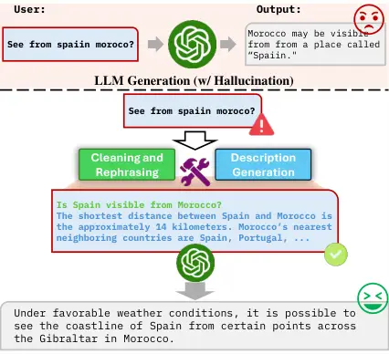
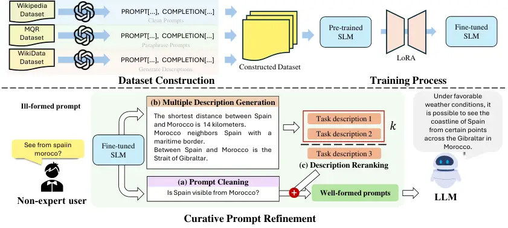

# CPR: Mitigating Large Language Model Hallucinations with Curative Prompt Refinement

Jung-Woo Shim Affiliation: J.-W. Shim, Y.-J. Ju, J.-H. Park, and S.-W.
Lee are with the Department of Artificial Intelligence, Korea
University, Anam-dong, Seongbuk-ku, Seoul 02841, Korea.
j_w_shim@korea.ac.kr, yj_ju@korea.ac.kr, jhoon_park@korea.ac.kr, and
sw.lee@korea.ac.kr    Yeong-Joon Ju Affiliation: J.-W. Shim, Y.-J. Ju,
J.-H. Park, and S.-W. Lee are with the Department of Artificial
Intelligence, Korea University, Anam-dong, Seongbuk-ku, Seoul 02841,
Korea. j_w_shim@korea.ac.kr, yj_ju@korea.ac.kr, jhoon_park@korea.ac.kr,
and sw.lee@korea.ac.kr    Ji-Hoon Park Affiliation: J.-W. Shim, Y.-J.
Ju, J.-H. Park, and S.-W. Lee are with the Department of Artificial
Intelligence, Korea University, Anam-dong, Seongbuk-ku, Seoul 02841,
Korea. j_w_shim@korea.ac.kr, yj_ju@korea.ac.kr, jhoon_park@korea.ac.kr,
and sw.lee@korea.ac.kr    Seong-Whan Lee ^(†)^(†)thanks: \*This work was
supported by the Institute of Information & Communications Technology
Planning & Evaluation (IITP) grant, funded by the Korea government
(MSIT) (No. RS-2019-II190079, Artificial Intelligence Graduate School
Program (Korea University)) and was partly supported by the Institute of
Information & Communications Technology Planning & Evaluation (IITP)
grant, funded by the Korea government (MSIT) (No. RS-2022-II220984,
Development of Artificial Intelligence Technology for Personalized
Plug-and-Play Explanation and Verification of Explanation).
Affiliation: J.-W. Shim, Y.-J. Ju, J.-H. Park, and S.-W. Lee are with
the Department of Artificial Intelligence, Korea University, Anam-dong,
Seongbuk-ku, Seoul 02841, Korea. j_w_shim@korea.ac.kr,
yj_ju@korea.ac.kr, jhoon_park@korea.ac.kr, and sw.lee@korea.ac.kr

###### Abstract

Recent advancements in large language models (LLMs) highlight their
fluency in generating responses to diverse prompts. However, these
models sometimes generate plausible yet incorrect “hallucinated” facts,
undermining trust. A frequent but often overlooked cause of such errors
is the use of poorly structured or vague prompts by users, leading LLMs
to base responses on assumed rather than actual intentions. To mitigate
hallucinations induced by these ill-formed prompts, we introduce
Curative Prompt Refinement (CPR), a plug-and-play framework for curative
prompt refinement that 1) cleans ill-formed prompts, and 2) generates
additional informative task descriptions to align the intention of the
user and the prompt using a fine-tuned small language model. When
applied to language models, we discover that CPR significantly increases
the quality of generation while also mitigating hallucination. Empirical
studies show that prompts with CPR applied achieves over a 90% win rate
over the original prompts without any external knowledge.

###### Index Terms: 

large language model, hallucination mitigation, plug-and-play, prompt
refinement

## I INTRODUCTION

While the recent advancements of artificial intelligence span various
domains \[1, 2, 3, 4, 5\], large language models (LLMs) have displayed
unprecedented capabilities in natural language processing and
generation. These models, built on sophisticated neural network
architectures with notable examples such as ChatGPT \[6\] and
GPT-4 \[7\], demonstrate remarkable performance in understanding
context, answering queries, and creating content that imitates
human-like interactions \[8\]. Despite these advancements, the practical
utility of LLMs is often limited due to their generation of
hallucinatory content that is plausible yet incorrect, a significant
concern highlighted in recent studies \[9\]. This challenge undermines
the reliability of LLM outputs and their applicability across various
domains.

Fig. 1: An example of our framework of refining prompts and generating
informative task descriptions. With the ill-formed prompt as the input,
the GPT-3.5 API generates a hallucinatory output whereas the refined
prompt with informative task descriptions generate a high quality
response.

Most existing studies focus on mitigating hallucinations by modifying
the model internally or correcting generated content
post-creation \[10\]. However, these approaches largely overlook the
quality of user inputs, predominantly addressing hallucinations from
already well-formed prompts. This oversight reveals a significant
shortfall in current methodologies, particularly in how the quality of
inputs influences the accuracy and reliability of LLM outputs.

While there are limited studies that do consider the quality of user
input, they still encounter significant challenges. These include high
computational costs and extensive time demands, often tied to the use of
large models or specific constraints related to model enhancements, such
as those from reinforcement learning or dependencies on external
knowledge bases \[11\]. These limitations suggest that such studies
heavily rely on additional resources, which complicates their broader
applicability and effectiveness.

Fig. 2: Overview of Curative Prompt Refinement (CPR). First, we
fine-tune an SLM on our constructed dataset using LoRA, to mitigate
computational burdens in fine-tuning. We then utilize the fine-tuned SLM
to (a) refine ill-formed user prompts into prompts without any
grammatical errors. Following the cleaning process, we (b) generate
descriptions of the corresponding prompt, and to maximize the
information of the prompts, we (c) use a reranking method to prioritize
the most relevant descriptions based perplexity. The well-formed prompt
allows the inference LLM to generate a concise response.

To address the challenges of ill-formed user inputs and the limitations
highlighted in prior research, we introduce Curative Prompt Refinement
(CPR), a novel framework designed to refine these inputs before they are
processed by LLMs. Our approach specifically targets inputs that often
act as out-of-distribution examples, which lead LLMs to generate
inaccurate or “hallucinated” content.

Initially, we focus on correcting linguistic imperfections to enhance
clarity and coherence. We then enrich inputs that lack detailed
information by integrating generated, informative task descriptions,
ensuring that the prompts are both linguistically accurate and
substantively comprehensive. To achieve these goals of prompt refinement
and enrichment, we employ a small language model (SLM), noted for its
efficiency and cost-effectiveness \[12\]. Throughout the refinement
process, we fine-tune the SLM using three specifically chosen datasets:
a paraphrase dataset for word substitution, a general English dataset
for punctuation and grammar corrections, and a keyword-description
paired dataset for description generation. With capabilities for
cleaning prompts and generating descriptions established, we process the
prompts and produce the corresponding descriptions following a reranking
policy \[13\]. This policy involves generating multiple descriptions and
selecting the top-$`k`$ descriptions, reranked by perplexity, within a
set threshold set upon previous studies \[14\]. The selected outputs are
then combined into a well-structured prompt, thereby reducing the
likelihood of the inference LLM generating hallucinations compared to
the original, poorly formed prompt.

Our extensive experimental evaluations demonstrate the effectiveness of
CPR. The results show that refined prompts, enhanced with detailed task
descriptions, significantly improve the quality of outputs from large
language models (LLMs) and notably reduce hallucinatory responses. When
using CPR, prompts show a 96% win rate over original, ill-formed prompts
with GPT-3.5 as the inference model, and a 99% win rate over highly
ill-formed prompts when a post-processing hallucination mitigation
approach is applied.

Moreover, CPR is engineered to be both lightweight and model-agnostic,
guaranteeing its applicability across any LLM without tailored
adjustments. This semi-universal applicability of our method is a
significant advantage, enabling it to integrate as a plug-and-play
solution with various LLM architectures. This flexibility, as shown in
our experimental results, is particularly beneficial in democratizing
access to advanced LLM functionalities, as it evades the need for access
to high-end computational resources. By presenting a solution that is
both accessible and effective across different computational
environments, our approach stands out for its potential to enhance the
reliability and quality of LLM outputs for non-expert users without
imposing heavy computational or technical prerequisites.

## II RELATED WORKS

### II-A Hallucination Mitigation

In natural language generation, the phenomenon known as “hallucination,”
where models generate plausible but incorrect information, has become a
significant area of focus. Efforts to mitigate this issue have
predominantly involved refining the internal mechanisms of the models,
such as architectural adjustments, augmenting training data, and
implementing advanced verification techniques post generation \[15\].
While effective in reducing hallucinations, these methods have
limitations in high computational demands and complex implementation
processes, making them costly and challenging to scale \[16\].

### II-B Prompt Refinement

Traditional prompt refinement strategies encompass various approaches,
including the use of large LLMs, direct human intervention, and
reinforcement learning \[17, 18\]. These methods typically aim to
optimize prompts for a specific target LLM, often encompassing high
computational costs. In contrast, our method utilizes a lightweight SLM
for prompt refinement, designed to mitigate hallucinations across any
LLM. This positions the SLM as a more accessible and resource-efficient
option for prompt optimization, achieving high levels of performance
through task-specific fine-tuning, despite its smaller scale \[19\]. Our
approach not only builds on the foundational research in prompt
refinement and automated generation \[20\] but also sets itself apart by
robustly highlighting the practical advantages of using SLMs.

## III METHODS

In this section, we present CPR, a simple yet effective framework for
mitigating hallucinations induced by ill-formed prompts. We describe the
details of our framework divided in the following subsections.

### III-A Dataset Construction

We first construct a dataset to adapt an SLM to our specific tasks. Our
training dataset for prompt refinement is constructed from three
sources: the Wikipedia English dataset (WikiEn) \[21\], the Multi-domain
Question Rewriting dataset (MQR) \[22\], and the Wikidata Description
dataset (WikiD) \[23\]. We transform these into instruction fine-tuning
form, which are pairs of prompts and ground-truth completions. Each
dataset is formatted to train the model for three specific tasks as
follows:

|                      |                     |                     |                    |                   |                     |                    |                   |
| -------------------- | ------------------- | ------------------- | ------------------ | ----------------- | ------------------- | ------------------ | ----------------- |
| Method               | Fine-tuned Models   | Inference Models    |                    |                   |                     |                    |                   |
|                      |                     | Llama-2 (7B) \[24\] |                    |                   | GPT-3.5 \[6\]       |                    |                   |
|                      |                     | HI ($`\downarrow`$) | CQS ($`\uparrow`$) | WR ($`\uparrow`$) | HI ($`\downarrow`$) | CQS ($`\uparrow`$) | WR ($`\uparrow`$) |
| Original             | -                   | 0.51                | 0.38               | -                 | 0.16                | 0.51               | -                 |
| CPR w/o Descriptions | Gemma (2B) \[25\]   | 0.35                | 0.51               | 0.51              | 0.14                | 0.58               | 0.61              |
|                      | Phi-2 (2.7B) \[26\] | 0.34                | 0.54               | 0.53              | 0.12                | 0.63               | 0.64              |
|                      | Llama-2 (7B) \[24\] | 0.32                | 0.62               | 0.73              | 0.10                | 0.68               | 0.78              |
|                      | Phi-3 (3.8B)        | 0.15                | 0.69               | 0.79              | 0.08                | 0.71               | 0.81              |
|                      | Qwen (1.5) (4B)     | 0.28                | 0.65               | 0.76              | 0.09                | 0.69               | 0.80              |
|                      | Zephyr (3B)         | 0.17                | 0.68               | 0.78              | 0.09                | 0.70               | 0.80              |
|                      | FLAN-T5 XL (2.85B)  | 0.31                | 0.60               | 0.74              | 0.10                | 0.67               | 0.75              |
|                      | Phi-3.5 mini (3B)   | 0.13                | 0.77               | 0                 | 0                   | 0                  | 0                 |
|                      | Llama 3.2 (3.21B)   | 0.16                | 0.78               | 0                 | 0                   | 0                  | 0                 |
| CPR (Ours)           | Gemma (2B) \[25\]   | 0.17                | 0.59               | 0.84              | 0.07                | 0.68               | 0.92              |
|                      | Phi-2 (2.7B) \[26\] | 0.14                | 0.63               | 0.85              | 0.09                | 0.73               | 0.93              |
|                      | Llama-2 (7B) \[24\] | 0.13                | 0.75               | 0.92              | 0.04                | 0.83               | 0.96              |
|                      | Phi-3 (3.8B)        | 0.14                | 0.73               | 0.88              | 0.05                | 0.79               | 0.94              |
|                      | Qwen (1.5) (4B)     | 0.16                | 0.67               | 0.87              | 0.06                | 0.76               | 0.91              |
|                      | Zephyr (3B)         | 0.15                | 0.71               | 0.89              | 0.05                | 0.77               | 0.93              |
|                      | FLAN-T5 XL (2.85B)  | 0.19                | 0.65               | 0.85              | 0.07                | 0.74               | 0.88              |
|                      | Phi-3.5 mini (3B)   | 0.13                | 0.77               | 0                 | 0                   | 0                  | 0                 |
|                      | Llama 3.2 (3.21B)   | 0.16                | 0.78               | 0                 | 0                   | 0                  | 0                 |

TABLE I: Comparison of hallucination index (HI), content quality score
(CQS), and win rate (WR) between ill-formed of output quality from
refined informative prompts upon different inference models. Bold values
represent the best values.

- •
  WikiEn Dataset: This dataset comprises a comprehensive collection of
  English text from Wikipedia that meets high linguistic standards.
  Using the GPT-3.5 API, we verify and refine 10,000 entries to ensure
  they are free of punctuation errors, establishing a baseline of
  well-formed text. Simultaneously, we introduce punctuation errors into
  a copy of the 10,000 entries using the same API, creating a unique
  dataset of paired examples. This setup is crucial for fine-tuning the
  model to improve text correction and punctuation accuracy.
- •
  MQR Dataset: This dataset, consisting of 2,114 pairs of paraphrased
  questions, is crucial for enhancing the model’s skills in nuanced
  linguistic transformations like word substitution and paraphrasing.
  The MQR dataset aids in training the model to transform ill-formed
  prompts into clearer, more accurate questions, improving its ability
  to align with user intents and enhance interaction quality and output
  relevancy.
- •
  WikiD Dataset: We selected a fraction of the Wikidata dataset based on
  lookup frequency, comprising 10,000 pairs of keywords and concise
  descriptions. This selection trains the model to generate accurate
  descriptions from minimal inputs and to enhance and expand on prompts,
  producing contextually relevant descriptions. Fine-tuning an SLM with
  WikiD equips the model to deliver enriched responses, significantly
  boosting performance in prompt-based tasks.

### III-B Fine-tuning the Model

We then fine-tune an SLM with the constructed dataset. For the
fine-tuning process, we incorporate instruction fine-tuning
techniques \[27\] coupled with low rank adaptation (LoRA) \[28\] to
enhance parameter efficiency. The approach of utilizing LoRA is
specifically chosen to counteract the limitations associated with
traditional full fine-tuning, notably its tendency to cause catastrophic
forgetting by modifying every parameter of the model \[29\]. LoRA
addresses this by selectively updating only a small subset of model
parameters, thereby preserving the pre-trained strengths of the model
while still adapting to new tasks.

By refining the model’s ability to handle specific instructional tasks
without overhauling its entire parameter structure, we achieve a more
targeted improvement in performance. This approach not only maintains
the general capabilities of the model but also ensures greater
efficiency and reduced resource consumption during the fine-tuning
phase.

1: Input: Input prompt $`q`$, maximum number of descriptions $`m`$,
perplexity threshold $`\tau`$, language model $`f`$, description $`d`$

2: Define Perplexity Function:

3: $`PPL(d_{i})=exp[{-\frac{1}{N}\sum_{j=1}^{N}\log p(w_{j}|w_{j-1})}]`$
$`\triangleright`$ $`N`$: tokens in $`d_{i}`$, $`p(w_{j}|w_{j-1})`$:
next-token probability

4: Generate and Rerank:

5: Initialize $`D`$ as an empty list

6: $`i=0`$

7: while $`|D|<m`$ do

8:   $`d_{i}\leftarrow f(q)`$

9:   if $`PPL(d_{i})>\tau`$ then

10:    break

11:   else

12:    Append $`d_{i}`$ to $`D`$   

13:   $`i\leftarrow i+1`$

14: $`D\leftarrow\text{sort}(D)`$, Set key to $`PPL(x)`$

15: $`D_{\text{top}}\leftarrow D[:k]`$ $`\triangleright`$ Select
top-$`k`$ descriptions

16: return $`D_{\text{top}}`$

Algorithm 1 Description Generation and Reranking

### III-C Cleaning and Paraphrasing Prompts

Using the fine-tuned SLM, ill-formed prompts are cleaned and rephrased
into clear, well-formed versions. The model corrects linguistic
inaccuracies such as grammar and syntax errors, a skill developed
through extensive training on the Wiki dataset, which includes diverse
text examples to enhance error detection and correction. Additionally,
it enhances clarity by rephrasing ambiguous phrases, benefiting from its
training with the MQR dataset where it learned nuanced linguistic
transformations like paraphrasing and word substitution. This dual
capability enables the model to deliver prompts that are structurally
sound and semantically clear.

### III-D Informative Description Generation and Reranking

Merely cleaning the prompt still leaves it lacking in necessary
contextual information, which hinders the ability to generate concise
responses. This issue occurs because, while SLMs have the necessary
information in their corpus, they often struggle to produce it without
sufficient contextual guidance. To mitigate this problem, we enhance
prompts by adding supplementary contextual information generated from
the model. This process is tailored to align with the refined prompts,
improving the LLM’s processing effectiveness. Through targeted
fine-tuning with our specialized dataset, the SLM learns to generate
enriched descriptions that directly complement the cleaned prompts.

To ensure the relevance and quality of the generated descriptions, we
continuously monitor the model’s perplexity throughout the description
generation process. This monitoring persists until the perplexity
reaches a predefined threshold of $`15`$. Once this threshold is
achieved, we halt the generation process. We then evaluate the
descriptions, selecting the top-$`k`$ based on their average perplexity.
These selected descriptions are reranked to prioritize those with the
lowest perplexity, ensuring the use of the most coherent and
contextually appropriate descriptions. This procedure is outlined in
Algorithm 1.

## IV EXPERIMENTS

We evaluate CPR in the following aspects: 1) the overall performance of
our refined prompts, 2) cleaning and paraphrasing abilities, 3) quality
of the generated descriptions, and 4) comparison to an existing
hallucination mitigation framework. In the following subsections, we
explain the specifics of each experiment, presenting implementation
details, evaluation metrics, and comprehensive results.

### IV-A Experimental Settings

#### IV-A1 Evaluation Dataset

To evaluate the effectiveness of CPR to ill-formed prompts we employed a
dataset consisting of 8,000 user queries from the Google Well-formed
Query dataset \[30\], each with a score below 0.5, indicating suboptimal
form. To ensure impartiality in processing and evaluation, these queries
were anonymized and subjected to a randomization process.

#### IV-A2 Hardware Settings

Model fine-tuning was conducted using a single NVIDIA RTX A6000 GPU,
while inference tasks for the SLMs were performed on a single NVIDIA
TITAN V GPU.

### IV-B Evaluating the Effectivness of CPR

To demonstrate the efficacy of CPR in reducing hallucinations and
improving content quality in inference models, we utilized the following
metrics evaluated with the GPT-3 API as the judge \[31\]:

- •
  Hallucination Index (HI): This metric quantifies the accuracy of the
  content generated by the model, using a scale from 0 to 1. A score of
  0 indicates no hallucinations, implying complete factual accuracy,
  while a score of 1 represents complete hallucination, where the
  content is entirely fabricated and lacks factual basis.
- •
  Content Quality Score (CQS): This score evaluates the relevance,
  coherence, and overall value of the generated content. It is also
  measured on a scale from 0 to 1, where 0 signifies irrelevant or
  incoherent content, and 1 indicates relevant and coherent content.
- •
  Win Rate (WR): This metric measures the superiority of generated
  content from ill-formed prompts compared to prompts with CPR with no
  descriptions applied, and ill-formed prompts compared to prompts with
  CPR applied.

As illustrated in TABLE I, the refined prompts have significantly
reduced hallucinations, enhanced content quality, and improved win rates
across all tested models, affirming that even small SLMs can produce
satisfactory outputs. Our analysis further reveals that the degree of
improvement in inference models diminishes as their size increases;
smaller models show more substantial improvements. Moreover, the
comparison of CPR used with 2B (comparably small) and 7B (comparably
large) models demonstrates no significant difference in reducing
hallucinations when it comes to the size of the SLM, yet it notably
enhances quality and win rates. This effect is more pronounced when
descriptions are included in CPR, where their absence markedly reduces
its effectiveness. Interestingly, while the GPT-3.5 model typically
performs well, the addition of descriptions through CPR specifically
enhances its content quality, indicating the value of context in prompt
refining.

### IV-C Evaluation of Prompt Refinement

To assess the prompt refinement capabilities of the fine-tuned SLMs, we
fine-tuned three most widely-used models—Gemma (2B), Phi-2 (2.7B), and
Llama-2 (7B)—using our curated dataset. We then evaluated the
performance of these models both before and after fine-tuning by
comparing the quality of refined prompts against the original ill-formed
prompts using the following established metrics:

- •
  BLEU: This metric measures the grammatical accuracy of translated
  text, used to assess the quality of refined versus original
  prompts \[32\].
- •
  ROUGE: This metric evaluates paraphrasing by analyzing n-gram overlap,
  gauging the fidelity of refined prompts to the originals \[33\].
- •
  METEOR: This metric assesses semantic similarity using linguistic
  features, measuring contextual and meaning improvements in refined
  prompts \[34\].

By comparing each version of queries before and after refinement, we
were able to determine the effectiveness of our dataset in enhancing the
fine-tuning process. Our findings are documented in TABLE II.

### IV-D Evaluation of Generated Descriptions

To validate the relevance and coherence of descriptions generated by our
model, we employed the same fine-tuned SLMs that refined the prompts,
since these models were previously adapted for description generation as
part of our constructed fine-tuning dataset. For each of the 8,000
queries, the SLMs generated up to five descriptions. Generation was
halted when the perplexity of a description reached a predefined
threshold of 5, a value determined through empirical research.

|                |             |      |       |        |
| -------------- | ----------- | ---- | ----- | ------ |
| Model          | Fine-tuning | BLEU | ROUGE | METEOR |
| Gemma \[25\]   | Original    | 11.2 | 45.3  | 31.3   |
|                | Fine-tuned  | 21.1 | 54.2  | 32.1   |
| Phi-2 \[26\]   | Original    | 13.1 | 46.6  | 31.7   |
|                | Fine-tuned  | 21.7 | 56.3  | 35.6   |
| Llama-2 \[24\] | Original    | 12.8 | 48.1  | 31.5   |
|                | Fine-tuned  | 23.1 | 56.2  | 36.5   |

TABLE II: Evaluation of prompt cleaning and paraphrasing of SLMs
fine-tuned on our dataset. We compare the BLEU, ROUGE, and METEOR scores
of each model’s generated description and the improvement after
fine-tuning.

The quality of these descriptions was assessed using the GPT-3 API. We
evaluated the descriptions on the following metrics:

- •
  Relevance: This metric evaluates the extent to which the generated
  descriptions accurately address the tasks outlined in the prompts. It
  is assessed on a scale from 0 to 1, where 0 indicates no relevance and
  1 represents maximum relevance. Higher scores signify that the content
  closely aligns with the prompt’s requirements.
- •
  Coherence: This metric measures the logical consistency and smooth
  integration of content within the descriptions relative to the refined
  prompts. It is also rated on a scale from 0 to 1, with 0 signifying
  illogical content and 1 indicating that the descriptions are perfectly
  coherent. Higher scores indicates that the model successfully
  maintains a logical flow and context throughout its responses.

|                    |             |           |           |
| ------------------ | ----------- | --------- | --------- |
| Model              | Fine-tuning | Relevance | Coherence |
| Gemma \[25\]       | Original    | 61.1      | 56.8      |
|                    | Fine-tuned  | 71.1      | 79.5      |
| Phi-2 \[26\]       | Original    | 61.4      | 58.8      |
|                    | Fine-tuned  | 73.4      | 81.4      |
| Llama-2 \[24\]     | Original    | 63.4      | 62.5      |
|                    | Fine-tuned  | 80.5      | 82.1      |
| Phi-3 (3.8B)       | Original    | 64.1      | 63.0      |
|                    | Fine-tuned  | 78.9      | 81.7      |
| Qwen (1.5) (4B)    | Original    | 62.5      | 61.0      |
|                    | Fine-tuned  | 75.8      | 80.3      |
| Zephyr (3B)        | Original    | 63.0      | 61.8      |
|                    | Fine-tuned  | 77.5      | 81.2      |
| FLAN-T5 XL (2.85B) | Original    | 62.0      | 60.5      |
|                    | Fine-tuned  | 74.2      | 79.0      |
| Phi-3.5 mini (3B)  | Original    | 67.3      | 66.1      |
|                    | Fine-tuned  | 0         | 0         |
| Llama-3.2 (3.21B)  | Original    | 69.8      | 66.3      |
|                    | Fine-tuned  | 0         | 0         |

TABLE III: Comparison of description generation quality of SLMs. We
compare relevance and coherence of each model’s generated description
with the descriptions generated by their fine-tuned models.

Each description was independently reviewed and scored by the GPT-3 API,
with results averaged. Our experiment demonstrates that while SLMs
initially show limited performance in both prompt refinement and
description generation, they can be effectively fine-tuned to achieve
satisfactory outcomes. The results are documented in TABLE III.

### IV-E Comparison of CPR with SelfCheckGPT

To demonstrate the effectiveness of CPR in reducing hallucinations, we
conducted a comparative experiment against SelfCheckGPT, one of the
current leading technique for hallucination mitigation, with Llama-2
(7B) as its inference model. We assessed both methods using the same
metrics—HI, CQS, and WR—with two different models, Gemma (2B) and
Llama-2 (7B), serving as the inference models. We specifically chose
Gemma (2B), the smallest SLM as CPR’s SLM.

As shown in TABLE IV, CPR outperforms SelfCheckGPT when handling highly
ill-formed prompts (prompts with scores under 0.2; High). However, for
prompts with minimal errors (prompts with scores above 0.2; Low),
SelfCheckGPT was more effective. Notably, combining CPR with
SelfCheckGPT yielded the highest scores across all metrics, showcasing
the compatibility and enhanced performance of integrating these methods.

|           |                     |                     |                    |                   |
| --------- | ------------------- | ------------------- | ------------------ | ----------------- |
| IF Degree | Method              | HI ($`\downarrow`$) | CQS ($`\uparrow`$) | WR ($`\uparrow`$) |
| Low       | SelfCheckGPT \[35\] | 0.19                | 0.58               | 0.71              |
|           | CPR w/ Gemma (2B)   | 0.23                | 0.42               | 0.61              |
|           | CPR w/ Llama-2 (7B) | 0.21                | 0.62               | 0.68              |
|           | CPR+SelfCheckGPT    | 0.03                | 0.91               | 0.98              |
| High      | SelfCheckGPT \[35\] | 0.37                | 0.42               | 0.51              |
|           | CPR w/ Gemma (2B)   | 0.29                | 0.48               | 0.61              |
|           | CPR w/ Llama-2 (7B) | 0.23                | 0.57               | 0.69              |
|           | CPR+SelfCheckGPT    | 0.05                | 0.88               | 0.99              |

TABLE IV: Comparison of CPR with SelfCheckGPT \[35\]. We compare the
mitigation of hallucination for ill-formed inputs using different SLMs
as the inference model. IF represents the ill-formed degree of the
prompts.

## V CONCLUSION

We introduce CPR, an automatic plug-and-play framework for refining
prompts utilizing an SLM, to ultimately mitigate hallucinations. Our
approach involves cleaning, paraphrasing, and generating informative
descriptions adequate to the prompts. This substantially improves the
clarity and task specificity of prompts, leading to a significant uplift
in the quality of LLM outputs as shown in our experimental results.
Despite these advancements, there are still some issues that remain.
Firstly, the dataset crafted for fine-tuning was manually done,
indicating a better crafted dataset potentially could amplify the
effectiveness of our approach. Additionally, resource constraints
restricted our evaluation scope, limiting a thorough exploration of
scalability and performance across models with larger sizes. Future
works will deal with these issues by crafting a higher-quality dataset
for fine-tuning and experimenting on a wider range of inference models.
Nonetheless, our findings contribute significantly to the field,
underscoring the substantial benefits of incorporating SLMs into the
preprocessing stages for LLMs. The marked improvements in the accuracy
and quality of LLM-generated content highlight the potential of CPR.

## References

- \[1\] M. Lee _et al._, “Quantifying arousal and awareness in altered
  states of consciousness using interpretable deep learning,” _Nat.
  Commun._, vol. 13, p. 1064, 2022.
- \[2\] D.-H. Lee, J.-H. Jeong, K. Kim, B.-W. Yu, and S.-W. Lee,
  “Continuous EEG Decoding of Pilots’ Mental States Using Multiple
  Feature Block-Based Convolutional Neural Network,” _IEEE Access_,
  vol. 8, pp. 121 929–121 941, 2020.
- \[3\] G.-H. Lee and S.-W. Lee, “Uncertainty-Aware Mesh Decoder for
  High Fidelity 3D Face Reconstruction,” in _IEEE/CVF Conf. Comput. Vis.
  Pattern Recognit. (CVPR)_, 2020.
- \[4\] Y.-B. Lee, U. Park, A. K. Jain, and S.-W. Lee, “Pill-ID:
  Matching and retrieval of drug pill images,” _Pattern Recognit.
  Lett._, vol. 33, pp. 904–910, 2012.
- \[5\] D.-G. Lee, H.-I. Suk, S.-K. Park, and S.-W. Lee, “Motion
  Influence Map for Unusual Human Activity Detection and Localization in
  Crowded Scenes,” _IEEE Trans. on Circuits Syst. Video Technol._,
  vol. 25, pp. 1612–1623, 2015.
- \[6\] L. Ouyang _et al._, “Training language models to follow
  instructions with human feedback,” in _Adv. Neural Inf. Process. Syst.
  (NeurIPS)_, 2022.
- \[7\] J. Achiam _et al._, “GPT-4 technical report,” _arXiv preprint
  arXiv:2303.08774_, 2023.
- \[8\] Z. He _et al._, “Exploring human-like translation strategy with
  large language models,” _Trans. Assoc. Comput. Linguist._, vol. 12,
  pp. 229–246, 2024.
- \[9\] W. Zhao _et al._, “A survey of large language models.” _arXiv
  preprint arXiv:2303.18223_, 2023.
- \[10\] A. Azaria and T. Mitchel, “The Internal State of an LLM Knows
  When It’s Lying,” in _Conf. Empir. Methods Nat. Lang. Process.
  (EMNLP)_, 2023.
- \[11\] Y. Liang, Z. Song, H. Wang, and J. Zhang, “Learning to trust
  your feelings: Leveraging self-awareness in llms for hallucination
  mitigation.” _arXiv preprint arXiv:2401.15449_, 2024.
- \[12\] T. Schick and H. Schütze, “It’s Not Just Size That Matters:
  Small Language Models Are Also Few-Shot Learners,” in _Assoc. Comput.
  Linguist. (ACL)_, 2021.
- \[13\] E. Giamphy _et al._, “A Quantitative Analysis of Noise Impact
  on Document Ranking,” in _IEEE Int. Conf. Syst. Man Cybern.
  (SMC)_, 2023.
- \[14\] K. Shuster _et al._, “Retrieval Augmentation Reduces
  Hallucination in Conversation,” in _Conf. Empir. Methods Nat. Lang.
  Process. (EMNLP)_, 2021.
- \[15\] M. Zhang, O. Press, W. Merrill, A. Liu, and N. A. Smith, “How
  Language Model Hallucinations Can Snowball,” _arXiv preprint
  arXiv:2305.13534_, 2023.
- \[16\] A. Gunjal, J. Yin, and E. Bas, “Detecting and Preventing
  Hallucinations in Large Vision Language models,” in _Ann. AAAI Conf.
  Artif. Intell. (AAAI)_, 2024.
- \[17\] W. Kong, S. Hombaiah, M. Zhang, Q. Mei, and M. Bendersky,
  “PRewrite: Prompt Rewriting with Reinforcement Learning.” _arXiv
  preprint arXiv:2401.08189_, 2024.
- \[18\] L. Shu _et al._, “RewriteLM: An instruction-tuned large
  language model for text rewriting.” in _Ann. AAAI Conf. Artif. Intell.
  (AAAI)_, 2024.
- \[19\] C.-Y. Hsieh _et al._, “Distilling Step-by-Step! Outperforming
  Larger Language Models with less Training Data and Smaller Model
  Sizes,” in _Assoc. Comput. Linguist. (ACL)_, 2023.
- \[20\] J. Weng _et al._, “Helping Language Models Learn More:
  Multi-Dimensional Task Prompt for Few-shot Tuning,” in _IEEE Int.
  Conf. Syst. Man Cybern. (SMC)_, 2023.
- \[21\] D. Saez-Trumper _et al._, “Wikimedia Public (Research)
  Resources.” in _Companion Proc. Web Conf. (CPWC)_, 2020.
- \[22\] Z. Chu _et al._, “How to ask better questions? A large-scale
  multi-domain dataset for rewriting ill-formed questions,” in _Ann.
  AAAI Conf. Artif. Intell. (AAAI)_, 2020.
- \[23\] D. Vrandečić and M. Krötzsch, “Wikidata: a free collaborative
  knowledgebase.” _Commun. ACM_, 2021.
- \[24\] H. Touvron _et al._, “Llama 2: Open foundation and fine-tuned
  chat models.” _arXiv preprint arXiv:2307.09288_, 2023.
- \[25\] G. Team _et al._, “Gemma: Open models based on Gemini research
  and technology,” _arXiv preprint arXiv:2403.08295_, 2024.
- \[26\] Z. Yuan, Z. Li, and L. Sun, “TinyGPT-V: Efficient multimodal
  large language model via small backbones,” _arXiv preprint
  arXiv:2312.16862_, 2023.
- \[27\] J. Wei _et al._, “Finetuned Language Models are Zero-shot
  Learners,” in _Int. Conf. Learn. Represent. (ICLR)_, 2022.
- \[28\] E. J. Hu _et al._, “LoRA: Low-Rank Adaptation of Large Language
  Models,” in _Int. Conf. Learn. Represent. (ICLR)_, 2022.
- \[29\] T. Korbak, H. Elsahar, G. Kruszewski, and M. Dymetman,
  “Controlling conditional language models without catastrophic
  forgetting.” in _Int. Conf. Mach. Learn. (ICML)_, 2022.
- \[30\] M. Faruqui and D. Das, “Identifying Well-formed Natural
  Language Questions,” in _Conf. Empir. Methods Nat. Lang. Process.
  (EMNLP)_, 2018.
- \[31\] L. Zheng _et al._, “Judging LLM-as-a-Judge with MT-bench and
  Chatbot Arena.” in _Adv. Neural Inf. Process. Syst. (NeurIPS)_, 2024.
- \[32\] K. Papineni _et al._, “BLEU: a method for automatic evaluation
  of machine translation.” in _Assoc. Comput. Linguist. (ACL)_, 2002.
- \[33\] P. Lu _et al._, “Learn to explain: Multimodal reasoning via
  thought chains for science question answering,” in _Adv. Neural Inf.
  Process. Syst. (NeurIPS)_, 2022.
- \[34\] S. Banerjee and A. Lavie, “METEOR: An automatic metric for MT
  evaluation with improved correlation with human judgments,” in _ACL
  Workshop Intr. Extr. Eval. Meas. for Mach. Transl. Summ_, 2005.
- \[35\] P. Manakul, A. Liusie, and M. Gales, “SelfCheckGPT:
  Zero-resource black-box hallucination detection for generative large
  language models,” in _Conf. Empir. Methods Nat. Lang. Process.
  (EMNLP)_, 2023.
