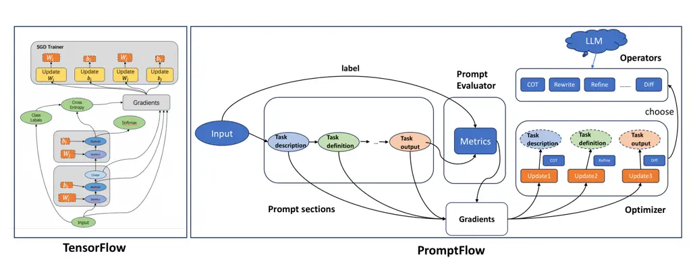
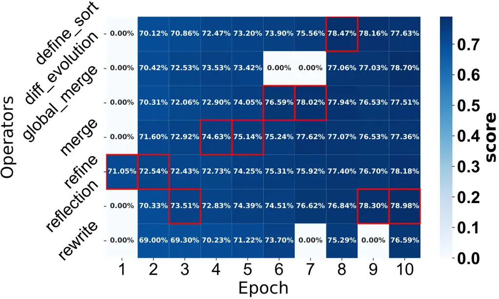
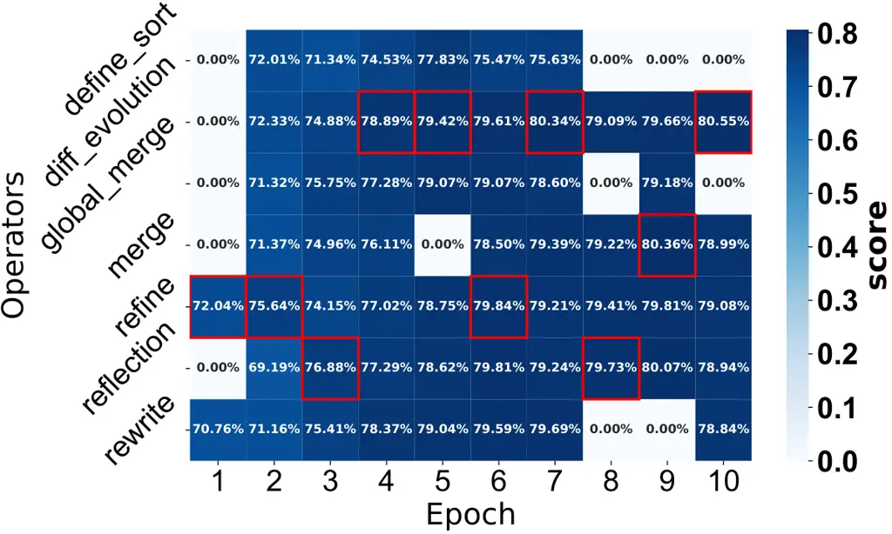

# PromptFlow: Training Prompts Like Neural Networks

Jingyi Wang    Hongyuan Zhu    Ye Niu    Yunhui Deng

###### Abstract

Large Language Models (LLMs) have demonstrated profound impact on
Natural Language Processing (NLP) tasks. However, their effective
deployment across diverse domains often require domain-specific
adaptation strategies, as generic models may underperform when faced
with specialized data distributions. Recent advances in prompt
engineering (PE) offer a promising alternative to extensive retraining
by refining input instructions to align LLM outputs with task
objectives. This paradigm has emerged as a rapid and versatile approach
for model fine-tuning. Despite its potential, manual prompt design
remains labor-intensive and heavily depends on specialized expertise,
often requiring iterative human effort to achieve optimal formulations.
To address this limitation, automated prompt engineering methodologies
have been developed to systematically generate task-specific prompts.
However, current implementations predominantly employ static update
rules and lack mechanisms for dynamic strategy selection, resulting in
suboptimal adaptation to varying NLP task requirements. Furthermore,
most methods treat and update the whole prompts at each step, without
considering editing prompt sections at a finer granularity. At last, in
particular, the problem of how to recycle experience in LLM is still
underexplored. To this end, we propose the PromptFlow, a modular
training framework inspired by TensorFlow, which integrates
meta-prompts, operators, optimization, and evaluator. Our framework can
be equipped with the latest optimization methods and autonomously
explores optimal prompt refinement trajectories through gradient-based
meta-learning, requiring minimal task-specific training data.
Specifically, we devise a reinforcement learning method to recycle
experience for LLM in the PE process. Finally, we conduct extensive
experiments on various datasets, and demonstrate the effectiveness of
PromptFlow.

Alibaba Cloud

wangjingyi.w@alibaba-inc.com, zhy19933628@gmail.com,

niuye@alibaba-inc.com, yunhui.dyh@alibaba-inc.com

## Introduction

Large language models (LLMs) have been emerging and achieving
state-of-the-art (SOTA) results on a variety of natural language
processing tasks. This success has propelled prompt engineering to
become a hot topic. Current approaches predominantly rely on manually
crafted prompts incorporating domain-specific knowledge. For instance,
Wei et al. (2021) proposed instruction tuning through natural language
template development, improving zero-shot performance on multiple NLP
benchmarks. For complex reasoning tasks, Wei et al. (2021) introduced
chain-of-thought (CoT) prompting, gaining accuracy in mathematical
reasoning through stepwise decomposition mechanisms. Currently,
multi-perspective optimization frameworks (Wang et al. 2022; Shinn
et al. 2023; Yao et al. 2024) emerged, employing self-refinement and
tree-search algorithms to enhance task-specific adaptability.
Simultaneously, there are exciting systems and tools (Tenney et al.
2024; Diao et al. 2023), aiming to help engineers develop prompts
efficiently. For example, Tenney et al. (2024) presented a visual tool
for interactive prompt debugging with input salience methods. However,
while these methods can enhance performance on specific tasks through
the creation of extensive prompts, they also require substantial
manpower and domain expertise.



Figure 1: Comparison of TensorFlow and PromptFlow

To enhance the efficiency and effectiveness of prompt engineering,
multiple studies (Zhou et al. 2022; Schnabel and Neville 2024; Hsieh
et al. 2023) explored automated prompt generation frameworks. Zhou
et al. (2022) pioneered a methodology that leverages large language
models to create instruction pools followed by candidate selection
mechanisms. These approaches represent a significant advancement by
enabling automatic prompt generation through template rewriting. Recent
advancements focus on optimizing iterative update strategies. Liu et al.
(2023) developed an evolutionary algorithm-based framework demonstrating
superior performance and rapid convergence in prompt generation. In
parallel, Ye et al. (2023) introduced meta-prompt architectures
incorporating hierarchical components, such as two-stage task
decomposition, contextual specifications, and structured reasoning
templates, to enhance LLM-driven prompt synthesis.  Tang et al. (2024);
Pryzant et al. (2023) emphasized the strategic optimization of update
mechanisms to improve both performance metrics and convergence rates.
Notably, Tang et al. (2024) innovatively adapted gradient-based
optimization principles to design enhanced update strategies for
LLM-based prompt optimizers, marking a significant methodological
advancement in the field.

Indeed, automatic prompt generation still faces several challenges that
have yet to be fully addressed by existing approaches. In particular,
current methods rely on predefined prompt refinement strategies, such as
rewriting, COT reasoning, and self-correction. However, the development
of adaptive mechanisms capable of dynamically adjusting and
transitioning update strategies for diverse scenarios remains
insufficient. Furthermore, existing experience-based feedback strategies
easily overhaul entire prompts during refinement, risking the
degradation of high-quality sections. A more effective paradigm would
involve selectively refining underperforming segments of prompts while
retaining their effective components. As prior works employ fixed
methods to address specific NLP tasks, they often demonstrate limited
extensibility to novel scenarios or emerging optimization techniques,
thereby necessitating task-specific redesigns.

To address these limitations, we introduce PromptFlow, an end-to-end
framework for prompt generation and training that effectively handles a
wide range of diverse NLP tasks. Inspired by TensorFlow, PromptFlow
integrates meta-prompts, operators, optimizers, and evaluators.
Specifically, we propose a meta-prompt generator, which can generate
prompt sections by utilizing various operators, such as self-reflection,
COT, differential evolution, and so on. We then employ a meta-level and
gradient-inspired optimization mechanism that integrates reinforcement
learning to intelligently select operators and determine the most
effective refinement paths for specific prompt segments. In this way,
PromptFlow can identify suitable operators and discover optimized paths
tailored to different tasks. We conduct comprehensive experiments across
multiple benchmarks on three datasets, including named entity
recognition (NER), classification (CLS), and machine reading
comprehension (MRC). The results demonstrate that PromptFlow can
significantly enhance prompt performance and demonstrate superiority
over baselines on massive NLP tasks. The contributions of this paper are
summarized as follows:

- •
  We propose the PromptFlow, a modular training framework. PromptFlow
  enables fine-grained improvements of prompts at the meta-prompt level,
  dynamically assembles prompt components using a rich and extensible
  library of operators, including self-reflection, chain-of-thought
  reasoning, differential evolution and so on.
- •
  We develop a meta-level and gradient-based optimization mechanism that
  intelligently selects operators and identifies optimal refinement
  paths for specific prompt segments. Furthermore, we incorporate a
  reinforcement learning (RL) method, which effectively recycles and
  leverages experience to enhance the performance of large language
  models.
- •
  We conduct comprehensive experiments across multiple benchmarks,
  covering three datasets that span diverse tasks such as named entity
  recognition, classification, and machine reading comprehension. The
  results indicate that PromptFlow can effectively enhance prompt
  performance and consistently outperform baseline methods.

## Related Work

### Prompt Engineering

A prompt in generative model is the textual input provided by users to
guide the model’s output. Prompting offers a natural and intuitive
interface for humans to interact with LLMs. Existing work has designed
methods with human knowledge effectively to improve the model’s
performance on specific tasks. For instance, Wei et al. (2021) used an
instruction tuning method to improve zero-shot (Palatucci et al. 2009)
performance on unseen tasks by developing natural language instruction
templates. To improve performance in complex reasoning, Wei et al.
(2022) proposed chain-of-thought prompting to reason and solve problems
step by step.

However, designing effective prompts manually is both challenging and
time-consuming. To handle this, several researches (Zhou et al. 2022;
Schnabel and Neville 2024; Hsieh et al. 2023) have proposed methods for
automatically generating prompts. Zhou et al. (2022) proposed a method
that leverages LLMs to generate a pool of prompt candidates and
subsequently select the most suitable candidates. These methods are
capable of generating new prompts automatically, but their generation
mechanisms are predominantly template-based or rule-based, which limits
the adaptability and flexibility of the generation process. Recent
research mainly focuses on rewriting the entire prompt. However, for
complex NLP tasks, prompts can be more intricate, and modifying the
entire prompt may significantly impact the results while risking the
loss of effective components from the original prompt.

### Large Language Model

In recent years, global enthusiasm for large language models (LLMs) has
surged dramatically and has demonstrated remarkable performance across a
wide range of natural language tasks. GPT-4, a massive transformer-based
model developed by OpenAI (Achiam et al. 2023), has proven its ability
to match human performance in a multitude of professional and academic
assessments. Following its success, GPT-4o (omni)(Hurst et al. 2024),
the upgraded iteration, has swiftly been introduced, significantly
expanding the frontiers of capability and performance. At the same time,
Meta’s Llama 3(Grattafiori et al. 2024), which supports multilingual
tasks, coding, reasoning, and tool integration, has demonstrated
performance on par with top-tier models such as GPT-4 across a variety
of practical applications. The Qwen series(Yang et al. 2024)
incorporates both dense models and a Mixture-of-Experts framework to
deliver advanced capabilities. These have achieved markedly improved
performance in downstream applications, particularly in solving
intricate and demanding problems.

### Reinforcement Learning

Reinforcement learning (RL) is a computational framework for developing
decision-making policies through iterative interactions with dynamic
environments. In previous studies, reinforcement learning has been
successfully applied across applications of machine learning, from
natural language processing (Yu et al. 2017; Ouyang et al. 2022) to
computer vision (Mirowski et al. 2016; Silver et al. 2016). For
instance, Silver et al. (2016) integrated value networks for position
evaluation and policy networks for strategic planning, enabling the
Monte Carlo tree search to master gameplay. More recently, reinforcement
learning methods has taken a central role in enhancing large language
models (LLMs). The seminal work by Ouyang et al. (2022) established a
paradigm for human-aligned LLM training through reinforcement learning
from human feedback (RLHF), utilizing preference rankings to fine-tune
GPT-3.Deng et al. (2022) developed RLPROMPT, which constructed a policy
network by training a task-specific multilayer perceptron (MLP) module
and its parameters were updated based on reward signals generated
through RL methods. Subsequent studies have expanded RL’s applicability
in LLMs.Achiam et al. (2023) systematically analyzed safety alignment
via RLHF, while Rafailov et al. (2023) developed direct preference
optimization methods that circumvent explicit reward modeling.Kwon
et al. (2024) proposed StablePrompt, in which the target LLM combined
with a given dataset served as the world model, while the agent LLM
acted as the policy and the reward was derived from the target LLM’s
response. Notably, Guo et al. (2025) demonstrated that large-scale
reinforcement learning (RL) training, even without supervised
fine-tuning initialization, can significantly enhance reasoning
capabilities.

## Problem Statement

A common scene of prompt engineering is writing prompt for LLMs to solve
a problem based on specific datasets and requirements. Thus, for a NLP
task, we define a dataset $`D`$, considering as a pair of input and
output $`\left\{X,Y\right\}`$. $`X`$ usually contains the task
description and context, and $`Y`$ is defined as the ground truth output
of task. Our objective is to generate the correct output $`y`$ by
combining prompt $`P`$ and $`X`$ as the input of LLM.
$`P=\left\{p_{1},p_{2},\dots,p_{l_{p}}\right\}`$ is the generated
prompt, and $`p_{i}`$ is the i-th section of the prompt. In this paper,
we discuss a strategy $`G_{\beta}`$ to generate best prompt efficiently
and accurately. The $`G_{\beta}`$ employs operators and optimizers to
explore additional possibilities while leveraging feedback from the
evaluator $`E`$ for self-learning. The goal of prompt optimization is to
find the optimal prompt $`p^{*}`$ drawn from the natural language space
that maximizes the expectation of the score over $`D`$. $`{M}_{T}`$
denotes the LLM used, and $`F`$ refers to the evaluation metrics.
Formally, the problem of prompt optimization can be formulated as:

```math
p^{*}=\underset{p\sim\mathcal{M}_{T}}{argmax}E_{\left\langle x,y\right\rangle\in D}\left[F\left(\mathcal{M}_{T}\left(x;G_{\beta\left(p\right)}\right),y\right)\right] \tag{1}
```

## PromptFlow

The PromptFlow framework comprises four core components: Meta-Prompt,
Operator, Optimizer, and Evaluator. Inspired by Developers (2022)’s
groundbreaking approach to training and inference in neural networks, we
propose that LLMs similarly necessitate a specialized framework for the
systematic optimization of prompts across diverse domains. Drawing a
parallel to TensorFlow’s methodology, which leverages GPU acceleration
to train predefined architectures through parameter optimization from
massive datasets, PromptFlow establishes a structured approach for
prompt engineering. Similar like fine-tuning model parameters by
minimizing loss using gradient-based optimizers, PromptFlow adopts
similar core principles for prompt evolution. PromptFlow uses LLMs
together with training data annotated with ground truth labels to
optimize prompts, incorporating various operators such as COT, Few-Shot,
Self-Reflection and more. Based on evaluation metrics and an evaluator,
PromptFlow receives feedback from optimizer by calculating the loss
between predictions and ground truth. Figure 2 shows the pipeline of
prompt generation.

Figure 2: Prompt training and generation pipeline

### Meta-Prompt

Existing approaches typically rewrite entire prompts during refinement,
risking degradation of high-quality sections. A more effective paradigm
would selectively refine underperforming prompt segments while
preserving effective components. Therefore, we define meta-prompt as a
sequence $`P=\left\{p_{0},p_{1},\dots,p_{m}\right\}`$, where $`p_{i}`$
represents the $`i`$-th section of $`P`$. As shown in Figure 2, there
are various meta-prompts, such as task description, definition,
few-shots, and output format, which together constitute a complete
prompt. In our framework, meta-prompts can be generated either from
scratch or starting from an initial template.

### Operator

We have systematically collected and developed a series of
methodological enhancements for prompt engineering, referred to as
Operators. These techniques, such as COT, Few-Shot, and Self-Reflection,
have been empirically shown to significantly enhance the performance of
LLMs. The design of Operators emphasizes extensibility, allowing newly
validated techniques to be seamlessly integrated into the existing
framework without additional development effort. Due to space
constraints, here we elaborate on a subset of most frequently used
Operators below.

COT enables model to break down multi-step problems into intermediate
steps, enhancing their reasoning abilities to handle complex
problems (Wei et al. 2022).

Self-Reflection is a powerful approach used in model reasoning, which
could enhance its performance by reflecting on previous
experience (Shinn et al. 2023).

Differential Evolution utilizes individual differences among existing
prompts to generate new candidates and progressively improves prompt
quality through candidate selection (Guo et al. 2023).

Define Sort The sequencing of meta-prompts may influence the final
outcome, as sentences closer to the output tend to exert a greater
effect. Therefore, we introduce this operator to reorder meta-prompts
accordingly.

Merge is applied when multiple high-performing prompts exist. It merges
the best components of each to achieve globally optimal results.

Few-Shot Previous study (Brown et al. 2020) compares one-shot and
few-shot methods with the zero-shot method and observes that one-shot
and few-shot always have higher performance.We utilize few-shot
operators to extract samples from origin dataset utilizing different
sampling strategies to help achieve higher performance.

Short-Instruction is employed to streamline content or make it more
concise, thereby enhancing the performance of large language models
(LLMs) by minimizing the disruption caused by irrelevant information.

Self-Consistency generates multiple possible meta-prompts and selects
the most consistent and reasonable one, effectively avoiding errors that
may arise from relying on a single solution  (Wang et al. 2022).

Repeat Instructions. We employ repeat instructions to reinforce key
points in the meta-prompts, ensuring sustained focus on the specific
task.

RAG is applied when working on knowledge-based problems. By utilizing
Rag, we can search for useful knowledge, incorporating prompt to gain
better result (Riedel et al. 2020).

### Optimizer

Existing research (Zhou et al. 2022) utilized a random sampling method
to generate new prompts as next epoch candidate prompts, which would
cost massive time and computing power for each optimization. Inspired by
gradient descent,  Pryzant et al. (2023) and  Tang et al. (2024)
proposed a gradient-based approach to sample better prompts, which
consider the loss between predictions and ground truth, utilizing the
loss to feedback and refine prompts. These works could cleverly sample
and choose better prompts, avoiding a violent exploration of all
possibilities. However, they refine the entire prompt without
considering the possibility of optimizing the prompt section by section.
It is more effective to refine only the suboptimal components of prompts
while preserving the high-quality content, as this minimizes unnecessary
disruptions and leverages strengths of the existing prompt. By focusing
on targeted modifications, the optimization process becomes more
efficient and maintains the integrity of well-performing segments,
ultimately leading to better overall performance. In this way, we
propose a meta-level stochastic gradient descent (MSGD) Optimizer to
handle this problem, which could calculate the gradient of each part of
prompts separately and update sections of prompts to bring positive
returns.

#### MSGD Optimizer

Given meta-prompts $`S`$ and Operators $`O`$, MSGD optimizer is defined
as a specific unit that focuses on selecting which operators to optimize
prompts. We define the prompt $`S=\{s_{0},s_{1},...,s_{l}\}`$ and
operators $`O=\{o_{0},o_{1},...,o_{n}\}`$. We utilize batch dataset
$`D=\{(x_{0},y_{0}),(x_{1},y_{1}),...,(x_{m},y_{m})\}`$ to train and
refine prompt sections over $`N`$ epochs. In every epoch, the MSGD
Optimizer decide to choose $`o_{j}`$ to rewrite $`i`$-th section of
prompt $`S`$ based on value $`Q(s_{i},o_{j})`$,

```math
Q_{ij}=\frac{exp(E_{S}^{i}{E_{O}^{j}}^{T})}{{\textstyle\sum_{i=0}^{i=l}\sum_{j=0}^{j=n}}exp(E_{S}^{i}{E_{O}^{j}}^{T})} \tag{2}
```

```math
Q_{ij}^{t}=Q_{ij}^{t-1}+\alpha Norm(L(G(x,p^{*}_{t}),y)-L(G(x,p^{*}_{t-1}),y)) \tag{3}
```

where vectors $`E_{S}^{i}`$ and $`E_{O}^{j}`$ correspond to the
selection probabilities of $`i`$-th section of prompt and $`j`$-th
operator. A task-specific loss function $`L`$ measures the discrepancy
between the model’s prediction and the ground truth. Here, $`Norm`$
denotes the normalization of the loss, and $`\alpha`$ is a
hyperparameter. The errors are then embedded into the prompt as
feedback, guiding the $`G`$ to edit new prompt $`p^{*}`$ in a direction
that counteracts the semantic drift introduced by the prediction error,
thus preparing it for the next iteration.

#### MSGD-RL Optimizer

Although the MSGD optimizer can refine prompts effectively through
meta-learning, achieve rapid convergence, and reduce resource
consumption, a significant challenge still remains: LLMs lack the
ability to reuse prior experience when fine-tuning. When training on
different datasets, existing methods typically require prompts to be
trained from scratch. However, we notice that when humans optimize
prompts to solve problems, they would draw upon past experiences and
refine their strategies iteratively. This experiential learning allows
for more efficient and effective prompt design, avoiding the need to
start from scratch with each new data. To address this issue, we propose
MSGD-RL Optimizer to learn and recycle experience in training processes,
as shown in Algorithm 1.

1: Large language model LLM, evaluator E, prompt generator $`G`$,
dataset $`D`$, meta-prompts input $`S=\{s_{0},s_{1},\ldots,s_{n}\}`$,
operators union $`O=\{o_{0},o_{1},\ldots,o_{l}\}`$, and transition
matrix $`M=[m_{00},m_{01},\ldots,m_{nl}]`$

2:
$`S^{\prime}=\{s_{0}^{\prime},s_{1}^{\prime},\ldots,s_{n}^{\prime}\}`$,
where $`s_{i}^{\prime}`$ means the $`i`$-th section of refined prompt

3: Initialize $`G`$, $`M`$ with random weights $`\theta`$, $`\phi`$

4: Run $`LLM`$ using $`S`$ on $`D`$ and using $`E`$ to get loss $`L`$

5: Generate new prompts $`S^{\prime}`$ using $`O`$ based on matrix $`M`$

6: Choose best-$`k`$ prompts for next epoch and update $`M`$ with $`L`$

7: repeat

8:   for g-steps do do

9:    Generate multiple sequences $`S^{*}\sim G`$

10:    for $`t`$ in $`1:T`$ do do

11:      Compute $`Q(s=s_{t};o=o_{t})`$ by Eq. 6

12:    end for

13:    Update matrix parameters by Eq. 7

14:   end for

15:   for d-steps do do

16:    Use best-$`k`$ prompts for next epoch and $`a`$ prompts as
simulated annealing examples

17:    Evaluate new $`S^{\prime}`$ for next epoch

18:   end for

19: until $`L`$ converges

Algorithm 1 MSGD-RL Optimizer

The procession of using operator to refine the section of prompt could
be defined as Markov Decision Process (MDP), as shown in Equation 4.

```math
Q^{k}_{\text{max}}=\begin{bmatrix}Q(s_{0},o_{0})&Q(s_{0},o_{1})&\cdots&Q(s_{0},o_{m})\\
Q(s_{1},o_{0})&Q(s_{1},o_{1})&\cdots&Q(s_{1},o_{m})\\
\vdots&\vdots&\ddots&\vdots\\
Q(s_{n},o_{0})&Q(s_{n},o_{1})&\cdots&Q(s_{n},o_{m})\end{bmatrix} \tag{4}
```

The State $`S`$ is the current prompt. The action $`A`$ is to choose
operator $`a_{t}`$ to rewrite prompt section $`s_{t}`$. The reward $`R`$
is determined by evaluating the predicted result against the ground
truth. The $`S^{\prime}`$ is the new prompt after rewriting. The
$`A^{\prime}`$ is next action to refine the prompt. Based on the track
$`\left(S,A,R,S^{\prime},A^{\prime}\right)`$ and inspired by Sarsa
method, we use $`Q(s_{t+1},a_{t+1})`$ to update $`Q(s_{t},a_{t})`$.

```math
\displaystyle Q(s_{t},a_{t})\leftarrow Q(s_{t},a_{t})+\alpha\Bigl(r_{t+1}+\gamma Q(s_{t+1},a_{t+1}) \tag{5}
```

```math
\displaystyle\qquad\qquad-Q(s_{t},a_{t})\Bigr)
```

In Equation 5, $`s_{t}`$ is prompt result at step $`t`$ and
$`Q(s_{t},a_{t})`$ is the reward value at step $`t`$, which uses
$`a_{t}`$ to rewrite prompt section $`s_{t}`$. $`\alpha`$ and $`\gamma`$
are hyper-parameters.

## Experiments

In this section, we demonstrate the effectiveness of our framework
through experiments. Firstly we introduce our datasets and training
details, then we present the main results of the experiments, and
finally show the results of the ablation studies.

### Datasets and Training Details

To demonstrate the effectiveness of PromptFlow, we conduct our
experiments on three real-world datasets: Cluener(Xu et al. 2020) for
named entity recognition task, Thucnews(Sun et al. 2016) for
classification tasks, and Squad (Rajpurkar, Jia, and Liang 2018) for
machine reading comprehension task. For each dataset, we randomly select
1,400 data samples as training data, another 600 as test data to
validate the performance. In our experiment, we run the MSGD optimizer
and the MSGD-RL optimizer for each dataset. The model runs 10 iterations
by default. We set the beam search size to $`6`$ for prompt
initialization in each section. The value of $`k`$ is set to 3, meaning
that the top 3 prompts are selected for the next iteration. The
parameter $`\alpha`$ is set to $`2`$, indicating that $`2`$ simulated
annealing instances are used in each iteration to preserve the global
optimum. By default, we set the optimization objective to F1 for
performing various tasks. Unless otherwise specified, GPT-4 is used as
the base model for running experiments.

|           |          |          |        |          |       |          |          |
| --------- | -------- | -------- | ------ | -------- | ----- | -------- | -------- |
| Model     | NER Task |          |        |          |       | CLS Task | MRC Task |
|           | Name     | Address. | Scene. | Position | Avg.  | THUCNEWS | SQUAD    |
| Empty     | 61.05    | 46.54    | 51.75  | 67.20    | 55.16 | 70.67    | 70.86    |
| CoT       | 62.53    | 45.05    | 51.05  | 66.14    | 56.36 | 71.03    | 71.11    |
| Manual PE | 74.67    | 42.55    | 62.02  | 46.42    | 60.53 | 73.06    | 70.34    |
| BS        | 62.88    | 48.36    | 61.88  | 70.02    | 57.20 | 71.40    | 70.80    |
| APE       | 74.04    | 78.10    | 80.02  | 77.96    | 57.50 | 72.00    | 75.49    |
| APO       | 73.12    | 88.94    | 81.94  | 83.20    | 57.71 | 72.20    | 72.92    |
| OPRO      | 74.66    | 88.72    | 78.55  | 82.11    | 65.05 | 73.33    | 70.89    |
| PE2       | 73.77    | 87.15    | 83.20  | 82.72    | 63.07 | 72.77    | 71.10    |
| MSGD      | 84.32    | 88.17    | 83.20  | 84.58    | 75.10 | 76.46    | 74.61    |
| MSGD-RL   | 84.96    | 88.34    | 86.61  | 83.33    | 78.63 | 81.91    | 75.24    |

Table 1: Performance across various tasks and prompting methods.

We compare PromptFlow with the following baselines, including BS(Xie
et al. 2023), APE (Zhou et al. 2022), APO (Pryzant et al. 2023),
OPRO (Yang et al. 2023), and PE2 (Ye et al. 2023). The baselines
implementation details can be found in Appendix C.

### Overall Performance

The main results are shown in Table 1. Our method consistently
outperforms most baselines across multiple tasks, achieving an average
improvement of $`8.8\%`$ in F1-score compared to the strongest baseline
OPRO. Notably, our approach demonstrates superior performance in terms
of NER task, which achieves a significant gain over OPRO by $`13.58\%`$.
On Classification task, our model outperforms OPRO by $`8.58\%`$.
However, on MRC task, the improvement is relatively modest. This might
due to the fact that the main challenge for reading comprehension tasks
lies in deep semantic understanding and reasoning, rather than just the
input prompts, thus prompt engineering may not significantly enhance
LLM’s ability to understand complex contexts. Tasks like entity
recognition and classification involve selecting multiple appropriate
labels from a predefined set. By designing suitable prompts, LLM can be
better guided to focus on key information, such as relationships between
labels or label-specific considerations, thereby significantly improving
performance. Incorporating RL into MSGD enables our method to better
learn and recycle experience in training processes, leading to improved
performance compared to MSGD optimizer. Compared to manual prompt
engineering, our approach achieves an average improvement of $`10.2\%`$
in F1-score, primarily due to our gradient-based RL optimization
mechanism and a rich library of operators. These results highlight the
effectiveness of our PromptFlow in automatic prompt improvement,
significantly enhancing the capability of LLMs for solving NLP tasks.
For more detailed data results, please refer to Appendix D.

(a) NER Task

(b) CLS Task

Figure 3: Results on reasoning and non-reasoning models

### Operator Selection Analysis

We present the results of operators selected in each iteration in
Figure 4. In classification task, diff evolution operator achieves
relatively better results, while the performance of rewrite is
comparatively poor. Classification labels are complex. Local rewriting
can alter label meanings and overlook their relationships, limiting
improvement. By leveraging global search capabilities, differential
evolution demonstrates better results.In NER task, reflection operator
performs the best. Experimental analysis reveals that the NER task is
generally more challenging than CLS task. Using the reflection method
allows for effective summarization and utilization of difficult cases to
guide improvements. Interestingly, rewrite consistently yields the worst
performance on both the CLS and NER tasks.This suggests that global
prompt rewriting is ineffective, and targeted optimization of meta-level
components is more appropriate. At the same time, we also found that
task types exhibit distinct preferences for operators. For example, CLS
favors diff evolution, while NER tends to prefer reflection. This
indicates that different tasks are best optimized using different
operators. This experience and knowledge will be recorded during the
iteration process. Later, when facing different data for the same task,
the system doesn’t need to learn from scratch but can instead initialize
based on the tendency probabilities of different operators.



(a) NER Task



(b) CLS Task

Figure 4: Operator selection and performance in each iteration

### Effects of Different Optimization Metrics

Our PromptFlow supports configuring different metrics as optimization
targets. In this setup, during the iteration process, the evolution and
selection of prompts prioritize retaining results with higher metric
values, thereby better aligning with the optimization goal. We compare
the model results on CLS task using F1, Precision, and Recall as
optimization targets based on GPT-4. The experimental results
demonstrate substantial improvements over the initial metrics, thereby
validating the effectiveness of our PromptFlow in optimizing for
specific evaluation targets. As shown in Figure  5, we have some
intriguing discoveries. When optimizing for F1, the model boosts Recall
but at the cost of Precision. In contrast, when targeting Precision,
both Recall and F1 drop significantly, suggesting that improving
Precision is comparatively more challenging. However, when focusing on
Recall, we observe a substantial gain in Recall with minimal loss in
Precision, which in turn also raises F1. This indicates that F1 and
Recall can be good optimization targets, while Precision, to some
extent, may reduce F1. Therefore, if your goal is to maintain F1, it
would not be a good choice.

Figure 5: Analysis of model on different metrics

## Ablation Analysis

### Performance on Reasoning Model

With the emergence of reasoning models, LLM capabilities have seen
significant improvements. We compare the performance of promptFlow on
both reasoning and non-reasoning models to analyze whether promptFlow
still has room for improvement. When we run Promptflow on
reasoning(QwQ-32b) and non-reasoning(Qwen-max) models, we have an
interesting finding shown in Figure 3. As we evaluate the performance on
Qwen-Max and QwQ-32b, after a limited number of iterations, QWQ-32b has
more significant improvement based on the initial prompt on both the CLS
and NER tasks. As a reasoning model, QwQ-32b demonstrates greater
sensitivity to prompt adjustments, suggesting that reasoning models may
deliver superior performance with PromptFlow. Besides, it can be seen
that when using PromptFlow to optimize PE, the reasoning model performs
better on more complex tasks (NER), outperforming the non-reasoning
model in both final performance and convergence speed.

### Results on Different Optimizers

To demonstrate the effectiveness of optimizers, we compare the results
of different optimizers, shown in Figure 6(b). Based on GPT-4, we
evaluate the performance using MSGD optimizer and MSGD-RL optimizer
respectively. The experimental results demonstrate that the MSGD-RL
optimizer outperforms the MSGD optimizer. In our experiment, the MSGD-RL
optimizer selects the direction with the steepest loss reduction for
optimization, enabling it to approach the optimal solution more
efficiently within a limited number of iterations, incorporating
reinforcement learning method to learn and recycle experience in
training processes.

## Conclusion

In this paper, we introduce PromptFlow, a modular training framework for
prompt generation. Compared to prior research, PromptFlow enhances
prompt performance at the meta-prompt level by enabling optimizers to
select from a variety of operators. We involve a gradient-based
reinforcement learning optimization mechanism to recycle and leverage
experience to enhance the performance. This framework significantly
reduces the cost of manually optimizing prompts while offering the
flexibility to continuously expand the library of optimizers and
operators, seamlessly integrating the latest prompt engineering
techniques. Our experimental results demonstrate that PromptFlow
achieves outstanding performance across multiple benchmarks, covering a
variety of different NLP tasks.We will further discuss the limitations
of the paper and future work in the appendix.

## References

- Achiam et al. (2023) Achiam, J.; Adler, S.; Agarwal, S.; Ahmad, L.;
  Akkaya, I.; Aleman, F. L.; Almeida, D.; Altenschmidt, J.; Altman, S.;
  Anadkat, S.; et al. 2023. Gpt-4 technical report. _arXiv preprint
  arXiv:2303.08774_.
- Brown et al. (2020) Brown, T.; Mann, B.; Ryder, N.; Subbiah, M.;
  Kaplan, J. D.; Dhariwal, P.; Neelakantan, A.; Shyam, P.; Sastry, G.;
  Askell, A.; et al. 2020. Language models are few-shot learners.
  _Advances in neural information processing systems_, 33: 1877–1901.
- Deng et al. (2022) Deng, M.; Wang, J.; Hsieh, C.-P.; Wang, Y.; Guo,
  H.; Shu, T.; Song, M.; Xing, E. P.; and Hu, Z. 2022. Rlprompt:
  Optimizing discrete text prompts with reinforcement learning. _arXiv
  preprint arXiv:2205.12548_.
- Developers (2022) Developers, T. 2022. TensorFlow. _Zenodo_.
- Diao et al. (2023) Diao, S.; Wang, P.; Lin, Y.; and Zhang, T. 2023.
  Active prompting with chain-of-thought for large language models.
  _arXiv preprint arXiv:2302.12246_.
- Grattafiori et al. (2024) Grattafiori, A.; Dubey, A.; Jauhri, A.;
  Pandey, A.; Kadian, A.; Al-Dahle, A.; Letman, A.; Mathur, A.;
  Schelten, A.; Vaughan, A.; et al. 2024. The llama 3 herd of models.
  _arXiv preprint arXiv:2407.21783_.
- Guo et al. (2025) Guo, D.; Yang, D.; Zhang, H.; Song, J.; Zhang, R.;
  Xu, R.; Zhu, Q.; Ma, S.; Wang, P.; Bi, X.; et al. 2025. Deepseek-r1:
  Incentivizing reasoning capability in llms via reinforcement learning.
  _arXiv preprint arXiv:2501.12948_.
- Guo et al. (2023) Guo, Q.; Wang, R.; Guo, J.; Li, B.; Song, K.; Tan,
  X.; Liu, G.; Bian, J.; and Yang, Y. 2023. Connecting large language
  models with evolutionary algorithms yields powerful prompt optimizers.
  _arXiv preprint arXiv:2309.08532_.
- Hsieh et al. (2023) Hsieh, C.-J.; Si, S.; Yu, F. X.; and Dhillon,
  I. S. 2023. Automatic engineering of long prompts. _arXiv preprint
  arXiv:2311.10117_.
- Hurst et al. (2024) Hurst, A.; Lerer, A.; Goucher, A. P.; Perelman,
  A.; Ramesh, A.; Clark, A.; Ostrow, A.; Welihinda, A.; Hayes, A.;
  Radford, A.; et al. 2024. Gpt-4o system card. _arXiv preprint
  arXiv:2410.21276_.
- Kwon et al. (2024) Kwon, M.; Kim, G.; Kim, J.; Lee, H.; and
  Kim, J. 2024. StablePrompt: automatic prompt tuning using
  reinforcement learning for large language models. _arXiv preprint
  arXiv:2410.07652_.
- Liu et al. (2023) Liu, S.; Chen, C.; Qu, X.; Tang, K.; and Ong,
  Y.-S. 2023. Large language models as evolutionary optimizers. _arXiv
  preprint arXiv:2310.19046_.
- Mirowski et al. (2016) Mirowski, P.; Pascanu, R.; Viola, F.; Soyer,
  H.; Ballard, A. J.; Banino, A.; Denil, M.; Goroshin, R.; Sifre, L.;
  Kavukcuoglu, K.; et al. 2016. Learning to navigate in complex
  environments. _arXiv preprint arXiv:1611.03673_.
- Ouyang et al. (2022) Ouyang, L.; Wu, J.; Jiang, X.; Almeida, D.;
  Wainwright, C.; Mishkin, P.; Zhang, C.; Agarwal, S.; Slama, K.; Ray,
  A.; et al. 2022. Training language models to follow instructions with
  human feedback. _Advances in neural information processing systems_,
  35: 27730–27744.
- Palatucci et al. (2009) Palatucci, M.; Pomerleau, D.; Hinton, G. E.;
  and Mitchell, T. M. 2009. Zero-shot learning with semantic output
  codes. _Advances in neural information processing systems_, 22.
- Pryzant et al. (2023) Pryzant, R.; Iter, D.; Li, J.; Lee, Y. T.; Zhu,
  C.; and Zeng, M. 2023. Automatic prompt optimization with” gradient
  descent” and beam search. _arXiv preprint arXiv:2305.03495_.
- Rafailov et al. (2023) Rafailov, R.; Sharma, A.; Mitchell, E.;
  Manning, C. D.; Ermon, S.; and Finn, C. 2023. Direct preference
  optimization: Your language model is secretly a reward model.
  _Advances in Neural Information Processing Systems_, 36: 53728–53741.
- Rajpurkar, Jia, and Liang (2018) Rajpurkar, P.; Jia, R.; and
  Liang, P. 2018. Know what you don’t know: Unanswerable questions for
  SQuAD. _arXiv preprint arXiv:1806.03822_.
- Riedel et al. (2020) Riedel, S.; Kiela, D.; Lewis, P.; and
  Piktus, A. 2020. Retrieval augmented generation: Streamlining the
  creation of intelligent natural language processing models. _Retrieved
  November_, 2: 2020.
- Rummery and Niranjan (1994) Rummery, G. A.; and Niranjan, M. 1994.
  _On-line Q-learning using connectionist systems_, volume 37.
  University of Cambridge, Department of Engineering Cambridge, UK.
- Schnabel and Neville (2024) Schnabel, T.; and Neville, J. 2024.
  Prompts As Programs: A Structure-Aware Approach to Efficient
  Compile-Time Prompt Optimization. _arXiv preprint arXiv:2404.02319_.
- Shinn et al. (2023) Shinn, N.; Cassano, F.; Gopinath, A.; Narasimhan,
  K.; and Yao, S. 2023. Reflexion: Language agents with verbal
  reinforcement learning. _Advances in Neural Information Processing
  Systems_, 36: 8634–8652.
- Silver et al. (2016) Silver, D.; Huang, A.; Maddison, C. J.; Guez, A.;
  Sifre, L.; Van Den Driessche, G.; Schrittwieser, J.; Antonoglou, I.;
  Panneershelvam, V.; Lanctot, M.; et al. 2016. Mastering the game of Go
  with deep neural networks and tree search. _nature_, 529(7587):
  484–489.
- Sun et al. (2016) Sun, M.; Li, J.; Guo, Z.; Zhao, Y.; Zheng, Y.; Si,
  X.; and Liu, Z. 2016. THUCTC: An Efficient Chinese Text Classifier.
  https://github.com/thunlp/THUCTC.
- Tang et al. (2024) Tang, X.; Wang, X.; Zhao, W. X.; Lu, S.; Li, Y.;
  and Wen, J.-R. 2024. Unleashing the Potential of Large Language Models
  as Prompt Optimizers: An Analogical Analysis with Gradient-based Model
  Optimizers. _arXiv preprint arXiv:2402.17564_.
- Tenney et al. (2024) Tenney, I.; Mullins, R.; Du, B.; Pandya, S.;
  Kahng, M.; and Dixon, L. 2024. Interactive prompt debugging with
  sequence salience. _arXiv preprint arXiv:2404.07498_.
- Wang et al. (2022) Wang, X.; Wei, J.; Schuurmans, D.; Le, Q.; Chi, E.;
  Narang, S.; Chowdhery, A.; and Zhou, D. 2022. Self-consistency
  improves chain of thought reasoning in language models. _arXiv
  preprint arXiv:2203.11171_.
- Wei et al. (2021) Wei, J.; Bosma, M.; Zhao, V. Y.; Guu, K.; Yu, A. W.;
  Lester, B.; Du, N.; Dai, A. M.; and Le, Q. V. 2021. Finetuned language
  models are zero-shot learners. _arXiv preprint arXiv:2109.01652_.
- Wei et al. (2022) Wei, J.; Wang, X.; Schuurmans, D.; Bosma, M.; Xia,
  F.; Chi, E.; Le, Q. V.; Zhou, D.; et al. 2022. Chain-of-thought
  prompting elicits reasoning in large language models. _Advances in
  neural information processing systems_, 35: 24824–24837.
- Xie et al. (2023) Xie, Y.; Kawaguchi, K.; Zhao, Y.; Zhao, J. X.; Kan,
  M.-Y.; He, J.; and Xie, M. 2023. Self-evaluation guided beam search
  for reasoning. _Advances in Neural Information Processing Systems_,
  36: 41618–41650.
- Xu et al. (2020) Xu, L.; Dong, Q.; Liao, Y.; Yu, C.; Tian, Y.; Liu,
  W.; Li, L.; Liu, C.; Zhang, X.; et al. 2020. CLUENER2020: Fine-grained
  named entity recognition dataset and benchmark for Chinese. _arXiv
  preprint arXiv:2001.04351_.
- Yang et al. (2024) Yang, A.; Yang, B.; Zhang, B.; Hui, B.; Zheng, B.;
  Yu, B.; Li, C.; Liu, D.; Huang, F.; Wei, H.; et al. 2024. Qwen2. 5
  technical report. _arXiv preprint arXiv:2412.15115_.
- Yang et al. (2023) Yang, C.; Wang, X.; Lu, Y.; Liu, H.; Le, Q. V.;
  Zhou, D.; and Chen, X. 2023. Large language models as optimizers.
  _arXiv preprint arXiv:2309.03409_.
- Yao et al. (2024) Yao, S.; Yu, D.; Zhao, J.; Shafran, I.; Griffiths,
  T.; Cao, Y.; and Narasimhan, K. 2024. Tree of thoughts: Deliberate
  problem solving with large language models. _Advances in Neural
  Information Processing Systems_, 36.
- Ye et al. (2023) Ye, Q.; Axmed, M.; Pryzant, R.; and Khani, F. 2023.
  Prompt engineering a prompt engineer. _arXiv preprint
  arXiv:2311.05661_.
- Yu et al. (2017) Yu, L.; Zhang, W.; Wang, J.; and Yu, Y. 2017. Seqgan:
  Sequence generative adversarial nets with policy gradient. In
  _Proceedings of the AAAI conference on artificial intelligence_,
  volume 31.
- Zhou et al. (2022) Zhou, Y.; Muresanu, A. I.; Han, Z.; Paster, K.;
  Pitis, S.; Chan, H.; and Ba, J. 2022. Large language models are
  human-level prompt engineers. _arXiv preprint arXiv:2211.01910_.

## Appendix A Limitations and Future Work

Our research has several limitations. Firstly, PromptFlow relies on
high-quality supervised datasets, making it unsuitable for unsupervised
scenarios. Secondly, PromptFlow currently incurs a significantly high
computational cost, particularly during the reasoning and evaluation
stages, which calls for the integration of more efficient reasoning and
evaluation methods. Furthermore, PromptFlow may not have a substantial
impact when the initial prompt already achieves a high score with the
base LLM or when the task relies more on domain-specific knowledge
rather than prompt engineering.  
Future work can focus on several key aspects. First, efforts should be
made to reduce the total cost of each iteration, thereby improving
efficiency. Second, the diversity of operators and optimizers can be
further enriched to enhance the framework’s flexibility and performance.
Finally, additional experiments on a wider range of tasks are needed to
validate the framework’s applicability and determine the optimal
configuration choices.

## Appendix B Contextual Background

The design of our framework is inspired by real-world business
applications. While current Automatic Prompt Engineering(APE) frameworks
are mostly theoretical, our PromptFlow is more of an
application-oriented framework. Our design has been rigorously tested in
complex, real-world industrial scenarios and has received consistently
positive feedback. To further validate its effectiveness, we conduct
experiments on open-source datasets.In light of our target application
scenario, we place emphasis on evaluating our approach on Chinese-based
LLM models and datasets. GPT is additionally employed to ensure a fair
comparison with other APE frameworks.While PromptFlow may require a
relatively high computational resources at first glance, the cost is
reasonable when considering the complexity and practical impact of the
target real-world problem. It mitigates the need for labor-intensive
manual prompt engineering (PE) optimization commonly encountered in AI
deployment.  
In the future, we plan to conduct further experiments and optimizations
on a broader range of open-source English datasets, which may uncover
new opportunities for improvement and research.To date, supported by our
current experimental results, PromptFlow is proved to be well-suited for
Chinese scenarios and exhibits practical applicability.

## Appendix C Implementation Details

For clarity and ease of reading, all of the Chinese prompts are
translated into English here.

### Implementation of Operators

These example illustrate how operators are integrated into PromptFlow,
demonstrating their roles in modifying meta-prompts.


### Details of Meta-Prompt Initialization

Here we show the initial prompts used in Classification, NER, and Task
respectively, which help readers understand how the prompts are composed
of meta-prompts. These examples illustrate that PromptFlow is capable of
performing prompt optimization in two modes: (1) starting from scratch
with minimal human input, (2) starting from an initial template with
provided initial definitions. This dual capability ensures broad
adaptability across different practical scenarios.


### Case Study

#### MSGD Optimizer

We provide a detailed explanation of how the MSGD Optimizer works.
Taking the NER task as a case study, based on batch dataset
$`D=\{(x_{0},y_{0}),(x_{1},y_{1}),...,(x_{m},y_{m})\}`$ , we first
evaluate the performance of the initial prompt to establish our starting
point.


Next,we identify the set of available Operators
$`O=\{o_{0},o_{1},...,o_{n}\}`$ and the meta-prompt
$`S=\{s_{0},s_{1},...,s_{l}\}`$. Each prompt operator and the
meta-prompt module are assigned an initial score, which reflects their
initial selection probability during the iteration process. This scoring
mechanism allows us to quantify the effectiveness and guide the
optimization procedure.An illustrative example is shown below,


At the beginning of training, we randomly select a subset of Operators
and meta-prompt module for optimization. The selected operators and
meta-prompts for the current iteration are as follows. This means we
utlize rewrite operator to update label address section and refine to
optimize label book.


Next, we employ our Evaluator to assess the performance of the updated
prompts on the dataset. Using real-world data, we compute the
discrepancy between the model’s predictions and the ground truth labels,
which serves as our loss function $`L`$ for optimization. Based on prior
performance, we can calculate the uplift or downlift as the $`G`$. If
the loss increases at this step, the selection probability of the
corresponding operator should be decreased; conversely, if the loss
decreases, the selection probability should be increased accordingly.


Then, we normalize the loss using $`Norm`$. Assuming $`\alpha`$ = 1, we
can now calculate the value of
$`Q(s_{i},o_{j})=Q(s_{i-1},o_{j-1})*(1+\alpha Norm)`$


Therefore, we update the probability of selecting each operator and
meta-prompt module.


In the subsequent iteration,based on performance across the past three
iterations, we select the best-performing operators and meta-prompt
modules to edit new prompt $`p^{*}`$ . The ultimate objective is to
minimize the overall loss, thereby maximizing the model’s overall
performance metric.

#### MSGD-RL Optimizer

As seen above, we need to initialize the selection probabilities for
both the operators and the meta-prompt sections. To learn and recycle
experience from past transition matrix, we define the procession of
using operator to refine the section of prompt as a Markov Decision
Process (MDP). The state $`S`$ is the current prompt. The action $`A`$
is to choose operator $`a_{j}`$ to rewrite prompt section $`s_{i}`$. The
reward $`R`$ is determined by evaluating the predicted result against
the ground truth. The $`S^{\prime}`$ is the new prompt after rewriting.
The $`A^{\prime}`$ is next action to refine the prompt. Specially, a
function $`Q_{i,j}^{t}`$ is designed to evaluate the value of using
$`o_{j}`$ to optimize $`p_{i}`$ at the current time $`t`$, thereby
supporting decision-making on the optimal action to take, as shown in
Equation 6,where $`Q_{(}i,j)=Q_{L}(s_{i},a_{j})`$ denotes the
$`Q`$-value for state $`s_{i}`$ and action $`a_{j}`$ at Level $`Q`$.

```math
Q_{i,j}^{t}=\begin{bmatrix}Q_{(}0,0)&Q(0,1)&\cdots&Q(0,j)\\
Q(1,0)&Q(1,1)&\cdots&Q(1,j)\\
\vdots&\vdots&\ddots&\vdots\\
Q(i,0)&Q(i,1)&\cdots&Q(i,j)\end{bmatrix} \tag{6}
```


Simultaneously, we use the SARSA (Rummery and Niranjan 1994) algorithm
to update the Q-function, recycling experience as well as updating
action policy with online learning. Based on the track
$`\left(S,A,R,S^{\prime},A^{\prime}\right)`$, we use
$`Q(s_{t+1},a_{t+1})`$ to update $`Q(s_{t},a_{t})`$.

```math
\begin{split}Q(s_{t},a_{t})\leftarrow Q(s_{t},a_{t})+\\
\alpha\left(R_{t+1}+\gamma Q(s_{t+1},a_{t+1})-Q(s_{t},a_{t})\right)\end{split} \tag{7}
```


In Equation 7, $`s_{t}`$ is prompt result at step $`t`$ and
$`Q(s_{t},a_{t})`$ is the reward value at step $`t`$, which uses
$`a_{t}`$ to rewrite prompt section $`s_{t}`$. $`\alpha`$ and $`\gamma`$
are hyper-parameters, which are defined as 0.5 here. The reward
$`R_{t+1}`$ is obtained by calculating the average of the actions in the
above sample.


Using MSGD-RL Optimizer, the entire PromptFlow can be viewed as an
agent. Just as in standard RL setups, we need to determine which
operators and modules used for optimization in order to maximize the
overall objective function.


### Details for Implementation of Baselines

##### APE

Inspired by classical program synthesis and human-driven prompt
engineering,  Zhou et al. (2022) introduces Automatic Prompt Engineering
(APE) for the automated generation and selection of instructions. This
method treats the instruction as a ”program” to be optimized, searching
through a pool of instruction candidates generated by an LLM to maximize
a selected scoring function.

##### APO

Pryzant et al. (2023) proposes Prompt Optimization with Textual
Gradients (ProTeGi). This method mimics the steps of gradient descent to
perform non-parametric ”gradient descent” in text-based conversations.
Finally, the best prompt is selected through efficient beam search and
the best arm identification algorithm.

##### OPRO

OPRO (Yang et al. 2023) does not directly modify the prompt based on
textual feedback or require the prompt to adhere to the same semantic
constraints compared to APE and APO. Instead, it optimizes on the basis
of the previous generated prompts and their scores (i.e., the
optimization trajectory), allowing it to identify commonalities among
high-scoring prompts.

##### PE2

Ye et al. (2023) introduces a trainable attention gate that balances
standard cross-attention with attention over retrieved keys from a
datastore within a single layer. However, as the public implementation¹¹
1 https://github.com/google-research/meliad of this method is ”not
officially supported” and lacks full reproducibility, we approximated it
by using attention over the datastore.

#### Implementation of Baselines

Since we are comparing to several baselines, we will not delve into all
the details here. Instead, we provide a brief overview of the prompts
used across the different baselines.


## Appendix D More Experiment Results

### Experiment Results for Different Tasks

In this paper, as shown in Table 1, we present the results of GPT-4 for
baseline comparison. We also run PromptFlow on Qwen-max and QWQ-32b, the
Chinese-based LLM to compare performance on non-reasoning model and
reasoning model. Here we provide all the detailed results, including
both train and test accuracies, all expressed in F1 scores.

#### NER Task

Table 2 presents the results for the training and test sets of QwQ-32b,
respectively. Overall, we achieve a $`7.93\%`$ uplift on the training
set, with the label ”address” showing the highest improvement at
$`58\%`$. Boldface in the table shows that PromptFlow iteratively
uplifts the label score contributing most to the final result, enhancing
overall performance. On the test set, the overall score improved by
$`4.1\%`$. By observing the performance of each label on the test set
and comparing it with their performance on the training set, we can see
that the labels which show improvement on the training set also
demonstrate corresponding gains on the test set. Therefore, it can be
concluded that the training results align with expectations. The overall
score differences here may due to an imbalance in the distribution of
samples between the training and test sets.

|          |              |          |        |        |        |        |         |        |        |        |        |
| -------- | ------------ | -------- | ------ | ------ | ------ | ------ | ------- | ------ | ------ | ------ | ------ |
| Model    | Category     | Trainset |        |        |        |        | Testset |        |        |        |        |
|          |              | 1        | 3      | 5      | 7      | 10     | 1       | 3      | 5      | 7      | 10     |
| Qwq-32b  | address      | 6.25%    | 28.77% | 20.44% | 64.88% | 64.93% | 18.27%  | 34.06% | 33.04% | 46.90% | 37.40% |
|          | book         | 62.92%   | 62.92% | 65.93% | 76.92% | 82.22% | 46.15%  | 48.72% | 47.22% | 53.49% | 57.47% |
|          | company      | 78.79%   | 78.91% | 80.78% | 77.89% | 81.08% | 68.39%  | 67.40% | 63.96% | 71.35% | 74.17% |
|          | game         | 85.97%   | 87.66% | 86.92% | 86.44% | 87.87% | 78.07%  | 78.14% | 75.69% | 80.58% | 80.29% |
|          | government   | 68.87%   | 70.00% | 73.75% | 73.29% | 72.96% | 59.49%  | 63.05% | 60.40% | 60.00% | 56.72% |
|          | movie        | 82.76%   | 78.65% | 83.52% | 88.42% | 86.60% | 85.72%  | 85.50% | 83.97% | 86.57% | 85.51% |
|          | name         | 85.39%   | 87.47% | 87.87% | 88.00% | 88.00% | 83.50%  | 81.89% | 81.54% | 83.00% | 86.70% |
|          | organization | 73.19%   | 67.88% | 72.92% | 79.59% | 80.53% | 53.60%  | 47.48% | 28.47% | 67.39% | 62.37% |
|          | position     | 59.91%   | 73.28% | 73.11% | 71.49% | 68.09% | 55.32%  | 59.26% | 55.70% | 55.75% | 53.53% |
|          | scene        | 63.64%   | 65.17% | 70.73% | 67.53% | 75.00% | 59.30%  | 62.58% | 62.43% | 56.96% | 63.10% |
|          | overall      | 71.05%   | 73.51% | 75.14% | 78.02% | 78.98% | 62.91%  | 63.90% | 60.49% | 67.51% | 67.01% |
| Qwen-max | address      | 29.78%   | 50.44% | 47.81% | 48.35% | 48.67% | 37.66%  | 52.81% | 51.53% | 52.17% | 51.35% |
|          | book         | 45.92%   | 46.23% | 50.00% | 46.15% | 44.90% | 50.67%  | 49.35% | 45.33% | 45.07% | 51.35% |
|          | company      | 73.15%   | 69.31% | 70.86% | 73.14% | 75.21% | 71.47%  | 70.03% | 70.12% | 70.93% | 70.76% |
|          | game         | 78.96%   | 78.91% | 79.38% | 78.77% | 78.88% | 77.21%  | 78.65% | 78.07% | 76.01% | 82.71% |
|          | government   | 58.15%   | 59.54% | 59.18% | 62.80% | 58.77% | 63.68%  | 60.61% | 63.59% | 63.96% | 63.92% |
|          | movie        | 84.68%   | 85.14% | 84.30% | 83.13% | 84.55% | 86.36%  | 85.50% | 84.85% | 87.69% | 87.02% |
|          | name         | 84.35%   | 84.66% | 85.55% | 84.65% | 84.77% | 85.15%  | 85.21% | 85.00% | 85.43% | 84.21% |
|          | organization | 55.64%   | 56.98% | 57.97% | 60.76% | 61.99% | 62.73%  | 60.22% | 62.27% | 63.44% | 63.22% |
|          | position     | 61.71%   | 59.97% | 58.65% | 55.35% | 56.88% | 60.28%  | 59.03% | 58.09% | 55.15% | 55.15% |
|          | scene        | 62.30%   | 63.74% | 63.84% | 62.22% | 59.49% | 58.82%  | 54.55% | 54.09% | 58.60% | 55.35% |
|          | overall      | 65.76%   | 66.90% | 67.22% | 67.36% | 67.64% | 67.12%  | 67.04% | 67.20% | 67.59% | 67.84% |

Table 2: Cluener Performance on Trainset and Testset

Table 2 also presents the results for the training and test sets of
Qwen-max, respectively. The overall performance on Qwen-Max is inferior
to that of QwQ-32b. These results are consistent with our conclusions in
the paper, where we note that PromptFlow is more sensitive when applied
to a reasoning model. On Qwen-Max, it is difficult to achieve
significant improvements on Cluener, as the overall uplift on the
training set is $`1.88\%`$. This is likely due to the inherent
complexity of the NER task. Further optimization can be explored in
future work.

#### Classification Task

Table 3 presents the results for the training and test sets of QwQ-32b,
respectively. Overall, we achieve a $`8.51\%`$ uplift on the training
set, with the label ”Sports” showing the highest improvement at
$`27.7\%`$. The label ”Sports” shows rapid improvement in the early
stages of training, but the gains level off as training progressed.
Although the initial score for the label ”Society” is quite low, its
improvement is limited, likely because its definition is relatively
abstract and requires stronger contextual comprehension. On the test
set, the overall score improved by $`6.63\%`$. The improvements of the
labels are consistent with those observed on the training set.

|          |                 |          |        |        |        |        |         |        |        |        |        |
| -------- | --------------- | -------- | ------ | ------ | ------ | ------ | ------- | ------ | ------ | ------ | ------ |
| Model    | Category        | Trainset |        |        |        |        | Testset |        |        |        |        |
|          |                 | 1        | 3      | 5      | 7      | 10     | 1       | 3      | 5      | 7      | 10     |
| Qwq-32b  | Current Affairs | 70.86%   | 72.35% | 68.54% | 71.08% | 74.83% | 59.57%  | 62.07% | 61.33% | 57.53% | 64.94% |
|          | Education       | 81.57%   | 83.86% | 84.00% | 85.01% | 85.39% | 80.81%  | 82.98% | 83.15% | 85.39% | 82.98% |
|          | Entertainment   | 68.90%   | 74.57% | 75.53% | 76.60% | 70.70% | 71.55%  | 79.41% | 78.74% | 77.52% | 75.20% |
|          | Fashion         | 72.46%   | 73.16% | 85.20% | 85.06% | 83.57% | 78.79%  | 78.48% | 85.42% | 79.41% | 83.87% |
|          | Finance         | 67.38%   | 66.81% | 73.53% | 74.04% | 75.21% | 72.13%  | 71.83% | 74.77% | 73.60% | 73.50% |
|          | Games           | 93.47%   | 95.36% | 94.24% | 93.75% | 94.56% | 90.27%  | 93.22% | 93.91% | 91.07% | 91.89% |
|          | Home            | 86.10%   | 84.96% | 88.33% | 88.10% | 88.36% | 82.00%  | 82.88% | 83.33% | 85.46% | 85.22% |
|          | Lottery         | 79.39%   | 92.47% | 91.69% | 92.91% | 95.24% | 86.02%  | 92.86% | 92.78% | 95.56% | 93.75% |
|          | Real Estate     | 86.67%   | 89.72% | 88.43% | 90.50% | 87.62% | 81.48%  | 88.33% | 87.04% | 85.71% | 85.15% |
|          | Society         | 62.06%   | 61.39% | 62.33% | 62.65% | 66.38% | 57.14%  | 60.76% | 61.22% | 60.53% | 62.77% |
|          | Sports          | 65.05%   | 82.95% | 88.40% | 90.69% | 92.75% | 72.55%  | 83.76% | 89.08% | 91.38% | 92.56% |
|          | Stock           | 64.69%   | 64.32% | 71.75% | 72.29% | 71.30% | 70.71%  | 74.07% | 71.30% | 75.63% | 73.68% |
|          | Technology      | 70.93%   | 72.83% | 72.51% | 73.53% | 73.42% | 74.29%  | 73.08% | 74.75% | 75.25% | 73.47% |
|          | Horoscope       | 76.88%   | 78.21% | 77.26% | 78.21% | 80.42% | 80.41%  | 78.79% | 76.40% | 78.26% | 80.44% |
|          | overall         | 72.04%   | 76.88% | 79.43% | 80.34% | 80.55% | 72.81%  | 77.85% | 79.07% | 78.70% | 79.44% |
| Qwen-max | Current Affairs | 72.53%   | 76.17% | 77.17% | 78.30% | 77.35% | 66.67%  | 71.56% | 73.87% | 74.78% | 75.86% |
|          | Education       | 87.23%   | 87.53% | 87.59% | 87.90% | 87.41% | 88.14%  | 87.93% | 87.18% | 85.47% | 86.21% |
|          | Entertainment   | 75.10%   | 80.79% | 80.53% | 79.23% | 83.87% | 77.03%  | 86.57% | 81.75% | 84.29% | 87.69% |
|          | Fashion         | 79.89%   | 68.52% | 68.39% | 72.78% | 82.01% | 77.78%  | 66.02% | 66.02% | 70.00% | 77.48% |
|          | Finance         | 52.40%   | 65.80% | 64.82% | 67.86% | 63.88% | 52.46%  | 67.65% | 68.61% | 68.00% | 72.87% |
|          | Games           | 95.14%   | 95.70% | 95.43% | 95.70% | 95.17% | 94.12%  | 95.08% | 94.22% | 94.22% | 93.33% |
|          | Home            | 88.37%   | 82.44% | 80.00% | 82.45% | 84.78% | 84.48%  | 79.03% | 74.60% | 76.36% | 76.64% |
|          | Lottery         | 80.70%   | 81.74% | 91.78% | 93.75% | 93.19% | 82.00%  | 82.00% | 90.91% | 90.91% | 91.89% |
|          | Real Estate     | 91.73%   | 91.09% | 92.16% | 91.22% | 91.40% | 89.60%  | 89.06% | 88.37% | 87.69% | 89.23% |
|          | Society         | 69.07%   | 71.91% | 71.91% | 72.04% | 71.95% | 67.55%  | 69.44% | 70.92% | 65.75% | 70.00% |
|          | Sports          | 84.35%   | 83.48% | 91.55% | 91.69% | 91.00% | 83.45%  | 83.45% | 88.55% | 88.55% | 89.23% |
|          | Stock           | 56.94%   | 62.30% | 61.16% | 58.64% | 65.71% | 57.85%  | 64.15% | 63.46% | 53.33% | 70.91% |
|          | Technology      | 75.58%   | 74.05% | 75.14% | 75.84% | 76.32% | 72.55%  | 75.73% | 71.85% | 74.77% | 72.22% |
|          | Horoscope       | 76.36%   | 80.70% | 79.29% | 86.11% | 93.23% | 80.00%  | 87.85% | 82.35% | 87.85% | 95.73% |
|          | overall         | 77.17%   | 78.60% | 79.64% | 80.89% | 82.42% | 76.46%  | 78.88% | 78.67% | 78.69% | 81.91% |

Table 3: Thucnews Performance on Trainset and Testset

Table 3 also presents the results for the training and test sets of
Qwen-max, respectively. The overall performance on Qwen-Max is inferior
to that of QwQ-32b. The overall uplift on the training set is
$`5.25\%`$. The improvement on Qwen-Max is better than that on Cluener,
indicating that PromptFlow has an advantage in classification tasks. For
the ”Horoscope” label, we observe a significant improvement as the
number of training iterations increases, rising from $`76.36\%`$ to
$`93.23\%`$, demonstrating that the PromptFlow learned effectively. On
the test set, the overall score improved by $`5.45\%`$, which is highly
consistent with the results on the training set, confirming the
effectiveness of our training.

(a) CLS Task Module Selection

(b) Optimizers performance

#### MRC Task

Table 4 presents the results for QwQ-32b and Qwen-max,respectively. The
overall performance on MRC is modest. On QwQ-32b, there is a $`1.21\%`$
improvement on the training set and a $`1.73\%`$ improvement on the test
set. Compared to NER and Classification tasks, the MRC task employs
English datasets and at the same time has fewer meta-prompt components
that can be modified, resulting in limited overall score improvement
from meta-prompt adjustments. In future work, we can explore better
optimization methods.

|          |          |        |        |        |        |         |        |        |        |        |
| -------- | -------- | ------ | ------ | ------ | ------ | ------- | ------ | ------ | ------ | ------ |
| Model    | Trainset |        |        |        |        | Testset |        |        |        |        |
|          | 1        | 3      | 5      | 7      | 10     | 1       | 3      | 5      | 7      | 10     |
| Qwq-32b  | 89.42%   | 89.88% | 89.96% | 90.61% | 90.63% | 90.15%  | 91.81% | 90.77% | 92.58% | 91.88% |
| Qwen-max | 90.21%   | 90.74% | 90.52% | 90.74% | 90.19% | 91.15%  | 91.81% | 91.65% | 91.81% | 92.31% |

Table 4: Squad Performance on Trainset and Testset

### Meta-prompt Selection Analysis

We take the CLS Task(Thucnews) to explore the Meta-prompt selection
process further. As shown in the initial prompt, each label description
can be treated as a meta-prompt module, which operators can further
optimize in PromptFlow. Based on Figure 6(a), it is evident that the
label ”address” initially receives a relatively low score but shows
significant improvement over time. This indicates that enhancing the
”address” label can efficiently boost the overall score. However,
meta-prompt module may negatively impact others, as evidenced by the
sudden drop in the ”organization” score at epoch 4. PromptFlow detects
the drop and subsequently achieves improvement in later iterations. The
figures show fluctuations in the scores of individual labels during the
development process, but ultimately result in an overall improvement by
the end.

## Appendix E Compute Cost

Our experiments are carried out using the following resources and
configurations:

- $`\bullet`$
  Hardware:All experiments are carried out on a single machine equipped
  with an NVIDIA A100 GPU. The system has 64GB of RAM.
- $`\bullet`$
  Model:We use GPT-4, Qwen-max, QwQ-32b for prompt training.
- $`\bullet`$
  Dataset:We utilize the Cluener, Thucnews, and Squad datasets.
  Specifically, each data set contains 1,400 training samples and 600
  test samples.
- $`\bullet`$
  Multi-threading:The number of threads is set to 100, allowing for
  parallel processing of data batches.
- $`\bullet`$
  Training Duration:The model is trained over 10 epochs.

Details of compute cost is shown in Table 5.

|          |      |           |         |            |          |           |         |           |
| -------- | ---- | --------- | ------- | ---------- | -------- | --------- | ------- | --------- |
| Dataset  | Size | Iteration | QwQ-32b |            | Qwen-max |           | GPT-4   |           |
|          |      |           | Time(h) | Tokens     | Time(h)  | Tokens    | Time(h) | Tokens    |
| Thucnews | 1400 | 10        | 40.1    | 314375200  | 18.78    | 263296320 | 18.28   | 265033760 |
| Cluener  | 1400 | 10        | 50.16   | 1185669760 | 13.04    | 534452800 | 14.92   | 729576640 |
| Squad    | 1400 | 10        | 45.12   | 195118080  | 10.35    | 113784832 | 8.1     | 155286656 |

Table 5: Compute cost on PromptFlow on datasets
