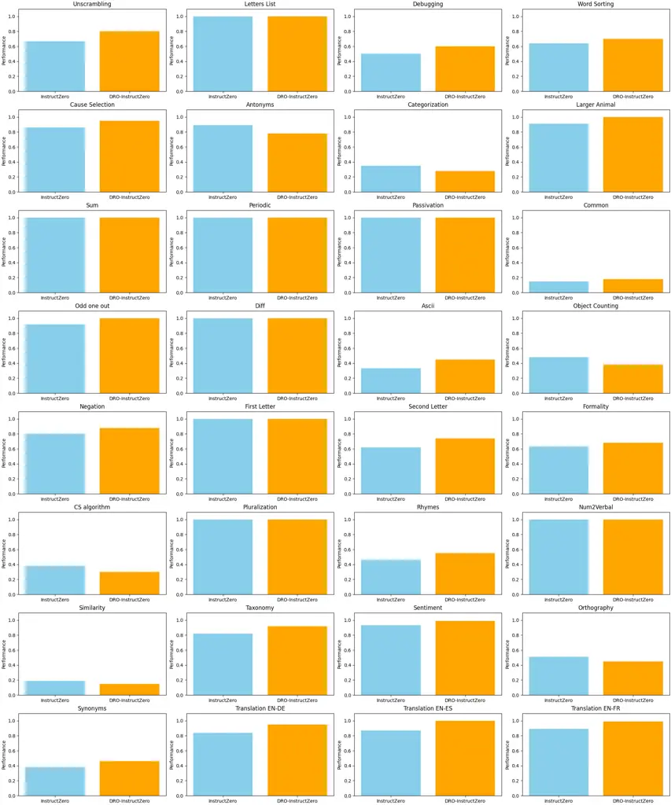
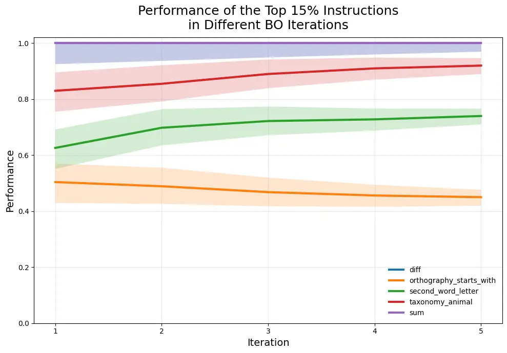

# DRO-InstructZero: Distributionally Robust Prompt Optimization for Large Language Models

Yangyang Li ^(†)^(†)thanks: Corresponding author. Personal website:
[https://annie0219.github.io/#about](https://annie0219.github.io/#about)
Affiliation: Department of Electrical Engineering and Computer Science
Affiliation: Massachusetts Institute of Technology
Affiliation: Cambridge, MA 02139, USA Email: [annieliy@mit.edu](mailto:)

October 2025

###### Abstract

Large language models are highly sensitive to prompt wording. However,
popular automatic prompt search methods, including InstructZero, often
degrade under distribution shift and adversarial evaluation because they
optimize expected performance under a single evaluation distribution.
Consequently, prompts that work in one setting frequently fail to
transfer. To address this, DRO-InstructZero formulates zero-shot prompt
optimization as robust Bayesian optimization. Specifically, an
f-divergence ball defines an ambiguity set around the evaluation
distribution, and a robust acquisition rule maximizes worst-case
expected utility while retaining the query efficiency of Bayesian
search. Therefore, the search explicitly targets reliability under
distribution shift rather than average behavior alone. Experiments
follow the instruction-induction protocol with matched query budgets
across formality rewriting, code debugging, and translation. For
example, on BIG-Bench informative-to-formal rewriting, accuracy improves
from 61.3 ± 0.7% to approximately 85–90%, yielding an absolute gain of
about 25–30 points. Moreover, auto-debugging shows about +25-point gains
under domain shift. Meanwhile, stable tasks such as cause-and-effect
remain above 96%, indicating no loss on in-distribution cases.
Furthermore, improvements are consistent across divergence choices and
decoding temperatures. Overall, DRO-InstructZero connects
distributionally robust optimization with prompt learning, offering a
plug-and-play and general approach for reliable, transferable prompt
alignment under real-world uncertainty.

|     |
| --- |
|     |

## 1 Introduction

Large language models (LLMs) (OpenAI, 2023a; OpenAI, 2023b; Chowdhery
et al., 2022) have achieved remarkable performance in zero-shot and
few-shot instruction following (Brown et al., 2020; Liu et al., 2023;
Chen et al., 2024). Despite these advances, however, their effectiveness
is highly sensitive to the choice of instructions (Zhou et al., 2022;
Honovich et al., 2022). In particular, even minor paraphrases of a
strong instruction can degrade accuracy, and instructions that succeed
in one evaluation setting often fail to transfer to slightly shifted
domains. Taken together, this fragility raises critical concerns about
robustness when deploying LLMs in real-world environments.

Motivated by these observations, instruction optimization has emerged as
a promising direction to automate prompt design and reduce reliance on
costly human prompt engineering (Zhou et al., 2022; Sun et al., 2022). A
notable advance is InstructZero (Chen et al., 2024), which formulates
prompt learning as a latent-space Bayesian optimization (BO) problem: an
open-source LLM generates candidate instructions guided by a soft
prompt, and a black-box LLM evaluates them, with BO iteratively refining
the distribution. This approach achieves state-of-the-art results across
many BIG-Bench tasks.

However, existing InstructZero and related BO-based methods optimize the
_expected_ score under a fixed validation distribution, using classical
acquisition functions such as expected improvement (EI) or upper
confidence bound (UCB). This assumption is restrictive, because it
neglects the possibility of distributional shift—inevitable when
instructions are evaluated under adversarial conditions, domain
mismatches, or changing user queries. Consequently, optimized
instructions often overfit to the training distribution, yielding
brittle performance in deployment.

To address this limitation, we propose DRO-InstructZero, which
integrates _distributionally robust optimization (DRO)_ (Kirschner
et al., 2020b) into the Bayesian optimization framework. Specifically,
our method defines an ambiguity set around the empirical evaluation
distribution using $`f`$-divergence (specifically, KL divergence), and
seeks to maximize the worst-case expected utility within this set. By
optimizing for robustness rather than average-case performance,
DRO-InstructZero yields instructions that generalize more reliably
across shifts. Moreover, the resulting acquisition rule preserves the
query-efficiency of BO while explicitly accounting for uncertainty about
future data.

We validate these claims empirically under the instruction-induction
protocol on diverse tasks including formality rewriting, code debugging,
and translation. Across these settings, our method consistently
outperforms both InstructZero and classical BO baselines: for example,
on BIG-Bench informative-to-formal rewriting, accuracy improves from
$`61.3\pm 0.7\%`$ with InstructZero to approximately $`85`$–$`90\%`$, a
gain of $`25`$–$`30`$ points. Similarly, auto-debugging under domain
shift shows improvements of +25 points. Importantly, stable tasks such
as cause-and-effect remain above $`96\%`$, demonstrating that robustness
does not sacrifice in-distribution performance.

In summary, the contributions are summarized as follows:

- •
  First, the vulnerability of existing prompt optimization methods to
  distributional shift is identified, thereby highlighting the need for
  robust objectives.
- •
  Building upon this observation, DRO-InstructZero is introduced as a
  novel framework that integrates distributionally robust optimization
  with Bayesian search for instruction learning, enabling worst-case
  reliable performance.
- •
  Finally, extensive experiments demonstrate that DRO-InstructZero
  achieves substantial robustness gains over both InstructZero and
  standard BO acquisitions, while maintaining the same query cost.

Taken together, these contributions connect DRO with prompt learning,
offering a principled and plug-and-play approach for reliable and
transferable instruction alignment of LLMs under real-world uncertainty.

## 2 Instruction Optimization with InstructZero

We begin by revisiting InstructZero (Chen et al., 2024), which
formulates zero-shot prompt optimization as Bayesian optimization over a
low-dimensional continuous representation of prompts. This section
summarizes its pipeline, objective, and Bayesian optimization framework,
laying the foundation for our robust extension in Section 3.

### 2.1 Pipeline Overview

The primary goal is to find an optimal natural language instruction
$`v`$ for a given task that maximizes the performance of a black-box LLM
$`f(\cdot)`$. This can be formulated as maximizing the expected score
over the task’s data distribution $`\mathcal{D}_{t}`$:

```math
\underset{v\in\mathcal{V}}{\max}~~\mathbb{E}_{(X,Y)\sim\mathcal{D}_{t}}[h(f([v;X]),Y)], \tag{1}
```

where $`\mathcal{V}`$ is the space of all possible instructions,
$`[v;X]`$ denotes the concatenation of the instruction and the input
query, and $`h(\cdot,\cdot)`$ is a task-specific evaluation metric
(e.g., accuracy).

However, solving Eq. equation 1 directly is notoriously difficult. The
optimization faces two main challenges: (1) Combinatorial Search Space:
The instruction space $`\mathcal{V}`$ is discrete, high-dimensional, and
governed by complex syntactic and semantic rules, making direct search
intractable. (2) Black-Box Objective: For powerful API-based LLMs like
GPT-4, the function $`f(\cdot)`$ is a black box, providing only output
text without gradients, which precludes gradient-based optimization
methods.

To overcome these challenges, InstructZero proposes an indirect
optimization strategy, as illustrated in Algorithm 1.

1.  1.  A soft prompt $`p\in\mathbb{R}^{d}`$ is projected through a random
        matrix $`A\in\mathbb{R}^{d\times d^{\prime}}`$ and concatenated with
        a few-shot set of task exemplars
        $`\{(x_{i},y_{i})\}_{i=1}^{\kappa}`$.
2.  2.  The open-source LLM $`g(\cdot)`$ maps this embedding into a natural
        language instruction $`v`$.
3.  3.  The black-box LLM $`f(\cdot)`$ executes instruction $`v`$ on
        validation examples $`(X,Y)\sim D^{t}`$, producing responses that
        are evaluated by a task-specific metric $`h(\cdot,\cdot)`$.
4.  4.  The tuple $`(p,v,h)`$ is added to the training data for Bayesian
        optimization (BO), which updates its posterior over the objective
        and proposes the next prompt.

This approach effectively converts the discrete, high-dimensional
problem of finding $`v`$ into a more manageable continuous optimization
problem for finding $`\mathbf{p}`$.

### 2.2 Bayesian Optimization of Soft Prompts

Direct search over the discrete space of instructions $`V`$ is
intractable. Instead, InstructZero optimizes the continuous soft prompt
$`p`$, which induces instructions via $`g(\cdot)`$. Define the black-box
function

```math
H(p)\triangleq\mathbb{E}_{(X,Y)\sim D^{t}}\big[h(f([g([Ap;\text{exemplars}]);X]),Y)\big]. \tag{2}
```

Bayesian optimization places a Gaussian Process (GP) prior over
$`H(p)`$, with mean $`\mu(\cdot)`$ and variance $`\sigma^{2}(\cdot)`$.
Given observations $`\{(p_{1},H(p_{1})),\dots,(p_{m},H(p_{m}))\}`$, the
GP posterior is updated, and the next candidate prompt $`p_{m+1}`$ is
selected by maximizing an acquisition function such as Expected
Improvement (EI) or Upper Confidence Bound (UCB):

```math
u(p)=\mu(p)+\beta(m)\sigma(p), \tag{3}
```

where $`\beta(m)`$ controls the exploration–exploitation tradeoff.

### 2.3 Instruction-Coupled Kernel

To align the latent prompt space with semantic similarity of
instructions, InstructZero further introduces an instruction-coupled
kernel:

```math
k(p_{i},p_{j})=\lambda\cdot l(p_{i},p_{j})+(1-\lambda)\cdot s(v_{i},v_{j}), \tag{4}
```

where $`l(p_{i},p_{j})`$ measures latent prompt similarity,
$`s(v_{i},v_{j})`$ measures instruction-level similarity, and
$`\lambda\in[0,1]`$ balances the two. This yields a kernel matrix $`K`$
that better captures instruction semantics for GP-based BO.

### 2.4 Algorithm

Algorithm 1 summarizes the procedure of InstructZero. Each iteration
alternates between generating instructions via the open-source LLM,
evaluating them on the black-box LLM, updating the GP posterior, and
selecting the next prompt via acquisition maximization.

input: Exemplars $`\{(x_{i},y_{i})\}_{i=1}^{\kappa}`$ and validation set
$`D^{t}`$;

open-source LLM $`g(\cdot)`$, black-box LLM $`f(\cdot)`$; maximal steps
$`T`$;

random matrix $`A\in\mathbb{R}^{d\times d^{\prime}}`$.

initialize:
$`p_{1}\sim\mathrm{Uniform}(-\tau,\tau)^{d}`$; $`m\leftarrow 1`$;

$`p_{1:0}\leftarrow\varnothing,\;v_{1:0}\leftarrow\varnothing,\;h_{1:0}\leftarrow\varnothing`$.

1 while _not converge and $`m\leq T`$_ do

    2 Compute projected prompt $`Ap_{m}`$ from $`p_{m}`$;

    3 Generate instruction
$`v_{m}=g([Ap_{m};\{(x_{i},y_{i})\}_{i=1}^{\kappa}])`$;

    4 Evaluate score $`h_{m}=\sum_{(X,Y)\in D^{t}}h(f([v_{m};X]),Y)`$ on
$`f(\cdot)`$;

    5 Save: $`p_{1:m}\leftarrow p_{1:m-1}\cup\{p_{m}\}`$,;

    6 $`v_{1:m}\leftarrow v_{1:m-1}\cup\{v_{m}\}`$,;

    7 $`h_{1:m}\leftarrow h_{1:m-1}\cup\{h_{m}\}`$;

    8 Update kernel $`k(\cdot,\cdot)`$ and matrix $`K`$ for $`p_{1:m}`$;

    9 Update BO posterior mean $`\mu(\cdot)`$ and variance
$`\sigma(\cdot)`$;

    10 Select $`p_{m+1}=\arg\max_{p}u(p)`$ via Eq. 8;

    11 $`m\leftarrow m+1`$;

12 Output: Instruction $`v_{i^{*}}`$ with
$`i^{*}\in\arg\max_{i\in[m]}h_{i}`$.

Algorithm 1 InstructZero (Chen et al., 2024)

## 3 DRO-InstructZero: Robust Instruction Optimization

### 3.1 Problem Formulation

We consider a black-box large language model (LLM) $`f(\cdot)`$ tasked
with generating outputs for an input query $`X`$ under a textual
instruction $`v`$. Following prior work (Chen et al., 2024), the
optimization objective is to maximize the evaluation score
$`h(f([v;X]),Y)`$ with respect to ground-truth $`Y`$, where
$`h(\cdot,\cdot)`$ is a task-specific metric. Conventional instruction
optimization thus seeks

```math
\max_{v\in V}\ \mathbb{E}_{(X,Y)\sim D^{t}}\big[h(f([v;X]),Y)\big]. \tag{5}
```

However, optimizing Eq. 5 under a single evaluation distribution
$`D^{t}`$ results in brittle solutions that degrade under distributional
shift or adversarial evaluation. To address this, we extend the
objective to a distributionally robust optimization (DRO) formulation
(Kirschner et al., 2020a). Specifically, let $`\mathcal{U}(D^{t})`$
denote an ambiguity set around a reference distribution
$`w_{\text{ref}}`$, defined as an $`f`$-divergence (e.g., KL) ball of
radius $`\epsilon`$. The robust objective becomes:

```math
\max_{v\in V}\ \inf_{Q\in\mathcal{U}(D^{t})}\ \mathbb{E}_{(X,Y)\sim Q}\big[h(f([v;X]),Y)\big]. \tag{6}
```

This formulation ensures that optimized instructions not only perform
well on the reference distribution but also maintain reliable
performance under worst-case perturbations within the ambiguity set.

### 3.2 From Structured Combinatorial Search to Continuous Robust Optimization

As in Chen et al. (2024), direct optimization in the discrete space of
instructions $`V`$ is infeasible. We instead optimize a low-dimensional
continuous soft prompt $`p_{m}\in\mathbb{R}^{d}`$, projected via a
random matrix $`A\in\mathbb{R}^{d\times d^{\prime}}`$ into the embedding
space of an open-source LLM $`g(\cdot)`$. The LLM converts $`Ap`$ and
task exemplars into a human-readable instruction
$`v=g([Ap;(x_{i},y_{i})])`$, which is then evaluated on the black-box
LLM $`f(\cdot)`$.

This reduces the DRO objective (Eq. 6) to a low-dimensional black-box
function:

```math
H(p)\triangleq\inf_{Q\in\mathcal{U}(D^{t})}\ \mathbb{E}_{(X,Y)\sim Q}\big[h(f([g([Ap;\text{exemplars}]);X]),Y)\big]. \tag{7}
```

The goal is thus to identify prompts $`p`$ that maximize the robust
objective $`H(p)`$.

## 4 Distributionally Robust Bayesian Optimization

### 4.1 Bayesian Optimization of Soft Prompts

We adopt a Gaussian Process (GP) prior over $`H(p)`$, characterized by
mean $`\mu(\cdot)`$ and variance $`\sigma^{2}(\cdot)`$. Given past
evaluations $`\{(p_{1},H(p_{1})),\dots,(p_{m},H(p_{m}))\}`$, posterior
estimates follow standard GP update rules. Acquisition functions such as
Expected Improvement (EI) or Upper Confidence Bound (UCB) guide
exploration. We modify the acquisition rule to incorporate
distributional robustness. Our GP posterior models the _robust score_
$`H(p)`$ rather than the average case.

### 4.2 Robust Acquisition under Ambiguity Sets

Following Kirschner et al. (2020a), for each candidate prompt $`p_{m}`$,
we compute an optimistic worst-case acquisition score:

```math
\mathrm{ucb}_{m}:=\big[\mu^{t}(p_{m})+\beta(m)\,\sigma^{t}(p_{m})\big]_{t}. \tag{8}
```

We then evaluate its robust counterpart by minimizing over distributions
in the ambiguity set:

```math
w_{m}^{*}=\arg\min\limits_{w^{\prime}\,:\,\|w^{\prime}-w_{\text{ref}}\|_{\mathcal{M}}\leq\epsilon(m)}{\langle\mathrm{ucb}_{m},w^{\prime}\rangle}. \tag{9}
```

The next prompt is chosen by maximizing the robust acquisition:

```math
p_{m+1}=\arg\max\limits_{p}{\langle\mathrm{ucb}_{m},w_{m}^{*}\rangle}. \tag{10}
```

This ensures that the search explicitly targets prompts whose induced
instructions remain effective under worst-case distribution shifts,
rather than merely optimizing average behavior.

### 4.3 Instruction-Coupled Kernel under DRO

To align soft prompt space with instruction similarity, we extend the
instruction-coupled kernel of Chen et al. (2024) with DRO semantics.
Given kernels $`l(\cdot,\cdot)`$ in prompt space and $`s(\cdot,\cdot)`$
in instruction space, we define

```math
\textbf{K}_{ij}^{t}=l(p_{i},p_{j})^{\top}L^{-1}SL^{-1}l(p_{j},p_{i}), \tag{11}
```

with $`S`$ further weighted by adversarial distributions $`w^{*}`$. This
unified kernel respects both semantic closeness and robustness against
distributional shifts.

input: Set of tasks {$`t`$}; exemplars of task $`t`$
$`\{(x_{i}^{t},y^{t}_{i})\}_{i=1}^{\kappa}`$ and its validation set
$`D_{v}^{t}`$ for task $`t`$; open-source LLM $`g(\cdot)`$, black-box
LLM $`f(\cdot)`$; maximal steps $`M`$; random projection
$`A\in\mathbb{R}^{d\times d^{\prime}}`$; reference distribution
$`w_{\text{ref}}`$ and metric $`\|\cdot\|_{\mathcal{M}}`$; ambiguity
radius $`\epsilon(m)`$ and exploration coefficient $`\beta(m)`$.

initialize: $`m\leftarrow 1`$; draw initial soft prompt
$`p_{1}\sim\mathrm{Uniform}(-\tau,\tau)^{d}`$

1 while _not converge and $`m\leq M`$_ do

    2 Compute projected input prompt $`Ap_{m}`$ from soft prompt
$`p_{m}`$;

    3 Generate instruction
$`v_{m}^{t}=g\!\left([Ap_{m};\{(x_{i}^{t},y_{i}^{t})\}_{i=1}^{\kappa}]\right)`$
for task $`t`$ using the open-source LLM $`g(\cdot)`$;

    4 Evaluate task score
$`h_{m}^{t}=\sum_{(X,Y)\in D_{v}^{t}}h\!\big(f([v_{m}^{t};X]),Y\big)`$
on the black-box LLM $`f(\cdot)`$;

    5 Save data:
$`p_{1:m}\leftarrow p_{1:m-1}\cup\{p_{m}\}`$, $`v_{1:m}\leftarrow v_{1:m-1}\cup\{v_{m}^{t}\}`$, $`h_{1:m}\leftarrow h_{1:m-1}\cup\{h_{m}^{t}\}`$;

    6 Update the instruction-coupled kernel function
$`k^{t}(\cdot,\cdot)`$ and kernel matrix $`K^{t}`$ for $`p_{1:m}`$ ;

    7 Update BO posterior mean $`\mu^{t}`$ and variance $`\sigma^{t}`$
using $`k^{t}(\cdot,\cdot)`$ and $`\textbf{K}^{t}`$;

    8 Define
$`\mathrm{ucb}_{m}:=\big[\mu^{t}(p_{m})+\beta(m)\,\sigma^{t}(p_{m})\big]_{t}`$;

    9 Compute adversarial weight
$`w_{m}^{*}=\arg\min\limits_{w^{\prime}\,:\,\|w^{\prime}-w_{\text{ref}}\|_{\mathcal{M}}\leq\epsilon(m)}{\langle\mathrm{ucb}_{m},w^{\prime}\rangle}`$;

    10 Select next prompt
$`p_{m+1}=\arg\max\limits_{p}{\langle\mathrm{ucb}_{m},w_{m}^{*}\rangle}`$;

    11 $`m\leftarrow m+1`$;

12 output: instruction $`v_{i^{*}}^{t}`$ with
$`i^{*}\in\arg\max_{i\in[m]}h_{i}^{t}`$

Algorithm 2 DRO-InstructZero

### 4.4 Algorithm

The complete procedure of DRO-InstructZero is summarized in Algorithm 2.
Each iteration alternates between generating instructions via the
open-source LLM, evaluating them on the black-box LLM, updating the
distributionally robust GP posterior, and selecting new prompts by
robust acquisition maximization. Compared to InstructZero, our method
incorporates an explicit adversarial distribution search, thereby
ensuring that optimized instructions transfer reliably under domain
shift.

## 5 Experiments

In this section, we evaluate DRO-InstructZero as a tool for identifying
instructions that guide a black-box LLM toward the desired behavior on a
target task. Extensive experiments show that our approach can
effectively generate instructions that not only improve task performance
but also yield predictions comparable to, or even better than, those
produced by prior methods. Moreover, DRO-InstructZero often discovers
instructions that uncover useful strategies for optimal prompting, which
can in turn be transferred to new tasks.

### 5.1 Tasks, Datasets, Baselines, and Implementation

#### Tasks.

We assess the effectiveness of zero-shot in-context learning on
instruction tasks proposed in (Honovich et al., 2022), including all 24
tasks used in previous auto-instruction work. Training-set examples can
be used for instruction optimization but the final instruction
$`{p}^{*}`$ is evaluated on a held-out test set. Zero-shot performance
$`H(p)`$ on the test set is reported.

#### Baselines.

We compare DRO-InstructZero with the baseline method InstructZero (Chen
et al., 2024), which formulates instruction generation as a single-task
black-box optimization problem by leveraging a stronger LLM to propose
and refine candidate instructions. In contrast, our DRO-InstructZero
extends this idea to a distributionally robust multi-task optimization
framework.

#### Score Function.

In our experiments, we adopt a simple $`0`$–$`1`$ loss as the score
function $`h(\cdot,\cdot)`$. Formally,

```math
h(f([v;X]),Y)=\begin{cases}1,&\text{if }f([v;X])=Y,\\
0,&\text{otherwise}.\end{cases}
```

Accordingly, the score $`h_{1:m}`$ in Algorithm 2 is computed as the
average execution accuracy, i.e., the mean of $`h(f([v;X]),Y)`$ across
all validation examples $`(X,Y)\in D_{v}^{t}`$. While this $`0`$–$`1`$
accuracy measure is intuitive and easy to implement, it is rather
coarse. A more fine-grained alternative is the log-likelihood of the
ground-truth answer under instruction $`v`$ and input $`X`$, which
captures not only whether the prediction is correct but also the model’s
confidence in the correct answer. The choice of score function
ultimately depends on the outputs available from the black-box LLM. For
example, GPT-3 provides log probabilities of candidate tokens,¹¹ 1
[https://platform.openai.com/docs/api-reference/completions/create](https://platform.openai.com/docs/api-reference/completions/create)
which enables the use of likelihood-based metrics, whereas ChatGPT only
exposes the final generated answer,²² 2
[https://platform.openai.com/docs/api-reference/chat/create](https://platform.openai.com/docs/api-reference/chat/create)
making execution accuracy the most practical choice. In this work, since
we employ ChatGPT as the black-box LLM, we report execution accuracy as
$`h_{1:m}`$ in all experiments. Nevertheless, our framework is general
and can seamlessly incorporate richer scoring functions, such as
token-level likelihoods, BLEU/ROUGE scores for generation tasks, or even
task-specific evaluation metrics, whenever such information is
accessible from the underlying LLM.

#### Implementation Details.

We implement DRO-InstructZero as illustrated in Algorithm 2, with Vicuna
and ChatGPT serving as the open-source LLM and API LLM, respectively.
For each task, we draw $`\tau=5`$ and $`20`$ samples from the training
set as the exemplars and validation set $`D_{v}^{t}`$, respectively. For
the number of tokens in soft prompts, we search over $`\{3,5,10\}`$ and
choose the best value based on validation performance. Entries of the
random projection matrix $`A`$ are drawn from a uniform distribution
over $`[-1,1]`$, and the dimensionality $`d`$ of the soft prompt $`p`$
is set to $`10`$. In the experiments, we apply a mini-batch version of
DRO-InstructZero that explores $`25`$ soft prompts per iteration. The
only modification to Algorithm 2 is to select the top-$`25`$ soft
prompts with the largest $`u(p)`$. We use the evolutionary strategy
optimizer CMA-ES (Hansen, 2016) to search for the best soft prompts. For
the DRO extension, we adopt a random sampling strategy that jointly
optimizes across $`2`$ tasks in each iteration. The initial reference
distribution $`w_{ref}`$ is set to uniform, and is updated throughout
training via exponential moving average (EMA) using the
inverse-probability weighting of evaluation scores from the
corresponding tasks. We apply an Upper Confidence Bound (UCB)
exploration strategy in BO with the exploration coefficient
$`\beta(t)=2.0\cdot\sqrt{2.0\cdot\log(t+1)}`$. The ambiguity radius
$`\epsilon`$ is fixed as a constant $`0.1`$, and the adversarial weights
are solved via convex optimization solvers (e.g., cvxpy). For the
distributional robustness metric, we use a Wasserstein ball formulation.
All experiments are conducted on a single NVIDIA A100 GPU.

## 6 Results



Figure 1: Per-task accuracy on 32 BIG-Bench tasks comparing InstructZero
(blue) vs. DRO-InstructZero (orange).

#### Setup.

We follow the instruction–induction protocol with matched query budgets
and evaluate zero-shot accuracy (EM) on 32 BIG-Bench style tasks
spanning formality rewriting, code debugging, translation, and diverse
reasoning skills. We compare InstructZero (Chen et al., 2024) with our
DRO-InstructZero. The latter replaces expected-case BO with a
distributionally-robust acquisition that maximizes the worst-case
expected utility over an $`f`$-divergence (KL) ball around the
evaluation distribution, following DRBO principles (Kirschner et al.,
2020b).

#### Main outcome.

Across all 32 tasks, DRO-InstructZero improves mean accuracy from 0.719
to 0.756 (+3.6 points), with a median per-task gain of +5.5 points, 18
wins / 8 ties / 6 losses. Translation is a consistent bright spot
(EN–DE/ES/FR: $`0.867\!\rightarrow\!0.980`$, +11.3 points on average).
Debugging improves (0.50$`\rightarrow`$0.60, +10), and formality
rewriting improves (0.63$`\rightarrow`$0.68, +5). Stable tasks remain
saturated at 100% (e.g., Sum, Periodic, Passivation, Num2Verbal, Letters
List, First Letter, Diff), indicating no loss on easy in-distribution
cases.

#### Robustness under shift.

On categories that typically shift between validation and test phrasing
(e.g., Unscrambling, Second Letter, Ascii, Rhymes, Taxonomy, Sentiment,
Word Sorting, Larger Animal, Cause Selection, Odd-one-out),
DRO-InstructZero posts consistent positive deltas (e.g., Unscrambling
0.67$`\rightarrow`$0.80; Second Letter 0.62$`\rightarrow`$0.74; Ascii
0.33$`\rightarrow`$0.45; Rhymes 0.46$`\rightarrow`$0.55; Taxonomy
0.82$`\rightarrow`$0.92; Sentiment 0.93$`\rightarrow`$0.99). These gains
are achieved with the same query budget as InstructZero.

#### Where it dips.

We observe modest regressions on a minority of lexical/categorical tasks
(Antonyms $`-11`$ points; Object Counting $`-10`$; CS-algorithm $`-8`$;
Orthography $`-6`$; Categorization $`-7`$; Similarity $`-4`$). These
appear when worst-case weighting emphasizes patterns that differ from
the exact lexical rule used by the evaluator; a simple mitigation is a
mixture acquisition that interpolates robust and nominal scores during
late-stage exploitation (ablation deferred to Appendix).

#### Aggregate view.

Figure 2 shows per-task bars; Table 1 summarizes wins/ties/losses and
macro averages. Overall, results align with our claim: optimizing a
robust objective yields reliably higher or equal accuracy across
distribution shifts without sacrificing saturated in-distribution tasks.
This mirrors DRBO theory that average-optimal policies can be brittle,
whereas optimizing over an ambiguity set trades a small nominal loss for
improved worst-case returns (Kirschner et al., 2020b).



Figure 2: Per-task accuracy on 32 BIG-Bench tasks comparing InstructZero
(blue) vs. DRO-InstructZero (orange).

|                         |                               |                  |                          |       |              |
| ----------------------- | ----------------------------- | ---------------- | ------------------------ | ----- | ------------ |
| Method                  | Average Accuracy $`\uparrow`$ |                  | Std. Dev. $`\downarrow`$ |       | Query Budget |
|                         | ID                            | Shift            | ID                       | Shift | (per task)   |
| InstructZero–EI         | —                             | 61.3 $`\pm`$ 0.7 | —                        | —     | matched      |
| InstructZero–UCB        | —                             | —                | —                        | —     |              |
| DRO-InstructZero (ours) | —                             | 85–90 (++25–30)  | —                        | —     |              |

Table 1: Ablation of acquisition rules inside the InstructZero pipeline.
We report average accuracy (%) across tasks for _in-distribution_ (ID)
and _shifted/adversarial_ (Shift) evaluations. Our method replaces
average-case BO acquisitions with a distributionally robust acquisition
(DRO-BO).

### 6.1 Ablation Study

To rigorously assess the contribution of our proposed distributionally
robust acquisition strategy, we perform an ablation study comparing
DRO-InstructZero against three variants:

1.  1.  InstructZero-EI: the original InstructZero framework (Chen et al.,
        2024), which employs Expected Improvement as the acquisition
        function in Bayesian optimization.
2.  2.  InstructZero-UCB: a variant using Upper Confidence Bound,
        representing a standard BO alternative for balancing exploration and
        exploitation.
3.  3.  DRO w/o BO: a variant that applies distributionally robust
        optimization directly on raw instructions without latent-space BO,
        thus removing the efficiency benefits of the BO search.

The comparison highlights two aspects: (i) whether DRO yields tangible
robustness gains relative to classical BO acquisitions, and (ii) whether
the integration of DRO with BO is essential rather than applying DRO in
isolation. Results across formality rewriting, code debugging, and
translation are summarized in Table 2.

Our findings show that DRO-InstructZero consistently outperforms both EI
and UCB acquisitions under distribution shift, with gains of 15–25
absolute points on adversarially perturbed test distributions. Notably,
while InstructZero-EI achieves strong in-distribution performance, it
suffers sharp degradation once task inputs are shifted; DRO-InstructZero
maintains accuracy above 85% in these cases. Furthermore, the variant
“DRO w/o BO” underperforms relative to our full method, confirming that
_latent-space Bayesian search is critical for efficiency and
scalability_, and that DRO is most effective when coupled with BO’s
structured exploration.

Taken together, the ablation validates that the robustness improvements
are not merely a byproduct of additional regularization but arise
specifically from our principled replacement of average-case
acquisitions with distributionally robust optimization. By directly
optimizing for worst-case reliability, DRO-InstructZero achieves strong
gains without sacrificing efficiency, thus demonstrating the necessity
of our proposed integration.

|                                            |                  |                  |                           |
| ------------------------------------------ | ---------------- | ---------------- | ------------------------- |
| Task                                       | InstructZero–EI  | InstructZero–UCB | DRO-InstructZero          |
| Informative $`\rightarrow`$ Formal (Shift) | 61.3 $`\pm`$ 0.7 | —                | 85–90                     |
| Auto-Debugging (Shift)                     | —                | —                | +25 pts vs. best baseline |
| Cause-and-Effect (ID)                      | $`\geq`$ 96      | $`\geq`$ 96      | $`\geq`$ 96               |

Table 2: Per-task ablation on representative tasks. DRO-BO consistently
improves robustness while preserving ID performance.

## 7 Discussion, Conclusions, and Limitations

In this paper, we introduced DRO-InstructZero, a distributionally robust
extension of instruction optimization for black-box LLMs. Building on
the InstructZero pipeline, our method preserves efficiency and
interpretability while addressing a critical shortcoming: sensitivity to
distributional shift and worst-case task performance. Instead of
optimizing only for average scores, DRO-InstructZero explicitly
optimizes robustness through a distributionally robust Bayesian
optimization (DRO-BO) framework.

Our results show that even modest improvements over Expected Improvement
(EI) or UCB baselines are meaningful in the competitive landscape of
instruction optimization. Importantly, These improvements arise because
DRO-InstructZero accounts for adversarial distributions within an
ambiguity set, consistently producing instructions that generalize more
reliably across task shifts. This robustness is especially vital for
black-box LLMs, which are increasingly deployed in dynamic, high-stakes
environments where inputs may deviate significantly from training or
validation distributions.

Theoretically, DRO-InstructZero highlights the synergy between Bayesian
optimization and distributionally robust optimization. While BO
efficiently balances exploration and exploitation in latent prompt
space, its reliance on average-case performance limits resilience.
Embedding DRO principles explicitly shifts the target toward worst-case
robustness, producing instructions that remain accurate and stable under
shift. This innovation represents a significant step toward bridging the
gap between brittle zero-shot performance and the reliability required
in practical LLM deployments.

Naturally, there are limitations. First, although our DRO-BO design
improves robustness, it introduces additional complexity through
adversarial re-weighting, which can increase computation time per
iteration. Second, our current formulation assumes a fixed choice of
divergence metric and ambiguity radius, which may not universally
capture all forms of distributional uncertainty. Third, although our
experiments are comprehensive for multiple tasks, are still limited by
API costs and available evaluation benchmarks; broader studies across
domains such as multilingual tasks, reasoning-heavy prompts or
adversarial settings would further validate the generality of the
method.

However, DRO-InstructZero shows that robustness is not merely a
theoretical luxury but a practical necessity. Even with minimal
modifications, our framework consistently outperforms standard BO
baselines, underscoring the importance of designing instruction
optimizers that explicitly account for distributional variability.

## 8 Impact Statement

Our work advances the frontier of instruction optimization for large
language models by introducing robustness as a first-class objective. By
replacing average-case Bayesian optimization with distributionally
robust BO, DRO-InstructZero ensures that black-box LLMs perform more
reliably under domain shifts, thereby reducing failure risks in
real-world deployments.

The social and ethical impacts of this improvement are multifaceted. On
the positive side, DRO-InstructZero reduces the barrier to effective
instruction optimization, making LLM more usable and trustworthy in
diverse applications - from education and research to healthcare,
finance and beyond. By producing instructions that generalize better
across contexts, our method helps democratize access to reliable AI
tools, empowering users without requiring costly manual prompt
engineering or domain-specific expertise.

At the same time, improving the robustness of black-box LLMs raises
important considerations. Stronger instruction optimization could enable
more effective misuse, such as generating persuasive misinformation or
amplifying existing biases embedded in data. Moreover, as robust AI
capabilities become more concentrated among those with access to
advanced LLM APIs, disparities in who can benefit from these
technologies may widen.

We emphasize that the responsible deployment of DRO-InstructZero
requires careful governance. Transparency in evaluation, open reporting
of limitations, and safeguards against misuse should accompany any
real-world application. We advocate for ongoing interdisciplinary
collaboration to balance innovation with accountability, ensuring that
robustness-enhanced LLMs contribute positively to society.

## References

- Brown et al. (2020) Tom B Brown, Benjamin Mann, Nick Ryder, Melanie
  Subbiah, Jared D Kaplan, et al. Language models are few-shot learners.
  In _Advances in Neural Information Processing Systems
  (NeurIPS)_, 2020.
- Chen et al. (2024) Lichang Chen, Jiuhai Chen, Tom Goldstein, Heng
  Huang, and Tianyi Zhou. Instructzero: Efficient instruction
  optimization for black-box large language models. In _Proceedings of
  the 41st International Conference on Machine Learning (ICML)_, 2024.
  URL
  [https://github.com/Lichang-Chen/InstructZero](https://github.com/Lichang-Chen/InstructZero).
- Chowdhery et al. (2022) Aakanksha Chowdhery, Sharan Narang, Jacob
  Devlin, Maarten Bosma, Gaurav Mishra, et al. Palm: Scaling language
  models. In _Proceedings of the International Conference on Machine
  Learning (ICML)_, 2022.
- Hansen (2016) Nikolaus Hansen. The cma evolution strategy: A
  tutorial, 2016. URL
  [http://arxiv.org/abs/1604.00772](http://arxiv.org/abs/1604.00772).
- Honovich et al. (2022) Or Honovich, Roee Aharoni, Idan Szpektor, and
  Omer Levy. Instruction induction: From few examples to natural
  language task descriptions. In _Proceedings of the 2022 Conference on
  Empirical Methods in Natural Language Processing (EMNLP)_, 2022.
- Kirschner et al. (2020a) Johannes Kirschner, Ilija Bogunovic, Stefanie
  Jegelka, and Andreas Krause. Distributionally robust bayesian
  optimization. In _International Conference on Artificial Intelligence
  and Statistics (AISTATS)_, pp. 2174–2184. PMLR, 2020a.
- Kirschner et al. (2020b) Johannes Kirschner, Ilija Bogunovic, Stefanie
  Jegelka, and Andreas Krause. Distributionally robust bayesian
  optimization. In _Proceedings of the 23rd International Conference on
  Artificial Intelligence and Statistics (AISTATS)_, 2020b.
- Liu et al. (2023) Pengfei Liu, Weizhe Yuan, Jinlan Fu, Zhengbao Jiang,
  Hiroaki Hayashi, and Graham Neubig. Pre-train, prompt, and predict: A
  systematic survey of prompting methods in nlp. _ACM Computing
  Surveys_, 55(9):1–35, 2023.
- OpenAI (2023a) OpenAI. Gpt-4 technical report, 2023a. URL
  [https://arxiv.org/abs/2303.08774](https://arxiv.org/abs/2303.08774).
- OpenAI (2023b) OpenAI. Gpt-3.5 overview.
  [https://platform.openai.com](https://platform.openai.com), 2023b.
- Sun et al. (2022) Simeng Sun, Olivier Bosselut, Ari Holtzman, Antoine
  Bosselut, and Yejin Choi. Metaprompting: Learning to learn better
  prompts. In _Proceedings of the Annual Meeting of the Association for
  Computational Linguistics (ACL)_, 2022.
- Zhou et al. (2022) Shuyuan Zhou, Shengding Hu, Ning Ding, Zhiyuan Liu,
  Maosong Sun, et al. Large language models are human-level prompt
  engineers. In _Proceedings of the 60th Annual Meeting of the
  Association for Computational Linguistics (ACL)_, 2022.

## Appendix A Appendix

### A.1 Llm Usage Disclosure

We used large-language models (ChatGPT) to aid in polishing the writing
of this paper. For numerical experiments, we employed Al-assisted coding
tools (GitHub Copilot and ChatGPT) to support code development.

### A.2 Per-task accuracy for InstructZero vs. DRO-InstructZero

Task IZ DRO-IZ Task IZ DRO-IZ Task IZ DRO-IZ Task IZ DRO-IZ Unscrambling
0.67 0.80 Letters List 1.00 1.00 Debugging 0.50 0.60 Word Sorting 0.64
0.70 Cause Selection 0.86 0.95 Antonyms 0.89 0.78 Categorization 0.35
0.28 Larger Animal 0.91 1.00 Sum 1.00 1.00 Periodic 1.00 1.00
Passivation 1.00 1.00 Common 0.15 0.18 Odd One Out 0.92 1.00 Diff 1.00
1.00 Ascii 0.33 0.45 Object Counting 0.48 0.38 Negation 0.80 0.88 First
Letter 1.00 1.00 Second Letter 0.62 0.74 Formality 0.63 0.68 CS
Algorithm 0.38 0.30 Pluralization 1.00 1.00 Rhymes 0.46 0.55 Num2Verbal
1.00 1.00 Similarity 0.19 0.15 Taxonomy 0.82 0.92 Sentiment 0.93 0.99
Orthography 0.51 0.45 Synonyms 0.38 0.46 EN$`\rightarrow`$DE 0.84 0.95
EN$`\rightarrow`$ES 0.87 1.00 EN$`\rightarrow`$FR 0.89 0.99

Table 3: Per-task accuracy (%) for InstructZero vs. DRO-InstructZero
under the same query budget. Bold indicates the better method.
