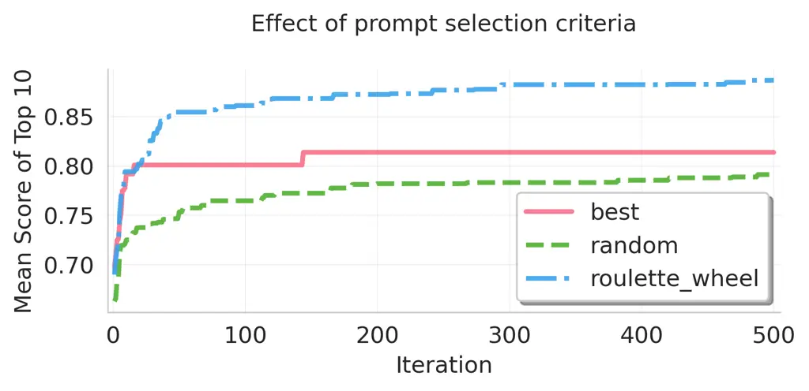
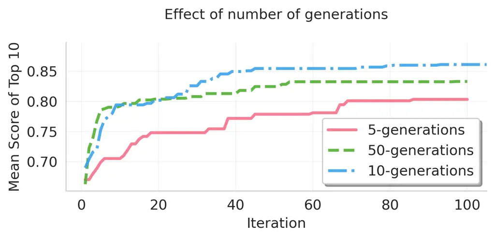
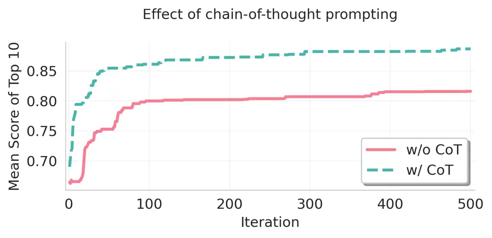
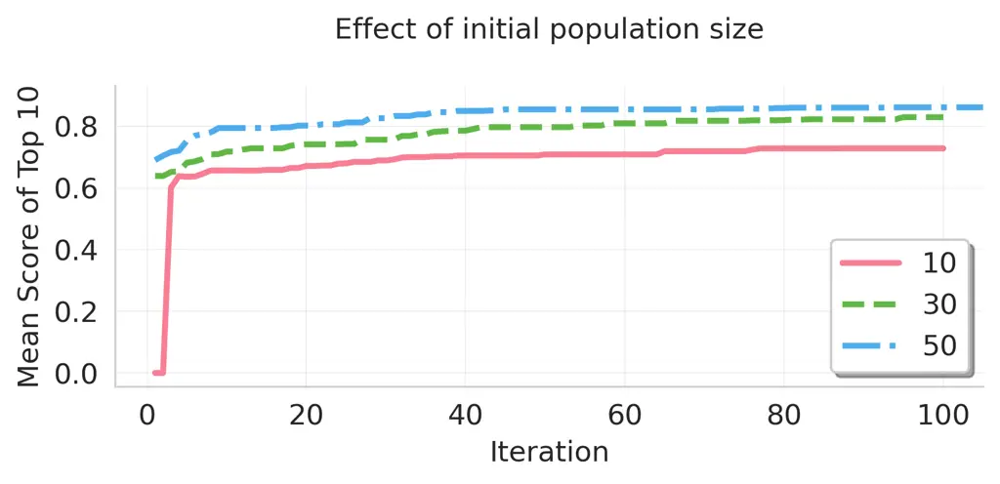

# BiomedXPro: Prompt Optimization for Explainable Diagnosis with Biomedical Vision Language Models

Kaushitha Silva Affiliation: Department of Computer Engineering,
University of Peradeniya, Peradeniya, Sri Lanka    Mansitha Eashwara
Affiliation: Department of Computer Engineering, University of
Peradeniya, Peradeniya, Sri Lanka    Sanduni Ubayasiri
Affiliation: Department of Computer Engineering, University of
Peradeniya, Peradeniya, Sri Lanka    Ruwan Tennakoon Affiliation: School
of Computing Technologies, RMIT University, Melbourne, Australia   
Damayanthi Herath Affiliation: Department of Computer Engineering,
University of Peradeniya, Peradeniya, Sri Lanka Correspondence to:
<damayanthiherath@eng.pdn.ac.lk>

###### Abstract

The clinical adoption of biomedical vision-language models is hindered
by prompt optimization techniques that produce either uninterpretable
latent vectors or single textual prompts. This lack of transparency and
failure to capture the multi-faceted nature of clinical diagnosis, which
relies on integrating diverse observations, limits their trustworthiness
in high-stakes settings. To address this, we introduce BiomedXPro
(Biomedical eXplainable Prompts), an evolutionary framework that
leverages a large language model as both a biomedical knowledge
extractor and an adaptive optimizer to automatically generate a diverse
ensemble of interpretable, natural-language prompt pairs for disease
diagnosis. Experiments on three biomedical benchmarks show that
BiomedXPro consistently outperforms state-of-the-art prompt-tuning
methods, particularly in data-scarce few-shot settings. Furthermore, our
analysis demonstrates a strong semantic alignment between the discovered
prompts and statistically significant clinical features, grounding the
model’s performance in verifiable concepts. By producing a diverse
ensemble of interpretable prompts, BiomedXPro provides a verifiable
basis for model predictions, representing a critical step toward the
development of more trustworthy and clinically-aligned AI systems.

###### Keywords: 

Machine Learning, ICML

^(†)^(†)affiliationnotice: Equal contribution

## 1 Introduction

Accurate and transparent interpretation of biomedical images is
fundamental for reliable disease diagnosis. Clinical practioners rely on
well-established visual cues such as cellular morphology, tissue
architecture, and pathological patterns, combined with domain expertise,
to make informed diagnostic decisions. For computer vision systems to
achieve clinical acceptance, they must not only demonstrate high
predictive accuracy but also provide interpretable outputs that align
with established clinical reasoning processes.

Recent advances in Vision-Language Models (VLMs), particularly
Contrastive Language-Image Pre-training (CLIP) (Radford et al., 2021),
have demonstrated remarkable potential for bridging visual content with
natural language descriptions. Biomedical adaptations such as
BiomedCLIP (Zhang et al., 2025) extend these capabilities to medical
imaging domains. While CLIP models demonstrate strong zero-shot
capabilities, their performance often benefits from prompt optimization
tailored to specific tasks. Early attempts relied on manual prompt
engineering (Radford et al., 2021), which was labor-intensive and
required domain expertise. To overcome these challenges, gradient-based
prompt learning methods such as Context Optimization (CoOp) (Zhou et
al., 2022b) introduced learnable soft prompts represented as continuous
vectors optimized via gradient descent. Biomedical adaptations,
including BiomedCoOp (Koleilat et al., 2025) and XCoOp (Bie et al.,
2024), incorporated domain knowledge into CoOp frameworks to improve
performance.

Despite these advances, two critical challenges remain for clinical
adoption: (1) prompts used to guide these models are typically optimized
as uninterpretable feature vectors, providing no insight into the
underlying diagnostic rationale (Koleilat et al., 2025; Bie et al.,
2024; Du et al., ), and (2) existing methods generally produce singular
prompts, restricting their ability to capture the multifaceted nature of
clinical observations that practitioners routinely consider.

Large Language Models (LLMs) present a compelling solution to these
limitations. They can generate semantically meaningful, natural-language
prompts that encode biomedical knowledge and can be automatically
refined to enhance diagnostic performance (Zhou et al., 2023; Yang et
al., ). However, existing LLM-driven prompt optimization techniques
still operate largely as black-box systems, with limited mechanisms to
ensure clinical transparency or domain relevance.

In this work, we introduce BiomedXPro, an evolutionary prompting
framework specifically designed for biomedical disease diagnosis. Unlike
conventional methods that seek a single optimal prompt, our framework
evolves a diverse ensemble of human-readable prompts, each capturing
distinct diagnostic observations. These prompts may emphasize specific
morphological alterations, tissue organizational patterns, or
cellular-level abnormalities that are directly interpretable by clinical
practitioners. We leverage LLMs both as biomedical knowledge extractors
and as adaptive optimizers that iteratively refine prompts through
structured feedback mechanisms, ensuring that the final prompt ensemble
captures a comprehensive range of clinically meaningful features.

Our contribution to the field is three-fold. First, we ensure
interpretability by anchoring optimized prompts in medically grounded
observations, providing direct transparency into the model’s
decision-making process. Second, by maintaining a diverse ensemble of
complementary prompts, BiomedXPro mirrors the multi-perspective
heuristic employed by clinicians, capturing complex pathological
features. Finally, by grounding probabilistic predictions in
semantically meaningful concepts, we improve clinical trustworthiness,
facilitating the seamless integration of VLM outputs into evidence-based
diagnostic workflows. This approach shifts the paradigm from simple
accuracy-focused optimization toward a more transparent and
clinically-aligned framework for AI-assisted medicine.

## 2 Methodology

### 2.1 Problem Formulation

Given a biomedical dataset $`\mathcal{D}=\{(x_{i},y_{i})\}_{i=1}^{N}`$
comprising medical images $`x_{i}\in\mathbb{R}^{H\times W\times C}`$ and
binary labels $`y_{i}\in\{0,1\}`$, we address the challenge of learning
interpretable visual concepts for disease classification. The framework
utilizes a pre-trained Vision-Language Model (VLM) consisting of an
image encoder
$`f_{\theta}:\mathbb{R}^{H\times W\times C}\rightarrow\mathbb{R}^{d}`$
and a text encoder $`g_{\phi}:\mathcal{T}\rightarrow\mathbb{R}^{d}`$,
which project visual and textual inputs into a shared $`d`$-dimensional
embedding space.

The objective is to discover an optimized ensemble of $`K`$ semantically
meaningful prompt pairs:

```math
P=\{(p_{j}^{-},p_{j}^{+})\}_{j=1}^{K},\quad p_{j}^{-},p_{j}^{+}\in\mathcal{T}, \tag{1}
```

where $`p_{j}^{+}`$ articulates the presence of disease-indicative
visual features, and $`p_{j}^{-}`$ articulates their absence or a benign
state.

For each prompt pair $`(p_{j}^{-},p_{j}^{+})`$, we define a binary
classifier based on the relative cosine similarity in the shared
embedding space:

```math
h_{j}(x)=\mathbb{I}\Big[\text{sim}\big(f_{\theta}(x),g_{\phi}(p_{j}^{+})\big)>\text{sim}\big(f_{\theta}(x),g_{\phi}(p_{j}^{-})\big)\Big], \tag{2}
```

where $`\text{sim}(\cdot,\cdot)`$ denotes the $`\ell_{2}`$-normalized
cosine similarity function, and $`\mathbb{I}[\cdot]`$ is the indicator
function.

Ultimately, the global optimization problem is to discover an optimal
ensemble $`P^{*}`$ (where $`|P^{*}|=K^{*}`$) and a corresponding set of
voting weights $`W^{*}=\{w_{1},\dots,w_{K^{*}}\}`$ that maximizes an
aggregated diagnostic performance metric $`\mathcal{M}`$ over the
dataset $`\mathcal{D}`$:

```math
\displaystyle P^{*},W^{*} \displaystyle=\underset{P\subset\mathcal{T}\times\mathcal{T},W}{\arg\max}\;\mathcal{M}\Bigg(\bigg\{\mathbb{I}\bigg[\sum_{j=1}^{|P|}w_{j}h_{j}(x_{i}) \tag{3}
```

```math
\displaystyle>\frac{1}{2}\sum_{j=1}^{|P|}w_{j}\bigg],y_{i}\bigg\}_{i=1}^{N}\Bigg).
```

Because the search space of natural language $`\mathcal{T}`$ is
discrete, non-differentiable, and practically infinite, discovering
$`P^{*}`$ via standard gradient-based optimization is intractable.
Therefore, the framework approaches this as an evolutionary search
problem.

### 2.2 BiomedXPro Algorithm

To navigate this intractable search space, BiomedXPro operationalizes
the optimization objective via an evolutionary algorithm. Within this
framework, a single prompt pair $`(p_{j}^{-},p_{j}^{+})`$ serves as the
fundamental unit of evolution (the genotype), representing a discrete,
testable clinical hypothesis. By iteratively evaluating, archiving, and
mutating a population of these prompt pairs, the system systematically
converges toward the optimal diagnostic ensemble $`P^{*}`$. The complete
closed-loop procedure is formalized in Algorithm 1, with each
computational phase detailed in the subsequent subsections. The
meta-prompt templates are provided in the Appendix A.

1: Dataset $`\mathcal{D}`$, VLM Encoders $`f_{\theta},g_{\phi}`$, LLM
Generator $`G_{\text{LLM}}`$, Generations $`T`$, Threshold $`\alpha`$,
Meta-prompt templates $`Q_{0},Q_{t},Q^{\text{crowd}}`$.

2: Optimized prompt ensemble $`P^{*}`$, Weight vector $`W^{*}`$

3:
$`P^{(0)}\leftarrow\textsc{GenerateInitialPopulation}(G_{\text{LLM}},Q_{0})`$

4: $`\mathcal{A}\leftarrow\emptyset`$ $`\triangleright`$ Initialize
evolutionary archive

5: for $`t=0`$ to $`T-1`$ do

6:   for each $`(p_{j}^{-},p_{j}^{+})\in P^{(t)}`$ do

7:
   $`s_{j}\leftarrow\textsc{EvaluateFitness}(\mathcal{D},f_{\theta},g_{\phi},p_{j}^{-},p_{j}^{+})`$

8:
   $`\mathcal{A}\leftarrow\textsc{UpdateArchive}(\mathcal{A},p_{j}^{-},p_{j}^{+},s_{j},\alpha)`$

9:   end for

10:
  $`\mathcal{S}_{t}\leftarrow\textsc{RouletteWheelSample}(\mathcal{A})`$

11:
  $`\mathcal{S}_{t}^{\text{sorted}}\leftarrow\textsc{SortAscendingByFitness}(\mathcal{S}_{t})`$

12:
  $`P^{(t+1)}\leftarrow\textsc{Mutation}(G_{\text{LLM}},Q_{t},\mathcal{S}_{t}^{\text{sorted}})`$

13: end for

14:
$`\mathcal{C}\leftarrow\textsc{SemanticCluster}(G_{\text{LLM}},Q^{\text{crowd}},\mathcal{A})`$

15: $`P^{*}\leftarrow\emptyset,\quad W^{*}\leftarrow\emptyset`$

16: for each $`c\in\mathcal{C}`$ do

17:   $`(p^{-},p^{+},s)^{*}\leftarrow\textsc{SelectElite}(c)`$

18:   $`P^{*}\leftarrow P^{*}\cup\{(p^{-},p^{+})^{*}\}`$

19:   $`W^{*}\leftarrow W^{*}\cup\{s^{*}\}`$

20: end for

21: return $`P^{*},W^{*}`$

Algorithm 1 BiomedXPro: Evolutionary Prompt Optimization

#### 2.2.1 Initial Population Generation

The evolutionary sequence initializes with a meta-prompt $`Q_{0}`$ that
encodes foundational diagnostic criteria. This meta-prompt instructs a
Large Language Model (LLM), denoted as $`G_{\text{LLM}}`$, to generate
the first-generation population of $`K_{0}`$ prompt pairs.

#### 2.2.2 Fitness Evaluation

Each candidate prompt pair $`(p_{j}^{-},p_{j}^{+})`$ is evaluated
against the training set $`\mathcal{D}`$ to compute a fitness score
$`s_{j}`$:

```math
s_{j}=\mathcal{M}\Big(\big\{h_{j}(x_{i}),y_{i}\big\}_{i=1}^{N}\Big), \tag{4}
```

where $`\mathcal{M}:\{0,1\}^{N}\times\{0,1\}^{N}\to\mathbb{R}`$
represents a designated performance metric (e.g., F1-score or balanced
accuracy).

#### 2.2.3 Evolutionary Archive Update

Following evaluation, prompt pairs are filtered for inclusion in an
evolutionary archive $`\mathcal{A}`$ via the UpdateArchive operation.
This archive serves as an elitist memory buffer that monotonically
accumulates high-performing diagnostic concepts across generations:

```math
\mathcal{A}\leftarrow\mathcal{A}\cup\{(p_{j}^{-},p_{j}^{+},s_{j})\mid s_{j}\geq\alpha\}. \tag{5}
```

The threshold parameter $`\alpha`$ acts as a strict minimum viability
filter. It is established as either the expected performance of a random
classifier (relative to the chosen metric $`\mathcal{M}`$)

#### 2.2.4 Probabilistic Sampling and Guided Mutation

Unlike stochastic evolutionary operators, BiomedXPro employs the LLM as
an intelligent, semantic mutator. At generation $`t`$, a subset of
prompt pairs $`\mathcal{S}_{t}\subset\mathcal{A}`$ is sampled via a
fitness-proportionate roulette wheel. This probabilistic mechanism
balances the exploitation of high-fitness prompts with the exploration
of diverse diagnostic concepts.

The sampled subset $`\mathcal{S}_{t}`$ is used to dynamically construct
the meta-prompt $`Q_{t}`$. To counteract the inherent recency bias of
LLMs (Yang et al., ), the in-context exemplars within $`Q_{t}`$ are
first sorted in ascending order of fitness. Furthermore, based on
findings from Yang et al. (Yang et al., ), fitness scores are normalized
to a stable integer range $`[60,90]`$. Finally, the generation is
conditioned with Chain-of-Thought reasoning (Wei et al., 2023) via
prompts such as “Let’s think step-by-step” to elicit a reasoned next
iteration of candidates.

#### 2.2.5 Semantic Clustering and Elite Selection

Following $`T`$ evolutionary generations, a crowding mechanism is
applied to the aggregate archive $`\mathcal{A}`$ to eliminate semantic
redundancy. An LLM, guided by a deduplication meta-prompt
$`Q^{\text{crowd}}`$, clusters the candidates into a set of mutually
exclusive semantic groups $`\mathcal{C}=\{c_{1},\dots,c_{m}\}`$

Within each cluster $`c\in\mathcal{C}`$, only the “elite” pair
possessing the highest fitness score is selected (SelectElite). This
yields the final, optimal prompt ensemble $`P^{*}`$:

```math
P^{*}\leftarrow\bigcup_{c\in\mathcal{C}}\underset{(p^{-},p^{+},s)\in c}{\text{arg\,max}}\,s. \tag{6}
```

#### 2.2.6 Final Prediction Formulation

For inference, the optimized ensemble $`P^{*}`$ (where
$`|P^{*}|=K^{*}`$) operates as an aggregated committee via weighted
majority voting. A given image $`x`$ is classified as:

```math
\hat{y}=\mathbb{I}\left[\sum_{j=1}^{K^{*}}w_{j}h_{j}(x)>\frac{1}{2}\sum_{j=1}^{K^{*}}w_{j}\right], \tag{7}
```

where the voting weight $`w_{j}=s_{j}`$, ensuring that empirically
reliable diagnostic observations exert proportionally greater influence
on the final clinical prediction.

| Dataset          | Method           | 1-Shot | 2-Shot | 4-Shot | 8-Shot | 16-Shot |
| ---------------- | ---------------- | ------ | ------ | ------ | ------ | ------- |
| Camelyon17-WILDS | Zero-shot        | 41.93  |        |        |        |         |
|                  | CoOp             | 78.79  | 70.76  | 74.15  | 84.25  | 88.47   |
|                  | CoCoOp           | 76.43  | 66.13  | 75.19  | 85.13  | 86.88   |
|                  | BiomedCoOp       | 53.15  | 61.06  | 58.69  | 63.46  | 56.94   |
|                  | XCoOp            | 66.90  | 35.60  | 45.00  | 64.20  | 84.50   |
|                  | BiomedXPro(Ours) | 72.06  | 86.95  | 90.20  | 90.87  | 90.38   |
| Derm7pt          | Zero-shot        | 27.86  |        |        |        |         |
|                  | CoOp             | 33.91  | 55.88  | 58.70  | 54.92  | 61.38   |
|                  | CoCoOp           | 33.89  | 56.70  | 50.97  | 54.36  | 57.06   |
|                  | BiomedCoOp       | 52.49  | 57.22  | 45.96  | 51.30  | 61.46   |
|                  | XCoOp            | 39.50  | 58.70  | 60.10  | 41.90  | 54.80   |
|                  | BiomedXPro(Ours) | 64.54  | 61.45  | 60.87  | 58.51  | 64.17   |
| WBCAtt           | Zero-shot        | 10.50  |        |        |        |         |
|                  | CoOp             | 33.08  | 41.74  | 55.10  | 67.81  | 75.50   |
|                  | CoCoOp           | 31.86  | 41.91  | 55.96  | 62.02  | 72.19   |
|                  | BiomedCoOp       | 11.24  | 10.83  | 10.48  | 10.57  | 10.91   |
|                  | XCoOp            | 26.20  | 22.10  | 22.80  | 25.20  | 28.90   |
|                  | BiomedXPro(Ours) | 41.39  | 47.31  | 58.33  | 69.63  | 72.18   |

Table 1: F1-macro percentage results of BiomedXPro compared with
baseline methods. Camelyon17-WILDS evaluates domain generalization
(train on 3 hospitals, test on unseen). Derm7pt evaluates binary
melanoma classification. WBCAtt extends to multiclass via one-vs-rest
classifiers.

## 3 Experiments and Results

### 3.1 Experimental Setup

We evaluate on Derm7pt (Kawahara et al., 2019), WBCAtt (Tsutsui et al.,
2023), and Camelyon17-WILDS (Koh et al., 2021) using BiomedCLIP
(ViT-B/16) (Koleilat et al., 2025) and Gemma 3-27B-it (Team et al.,
2025). We benchmark few-shot efficiency ($`N_{c}\in\{1,2,4,8,16\}`$),
out-of-distribution generalization (Camelyon17-WILDS), and clinical
semantic alignment against CoOp (Zhou et al., 2022b), CoCoOp (Zhou et
al., 2022a), BiomedCoOp (Koleilat et al., 2025), and XCoOp (Bie et al., 2024) using the F1-macro score.

The framework evolves an initial population of $`K_{0}=50`$ prompt pairs
over $`T=500`$ generations. Fitness is evaluated via inverse binary
cross-entropy for 1- and 2-shot regimes, and F1-macro for
$`\geq 4`$-shot regimes.

### 3.2 Results and Analysis

##### Quantitative Performance.

BiomedXPro consistently outperforms all baselines in the data-scarce
few-shot regime (Table 1), demonstrating strong generalization across
diverse imaging modalities. The relative underperformance of
biomedical-specific baselines (BiomedCoOp, XCoOp) indicates that static,
single-query LLM prompts artificially constrain the representation
space. BiomedXPro circumvents this limitation by continually evolving a
dynamic, high-fitness ensemble.

##### Clinical Relevance.

To validate semantic alignment, we analyzed the correspondence between
the discovered prompt ensembles ($`P^{*}`$) and the training data’s
statistical features (conditional probability
$`P(\text{class}\mid\text{observation})`$). For Derm7pt, the most
significant indicator, ‘Linear Irregular’ vascular structures
($`P=0.80`$), was captured by an elite prompt (F1: 0.65) contrasting a
‘regular, linear arrangement’ with a ‘chaotic, branching pattern.’
Similarly, for WBCAtt Neutrophil classification, the highly predictive
unsegmented-band nucleus ($`P=0.85`$) was accurately described by an
evolved prompt distinguishing a ‘predominantly spherical’ nucleus from
one that is ‘irregular and lobulated.’ This consistent alignment
confirms that the evolutionary search natively discovers and articulates
statistically significant visual biomarkers. Complete prompt ensembles
and conditional probabilities are provided in the supplementary
material.

## 4 Future Work

Future efforts will focus on extending the framework to native
multiclass prompt sets and integrating deterministic semantic metrics
for per-iteration diversity maintenance. Furthermore, visual analysis
(e.g via Grad-CAM (Selvaraju et al., 2020)) and expert human-in-the-loop
validation are essential to ensure model reasoning remains robust and
clinically aligned in real-world scenarios.

## 5 Conclusion

We introduce BiomedXPro, an evolutionary framework that generates
diverse ensembles of interpretable natural-language prompts for
biomedical image classification. Leveraging an LLM as both biomedical
knowledge extractor and adaptive optimizer, our method overcomes the
limitations of uninterpretable soft prompts and single-prompt systems.
BiomedXPro outperforms state-of-the-art prompt-tuning methods in
few-shot and domain generalization settings across multiple biomedical
datasets. The discovered prompts are not only high-performing but also
semantically aligned with statistically significant clinical features,
grounding predictions in verifiable concepts. By enhancing
interpretability, diversity, and trustworthiness, BiomedXPro advances
the safe deployment of vision-language models in clinical practice.

## References

- Bie et al. (2024) Y. Bie, L. Luo, Z. Chen, and H. Chen XCoOp:
  Explainable Prompt Learning for Computer-Aided Diagnosis via
  Concept-guided Context Optimization. arXiv. Note: arXiv:2403.09410
  \[cs\] External Links: [Link](http://arxiv.org/abs/2403.09410),
  [Document](https://dx.doi.org/10.48550/arXiv.2403.09410) Cited by: §1,
  §1, §3.1.
- \[2\] Y. Du, W. Sun, and C. G. M. Snoek IPO: Interpretable Prompt
  Optimization for Vision-Language Models. (en). Cited by: §1.
- Kawahara et al. (2019) J. Kawahara, S. Daneshvar, G. Argenziano,
  and G. Hamarneh Seven-Point Checklist and Skin Lesion Classification
  Using Multitask Multimodal Neural Nets. IEEE Journal of Biomedical and
  Health Informatics 23 (2), pp. 538–546 (en). External Links: ISSN
  2168-2194, 2168-2208,
  [Link](https://ieeexplore.ieee.org/document/8333693/),
  [Document](https://dx.doi.org/10.1109/JBHI.2018.2824327) Cited by:
  §A.1, §3.1.
- Koh et al. (2021) P. W. Koh, S. Sagawa, H. Marklund, S. M. Xie, M.
  Zhang, A. Balsubramani, W. Hu, M. Yasunaga, R. L. Phillips, I. Gao, T.
  Lee, E. David, I. Stavness, W. Guo, B. A. Earnshaw, I. S. Haque, S.
  Beery, J. Leskovec, A. Kundaje, E. Pierson, S. Levine, C. Finn, and P.
  Liang WILDS: A Benchmark of in-the-Wild Distribution Shifts. arXiv.
  Note: arXiv:2012.07421 \[cs\] External Links:
  [Link](http://arxiv.org/abs/2012.07421),
  [Document](https://dx.doi.org/10.48550/arXiv.2012.07421) Cited by:
  §A.3, §3.1.
- Koleilat et al. (2025) T. Koleilat, H. Asgariandehkordi, H. Rivaz,
  and Y. Xiao BiomedCoOp: Learning to Prompt for Biomedical
  Vision-Language Models. arXiv. Note: arXiv:2411.15232 \[cs\] External
  Links: [Link](http://arxiv.org/abs/2411.15232),
  [Document](https://dx.doi.org/10.48550/arXiv.2411.15232) Cited by: §1,
  §1, §3.1.
- Radford et al. (2021) A. Radford, J. W. Kim, C. Hallacy, A. Ramesh, G.
  Goh, S. Agarwal, G. Sastry, A. Askell, P. Mishkin, J. Clark, G.
  Krueger, and I. Sutskever Learning Transferable Visual Models From
  Natural Language Supervision. arXiv. Note: arXiv:2103.00020 \[cs\]
  External Links: [Link](http://arxiv.org/abs/2103.00020),
  [Document](https://dx.doi.org/10.48550/arXiv.2103.00020) Cited by: §1.
- Selvaraju et al. (2020) R. R. Selvaraju, M. Cogswell, A. Das, R.
  Vedantam, D. Parikh, and D. Batra Grad-CAM: Visual Explanations from
  Deep Networks via Gradient-based Localization. International Journal
  of Computer Vision 128 (2), pp. 336–359. Note: arXiv:1610.02391 \[cs\]
  External Links: ISSN 0920-5691, 1573-1405,
  [Link](http://arxiv.org/abs/1610.02391),
  [Document](https://dx.doi.org/10.1007/s11263-019-01228-7) Cited by:
  §4.
- Team et al. (2025) G. Team, A. Kamath, J. Ferret, S. Pathak, N.
  Vieillard, R. Merhej, S. Perrin, T. Matejovicova, A. Ramé, M.
  Rivière, L. Rouillard, T. Mesnard, G. Cideron, J. Grill, S. Ramos, E.
  Yvinec, M. Casbon, E. Pot, I. Penchev, G. Liu, F. Visin, K.
  Kenealy, L. Beyer, X. Zhai, A. Tsitsulin, R. Busa-Fekete, A. Feng, N.
  Sachdeva, B. Coleman, Y. Gao, B. Mustafa, I. Barr, E. Parisotto, D.
  Tian, M. Eyal, C. Cherry, J. Peter, D. Sinopalnikov, S.
  Bhupatiraju, R. Agarwal, M. Kazemi, D. Malkin, R. Kumar, D. Vilar, I.
  Brusilovsky, J. Luo, A. Steiner, A. Friesen, A. Sharma, A.
  Sharma, A. M. Gilady, A. Goedeckemeyer, A. Saade, A. Feng, A.
  Kolesnikov, A. Bendebury, A. Abdagic, A. Vadi, A. György, A. S.
  Pinto, A. Das, A. Bapna, A. Miech, A. Yang, A. Paterson, A. Shenoy, A.
  Chakrabarti, B. Piot, B. Wu, B. Shahriari, B. Petrini, C. Chen, C. L.
  Lan, C. A. Choquette-Choo, C. J. Carey, C. Brick, D. Deutsch, D.
  Eisenbud, D. Cattle, D. Cheng, D. Paparas, D. S. Sreepathihalli, D.
  Reid, D. Tran, D. Zelle, E. Noland, E. Huizenga, E. Kharitonov, F.
  Liu, G. Amirkhanyan, G. Cameron, H. Hashemi, H. Klimczak-Plucińska, H.
  Singh, H. Mehta, H. T. Lehri, H. Hazimeh, I. Ballantyne, I.
  Szpektor, I. Nardini, J. Pouget-Abadie, J. Chan, J. Stanton, J.
  Wieting, J. Lai, J. Orbay, J. Fernandez, J. Newlan, J. Ji, J.
  Singh, K. Black, K. Yu, K. Hui, K. Vodrahalli, K. Greff, L. Qiu, M.
  Valentine, M. Coelho, M. Ritter, M. Hoffman, M. Watson, M.
  Chaturvedi, M. Moynihan, M. Ma, N. Babar, N. Noy, N. Byrd, N. Roy, N.
  Momchev, N. Chauhan, N. Sachdeva, O. Bunyan, P. Botarda, P.
  Caron, P. K. Rubenstein, P. Culliton, P. Schmid, P. G. Sessa, P.
  Xu, P. Stanczyk, P. Tafti, R. Shivanna, R. Wu, R. Pan, R. Rokni, R.
  Willoughby, R. Vallu, R. Mullins, S. Jerome, S. Smoot, S. Girgin, S.
  Iqbal, S. Reddy, S. Sheth, S. Põder, S. Bhatnagar, S. R. Panyam, S.
  Eiger, S. Zhang, T. Liu, T. Yacovone, T. Liechty, U. Kalra, U.
  Evci, V. Misra, V. Roseberry, V. Feinberg, V. Kolesnikov, W. Han, W.
  Kwon, X. Chen, Y. Chow, Y. Zhu, Z. Wei, Z. Egyed, V. Cotruta, M.
  Giang, P. Kirk, A. Rao, K. Black, N. Babar, J. Lo, E. Moreira, L. G.
  Martins, O. Sanseviero, L. Gonzalez, Z. Gleicher, T. Warkentin, V.
  Mirrokni, E. Senter, E. Collins, J. Barral, Z. Ghahramani, R.
  Hadsell, Y. Matias, D. Sculley, S. Petrov, N. Fiedel, N. Shazeer, O.
  Vinyals, J. Dean, D. Hassabis, K. Kavukcuoglu, C. Farabet, E.
  Buchatskaya, J. Alayrac, R. Anil, Dmitry, Lepikhin, S. Borgeaud, O.
  Bachem, A. Joulin, A. Andreev, C. Hardin, R. Dadashi, and L. Hussenot
  Gemma 3 Technical Report. arXiv. Note: arXiv:2503.19786 \[cs\]
  External Links: [Link](http://arxiv.org/abs/2503.19786),
  [Document](https://dx.doi.org/10.48550/arXiv.2503.19786) Cited by:
  §3.1.
- Tsutsui et al. (2023) S. Tsutsui, W. Pang, and B. Wen WBCAtt: A White
  Blood Cell Dataset Annotated with Detailed Morphological Attributes.
  arXiv. Note: arXiv:2306.13531 \[cs\] External Links:
  [Link](http://arxiv.org/abs/2306.13531),
  [Document](https://dx.doi.org/10.48550/arXiv.2306.13531) Cited by:
  §A.2, §3.1.
- Wei et al. (2023) J. Wei, X. Wang, D. Schuurmans, M. Bosma, B.
  Ichter, F. Xia, E. Chi, Q. Le, and D. Zhou Chain-of-Thought Prompting
  Elicits Reasoning in Large Language Models. arXiv (en). Note:
  arXiv:2201.11903 \[cs\] External Links:
  [Link](http://arxiv.org/abs/2201.11903),
  [Document](https://dx.doi.org/10.48550/arXiv.2201.11903) Cited by:
  §2.2.4.
- \[11\] C. Yang, X. Wang, Y. Lu, and H. Liu LARGE LANGUAGE MODELS AS
  OPTIMIZERS. (en). Cited by: §D.2, §1, §2.2.4.
- Zhang et al. (2025) S. Zhang, Y. Xu, N. Usuyama, H. Xu, J. Bagga, R.
  Tinn, S. Preston, R. Rao, M. Wei, N. Valluri, C. Wong, A. Tupini, Y.
  Wang, M. Mazzola, S. Shukla, L. Liden, J. Gao, A. Crabtree, B.
  Piening, C. Bifulco, M. P. Lungren, T. Naumann, S. Wang, and H. Poon
  BiomedCLIP: a multimodal biomedical foundation model pretrained from
  fifteen million scientific image-text pairs. arXiv. Note:
  arXiv:2303.00915 \[cs\] External Links:
  [Link](http://arxiv.org/abs/2303.00915),
  [Document](https://dx.doi.org/10.48550/arXiv.2303.00915) Cited by: §1.
- Zhou et al. (2022a) K. Zhou, J. Yang, C. C. Loy, and Z. Liu
  Conditional Prompt Learning for Vision-Language Models. In 2022
  IEEE/CVF Conference on Computer Vision and Pattern Recognition (CVPR),
  New Orleans, LA, USA, pp. 16795–16804 (en). External Links: ISBN
  978-1-6654-6946-3,
  [Link](https://ieeexplore.ieee.org/document/9879913/),
  [Document](https://dx.doi.org/10.1109/CVPR52688.2022.01631) Cited by:
  §3.1.
- Zhou et al. (2022b) K. Zhou, J. Yang, C. C. Loy, and Z. Liu Learning
  to Prompt for Vision-Language Models. International Journal of
  Computer Vision 130 (9), pp. 2337–2348 (en). External Links: ISSN
  0920-5691, 1573-1405,
  [Link](https://link.springer.com/10.1007/s11263-022-01653-1),
  [Document](https://dx.doi.org/10.1007/s11263-022-01653-1) Cited by:
  §1, §3.1.
- Zhou et al. (2023) Y. Zhou, A. I. Muresanu, Z. Han, K. Paster, S.
  Pitis, H. Chan, and J. Ba Large Language Models Are Human-Level Prompt
  Engineers. arXiv. Note: arXiv:2211.01910 \[cs\] External Links:
  [Link](http://arxiv.org/abs/2211.01910),
  [Document](https://dx.doi.org/10.48550/arXiv.2211.01910) Cited by: §1.

## Appendix A Meta-Prompts utilized for each dataset

This section presents the exact meta-prompts used for each dataset
evaluated in this work.

### A.1 Derm7pt (Kawahara et al., 2019) (Melanoma vs Non-melanoma binary classification)

- •
  $`Q_{0}`$ — Initial meta-prompt

  Give 50 distinct textual descriptions of pairs of visual
  discriminative features to identify whether a dermoscopic image of a
  skin lesion shows melanoma or not.

  These are the following features an expert would look for: Pigment
  Network, Blue Whitish Veil, Vascular Structures, Pigmentation,
  Streaks, Dots and Globules, Regression Structures.

  Each description pair must contain two contrasting features: one
  indicative of benign, and one indicative of a melanoma

  Only provide the output as Python code in the following format:

  prompts = list\[tuple\[negative: str, positive: str\]\]

  Let’s think step-by-step

  Listing 1: Initial meta-prompt for the Derm7pt dataset ($`Q_{0}`$).

- •
  $`Q_{t}`$ — Mutation meta-prompt

  The task is to generate distinct textual descriptions pairs of visual
  discriminative features to identify whether a dermoscopic image of a
  skin lesion shows melanoma or not.

  These are the following features an expert would look for: Pigment
  Network, Blue Whitish Veil, Vascular Structures, Pigmentation,
  Streaks, Dots and Globules, Regression Structures.

  Each description pair must contain two contrasting features: one
  indicative of benign, and one indicative of a melanoma

  Here are the best performing pairs in ascending order. High scores
  indicate higher quality visual discriminative features.

  Current top 10 prompt pairs:
  1. ("....", "...."), Score: 60

  2. ..

  ...

  Write 10 new prompt pairs that are different from the old ones and has
  a score as high as possible, formulate a strategy.

  Only provide the output as Python code in the following format:
  prompts = list\[tuple\[negative: str, positive: str\]\]. Let’s think
  step-by-step

  Listing 2: Mutation meta-prompt for the Derm7pt dataset ($`Q_{t}`$).

- •
  $`Q_{\text{crowd}}`$ — Crowding meta-prompt

  The task is to group textual description pairs of visual
  discriminative features for melanoma detection in a skin lesion.

  Current Prompt Pairs: Format: \<Index. Prompt Pair\>
  1. ("....", "....")

  2. ..

  3. ..

  ...
  30. ...

  Each pair corresponds to a feature of the same medical concept. Group
  the prompt pairs that has exactly same observation but differ only in
  language variations. Give the indexes of the grouped pairs in the
  output.

  Provide the output as follows: list\[list\[index:int\]\]. Make sure to
  include all pairs in the output, even if they are not grouped with
  others.

  Let’s think step by step.

  Listing 3: Crowding meta-prompt for the Derm7pt dataset
  ($`Q_{\text{crowd}}`$).

### A.2 WBCAtt (Tsutsui et al., 2023) (Peripheral Blood Smears: Multiclass Cell-type classification)

The following meta-prompts were utilized for the WBCAtt dataset, which
focuses on multiclass cell-type classification in peripheral blood
smears. For each one-vs-rest binary classifier, the variables
{BINARY_LABEL} and {other_labels_str} are replaced with the specific
cell-type being evaluated. The prompt leverages a set of defining
attributes for each white blood cell type, which are stored in the
MEDICAL_CONCEPTS_MAPPING dictionary. These attributes are:

- •
  Basophil: Nucleus=Segmented, NC Ratio=Low, Granularity=Yes,
  Color=Blue/Black (dense)
- •
  Eosinophil: Nucleus=Segmented, NC Ratio=Low, Granularity=Yes,
  Color=Red
- •
  Lymphocyte: Nucleus=Unsegmented, NC Ratio=High, Granularity=No,
  Size=Small
- •
  Monocyte: Nucleus=Unsegmented, NC Ratio=Low, Granularity=No
- •
  Neutrophil: Nucleus=Segmented, NC Ratio=Low, Granularity=Yes,
  Color=Blue

- •
  $`Q_{0}`$ — Initial meta-prompt

  Give 50 distinct textual descriptions of pairs of visual
  discriminative features to identify whether the peripheral blood cell
  is a {BINARY_LABEL} or not. Other cell types include
  {other_labels_str}.

  These are the following features an expert would look for: Cell Size,
  Cell Shape, Nucleus Shape, Nuclear-Cytoplasmic Ratio,
  Chromatin-Density, Cytoplasm-Vacuole, Cytoplasm-Texture,
  Cytoplasm-Color, Granule-Type, Granule-Color, Granularity

  {MEDICAL_CONCEPTS_MAPPING\[BINARY_LABEL\]}

  Only provide the output as Python code in the following format:
  prompts = list\[tuple\[negative: str, positive: str\]\]. Let’s think
  step-by-step

  Listing 4: Initial meta-prompt for the WBCAtt dataset ($`Q_{0}`$).

- •
  $`Q_{t}`$ — Mutation meta-prompt

  The task is to generate distinct textual descriptions of pairs of
  visual discriminative features to identify whether the peripheral
  blood cell is a {BINARY_LABEL} or not. Other cell types include
  {other_labels_str}.

  These are the following features an expert would look for: Cell Size,
  Cell Shape, Nucleus Shape, Nuclear-Cytoplasmic Ratio,
  Chromatin-Density, Cytoplasm-Vacuole, Cytoplasm-Texture,
  Cytoplasm-Color, Granule-Type, Granule-Color, Granularity

  {MEDICAL_CONCEPTS_MAPPING\[BINARY_LABEL\]}

  Here are the best performing pairs in ascending order. High scores
  indicate higher quality visual discriminative features.

  Current top 10 prompt pairs:
  1. ("....", "...."), Score: 60

  2. ..

  ...

  Write 10 new prompt pairs that are different to from the old ones and
  has a score as high as possible. Formulate a strategy",

  Only provide the output as Python code in the following format:
  prompts = list\[tuple\[negative: str, positive: str\]\]. Let’s think
  step-by-step

  Listing 5: Mutation meta-prompt for the WBCAtt dataset ($`Q_{t}`$).

- •
  $`Q_{\text{crowd}}`$ — Crowding meta-prompt

  The task is to group textual description pairs of visual
  discriminative features for white blood cell classification.

  Current Prompt Pairs: Format: \<Index. Prompt Pair\>
  1. ("....", "....")

  2. ..

  3. ..

  ...
  30. ...

  Each pair corresponds to a feature of the same medical concept. Group
  the prompt pairs that has exactly same observation but differ only in
  language variations. Give the indexes of the grouped pairs in the
  output.

  Provide the output as follows: list\[list\[index:int\]\]. Make sure to
  include all pairs in the output, even if they are not grouped with
  others.

  Let’s think step by step.

  Listing 6: Crowding meta-prompt for the WBCAtt dataset
  ($`Q_{\text{crowd}}`$).

### A.3 Camelyon17-WILDS (Koh et al., 2021)(Histopathology: Binary Classification)

- •
  $`Q_{0}`$ — Initial meta-prompt

  Give 50 distinct textual descriptions of pairs of visual
  discriminative features to identify whether the central region of a
  histopathological image patch contains tumor tissue or not. The patch
  is extracted from an H&E-stained whole-slide image of a lymph node
  section. Only provide the output as Python code in the following
  format: prompts = list\[tuple\[negative: str, positive: str\]\]

  Listing 7: Initial meta-prompt for the Camelyon17-WILDS dataset
  ($`Q_{0}`$).

- •
  $`Q_{t}`$ — Mutation meta-prompt

  The task is to generate distinct textual descriptions pairs of visual
  discriminative features to identify whether the central region of a
  histopathological image patch contains tumor tissue or not. The patch
  is extracted from an H&E-stained whole-slide image of a lymph node
  section.

  Here are the best performing pairs in ascending order. High scores
  indicate higher quality visual discriminative features.

  Current top 10 prompt pairs:
  1. ("....", "...."), Score: 60

  2. ..

  ...

  Write 10 new prompt pairs that are different to from the old ones and
  has a score as high as possible.

  Only provide the output as Python code in the following format:
  prompts = list\[tuple\[negative: str, positive: str\]\]. Let’s think
  step-by-step

  Listing 8: Mutation meta-prompt for the Camelyon17-WILDS dataset
  ($`Q_{t}`$).

- •
  $`Q_{\text{crowd}}`$ — Crowding meta-prompt

  The task is to group textual description pairs of visual
  discriminative features for tumor detection in histopathology.

  Current Prompt Pairs: Format: \<Index. Prompt Pair\>
  1. ("....", "....")

  2. ..

  3. ..

  ...
  30. ...

  Each pair corresponds to a feature of the same medical concept. Group
  the prompt pairs that has exactly same observation but differ only in
  language variations. Give the indexes of the grouped pairs in the
  output.

  Provide the output as follows: list\[list\[index:int\]\]. Make sure to
  include all pairs in the output, even if they are not grouped with
  others. Let’s think step by step

  Listing 9: Crowding meta-prompt for the Camelyon17-WILDS dataset
  ($`Q_{\text{crowd}}`$).

## Appendix B Sample LLM CoT Strategy

This section presents sample Chain-of-Thought (CoT) responses generated
by the Gemma 3-27b-it LLM, demonstrating its reasoning process for our
meta-prompts. and show two distinct examples of the strategy formulated
by the LLM in response to the optimization meta-prompt ($`Q_{t}`$) for
the Camelyon17-WILDS dataset. An example of the reasoning and final
output for the crowding meta-prompt ($`Q^{\text{crowd}}`$) is provided
in .

Example of LLM’s reasoning for the strategy as a response for the
optimization meta prompt

Strategy to Enhance Prompt Fitness:

1. Highlight histopathological features that unambiguously separate
   benign/reactive from tumor tissue.

2. Use precise, quantifiable terms based on standard diagnostic
   criteria.

3. Introduce new descriptors-nuclear size & contour, chromatin texture,
   necrosis, apoptosis, cell cohesion, architectural disruption,
   cytoplasmic granularity, and hallmark patterns (e.g., starry sky,
   rosettes).

4. Craft negative prompts around the absence or benign manifestation of
   these features, and positive prompts around their abnormal or
   tumor-associated presentations.

5. Avoid repeating any feature pairs from the existing top-10 list.

Example of LLM’s reasoning for the strategy as a response for the
optimization meta prompt

Okay, let’s break down a strategy to generate high-scoring prompt pairs
for identifying tumor tissue in histopathological images.

1. Analyze Existing High-Scoring Pairs:

Specificity: The best pairs aren’t just "normal" vs. "abnormal." They
pinpoint specific features. "Abnormal cytoplasmic staining" is better
than just "abnormal cells."

Visual Discriminability: The features must be readily observable in an
H&E stain. Things like molecular markers are out of scope.

Tumor-Related Features: The features directly relate to hallmarks of
cancer - abnormal growth, nuclear changes, necrosis, invasion, etc.

Contrast: The negative and positive prompts are clearly contrasting. "No
mitotic figures" vs. "Frequent mitotic figures" is strong.

Lymph Node Context: Since the images are from lymph nodes, features
related to lymph node architecture (lymphatic invasion, reactive
follicles) are relevant.

2. Brainstorming Feature Categories:

Based on the above, let’s consider categories of features to focus on:

Nuclear Features: Size, shape, chromatin, nucleoli, membrane
irregularities. These are very important in cancer diagnosis.

Cytoplasmic Features: Staining intensity, granularity, presence of
inclusions.

Growth Patterns: How cells are arranged (sheets, clusters, single cells,
palisading).

Microenvironment: Inflammation, fibrosis, vascular changes, necrosis.

Invasion: Evidence of tumor cells breaking through boundaries (capsule,
vessels, lymphatics).

Differentiation: Features suggesting the cell type or degree of
differentiation (e.g., plasmacytoid differentiation).

3. Generating Prompt Pairs:

I’ll aim for pairs that are:

Specific and visually discriminable.

Contrasting.

Relevant to lymph node pathology.

Different from the existing top 10.

Example of the LLM’s reasoning and output in response to the crowding
meta-prompt.

Let’s think step by step. I will analyze the prompt pairs and group them
based on identical observations with language variations.

\* Group 1: No plasma cells identified/observed/present

\* 3: (’No plasma cells are identified.’ , ’Numerous plasma cells with
eccentric nuclei and abundant cytoplasm.’)

\* 12: (’No plasma cells are identified.’ , ’Numerous plasma cells with
eccentric nuclei are present.’)

\* 14: (’No plasma cells are observed.’ , ’Increased number of plasma
cells, some with Dutcher bodies.’)

\* 17: (’No plasma cells are identified.’ , ’Increased number of plasma
cells, some with Dutcher bodies.’)

\* 18: (’No plasma cells are present.’ , ’Increased number of plasma
cells with eccentric nuclei.’)

\* 22: (’No plasma cells are observed.’ , ’Abundant plasma cells with
eccentric nuclei.’)

\* 24: (’No plasma cells are identified.’ , ’Abundant plasma cells with
eccentric nuclei are present.’)

\* Group 2: Few reactive lymphocytes vs. Numerous reactive lymphocytes

\* 4: (’Few scattered reactive lymphocytes.’ , ’Sheets of atypical
lymphocytes with brisk proliferation.’)

\* 6: (’Few reactive lymphocytes are present.’ , ’Dense infiltrate of
atypical lymphocytes and plasma cells.’)

\* 8: (’Few reactive lymphocytes are present.’ , ’Numerous reactive
lymphocytes and plasma cells are observed.’)

\* 13: (’Few reactive lymphocytes present.’ , ’Numerous reactive
lymphocytes with plasmacytoid differentiation.’)

\* 25: (’Few reactive lymphocytes are present.’ , ’Numerous reactive
lymphocytes are present, forming rosettes around tumor cells.’)

\* 27: (’Few reactive lymphocytes.’ , ’Abundant reactive lymphocytes and
atypical lymphoid cells.’)

\* 30: (’Few reactive lymphocytes present.’ , ’Numerous reactive
lymphocytes forming rosettes around tumor cells.’)

\* Group 3: Lymphocyte maturity

\* 9: (’Mature lymphocytes.’ , ’Immunoblasts and plasmablasts.’)

\* 20: (’Lymphocytes are small and mature-appearing.’ , ’Lymphocytes are
large and immature-appearing with prominent nucleoli.’)

\* 29: (’Lymphocytes are small and mature.’ , ’Lymphocytes are large and
immature with prominent nucleoli.’)

\* Group 4: Stroma cellularity

\* 11: (’Stroma is edematous with minimal cellularity.’ , ’Stroma is
densely cellular with a myxoid appearance.’)

\* 28: (’Stroma is hypocellular with minimal collagen.’ , ’Stroma is
hypercellular with abundant collagen deposition.’)

\* Group 5: Atypical plasma cells

\* 19: (’No atypical plasma cells are identified.’ , ’Presence of
atypical plasma cells with prominent nucleoli.’)

\* Group 6: Inflammatory infiltrate

\* 15: (’Inflammatory infiltrate is minimal and lymphocytic.’ , ’Dense
inflammatory infiltrate with neutrophils and eosinophils.’)

\* 21: (’Minimal inflammatory infiltrate.’ , ’Dense inflammatory
infiltrate with numerous plasma cells.’)

\* Group 7: Eosinophils

\* 16: (’No eosinophils are present.’ , ’Increased number of eosinophils
infiltrating the tumor.’)

\* Group 8: Emperipolesis

\* 10: (’No emperipolesis is observed.’ , ’Frequent emperipolesis is
seen within tumor cells.’)

\* Group 9: Germinal Centers

\* 26: (’Few reactive germinal centers.’ , ’Numerous large and atypical
germinal centers with prominent nucleoli.’)

\* Group 10: Infiltration of atypical cells

\* 1: (’No infiltration of atypical cells.’ , ’Infiltration of atypical
cells disrupting normal lymph node architecture.’)

\* 5: (’No infiltration of atypical cells into surrounding tissues.’ ,
’Infiltration of atypical cells into surrounding tissues, disrupting
normal structures.’)

\* Group 11: Cell Arrangement

\* 2: (’Cells arranged in a normal lymphatic pattern.’ , ’Cells arranged
in sheets or solid nests.’)

\* Group 12: Background Lymphoid Aggregates

\* 23: (’Background shows normal lymphoid aggregates.’ , ’Background
shows diffuse sheets of atypical cells.’)

\* Group 13: Immunocytes

\* 7: (’Immunocytes are rare.’ , ’Abundant immunocytes are present,
forming rosettes.’)

--- Final Output ---

\[

\[3, 12, 14, 17, 18, 22, 24\],

\[4, 6, 8, 13, 25, 27, 30\],

\[9, 20, 29\],

\[11, 28\],

\[19\],

\[15, 21\],

\[16\],

\[10\],

\[26\],

\[1, 5\],

\[2\],

\[23\],

\[7\]

\]

## Appendix C Prompts Learnt

This section presents the final prompt ensembles ($`P^{*}`$) generated
by BiomedXPro. We provide the prompts learned in two distinct
experimental settings: the full-shot scenario, where the F1-macro score
was used as the fitness metric, and the 1-shot scenario, where fitness
was evaluated using the inverted Binary Cross-Entropy (BCE).

### C.1 Derm7pt

The prompts learnt for the 1-shot and full-shot scenarios are listed in
Table 2 and Table 3 respectively.

| Absence or Normal Appearance ($`p_{j}^{-}`$)                                                  | Disease-Indicative Observations ($`p_{j}^{+}`$)                                                                 | Fitness Score ($`s_{j}`$) |
| --------------------------------------------------------------------------------------------- | --------------------------------------------------------------------------------------------------------------- | ------------------------- |
| Pigmentation is limited to brown tones with sharp borders.                                    | Pigmentation is variegated with shades of brown, black, blue, and grey, with ill-defined borders.               | 0.6741                    |
| Pigmentation is homogenous and limited to the epidermis.                                      | Pigmentation is heterogeneous and extends into the dermis, causing a bluish hue.                                | 0.6724                    |
| Blue-whitish veil is absent.                                                                  | Blue-whitish veil is present and associated with ulceration.                                                    | 0.6667                    |
| Pigmentation is limited to the periphery with a normal skin color center.                     | Pigmentation extends to the center of the lesion with shades of black, grey, and blue.                          | 0.6565                    |
| Dots and globules have a smooth, rounded appearance.                                          | Dots and globules are angular, irregular, and exhibit pseudopods.                                               | 0.6543                    |
| Pigmentation is light brown or tan.                                                           | Pigmentation is dark brown or black.                                                                            | 0.6535                    |
| Vascular structures show a regular, linear arrangement following skin creases.                | Vascular structures display a chaotic, branching pattern with irregular vessel diameters.                       | 0.6523                    |
| Vascular structures are primarily hairpin-shaped telangiectasias.                             | Vascular structures show branching vessels with irregular caliber and occasional hemorrhages.                   | 0.6506                    |
| Pigmentation is predominantly brown with subtle variations.                                   | Pigmentation includes shades of black, grey, and blue, with abrupt color changes.                               | 0.6419                    |
| Vascular structures are primarily small, regularly spaced capillaries.                        | Vascular structures demonstrate large, dilated vessels and hemorrhages.                                         | 0.6392                    |
| The lesion exhibits a smooth, symmetrical surface with no evidence of ulceration or scarring. | The lesion exhibits an irregular, asymmetrical surface with ulceration, crusting, and surrounding inflammation. | 0.635                     |
| Regression structures are absent or minimal, with slight lightening of the skin.              | Regression structures are significant, with a scarred, fibrotic appearance and possible ulceration.             | 0.6324                    |
| The lesion exhibits a smooth, even surface texture.                                           | The lesion demonstrates surface elevation, ulceration, or a nodular appearance.                                 | 0.6322                    |
| Streaks are fine and follow the natural skin creases.                                         | Streaks are thick, irregular, and abruptly change direction, suggesting rapid growth.                           | 0.6304                    |

Table 2: Prompts Learned for the Derm7pt full dataset: F1-macro utilized
as the fitness function

| Absence or Normal Appearance ($`p_{j}^{-}`$)                        | Disease-Indicative Observations ($`p_{j}^{+}`$)                                     | Fitness Score ($`s_{j}`$) |
| ------------------------------------------------------------------- | ----------------------------------------------------------------------------------- | ------------------------- |
| Blue whitish veil is absent or minimal.                             | Blue whitish veil is pronounced and covers a significant portion of the lesion.     | 1.0                       |
| Blue whitish veil is absent or very subtle.                         | Blue whitish veil is prominent and widespread, obscuring the underlying structures. | 1.0                       |
| Dots are evenly distributed and small.                              | Dots are clustered and large, with irregular shapes.                                | 1.0                       |
| Dots and globules are small, round, and uniformly pigmented.        | Dots and globules are large, irregular, and exhibit color variation.                | 1.0                       |
| Blue-whitish veil is absent or minimal, with no associated changes. | Blue-whitish veil is dense and associated with surrounding inflammation.            | 1.0                       |

Table 3: Prompts Learned for the 1-Shot Derm7pt Case: Inverted BCE is
utilized for the fitness function

### C.2 WBCAtt

The prompts learned for the Neutrophil class in the full-shot and 1-shot
scenarios are shown in Table 4 and Table 5, respectively.

| Negative Class Observation ($`p_{j}^{-}`$)                                                              | Neutrophil-Indicative Observation ($`p_{j}^{+}`$)                                               | Fitness Score ($`s_{j}`$) |
| ------------------------------------------------------------------------------------------------------- | ----------------------------------------------------------------------------------------------- | ------------------------- |
| The cell shape is consistently round with a smooth perimeter.                                           | The cell shape is often irregular and slightly distorted due to the segmented nucleus.          | 0.7945                    |
| Cytoplasm is clear and homogenous, lacking distinct features.                                           | Cytoplasm is abundant and contains fine, pale lilac granules.                                   | 0.7710                    |
| The nuclear shape is predominantly spherical with a smooth outline.                                     | The nuclear shape is irregular and lobulated, with a clearly indented outline.                  | 0.7565                    |
| Granules, if present, are sparse and difficult to discern.                                              | Granules are abundant, easily visible, and fill a significant portion of the cytoplasm.         | 0.7487                    |
| The cell shape is generally round or slightly irregular.                                                | The cell exhibits a more polymorphic shape, often displaying pseudopods or extensions.          | 0.7467                    |
| The cell shape is consistently oval or spherical, maintaining a regular form.                           | The cell shape is highly variable and often irregular, exhibiting pseudopod extensions.         | 0.7418                    |
| The cell shape is generally spherical or slightly irregular.                                            | The cell exhibits an elongated or flattened shape.                                              | 0.7358                    |
| Granules, if present, are small and indistinct.                                                         | Granules are large, prominent, and easily identifiable.                                         | 0.7340                    |
| The cell size is similar to that of a small lymphocyte.                                                 | The cell size is significantly larger, comparable to a monocyte.                                | 0.7242                    |
| The cell displays a uniform, homogenous cytoplasm without any noticeable texture.                       | The cell displays a granular cytoplasm with a slightly textured appearance.                     | 0.7213                    |
| Granules, if present, are sparse and appear as small, indistinct dots.                                  | Granules are numerous, prominent, and exhibit a distinct, segmented appearance.                 | 0.7147                    |
| The cell exhibits a uniform, smooth cytoplasmic border.                                                 | The cell exhibits an irregular cytoplasmic border with occasional projections.                  | 0.7133                    |
| The cell exhibits a high nuclear-cytoplasmic ratio, with the nucleus occupying most of the cell volume. | The cell displays a balanced nuclear-cytoplasmic ratio, with a substantial amount of cytoplasm. | 0.7109                    |
| Granules, if present, are very few and evenly distributed.                                              | Granules are numerous and clustered in specific areas of the cytoplasm.                         | 0.7062                    |

Table 4: Prompts Learned for Neutrophil Classification (Full-Shot
Scenario): F1-macro as Fitness Function

| Negative Class Observation ($`p_{j}^{-}`$)                                                       | Neutrophil-Indicative Observation ($`p_{j}^{+}`$)                                                                | Fitness Score ($`s_{j}`$) |
| ------------------------------------------------------------------------------------------------ | ---------------------------------------------------------------------------------------------------------------- | ------------------------- |
| Basophils granules contain histamine and heparin, giving them a metachromatic staining property. | Neutrophils granules contain enzymes like myeloperoxidase and lysozyme, staining specifically with neutral dyes. | 1.0000                    |
| Lymphocytes have a condensed, hyperchromatic nucleus.                                            | Neutrophils have a segmented nucleus with varying degrees of chromatin condensation in each lobe.                | 1.0000                    |
| Basophils often have a U- or S-shaped nucleus due to the abundance of granules.                  | Neutrophils maintain a consistently segmented nuclear shape, even with granule presence.                         | 1.0000                    |
| Eosinophils have granules that are rich in major basic protein and eosinophil cationic protein.  | Neutrophils have granules containing elastase and collagenase.                                                   | 1.0000                    |
| Basophils have granules that stain intensely with basic dyes.                                    | Neutrophils have granules that stain weakly with both acidic and basic dyes.                                     | 1.0000                    |
| Basophils exhibit a high nuclear-cytoplasmic ratio, with a relatively small amount of cytoplasm. | Neutrophils have a low nuclear-cytoplasmic ratio, with a significant amount of cytoplasm.                        | 0.9942                    |
| Lymphocytes have a consistently round nucleus.                                                   | Neutrophils have a segmented nucleus, typically with 3-5 lobes.                                                  | 0.9515                    |
| Monocytes often present with a folded or irregular nuclear shape.                                | Neutrophils consistently display a segmented nucleus with distinct lobes.                                        | 0.5331                    |
| Basophils have intensely staining, dark purple granules that often fill the cytoplasm.           | Neutrophils have granules that are less intensely stained and more evenly distributed within the cytoplasm.      | 0.2721                    |
| Eosinophils typically have a bilobed nucleus, although variations exist.                         | Neutrophils are characterized by a multi-lobed nucleus, usually with 3-5 lobes.                                  | 0.2497                    |
| Cells with a large, round nucleus and minimal cytoplasm are often lymphocytes.                   | Neutrophils are identified by their segmented nucleus and relatively large amount of cytoplasm.                  | 0.2492                    |
| Eosinophilic cytoplasm is indicative of eosinophils.                                             | The cytoplasm is pale blue or slightly pink.                                                                     | 0.2332                    |
| Monocytes typically exhibit a bean-shaped or kidney-shaped nucleus.                              | Neutrophils are defined by a multi-lobed, segmented nucleus.                                                     | 0.2013                    |

Table 5: Prompts Learned for Neutrophil Classification (1-Shot
Scenario): Inverted BCE as Fitness Function

### C.3 Camelyon17-WILDS

The prompts learned in both the 1-shot and 16-shot scenarios are shown
in Table 6 and Table 7, respectively.

| Absence or Normal Appearance ($`p_{j}^{-}`$)        | Disease-Indicative Observations ($`p_{j}^{+}`$)                           | Fitness Score ($`s_{j}`$) |
| --------------------------------------------------- | ------------------------------------------------------------------------- | ------------------------- |
| Cells arranged in a normal lymphatic pattern.       | Cells arranged in sheets or solid nests.                                  | 0.9998                    |
| No infiltration of atypical cells.                  | Infiltration of atypical cells disrupting normal lymph node architecture. | 0.9998                    |
| No plasma cells are identified.                     | Numerous plasma cells with eccentric nuclei and abundant cytoplasm.       | 0.9994                    |
| Few scattered reactive lymphocytes.                 | Sheets of atypical lymphocytes with brisk proliferation.                  | 0.9992                    |
| Immunocytes are rare.                               | Abundant immunocytes are present, forming rosettes.                       | 0.9988                    |
| Mature lymphocytes.                                 | Immunoblasts and plasmablasts.                                            | 0.9987                    |
| No emperipolesis is observed.                       | Frequent emperipolesis is seen within tumor cells.                        | 0.9986                    |
| Stroma is edematous with minimal cellularity.       | Stroma is densely cellular with a myxoid appearance.                      | 0.9984                    |
| No eosinophils are present.                         | Increased number of eosinophils infiltrating the tumor.                   | 0.9980                    |
| Inflammatory infiltrate is minimal and lymphocytic. | Dense inflammatory infiltrate with neutrophils and eosinophils.           | 0.9980                    |
| No atypical plasma cells are identified.            | Presence of atypical plasma cells with prominent nucleoli.                | 0.9979                    |
| Background shows normal lymphoid aggregates.        | Background shows diffuse sheets of atypical cells.                        | 0.9973                    |
| Few reactive germinal centers.                      | Numerous large and atypical germinal centers with prominent nucleoli.     | 0.9971                    |
| Lymphocytes show low proliferative activity.        | Lymphocytes exhibit brisk proliferation with many dividing cells.         | 0.9966                    |
| Normal vasculature with thin walls.                 | Thickened and irregular vasculature with increased blood flow.            | 0.9962                    |
| Low nuclear-to-cytoplasmic ratio in lymphocytes.    | High nuclear-to-cytoplasmic ratio in tumor cells.                         | 0.9953                    |
| Germinal centers are small and inactive.            | Germinal centers are large and hyperactive with numerous mitotic figures. | 0.9947                    |
| Minimal inflammatory infiltrate.                    | Dense inflammatory infiltrate with lymphocytes and plasma cells.          | 0.9946                    |
| Adipose tissue is present in normal distribution.   | Adipose tissue is compressed or replaced by tumor.                        | 0.9946                    |
| Clear cytoplasm in lymphocytes.                     | Darkly stained, irregular cytoplasm in tumor cells.                       | 0.9941                    |
| Lymphocytes are small and uniform.                  | Tumor cells are large and pleomorphic.                                    | 0.9941                    |
| No mitoses observed.                                | Frequent mitoses with atypical mitotic figures.                           | 0.9940                    |
| Stroma is collagenous and hypocellular.             | Stroma is fibrotic and hypercellular with increased mitotic activity.     | 0.9938                    |
| Few plasma cells are seen.                          | Numerous plasma cells with atypical morphology.                           | 0.9937                    |

Table 6: Prompts Learned for Camelyon17-WILDS (1-Shot Scenario):
Inverted BCE as Fitness Function

| Absence or Normal Appearance ($`p_{j}^{-}`$)       | Disease-Indicative Observations ($`p_{j}^{+}`$)                                        | Fitness Score ($`s_{j}`$) |
| -------------------------------------------------- | -------------------------------------------------------------------------------------- | ------------------------- |
| No increase in mitotic activity.                   | Increased mitotic activity.                                                            | 0.9193                    |
| No increase in eosinophilic cytoplasm.             | Increased eosinophilic cytoplasm in tumor cells.                                       | 0.8982                    |
| Normal follicular architecture is preserved.       | Disrupted follicular architecture with loss of polarity.                               | 0.8904                    |
| Lymphocytes are small and round with dense nuclei. | Lymphocytes are large and atypical with prominent nucleoli.                            | 0.8859                    |
| Benign inflammatory infiltrate.                    | Aggressive, atypical inflammatory infiltrate.                                          | 0.8837                    |
| No prominent nucleolus.                            | Large and prominent nucleoli within tumor cells.                                       | 0.8822                    |
| No increase in nuclear size.                       | Marked increase in nuclear size (nuclear pleomorphism).                                | 0.8806                    |
| No atypical cells present.                         | Presence of atypical cells with pleomorphic nuclei.                                    | 0.8763                    |
| No fibrosis.                                       | Increased stromal fibrosis surrounding tumor nests.                                    | 0.8748                    |
| No increase in interfollicular proliferation.      | Increased interfollicular proliferation of atypical cells.                             | 0.8663                    |
| No high-grade nuclear features.                    | Presence of high-grade nuclear features.                                               | 0.8627                    |
| Cells exhibit normal size and shape.               | Cells exhibit significant variation in size and shape (anisocytosis and pleomorphism). | 0.8532                    |
| No increased number of macrophages.                | Increased number of macrophages infiltrating the tissue.                               | 0.8490                    |
| Stroma with minimal collagen deposition.           | Desmoplastic stroma with abundant collagen deposition.                                 | 0.8476                    |
| No spindle cell morphology.                        | Predominantly spindle cell morphology.                                                 | 0.8298                    |
| No perivascular lymphocytic cuffing.               | Perivascular lymphocytic cuffing around tumor nests.                                   | 0.8297                    |
| No increased nuclear-to-cytoplasmic ratio.         | Increased nuclear-to-cytoplasmic ratio in tumor cells.                                 | 0.8278                    |
| No syncytial formation.                            | Syncytial formation of tumor cells.                                                    | 0.8233                    |
| No evidence of extracellular mucin.                | Presence of extracellular mucin surrounding tumor cells.                               | 0.8225                    |

Table 7: Prompts Learned for Camelyon17-WILDS (16-Shot Scenario):
F1-macro as Fitness Function

## Clinical Relevance Analysis

To provide a deeper, evidence-based validation of the prompts’ clinical
relevance, we ground our analysis in the statistical features of the
training data. To create a quantitative measure of importance for the
visual features in a dataset, we compute the conditional probability
$`P(\text{class}\mid\text{observation})`$. This is calculated by
dividing the number of images of a given class that exhibit a specific
observation by the total number of images where that observation is
present, across the training set. This probability serves as a
data-driven proxy for the diagnostic significance of a visual feature.

| Clinical Observation                  | P(Melanoma $` | `$ Obs.) |
| ------------------------------------- | ------------- | -------- |
| Vascular Structures: Linear Irregular | 0.80          |
| Blue-Whitish Veil: Present            | 0.59          |
| Regression Structures: Combinations   | 0.58          |
| Pigment Network: Atypical             | 0.55          |
| Streaks: Irregular                    | 0.53          |
| Pigmentation: Diffuse Irregular       | 0.48          |
| Vascular Structures: Dotted           | 0.48          |
| Dots and Globules: Irregular          | 0.47          |
| Regression Structures: White Areas    | 0.42          |
| Pigmentation: Localized Irregular     | 0.33          |
| Regression Structures: Blue Areas     | 0.33          |

Table 8: Conditional probabilities of melanoma given specific clinical
observations, calculated on the Derm7pt training dataset (N=412).

### Derm7pt Analysis

For the Derm7pt dataset, we calculated these probabilities for key
dermatoscopic features associated with melanoma. The results are
presented in Table 8. A detailed comparison between these statistical
findings and the learned full-shot prompts (presented in Table 2)
reveals a strong and consistent alignment:

- •
  Vascular Structures: The most predictive feature, ‘Linear Irregular’
  vascular structures ($`P=0.80`$), was captured by the high-fitness
  prompt pair (F1: 0.6523) that contrasts a ’regular, linear arrangement
  following skin creases’ with a ’chaotic, branching pattern with
  irregular vessel diameters.’
- •
  Blue-Whitish Veil: The second most significant feature, the presence
  of a ‘Blue-Whitish Veil’ ($`P=0.59`$), was identified by a
  high-scoring prompt (F1: 0.6667) distinguishing its absence from when
  it is ’present and associated with ulceration.’
- •
  Regression Structures & Streaks: Other key indicators like regression
  structures ($`P=0.58`$) and irregular streaks ($`P=0.53`$) were also
  identified, with prompts learning to contrast ’absent or minimal’
  structures with ’significant, with a scarred, fibrotic appearance,’
  and ’fine, natural’ streaks with those that are ’thick, irregular, and
  abruptly change direction.’
- •
  Pigment Network: Notably, while ‘Atypical Pigment Network’ was a
  strong statistical indicator ($`P=0.55`$), prompts describing nuanced
  aspects of pigmentation consistently achieved the highest F1-scores
  (up to 0.6741), such as the top-performing pair contrasting ’limited
  to brown tones with sharp borders’ with being ’variegated with shades
  of brown, black, blue, and grey.’

### WBCAtt Analysis

A similar analysis was performed for the WBCAtt dataset, focusing on the
one-vs-rest classification of Neutrophils. We calculated the conditional
probabilities for key cytological observations, presented in Table 9.
The following is a detailed comparison between these statistics and the
prompts learned in the full-shot scenario (presented in Table 4).

- •
  Granules: The statistical data identifies the presence of ‘Small’ and
  ‘Pink’ granules as perfect predictors ($`P=1.00`$). This is directly
  captured by the second-highest scoring prompt (F1: 0.7710), which
  contrasts a ’clear and homogenous’ cytoplasm with one that is
  ’abundant and contains fine, pale lilac granules.’ Multiple other
  high-fitness prompts also focus on the abundance and visibility of
  granules.
- •
  Nucleus Shape: The ‘Unsegmented-band’ nucleus shape is a highly
  significant statistical feature ($`P=0.85`$). The framework learned
  this concept, generating a high-fitness prompt (F1: 0.7565) that
  distinguishes a ’predominantly spherical’ nucleus from one that is
  ’irregular and lobulated, with a clearly indented outline.’
- •
  Complex Feature Learning: Interestingly, while ‘Irregular’ cell shape
  is a weak statistical predictor on its own ($`P=0.32`$), the
  highest-scoring learned prompt (F1: 0.7945) is about cell shape. It
  learns a more complex, conditional feature by contrasting a
  ’consistently round’ shape with one that is ’often irregular and
  slightly distorted due to the segmented nucleus.’ This shows the
  framework’s ability to discover nuanced, multi-part features that are
  more discriminative than the simple statistical correlations.

This alignment demonstrates that BiomedXPro effectively identifies and
articulates the key cytological features necessary for cell type
classification.

| Cytological Observation             | P(Neutrophil $` | `$ Obs.) |
| ----------------------------------- | --------------- | -------- |
| Granule Type: Small                 | 1.00            |
| Granule Colour: Pink                | 1.00            |
| Nucleus Shape: Unsegmented-band     | 0.85            |
| Granularity: Yes                    | 0.43            |
| Cytoplasm Colour: Light blue        | 0.43            |
| Cytoplasm Texture: Clear            | 0.40            |
| Nuclear-Cytoplasmic Ratio: Low      | 0.37            |
| Cell Size: Big                      | 0.36            |
| Chromatin Density: Densely          | 0.35            |
| Nucleus Shape: Segmented-multilobed | 0.34            |
| Cytoplasm Vacuole: No               | 0.34            |
| Cell Shape: Round                   | 0.32            |
| Cell Shape: Irregular               | 0.32            |
| Cell Size: Small                    | 0.28            |
| Nucleus Shape: Segmented-bilobed    | 0.20            |
| Cytoplasm Vacuole: Yes              | 0.15            |

Table 9: Conditional probabilities of a cell being a Neutrophil given
specific cytological observations, calculated on the WBCAtt training
dataset.

### Limitation on Multiclass Classification

As mentioned in the main paper, while the one-vs-rest scheme is
effective for extending our binary framework to multiclass problems, it
can lead to the generation of over-specialized negative prompts
($`p_{j}^{-}`$). Instead of learning a general description for a
”non-target” class, the evolutionary process often discovers that the
most effective strategy is to describe a single, high-contrast competing
class. The prompts learned for the Eosinophil class in the WBCAtt
full-shot scenario provide a clear example of this behavior.

| Negative Class Observation ($`p_{j}^{-}`$)                                         | Eosinophil-Indicative Observation ($`p_{j}^{+}`$)                                                                            | Fitness Score ($`s_{j}`$) |
| ---------------------------------------------------------------------------------- | ---------------------------------------------------------------------------------------------------------------------------- | ------------------------- |
| Neutrophils exhibit granules that stain neutrally, appearing a faint lilac color.  | Eosinophil granules are intensely stained with eosin, resulting in a bright red-orange color.                                | 0.8311                    |
| Monocytes exhibit a dull, greyish cytoplasm.                                       | Eosinophils display a cytoplasm with a pale pink or slightly orange hue.                                                     | 0.8247                    |
| Basophils have granules that stain metachromatically, appearing purple-black.      | Eosinophil granules stain specifically with eosin, resulting in a bright orange-red color.                                   | 0.8179                    |
| Basophils display dark blue or purple granules that often overwhelm the cytoplasm. | Eosinophil granules are characteristically bright pink or red-orange, contrasting with the basophilic granules of basophils. | 0.8092                    |
| Monocytes display a folded or indented nuclear membrane.                           | Eosinophil nuclei are generally round or oval with a smooth, regular membrane.                                               | 0.8079                    |
| Monocytes exhibit a ”cloud-like” or ”ground glass” appearance to their cytoplasm.  | Eosinophil cytoplasm is filled with distinct, refractile granules, lacking the diffuse appearance of monocytes.              | 0.8015                    |
| The cytoplasm of a lymphocyte is usually scant and clear.                          | Eosinophil cytoplasm is plentiful and filled with characteristic red-orange granules.                                        | 0.7971                    |

Table 10: Prompts Learned for Eosinophil Classification (Full-Shot
Scenario)

A review of the highest-scoring prompts (presented in Table 10) shows
that the negative prompts are not general descriptions of blood cells,
but are instead specific definitions of other cell types:

- •
  The top-performing prompt (F1: 0.8311) uses a description of a
  Neutrophil for its negative case: ’Neutrophils exhibit granules that
  stain neutrally, appearing a faint lilac color.’
- •
  The second-highest scoring prompt (F1: 0.8247) uses a Monocyte as the
  negative exemplar: ’Monocytes exhibit a dull, greyish cytoplasm.’
- •
  The third-highest scoring prompt (F1: 0.8179) uses a Basophil:
  ’Basophils have granules that stain metachromatically, appearing
  purple-black.’

This analysis shows that the framework effectively converts the
one-vs-rest problem into a series of highly discriminative one-vs-one
classifiers. While this is a powerful strategy for achieving high
performance, it creates classifiers that may be brittle and less
generalizable to the full spectrum of other classes. This finding
further motivates the future work discussed in the main paper: extending
the framework to natively handle a multiclass prompt set.

## Appendix D Ablation studies

### D.1 Effect of prompt selection criteria.



Figure 1: Effect of prompt selection strategy on convergence. Our
proposed Roulette Wheel selection achieves the best balance of
exploration and exploitation, leading to more stable and consistent
performance gains compared to Best-N and Random selection.

We analyze the impact of the strategy for sampling mutation candidates
by comparing our proposed Roulette Wheel Selection against two
baselines: deterministic Best-N and uniform Random selection. As shown
in Figure 1, these baselines represent extremes of the
exploration-exploitation trade-off. Best-N selection focuses purely on
exploitation, leading to premature convergence in local optima, while
Random selection’s pure exploration provides an inefficient and erratic
search signal to the LLM. Our approach effectively balances this
trade-off by probabilistically favoring higher-fitness candidates while
maintaining sufficient randomness for exploration, resulting in the
stable and consistent performance gains shown in the learning curves.

We analyze the impact of the strategy used to sample prompt pairs from
the archive $`\mathcal{A}`$ for the next generation’s mutation. We
compare our proposed Roulette Wheel Selection against two baselines: (1)
Best-N Selection, which deterministically chooses the top-$`K`$ prompts
by fitness, and (2) Random Selection, which samples uniformly.

As illustrated in Figure 1, these strategies represent extremes in the
exploration-exploitation trade-off. Best-N Selection focuses purely on
exploitation, which frequently leads to premature convergence. By
repeatedly feeding the same high-scoring prompts to the LLM, the
optimization process often stalls in local optima until stochasticity in
the LLM’s output provides an escape. Conversely, Random Selection
prioritizes exploration but often feeds the LLM low-fitness prompts,
diluting the quality of information available for refinement and
resulting in an erratic and inefficient search process.

Our proposed Roulette Wheel Selection effectively balances this
trade-off. By probabilistically favoring higher-fitness candidates, it
provides the LLM with a strong, informative basis for generating
superior prompts, while the inherent randomness ensures sufficient
exploration to avoid getting stuck. The learning curves in Figure 1
empirically validate this, demonstrating that our approach achieves more
stable and consistent performance improvement throughout the
evolutionary process.

### D.2 Impact of generation size per iteration.



Figure 2: Impact of generation size per iteration on performance. The
10-pair setting (our choice) provides the optimal balance, outperforming
5 pairs and 50 pairs.

We also analyze the number of prompt pairs generated per mutation step,
comparing our choice of 10 against smaller (5) and larger (50) sets. As
shown in Figure 2, generating only 5 pairs leads to slow convergence,
while a large set of 50 causes performance to plateau quickly after a
strong start. While the precise reason for this degradation with a large
generation size is unclear, this finding is consistent with prior work
by Yang et al. (Yang et al., ), who also observed that a moderate number
of generated instructions was optimal. Based on these findings, we
utilize a generation size of 10, as it provides a favorable balance
between refinement diversity and optimization stability while being more
cost-effective in terms of token usage.

### D.3 Effect of chain-of-thought prompting.



Figure 3: Effect of Chain-of-Thought (CoT) prompting, which consistently
outperforms a direct-instruction baseline.

We investigated the effect of Chain-of-Thought (CoT) prompting by adding
an instruction for the LLM to first ”formulate a strategy” and ”Let’s
think step-by-step” for improvement before generating new candidates. As
shown in Figure 3, this addition leads to consistently better
performance. Examples of CoT generated by the LLM are provided in the
supplementary material.

### D.4 Effect of initial population size.



Figure 4: Effect of initial population size on performance. A larger and
more diverse initial population (50) consistently outperforms smaller
sets

We compare initial sizes $`K_{0}`$ of 10, 30, and 50, and find that a
larger initial population of 50 consistently outperforms the smaller
sets (Figure 4). This suggests that a broader initial semantic space
provides a more robust foundation for the optimization, preventing
premature convergence on a narrow range of concepts. We did not explore
sizes beyond 50 due to the practical limitations of our LLM, which
struggled to reliably generate a large and exact number of distinct
prompts in a single query.
