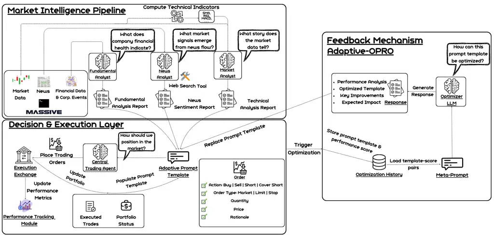
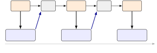
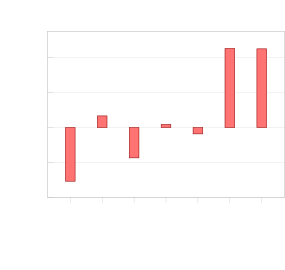
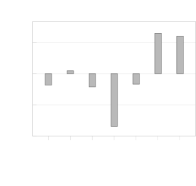
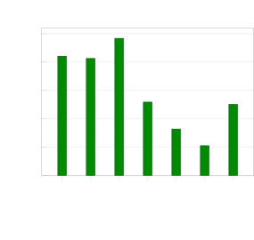

# ATLAS: Adaptive Trading with LLM AgentS Through Dynamic Prompt Optimization and Multi-Agent Coordination

Charidimos Papadakis    Angeliki Dimitriou    Giorgos Filandrianos
Affiliation: Maria Lymperaiou, Konstantinos Thomas, Giorgos Stamou
Affiliation: School of Electrical and Computer Engineering, AILS
Laboratory Affiliation: National Technical University of Athens
Email: [](mailto:,)[harrypapadakis02@gmail.com](mailto:harrypapadakis02@gmail.com),
Affiliation: {[angelikidim](mailto:angelikidim@ails.ece.ntua.gr),
[geofila](mailto:geofila@ails.ece.ntua.gr),
[marialymp](mailto:marialymp@ails.ece.ntua.gr),
[kthomas](mailto:kthomas@ails.ece.ntua.gr)}@ails.ece.ntua.gr,
Email: [](mailto:)[gstam@cs.ntua.gr](mailto:gstam@cs.ntua.gr)

###### Abstract

Large language models (LLMs) offer promising capabilities for financial
decision-making, yet their deployment in sequential trading settings
faces two key challenges: synthesizing heterogeneous information sources
and adapting agent behavior under delayed and noisy reward signals. We
address these challenges by introducing _ATLAS_ (_Adaptive Trading with
LLM AgentS_), a unified agentic framework for systematic integration of
market data, financial news, and corporate fundamentals, and
_Adaptive-OPRO_, a novel prompt optimization method that dynamically
updates agent instructions using real-time stochastic feedback. We
evaluate our approach across regime-specific equity trading scenarios
and multiple LLM families. Results demonstrate that Adaptive-OPRO
consistently outperforms existing methods, particularly in highly
volatile regimes. Moreover, our analysis reveals that increased
information availability does not necessarily translate to improved
performance, highlighting the importance of careful modality integration
in noisy market environments.

## 1 Introduction

Financial markets represent one of humanity’s most complex
decision-making environments, requiring synthesis of vast information,
from technical indicators and fundamental analysis to breaking news and
market sentiment. LLMs introduce new possibilities for financial
decision-making through their ability to process diverse data sources
and reason over complex scenarios.

From the model’s perspective, financial trading serves as an ideal
testbed: it combines unambiguous metrics, sequential complexity,
multimodal reasoning requirements, and inherent stochasticity. Unlike
synthetic benchmarks, markets provide extensive historical data without
simulation bias and reward genuine understanding over pattern
memorization. LLMs can therefore be tasked to make decisions under
uncertainty, revealing capabilities in complex reasoning He et al.
(2025), market understanding Li et al. (2025), and high-risk
decision-making Hung et al. (2023).

Despite this potential, stock market decision-making introduces inherent
challenges beyond stochasticity. Decisions require synthesizing
heterogeneous signals such as price dynamics, market conditions, and
firm-specific developments into coherent actions. Moreover, in
high-stakes financial environments where capital is continuously at
risk, static decision policies are insufficient; decision patterns must
be revised by incorporating market feedback as it unfolds, enabling
continuous behavioral adaptation.

Consequently, turning LLM capabilities into reliable trading systems
raises two key queries: (i) how diverse signals are synthesized into
coherent guidance, and (ii) how models adapt their behavior through
continuous market interaction. While recent work explores these issues
partly, their systematic study in realistic trading settings is limited.

In this work, (i) we propose ATLAS, a multi-agent framework that
provides a foundational structure for experimentation in LLM-based stock
market decision-making; (ii) we introduce Adaptive-OPRO, a prompt
optimization mechanism for sequential settings that supports behavioral
adaptation through ongoing market interaction and achieves
state-of-the-art performance across multiple market regimes and LLM
families. Through extensive regime-aware evaluations, we show that
additional input modalities are not uniformly beneficial and depend
critically on market conditions.

## 2 Related Work

##### LLM Agents in Financial Markets

Recent work explores several LLM-based trading agents, from
sentiment-driven Kirtac and Germano (2024) to coordinated,
multi-component systems Zhou et al. (2025); Yang et al. (2025); Liu et
al. (2023). Examples include CryptoTrade, which integrates on/off-chain
signals with reflection Li et al. (2024), and TradingAgents, which
coordinates specialized roles via structured debate and synthesis Xiao
et al. (2025). Memory-centric designs such as FinMem emphasize
persistent, task-specific recall Yu et al. (2023), while FINCON
introduces conceptual verbal reinforcement to shape multi-agent
collaboration Yu et al. (2024). Others incorporate learning signals
Xiong et al. (2025) or mixture-of-experts routing Ding et al. (2025),
and focus on document-centric analysis, e.g., filings and earnings calls
Fatouros et al. (2025). However, key limitations persist: prompts are
mainly hand-crafted even when feedback is delayed and noisy, and many
setups collapse execution into directional scores. ATLAS pairs a
prompt-tuning component with order-level evaluation (type, size, timing,
price) in a simulator built for such interfaces Papadakis et al. (2025),
using multi-run reporting to account for stochastic variability Song et
al. (2025); Atil et al. (2025).

##### Prompt Optimization

enhances LLM performance beyond manual tuning. Optimization by PROmpting
(OPRO) treats the model as a meta-optimizer over instruction text,
achieving gains on single-turn tasks with immediate feedback Yang et al.
(2024). Extensions explore evolutionary search and reinforcement-style
updates Guo et al. (2025); Do et al. (2024); Austin and Chartock (2024).
These settings typically assume fast, unambiguous scoring and
independent instances. In contrast, trading provides deferred, noisy
reward signals and sequentially coupled decisions. Adaptive-OPRO
addresses such challenges by using rolling evaluation windows and by
separating static instructions from dynamic run-time content, allowing
stability where consistency matters and controlled evolution where
change is beneficial.

## 3 ATLAS Framework

ATLAS comprises three main components: (i) a _Market Intelligence
Pipeline_, which consists of specialized agents that prepare market,
news, and fundamental inputs for downstream decisions; (ii) a _Decision
& Execution Layer_ centered on a Central Trading Agent that generates
and executes orders; and (iii) a feedback mechanism that collects
post-execution signals and feeds them back for continuous adaptation.
Within the feedback mechanism we incorporate Adaptive-OPRO, an extension
of the OPRO framework that dynamically edits the Central Trading Agent’s
instruction prompt based on real-time, stochastic market feedback.
Figure 1 provides an overview of the ATLAS framework.

##### Market Intelligence Pipeline.

ATLAS separates information preparation from decision-making. The Market
Intelligence Pipeline consists of three specialized agents, each with a
distinct analyst role. Market Analyst produces multi-timescale summaries
from price and volume in varying time scales (2 years, 6 months, and 3
months of history with monthly, weekly, and daily candlesticks,
respectively). Within each window it computes standard indicators (e.g.,
moving averages, momentum, volatility bands, support/resistance) and
refreshes daily, providing a consistent, noise-filtered description
rather than trading signals (details in App. B). News Analyst aggregates
relevant articles into structured fields (_Sentiment Assessment_, _Key
Developments_, _Market Relevance_, _Source Analysis_) with optional
full-text retrieval to move beyond headlines (details in App. C.1).
Fundamental Analyst extracts material changes from periodic reports and
corporate events, activating infrequently to mirror reporting cycles and
provide medium- to long-horizon context (details in App. C.2).



Figure 1: ATLAS Framework Overview. The Central Trading Agent submits
orders to the Trading Execution Engine via prompts shaped by three
specialized analysts and the proposed _Adaptive-OPRO_ optimization
technique.

##### Decision & Execution Layer.

Here, the trading actions (e.g. buying or selling a stock) are
determined, executed, and corresponding market feedback is received. The
main decision-making component within this layer is the Central Trading
Agent (CTA). This agent consumes the structured inputs and current
portfolio and emits orders that specify type (market, limit, stop),
size, timing, and price levels. Orders are executed in StockSim
Papadakis et al. (2025), which enforces core trading semantics and
returns fills, positions, and cash for the next step. Order-level
decisions clarify intent and link analytical quality to execution
choices.

##### Feedback Mechanism.

This mechanism defines how information derived from market outcomes is
incorporated into the agent’s future decisions. It may be entirely
absent, resulting in a static agent that follows a fixed policy, or it
may be enabled to support adaptation based on observed performance. In
general, the mechanism processes signals such as returns or behavioral
outcomes from past decisions and uses them to influence subsequent
actions. Implementations can range from simple feedback summaries to
more structured optimization approaches, such as reflection-based
methods Li et al. (2024). In the following section, we describe
Adaptive-OPRO, a prompt optimization technique that leverages market
feedback to iteratively refine the agent’s decision-making process.

## 4 Adaptive-OPRO

_Adaptive-OPRO_ is a sequential prompt-optimization procedure that
improves an agent’s instruction prompt using delayed, noisy performance
feedback. It generalizes OPRO to interactive settings where decisions
are temporally coupled and rewards arrive after multiple steps. The core
idea is to treat instruction text as the optimized object and to update
it periodically via a learned update mechanism (implemented by an
optimizer LLM), while keeping the agent’s run-time inputs and interfaces
stable.

##### Optimized object, state, and round inputs.

Adaptive-OPRO maintains a current instruction prompt $`P_{t}`$ for a
target agent that acts over time, along with an _optimization history_
$`\mathcal{H}=\{(P_{i},s_{i})\}_{i<t}`$ storing past prompt variants and
their scores. At the end of each evaluation window, it constructs an
optimizer query with the following inputs: (i) a _meta-prompt_ $`M`$
that specifies the optimizer’s role and constraints, (ii)
$`\mathcal{H}`$ (or a compact summary thereof), and (iii) a summary of
the agent’s recent interaction outcomes together with a scalar
performance score $`s_{t}`$ for $`P_{t}`$. An update rule $`U`$,
implemented using an optimizer LLM, produces a revised prompt
$`P_{t+1}=U(M,\mathcal{H},s_{t},\text{summary})`$. The output of each
round is an updated instruction prompt that governs subsequent agent
decisions.

##### Stability via template separation.

In sequential systems, prompt updates can inadvertently break the
run-time interface (e.g., input placeholders, output schemas) or overfit
to transient observations. Adaptive-OPRO therefore separates the target
agent prompt into: (a) _static instructions_ (policy, priorities,
constraints, formatting requirements), and (b) _dynamic run-time
content_ injected at execution time (state, observations, tool outputs,
recent actions). Only the _static instruction block_ is editable; all
placeholders and the run-time injection format are held fixed. This
enforces _edit locality_: updates can change _how_ the agent reasons and
decides, but cannot change _what_ information it receives nor the
interface it must comply with.

##### Windowed evaluation under delayed feedback.

To address credit assignment and reduce variance, Adaptive-OPRO
evaluates prompts over rolling windows of $`K`$ decision steps. After
each window, the system computes a scalar performance score $`s`$ from
outcomes observed during that window (e.g. task success, reward,
utility, risk-adjusted return). The choice of $`K`$ and scoring function
is task-dependent; the only requirement is that $`s`$ provides
consistent ordering to compare prompt variants.



Figure 2: Adaptive-OPRO as an online procedure. Prompt $`P_{t}`$ governs
window $`W_{t}`$; its realized score $`s_{t}`$ and the accumulated
history $`\mathcal{H}_{\leq t}`$ feed the optimizer $`U`$, which emits
$`P_{t+1}`$ for the next window.

##### Meta-prompted update rule.

At each window, Adaptive-OPRO forms the optimizer query from $`M`$,
$`\mathcal{H}`$, and the recent outcome summary/score, and applies $`U`$
to generate a candidate $`P_{t+1}`$ (Figure 2). The optimizer is
instructed to: (i) diagnose likely failure modes of the current prompt,
(ii) propose a revised instruction prompt $`P_{t+1}`$, (iii) summarize
the concrete changes made, and (iv) state the expected behavioral
impact. The candidate is accepted only if it preserves the template
(e.g., placeholders and output schema). The accepted prompt governs the
next window onward and is appended to history with its subsequent score;
since no window is ever replayed under a later prompt, each variant is
assessed on outcomes that unfolded after it was written, keeping
optimization and evaluation on disjoint segments of the trajectory.

##### ATLAS instantiation.

In ATLAS, Adaptive-OPRO is applied to the _Central Trading Agent_’s
instruction prompt (i.e., the static instruction block of the decision
policy). Dynamic run-time content corresponds to the daily injected
analyst summaries, portfolio state, and recent executions, which are
kept fixed by construction (App. I). For scoring, we aggregate portfolio
performance over $`K{=}5`$ trading days to reduce noise and capture
delayed effects of sequential decisions, then map cumulative ROI to a
bounded OPRO-style score $`s\in[0,100]`$ via linear scaling and
clipping:

```math
s=\mathrm{clip}_{[0,100]}\big(50+250\cdot\mathrm{ROI}\big), \tag{1}
```

so that $`-20\%\!\mapsto\!0`$, $`0\%\!\mapsto\!50`$,
$`+20\%\!\mapsto\!100`$. This yields a stable, delay-aware signal while
limiting the impact of outlier windows; the optimizer is restricted to
instruction edits that preserve ATLAS’s execution interface.

|                              |               |                      |                   |                       |                           |                 |
| ---------------------------- | ------------- | -------------------- | ----------------- | --------------------- | ------------------------- | --------------- |
| Model                        | Prompting     | ROI (%) $`\uparrow`$ | SR $`\uparrow`$   | DD (%) $`\downarrow`$ | Win Rate (%) $`\uparrow`$ | Num. Trades     |
| Non-LLM-Based Strategies     |               |                      |                   |                       |                           |                 |
| Buy & Hold                   | N/A           | -8.59                | -0.071            | 20.45                 | 0.00                      | 1               |
| MACD                         | N/A           | 6.50                 | 0.131             | 6.86                  | 0.00                      | 1               |
| SMA                          | N/A           | 6.91                 | 0.177             | 3.56                  | 50.00                     | 4               |
| SLMA                         | N/A           | -1.87                | -0.078            | 6.89                  | 0.00                      | 1               |
| Bollinger Bands              | N/A           | 0.00                 | 0.000             | 0.00                  | 0.00                      | 0               |
| LLM-Based Strategies - ATLAS |               |                      |                   |                       |                           |                 |
| Llama 3.3-70B                | Baseline      | -9.19\_(± 1.54)      | -0.091\_(± 0.021) | 16.90\_(± 0.82)       | 30.28\_(± 11.87)          | 22.67\_(± 8.39) |
|                              | Reflection    | -8.44\_(± 1.58)      | -0.087\_(± 0.025) | 16.36\_(± 0.31)       | 44.69\_(± 13.25)          | 27.67\_(± 1.15) |
|                              | Adaptive-OPRO | -6.16\_(± 2.08)      | -0.066\_(± 0.004) | 14.05\_(± 3.33)       | 54.36\_(± 12.44)          | 28.33\_(± 3.21) |
| Qwen3-235B                   | Baseline      | -1.78\_(± 3.86)      | -0.006\_(± 0.039) | 13.09\_(± 1.88)       | 36.51\_(± 17.55)          | 13.00\_(± 4.00) |
|                              | Reflection    | -5.76\_(± 2.97)      | -0.049\_(± 0.033) | 14.18\_(± 1.91)       | 25.00\_(± 0.00)           | 8.67\_(± 0.58)  |
|                              | Adaptive-OPRO | 1.33\_(± 1.91)       | 0.025\_(± 0.019)  | 11.41\_(± 0.06)       | 50.00\_(± 0.00)           | 9.00\_(± 0.00)  |
| Qwen3-32B                    | Baseline      | -10.62\_(± 3.54)     | -0.087\_(± 0.031) | 16.72\_(± 2.75)       | 30.00\_(± 10.00)          | 25.33\_(± 1.53) |
|                              | Reflection    | -7.76\_(± 0.90)      | -0.065\_(± 0.002) | 16.47\_(± 3.44)       | 28.72\_(± 25.06)          | 31.67\_(± 2.31) |
|                              | Adaptive-OPRO | -3.48\_(± 2.19)      | -0.022\_(± 0.021) | 15.52\_(± 0.68)       | 43.45\_(± 6.27)           | 28.67\_(± 1.53) |
| Claude Sonnet 4              | Baseline      | -7.26\_(± 2.99)      | -0.066\_(± 0.030) | 17.59\_(± 1.55)       | 31.19\_(± 7.84)           | 13.00\_(± 4.36) |
|                              | Reflection    | -5.69\_(± 1.82)      | -0.058\_(± 0.013) | 15.12\_(± 3.26)       | 46.67\_(± 5.77)           | 12.67\_(± 2.08) |
|                              | Adaptive-OPRO | 0.35\_(± 1.78)       | 0.008\_(± 0.018)  | 14.76\_(± 2.87)       | 43.45\_(± 6.27)           | 15.00\_(± 2.00) |
| Claude Sonnet 4 w/ Thinking  | Baseline      | -4.46\_(± 4.76)      | -0.043\_(± 0.048) | 14.32\_(± 4.12)       | 11.11\_(± 19.24)          | 14.00\_(± 2.65) |
|                              | Reflection    | -8.60\_(± 0.59)      | -0.078\_(± 0.004) | 19.45\_(± 1.65)       | 14.29\_(± 24.75)          | 11.67\_(± 2.08) |
|                              | Adaptive-OPRO | -0.73\_(± 3.82)      | -0.004\_(± 0.038) | 12.94\_(± 2.32)       | 43.89\_(± 21.11)          | 17.00\_(± 5.00) |
| GPT-o4-mini                  | Baseline      | -1.30\_(± 1.71)      | -0.017\_(± 0.017) | 9.68\_(± 3.12)        | 29.17\_(± 11.02)          | 15.33\_(± 3.06) |
|                              | Reflection    | -2.52\_(± 4.03)      | -0.039\_(± 0.045) | 9.82\_(± 3.43)        | 51.28\_(± 5.06)           | 20.33\_(± 3.06) |
|                              | Adaptive-OPRO | 9.06\_(± 0.73)       | 0.094\_(± 0.008)  | 11.48\_(± 0.00)       | 65.28\_(± 16.84)          | 17.33\_(± 5.86) |
| GPT-o3                       | Baseline      | -6.11\_(± 3.42)      | -0.080\_(± 0.029) | 11.58\_(± 3.09)       | 42.59\_(± 8.49)           | 18.67\_(± 3.21) |
|                              | Reflection    | -4.60\_(± 3.40)      | -0.053\_(± 0.044) | 12.11\_(± 1.27)       | 46.03\_(± 16.88)          | 18.33\_(± 2.52) |
|                              | Adaptive-OPRO | 9.02\_(± 3.28)       | 0.146\_(± 0.048)  | 5.33\_(± 0.14)        | 72.81\_(± 17.27)          | 19.67\_(± 4.16) |

Table 1: Performance comparison between non-LLM-based and LLM-based
approaches using ATLAS in volatile, declining market conditions. Bold
values indicate the best per model.

## 5 Experiments

Our study examines ATLAS along three axes: (1) Adaptation – whether
sequential prompt optimization via _Adaptive-OPRO_ improves over
well-tuned static prompts and over analytical reflection when feedback
is delayed and noisy; (2) Component attribution – contribution of
structured inputs (Market Analyst, News Analyst, Fundamental Analyst)
under different regimes; (3) Model capabilities – performance of
backbone LLMs as both decision policies and prompt optimizers under
Adaptive-OPRO, assessed by return and risk-adjusted performance,
robustness across runs, and their ability to propose instruction updates
for sustained improvements over windows.

### 5.1 Experimental Setup

##### Assets and time period.

Specifically, we evaluate stock market decision-making across three
distinct regimes: a bearish-volatile regime characterized by declining
prices and elevated uncertainty, a sideways regime marked by range-bound
price dynamics and limited directional trends, and a bullish regime
defined by sustained upward momentum and comparatively favorable
risk-return conditions. Each window spans two months (Apr 28-Jun 28, 2025) _with a daily decision interval_: the agent acts once per trading
day. This horizon is chosen to (i) capture multiple decision cycles
_without regime mixing_, so adaptation reflects outcomes rather than
macro shifts, and (ii) preserve complete conversation history (analyst
summaries, orders, prompt-evolution logs) within the context limits of
all backbones, enabling fair, auditable runs across models and
ablations. More details in App. D.1.

The experimental setup, including the evaluation method, metrics, regime
partitioning, and evaluation horizon, follows Li et al. (2024), ensuring
methodological consistency and fair comparison across settings. We
explicitly account for LLM stochasticity by running each configuration
_three times_ and reporting mean $`\pm`$ standard deviation,
distinguishing systematic performance differences from randomness rather
than single-run variability.

Models. We evaluate seven backbones spanning families, sizes, and
reasoning modes: GPT-o3, GPT-o4-mini, Claude Sonnet 4 with and without
thinking, Llama 3.3-70B, Qwen3-235B, and Qwen3-32B. Each run uses a
single backbone for all ATLAS components and Adaptive-OPRO, isolating
how model capacity and architecture affect sequential behavior,
instruction adherence, stability, and cross-family transfer without
per-model tuning.

Prompting strategies. We compare three strategies for the _Central
Trading Agent_: Baseline – a fixed instruction prompt obtained via
iterative expert prompt engineering; Reflection Li et al. (2024) – a
weekly reflection mechanism that summarizes recent trajectories into
high-level feedback that the agent must interpret; Adaptive-OPRO – our
sequential prompt optimization with windowed scoring and template
separation (Section 4). Our goal is to isolate the _adaptation
mechanism_ under identical data and execution semantics. We therefore
evaluate all methods within a single, transparent setup rather than
re-implementing full external agent stacks, which differ in action
spaces, state representations, and execution interfaces. We include
reflection as a widely used and portable form of sequential feedback,
providing a focused comparison to _Adaptive-OPRO_ and the fixed
baseline.

Non-LLM baselines. Following Li et al. (2024), we include five widely
used quantitative strategies to contextualize results: Buy & Hold, MACD
Wang and Kim (2018), SMA Gencay (1996), SLMA Wang and Kim (2018), and
Bollinger Bands Day et al. (2023). For window-based methods, we test
multiple window lengths per regime and report a strong, representative
configuration for each strategy (e.g., 10-day SMA; 10/30-day SLMA). Full
specifications in App. D.8.

Execution environment. Agents interact with StockSim Papadakis et al.
(2025) via an _order-level_ action space, requiring CTAs to submit fully
_executable_ orders (type, side, size, price). Compared to signal- or
position-level formulations common in prior LLM trading studies Li et
al. (2024); Xiao et al. (2025), this enforces execution feasibility
(cash, inventory, validity) and yields a complete audit trail of orders,
fills, and portfolio states. Consistent with standard offline
evaluation, we abstract away four aspects of market microstructure,
namely latency, slippage, market impact, and intraday partial fills, and
assume deterministic execution. Since these abstractions apply uniformly
to every prompting strategy, they shift absolute return levels while
leaving comparisons between Baseline, Reflection, and Adaptive-OPRO
internally consistent.



Figure 3: ROI gain of Adaptive-OPRO over the Baseline prompt, in
percentage points, per backbone and market regime. The effect is most
pronounced under bearish-volatile conditions.

##### Evaluation Metrics.

We employ five metrics capturing different aspects of trading
performance:

Return on Investment (ROI): Total percentage return calculated as:

```math
\frac{\text{final value}-\text{initial value}}{\text{initial value}}\times 100 \tag{2}
```

where portfolio values include both cash holdings and the current market
value of all stocks owned.

Sharpe Ratio (SR): Risk-adjusted return metric:

```math
\frac{\mu-r_{f}}{\sigma} \tag{3}
```

where $`\mu`$ is mean daily return, $`\sigma`$ is daily return standard
deviation, and $`r_{f}`$ is the risk-free rate (set to 0 as in Li et al.
(2024)).

Maximum Drawdown (DD): The worst peak-to-trough decline in portfolio
value:

```math
\max_{t\in[0,T]}\left(\max_{s\in[0,t]}V_{s}-V_{t}\right)/\max_{s\in[0,t]}V_{s} \tag{4}
```

where $`V_{t}`$ is portfolio value at time $`t`$. This measures the
largest loss from any historical high, reflecting downside risk and
stress tolerance.

Win Rate: Percentage of _profitable_ _closed_ (i.e. completed) trades,
computed as:

```math
\frac{\text{Closed trades with realized profit > 0}}{\text{Total closed trades}}\times 100. \tag{5}
```

“Closed trades” are fully opened and exited positions; open positions
are excluded. Win rate reflects decision consistency but does not ensure
profitability if losses outweigh gains.

Number of Trades: Total trading frequency over the evaluation period.
Higher frequencies indicate active, opportunistic short-term strategies,
while lower frequencies suggest patient, conviction-driven approaches.
Additional metrics, results, and analyses are reported in App. E.

|                              |               |                      |                   |                       |                           |                 |
| ---------------------------- | ------------- | -------------------- | ----------------- | --------------------- | ------------------------- | --------------- |
| Model                        | Prompting     | ROI (%) $`\uparrow`$ | SR $`\uparrow`$   | DD (%) $`\downarrow`$ | Win Rate (%) $`\uparrow`$ | Num. Trades     |
| Non-LLM-Based Strategies     |               |                      |                   |                       |                           |                 |
| Buy & Hold                   | N/A           | 1.14                 | 0.013             | 6.97                  | 0.00                      | 1               |
| MACD                         | N/A           | -0.26                | -0.019            | 5.90                  | 0.00                      | 3               |
| SMA                          | N/A           | -0.13                | -0.019            | 5.57                  | 0.00                      | 3               |
| SLMA                         | N/A           | -1.12                | -0.043            | 5.28                  | 0.00                      | 2               |
| Bollinger Bands              | N/A           | 0.00                 | 0.000             | 0.00                  | 0.00                      | 0               |
| LLM-Based Strategies - ATLAS |               |                      |                   |                       |                           |                 |
| Llama 3.3-70B                | Baseline      | -0.42\_(± 2.06)      | -0.024\_(± 0.051) | 5.56\_(± 1.08)        | 53.48\_(± 9.56)           | 26.00\_(± 2.00) |
|                              | Reflection    | -2.61\_(± 0.77)      | -0.083\_(± 0.014) | 6.38\_(± 0.72)        | 46.63\_(± 3.15)           | 26.33\_(± 6.51) |
|                              | Adaptive-OPRO | -1.10\_(± 0.44)      | -0.045\_(± 0.012) | 5.15\_(± 0.71)        | 50.00\_(± 3.85)           | 25.33\_(± 1.15) |
| Qwen3-235B                   | Baseline      | -2.43\_(± 0.68)      | -0.04\_(± 0.01)   | 5.72\_(± 0.16)        | 46.67\_(± 5.77)           | 11.66\_(± 0.57) |
|                              | Reflection    | -2.02\_(± 1.44)      | -0.04\_(± 0.03)   | 6.26\_(± 1.77)        | 36.51\_(± 5.50)           | 13.33\_(± 2.31) |
|                              | Adaptive-OPRO | 0.27\_(± 1.83)       | 0.01\_(± 0.04)    | 7.20\_(± 2.09)        | 32.86\_(± 15.45)          | 11.00\_(± 3.61) |
| Qwen3-32B                    | Baseline      | -9.14\_(± 1.02)      | -0.20\_(± 0.02)   | 9.82\_(± 0.90)        | 28.85\_(± 17.20)          | 21.00\_(± 1.73) |
|                              | Reflection    | -7.96\_(± 3.11)      | -0.16\_(± 0.06)   | 9.05\_(± 2.90)        | 40.55\_(± 15.48)          | 24.33\_(± 3.05) |
|                              | Adaptive-OPRO | -1.27\_(± 3.21)      | -0.03\_(± 0.07)   | 6.75\_(± 0.54)        | 35.83\_(± 2.57)           | 25.67\_(± 5.50) |
| Claude Sonnet 4              | Baseline      | -4.49\_(± 4.22)      | -0.134\_(± 0.114) | 7.71\_(± 1.06)        | 37.50\_(± 4.17)           | 19.00\_(± 3.46) |
|                              | Reflection    | -3.78\_(± 4.23)      | -0.115\_(± 0.105) | 10.54\_(± 1.58)       | 23.84\_(± 8.27)           | 18.00\_(± 6.93) |
|                              | Adaptive-OPRO | -5.07\_(± 4.53)      | -0.165\_(± 0.143) | 9.23\_(± 2.71)        | 31.02\_(± 7.90)           | 18.33\_(± 2.52) |
| Claude Sonnet 4 w/ Thinking  | Baseline      | -0.99\_(± 0.80)      | -0.039\_(± 0.020) | 7.75\_(± 1.00)        | 56.28\_(± 1.50)           | 17.00\_(± 5.20) |
|                              | Reflection    | -1.49\_(± 3.76)      | -0.069\_(± 0.123) | 7.27\_(± 2.26)        | 45.11\_(± 12.60)          | 17.00\_(± 5.57) |
|                              | Adaptive-OPRO | -1.01\_(± 0.90)      | -0.046\_(± 0.020) | 5.16\_(± 0.52)        | 36.20\_(± 24.47)          | 16.33\_(± 2.08) |
| GPT-o4-mini                  | Baseline      | 1.29\_(± 1.38)       | 0.021\_(± 0.044)  | 3.23\_(± 0.48)        | 39.01\_(± 3.61)           | 22.67\_(± 7.57) |
|                              | Reflection    | -1.48\_(± 0.54)      | -0.087\_(± 0.018) | 4.64\_(± 0.75)        | 32.62\_(± 7.49)           | 27.33\_(± 3.06) |
|                              | Adaptive-OPRO | 3.88\_(± 2.21)       | 0.089\_(± 0.067)  | 3.28\_(± 0.95)        | 47.95\_(± 7.15)           | 25.33\_(± 5.03) |
| GPT-o3                       | Baseline      | -0.60\_(± 1.71)      | -0.034\_(± 0.050) | 5.93\_(± 1.33)        | 60.74\_(± 5.59)           | 16.33\_(± 2.52) |
|                              | Reflection    | -1.55\_(± 2.09)      | -0.084\_(± 0.075) | 5.02\_(± 0.72)        | 42.50\_(± 6.61)           | 16.67\_(± 0.58) |
|                              | Adaptive-OPRO | 3.62\_(± 0.90)       | 0.096\_(± 0.027)  | 3.46\_(± 0.48)        | 71.93\_(± 15.90)          | 16.00\_(± 2.65) |

Table 2: Performance comparison between non-LLM-based and LLM-based
approaches using ATLAS in range-bound market conditions. Bold values
indicate the best results per model.

|                              |               |                      |                  |                       |                           |                  |
| ---------------------------- | ------------- | -------------------- | ---------------- | --------------------- | ------------------------- | ---------------- |
| Model                        | Prompting     | ROI (%) $`\uparrow`$ | SR $`\uparrow`$  | DD (%) $`\downarrow`$ | Win Rate (%) $`\uparrow`$ | Num. Trades      |
| Non-LLM-Based Strategies     |               |                      |                  |                       |                           |                  |
| Buy & Hold                   | N/A           | 41.30                | 0.409            | 3.16                  | 0.00                      | 1                |
| MACD                         | N/A           | -0.62                | -0.343           | 0.62                  | 0.00                      | 1                |
| SMA                          | N/A           | 36.77                | 0.384            | 3.12                  | 0.00                      | 1                |
| SLMA                         | N/A           | 15.88                | 0.254            | 2.98                  | 0.00                      | 1                |
| Bollinger Bands              | N/A           | 0.00                 | 0.000            | 0.00                  | 0.00                      | 0                |
| LLM-Based Strategies - ATLAS |               |                      |                  |                       |                           |                  |
| Llama 3.3-70B                | Baseline      | 37.86\_(± 12.31)     | 0.388\_(± 0.096) | 3.46\_(± 0.63)        | 20.37\_(± 35.28)          | 13.00\_(± 20.78) |
|                              | Reflection    | 40.40\_(± 1.43)      | 0.422\_(± 0.023) | 2.96\_(± 0.34)        | 33.33\_(± 57.74)          | 5.33\_(± 6.66)   |
|                              | Adaptive-OPRO | 42.07\_(± 1.85)      | 0.418\_(± 0.016) | 3.15\_(± 0.02)        | 100.00\_(± 0.00)          | 1.33\_(± 0.58)   |
| Qwen3-235B                   | Baseline      | 43.91\_(± 2.31)      | 0.42\_(± 0.00)   | 3.34\_(± 0.16)        | 0.00\_(± 0.00)            | 2.00\_(± 0.00)   |
|                              | Reflection    | 34.08\_(± 12.30)     | 0.37\_(± 0.08)   | 2.98\_(± 0.30)        | 23.81\_(± 41.24)          | 11.33\_(± 16.17) |
|                              | Adaptive-OPRO | 41.25\_(± 0.00)      | 0.42\_(± 0.00)   | 3.16\_(± 0.00)        | 0.00\_(± 0.00)            | 2.00\_(± 0.00)   |
| Qwen3-32B                    | Baseline      | 35.75\_(± 5.35)      | 0.48\_(± 0.06)   | 2.86\_(± 0.30)        | 60.86\_(± 52.71)          | 22.33\_(± 3.06)  |
|                              | Reflection    | 41.72\_(± 1.32)      | 0.43\_(± 0.01)   | 3.03\_(± 0.22)        | 66.67\_(± 57.74)          | 10.67\_(± 5.13)  |
|                              | Adaptive-OPRO | 48.37\_(± 0.10)      | 0.47\_(± 0.00)   | 3.15\_(± 0.02)        | 100.00\_(± 0.00)          | 18.00\_(± 5.00)  |
| Claude Sonnet 4              | Baseline      | 13.43\_(± 8.62)      | 0.180\_(± 0.121) | 5.52\_(± 3.96)        | 60.83\_(± 12.30)          | 21.67\_(± 9.50)  |
|                              | Reflection    | 5.21\_(± 1.10)       | 0.089\_(± 0.026) | 5.11\_(± 1.86)        | 39.25\_(± 15.79)          | 22.33\_(± 1.53)  |
|                              | Adaptive-OPRO | 25.85\_(± 10.61)     | 0.290\_(± 0.087) | 3.75\_(± 0.59)        | 43.81\_(± 38.37)          | 19.00\_(± 12.17) |
| Claude Sonnet 4 w/ Thinking  | Baseline      | 12.52\_(± 2.47)      | 0.175\_(± 0.030) | 5.03\_(± 1.53)        | 53.30\_(± 14.47)          | 17.00\_(± 2.65)  |
|                              | Reflection    | 11.12\_(± 4.86)      | 0.186\_(± 0.083) | 3.42\_(± 2.23)        | 77.86\_(± 2.58)           | 17.00\_(± 5.00)  |
|                              | Adaptive-OPRO | 16.36\_(± 7.87)      | 0.217\_(± 0.105) | 5.18\_(± 2.52)        | 68.89\_(± 30.06)          | 12.67\_(± 4.04)  |
| GPT-o4-mini                  | Baseline      | 7.00\_(± 3.46)       | 0.125\_(± 0.054) | 2.74\_(± 0.79)        | 46.29\_(± 3.21)           | 18.67\_(± 1.53)  |
|                              | Reflection    | 9.80\_(± 3.21)       | 0.189\_(± 0.067) | 2.45\_(± 1.00)        | 54.54\_(± 7.92)           | 26.33\_(± 9.61)  |
|                              | Adaptive-OPRO | 10.47\_(± 3.84)      | 0.193\_(± 0.046) | 3.42\_(± 0.90)        | 62.70\_(± 11.25)          | 20.33\_(± 2.89)  |
| GPT-o3                       | Baseline      | 22.70\_(± 0.92)      | 0.269\_(± 0.029) | 6.82\_(± 3.03)        | 66.67\_(± 28.87)          | 7.33\_(± 2.52)   |
|                              | Reflection    | 21.98\_(± 4.54)      | 0.325\_(± 0.040) | 3.14\_(± 0.99)        | 96.67\_(± 5.77)           | 18.00\_(± 3.61)  |
|                              | Adaptive-OPRO | 25.06\_(± 4.28)      | 0.392\_(± 0.019) | 2.31\_(± 0.80)        | 100.00\_(± 0.00)          | 9.67\_(± 4.04)   |

Table 3: Performance comparison between non-LLM-based and LLM-based
approaches using ATLAS in bullish market conditions. Bold values
indicate the best per model.

## 6 Results

Tables 1, 2, and 3 present the results of our experimental design
evaluating ATLAS across diverse market conditions. The results show that
_Adaptive-OPRO_ consistently improves upon fixed prompts across models
and market conditions, while reflection often deteriorates performance
or provides inconsistent value. Non-LLM strategies demonstrate
regime-dependent performance, with different technical approaches
succeeding in specific conditions but failing to generalize. ATLAS with
_Adaptive-OPRO_ delivers stable performance across tested regimes, with
certain model pairings achieving positive returns even in volatile and
declining market conditions where most baseline strategies struggle. The
order-level action space reveals distinct patterns across model families
and supports attribution from analytical reasoning to execution
behavior.

### 6.1 Optimization in Sequential Decision-Making

_Adaptive-OPRO_ consistently outperforms both static baseline prompts
and reflection-based approaches across the tested models and market
conditions. Figure 3 makes this breadth explicit: the ROI gain over
Baseline is positive across most backbones and regimes and spans all
four model families, so the improvement is not confined to a particular
architecture or market condition. Its magnitude scales with the slack
left by the tuned baseline, which is largest under volatile conditions
and narrowest in already-favorable regimes.

Return, risk-adjusted, and win-rate metrics jointly indicate successful
adaptation to market feedback: models paired with _Adaptive-OPRO_
achieve higher returns while maintaining or reducing drawdowns, with SR
gains showing that improvements arise from strategic enhancement and not
increased risk-taking. Crucially, these return gains are accompanied by
higher win rates, indicating consistent decision-making rather than
sporadic large profits masking frequent losses. For instance, in the
bearish regime (Table 1), GPT-o3 and GPT-o4-mini shift from negative
baseline returns to strong positive performance under _Adaptive-OPRO_,
while Qwen3-235B moves from losses to gains. This pattern persists
across range-bound and bullish conditions, suggesting that prompt
optimization captures regime-appropriate cues rather than overfitting to
specific market settings.

Comparisons to baseline performance. We examine how baseline decision
quality relates to the gains from Adaptive-OPRO under volatile,
declining markets. Baseline and Adaptive-OPRO ROI are moderately
correlated ($`r=0.64`$), suggesting that stronger baselines maintain
higher absolute returns after adaptation. However, the improvement over
baseline shows no meaningful correlation ($`r=0.05`$) and an almost flat
gradient ($`\beta\approx 0.06`$). This indicates that Adaptive-OPRO does
not simply amplify existing strengths, but delivers improvements largely
independent of initial performance. Similar trends hold for
risk-adjusted metrics, implying that Adaptive-OPRO mainly alters
decision behavior rather than scaling baseline profitability.

The reflection paradox. In contrast, reflection-based prompting Li et
al. (2024) exhibits a markedly different behavior. In the
bearish-volatile regime, the ROI improvement under reflection shows a
strong negative correlation with baseline performance
($`r=-0.78,\,p<0.05`$), accompanied by a pronounced negative performance
gradient ($`\beta=-0.61`$), indicating that models with stronger
baseline decision quality tend to deteriorate more with reflection. This
suggests that reflection does not merely fail to improve performance,
but can actively disrupt effective decision policies in high-noise
environments. Rather than stabilizing behavior, reflection appears to
amplify stochasticity and override useful heuristics, particularly for
models that already exhibit competent baseline trading strategies,
consistent with overthinking induced by redundant information (more
details in App. H).

|                 |                     |                     |                   |                       |                           |                  |
| --------------- | ------------------- | ------------------- | ----------------- | --------------------- | ------------------------- | ---------------- |
| Regime          | Configuration       | ROI (%)$`\uparrow`$ | SR $`\uparrow`$   | DD (%) $`\downarrow`$ | Win Rate (%) $`\uparrow`$ | Num. Trades      |
| Bearish Regime  | No News             | 4.07\_(± 0.72)      | 0.056\_(± 0.016)  | 7.84\_(± 3.15)        | 53.51\_(± 6.67)           | 25.33\_(± 4.51)  |
|                 | No Market Data      | -5.75\_(± 0.76)     | -0.094\_(± 0.017) | 11.32\_(± 2.63)       | 37.52\_(± 4.87)           | 18.33\_(± 3.06)  |
|                 | No News & No Market | -6.86\_(± 1.68)     | -0.078\_(± 0.036) | 14.54\_(± 3.30)       | 43.94\_(± 6.94)           | 22.33\_(± 1.15)  |
|                 | ATLAS               | 9.06\_(± 0.73)      | 0.094\_(± 0.008)  | 11.48\_(± 0.00)       | 65.28\_(± 16.84)          | 17.33\_(± 5.86)  |
| Sideways Regime | No News             | -8.20\_(± 1.64)     | -0.264\_(± 0.069) | 9.09\_(± 2.99)        | 22.82\_(± 13.65)          | 35.00\_(± 12.29) |
|                 | No Market Data      | 0.01\_(± 0.92)      | -0.011\_(± 0.021) | 6.56\_(± 1.58)        | 46.55\_(± 23.15)          | 13.33\_(± 3.06)  |
|                 | No News & No Market | -4.60\_(± 0.70)     | -0.136\_(± 0.026) | 7.01\_(± 2.29)        | 35.26\_(± 13.09)          | 21.00\_(± 4.58)  |
|                 | ATLAS               | 3.88\_(± 2.21)      | 0.089\_(± 0.067)  | 3.28\_(± 0.95)        | 47.95\_(± 7.15)           | 25.33\_(± 5.03)  |
| Bullish Regime  | No News             | 6.62\_(± 0.25)      | 0.090\_(± 0.008)  | 6.67\_(± 0.36)        | 41.96\_(± 5.21)           | 28.33\_(± 4.62)  |
|                 | No Market Data      | 11.78\_(± 1.76)     | 0.216\_(± 0.024)  | 3.70\_(± 0.86)        | 70.24\_(± 14.03)          | 20.00\_(± 5.57)  |
|                 | No News & No Market | 7.34\_(± 2.79)      | 0.110\_(± 0.012)  | 5.76\_(± 2.01)        | 63.84\_(± 9.39)           | 20.67\_(± 1.53)  |
|                 | ATLAS               | 10.47\_(± 3.84)     | 0.193\_(± 0.046)  | 3.42\_(± 0.90)        | 62.70\_(± 11.25)          | 20.33\_(± 2.89)  |

Table 4: Ablation study results showing individual agent contributions
using GPT-o4-mini across three market regimes. Bold values indicate the
best results per configuration.

### 6.2 Trading Behavior Across LLMs

The order-level action space reveals systematic behavioral differences
across model families, with performance broadly correlating with general
model capabilities. Beyond averages, variance across runs captures
decision reliability, especially when timing and sizing errors are
amplified.

GPT models exhibit distinct trading styles and adaptation patterns.
GPT-o3 integrates inputs from agents into coherent decisions, showing
conservative risk management that can cap gains in strongly trending
markets but delivers consistent performance across regimes. This
manifests as robust returns with comparatively low drawdowns and low
run-to-run variance, denoting stable execution.

GPT-o4-mini emphasizes short-term risk control through frequent
stop-losses and early profit-taking. This behavior aligns with stronger
outcomes in volatile settings and more muted trend capture in sustained
moves; it also tends toward higher trading frequency in some regimes.
Still, Adaptive-OPRO generally improves its consistency and
profitability relative to fixed prompting, with moderate variance
suggesting a more reactive but still controlled policy.

Qwen models show divergent behavior based on scale. Qwen3-235B trades
more selectively and, across several regimes, achieves stable positive
outcomes under Adaptive-OPRO. All three tables reflect that prompt
adaptation is important here: it often turns otherwise marginal/negative
behavior into positive returns while keeping activity relatively
restrained, consistent with risk-reward balancing.

Qwen3-32B is more active and variable, with larger swings across runs
and regimes. Adaptive-OPRO improves its behavior, reducing losses in
adverse settings and strengthening performance in favorable ones, but
residual variance suggests less stable execution than the larger
variant.

Llama 3.3-70B adopts simpler trading strategies with limited
risk-management sophistication. Qualitatively, it shows delayed
responses to market shifts and occasional abrupt changes in stance,
which correspond to weaker performance in more adversarial regimes.
Interestingly, this straightforward behavior performs well in the
bullish regime in our results, consistent with capturing upward drift
without overcomplicating execution.

Claude Sonnet 4 varies depending on reasoning mode, with variance
patterns revealing meaningful differences in reliability. Certain
configurations exhibit markedly higher run-to-run variability,
indicating less predictable decision-making. With extended thinking
enabled, the model often produces detailed analysis but the results show
mixed execution quality; without thinking, decisions become more erratic
and consistency across regimes degrades, suggesting that the bottleneck
is both analysis depth and subsequent order construction.

Overall, the key insight enabled by order-level specifications is that
weaker configurations often generate plausible market analysis but fail
in position sizing, timing, or order selection, whereas successful
configurations consistently translate analysis into coherent execution.

### 6.3 LLM Optimization Capabilities

A key advantage of _Adaptive-OPRO_ is that optimization yields
interpretable instruction updates, assessed along two axes: (i) whether
the revised prompt is objectively aligned with the trading goal (e.g.,
explicit risk controls, sizing discipline, and when to trade), and (ii)
whether those instructions are reflected in subsequent order-level
behavior (frequency, timing, and position sizing). After manual
inspection of the results, we observe clear family-level patterns. GPT
models consistently produce well-structured, objective-aligned
refinements that translate observed weaknesses into actionable
constraints, and these updates tend to be followed in execution,
consistent with their lower run-to-run variance. Qwen models also
generate targeted improvements, with the larger Qwen3-235B producing
more coherent and internally consistent instruction revisions, which
aligns with its more stable selective trading behavior. In contrast,
Llama often reports edits that are not present in the actual prompt or
proposes changes that conflict with the stated objective, weakening the
connection between optimization output and downstream execution. Claude
models often shift toward increasingly procedural and restrictive
prompts, which can reduce adaptability; notably, this prescriptiveness
does not reliably translate into stable execution, as reflected by
higher variance in several configurations. Examples of observed patterns
in App. G.

### 6.4 ATLAS Ablation Study

Table 4 shows distinct agent contributions through performance drops
when each is ablated.

Market Analyst is a core component across market regimes. Its removal
consistently results in the most significant performance degradation,
especially in challenging conditions such as the bearish-volatile
regime, where technical context is crucial for decision-making. In the
sideways regime, the absence of market analysis not only reduces returns
but also lowers trading frequency, suggesting that agents lose
confidence to act without a solid technical foundation. Notably, in the
bullish regime, ROI slightly improves when market data is excluded,
suggesting that in up-trending conditions social consensus may offer
cleaner entry signals.

News analyst contributes regime-specific strategic value. In the bullish
regime, news removal leads to lower returns as agents become more
conservative. The sideways regime shows news analysis as critical, with
its removal producing severe degradation, suggesting that sentiment
analysis is essential when technical signals are ambiguous.

Combination of News & Market Analyst highlights the complementary value
of these signals. Across all regimes, removing both agents substantially
degrades performance, showing that news and market data provide
non-redundant information. In the bearish regime, the drop reflects the
importance of sentiment and technical context under volatility, while in
the sideways regime their absence produces unstable, unprofitable
behavior. Even in the bullish regime, combined removal harms
performance, indicating that each component contributes differently
across regimes and that their joint effect is not simply additive.

## 7 Conclusion

In this work, we introduce ATLAS, an LLM-based trading framework that
combines _Adaptive-OPRO_ for prompt optimization under delayed, noisy
feedback with structured analyst inputs and an order-level interface.
Across regimes and model families, Adaptive-OPRO outperforms tuned
static prompts, while standard reflection proves inconsistent. The
order-level interface reveals model-specific trading behaviors and
separates analytical quality from execution choices, enabling clearer
attribution and interpretability. ATLAS with Adaptive-OPRO provides a
practical, reliable, auditable paradigm for sequential LLM
decision-making.

## Acknowledgments

Cloud computing credits for accessing Llama, Qwen, and Claude models via
Amazon Bedrock were provided by Amazon Web Services (AWS). This work was
supported by the Hellenic Foundation for Research and Innovation (HFRI)
under the 5th Call for HFRI PhD Fellowships (Fellowship Number 19268).

## Limitations

Following prior LLM-agent and market-simulation work, we focus on three
liquid equities over two-month, regime-specific windows with daily
decisions to reduce confounding from asset heterogeneity and shifting
market structure. This isolates adaptation effects under a shared
interface but does not support generalization across assets, sectors,
horizons, or macro conditions. Results should be read as behavioral
evidence about _Adaptive-OPRO_, not as market-wide performance claims.

End-of-day decisions provide stable feedback for optimization under
delayed, noisy outcomes, but prevent agents from reacting to intraday
moves or capturing timing-dependent behaviors. The frictionless
execution assumption discussed in Section 5 also means that strategies
sensitive to fill quality, such as high-turnover or large-size policies,
would need revalidation under a microstructure-aware simulator before
any live-trading claim.

Each configuration runs three times due to resource constraints,
capturing stochastic variance but limiting statistical power.
Comparisons isolate prompt adaptation under a shared order-level
interface rather than varying full system architectures. While
order-level actions improve interpretability by separating analysis from
execution, we do not include a directional-only ablation for direct
causal comparison. Finally, although we cover multiple model families
(GPT, Claude, Llama, Qwen), behaviors may vary with architectures,
scales, and training procedures beyond those studied here.

## Ethical Considerations

This work focuses on controlled, simulated trading experiments to study
prompt optimization and does not involve real-world financial
transactions or human subjects. All analyses are conducted in a
reproducible, transparent environment, minimizing potential risks. While
findings provide insights into model behavior, they are not financial
advice and should not be used for live trading.

## References

- Achelis (2000) S. B. Achelis Technical analysis from a to z. 2nd
  edition, McGraw-Hill. Cited by: §B.3, §B.5.
- Atil et al. (2025) B. Atil, S. Aykent, A. Chittams, L. Fu, R. J.
  Passonneau, E. Radcliffe, G. R. Rajagopal, A. Sloan, T. Tudrej, F.
  Ture, Z. Wu, L. Xu, and B. Baldwin Non-determinism of "deterministic"
  llm settings. External Links: 2408.04667,
  [Link](https://arxiv.org/abs/2408.04667) Cited by: §2.
- Austin and Chartock (2024) D. Austin and E. Chartock GRAD-sum:
  leveraging gradient summarization for optimal prompt engineering.
  External Links: 2407.12865, [Link](https://arxiv.org/abs/2407.12865)
  Cited by: §2.
- Baker and Powell (1993) H. K. Baker and G. E. Powell Further evidence
  on managerial motives for stock splits. Quarterly Journal of Business
  and Economics 32 (3), pp. 20–31. External Links: ISSN 07475535,
  [Link](http://www.jstor.org/stable/40473089) Cited by: §C.2.2.
- Brealey et al. (2019) R. A. Brealey, S. C. Myers, and F. Allen
  Principles of corporate finance. 13th edition, McGraw-Hill Education,
  New York, NY. External Links: ISBN 978-1260565553 Cited by: 1st item.
- Damodaran (2012) A. Damodaran Investment valuation: tools and
  techniques for determining the value of any asset. 3rd edition, John
  Wiley & Sons, Hoboken, NJ. External Links: ISBN 978-1118130735 Cited
  by: 5th item, 2nd item.
- Day et al. (2023) M. Day, Y. Cheng, P. Huang, and Y. Ni The
  profitability of bollinger bands trading bitcoin futures. Applied
  Economics Letters 30 (11), pp. 1437–1443. Cited by: §D.8, §5.1.
- Ding et al. (2025) Q. Ding, H. Shi, J. Guo, and B. Liu TradExpert:
  revolutionizing trading with mixture of expert llms. External Links:
  2411.00782, [Link](https://arxiv.org/abs/2411.00782) Cited by: §2.
- Do et al. (2024) D. Do, Q. Tran, S. Venkatesh, and H. Le Large
  language models prompting with episodic memory. External Links:
  2408.07465, [Link](https://arxiv.org/abs/2408.07465) Cited by: §2.
- Fatouros et al. (2025) G. Fatouros, K. Metaxas, J. Soldatos, and M.
  Karathanassis MarketSenseAI 2.0: enhancing stock analysis through llm
  agents. External Links: 2502.00415,
  [Link](https://arxiv.org/abs/2502.00415) Cited by: §2.
- Gencay (1996) R. Gencay Non-linear prediction of security returns with
  moving average rules. Journal of Forecasting 15 (3), pp. 165–174.
  Cited by: §D.8, §5.1.
- Guo et al. (2025) Q. Guo, R. Wang, J. Guo, B. Li, K. Song, X. Tan, G.
  Liu, J. Bian, and Y. Yang EvoPrompt: connecting llms with evolutionary
  algorithms yields powerful prompt optimizers. External Links:
  2309.08532, [Link](https://arxiv.org/abs/2309.08532) Cited by: §2.
- He et al. (2025) T. He, H. Li, J. Chen, R. Liu, Y. Cao, L. Liao, Z.
  Zheng, Z. Chu, J. Liang, M. Liu, and B. Qin Breaking the reasoning
  barrier a survey on LLM complex reasoning through the lens of
  self-evolution. In Findings of the Association for Computational
  Linguistics: ACL 2025, W. Che, J. Nabende, E. Shutova, and M. T.
  Pilehvar (Eds.), Vienna, Austria, pp. 7377–7417. External Links:
  [Link](https://aclanthology.org/2025.findings-acl.386/), ISBN
  979-8-89176-256-5 Cited by: §1.
- Hung et al. (2023) C. Hung, W. Ben Rim, L. Frost, L. Bruckner, and C.
  Lawrence Walking a tightrope – evaluating large language models in
  high-risk domains. In Proceedings of the 1st GenBench Workshop on
  (Benchmarking) Generalisation in NLP, D. Hupkes, V. Dankers, K.
  Batsuren, K. Sinha, A. Kazemnejad, C. Christodoulopoulos, R.
  Cotterell, and E. Bruni (Eds.), Singapore, pp. 99–111. External Links:
  [Link](https://aclanthology.org/2023.genbench-1.8/),
  [Document](https://dx.doi.org/10.18653/v1/2023.genbench-1.8) Cited by:
  §1.
- Kaufman (2013) P. J. Kaufman Trading systems and methods. 5th edition,
  Wiley. Cited by: §B.1.
- Kirtac and Germano (2024) K. Kirtac and G. Germano Enhanced financial
  sentiment analysis and trading strategy development using large
  language models. In Proceedings of the 14th Workshop on Computational
  Approaches to Subjectivity, Sentiment, & Social Media Analysis, O. De
  Clercq, V. Barriere, J. Barnes, R. Klinger, J. Sedoc, and S. Tafreshi
  (Eds.), Bangkok, Thailand, pp. 1–10. External Links:
  [Link](https://aclanthology.org/2024.wassa-1.1/),
  [Document](https://dx.doi.org/10.18653/v1/2024.wassa-1.1) Cited by:
  §2.
- Li et al. (2025) H. Li, Y. Cao, Y. Yu, S. R. Javaji, Z. Deng, Y.
  He, Y. Jiang, Z. Zhu, K.p. Subbalakshmi, J. Huang, L. Qian, X.
  Peng, J. W. Suchow, and Q. Xie INVESTORBENCH: a benchmark for
  financial decision-making tasks with LLM-based agent. In Proceedings
  of the 63rd Annual Meeting of the Association for Computational
  Linguistics (Volume 1: Long Papers), W. Che, J. Nabende, E. Shutova,
  and M. T. Pilehvar (Eds.), Vienna, Austria, pp. 2509–2525. External
  Links: [Link](https://aclanthology.org/2025.acl-long.126/), ISBN
  979-8-89176-251-0 Cited by: §1.
- Li et al. (2024) Y. Li, B. Luo, Q. Wang, N. Chen, X. Liu, and B. He
  CryptoTrade: a reflective LLM-based agent to guide zero-shot
  cryptocurrency trading. In Proceedings of the 2024 Conference on
  Empirical Methods in Natural Language Processing, Y. Al-Onaizan, M.
  Bansal, and Y. Chen (Eds.), Miami, Florida, USA, pp. 1094–1106.
  External Links: [Link](https://aclanthology.org/2024.emnlp-main.63/),
  [Document](https://dx.doi.org/10.18653/v1/2024.emnlp-main.63) Cited
  by: §2, §3, §5.1, §5.1, §5.1, §5.1, §5.1, §6.1.
- Liu et al. (2023) Z. Liu, Y. Zhang, P. Li, Y. Liu, and D. Yang Dynamic
  llm-agent network: an llm-agent collaboration framework with agent
  team optimization. arXiv preprint arXiv:2310.02170. Cited by: §2.
- Murphy (1999) J. J. Murphy Technical analysis of the financial
  markets: a comprehensive guide to trading methods and applications.
  New York Institute of Finance. Cited by: §B.1, §B.1, §B.1, §B.2, §B.3,
  §B.5, §B.6.
- Palepu et al. (2019) K. G. Palepu, P. M. Healy, and E. Peek Business
  analysis and valuation: using financial statements. 5th edition,
  Cengage Learning, Boston, MA. External Links: ISBN 978-1473758681
  Cited by: 2nd item, 1st item.
- Papadakis et al. (2025) C. Papadakis, G. Filandrianos, A.
  Dimitriou, M. Lymperaiou, K. Thomas, and G. Stamou StockSim: a
  dual-mode order-level simulator for evaluating multi-agent llms in
  financial markets. arXiv preprint arXiv:2507.09255. Cited by: Appendix
  J, Appendix B, §2, §3, §5.1.
- Penman (2012) S. H. Penman Financial statement analysis and security
  valuation. 5th edition, McGraw-Hill Education, New York, NY. External
  Links: ISBN 978-0078025310 Cited by: 1st item, 3rd item, 1st item.
- Song et al. (2025) Y. Song, G. Wang, S. Li, and B. Y. Lin The good,
  the bad, and the greedy: evaluation of LLMs should not ignore
  non-determinism. In Proceedings of the 2025 Conference of the Nations
  of the Americas Chapter of the Association for Computational
  Linguistics: Human Language Technologies (Volume 1: Long Papers), L.
  Chiruzzo, A. Ritter, and L. Wang (Eds.), Albuquerque, New Mexico,
  pp. 4195–4206. External Links:
  [Link](https://aclanthology.org/2025.naacl-long.211/),
  [Document](https://dx.doi.org/10.18653/v1/2025.naacl-long.211), ISBN
  979-8-89176-189-6 Cited by: §2.
- Wang and Kim (2018) J. Wang and J. Kim Predicting stock price trend
  using macd optimized by historical volatility. Mathematical Problems
  in Engineering 2018, pp. 1–12. Cited by: §D.8, §D.8, §5.1.
- Wilder (1978) J. W. Wilder New concepts in technical trading systems.
  Trend Research. Cited by: §B.2, §B.2, §B.2, §B.4.
- Xiao et al. (2025) Y. Xiao, E. Sun, D. Luo, and W. Wang TradingAgents:
  multi-agents llm financial trading framework. External Links:
  2412.20138, [Link](https://arxiv.org/abs/2412.20138) Cited by: §2,
  §5.1.
- Xiong et al. (2025) G. Xiong, Z. Deng, K. Wang, Y. Cao, H. Li, Y.
  Yu, X. Peng, M. Lin, K. E. Smith, X. Liu, J. Huang, S. Ananiadou,
  and Q. Xie FLAG-trader: fusion llm-agent with gradient-based
  reinforcement learning for financial trading. External Links:
  2502.11433, [Link](https://arxiv.org/abs/2502.11433) Cited by: §2.
- Yang et al. (2024) C. Yang, X. Wang, Y. Lu, H. Liu, Q. V. Le, D. Zhou,
  and X. Chen Large language models as optimizers. External Links:
  2309.03409, [Link](https://arxiv.org/abs/2309.03409) Cited by: §2.
- Yang et al. (2025) Y. Yang, H. Chai, S. Shao, Y. Song, S. Qi, R. Rui,
  and W. Zhang Agentnet: decentralized evolutionary coordination for
  llm-based multi-agent systems. arXiv preprint arXiv:2504.00587. Cited
  by: §2.
- Yu et al. (2023) Y. Yu, H. Li, Z. Chen, Y. Jiang, Y. Li, D. Zhang, R.
  Liu, J. W. Suchow, and K. Khashanah FinMem: a performance-enhanced llm
  trading agent with layered memory and character design. External
  Links: 2311.13743, [Link](https://arxiv.org/abs/2311.13743) Cited by:
  §2.
- Yu et al. (2024) Y. Yu, Z. Yao, H. Li, Z. Deng, Y. Cao, Z. Chen, J. W.
  Suchow, R. Liu, Z. Cui, Z. Xu, D. Zhang, K. Subbalakshmi, G. Xiong, Y.
  He, J. Huang, D. Li, and Q. Xie FinCon: a synthesized llm multi-agent
  system with conceptual verbal reinforcement for enhanced financial
  decision making. External Links: 2407.06567,
  [Link](https://arxiv.org/abs/2407.06567) Cited by: §2.
- Zhou et al. (2025) H. Zhou, X. Wan, R. Sun, H. Palangi, S. Iqbal, I.
  Vulić, A. Korhonen, and S. Ö. Arık Multi-agent design: optimizing
  agents with better prompts and topologies. arXiv preprint
  arXiv:2502.02533. Cited by: §2.

## Appendix A Financial Markets and Trading Foundations

This appendix summarizes the trading concepts needed to interpret an
_order-aware_ interface and the signals used by the Market Analyst. The
focus is on how ATLAS expresses decisions as executable orders in
StockSim rather than on venue-specific microstructure.

### A.1 Orders and Positions

ATLAS expresses actions at the order level and supports both long and
short positioning.

##### Order types.

Market orders seek immediate execution at the best available prices and
prioritize certainty of fill over price control. Limit orders specify a
worst acceptable price for buys or a best acceptable price for sells and
prioritize price control over certainty of execution. Stop orders
activate once a trigger is reached and are commonly used for risk
control or momentum entry.

##### Long and short.

A buy to open creates or increases a long position. A sell short creates
a short position that profits if price declines. Exits are expressed
symmetrically as sell to close for long positions and buy to cover for
short positions. The Central Trading Agent may attach stops or limits to
manage risk and profit-taking for either side.

##### Decision cadence.

The Central Trading Agent makes decisions on a daily schedule. At each
decision point it consumes the updated analyst summaries and current
portfolio state, then may submit new or modifying orders that are
evaluated by StockSim under standard semantics. At initialization, the
portfolio holds \$100,000 in cash and no positions. Since our headline
metrics are percentage based (e.g., ROI, Sharpe, and drawdown computed
from returns), the absolute starting capital does not affect reported
performance and only scales dollar P&L.

### A.2 Regime Taxonomy

We organize evaluation windows by broad market regimes in order to study
behavior under distinct conditions.

Bearish volatile denotes periods with sustained downward drift and
elevated variability. Sideways denotes range-bound behavior with mixed
signals and limited trend persistence. Bullish denotes periods with
sustained upward drift and comparatively orderly pullbacks. In the main
experiments we instantiate one window for each regime and keep the
decision cadence and interface fixed. The taxonomy is agnostic to any
single indicator choice and can be operationalized by simple trend and
volatility summaries when needed.

## Appendix B Technical Indicators Used in Market Analysis

This appendix provides detailed explanations of the technical indicators
employed by the Market Analyst agent in ATLAS, covering their
mathematical formulations, implementation specifics, and interpretive
significance in financial market analysis. All technical indicators
described in this section are calculated by the StockSim Papadakis et
al. (2025) simulation environment and integrated into our analysis
framework to provide comprehensive market insights.

##### Data source.

The Market Analyst consumes OHLCV, volume, and session VWAP series from
Massive¹¹ 1 [https://massive.com](https://massive.com) for the specified
instrument and evaluation window. Bars are retrieved at daily resolution
and aligned to official U.S. market sessions, with corporate actions
(splits and dividends) from Massive used to adjust prices consistently
with StockSim. All technical indicators described in this appendix are
computed inside StockSim from these Massive-derived bars. Days with
incomplete or missing bars are excluded rather than backfilled, and no
survivorship or lookahead adjustments are applied beyond standard split
and dividend handling.

### B.1 Simple Moving Average (SMA) and Exponential Moving Average (EMA)

Simple Moving Average (SMA): The SMA is calculated as the arithmetic
mean of closing prices over a specified number of periods Murphy (1999):

```math
SMA_{n}=\frac{1}{n}\sum_{i=0}^{n-1}P_{t-i} \tag{6}
```

where $`P_{t}`$ represents the closing price at time $`t`$ and $`n`$ is
the number of periods. For our analysis, we employ SMA periods of 20,
50, 100, and 200 days to capture short-term, medium-term, and long-term
trend characteristics. SMA provides equal weight to all prices in the
calculation period, which makes it suitable for identifying longer-term
trends but less responsive to recent price changes Murphy (1999).

Exponential Moving Average (EMA): The EMA assigns exponentially
decreasing weights to older prices, which makes it more responsive to
recent price movement Murphy (1999):

```math
EMA_{t}=\alpha\cdot P_{t}+(1-\alpha)\cdot EMA_{t-1} \tag{7}
```

where $`\alpha=\frac{2}{n+1}`$ is the smoothing factor and $`n`$ is the
number of periods. In our implementation, we utilize 12-period and
26-period EMAs, which serve as the foundation for MACD calculation and
provide complementary trend analysis to our SMA suite. Research
indicates that EMA often outperforms SMA in volatile conditions due to
its enhanced sensitivity to recent price changes Kaufman (2013).

### B.2 Relative Strength Index (RSI)

The RSI is a momentum oscillator that measures the speed and magnitude
of price changes, oscillating between 0 and 100 Wilder (1978):

```math
RSI=100-\frac{100}{1+RS} \tag{8}
```

where $`RS=\frac{Average\ Gain}{Average\ Loss}`$ over a specified
period. Our analysis uses the standard 14-day period as originally
recommended by Wilder (1978). The average gain and loss are calculated
using exponential smoothing as originally formulated:

```math
\overline{G}_{t}=\frac{13\overline{G}_{t-1}+G_{t}}{14} \tag{9}
```

```math
\overline{L}_{t}=\frac{13\overline{L}_{t-1}+L_{t}}{14} \tag{10}
```

where $`\overline{G}_{t}`$ represents the average gain at time $`t`$,
$`\overline{L}_{t}`$ represents the average loss at time $`t`$,
$`G_{t}`$ is the current gain, and $`L_{t}`$ is the current loss. RSI
values above 70 typically indicate overbought conditions, while values
below 30 suggest oversold conditions Wilder (1978). These thresholds can
be adapted to asset volatility and regime Murphy (1999).

### B.3 Moving Average Convergence Divergence (MACD)

MACD is a trend-following momentum indicator that shows the relationship
between two moving averages of a security’s price Murphy (1999):

```math
\textit{MACD}=EMA_{12}-EMA_{26} \tag{11}
```

```math
\textit{Signal Line}=EMA_{9}(\textit{MACD}) \tag{12}
```

```math
\textit{Histogram}=\textit{MACD}-\textit{Signal Line} \tag{13}
```

We employ the standard configuration. Crossovers and divergences are
commonly used to identify trend changes and momentum shifts Achelis
(2000).

### B.4 Average True Range (ATR)

ATR measures market volatility by calculating the average of true ranges
over a specified number of periods, as developed by Wilder (1978):

```math
\begin{split}\textit{True Range}=\max[(High-Low),\\
|High-Close_{prev}|,|Low-Close_{prev}|]\end{split} \tag{14}
```

```math
ATR_{n}=\frac{1}{n}\sum_{i=0}^{n-1}TR_{t-i} \tag{15}
```

We use the standard 14-period ATR. ATR supports volatility-aware sizing
and stop placement.

### B.5 Bollinger Bands

Bollinger Bands consist of three lines: a middle band and two outer
bands positioned at standard deviations above and below the middle band
Achelis (2000):

```math
\text{Middle Band}=SMA_{20} \tag{16}
```

```math
\text{Upper Band}=SMA_{20}+(k\times\sigma) \tag{17}
```

```math
\text{Lower Band}=SMA_{20}-(k\times\sigma) \tag{18}
```

where $`k`$ is typically 2 and $`\sigma`$ is the rolling standard
deviation of close. The bands adapt to changing volatility and help
contextualize extremes Murphy (1999).

### B.6 Support and Resistance Levels

Support and resistance levels are price zones where the asset has
historically shown difficulty moving below (support) or above
(resistance) Murphy (1999). We focus on horizontal levels identified by
repeated interactions and elevated volume. Their strength increases with
the number of tests, traded volume, and time span.

### B.7 Volume Profile

Volume Profile displays trading activity over price for a chosen window:

- •
  Point of Control (POC): price with the highest traded volume
- •
  Value Area: price range that contains a specified share of volume,
  typically 70%
- •
  High Volume Nodes: locally elevated volume levels

Volume-based context helps identify zones where participation has been
concentrated, which often align with support or resistance.

## Appendix C Analyst Details

### C.1 News Analyst

The News Analyst distills market-relevant information from financial
news streams for a given ticker. Inputs are retrieved from the Massive
API²² 2 [https://massive.com](https://massive.com) as batches of
timestamped items containing title, URL, summary, and keywords. The
component produces a structured analysis along four dimensions that are
stable across models and assets: Sentiment Assessment, Key Developments,
Market Relevance, and Source Analysis. When headline-only context is
insufficient, the analyst can fetch the full article text through an
internal fetcher to improve coverage and reduce headline bias. The
output is designed to be compact, auditible, and directly consumable by
the Central Trading Agent; it does not generate trading signals.

##### Example input batch (NVDA).

> \##NEWS BATCH
>
> \[2025-04-28T12:45:00+00:00\] Want to Avoid the “Magnificent Seven”
> and Generate Passive Income? This Vanguard ETF May Be for You — The
> Motley Fool  
> URL:
> [https://www.fool.com/investing/2025/04/28/magnificent-seven-passive-income-vanguard-etf/?source=iedfolrf0000001](https://www.fool.com/investing/2025/04/28/magnificent-seven-passive-income-vanguard-etf/?source=iedfolrf0000001)  
> Summary: The article discusses the Vanguard High Dividend Yield ETF
> (VYM) as an alternative to large-cap tech, highlighting sector
> diversification and dividend income.  
> Keywords: Vanguard High Dividend Yield ETF, Magnificent Seven, passive
> income, value stocks, dividend stocks
>
> \[2025-04-28T07:15:00+00:00\] This Could Be a Make-It-or-Break-It
> Moment for Nvidia. Here’s What to Watch For This Week. — The Motley
> Fool  
> URL:
> [https://www.fool.com/investing/2025/04/28/a-make-it-or-break-it-moment-for-nvidia/?source=iedfolrf0000001](https://www.fool.com/investing/2025/04/28/a-make-it-or-break-it-moment-for-nvidia/?source=iedfolrf0000001)  
> Summary: Nvidia’s near-term outlook hinges on AI demand signals from
> large customers reporting earnings this week.  
> Keywords: Nvidia, AI, Microsoft, Amazon, Meta Platforms, Alphabet
>
> \[2025-04-27T22:25:00+00:00\] Prediction: Broadcom Stock Could Surge
> by 100% in the Next 3 Years — The Motley Fool  
> URL:
> [https://www.fool.com/investing/2025/04/27/prediction-broadcom-could-surge-by-100-in-the-next/?source=iedfolrf0000001](https://www.fool.com/investing/2025/04/27/prediction-broadcom-could-surge-by-100-in-the-next/?source=iedfolrf0000001)  
> Summary: Broadcom’s networking and ASIC businesses are positioned to
> benefit from AI infrastructure demand.  
> Keywords: Broadcom, AI chips, networking, ASIC, VMware

##### Structured output (NVDA).

> Sentiment Assessment Tone is cautiously optimistic and contingent on
> confirmation of continued AI spend by key customers. There is also a
> modest rotation narrative toward dividend payers that could weigh on
> high-beta tech.
>
> Key Developments Earnings this week from Microsoft, Amazon, and Meta
> will signal near-term AI budgets. Alphabet’s reaffirmed capital
> spending supports sustained demand for next-gen chips. Policy risks
> around import tariffs remain a headwind.
>
> Market Relevance Expect higher volatility around customer earnings.
> Rotation into dividend ETFs could pressure large-cap AI beneficiaries
> if macro uncertainty rises. Broadcom’s bullish outlook may drive
> sector flow dispersion that competes with Nvidia exposure.
>
> Source Analysis All items originate from The Motley Fool, a
> retail-focused outlet with a constructive bias. Claims should be
> cross-checked against primary earnings releases and sell-side notes
> for actionable conviction.

##### Additional example (XOM).

> Sentiment Assessment Mixed. ExxonMobil appears on a list of top buys
> for diversification strength, offset by policy uncertainty related to
> funding cuts for carbon capture projects.
>
> Key Developments Federal funding for a \$332M CCS project at Baytown
> is being withdrawn, which may delay low-carbon hydrogen and ammonia
> plans, although core growth strategy remains intact.
>
> Market Relevance Near-term noise in decarbonization headlines with
> limited change to base cash-flow trajectory. Integrated model and
> commercial partnerships support resilience.
>
> Source Analysis Coverage from The Motley Fool blends stock-picking
> commentary with policy reporting and lacks direct primary citations.
> Verification from official releases is recommended when trading on
> policy moves.

##### Operational notes.

The News Analyst refreshes daily in sync with the decision cadence,
deduplicates near-identical headlines, and preserves a consistent schema
across assets and regimes. Its role is to surface catalysts, stance
shifts, and source reliability in a compact form that supports
downstream reasoning by the Central Trading Agent.

### C.2 Fundamental Analyst

The Fundamental Analyst extracts trading-relevant structure from
periodic corporate disclosures (earnings releases, financial statements)
and corporate actions (dividends, splits). It runs at low frequency to
mirror real reporting cadence, typically activating once or twice per
evaluation window. Inputs are retrieved via Massive³³ 3
[https://massive.com](https://massive.com) and normalized to a compact
schema consumed by the Central Trading Agent. The module does not emit
buy/sell signals; it summarizes material changes and likely catalysts.

#### C.2.1 Financial Statement Components and Terminology

##### Revenue and income metrics.

- •
  Revenue (net sales) is top-line activity prior to costs Penman (2012).
- •
  Gross profit margin:

  ```math
  \text{GPM}=\frac{\text{Revenue}-\text{COGS}}{\text{Revenue}}\times 100\%, \tag{19}
  ```

  capturing production efficiency and pricing power Palepu et al.
  (2019).

- •
  Operating margin:

  ```math
  \text{OpM}=\frac{\text{Operating Income}}{\text{Revenue}}\times 100\%, \tag{20}
  ```

  reflecting core cost discipline Penman (2012).

- •
  Net income is profit after all expenses, taxes, and interest.
- •
  Earnings per share (EPS):

  ```math
  \text{EPS}=\frac{\text{Net Income}}{\text{Weighted Avg.\ Shares}}, \tag{21}
  ```

  a per-share profitability anchor for valuation Damodaran (2012).

##### Cash-flow dynamics.

- •
  Operating cash flow (OCF) approximates cash generated by operations:

  ```math
  \text{OCF}=\text{NI}+\text{NCE}\pm\text{WCC}, \tag{22}
  ```

  where NI is net income, NCE non-cash expenses, WCC working-capital
  change Penman (2012).

- •
  Net cash flow aggregates operating, investing, and financing cash
  flows:

  ```math
  \text{NCF}=\text{OCF}+\text{ICF}+\text{FCF}. \tag{23}
  ```

- •
  Capital allocation covers capex, buybacks, dividends, and debt
  paydown, each with distinct market implications.

##### Balance-sheet metrics.

- •
  Total assets and total equity summarize scale and residual value
  Palepu et al. (2019).
- •
  Debt-to-equity gauges leverage and risk:

  ```math
  \text{D/E}=\frac{\text{Total Debt}}{\text{Total Equity}}. \tag{24}
  ```

  Higher values imply greater financial risk Damodaran (2012).

#### C.2.2 Corporate Actions and Structural Events

##### Stock splits.

Splits increase share count while proportionally reducing price (e.g.,
1:2, 1:4, 1:10), often to improve perceived affordability and liquidity
Baker and Powell (1993).

##### Dividends.

- •
  Cash dividends return capital to shareholders; policy signals
  management’s view on reinvestment vs. distribution Brealey et al.
  (2019).
- •
  Dividend yield:

  ```math
  \text{Yield}=\frac{\text{Annual Dividends Per Share}}{\text{Current Price}}\times 100\%. \tag{25}
  ```

#### C.2.3 Analytical Dimensions

The analyst produces a concise, four-part summary focused on trading
relevance: _Profit & Margin Trends_, _Cash Flow & Capital Allocation_,
_Balance Sheet & Leverage / Earnings Quality flags_, and _Catalyst
Watch_. Outputs are kept compact and directly auditable.

##### Example input batch (NVDA).

> Stock Splits:  
> 2024-06-10: 1:10  2021-07-20: 1:4  2007-09-11: 2:3  2006-04-07: 1:2  
> Dividends:  
> 2025-03-12: \$0.010  2024-12-05: \$0.010  2024-09-12: \$0.010
>  2024-06-11: \$0.010  2024-03-05: \$0.040  
> Annual FY2025 (Filed: 2025-02-26):  
> Revenue \$130.5B; GPM 75.0%; OpM 62.4%; Net income \$72.9B; EPS
> \$2.94;  
> OCF \$64.1B; NCF \$1.3B; Assets \$111.6B; Equity \$79.3B; D/E 0.11.  
> Quarterly Q1 2025 (Filed: 2024-05-29):  
> Revenue \$26.0B; GPM 78.4%; OpM 64.9%; Net income \$14.9B; EPS \$5.98;
> NCF \$0.3B.  
> Quarterly Q2 2025 (Filed: 2024-08-28):  
> Revenue \$30.0B; GPM 75.1%; OpM 62.1%; Net income \$16.6B; EPS \$0.67;
> NCF \$1.0B.

##### Structured output (NVDA).

> Profit & Margin Trends Q1→Q2 revenue grew $`\sim`$15% to \$30B on
> sustained AI demand; gross margin held near 75% while operating margin
> eased from 64.9% to 62.1%, consistent with mix normalization.
>
> Cash Flow & Capital Allocation FY25 OCF \$64B ($`\sim`$49% of sales)
> supports heavy capex and buybacks; net cash still positive. The cut in
> quarterly dividend from \$0.04 to \$0.01 signals prioritization of
> reinvestment.
>
> Balance Sheet & Earnings Quality Low leverage and strong equity base
> support flexibility. The sharp EPS swing (Q1 \$5.98 vs. Q2 \$0.67)
> warrants a GAAP vs. non-GAAP review to isolate one-offs.
>
> Catalyst Watch Upcoming guidance on AI trajectory, capex cadence, and
> inventory dynamics are potential volatility catalysts relative to
> consensus.

##### Additional example (XOM).

> Profit & Margin Trends FY2024 net margin near 10% with operating
> margin $`\sim`$14–15%; quarterly prints show stability.
>
> Cash Flow & Capital Allocation Strong free cash flow capacity;
> negative annual net cash reflects investing and distribution outflows
> (capex, buybacks, dividends) rather than operating stress.
>
> Balance Sheet & Leverage Debt-free posture and current ratio $`>`$1.3
> provide high financial flexibility; equity base expanded through
> FY/Q3.
>
> Catalyst Watch Capital-return actions (buyback/dividend changes) and
> updates on large projects are the near-term fundamental triggers.

## Appendix D Experiments

### D.1 Experimental Setup

Market regimes in our evaluation are instantiated using highly liquid,
publicly traded equities selected prior to experimentation based on
transparent criteria. Specifically, assets are required to exhibit
stable liquidity conditions, clearly identifiable regime-consistent
price dynamics over the evaluation window, and minimal microstructure
distortions. This ensures that observed agent behavior reflects regime
characteristics rather than artifacts of illiquidity or asset-specific
noise. Asset instantiations are chosen independently of model
performance and without outcome-driven adjustment, with selection
criteria emphasizing representativeness of regime dynamics and sectoral
diversity to reduce the likelihood that results are driven by
idiosyncratic company- or industry-level effects.

Concretely, the bearish-volatile regime is instantiated using Eli Lilly
and Company (LLY), the sideways regime using Exxon Mobil Corporation
(XOM), and the bullish regime using NVIDIA Corporation (NVDA). All
assets are evaluated over the same fixed two-month window (Apr 28–Jun
28, 2025) with a daily decision interval, ensuring consistency in
sequential decision-making across regimes.

Importantly, ATLAS is asset- and regime-agnostic by design: no
asset-specific features or regime-dependent assumptions are encoded in
the framework, and the same experimental protocol can be directly
applied to alternative equities, broader asset sets, or different
evaluation horizons without modification.

### D.2 Evaluation Scope

We evaluate ATLAS over a two-month window (28 Apr–28 Jun 2025) across
three sector-diverse equities. This horizon provides multiple decision
cycles per asset while keeping full conversation histories within
context limits and avoiding regime mixing. The period naturally includes
routine corporate events and news, yielding a representative test bed.

### D.3 Asset Selection Strategy

We use three equities chosen ex ante by simple, transparent criteria
(liquidity, sector diversity, characteristic behavior): NVDA
(technology, trending), LLY (healthcare, volatile drawdowns), XOM
(energy, range-bound). This mix stresses different information channels
and trading behaviors (trend capture, volatility management, and
patience) without relying on outcome-driven selection.

### D.4 Framework Configurations

Beyond the main-paper comparisons, we implemented additional variants to
probe design choices:

- •
  Baseline: Multi-agent with carefully engineered static prompts.
- •
  Adaptive-OPRO: Prompt optimization applied only to the Central Trading
  Agent.
- •
  Reflection: A reviewer agent that produces periodic feedback on recent
  decisions. We tested weekly reflections (as in prior work) and a
  shorter 1-day variant; the latter is exploratory and omitted from the
  main tables.
- •
  Adaptive-OPRO + Reflection: Combined for interaction analysis;
  included here for completeness.

All runs keep analyst prompts fixed to isolate the adaptation mechanism
at the decision layer.

### D.5 Model Selection

We study how backbone capabilities translate to sequential decisions
under identical interfaces:

- •
  Reasoning-enabled: GPT-o3, GPT-o4-mini, Claude Sonnet 4 (thinking).
- •
  Matched base model: Claude Sonnet 4 (no thinking) to isolate the
  effect of explicit reasoning.
- •
  Open-source: Llama 3.3-70B, Qwen3-235B, Qwen3-32B to gauge transfer
  across families and deployment options.

Within a run, the same backbone powers all ATLAS components to avoid
cross-model confounds.

### D.6 Ablation Study Choices

To quantify information value within ATLAS, we run ablations exclusively
under GPT-o4-mini + Adaptive-OPRO:

1.  1.  No Market Analyst: removes multi-timescale technical structure and
        indicators.
2.  2.  No News Analyst: removes unstructured text processing of headlines
        and stories.
3.  3.  No Market & No News: leaves only portfolio state and fundamentals.

We do not ablate the Fundamental Analyst due to its intentionally low
activation frequency within these windows; its role is assessed
qualitatively around reporting events. Each ablation is run three times.

### D.7 Evaluation Methodology

We use a multi-run protocol of three independent runs per configuration
and report mean $`\pm`$ standard deviation. Metrics mirror the main
paper (returns, risk-adjusted returns, drawdowns, win rate on closed
trades, and activity). In addition to aggregate metrics, we examine
decision patterns and adaptation trajectories to explain _why_
configurations differ.

### D.8 Non-LLM Based Strategies

We compare against established trading strategies (Buy & Hold, moving
average crossovers, MACD) that require no machine learning. These
baselines contextualize LLM performance-showing where adds value versus
simpler alternatives. A detailed description of these methods is
presented below.

##### Buy and Hold

The Buy and Hold strategy is a passive investment approach in which an
asset is acquired at the beginning of the investment horizon and
retained without any further trading actions, regardless of interim
price fluctuations. This method assumes that, over time, the market
tends to grow, and thus long-term holding can yield positive returns. It
does not rely on any predictive model or technical indicator. In our
evaluation, Buy and Hold serves as a benchmark strategy against which
the performance of all other trading methods is compared.

##### Simple Moving Average (SMA)

The SMA strategy Gencay (1996) issues trading signals based on the
relationship between the current price of an asset and its moving
average over a fixed time window. Specifically, a buy (sell) signal is
triggered when the price crosses above (below) the SMA. We test various
window lengths selecting the optimal period based on validation
performance.

##### Short-Long Moving Average (SLMA)

The SLMA method Wang and Kim (2018) extends the SMA approach by
employing two SMAs of different lengths: one short-term and one
long-term. A buy signal is generated when the short-term average crosses
above the long-term average, while a sell signal occurs at the inverse
crossover.

##### Moving Average Convergence Divergence (MACD)

The MACD strategy Wang and Kim (2018) captures momentum shifts by
computing the difference between the 12-day and 26-day exponential
moving averages. A 9-day EMA of the MACD line is used as a signal line.
Trading signals are generated when the MACD line crosses the signal line
from below (buy) or from above (sell). The exponential formulation
ensures increased sensitivity to recent price movements.

##### Bollinger Bands

The Bollinger Bands strategy Day et al. (2023) incorporates volatility
by constructing a band around a 20-day SMA, with the upper and lower
bands placed two standard deviations above and below the mean,
respectively. A price crossing above the upper band may indicate
overbought conditions (sell signal), while crossing below the lower band
may suggest oversold conditions (buy signal). We adopt the standard
parameterization of 20-day SMA and multiplier 2, as commonly suggested
in the literature.

|                              |               |                      |                      |                       |                       |
| ---------------------------- | ------------- | -------------------- | -------------------- | --------------------- | --------------------- |
| Model                        | Prompting     | Ann. SR $`\uparrow`$ | Sortino $`\uparrow`$ | ROIC (%) $`\uparrow`$ | P/T (\$) $`\uparrow`$ |
| LLM-Based Strategies - ATLAS |               |                      |                      |                       |                       |
| Llama 3.3-70B                | Baseline      | 6.16\_(± 1.52)       | 0.97\_(± 0.22)       | 30.98\_(± 26.06)      | 456.27\_(± 790.29)    |
|                              | Reflection    | 6.70\_(± 0.37)       | 1.03\_(± 0.02)       | 29.14\_(± 21.06)      | 1511.32\_(± 2617.69)  |
|                              | Adaptive-OPRO | 6.63\_(± 0.25)       | 1.05\_(± 0.01)       | 42.26\_(± 1.68)       | 0.00                  |
| Qwen3-235B                   | Baseline      | 6.61\_(± 0.02)       | 0.67\_(± 0.00)       | 40.90\_(± 0.35)       | 0.00\_(± 0.00)        |
|                              | Reflection    | 5.94\_(± 1.20)       | 0.58\_(± 0.14)       | 27.90\_(± 23.15)      | 491.18\_(± 850.75)    |
|                              | Adaptive-OPRO | 6.63\_(± 0.00)       | 0.67\_(± 0.00)       | 41.26\_(± 0.00)       | 0.00\_(± 0.00)        |
| Qwen3-32B                    | Baseline      | 7.57\_(± 0.96)       | 0.63\_(± 0.07)       | 16.37\_(± 21.12)      | 1567.18\_(± 1369.31)  |
|                              | Reflection    | 6.85\_(± 0.18)       | 0.67\_(± 0.00)       | 26.67\_(± 17.99)      | 3266.26\_(± 5812.42)  |
|                              | Adaptive-OPRO | 7.41\_(± 0.05)       | 0.72\_(± 0.01)       | 43.27\_(± 4.61)       | 248.26\_(± 200.41)    |
| Claude Sonnet 4              | Baseline      | 2.86\_(± 1.93)       | 0.45\_(± 0.33)       | 2.82\_(± 2.60)        | 1212.88\_(± 920.24)   |
|                              | Reflection    | 1.42\_(± 0.41)       | 0.16\_(± 0.05)       | 0.86\_(± 0.36)        | 416.79\_(± 149.76)    |
|                              | Adaptive-OPRO | 4.60\_(± 1.38)       | 0.68\_(± 0.22)       | 8.25\_(± 9.83)        | 371.70\_(± 1779.64)   |
| Claude Sonnet 4 w/ Thinking  | Baseline      | 2.78\_(± 0.48)       | 0.46\_(± 0.20)       | 3.27\_(± 1.51)        | 1246.39\_(± 143.77)   |
|                              | Reflection    | 2.95\_(± 1.32)       | 0.57\_(± 0.40)       | 4.33\_(± 1.72)        | 1042.20\_(± 424.00)   |
|                              | Adaptive-OPRO | 3.45\_(± 1.66)       | 0.76\_(± 0.56)       | 5.44\_(± 2.81)        | 2402.02\_(± 1239.52)  |
| GPT-o4-mini                  | Baseline      | 1.98\_(± 0.86)       | 0.27\_(± 0.14)       | 0.81\_(± 0.39)        | 212.27\_(± 421.02)    |
|                              | Reflection    | 3.00\_(± 1.06)       | 0.47\_(± 0.23)       | 1.40\_(± 0.70)        | 537.97\_(± 45.35)     |
|                              | Adaptive-OPRO | 3.07\_(± 0.73)       | 0.41\_(± 0.12)       | 1.54\_(± 0.47)        | 506.75\_(± 329.55)    |
| GPT-o3                       | Baseline      | 4.27\_(± 0.47)       | 0.61\_(± 0.14)       | 8.03\_(± 1.86)        | 4262.67\_(± 897.79)   |
|                              | Reflection    | 5.16\_(± 0.63)       | 0.68\_(± 0.20)       | 6.76\_(± 2.76)        | 2192.28\_(± 920.54)   |
|                              | Adaptive-OPRO | 6.22\_(± 0.30)       | 1.22\_(± 0.37)       | 17.04\_(± 7.65)       | 3761.99\_(± 749.07)   |

Table 5: Additional performance metrics for NVDA (technology sector)
comparing LLM-based approaches using ATLAS in bullish market conditions.
Ann. SR = Annualized Sharpe Ratio, ROIC = Return on Invested Capital,
P/T = Profit per Trade. Bold values indicate the best per model.

|                              |               |                      |                      |                       |                       |
| ---------------------------- | ------------- | -------------------- | -------------------- | --------------------- | --------------------- |
| Model                        | Prompting     | Ann. SR $`\uparrow`$ | Sortino $`\uparrow`$ | ROIC (%) $`\uparrow`$ | P/T (\$) $`\uparrow`$ |
| LLM-Based Strategies - ATLAS |               |                      |                      |                       |                       |
| Llama 3.3-70B                | Baseline      | -0.38\_(± 0.81)      | -0.02\_(± 0.06)      | -0.03\_(± 0.16)       | -26.23\_(± 164.36)    |
|                              | Reflection    | -1.32\_(± 0.21)      | -0.10\_(± 0.01)      | -0.21\_(± 0.07)       | -227.29\_(± 38.58)    |
|                              | Adaptive-OPRO | -0.72\_(± 0.19)      | -0.06\_(± 0.02)      | -0.09\_(± 0.03)       | -86.11\_(± 31.28)     |
| Qwen3-235B                   | Baseline      | -0.70\_(± 0.22)      | -0.03\_(± 0.01)      | -0.43\_(± 0.13)       | -437.32\_(± 151.36)   |
|                              | Reflection    | -0.59\_(± 0.54)      | -0.03\_(± 0.02)      | -0.34\_(± 0.25)       | -334.07\_(± 245.20)   |
|                              | Adaptive-OPRO | 0.17\_(± 0.59)       | 0.01\_(± 0.03)       | -0.02\_(± 0.34)       | -12.35\_(± 351.54)    |
| Qwen3-32B                    | Baseline      | -3.23\_(± 0.37)      | -0.14\_(± 0.02)      | -0.95\_(± 0.06)       | -854.51\_(± 145.41)   |
|                              | Reflection    | -2.56\_(± 0.95)      | -0.11\_(± 0.04)      | -0.68\_(± 0.24)       | -709.97\_(± 279.41)   |
|                              | Adaptive-OPRO | -0.40\_(± 1.14)      | -0.02\_(± 0.05)      | 0.29\_(± 0.94)        | -440.76\_(± 476.89)   |
| Claude Sonnet 4              | Baseline      | -2.13\_(± 1.81)      | -0.17\_(± 0.13)      | -0.54\_(± 0.56)       | -522.11\_(± 353.17)   |
|                              | Reflection    | -1.82\_(± 1.67)      | -0.14\_(± 0.13)      | -0.37\_(± 0.46)       | -313.67\_(± 414.48)   |
|                              | Adaptive-OPRO | -2.62\_(± 2.27)      | -0.20\_(± 0.17)      | -0.80\_(± 0.48)       | -576.65\_(± 491.70)   |
| Claude Sonnet 4 w/ Thinking  | Baseline      | -0.63\_(± 0.32)      | -0.04\_(± 0.02)      | -0.12\_(± 0.10)       | -113.56\_(± 89.87)    |
|                              | Reflection    | -1.10\_(± 1.94)      | -0.09\_(± 0.16)      | -0.34\_(± 0.85)       | -90.06\_(± 311.40)    |
|                              | Adaptive-OPRO | -0.73\_(± 0.32)      | -0.06\_(± 0.02)      | -0.39\_(± 0.35)       | -133.64\_(± 113.58)   |
| GPT-o4-mini                  | Baseline      | 0.33\_(± 0.69)       | 0.04\_(± 0.08)       | 0.16\_(± 0.21)        | 155.33\_(± 202.32)    |
|                              | Reflection    | -1.38\_(± 0.29)      | -0.14\_(± 0.02)      | -0.17\_(± 0.05)       | -132.49\_(± 87.57)    |
|                              | Adaptive-OPRO | 1.41\_(± 1.06)       | 0.16\_(± 0.14)       | 0.34\_(± 0.26)        | 340.47\_(± 260.95)    |
| GPT-o3                       | Baseline      | -0.54\_(± 0.80)      | -0.04\_(± 0.07)      | -0.10\_(± 0.31)       | -64.90\_(± 190.96)    |
|                              | Reflection    | -1.33\_(± 1.18)      | -0.10\_(± 0.08)      | -0.43\_(± 0.68)       | -187.25\_(± 261.18)   |
|                              | Adaptive-OPRO | 1.52\_(± 0.43)       | 0.15\_(± 0.05)       | 1.08\_(± 0.72)        | 380.06\_(± 44.91)     |

Table 6: Additional performance metrics for XOM (energy sector)
comparing LLM-based approaches using ATLAS in range-bound market
conditions. Ann. SR = Annualized Sharpe Ratio, ROIC = Return on Invested
Capital, P/T = Profit per Trade. Bold values indicate the best per
model.

|                              |               |                      |                      |                       |                       |
| ---------------------------- | ------------- | -------------------- | -------------------- | --------------------- | --------------------- |
| Model                        | Prompting     | Ann. SR $`\uparrow`$ | Sortino $`\uparrow`$ | ROIC (%) $`\uparrow`$ | P/T (\$) $`\uparrow`$ |
| LLM-Based Strategies - ATLAS |               |                      |                      |                       |                       |
| Llama 3.3-70B                | Baseline      | -1.45\_(± 0.33)      | -0.09\_(± 0.02)      | -1.01\_(± 0.48)       | -1070.14\_(± 634.06)  |
|                              | Reflection    | -1.38\_(± 0.39)      | -0.08\_(± 0.02)      | -0.68\_(± 0.20)       | -647.13\_(± 141.63)   |
|                              | Adaptive-OPRO | -1.05\_(± 0.06)      | -0.06\_(± 0.00)      | -0.47\_(± 0.19)       | -472.27\_(± 174.19)   |
| Qwen3-235B                   | Baseline      | -0.09\_(± 0.61)      | -0.00\_(± 0.02)      | -0.23\_(± 0.67)       | -495.51\_(± 489.68)   |
|                              | Reflection    | -0.78\_(± 0.52)      | -0.02\_(± 0.01)      | -1.41\_(± 0.92)       | -1625.13\_(± 550.55)  |
|                              | Adaptive-OPRO | 0.39\_(± 0.31)       | 0.01\_(± 0.01)       | 0.28\_(± 0.39)        | 66.84\_(± 79.90)      |
| Qwen3-32B                    | Baseline      | -1.39\_(± 0.49)      | -0.05\_(± 0.02)      | -1.01\_(± 0.34)       | -1194.23\_(± 323.67)  |
|                              | Reflection    | -1.04\_(± 0.03)      | -0.04\_(± 0.01)      | -2.28\_(± 2.88)       | -728.58\_(± 362.80)   |
|                              | Adaptive-OPRO | -0.34\_(± 0.34)      | -0.01\_(± 0.01)      | -0.59\_(± 0.37)       | -1213.67\_(± 297.92)  |
| Claude Sonnet 4              | Baseline      | -1.04\_(± 0.48)      | -0.06\_(± 0.03)      | -2.83\_(± 1.13)       | -1920.19\_(± 323.80)  |
|                              | Reflection    | -0.91\_(± 0.21)      | -0.05\_(± 0.01)      | -2.66\_(± 1.47)       | -1206.60\_(± 745.08)  |
|                              | Adaptive-OPRO | 0.12\_(± 0.28)       | 0.01\_(± 0.02)       | 0.00\_(± 0.27)        | -144.52\_(± 136.78)   |
| Claude Sonnet 4 w/ Thinking  | Baseline      | -0.68\_(± 0.77)      | -0.04\_(± 0.04)      | -2.65\_(± 2.53)       | -2084.43\_(± 2197.78) |
|                              | Reflection    | -1.23\_(± 0.06)      | -0.08\_(± 0.00)      | -5.21\_(± 1.72)       | -2407.54\_(± 1345.56) |
|                              | Adaptive-OPRO | -0.06\_(± 0.61)      | -0.00\_(± 0.04)      | -0.35\_(± 0.92)       | -278.10\_(± 725.32)   |
| GPT-o4-mini                  | Baseline      | -0.26\_(± 0.27)      | -0.02\_(± 0.02)      | -0.18\_(± 0.22)       | -168.13\_(± 209.76)   |
|                              | Reflection    | -0.61\_(± 0.71)      | -0.04\_(± 0.04)      | -0.48\_(± 0.72)       | -287.24\_(± 328.38)   |
|                              | Adaptive-OPRO | 1.49\_(± 0.12)       | 0.09\_(± 0.01)       | 1.12\_(± 0.34)        | 1056.49\_(± 297.92)   |
| GPT-o3                       | Baseline      | -1.27\_(± 0.45)      | -0.08\_(± 0.02)      | -1.67\_(± 1.03)       | -792.65\_(± 279.17)   |
|                              | Reflection    | -0.84\_(± 0.70)      | -0.05\_(± 0.04)      | -0.90\_(± 0.73)       | -497.41\_(± 337.21)   |
|                              | Adaptive-OPRO | 2.32\_(± 0.76)       | 0.16\_(± 0.07)       | 1.98\_(± 0.84)        | 799.30\_(± 242.46)    |

Table 7: Additional performance metrics for LLY (healthcare sector)
comparing LLM-based approaches using ATLAS in volatile, declining market
conditions. Ann. SR = Annualized Sharpe Ratio, ROIC = Return on Invested
Capital, P/T = Profit per Trade. Bold values indicate the best per
model.

|                              |                                 |                      |                 |                       |                           |               |
| ---------------------------- | ------------------------------- | -------------------- | --------------- | --------------------- | ------------------------- | ------------- |
| Model                        | Prompting                       | ROI (%) $`\uparrow`$ | SR $`\uparrow`$ | DD (%) $`\downarrow`$ | Win Rate (%) $`\uparrow`$ | Num. Trades   |
| LLM-Based Strategies - ATLAS |                                 |                      |                 |                       |                           |               |
| Llama 3.3-70B                | Reflection (1d)                 | 15.12\_(± 9.01)      | 0.22\_(± 0.11)  | 3.42\_(± 0.70)        | 64.88\_(± 9.16)           | 16\_(± 1.73)  |
|                              | Adaptive-OPRO w/Reflection (1d) | 36.31\_(± 6.20)      | 0.40\_(± 0.01)  | 2.60\_(± 0.92)        | 33.33\_(± 57.74)          | 2\_(± 0.58)   |
|                              | Adaptive-OPRO                   | 42.07\_(± 1.85)      | 0.42\_(± 0.02)  | 3.15\_(± 0.02)        | 100.00\_(± 0.00)          | 1\_(± 0.58)   |
| Claude Sonnet 4              | Reflection (1d)                 | 6.62\_(± 2.64)       | 0.11\_(± 0.06)  | 5.14\_(± 2.91)        | 48.48\_(± 2.63)           | 15\_(± 5.13)  |
|                              | Adaptive-OPRO w/Reflection (1d) | 24.60\_(± 3.37)      | 0.33\_(± 0.05)  | 2.39\_(± 0.81)        | 92.67\_(± 7.15)           | 17\_(± 5.86)  |
|                              | Adaptive-OPRO                   | 25.85\_(± 10.61)     | 0.29\_(± 0.09)  | 3.75\_(± 0.59)        | 43.81\_(± 38.37)          | 19\_(± 12.17) |
| Claude Sonnet 4 w/ Thinking  | Reflection (1d)                 | 12.82\_(± 9.97)      | 0.21\_(± 0.12)  | 3.23\_(± 2.11)        | 50.79\_(± 30.24)          | 9\_(± 2.89)   |
|                              | Adaptive-OPRO w/Reflection (1d) | 18.22\_(± 10.21)     | 0.23\_(± 0.11)  | 3.54\_(± 0.63)        | 53.33\_(± 17.64)          | 8\_(± 2.08)   |
|                              | Adaptive-OPRO                   | 16.36\_(± 7.87)      | 0.22\_(± 0.10)  | 5.18\_(± 2.52)        | 68.89\_(± 30.06)          | 13\_(± 4.04)  |
| GPT-o4-mini                  | Reflection (1d)                 | 3.75\_(± 2.06)       | 0.09\_(± 0.03)  | 3.24\_(± 2.80)        | 61.88\_(± 11.11)          | 30\_(± 10.79) |
|                              | Adaptive-OPRO w/Reflection (1d) | 4.33\_(± 0.66)       | 0.12\_(± 0.02)  | 2.36\_(± 0.51)        | 74.39\_(± 2.60)           | 30\_(± 3.61)  |
|                              | Adaptive-OPRO                   | 10.47\_(± 3.84)      | 0.19\_(± 0.05)  | 3.42\_(± 0.90)        | 62.70\_(± 11.25)          | 20\_(± 2.89)  |
| GPT-o3                       | Reflection (1d)                 | 12.82\_(± 3.94)      | 0.25\_(± 0.05)  | 3.52\_(± 1.57)        | 82.01\_(± 9.30)           | 13\_(± 2.08)  |
|                              | Adaptive-OPRO w/Reflection (1d) | 11.54\_(± 5.63)      | 0.24\_(± 0.08)  | 1.89\_(± 0.54)        | 73.74\_(± 23.54)          | 16\_(± 4.16)  |
|                              | Adaptive-OPRO                   | 25.06\_(± 4.28)      | 0.39\_(± 0.02)  | 2.31\_(± 0.80)        | 100.00\_(± 0.00)          | 10\_(± 4.04)  |

Table 8: Performance comparison of advanced prompting strategies for
NVDA (technology sector) using ATLAS in bullish market conditions. Bold
values indicate the best per model.

|                              |                                 |                      |                 |                       |                           |               |
| ---------------------------- | ------------------------------- | -------------------- | --------------- | --------------------- | ------------------------- | ------------- |
| Model                        | Prompting                       | ROI (%) $`\uparrow`$ | SR $`\uparrow`$ | DD (%) $`\downarrow`$ | Win Rate (%) $`\uparrow`$ | Num. Trades   |
| LLM-Based Strategies - ATLAS |                                 |                      |                 |                       |                           |               |
| Llama 3.3-70B                | Reflection (1d)                 | 0.82\_(± 1.42)       | 0.01\_(± 0.02)  | 1.62\_(± 2.80)        | 16.67\_(± 28.87)          | 8\_(± 13.86)  |
|                              | Adaptive-OPRO w/Reflection (1d) | 0.29\_(± 0.50)       | 0.00\_(± 0.00)  | 1.96\_(± 3.39)        | 16.67\_(± 28.87)          | 12\_(± 20.78) |
|                              | Adaptive-OPRO                   | -1.10\_(± 0.44)      | -0.05\_(± 0.01) | 5.15\_(± 0.71)        | 50.00\_(± 3.85)           | 25\_(± 1.15)  |
| Claude Sonnet 4              | Reflection (1d)                 | -3.76\_(± 4.23)      | -0.10\_(± 0.07) | 7.29\_(± 3.08)        | 48.81\_(± 20.03)          | 15\_(± 6.08)  |
|                              | Adaptive-OPRO w/Reflection (1d) | -4.48\_(± 3.85)      | -0.20\_(± 0.16) | 7.16\_(± 3.31)        | 39.17\_(± 20.05)          | 14\_(± 3.51)  |
|                              | Adaptive-OPRO                   | -5.07\_(± 4.53)      | -0.16\_(± 0.14) | 9.23\_(± 2.71)        | 31.02\_(± 7.90)           | 18\_(± 2.52)  |
| Claude Sonnet 4 w/ Thinking  | Reflection (1d)                 | 2.40\_(± 4.39)       | 0.05\_(± 0.14)  | 4.57\_(± 1.98)        | 48.41\_(± 42.35)          | 14\_(± 5.69)  |
|                              | Adaptive-OPRO w/Reflection (1d) | -2.84\_(± 3.73)      | -0.12\_(± 0.13) | 8.03\_(± 0.89)        | 22.62\_(± 7.43)           | 14\_(± 1.53)  |
|                              | Adaptive-OPRO                   | -1.01\_(± 0.90)      | -0.05\_(± 0.02) | 5.16\_(± 0.52)        | 36.20\_(± 24.47)          | 16\_(± 2.08)  |
| GPT-o4-mini                  | Reflection (1d)                 | -3.81\_(± 2.13)      | -0.18\_(± 0.06) | 6.54\_(± 1.95)        | 32.86\_(± 8.84)           | 38\_(± 9.71)  |
|                              | Adaptive-OPRO w/Reflection (1d) | -1.43\_(± 0.38)      | -0.09\_(± 0.02) | 5.37\_(± 3.26)        | 41.45\_(± 7.41)           | 38\_(± 5.29)  |
|                              | Adaptive-OPRO                   | 3.88\_(± 2.21)       | 0.09\_(± 0.07)  | 3.28\_(± 0.95)        | 47.95\_(± 7.15)           | 25\_(± 5.03)  |
| GPT-o3                       | Reflection (1d)                 | -0.97\_(± 1.08)      | -0.11\_(± 0.09) | 3.42\_(± 0.58)        | 48.21\_(± 20.28)          | 11\_(± 2.65)  |
|                              | Adaptive-OPRO w/Reflection (1d) | -0.51\_(± 0.76)      | -0.06\_(± 0.03) | 2.71\_(± 0.18)        | 55.18\_(± 16.43)          | 17\_(± 4.73)  |
|                              | Adaptive-OPRO                   | 3.62\_(± 0.90)       | 0.10\_(± 0.03)  | 3.46\_(± 0.48)        | 71.93\_(± 15.99)          | 16\_(± 2.65)  |

Table 9: Performance comparison of advanced prompting strategies for XOM
(energy sector) using ATLAS in range-bound market conditions. Bold
values indicate the best per model.

|                              |                                 |                      |                 |                       |                           |               |
| ---------------------------- | ------------------------------- | -------------------- | --------------- | --------------------- | ------------------------- | ------------- |
| Model                        | Prompting                       | ROI (%) $`\uparrow`$ | SR $`\uparrow`$ | DD (%) $`\downarrow`$ | Win Rate (%) $`\uparrow`$ | Num. Trades   |
| LLM-Based Strategies - ATLAS |                                 |                      |                 |                       |                           |               |
| Llama 3.3-70B                | Reflection (1d)                 | -10.59\_(± 4.89)     | -0.11\_(± 0.06) | 16.37\_(± 1.97)       | 40.47\_(± 8.25)           | 27\_(± 2.65)  |
|                              | Adaptive-OPRO w/Reflection (1d) | -5.03\_(± 0.99)      | -0.06\_(± 0.02) | 13.18\_(± 0.22)       | 42.86\_(± 7.15)           | 26\_(± 4.93)  |
|                              | Adaptive-OPRO                   | -6.16\_(± 2.08)      | -0.07\_(± 0.00) | 14.05\_(± 3.33)       | 54.36\_(± 12.44)          | 28\_(± 3.21)  |
| Claude Sonnet 4              | Reflection (1d)                 | -2.98\_(± 3.38)      | -0.04\_(± 0.04) | 10.35\_(± 4.47)       | 33.33\_(± 11.55)          | 14\_(± 5.20)  |
|                              | Adaptive-OPRO w/Reflection (1d) | -4.68\_(± 4.71)      | -0.06\_(± 0.06) | 13.07\_(± 3.68)       | 26.19\_(± 8.58)           | 15\_(± 2.65)  |
|                              | Adaptive-OPRO                   | 0.35\_(± 1.78)       | 0.01\_(± 0.02)  | 14.76\_(± 2.87)       | 43.45\_(± 6.27)           | 15\_(± 2.00)  |
| Claude Sonnet 4 w/ Thinking  | Reflection (1d)                 | -5.25\_(± 2.34)      | -0.05\_(± 0.01) | 15.35\_(± 4.17)       | 24.44\_(± 21.43)          | 13\_(± 6.35)  |
|                              | Adaptive-OPRO w/Reflection (1d) | -2.07\_(± 3.49)      | -0.03\_(± 0.04) | 8.74\_(± 3.77)        | 47.62\_(± 4.12)           | 16\_(± 2.52)  |
|                              | Adaptive-OPRO                   | -0.73\_(± 3.82)      | -0.00\_(± 0.04) | 12.94\_(± 2.32)       | 43.89\_(± 21.11)          | 17\_(± 5.00)  |
| GPT-o4-mini                  | Reflection (1d)                 | -3.84\_(± 2.93)      | -0.06\_(± 0.04) | 9.61\_(± 2.13)        | 52.46\_(± 2.50)           | 32\_(± 12.50) |
|                              | Adaptive-OPRO w/Reflection (1d) | -1.25\_(± 1.45)      | -0.04\_(± 0.03) | 6.51\_(± 2.08)        | 41.14\_(± 15.35)          | 27\_(± 3.79)  |
|                              | Adaptive-OPRO                   | 9.06\_(± 0.73)       | 0.09\_(± 0.01)  | 11.48\_(± 0.00)       | 65.28\_(± 16.84)          | 17\_(± 5.86)  |
| GPT-o3                       | Reflection (1d)                 | 0.14\_(± 0.56)       | -0.01\_(± 0.01) | 6.40\_(± 1.07)        | 73.81\_(± 2.06)           | 19\_(± 3.79)  |
|                              | Adaptive-OPRO w/Reflection (1d) | 8.05\_(± 0.30)       | 0.16\_(± 0.03)  | 4.55\_(± 1.42)        | 76.69\_(± 5.03)           | 22\_(± 5.69)  |
|                              | Adaptive-OPRO                   | 9.02\_(± 3.28)       | 0.15\_(± 0.05)  | 5.33\_(± 0.14)        | 72.81\_(± 17.27)          | 20\_(± 4.16)  |

Table 10: Performance comparison of advanced prompting strategies for
LLY (healthcare sector) using ATLAS in volatile, declining market
conditions. Bold values indicate the best per model.







Figure 4: ROI of Adaptive-OPRO per backbone in each market regime.

## Appendix E Extended Results

This appendix consolidates additional metrics and analysis that
complement the main paper’s results and experimental setup. All
computations use _daily_ portfolio returns with risk–free rate
$`r_{f}=0`$ and are reported as mean $`\pm`$ standard deviation over
three independent runs, consistent with the protocol described in
Section 5.

### E.1 Additional Quantitative Results

##### Additional Evaluation Metrics.

Beyond ROI, Sharpe Ratio, Maximum Drawdown, Win Rate, and Number of
Trades, we report the following complementary measures:

Annualized Sharpe Ratio (Ann. SR):

```math
\text{Ann.\ SR}=\text{SR}\times\sqrt{252},
```

which standardizes risk-adjusted performance to a yearly scale.

Sortino Ratio:

```math
\text{Sortino}=\frac{\mu-r_{f}}{\sigma_{d}},
```

where $`\mu`$ is the mean daily return and $`\sigma_{d}`$ is the
standard deviation of negative daily returns only. This isolates
downside variability.

Return on Invested Capital (ROIC):

```math
\text{ROIC}=\frac{V_{\text{final}}-V_{\text{initial}}}{\sum_{i\in\text{entries}}p_{i}\cdot q_{i}}\times 100,
```

where $`V`$ denotes portfolio value, $`p_{i}`$ and $`q_{i}`$ are the
price and quantity of each opening trade. This measures net profit as a
percentage of total capital committed to opening positions, capturing
how efficiently the agent converts invested capital into returns.

Profit per Trade (P/T):

```math
\text{P/T}=\frac{\text{Total net profit}}{\text{Number of trades}},
```

computed on _closed_ round trips only. This reflects average value
creation per completed decision cycle and should be interpreted
alongside position-level outcomes and exposure management.

### E.2 Risk-Adjusted Performance Validation

Extended risk-adjusted metrics reinforce the central findings (Tables 5,
6, 7). Sortino Ratio improvements under _Adaptive-OPRO_ indicate that
gains are not driven by larger risk-taking but by better mitigation of
downside variability. The effect is strongest in the bearish-volatile
regime, where lower downside dispersion coincides with tighter drawdown
control. ROIC consistently rises with _Adaptive-OPRO_ across model
families, showing that optimization improves the efficiency of capital
deployment rather than merely increasing turnover. Improvements in P/T,
when paired with higher win rates, suggest more consistent decision
quality and cleaner trade selection. Since P/T excludes open positions,
we interpret it jointly with exposure and drawdown metrics to avoid
selection bias.

### E.3 The Reflection Paradox, Revisited

Reflection mechanisms show regime- and model-dependent behavior. In
multiple settings they add analysis without producing commensurate
execution benefits. Across the extended metrics, reflection frequently
underperforms _Adaptive-OPRO_ and often fails to exceed fixed prompt
baselines. Degradations are most visible in Sortino and ROIC, where
added cognitive overhead appears to introduce hesitation or inconsistent
sizing. These results support the view that when base prompts and
interfaces are well specified, iterative self-commentary can inject
noise into otherwise coherent policies.

### E.4 Architectural Performance Patterns

##### GPT family.

GPT-o3 exhibits the most stable risk-adjusted profile. Sortino and gains
under _Adaptive-OPRO_ align with visible drawdown compression and
disciplined exposure. GPT-o4-mini benefits from optimization but shows a
tendency toward over-trading in some regimes. Its risk-adjusted gains
are present, yet capital efficiency can lag when trade frequency rises
without proportional edge.

##### Qwen family.

Qwen models exhibit a scale-dependent profile. Qwen3-235B trades
selectively and, under Adaptive-OPRO, achieves robust ROIC and
consistent Sortino gains across regimes, especially where patience and
precise timing are rewarded. Qwen3-32B is more active with higher
variability; _Adaptive-OPRO_ narrows this gap by improving risk-adjusted
behavior and capital efficiency, but residual volatility in outcomes
remains higher than for the larger counterpart. Reflection is
particularly inconsistent for the 32B variant, where added reasoning
often amplifies noise.

##### Llama 3.3-70B.

Raw returns can appear competitive in trending periods, but extended
metrics reveal weaker downside control and inconsistent capital
efficiency. _Adaptive-OPRO_ reduces these gaps, yet reflection often
increases variance without clear risk-adjusted gains. The pattern
suggests sound high-level narrative analysis with slippage at the
execution layer that optimization partially repairs.

##### Claude Sonnet 4 (with and without thinking).

Both modes show uneven translation from analysis to execution. With
thinking enabled, the model produces detailed diagnostics, but extended
metrics indicate conservative positioning that can miss trend capture,
leading to modest ROIC. Without thinking, decisions are less predictable
and downside risk rises. _Adaptive-OPRO_ improves both modes but does
not eliminate regime sensitivity.

### E.5 Extended Prompting Strategy Analysis

##### Adaptation frequency effects.

Daily reflection can help in range-bound markets by encouraging
restraint and tighter downside control. In trending markets it often
suppresses participation, leaving upside uncaptured. Weekly reflection
shows fewer short-horizon reversals but still trails _Adaptive-OPRO_ on
risk-adjusted measures (Tables 8, 9, 10).

##### Mechanism compatibility.

Combining _Adaptive-OPRO_ with daily reflection usually outperforms
reflection alone but still underperforms pure Adaptive-OPRO. The
optimization signal appears sufficient on its own, while added
reflective steps introduce inconsistent edits or timing noise that
dilute capital efficiency and worsen Sortino in several settings.


Bearish-volatile (LLY)


Sideways (XOM)


Bullish (NVDA)


Daily


Weekly

Figure 5: ROI (%) under daily and weekly reflection across backbone
models. Solid bars denote daily reflection; striped bars denote weekly.

##### Summary.

Across extended metrics and regimes, _Adaptive-OPRO_ consistently
improves in downside control, capital efficiency, and per-trade value.
Reflection provides mixed benefits and often disrupts otherwise clean
optimization dynamics. Architectural differences matter: GPT-o3 and
Qwen3-235B translate optimization into stable, execution-aware behavior,
Qwen3-32B benefits from optimization to curb variability, Llama gains
risk-adjusted ground but remains sensitive to execution choices, and
Claude variants improve under optimization yet retain regime-dependent
limitations.

## Appendix F Prompt Templates

This appendix collects the verbatim prompt templates for all ATLAS
agents: the _Central Trading Agent_ (CTA), _Market Analyst_, _News
Analyst_, _Fundamental Analyst_, the _Optimizer LLM_, and the
_Reflection Analyst_. Placeholders of the form {{ variable }} are
instantiated at runtime. Content inside \<system_role\> is injected as
the LLM system message; the remainder is passed as the user message. The
CTA operates on a daily decision cadence ({{ action_interval }} = 1
day). Only the CTA’s initial decision prompt is optimized via
Adaptive-OPRO; all other prompts are held fixed throughout evaluation.

### F.1 Central Trading Agent (CTA)

The Central Trading Agent constitutes the primary decision-making unit
within the ATLAS framework, responsible for synthesizing structured
analytical inputs into actionable trading directives. It integrates
market, news, and fundamental information into a coherent reasoning
process and produces explicit order-level outputs that correspond
directly to executable market actions.

The agent’s behavior is governed by a structured prompt architecture
that ensures strategic coherence while allowing adaptive responsiveness
to evolving market conditions. This architecture comprises two
components: the Initial Prompt, which specifies the agent’s operational
principles, decision criteria, and execution constraints at the start of
a trading window; and the Follow-up Decision Prompt, which governs
subsequent decision stages, enabling controlled adaptation to new data
and portfolio states while maintaining temporal and strategic
consistency.

#### F.1.1 Central Agent - Initial Decision Prompt

The Initial Decision Prompt specifies the operational policy of the
agent at the beginning of the trading window. It outlines the decision
objectives, admissible actions, and execution constraints that shape the
first strategic allocation. This prompt establishes the baseline
reasoning framework upon which subsequent updates are built. The prompt
is provided below.


#### F.1.2 Central Agent - Follow-up Decision Prompt

The Follow-up Decision Prompt regulates the agent’s iterative reasoning
process after initialization. It integrates updated analytical inputs
and portfolio states to determine whether position adjustments are
justified. This prompt ensures adaptive responsiveness to evolving
market conditions while maintaining alignment with the initial strategic
configuration. The prompt is provided below.


### F.2 Market Analyst

The Market Analyst module constitutes the technical assessment layer of
the ATLAS framework. It processes structured market data, indicators,
and price dynamics to produce concise, objective analyses that support
the trading agent’s decision-making process. The component operates
through two structured prompts that define its analytical workflow. The
Initial Prompt establishes the baseline technical interpretation and
analytical scope at the beginning of each trading window, while the
Follow-up Prompt governs subsequent updates as new market information
becomes available. These prompts are presented in detail below.

#### F.2.1 Market Analyst - Initial Prompt

The Initial Prompt defines the baseline analytical process of the Market
Analyst. It specifies the structure, scope, and format of the initial
technical report, focusing on market structure, price behavior, dominant
patterns, and critical levels. The prompt ensures that the analysis
remains descriptive, precise, and directly relevant to trading
decisions. The prompt is provided below.


#### F.2.2 Market Analyst - Follow-up Prompt

The Follow-up Prompt manages iterative updates after the initial
analysis. It enables the Market Analyst to incorporate newly available
data, refresh indicator readings, and re-evaluate market conditions.
This prompt maintains analytical consistency with the initial framework
while highlighting only the most relevant developments for ongoing
trading decisions. The prompt is provided below.


### F.3 News Analyst

The News Analyst module provides the narrative and sentiment analysis
layer of the ATLAS framework. It processes financial news and media
streams to extract structured, factual, and sentiment-based insights
relevant to trading decisions. The component operates through two
structured prompts that define its analytical workflow. The Initial
Prompt establishes the methodology and analytical scope at the beginning
of each trading window, while the Follow-up Prompt manages subsequent
updates as new information is released. These prompts are presented in
detail below.

#### F.3.1 News Analyst - Initial Prompt

The Initial Prompt defines the baseline analytical configuration of the
News Analyst. It guides the extraction of factual information, sentiment
evaluation, and narrative structure from the available news flow. The
prompt ensures objectivity and conciseness, focusing on actionable
insights that may influence market dynamics. The prompt is provided
below.


#### F.3.2 News Analyst - Follow-up Prompt

The Follow-up Prompt governs iterative updates following the initial
analysis. It enables the News Analyst to incorporate new articles, track
evolving sentiment trends, and reassess the relevance or reliability of
information sources. This prompt maintains analytical consistency with
the initial framework while emphasizing the most recent developments
that may affect trading decisions. The prompt is provided below.


### F.4 Fundamental Analyst

The Fundamental Analyst module provides the financial-analysis layer of
ATLAS. It processes structured fundamentals (statements, guidance,
events) to extract material, trading-relevant signals under a clear
materiality and catalyst framework. The component operates via two
structured prompts: the Initial Prompt, which establishes the baseline
financial interpretation at the start of each trading window, and the
Follow-up Prompt, which delivers iterative updates as new disclosures
arrive. These prompts are presented below.

#### F.4.1 Fundamental Analyst - Initial Prompt

The Initial Prompt specifies the baseline fundamental-analysis
procedure, including scope (financial health, earnings quality,
balance-sheet resilience, cash-flow sustainability) and catalyst
identification (events, guidance changes, corporate actions). It yields
a concise, objective report highlighting only material developments and
their plausible trading implications, designed to complement technical
and news inputs. The prompt is provided below.


#### F.4.2 Fundamental Analyst - Follow-up Prompt

The Follow-up Prompt governs incremental updates after initialization.
It incorporates newly released fundamentals (filings, guidance, event
deltas), reassesses material changes and catalysts, and refines the
prior assessment while preserving methodological consistency. Emphasis
is placed on short-horizon relevance and actionable context for the
trading agent. The prompt is provided below.


### F.5 Trading Prompt Optimizer (Adaptive-OPRO Target = CTA Initial Prompt)

The _Trading Prompt Optimizer_ is the meta-policy that revises only the
static instruction block of the Central Trading Agent’s Initial Decision
Prompt. At each window boundary it consumes a prompt–performance history
(history_text) scored via the windowed ROI signal and proposes an edited
template that preserves all placeholders ({{...}}), conditional blocks
(), and the order JSON schema (actions and order types). The
optimizer returns a strictly structured JSON payload containing a
diagnostic performance_analysis, a full optimized_prompt (template text,
not a filled instance), key_improvements, and an expected_impact. An
update is applied only if the placeholder set and interface remain
unchanged, ensuring compatibility with the runtime injector.


### F.6 Weekly Reflection Agent

The _Weekly Reflection Agent_ provides periodic
({{reflection_interval}}-day) reviews of recent trades and portfolio
evolution, producing a single, compact paragraph that highlights
recurring patterns, risk discipline, and thesis maintenance. Its output
is _advisory_ text only: it is injected as reflection_analysis for the
Central Trading Agent to read on subsequent decisions, and it does not
directly edit prompts or alter execution semantics. The reflection is
derived from the full decision log and period summary, avoids
prescriptive rules or rigid thresholds, and is designed to surface
durable process improvements rather than post-hoc trade-by-trade
commentary. By construction, it respects the fixed decision interval and
order-cancellation rules described in the environment specification.


## Appendix G LLM Optimization Capabilities

This appendix provides qualitative examples of how different models
refine prompts under _Adaptive-OPRO_ in a sequential trading setting. We
follow the two-axis lens used in the main text (Sec. 6): (i) whether the
revised prompt is objectively aligned with the trading goal by
operationalizing decision logic (when to trade vs. wait, risk controls,
sizing discipline, and horizon feasibility), and (ii) whether those
instructions plausibly support the observed order-level behavior
(frequency, timing, and sizing). The excerpts below come from real
optimization traces and are intended to illustrate the qualitative
patterns summarized in the main paper: GPT models tend to produce
compact, enforceable decision criteria; Qwen produces targeted
improvements, with Qwen3-235B notably more coherent than smaller
variants; Claude accumulates increasingly procedural structure that can
narrow adaptability; and Llama often exhibits a disconnect between
claimed and realized edits.

### G.1 GPT-o3

GPT-o3’s _Adaptive-OPRO_ updates typically preserve the high-level
objective while tightening the _permission to trade_: the prompt
increasingly distinguishes analysis from execution and makes the
act-versus-wait boundary explicit.

##### Example 1: Making act-versus-wait a required decision.

Early prompts emphasize patience abstractly; optimization turns it into
a repeatable gate:

> “Decide: ACT only if probability and reward justify risk; otherwise
> WAIT and remain flat.”

This operationalizes inactivity as the default outcome unless a
justified edge is established.

##### Example 2: Requiring explicit trade geometry (entry/downside/target).

GPT-o3 repeatedly converts risk-adjusted intent into checkable
preconditions:

> “Define entry, downside, and target; proceed only when reward-to-risk
> meets the required threshold.”

The key change is not the threshold itself, but the insistence that
execution is conditional on explicit levels.

##### Example 3: Connecting position size to bounded downside.

Sizing guidance becomes explicitly conditional on risk definition and
uncertainty:

> “Position size must scale with conviction and defined downside; reduce
> size when uncertainty is elevated.”

##### Example 4: Horizon feasibility embedded in trade permission.

GPT-o3 frequently folds window constraints into the execution gate,
especially for shorts:

> “If short exposure is considered, confirm a viable path to exit before
> the end of the trading window.”

##### Summary.

Overall, GPT-o3 translates performance feedback into compact,
objective-aligned decision criteria. The edits are typically locally
scoped (gates, levels, sizing) and intended to be enforceable at the
order level, matching the main-text observation that GPT updates tend to
be followed in execution and exhibit lower variance.

### G.2 GPT-o4-mini

GPT-o4-mini shows a similar pattern to GPT-o3, but with more emphasis on
reorganizing the prompt into an explicit pipeline and making constraints
a routine part of the decision rather than a passive rule list.

##### Example 1: Converting broad guidance into an explicit analysis $`\rightarrow`$ decision pipeline.

A representative refinement is the insertion of an ordered workflow:

> “Step 1: Define thesis and edge. Step 2: Map entry, stop, target
> levels. Step 3: Allocate position size within risk limits. Step 4:
> Select order type and execute or queue.”

This repeatedly forces a mapping from context to levels to sizing to
execution.

##### Example 2: Making risk–reward and level definition a precondition for trading.

Rather than leaving risk management implicit, GPT-o4-mini often requires
an explicit computation step:

> “Risk/Reward: calculate per-share risk, total risk, and reward
> potential.”

##### Example 3: Pulling sizing into constraint-aware checking.

Updates frequently move sizing closer to the cash/shorting limits:

> “Sizing: determine quantity within cash limits; validate compliance
> before submission.”

##### Example 4: Adding an explicit final compliance gate.

Several variants add a last-step constraint reconciliation:

> “Final Check: validate compliance with constraints and portfolio
> limits.”

##### Summary.

GPT-o4-mini’s refinements are interpretable and execution-oriented:
unify context, require thesis/levels, make risk–reward and sizing
explicit, and end with a compliance gate. This matches the main-text
characterization of GPT models producing actionable constraints that
tend to be reflected in order behavior.

### G.3 Llama 3.3-70B

Llama 3.3-70B’s traces often show a weaker coupling between the
optimizer’s narrative of improvement and the actual substantive prompt
edits, consistent with the main text.

##### Example 1: Claimed restructuring without corresponding decision logic changes.

Llama frequently reports that it has improved the flow from analysis to
action, e.g.,

> “optimized decision-making frameworks and criteria” and “better
> structured the flow from analysis to action,”

but the resulting prompt may remain largely unchanged beyond formatting,
with no additional execution gates, sizing rules, or horizon checks.
This limits instruction-quality gains because the act-versus-wait
boundary remains underspecified.

##### Example 2: Identity amplification in place of operational decision criteria.

A common pattern is to expand the role description (tone, expertise)
without adding enforceable constraints:

> “leveraging your expertise in pattern recognition, narrative
> synthesis, and dynamic position sizing.”

These edits strengthen persona but do not meaningfully refine when and
how the agent should trade.

##### Example 3: Abstract guidance instead of objective-specific gates.

When attempting to improve quality, Llama often adds generic
meta-instructions (clearer guidance, more iterative reasoning) without
translating them into concrete trade authorization conditions, unlike
GPT-style edits that introduce explicit gates.

##### Summary.

Overall, Llama’s optimization tends to emphasize descriptive framing and
self-reported improvements more than substantive, objective-aligned
decision logic. This weakens the link between optimization output and
downstream execution, aligning with the main-text observations.

### G.4 Claude Sonnet 4

Claude Sonnet 4 commonly converts feedback into increasingly explicit
analytical structure and validation layers. The edits are usually
objective-aware, but the optimization trajectory often accumulates
procedural constraints that can reduce adaptability.

##### Example 1: Expansion into multi-stage analytical frameworks.

Claude often replaces compact guidance with structured pipelines:

> “Market State Assessment $`\rightarrow`$ Strategic Assessment
> $`\rightarrow`$ Execution Decision.”

##### Example 2: Formalizing decision criteria as thresholds.

Subsequent updates frequently introduce explicit conviction or risk
thresholds:

> “Proceed only when conviction exceeds a defined threshold and
> reward-to-risk meets minimum requirements.”

##### Example 3: Layering checklist-style validation.

Rather than pruning, Claude tends to add confirmation stages:

> “Confirm signal alignment, defined invalidation levels, and position
> sizing calibrated to conviction before execution.”

##### Example 4: Progressive tightening toward prescriptive permission rules.

Later iterations may harden the no-trade default into an increasingly
restrictive rule set:

> “If the setup does not satisfy all required criteria, return \[\]
> …otherwise execute only the single highest-conviction position …”

This yields highly interpretable instructions, but systematically
narrows the decision space via procedural completeness.

##### Summary.

Claude’s updates typically remain aligned with risk-adjusted objectives
and are easy to audit, but the tendency to accumulate prescriptive
structure can reduce adaptability. This matches the main text: increased
procedural restriction does not reliably translate into stable
execution, consistent with higher variance in several settings.

### G.5 Qwen3-235B

Qwen3-235B’s _Adaptive-OPRO_ updates preserve the base strategic
objective but progressively add _explicit, checkable trade-permission
criteria_. Relative to the smaller variant, the trace shows clearer
convergence: it introduces concrete authorization gates (risk–reward and
invalidation), then tightens state abstraction (regime) and execution
mapping (order-type guidance). These edits plausibly support more
selective order-level behavior by making no-trade an explicit outcome
when conditions are not met.

##### Example 1: Reframing the objective around selectivity rather than activity.

Early optimized prompts sharpen the act-versus-wait stance by explicitly
defining value as discernment:

> “You are a STRATEGIC TRADER — your value is in discernment, not
> activity. Act only when …creates asymmetric opportunity.”

This operationalizes patience as a default prior, not just a stylistic
preference.

##### Example 2: Requiring a falsifiable setup with explicit invalidation.

Across successive iterations, Qwen3-235B repeatedly hardens the idea
that a trade must be falsifiable and tied to levels:

> “What would invalidate this thesis? — Define explicit invalidation
> level …Pre-commit to exit logic if edge degrades.”

Later versions make this strictly price-specific:

> “…clearly defined, price-based invalidation.”

This is an enforceable execution gate because it forces a concrete
failure condition before trading.

##### Example 3: Encoding a risk–reward gate as a trade precondition.

A stable addition in the later prompts is the explicit requirement for
minimum risk–reward:

> “Confirm minimum 2:1 risk/reward …”

Regardless of whether the agent perfectly computes it, the instruction
shifts the prompt from “trade when convinced” to “trade only if the
setup geometry is favorable.”

##### Example 4: Introducing state abstraction via regime classification.

Later prompts add a compact regime label that conditions interpretation
and supports explicit inaction:

> “Classify current regime: Trending (bull/bear), Range-bound, Volatile
> Breakout, or Uncertain.”

This makes “Uncertain” a first-class no-trade state rather than an
implicit excuse.

##### Example 5: Mapping analysis to order-level execution choices.

Qwen3-235B increasingly ties decision logic to the simulator’s action
space by specifying order-type selection:

> “Prefer LIMIT orders …Use STOP orders for breakout entries …MARKET
> orders only …”

This is directly order-level: it constrains _how_ a decision should be
expressed, not just _whether_ to trade.

##### Summary.

Overall, Qwen3-235B’s trace shows a progression from descriptive
strategy to explicit, auditable trade permission: asymmetric setups,
minimum risk–reward, and (eventually) price-based invalidation, plus
regime labeling and execution guidance. The resulting prompt revisions
are interpretable and enforceable at the order level, providing a
plausible mechanism for more selective and consistent order emission.

### G.6 Qwen3-32B

Qwen3-32B’s _Adaptive-OPRO_ updates are generally objective-aware and
interpretable: the optimizer reliably clarifies the intended
analysis-to-action routine (context $`\rightarrow`$ levels
$`\rightarrow`$ conviction $`\rightarrow`$ risk–reward $`\rightarrow`$
decision) and repeatedly reinforces selective trading as the default
posture. Compared to Qwen3-235B, however, the revisions are less
decisive: they emphasize _framework articulation and mandate phrasing_
more than adding new, hard trade-permission gates (e.g., explicit
invalidation requirements or regime-based no-trade states). This makes
the optimized prompts _good and usable_, but typically less
discriminative at the order level than the larger model’s variant.

##### Example 1: Converting broad guidance into a stable, repeatable decision pipeline.

A consistent improvement is making the decision procedure explicit and
sequential:

> “Synthesize Context …Map Strategic Levels …Assess Conviction
> …Calculate Risk-Reward …Consider Time Value …Make Positioning
> Decision.”

This mirrors the “pipeline” pattern seen in stronger traces: it
repeatedly forces the model to connect market context to levels and then
to a decision, rather than acting on diffuse intuition.

##### Example 2: Strengthening selectivity as an explicit objective, not just a style preference.

Across iterations, Qwen3-32B repeatedly foregrounds discipline over
activity:

> “Your edge comes from discipline, not frequency.”

and preserves the explicit no-trade option:

> “Return …\[\] if patience best serves performance by {{ window_end
> }}.”

This is directly relevant to order-level behavior because it legitimizes
inactivity as an admissible (and sometimes optimal) action.

##### Example 3: Making the action criterion clearer by anchoring it to risk–reward.

Later prompts consistently elevate risk–reward from a general principle
to a stated execution condition:

> “Only act when the reward clearly exceeds the risk and the signal is
> strong and consistent across multiple inputs.”

While this remains qualitative compared to Qwen3-235B’s explicit
invalidation and regime scaffolding, it still sharpens the
act-versus-wait boundary relative to the initial, more open-ended
template.

##### Example 4: Adding adaptive thesis language without over-prescription.

The final iterations introduce autonomy in a lightweight way:

> “act as an autonomous, adaptive decision-maker …evolving your thesis
> in response to market dynamics.”

Notably, this is framed as a general operating mode (update the thesis
as evidence changes) rather than as a rigid checklist; maintaining
flexibility while still encouraging internal consistency across ticks.

##### Summary.

Overall, Qwen3-32B produces _solid_ prompt refinements: clearer
analysis-to-decision structure, repeated reinforcement of selective
execution, and a more explicit emphasis on risk–reward and thesis
updating. Relative to Qwen3-235B, the main limitation is that fewer
edits become hard, checkable trade-permission gates (e.g., price-based
invalidation and regime-conditioned inaction), which plausibly explains
why the smaller model’s optimized prompts are typically less sharp at
controlling order-level timing and selectivity. Nevertheless, the
trajectory remains objectively aligned and interpretable, consistent
with the main text’s more favorable characterization of Qwen models
overall.

## Appendix H When Reflection Degrades Performance: A Causal Analysis

While _Adaptive-OPRO_ improves behavior via score-driven prompt updates,
free-form _reflection_ can degrade performance by injecting prescriptive
guidance that the agent follows even when market conditions do not
justify action. We present a qualitative case study from Qwen3-235B
trading LLY where weekly reflection encouraged re-engagement after a
prudent exit. The agent re-entered a still-weak market and exited two
trading days later on a breakdown, realizing a \$3,967 loss that would
have been avoided by remaining in cash.

### H.1 Market Setup: Exiting After Initial Loss

On May 2 (Day 5), after LLY experienced a severe selloff from \$898 to
\$794 (-11.6%), the agent exited at \$825:


### H.2 Reflection Intervention: Criticizing the Exit and Demanding “Dynamic Scaling”

On May 5, with LLY still near the low \$820s, the weekly reflection
mechanism activated:


Key Guidance: avoid “binary” decisions; implement “dynamic position
scaling”; use “partial entries”.

### H.3 Decision Influenced by Reflection: Re-entering a Still-Weak Market

Immediately following the reflection, the agent re-entered:


### H.4 The Outcome: Breakdown and Forced Exit (May 7)

Contrary to the reflection’s implied “re-engagement” benefit, price
action deteriorated after re-entry. The agent exited on May 7 on a
breakdown, at a materially worse level than if it had simply remained in
cash.


##### Key Observation

Reflection-induced re-entry created exposure during an unresolved
downtrend. The agent then exited on May 7 after a breakdown, realizing
an avoidable loss that did not correspond to any improvement in market
structure.

### H.5 Quantifying Reflection’s Impact

Because the portfolio was already in cash before reflection, the
counterfactual is straightforward:

|                         |             |        |
| ----------------------- | ----------- | ------ |
| Scenario                | Portfolio   | Return |
| Actual (re-enter, exit) | \$90,956.10 | -9.0%  |
| Counterfactual (cash)   | \$94,923.60 | -5.1%  |
| Cost of reflection      | -\$3,967.50 | -4.0%  |

Table 11: Cost of reflection-induced re-entry (exit on May 7).

##### Key Findings

- •
  Reflection criticized the prior exit as “binary” and prescribed
  “dynamic position scaling” / “partial entries.”
- •
  The agent re-entered on May 5 and explicitly cited that reflection
  guidance.
- •
  The market structure continued to deteriorate; the agent exited on May
  7 at \$780.50.
- •
  The realized loss attributable to reflection-induced exposure was
  \$3,967.50 (about 4.0% of initial capital).
- •
  Had the agent ignored reflection and stayed in cash, this loss would
  not have occurred.

### H.6 Causal Mechanism: How Reflection Created the Loss

##### 1. Reflection reframed a reasonable exit as a mistake

The May 2 exit moved the portfolio to cash during a breakdown regime.
Reflection reinterpreted this as a flawed “binary approach,” creating a
narrative that the agent needed to “correct” by becoming more active.

##### 2. Reflection prescribed a concrete behavioral change

Rather than merely summarizing, reflection advocated specific tactics
(“dynamic scaling,” “partial entries”) that implicitly favor
re-engagement even without evidence of a reversal.

##### 3. The agent followed reflection literally

The May 5 re-entry explicitly justified exposure as implementing the
reflection’s strategy (partial re-entry / scaling), establishing an
observable causal link from reflection text to action.

##### 4. Market conditions did not support re-entry

At the time of re-entry, the stock remained in a fragile technical state
(recent support breaks; no confirmed trend reversal). The subsequent
breakdown (referenced in the exit log) triggered a forced exit on May 7.

##### 5. The resulting loss was immediate and avoidable

The agent realized a -\$3,967.50 loss within two trading days solely
because it reintroduced exposure; the counterfactual (stay in cash)
dominates.

### H.7 Connection to Empirical Findings

Reflection produces _qualitative_, high-variance feedback that is only
indirectly tied to the objective (portfolio performance). In sequential,
noisy markets this often creates three predictable failure modes: (i)
misattributed credit (recent outcomes are blamed on the most recent
rationale despite delayed effects), (ii) policy drift (the agent changes
sizing/behavior based on narrative critique rather than stable edge),
and (iii) overreaction (extra commentary increases churn and undermines
previously consistent heuristics).

These mechanisms match our empirical patterns. Reflection rarely exceeds
a strong fixed prompt and frequently degrades it, with the strongest
deterioration appearing when the baseline is already competent in the
bearish/volatile regime (Table 1); this is also reflected in the
negative association between baseline strength and reflection gains
(reported in Sec. 6). In contrast, Adaptive-OPRO updates only the
_static_ instruction block using a _scalar, windowed_ performance
signal, yielding consistent improvements across models and regimes
(Tables 1, 2, and 3) without introducing additional narrative load at
decision time.

## Appendix I Prompt Evolution Mechanism Analysis

The transparent optimization traces produced by _Adaptive-OPRO_ provide
unprecedented insights into how systematic prompt refinement drives
performance improvements in sequential decision-making systems. Through
detailed examination of optimization trajectories across different model
architectures, we can observe the precise mechanisms by which prompt
modifications translate into enhanced trading performance.

This interpretability is grounded in the design of _Adaptive-OPRO_. The
optimizer operates in a sequential setting with delayed, noisy rewards,
where decisions are temporally coupled and immediate supervision is
unavailable. To ensure stability, prompts are evaluated over rolling
windows of five trading days and mapped to a bounded scalar score based
on cumulative ROI. Crucially, the framework enforces _template
separation_: only the static instruction block is updated, while runtime
inputs, placeholders, and output schemas remain fixed. As a result,
improvements stem from restructuring how the agent processes information
and produces decisions, rather than from changes in inputs or interface,
revealing genuine policy refinement rather than prompt overfitting.

### I.1 Systematic Weakness Detection and Resolution

The optimization process demonstrates sophisticated analytical
capabilities in identifying prompt weaknesses and prescribing targeted
improvements. Analysis of the GPT-o3 optimization trajectory from
iteration 4 to iteration 5 on LLY stock reveals the systematic approach
employed by the meta-optimization process.

#### I.1.1 Phase 1: Diagnostic Analysis - Identifying Performance Bottlenecks


The optimizer’s analysis demonstrates pattern recognition across
multiple iterations, identifying four critical areas for refinement:
workflow linearization to create more structured reasoning chains, risk
management formalization to enforce disciplined decision-making, output
specification prominence to reduce formatting errors, and context
integration enhancement to ensure comprehensive information utilization.
This diagnostic precision enables targeted remediation rather than
broad, inefficient modifications.

#### I.1.2 Phase 2: Strategic Intervention - Translating Insights into Targeted Solutions

Building directly upon these identified weaknesses, the optimization
process prescribes specific structural modifications designed to address
each diagnostic finding systematically:


Each modification directly corresponds to a specific weakness identified
in the diagnostic phase, creating a clear causal chain from problem
identification to solution implementation. The architectural changes
shown in Figures 6, 7, and 8 demonstrate this systematic approach,
consolidating scattered elements while strengthening decision-making
frameworks.

#### I.1.3 Phase 3: Outcome Assessment - Connecting Solutions to Impact

Having implemented these targeted architectural improvements, the
optimization process generates forward-looking performance predictions
based on the expected behavioral changes from each modification:


This prediction proves accurate, as performance improved from 56.6 to
67.6 following these modifications, validating the optimizer’s
analytical capabilities and demonstrating the effectiveness of
systematic architectural refinement.


Figure 6: Header and trader identity modifications between iteration 4
and iteration 5, showing title changes and mission statement
refinements. Lines in red with a leading “-” and lines in green with a
leading “+” indicate deletions and additions, respectively, proposed by
_Adaptive-OPRO_.


Figure 7: Structural reorganization consolidating sections into a
unified PORTFOLIO & CONSTRAINTS section. Lines in red with a leading “-”
and lines in green with a leading “+” indicate deletions and additions,
respectively, proposed by _Adaptive-OPRO_.


Figure 8: Decision protocol restructuring from informal REVIEW → REASON
→ RESPOND to structured five-step THINK → CHECK → ACT workflow. Lines in
red with a leading “-” and lines in green with a leading “+” indicate
deletions and additions, respectively, proposed by _Adaptive-OPRO_.

### I.2 Progressive Prompt Evolution: From Generic Foundation to Optimized Performance

The GPT-o4-mini optimization trajectory demonstrates systematic prompt
evolution through three distinct phases, each building upon previous
discoveries to achieve cumulative performance improvements. The
optimization process adapts to both model-specific response patterns and
varying market regime requirements.

The progression from baseline (37.2) through intermediate optimization
(51.4) to final optimization (72.1) reveals how systematic refinement
can compound initial improvements into substantial performance gains.
These three representative prompts (Prompt 1, Prompt 4, and Prompt 11)
from the full optimization trajectory illustrate the key evolutionary
patterns that drive performance enhancement.

The baseline prompt (Prompt 1) is documented in Appendix F; here we
present only the intermediate and final optimized variants to avoid
duplication.

The intermediate optimization achieves structural refinement by
systematically eliminating architectural complexity while strengthening
core functionality. Figure 9 reveals this transformation: verbose
explanations are stripped away and replaced with a compact, numbered
decision framework that provides clear analytical guidance. The
constraint presentation undergoes similar streamlining, retaining
comprehensive coverage while dramatically improving clarity. Crucially,
the framework maintains an advisory approach (Define thesis & edge) that
guides without constraining, avoiding over-specification that could
limit model flexibility. This architectural simplification creates a
foundation optimized for further enhancement.

The final optimization achieves breakthrough performance by expanding
upon this concise foundation with granular procedural guidance.
Figure 10 showcases the evolved architecture where the decision
framework expands to six numbered steps with explicit descriptions:
Define Thesis & Edge: state your core conviction and Validate
Compliance: ensure all constraints are met before submission. The market
context integration becomes systematically organized with consistent
bullet-point formatting and descriptive labels like Technical Analysis
and News Impact. The constraint presentation achieves optimal balance
between completeness and clarity, providing comprehensive operational
guidance without cognitive overload. This final optimization
demonstrates how systematic refinement can compound architectural
improvements into substantial performance gains, with each evolution
building upon and enhancing previous discoveries.


Figure 9: Intermediate optimization (GPT-o4-mini, Prompt 4) featuring
streamlined structure with a numbered decision framework and concise
constraint presentation. Score: 51.4


Figure 10: Final optimized prompt (GPT-o4-mini, Prompt 11) with a
six-step decision framework and systematic market context organization.
Score: 72.1

## Appendix J Reproducibility

All experiments are conducted on a MacBook Pro with an Apple M3 Pro chip
(11-core CPU) and 18 GB of unified memory. Our experiments are conducted
using an updated version of the StockSim environment Papadakis et al.
(2025), with modifications to support the ATLAS multi-agent
architecture, _Adaptive-OPRO_ optimization, and reflection-based
mechanisms (implementation details in code). An example configuration
for GPT-o4-mini using _Adaptive-OPRO_ on XOM is provided under
configs/o4-mini-adaptive-opro-config.yaml. All other experimental
configurations can be reproduced by following the StockSim documentation
and adapting this sample.

|                      |                                         |
| -------------------- | --------------------------------------- |
| Model ID             | Model Card / Provider Identifier        |
| Llama 3.3-70B        | meta.llama3-3-70b-instruct-v1:0         |
| Claude Sonnet 4      | anthropic.claude-sonnet-4-20250514-v1:0 |
| Qwen3 235B A22B 2507 | qwen.qwen3-235b-a22b-2507-v1:0          |
| Qwen3 32B (dense)    | qwen.qwen3-32b-v1:0                     |

Table 12: Models accessed via Amazon Bedrock.

|             |                        |
| ----------- | ---------------------- |
| Model ID    | Model Card / Docs      |
| GPT-o4-mini | gpt-4o-mini-2024-07-18 |
| GPT-o3      | gpt-o3-2025-04-16      |

Table 13: Models accessed via OpenAI.

We access Llama, Claude, and Qwen models via Amazon Bedrock (Table 12).
GPT models are accessed via OpenAI APIs (Table 13). We interface with
all LLMs strictly through provider APIs and do not employ any local
hardware or fine-tuning.

## Appendix K Use of AI assistants

We sparsely leveraged ChatGPT 5.2 for grammatical assistance and
linguistic polishing.
