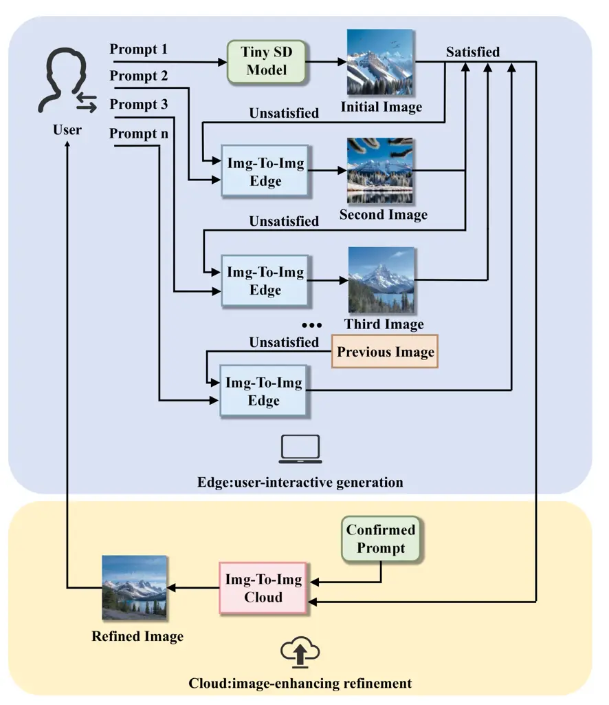
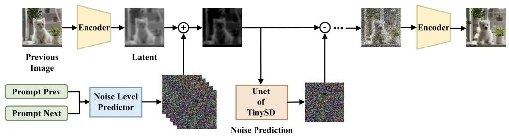
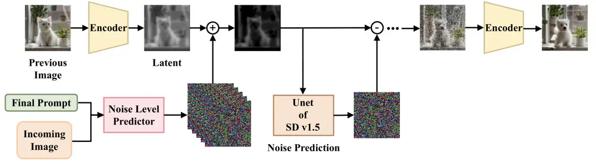
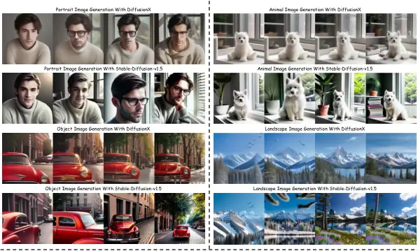

# DiffusionX: Efficient Edge-Cloud Collaborative Image Generation with Multi-Round Prompt Evolution

Yi Wei    Shunpu Tang    Liang Zhao    Qianqian Yang

###### Abstract

Recent advances in diffusion models have driven remarkable progress in
image generation. However, the generation process remains
computationally intensive, and users often need to iteratively refine
prompts to achieve the desired results, further increasing latency and
placing a heavy burden on cloud resources. To address this challenge, we
propose DiffusionX, a cloud–edge collaborative framework for efficient
multi-round, prompt-based generation. In this system, a lightweight
on-device diffusion model interacts with users by rapidly producing
preview images, while a high-capacity cloud model performs final
refinements after the prompt is finalized. We further introduce a noise
level predictor that dynamically balances the computation load,
optimizing the trade-off between latency and cloud workload. Experiments
show that DiffusionX reduces average generation time by 15.8% compared
with Stable Diffusion v1.5, while maintaining comparable image quality.
Moreover, it is only 0.9% slower than Tiny-SD with significantly
improved image quality, yet delivers significantly better image quality,
thereby demonstrating efficiency and scalability with minimal overhead.

###### Index Terms: 

Edge-Cloud systems, text-to-image synthesis, and low-latency inference

^(†)^(†)address: College of Information Science and Electronic
Engineering, Zhejiang University, Hangzhou, China

## 1 Introduction

Recent advances in generative diffusion models (GDMs) have significantly
improved the quality and diversity of text-to-image generation \[1, 2,
3\]. However, these models rely on iterative denoising across hundreds
of steps, and their large parameter sizes also increase computational
demands. For example, the Stable Diffusion XL (SDXL) base model \[4\]
contains 3.5 billion parameters and requires roughly 10 seconds to
generate a 1024×1024 image on a modern GPU, which limits its
practicality for real-world deployment.

To address this inefficiency, prior works have explored accelerating
generation by reducing the complexity of inference. On one hand, some
studies focus on model compression techniques such as pruning and
quantization \[5\], which eliminate redundant parameters and reduce
per-step computation while preserving generation quality. On the other
hand, researchers have investigated methods to decrease the number of
required denoising steps. For example, Xia et al. \[6\] proposed a
timestep tuner that adaptively adjusts integration directions,
mitigating truncation errors and improving quality with fewer steps. The
authors in \[7\] introduced an optimal linear subspace search (OLSS)
scheduler that approximates the full process in fewer steps, enabling
near real-time synthesis on powerful hardware. Moreover, the authors in
\[8\] proposed DeepCache, which caches intermediate features across
denoising stages, effectively skipping redundant steps and achieving
more than 2× speedup without retraining.



Figure 1: Illustration of the proposed DiffusionX framework, where the
edge model provides fast previews for user interaction and the cloud
model refines them into high-fidelity results.

While these approaches can effectively reduce image generation latency,
they still face several limitations. In practice, users often cannot
obtain the desired result in a single attempt and must refine or
supplement prompts based on previously generated images. However,
existing techniques treat each round of generation as an independent
process, leading to unnecessary system overhead. Furthermore, most
approaches focus solely on the cloud-computing paradigm and overlook the
potential of edge devices. Although lightweight models deployed on the
edge have limited capacity, they enable opportunities for collaborative
computing, where edge models generate coarse outputs and cloud models
subsequently refine or validate them \[9, 10\].

Motivated by this, we explore efficient edge-cloud collaborative image
generation by leveraging the integration of lightweight GDMs, such as
Tiny SD \[11\], on the edge with a large GDM in the cloud. In this
setting, the edge side supports user interaction and provides coarse
previews, while the cloud refines them into high-quality results. The
main contributions of this paper are as follows: 1) we propose
DiffusionX, a hybrid framework that integrates a lightweight edge GDM
with a large cloud GDM to better support multi-round user interaction. 2) We introduce strength predictors to reduce redundant noise
estimation, thereby lowering system overhead and accelerating iterative
refinement. 3) We conduct extensive experiments showing that DiffusionX
reduces generation time by 23.2% compared with a cloud-only large GDM,
while being only 2.1% slower than the lightweight baseline, while
maintaining comparable image quality to the large GDM.

## 2 Proposed System

As shown in Fig. 1, we propose DiffusionX, a collaborative edge–cloud
framework where the edge produces fast previews for user interaction and
the cloud refines them into high-fidelity results. The system consists
of two key modules: (1) a lightweight GDM with a semantic-aware strength
predictor for fast previews; (2) a cloud-based high-fidelity predictor
with skip-step denoising to refine results efficiently.



Figure 2: The structure of img2img generation on the edge with a noise
level predictor.

### 2.1 Fast Preview with Noise Level Predictor

On the edge, the lightweight GDM first generates a draft image \[12\]
from the user’s prompt to provide fast feedback. When the user refines
the prompt, the edge model updates the image using an image-to-image
(img2img) pipeline \[13, 14\]. As shown in Fig. 2, to ensure efficiency,
we introduce a semantic-aware noise level predictor that adapts the
strength parameter based on the semantic difference between the previous
and current prompts \[15, 16\]. This parameter controls the noise level,
thus the number of diffusion steps, to perform on the latent image.

Specifically, we use a text encoder to extract semantic embeddings from
prompts. Given previous and current prompts $`p_{t-1}`$ and $`p_{t}`$,
their embeddings are computed as
$`\mathbf{h}_{t-1}=f_{\text{MiniLM}}(p_{t-1})`$ and
$`\mathbf{h}_{t}=f_{\text{MiniLM}}(p_{t})`$, where
$`f_{\text{MiniLM}}(\cdot)`$ maps a prompt to a $`d`$-dimensional
embedding $`\mathbf{h}\in\mathbb{R}^{d}`$. A lightweight feed-forward
network (FFN) then predicts the strength
$`\hat{s}_{t}=g\!\left([\mathbf{h}_{t-1},\,\mathbf{h}_{t},\,\mathbf{h}_{t}-\mathbf{h}_{t-1}]\right)`$,
where $`g(\cdot)`$ is the FFN. To train the FFN, we construct a dataset
that contains pairs of prompts, such as $`(p_{t-1},p_{t})`$ and their
corresponding ground truth $`s^{*}`$. To be specific, we empirically
predefine a discrete set of candidate strengths ranging from 0.40 to
0.90 with a step size of 0.05. Next, for each prompt pair
$`(p_{t-1},p_{t})`$, we perform the img2img pipeline
$`I(\mathbf{x}_{t-1},p_{t};s)`$ with different $`s\in\mathcal{S}`$, and
compute the CLIP score between the generated image and the current
prompt $`p_{t}`$, respectively. The strength that achieves the highest
score is taken as the ground-truth label, given by

```math
s_{t}^{*}=\arg\max_{s\in\mathcal{S}}\ \text{CLIP}\bigg(I(\mathbf{x}_{t-1},p_{t};s),\,p_{t}\bigg), \tag{1}
```

where $`\text{CLIP}(\cdot,\cdot)`$ computes the image–text alignment
score, and $`\mathbf{x}_{t-1}`$ is the image generated in the previous
round. Thus, the loss function for training the strength predictor can
be expressed as

```math
\mathcal{L}_{\text{edge}}=\frac{1}{N}\sum_{n=1}^{N}\left(\hat{s}_{t}-s^{*}_{t}\right)^{2} \tag{2}
```

where $`N`$ is the number of training pairs. We note that during
training and inference, the predicted strength $`\hat{s}_{t}`$ is
clipped to satisfy the range of the predefined candidate set
$`\mathcal{S}`$.



Figure 3: The structure of img2img generation on the cloud with a noise
level predictor for refinement.

### 2.2 High-Fidelity Noise Level Predictor with Skip-Step Acceleration

Once the user finalizes the prompt, the edge sends the draft image and
confirmed prompt to the cloud for high-quality refinement. Similar to
the edge, the cloud uses an img2img pipeline and a strength predictor to
avoid redundant denoising, but with higher capacity and multimodal
fusion to improve quality, as shown in Fig. 3. The cloud employs a Unet
architecture, derived from SD v1.5, to extract noise, predict the noise
level, and perform denoising to refine the generated image.

To train this predictor, we use a higher-capacity language encoder, such
as BERT \[17\], to extract semantic embeddings
$`\mathbf{h}_{\text{cloud}}`$ from the prompt, and the CLIP image
encoder to obtain visual embeddings $`\mathbf{v}_{\text{cloud}}`$ from
the draft image. These embeddings are concatenated to form a multimodal
feature
$`\mathbf{z}_{\text{cloud}}=\phi(\mathbf{h}_{\text{cloud}},\mathbf{v}_{\text{cloud}})`$,
where $`\phi(\cdot)`$ denotes concatenation. A deep regression head then
maps this feature to a continuous strength value
$`\hat{s}_{t}^{\text{cloud}}`$ controlling the noise level in the
img2img pipeline:

```math
\hat{s}_{\text{cloud}}=f_{\text{DeepReg}}\!\left(\mathbf{h}_{\text{cloud}},\mathbf{v}_{\text{cloud}}\right), \tag{3}
```

where $`f_{\text{DeepReg}}(\cdot)`$ is the regression head.

The cloud predictor is trained similarly to the edge predictor, using a
prompt dataset and corresponding CLIP-selected strengths as ground
truth. The loss function is:

```math
\mathcal{L}_{\text{cloud}}=\frac{1}{N}\sum_{t=1}^{N}\left(\hat{s}_{t}^{\text{cloud}}-s_{t}^{*}\right)^{2}+\lambda\,\Omega(\theta), \tag{4}
```

where $`s^{*}_{\text{cloud}}`$ is the CLIP-derived strength,
$`\hat{s}^{\text{cloud}}`$ is the predicted strength, $`\Omega(\theta)`$
is the regularization term, and $`\lambda>0`$ balances regularization
and regression loss. Based on the predicted strength, the cloud performs
img2img refinement with a skip-step denoising schedule to reduce
redundant computation.

| Model      | FID ↓  | CLIP SCORE ↑ | IS (SD) ↑      |
| ---------- | ------ | ------------ | -------------- |
| SD v1.5    | 12.808 | 0.297        | 23.387 (1.809) |
| Tiny-SD    | 45.482 | 0.249        | 13.800 (0.599) |
| DiffusionX | 17.016 | 0.313        | 24.943 (2.166) |

Table 1: Comparison of image generation quality across different models
in terms of FID, CLIP, and IS SCORE on the MS-COCO 30K Dataset.

## 3 EXPERIMENTS

### 3.1 Experimental Setup

In experiments, we evaluate the peformance of the proposed DiffusionX
and also provide two baselines for comparison: 1) Tiny SD deployed on
the edge and 2) Stable Diffusion v1.5 (SD v1.5) on the cloud. The edge
equipped with an NVIDIA RTX 4060 8GB GPU, while the cloud uses an NVIDIA
RTX A6000 48GB GPU. We assess image quality using the MS-COCO 30K
dataset \[18\], reporting FID \[19\], CLIP Score, and IS \[20\]. To
evaluate generation speed, we construct the
COCO2017-Interactive-Prompts-400 dataset, based on the COCO 2017 dataset
\[18\], which simulates user interactions by progressively updating
prompt pairs with 400 captions. As for the connection between the edge
and cloud, we assume an uplink bandwidth of 20 Mbps, which is typical
for 4G/5G networks \[21\].



Figure 4: Visual examples of images generated by SD v1.5 and the
proposed DiffusionX on the COCO2017-Interactive-Prompts-400 Dataset.

### 3.2 Image Generation Quality

As shown in Table 1, we compare the image generation quality of the
three models on the MS-COCO 30K dataset in terms of FID, CLIP score, and
IS. We can see that the proposed DiffusionX achieves the highest average
CLIP score of 0.313, indicating the best alignment between generated
images and textual prompts among the compared models. Moreover, the
proposed DiffusionX also achieves comparable FID and IS scores to SD
v1.5, and outperforms Tiny-SD significantly in all metrics. These
results demonstrate the effectiveness of the proposed DiffusionX.

As shown in Fig. 4, we provide some visual examples of images generated
by SD v1.5 and the proposed DiffusionX. We can see that both models can
generate high-quality images that align well with the prompts. These
visual results further validate the effectiveness of the proposed
DiffusionX in generating high-quality images from textual prompts.

### 3.3 Image Generation Efficiency

As shown in Table 2, we compare the image generation latency of the
three models on the COCO2017-Interactive-Prompts-400 dataset. We can see
that the proposed DiffusionX can reduce the average total generation
time by 2.23s compared to SD v1.5 running on the cloud, while being only
0.13s slower than Tiny-SD running on the edge. We note that although
DiffusionX introduces an additional transmission, the incurred latency
is only 0.20s, which accounts for a small fraction of the total system
latency.. These demonstrates that the proposed DiffusionX can achieve a
good balance between efficiency and image quality.

| Model      | Trans. Latency (s) ↓ | Total Latency (s) ↓ |
| ---------- | -------------------- | ------------------- |
| SD v1.5    | \-                   | 14.15               |
| Tiny-SD    | \-                   | 11.79               |
| DiffusionX | 0.20                 | 11.92               |

Table 2: Efficiency comparison across different models in terms of
average transmission latency and total latency on the
COCO2017-Interactive-Prompts-400 Dataset.

| Model         | Trans. Latency (s) ↓ | Avg. Total Time (s) ↓ |
| ------------- | -------------------- | --------------------- |
| w/o predictor | 0.20                 | 13.96                 |
| w/ predictor  | 0.20                 | 11.92 (-15.8%)        |

Table 3: Ablation study on the impact of the noise level predictor on
latency.

### 3.4 Ablation Studies

We also conduct an ablation study to assess the impact of the proposed
noise level predictor on the performance of DiffusionX. As shown in
Table 3, we frist compare the system latency of DiffusionX with and
without the predictor. We can see that adding the predictor reduces the
average total generation time from 13.96s to 11.92s, achieving a 15.8%
speedup. This is because the predictor helps avoid redundant denoising
steps, thereby reducing computation.

| Model         | FID ↓  | CLIP SCORE ↑ | IS (SD) ↑      |
| ------------- | ------ | ------------ | -------------- |
| w/o predictor | 21.453 | 0.318        | 25.399 (2.851) |
| w/ predictor  | 17.016 | 0.313        | 24.943 (2.166) |

Table 4: Ablation study on the impact of the noise level predictor on
image generation quality.

Moreover, we compare the image generation quality of DiffusionX with and
without the predictor on the MS-COCO 30K dataset, as shown in Table 4.
We can see that adding the predictor reduces FID from 21.453 to 17.016,
while maintaining competitive CLIP and IS scores. This indicates that
the proposed predictor can help improve image quality while reducing
system latency as well. These results demonstrate the effectiveness of
the proposed noise level predictor.

## 4 CONCLUSIONS

In this paper, we proposed DiffusionX, a cloud–edge collaborative
framework for efficient multi-round text-to-image generation, where the
edge provides fast previews for user interaction and the cloud refines
them into high-fidelity results. We introduced strength predictors on
both sides to reduce redundant noise estimation, thereby lowering system
overhead and accelerating iterative refinement. Extensive experiments
demonstrated that the proposed DiffusionX can reduce average total
generation latency by over 15.8% compared to SD v1.5 , while maintaining
competitive image quality.

## 5 ACKNOWLEDGEMENT

This work is partly supported by the NSFC under grant No. 62293481, No.
62571487, No. 62201505, by the National Key R&D Program of China under
Grant 2024YFE0200802, and by the Zhejiang Provincial Natural Science
Foundation of China under Grant No. LZ25F010001.

## References

- \[1\] C. Zhang, C. Zhang, M. Zhang, I. S. Kweon, and J. Kim,
  “Text-to-image Diffusion Models in Generative AI: A Survey,”
  arXiv:2303.07909, 2024.
- \[2\] N. Ruiz, Y. Li, V. Jampani, Y. Pritch, M. Rubinstein, and
  K. Aberman, “DreamBooth: Fine Tuning Text-to-Image Diffusion Models
  for Subject-Driven Generation,” arXiv:2208.12242, 2023.
- \[3\] P. Esser, S. Kulal, A. Blattmann, R. Entezari, J. Müller, and
  et al., “Scaling Rectified Flow Transformers for High-Resolution Image
  Synthesis,” arXiv:2403.03206, 2024.
- \[4\] D. Podell, Z. English, K. Lacey, A. Blattmann, T. Dockhorn,
  J. Müller, J. Penna, and R. Rombach, “SDXL: Improving Latent Diffusion
  Models for High-Resolution Image Synthesis,” arXiv:2307.01952, 2023.
- \[5\] Y. D. Kwon, R. Li, S. Li, D. Li, S. Bhattacharya, and S. I.
  Venieris, “HierarchicalPrune: Position-Aware Compression for
  Large-Scale Diffusion Models,” arXiv preprint arXiv:2508.04663,
  Aug. 2025.
- \[6\] M. Xia, Y. Shen, C. Lei, Y. Zhou, D. Zhao, R. Yi, W. Wang, and
  Y.-J. Liu, “Towards More Accurate Diffusion Model Acceleration with a
  Timestep Tuner,” in Proc. IEEE/CVF Conf. Comput. Vis. Pattern
  Recognit. (CVPR), 2024, pp. 5736–5745.
- \[7\] Z. Duan, C. Wang, C. Chen, J. Huang, and W. Qian, “Optimal
  Linear Subspace Search: Learning to Construct Fast and High-Quality
  Schedulers for Diffusion Models,” in Proc. ACM Int. Conf. Inf. Knowl.
  Manag. (CIKM), 2023, pp. 463–472.
- \[8\] X. Ma, G. Fang, and X. Wang, “DeepCache: Accelerating Diffusion
  Models for Free,” in Proc. IEEE/CVF Conf. Comput. Vis. Pattern
  Recognit. (CVPR), 2024, pp. 15762–15772.
- \[9\] S. Oh, J. Kim, J. Park, S.-W. Ko, T. Q. S. Quek, and S.-L. Kim,
  “Uncertainty-aware hybrid inference with on-device small and remote
  large language models,” in Proc. IEEE Int. Conf. Mach. Learn. Commun.
  Netw. (ICMLCN), 2025, pp. 1–7.
- \[10\] F. Yang, Z. Wang, H. Zhang, Z. Zhu, X. Yang, G. Dai, and
  Y. Wang, “Efficient Deployment of Large Language Model across
  Cloud-Device Systems,” in Proc. IEEE Int. System-on-Chip Conf. (SOCC),
  2024, pp. 1–6.
- \[11\] B.-K. Kim, H.-K. Song, T. Castells, and S. Choi, “BK-SDM: A
  lightweight, fast, and cheap version of stable diffusion,” in Proc.
  Eur. Conf. Comput. Vis. (ECCV), 2024, vol. 15112, pp. 381–399.
- \[12\] X. Zheng, W. Zhang, C. Hu, L. Zhu, and C. Zhang,
  “Cloud-Edge-End Collaborative Inference in Mobile Networks: Challenges
  and Solutions,” IEEE Netw., vol. 39, no. 4, pp. 90–96, 2025.
- \[13\] C. Saharia, W. Chan, H. Chang, C. Lee, J. Ho, T. Salimans,
  D. Fleet, and M. Norouzi, “Palette: Image-to-Image Diffusion Models,”
  in Proc. ACM SIGGRAPH Conf., 2022, pp. 1–10.
- \[14\] L. Stanchev, “Measuring the Strength of the Semantic
  Relationship Between Words,” Int. J. Artif. Intell. Tools, vol. 24,
  no. 02, pp. 1540011, 2015.
- \[15\] A. Hertz, R. Mokady, J. Tenenbaum, K. Aberman, Y. Pritch, and
  D. Cohen-Or, “Prompt-to-Prompt Image Editing with Cross Attention
  Control,” in Proc. Int. Conf. Learn. Represent. (ICLR), 2023.
- \[16\] R. Mokady, A. Hertz, K. Aberman, Y. Pritch, and D. Cohen-Or,
  “Null-text Inversion for Editing Real Images using Guided Diffusion
  Models,” in Proc. IEEE/CVF Conf. Comput. Vis. Pattern Recognit.
  (CVPR), pp. 6038–6047.
- \[17\] J. Devlin, M. Chang, K. Lee, and K. Toutanova, “BERT:
  pre-training of deep bidirectional transformers for language
  understanding,” in Proc. Conf. North Am. Chapter Assoc. Comput.
  Linguistics (NAACL), 2019, pp. 4171–4186.
- \[18\] T.-Y. Lin, M. Maire, S. Belongie, J. Hays, P. Perona,
  D. Ramanan, P. Dollár, and C. L. Zitnick, “Microsoft COCO: Common
  Objects in Context,” in Proc. Eur. Conf. Comput. Vis. (ECCV), 2014,
  vol. 8693, pp. 740–755.
- \[19\] M. Heusel, H. Ramsauer, T. Unterthiner, B. Nessler, and
  S. Hochreiter, “GANs Trained by a Two Time-Scale Update Rule Converge
  to a Local Nash Equilibrium,” in Adv. Neural Inf. Process. Syst.
  (NeurIPS), 2017.
- \[20\] T. Salimans, I. Goodfellow, W. Zaremba, V. Cheung, A. Radford,
  and X. Chen, “Improved Techniques for Training GANs,” in Adv. Neural
  Inf. Process. Syst. (NeurIPS), 2016, p. 2234–2242.
- \[21\] “Realtime mobile bandwidth and handoff predictions in 4G/5G
  networks,” Compt. Netw., vol. 204, pp. 108736, 2022.
