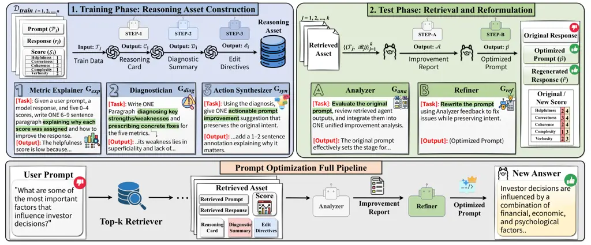

# MA-SAPO: Multi-Agent Reasoning for Score-Aware Prompt Optimization

Juhyeon Lee ^(†)^(†)thanks: Equal contribution. Affiliation: Peking
University Email: [haihua.chen@unt.edu](mailto:)    Wonduk Seo
^(†)^(†)thanks: This work was done while Wonduk Seo was at Enhans.
Email: [buyi@pku.edu.cn](mailto:)    Junseo Koh Affiliation: Peking
University    Wonseok Choi Affiliation: Peking University    Hyunjin An
Affiliation: Enhans    Jian Park  Seunghyun Lee  Haihua Chen  Yi Bu
^(†)^(†)thanks: Corresponding author(s): Haihua Chen, Yi Bu.
Affiliation: Peking University Affiliation: Enhans Affiliation: Fudan
University Affiliation: University of North
Texas{leejuhyeon,junseokoh,choiwonseok}@stu.pku.edu.cn, wonduk@enhans.ai

###### Abstract

Prompt optimization has become a practical way to improve the
performance of Large Language Models (LLMs) without retraining. However,
most existing frameworks treat evaluation as a black box, relying solely
on outcome scores without explaining why prompts succeed or fail.
Moreover, they involve repetitive trial-and-error refinements that
remain implicit, offering limited interpretability or actionable
guidance for systematic improvement. In this paper, we propose MA-SAPO:
a new Multi-Agent Reasoning for Score Aware Prompt Optimization
framework that links evaluation outcomes directly to targeted
refinements. Specifically, in the _Training Phase_, multiple agents
interpret evaluation scores, diagnose weaknesses, and generate concrete
revision directives, which are stored as reusable reasoning assets. In
the _Test Phase_, an analyzer agent retrieves relevant exemplars and
assets for a new prompt, and a refiner agent applies evidence-based
edits to improve the prompt and its response.By grounding optimization
in structured reasoning, MA-SAPO ensures edits are interpretable,
auditable, and controllable. Experiments on the \*_HelpSteer1_/2\*
benchmarks show that our framework consistently outperforms single-pass
prompting, retrieval-augmented generation, and prior multi-agent methods
across multiple evaluation metrics.

|     |
| --- |
|     |

## 1 Introduction

Large Language Models (LLMs) have emerged as powerful tools capable of
tackling a wide range of tasks, from reasoning and summarization to
complex dialogue and code generation (Brown et al., 2020; Chowdhery et
al., 2023; Touvron et al., 2023). However, their performance remains
highly sensitive to the wording and examples embedded within
prompts (Pryzant et al., 2023; He et al., 2024; Cao et al., 2024; Razavi
et al., 2025). Consequently, prompt optimization has rapidly emerged as
a practical alternative to costly retraining or parameter updates for
improving model behavior.

Early research explored single-pass prompt optimization that effectively
treats the LLM as its own optimizer. Approaches such as Chain-of-Thought
(CoT) prompting (Wei et al., 2022), role conditioning via carefully
crafted system instructions (Wu et al., 2023; Kong et al., 2024), and
structured reasoning schemes including Tree-of-Thought (ToT) (Yao et
al., 2023), Graph-of-Thought (GoT) (Besta et al., 2024), and step-back
prompting (Zheng et al., 2024) demonstrated that encoding explicit
reasoning structure or role signals in the prompt can materially improve
downstream performance. Nevertheless, these methods are largely
self-contained, relying on a single model instance to revise prompts
without leveraging systematic feedback across iterations or external
resources.

As LLMs have advanced, multi-agent frameworks have emerged to broaden
viewpoints and coordinate specialized roles in prompt optimization (Zhou
et al., 2025; Zhang et al., 2025; Han et al., 2025). By delegating
subtasks such as decomposition, evaluation, and refinement to distinct
agents, these systems extend beyond single-pass rewriting into more
structured pipelines. In parallel, optimization-theoretic approaches (Li
et al., 2025a; Cui et al., 2025) and label-efficient schemes (Xiang et
al., 2025; Dong et al., 2025) aim to curb reliance on expensive feedback
while scaling across tasks.

Despite these advances, several common limitations remain: (i)
evaluation is often collapsed to scalar scores, obscuring why prompts
succeed or fail; (ii) refinement remains largely trial-and-error,
incurring high computational cost with limited transparency; (iii)
reasoning, when used, is typically implicit rather than distilled into
auditable artifacts that drive targeted edits; and (iv) pipelines
prioritize score gains over interpretability and controllability, which
hinders practitioners from analyzing trade-offs and making precise
adjustments in real-world applications.

To address these limitations, we introduce MA-SAPO, a sequential
reasoning framework for prompt optimization that explicitly maps metric
outcomes to actionable edits via structured reasoning artifacts. MA-SAPO
has two phases. In the _training phase_, three agents convert annotated
scores into reusable assets: (1) a Metric Explainer interprets
evaluation dimensions, (2) a Diagnostician identifies error sources and
trade-offs, and (3) an Action Synthesizer produces concrete edit
directives. In the _test phase_, a retrieval-augmented pipeline applies
these assets: an Analyzer contrasts the current prompt with retrieved
exemplars to surface improvement opportunities, and a Refiner performs
targeted edits grounded in diagnostic evidence, yielding interpretable
and controllable optimization.

Experiments on HelpSteer1/2 (Wang et al., 2024c; Wang et al., 2024b)
show that MA-SAPO consistently surpasses single-pass prompting,
retrieval-augmented generation, and prior multi-agent baselines,
underscoring structured reasoning as an effective bridge between
evaluation and optimization. Our contributions are:

- •
  A score-aware multi-agent training pipeline that distills evaluation
  outcomes into reusable, semi-structured reasoning assets for
  explanation, diagnosis, and edit directives.
- •
  MA-SAPO, a modular and compute-efficient framework that delivers
  interpretable, auditable, and controllable gains while substantially
  reducing token and API-call budgets.
- •
  Extensive results on HelpSteer1/2 demonstrating consistent
  multi-metric improvements and outperforming six state-of-the-art
  baselines in both effectiveness and efficiency.

## 2 Related work

### 2.1 Single-pass prompt optimization

Prompt optimization has rapidly evolved as a practical means of
improving the performance of LLMs without retraining (Wei et al., 2022;
Pryzant et al., 2023; Sun et al., 2023; Li et al., 2025b). Early studies
highlighted the centrality of prompts as control variables for steering
model behavior. Specifically, few-shot prompting (Brown et al., 2020)
demonstrated that models could adapt to unseen tasks using in-context
examples alone, while retrieval-augmented generation (RAG) (Lewis et
al., 2020; Lee et al., 2025) injected external knowledge to improve
factuality and adaptability. These two paradigms, context construction
and evidence injection, laid the foundation for single-pass prompt
optimization methods. Subsequent research explored reasoning-augmented
prompting. Chain-of-Thought (CoT) (Wei et al., 2022) introduced
intermediate reasoning steps. Building on this idea, Tree-of-Thought
(ToT) (Yao et al., 2023) generalized linear reasoning chains into
branching structures with self-evaluation via lookahead and
backtracking. Other structured strategies, such as Skeleton-of-Thought
(SoT) (Ning et al., 2023), separate planning from execution to
parallelize generation, while Graph-of-Thought (GoT) (Besta et al., 2024) organizes reasoning trajectories into graph topologies.
Evolutionary and heuristic single-pass approaches have also been
explored. For instance, PromptBreeder (Fernando et al., 2023) evolves a
population of prompts through mutation and selection, while
PromptWizard (Agarwal et al., 2024) refines prompts via feedback-driven
critique-and-synthesis loops.

### 2.2 Multi-agent based prompt optimization

Beyond single-pass methods, multi-agent systems have emerged as a
powerful paradigm for prompt optimization (Du et al., 2024; Liu et al.,
2024; Chen et al., 2024; Li et al., 2024; Seo et al., 2026). Early
agentic frameworks such as Self-Ask (Press et al., 2023) introduced
decomposition by generating sub-questions and integrating external
retrieval, laying the groundwork for cooperative prompting strategies.
Multi-Agent Debate (MAD) (Du et al., 2024) advanced this idea by
allowing agents to iteratively present and critique answers in a
roundtable format, thereby improving factual grounding and reasoning
quality. Reflection-based frameworks (Shinn et al., 2023; Khan et al., 2024) further enhanced adaptability by storing feedback as memory for
subsequent optimization attempts. Building on this foundation, recent
systems formalized agent roles and workflows to optimize prompts more
systematically (Li et al., 2023). Subsequent work explicitly targeted
prompt optimization as the objective. For instance, MASS (Zhou et al., 2025) searches over agent topologies while performing block-level prompt
refinement, followed by global optimization. Additionally, MARS (Zhang
et al., 2025) leverages a Planner and Teacher–Critic–Student dialogue to
iteratively propose, critique, and revise prompts in structured rounds.
MAPGD (Han et al., 2025) further integrates pseudo-gradient feedback
with bandit-style exploration, offering sample-efficient optimization
through agent collaboration. However, most existing frameworks treat
evaluation as a black box with limited interpretability and rely on
costly trial-and-error refinements. MA-SAPO addresses this by grounding
optimization in score-aware reasoning assets that link evaluation
outcomes to actionable, interpretable, and auditable refinements.

## 3 Methodology



Figure 1: MA-SAPO pipeline overview. Three training agents convert
annotated prompt–response pairs into reusable Reasoning Assets
$`\mathcal{R}_{i}=(\mathcal{C}_{i},\mathcal{D}_{i},\mathcal{E}_{i})`$.
At test time, retrieved assets guide the Analyzer $`G_{\mathrm{ana}}`$
and Refiner $`G_{\mathrm{ref}}`$ to produce an optimized prompt
$`\hat{p}`$ with higher scores across all five evaluation dimensions.

### 3.1 Preliminaries

Let the training dataset be denoted as

```math
\mathcal{D}_{train}=\{\tau_{i}\}_{i=1}^{N},\quad\tau_{i}=(p_{i},r_{i},\mathcal{S}_{i}),
```

where each entry $`\tau_{i}`$ consists of a prompt $`p_{i}`$, its
associated response $`r_{i}`$, and a set of scores
$`\mathcal{S}_{i}=\{s_{help},s_{corr},s_{coh},s_{comp},s_{verb}\}`$,
corresponding to the dimensions of _helpfulness_, _correctness_,
_coherence_, _complexity_, and _verbosity_. The test set is denoted as

```math
\mathcal{D}_{test}=\{p_{j}\}_{j=1}^{M},
```

where only prompts are available, and corresponding responses are
generated during evaluation. Our objective is to generate structured
reasoning assets from $`\mathcal{D}_{train}`$ that can be retrieved to
optimize new prompts and their corresponding responses. Thus, the
training phase serves as _data generation_, while the test phase
operates as a _retrieval-augmented optimization_ pipeline.

Throughout this framework, we employ several specialized agents denoted
as $`G`$. Each agent is designed with a distinct functional role:
$`G_{\text{exp}}`$ explains metric-level outcomes, $`G_{\text{diag}}`$
diagnoses weaknesses and trade-offs, $`G_{\text{syn}}`$ synthesizes
actionable directives, $`G_{\text{ana}}`$ analyzes retrieved examples,
and $`G_{\text{ref}}`$ refines prompts into optimized versions. These
agents are executed in sequential order within their respective phases,
and their outputs are explicitly stored for later retrieval and
reasoning. The overview of the MA-SAPO framework is shown in Figure 1.

### 3.2 Training phase: reasoning asset construction

In the training phase, three agents are executed sequentially for each
$`\tau_{i}\in\mathcal{D}_{train}`$. All three agents operate on the same
triplet $`\tau_{i}=(p_{i},r_{i},\mathcal{S}_{i})`$, ensuring that their
reasoning is consistently grounded in both the input and output of the
original instance.

#### 3.2.1 Metric explainer agent $`G_{\text{exp}}`$

The Metric Explainer Agent generates natural language justifications for
the assigned scores. Formally, given $`\tau_{i}`$, the agent produces a
reasoning card $`\mathcal{C}_{i}`$:

```math
\mathcal{C}_{i}=G_{\text{exp}}(\tau_{i},P_{\text{exp}}), \tag{1}
```

where $`P_{\text{exp}}`$ is the system prompt guiding explanation. Each
card explicitly outlines the reason why $`\tau_{i}`$ received its
annotated scores. The reasoning card $`\mathcal{C}_{i}`$ then serves as
input to the next agent, together with $`\tau_{i}`$.

#### 3.2.2 Diagnostician agent $`G_{\text{diag}}`$

The Diagnostician Agent operates on $`\tau_{i}`$ and the reasoning card
$`\mathcal{C}_{i}`$. It extends $`\mathcal{C}_{i}`$ by analyzing
metric-level weaknesses and trade-offs. $`G_{\text{diag}}`$ produces a
diagnostic summary $`\mathcal{D}_{i}`$ that identifies: (1) the key
causes of low-scoring dimensions, and (2) trade-offs across metrics
(e.g., verbosity vs. coherence).

```math
\mathcal{D}_{i}=G_{\text{diag}}(\tau_{i},\mathcal{C}_{i},P_{\text{diag}}). \tag{2}
```

The diagnostic summary $`\mathcal{D}_{i}`$ is then passed to the next
stage, along with $`\tau_{i}`$.

#### 3.2.3 Action synthesizer agent $`G_{\text{syn}}`$

The Action Synthesizer Agent receives $`\tau_{i}`$ together with
$`\mathcal{C}_{i}`$ and $`\mathcal{D}_{i}`$. It converts these enriched
insights into actionable edit directives (EDs). Each directive
corresponds to a concrete modification strategy for improving
$`\tau_{i}`$:

```math
\mathcal{E}_{i}=G_{\text{syn}}(\tau_{i},\mathcal{C}_{i},\mathcal{D}_{i},P_{\text{syn}}), \tag{3}
```

where $`\mathcal{E}_{i}=\{e_{1},e_{2},\dots,e_{m}\}`$ is a set of
recommended edits.

##### Definition (reasoning assets).

For notational convenience, we define the collection of training outputs
for instance $`i`$ as:

```math
\mathcal{R}_{i}=(\mathcal{C}_{i},\mathcal{D}_{i},\mathcal{E}_{i}).
```

As a result, $`\mathcal{R}_{i}`$ is stored as reasoning assets aligned
with $`\tau_{i}`$, forming the retrieval corpus for the test phase.
Importantly, these reasoning assets are designed as semi-structured
text, which makes them machine-parseable and directly usable by
downstream agents in the test phase. For instance, edit directives often
follow a pattern such as “add a constraint to …”, which the refiner
agent can reliably identify and execute.

### 3.3 Test phase: retrieval and reformulation

In the test phase, optimization is performed via retrieval-augmented
generation. Given a new prompt $`p_{\text{test}}`$, we adopt a sparse
lexical retriever that ranks training prompts based on term-frequency
and inverse document-frequency statistics. Each training prompt
$`p_{j}`$ is represented in the sparse lexical space, and a relevance
score is computed between $`p_{\text{test}}`$ and $`p_{j}`$ according to
token overlap weighted by discriminative importance. The top-$`k`$ most
relevant prompt-response pairs are then retrieved along with their
corresponding reasoning assets:

```math
\{(\tau_{j},\mathcal{R}_{j})\}_{j=1}^{k}.
```

#### 3.3.1 Analyzer agent $`G_{\text{ana}}`$

The Analyzer Agent compares $`p_{\text{test}}`$ against retrieved
examples to identify improvement points. It outputs an improvement
report $`\mathcal{A}`$:

```math
\mathcal{A}=G_{\text{ana}}(p_{\text{test}},\{\tau_{i},\mathcal{R}_{j}\}_{j=1}^{k},P_{\text{ana}}). \tag{4}
```

The Analyzer Agent transforms raw retrieval into structured insights
rather than merely transferring edits from similar prompts. The agent
highlights concrete weaknesses and improvement opportunities by
contrasting the test prompt with retrieved reasoning assets.

#### 3.3.2 Refiner agent $`G_{\text{ref}}`$

The Refiner Agent regenerates an optimized prompt $`\hat{p}`$ by
incorporating the improvement report:

```math
\hat{p}=G_{\text{ref}}(p_{\text{test}},\mathcal{A},P_{\text{ref}}). \tag{5}
```

It operationalizes the analyzer’s insights into a concrete optimized
prompt. Compared to a direct rewriting approach, which may introduce
irrelevant or unjustified changes, the refiner explicitly conditions on
the improvement report, producing refinements that are focused,
justifiable, and consistent with diagnostic evidence. The final
optimized prompt $`\hat{p}`$ is then used to generate a corresponding
optimized response $`\hat{r}`$.¹¹ 1 The detailed prompt templates and
specific role descriptions for all agents are provided in Appendix F.

## 4 Experimental design and setup

### 4.1 Datasets

We conduct our experiments on the HelpSteer family of datasets (Wang et
al., 2024c; Wang et al., 2024b), which provide human-annotated
prompt-response pairs scored across five quality dimensions on a 0--4
scale.²² 2 Detailed descriptions of the five annotation dimensions are
provided in Table 4 in Appendix A. Both datasets share the same
annotation schema but differ in size and design, as summarized in
Table 1. We build our retrieval corpus exclusively from the HelpSteer2
training set, as it offers higher-quality annotations and broader prompt
diversity, with approximately 29% of samples consisting of multi-turn
interactions. Furthermore, its preference annotations between responses
provide finer-grained evidence for our Analyzer and Refiner agents, and
it serves as the current benchmark standard for training and evaluating
reward models. Evaluation is conducted on the validation splits of both
HelpSteer1 and HelpSteer2.

| Dataset    | Train | Val   | Multi-turn | Preference Ann. |
| ---------- | ----- | ----- | ---------- | --------------- |
| HelpSteer1 | 35.3k | 1.79k | ×          | ×               |
| HelpSteer2 | 20.3k | 1.04k | ✓          | ✓               |

Table 1: Statistics of the HelpSteer1/2 datasets. Both share the same
annotation schema of five quality dimensions scored on a 0–4 scale.

### 4.2 Models used

##### Reasoning–asset generation (corpus construction).

To construct the retrieval corpus, we employ the three reasoning agents
($`G_{\text{exp}}`$, $`G_{\text{diag}}`$, $`G_{\text{syn}}`$) using the
o4-mini reasoning model from OpenAI (Achiam et al., 2023). This model is
used exclusively for _reasoning asset construction_ rather than
downstream inference. All generations follow default API
hyperparameters. For each training instance $`\tau_{i}`$, it produces a
reasoning card $`\mathcal{C}_{i}`$, a diagnostic summary
$`\mathcal{D}_{i}`$, and a set of edit directives $`\mathcal{E}_{i}`$,
which together form the stored reasoning assets $`\mathcal{R}_{i}`$.

##### Generation models for evaluation.

For downstream evaluation, we adopt a representative API model
GPT-4o (Achiam et al., 2023), and an open-source model
Llama3-8B-Instruct (Dubey et al., 2024) as the backbone models. These
models are responsible for generating (i) optimized prompts $`\hat{p}`$
from the Refiner Agent and (ii) the corresponding optimized responses
$`\hat{r}`$ conditioned on $`\hat{p}`$. Both models are configured with
temperature $`=0`$ to ensure deterministic decoding, and all other
hyperparameters remain at their defaults.

##### Judge model.

We employ the ArmoRM-Llama3-8B-v0.1 reward model (Wang et al., 2024a) as
an interpretable multi-objective evaluator ($`>90\%`$ benchmark
accuracy), which automatically scores response quality. For any
prompt-response pair, the judge model returns five HelpSteer-aligned
scores:

```math
\mathcal{M}=\{\text{help},\text{corr},\text{coh},\text{comp},\text{verb}\},\quad s_{m}\in[0,4].
```

##### Retrieval.

We adopt a sparse retriever based on BM25 (Robertson et al., 2009) over
prompt text. For each test prompt $`p_{\text{test}}`$, we retrieve the
top-$`k`$ training prompts with $`k=3`$, which we identify as the
optimal setting for retrieval³³ 3 A detailed analysis of $`k`$ values
and their effects on performance is provided in Section 5.2.1. and
attach their paired responses and reasoning assets:

```math
\{(p_{j},r_{j},\mathcal{R}_{j})\}_{j=1}^{k=3}. \tag{6}
```

### 4.3 Evaluation

##### Evaluation metrics.

To assess the effectiveness of our framework, we evaluate each candidate
pair $`(p,r)`$ is evaluated across the five HelpSteer dimensions
$`\mathcal{M}=\{\text{help},\text{corr},\text{coh},\text{comp},\text{verb}\}`$,
where each raw score $`s_{m}\in[0,4]`$. We normalize scores by dividing
by $`4`$, yielding $`\tilde{s}_{m}=s_{m}/4\in[0,1]`$. The overall
quality score is then defined as the average over all metrics:

```math
\mathrm{Score}(p,r)=\tfrac{1}{|\mathcal{M}|}\sum_{m\in\mathcal{M}}\tfrac{s_{m}}{4}. \tag{7}
```

This produces a single composite value in the range $`[0,1]`$,
reflecting the overall response quality. We additionally complement
automatic metrics with a human evaluation involving 17 expert
annotators, which examines (H1) the usefulness, accuracy, and
consistency of the reasoning and (H2) whether optimized prompts preserve
the original intent.⁴⁴ 4 The results of this human evaluation are
presented in Section 5.3, with detailed protocols and per-dimension
scores in Appendix E.

### 4.4 Baselines

We compare our method with six baselines in three settings: single-pass
prompt optimization without retrieval (Direct Generation, CoT (Wei et
al., 2022), and Role Assignment (Wu et al., 2023)), retrieval-augmented
optimization (RAG (Lewis et al., 2020)), and multi-agent optimization
(MAD (Du et al., 2024) and MARS (Zhang et al., 2025)). For all methods,
the model first generates an optimized prompt from the input, and then
produces the final response from that optimized prompt using the same
backbone LLM. We use GPT-4o and Llama3-8B-Instruct for all baselines,
with temperature set to $`0`$ and other decoding settings kept at their
defaults. For RAG, we retrieve the top-$`10`$ training examples using
BM25. For MAD, we use $`2`$ agents and $`3`$ debate rounds. For MARS, we
use $`3`$–$`4`$ planning steps and $`5`$ refinement iterations.⁵⁵ 5
Baseline details are provided in Appendix B.

## 5 Experimental results and analysis

### 5.1 Main results

|                                 |        |        |        |        |        |        |           |        |        |        |        |        |
| ------------------------------- | ------ | ------ | ------ | ------ | ------ | ------ | --------- | ------ | ------ | ------ | ------ | ------ |
| Methods                         | GPT-4o |        |        |        |        |        | Llama3-8B |        |        |        |        |        |
|                                 | Help   | Corr   | Coh    | Comp   | Verb   | Avg    | Help      | Corr   | Coh    | Comp   | Verb   | Avg    |
| _HelpSteer1_                    |        |        |        |        |        |        |           |        |        |        |        |        |
| Direct Generation               | 0.3216 | 0.3866 | 0.7583 | 0.2951 | 0.4215 | 0.4366 | 0.2549    | 0.3247 | 0.7054 | 0.2702 | 0.4062 | 0.3927 |
| RAG (sparse, $`k{=}10`$) (2020) | 0.3751 | 0.4402 | 0.7871 | 0.3116 | 0.4779 | 0.4784 | 0.2930    | 0.3594 | 0.7452 | 0.3007 | 0.4377 | 0.4272 |
| Chain-of-Thought (CoT) (2022)   | 0.3223 | 0.3876 | 0.7595 | 0.2935 | 0.4192 | 0.4364 | 0.2359    | 0.3077 | 0.6906 | 0.2627 | 0.3967 | 0.3787 |
| Role Assignment (2023)          | 0.3988 | 0.4679 | 0.8024 | 0.3427 | 0.5008 | 0.5025 | 0.2887    | 0.3516 | 0.7287 | 0.3164 | 0.4517 | 0.4274 |
| MAD (2024)                      | 0.3774 | 0.4764 | 0.7954 | 0.3210 | 0.5248 | 0.4990 | 0.3774    | 0.5049 | 0.8067 | 0.4084 | 0.6708 | 0.5531 |
| MARS (2025)                     | 0.4159 | 0.4876 | 0.7963 | 0.3293 | 0.5188 | 0.5096 | 0.3901    | 0.4591 | 0.7745 | 0.3512 | 0.5801 | 0.5110 |
| MA-SAPO (Ours)                  | 0.5183 | 0.6260 | 0.8614 | 0.5013 | 0.7363 | 0.6486 | 0.4110    | 0.4868 | 0.8326 | 0.4720 | 0.8433 | 0.6091 |
| _HelpSteer2_                    |        |        |        |        |        |        |           |        |        |        |        |        |
| Direct Generation               | 0.3616 | 0.4700 | 0.7723 | 0.3280 | 0.4913 | 0.4846 | 0.2616    | 0.3636 | 0.7078 | 0.2942 | 0.4421 | 0.4139 |
| RAG (sparse, $`k{=}10`$) (2020) | 0.4903 | 0.5745 | 0.8642 | 0.4161 | 0.6567 | 0.6003 | 0.3990    | 0.4711 | 0.7989 | 0.3722 | 0.5814 | 0.5245 |
| Chain-of-Thought (CoT) (2022)   | 0.2981 | 0.3958 | 0.7169 | 0.2888 | 0.4709 | 0.4341 | 0.1600    | 0.2545 | 0.6291 | 0.2421 | 0.3812 | 0.3334 |
| Role Assignment (2023)          | 0.4400 | 0.5175 | 0.8221 | 0.4025 | 0.5992 | 0.5563 | 0.2555    | 0.3303 | 0.7050 | 0.3267 | 0.4441 | 0.4123 |
| MAD (2024)                      | 0.4167 | 0.5049 | 0.8067 | 0.4084 | 0.6708 | 0.5615 | 0.3971    | 0.4532 | 0.7898 | 0.3998 | 0.6439 | 0.5368 |
| MARS (2025)                     | 0.4791 | 0.5569 | 0.8268 | 0.4095 | 0.6234 | 0.5791 | 0.4296    | 0.5019 | 0.7994 | 0.3957 | 0.6181 | 0.5482 |
| MA-SAPO (Ours)                  | 0.5072 | 0.6038 | 0.8527 | 0.5244 | 0.7570 | 0.6490 | 0.4005    | 0.4754 | 0.8294 | 0.4833 | 0.8441 | 0.6065 |

Table 2: Main results on _HelpSteer1_ and _HelpSteer2_. Columns report
the five HelpSteer metrics (Help, Corr, Coh, Comp, Verb) normalized to
$`[0,1]`$ and their mean (Avg). Methods are grouped into (i) single-pass
prompting, (ii) retrieval-augmented generation (no reasoning assets),
and (iii) multi-agent frameworks. For each dataset and backbone block,
the best value in each metric column is shown in bold, and the
second-best is underlined.

In our main experiments, we compare MA-SAPO with three groups of
baselines: (1) single-pass prompting methods (Direct Generation, CoT,
and Role Assignment), (2) retrieval-augmented generation (RAG) without
reasoning assets, and (3) multi-agent frameworks (MAD and MARS). As
shown in Table 2, MA-SAPO consistently achieves the best results across
both HelpSteer1 and HelpSteer2, under both GPT-4o and Llama3-8B.
Single-pass methods remain limited because they revise prompts in
isolation, without diagnostic grounding, which often leads to brittle or
inconsistent improvements across metrics. Although Role Assignment
introduces more explicit guidance, it still depends heavily on
predefined roles. RAG benefits from retrieved exemplars, but without
explicit reasoning about why those examples are useful, its refinements
remain heuristic and less reliable.

Figure 2: KDE score distributions of Direct Generation and MA-SAPO
across five HelpSteer dimensions and their average, aggregated over
GPT-4o and Llama3-8B. Solid lines denote HelpSteer1 and dashed lines
denote HelpSteer2. Vertical lines indicate the mean of each
distribution. MA-SAPO consistently shifts the score distribution toward
higher values.⁷⁷ 7 Distributions for GPT-4o and Llama3-8B are provided
in Appendix D.

|                         |        |        |        |        |        |        |           |        |        |        |        |        |
| ----------------------- | ------ | ------ | ------ | ------ | ------ | ------ | --------- | ------ | ------ | ------ | ------ | ------ |
| Methods                 | GPT-4o |        |        |        |        |        | Llama3-8B |        |        |        |        |        |
|                         | Help   | Corr   | Coh    | Comp   | Verb   | Avg    | Help      | Corr   | Coh    | Comp   | Verb   | Avg    |
| _HelpSteer1_            |        |        |        |        |        |        |           |        |        |        |        |        |
| $`k=1`$                 | 0.5182 | 0.6247 | 0.8543 | 0.4943 | 0.7349 | 0.6453 | 0.4045    | 0.4769 | 0.8268 | 0.4729 | 0.8446 | 0.6051 |
| $`k=2`$                 | 0.5211 | 0.6287 | 0.8591 | 0.4960 | 0.7318 | 0.6473 | 0.4002    | 0.4747 | 0.8236 | 0.4726 | 0.8384 | 0.6019 |
| $`k=4`$                 | 0.5204 | 0.6266 | 0.8606 | 0.4965 | 0.7369 | 0.6482 | 0.4028    | 0.4778 | 0.8272 | 0.4708 | 0.8389 | 0.6035 |
| Test Agents Combination | 0.4672 | 0.5415 | 0.8619 | 0.3670 | 0.6403 | 0.5756 | 0.4649    | 0.5203 | 0.8323 | 0.4363 | 0.7249 | 0.5957 |
| MA-SAPO ($`k`$=3)       | 0.5183 | 0.6260 | 0.8614 | 0.5013 | 0.7363 | 0.6486 | 0.4110    | 0.4868 | 0.8326 | 0.4720 | 0.8433 | 0.6091 |
| _HelpSteer2_            |        |        |        |        |        |        |           |        |        |        |        |        |
| $`k=1`$                 | 0.5058 | 0.5982 | 0.8458 | 0.5113 | 0.7402 | 0.6403 | 0.3910    | 0.4616 | 0.8215 | 0.4784 | 0.8420 | 0.5989 |
| $`k=2`$                 | 0.5107 | 0.6044 | 0.8504 | 0.5158 | 0.7450 | 0.6452 | 0.3980    | 0.4713 | 0.8268 | 0.4845 | 0.8396 | 0.6041 |
| $`k=4`$                 | 0.5066 | 0.6012 | 0.8480 | 0.5202 | 0.7451 | 0.6442 | 0.3947    | 0.4685 | 0.8251 | 0.4786 | 0.8395 | 0.6013 |
| Test Agents Combination | 0.5404 | 0.6012 | 0.8891 | 0.4455 | 0.7398 | 0.6432 | 0.4379    | 0.4720 | 0.7968 | 0.4918 | 0.7321 | 0.5861 |
| MA-SAPO ($`k`$=3)       | 0.5072 | 0.6038 | 0.8527 | 0.5244 | 0.7570 | 0.6490 | 0.4005    | 0.4754 | 0.8294 | 0.4833 | 0.8441 | 0.6065 |

Table 3: Ablation results over agent number $`k`$ and agent-combination
testing on _HelpSteer1_ and _HelpSteer2_. Best scores are shown in bold
and second-best scores are underlined.

Multi-agent baselines such as MAD and MARS achieve stronger performance
by coordinating multiple roles, but they still rely on repeated
interaction cycles and treat evaluation mainly as a scalar target rather
than a source of actionable reasoning. In contrast, MA-SAPO converts
evaluation outcomes into reusable reasoning assets and uses them to
support evidence-backed refinement through the Analyzer–Refiner
pipeline. This design yields both stronger and more interpretable
improvements. For example, on HelpSteer1 with GPT-4o, MA-SAPO achieves
an average score of 0.6486, substantially outperforming MARS (0.5096)
and RAG (0.4784). Similar trends hold across HelpSteer2 and Llama3-8B,
showing that the gains come from structured reasoning rather than
trial-and-error optimization. Figure 7 further shows that these
improvements reflect a consistent shift toward higher scores across
dimensions, not just a few outlier cases.⁸⁸ 8 Per-backbone KDE
distributions are provided in Appendix D. This suggests that MA-SAPO’s
reasoning assets enable comprehensive enhancements that address multiple
quality aspects simultaneously, rather than over-optimizing a single
metric at the expense of others.

### 5.2 Ablation study

#### 5.2.1 Top-k retrieval variations

To further analyze the robustness of MA-SAPO, we examine two key design
choices: retrieval depth and test-phase agent composition. First, to
study how the number of retrieved training examples affects performance,
we vary the retrieval depth $`k\in\{1,2,3,4\}`$. Table 3 reports results
for both GPT-4o and Llama3-8B across HelpSteer1 and HelpSteer2. For both
backbones, increasing $`k`$ from 1 to 3 generally improves overall
performance. When $`k=1`$, the Analyzer is under-informed because it can
compare the test prompt with only a single exemplar, which limits the
diversity of available reasoning assets. Expanding to $`k=2`$ provides
broader evidence and modest gains, while $`k=3`$ achieves the best
balance across all five metrics and yields the highest average
performance. Although $`k=4`$ remains competitive, it shows slight
declines in some dimensions, suggesting that retrieving too many
exemplars can introduce noise and conflicting diagnostic signals. These
results reveal a clear trade-off: smaller $`k`$ restricts contextual
diversity, whereas larger $`k`$ can dilute the relevance of retrieved
assets. In particular, $`k=3`$ produces the most stable improvements
across metrics, avoiding cases where gains in helpfulness or verbosity
come at the expense of correctness or coherence. Overall, this suggests
that retrieval depth is an important controllable hyperparameter that
balances evidence diversity against diagnostic noise, with $`k=3`$
offering the most reliable trade-off in our setting.

#### 5.2.2 Test agents combination

We subsequently assess the effect of test-phase agent modularity by
merging the two agents into a single combined agent, denoted as _Test
Agents Combination_. As shown in Table 3, this variant remains
competitive for both GPT-4o and Llama3-8B on HelpSteer1 and HelpSteer2,
and in a few cases even surpasses the full framework on individual
metrics. However, its average performance consistently falls below that
of the full MA-SAPO. This indicates that although a unified agent can
occasionally produce isolated gains, it cannot reliably reproduce the
advantages of MA-SAPO’s structured diagnostic workflow, in which the
Analyzer first generates an evidence-grounded report and the Refiner
then applies targeted, report-driven edits. The results therefore
highlight the importance of separating these two roles in the test
phase. The Analyzer-to-Refiner pipeline supports a more interpretable
and controllable refinement process by making the rationale explicit and
linking revisions to retrieved reasoning assets, rather than allowing
changes to emerge implicitly within a single generation step.
Consequently, the modular test-phase design is not only more robust, but
also essential for achieving consistent gains across datasets and model
backbones.

### 5.3 Qualitative analysis

We additionally conducted a human evaluation to examine two
complementary aspects of MA-SAPO.⁹⁹ 9 The full evaluation protocol,
per-dimension scores, and the rating distribution are provided in
Appendix E. A total of 17 annotators, comprising data scientists, AI
engineers, and graduate students in data science or related fields,
participated in the study. For reasoning quality (H1), MA-SAPO achieved
a mean score of 3.93 on a 5-point scale, outperforming the single-agent
baseline by 0.24 points, with notable gains in usefulness and accuracy.
For directional consistency (H2), annotators assessed whether optimized
prompts retained the original intent, yielding a mean rating of 3.36 out
of 4.0, indicating that prompt optimization largely preserves semantic
alignment. Taken together, the human evaluation supports the
quantitative findings and demonstrates that MA-SAPO improves output
quality without distorting the original task intent.

### 5.4 Token cost comparison

Figure 3: Trade-off between token cost and average performance across
five HelpSteer metrics for MAD, MARS, and MA-SAPO on HelpSteer1 and
HelpSteer2.

To complement the effectiveness results, we also compare the
computational cost of different multi-agent frameworks. Figure 3 reports
the average number of input tokens, output tokens, and API calls per
instance. MAD incurs moderate overhead through repeated debate rounds
but yields relatively weak overall performance. MARS improves
performance through its iterative planner–critic–student workflow, but
at a substantially higher runtime cost, consuming over 17K input tokens
and roughly 60 calls per instance. In contrast, MA-SAPO reduces runtime
cost to approximately 5K input tokens and only 2 calls per instance by
constructing reasoning assets offline and adopting a single
Analyzer-to-Refiner loop at test time. Combined with the average
evaluation results under GPT-4o and Llama3-8B, these findings show that
MA-SAPO achieves a more favorable efficiency–performance balance. It
consistently attains the strongest or near-strongest average performance
while requiring far fewer tokens than MARS, indicating that structured
multi-agent planning can improve performance without incurring heavy
computational overhead.

## 6 Implications

This work shows that prompt optimization can move beyond black-box score
chasing by converting evaluation outcomes into reusable reasoning assets
that support targeted, evidence-backed edits. In practice, MA-SAPO
provides a more interpretable and controllable workflow, since prompt
revisions can be traced back to retrieved exemplars and their
metric-linked rationales. It also improves efficiency by shifting most
computation offline: once the reasoning-asset corpus is built, new
prompts can be optimized through lightweight retrieval and a single
Analyzer-to-Refiner step. As a result, MA-SAPO enables repeatable prompt
updates that are auditable, cost-aware, and practical for real-world
deployment.

## 7 Conclusion

We propose MA-SAPO, a novel multi-agent framework for interpretable and
controllable prompt optimization. Compared to prior methods that either
perform one-shot rewrites, rely on unguided retrieval, or employ heavy
multi-agent debates, MA-SAPO explicitly transforms evaluation outcomes
into reusable reasoning assets and grounds refinements in
evidence-backed Analyzer-to-Refiner interactions. Our contributions
extend beyond framework design to include comprehensive experiments on
two benchmarks and multiple backbones, ablation studies on retrieval
depth and agent configuration, and human evaluations of reasoning
quality and semantic consistency. Extensive results demonstrate that
MA-SAPO consistently outperforms existing approaches, achieving higher
optimization quality while remaining efficient in cost and latency.

## References

- Achiam et al. (2023) J. Achiam, S. Adler, S. Agarwal, L. Ahmad, I.
  Akkaya, F. L. Aleman, D. Almeida, J. Altenschmidt, S. Altman, S.
  Anadkat, et al. Gpt-4 technical report. arXiv preprint
  arXiv:2303.08774. Cited by: §4.2, §4.2.
- Agarwal et al. (2024) E. Agarwal, J. Singh, V. Dani, R. Magazine, T.
  Ganu, and A. Nambi PromptWizard: task-aware prompt optimization
  framework. arXiv preprint arXiv:2405.18369. Cited by: §2.1.
- Besta et al. (2024) M. Besta, N. Blach, A. Kubicek, R.
  Gerstenberger, M. Podstawski, L. Gianinazzi, J. Gajda, T. Lehmann, H.
  Niewiadomski, P. Nyczyk, et al. Graph of thoughts: solving elaborate
  problems with large language models. In Proceedings of the AAAI
  conference on artificial intelligence, Vol. 38, pp. 17682–17690. Cited
  by: §1, §2.1.
- Brown et al. (2020) T. Brown, B. Mann, N. Ryder, M. Subbiah, J. D.
  Kaplan, P. Dhariwal, A. Neelakantan, P. Shyam, G. Sastry, A. Askell,
  et al. Language models are few-shot learners. Advances in neural
  information processing systems 33, pp. 1877–1901. Cited by: §1, §2.1.
- Cao et al. (2024) B. Cao, D. Cai, Z. Zhang, Y. Zou, and W. Lam On the
  worst prompt performance of large language models. Advances in Neural
  Information Processing Systems 37, pp. 69022–69042. Cited by: §1.
- Chen et al. (2024) P. Chen, S. Zhang, and B. Han Comm: collaborative
  multi-agent, multi-reasoning-path prompting for complex problem
  solving. In Findings of the Association for Computational Linguistics:
  NAACL 2024, pp. 1720–1738. Cited by: §2.2.
- Chowdhery et al. (2023) A. Chowdhery, S. Narang, J. Devlin, M.
  Bosma, G. Mishra, A. Roberts, P. Barham, H. W. Chung, C. Sutton, S.
  Gehrmann, et al. Palm: scaling language modeling with pathways.
  Journal of Machine Learning Research 24 (240), pp. 1–113. Cited by:
  §1.
- Cui et al. (2025) W. Cui, J. Zhang, Z. Li, H. Sun, D. Lopez, K. Das,
  and S. Kumar Automatic prompt optimization via heuristic search: a
  survey. Cited by: §1.
- Dong et al. (2025) X. Dong, S. Wang, D. Lin, and A. Hassan Model
  performance-guided evaluation data selection for effective prompt
  optimization. In Findings of the Association for Computational
  Linguistics: ACL 2025, pp. 2844–2859. Cited by: §1.
- Du et al. (2024) Y. Du, S. Li, A. Torralba, J. B. Tenenbaum, and I.
  Mordatch Improving factuality and reasoning in language models through
  multiagent debate. In Forty-first international conference on machine
  learning, Cited by: §B.3, §2.2, §4.4, Table 2, Table 2.
- Dubey et al. (2024) A. Dubey, A. Jauhri, A. Pandey, A. Kadian, A.
  Al-Dahle, A. Letman, A. Mathur, A. Schelten, A. Yang, A. Fan, et al.
  The llama 3 herd of models. arXiv preprint arXiv:2407.21783. Cited by:
  §4.2.
- Fernando et al. (2023) C. Fernando, D. Banarse, H. Michalewski, S.
  Osindero, and T. Rocktäschel Promptbreeder: self-referential
  self-improvement via prompt evolution. arXiv preprint
  arXiv:2309.16797. Cited by: §2.1.
- Han et al. (2025) Y. Han, Y. Han, B. Liu, Z. Zhou, G. Liu, Z.
  Zhang, Y. Yang, W. Wang, I. N. Shi, Y. Zhang, et al. MAPGD:
  multi-agent prompt gradient descent for collaborative prompt
  optimization. arXiv preprint arXiv:2509.11361. Cited by: §1, §2.2.
- He et al. (2024) J. He, M. Rungta, D. Koleczek, A. Sekhon, F. X. Wang,
  and S. Hasan Does prompt formatting have any impact on llm
  performance?. arXiv preprint arXiv:2411.10541. Cited by: §1.
- Khan et al. (2024) A. Khan, J. Hughes, D. Valentine, L. Ruis, K.
  Sachan, A. Radhakrishnan, E. Grefenstette, S. R. Bowman, T.
  Rocktäschel, and E. Perez Debating with more persuasive llms leads to
  more truthful answers. arXiv preprint arXiv:2402.06782. Cited by:
  §2.2.
- Kong et al. (2024) A. Kong, S. Zhao, H. Chen, Q. Li, Y. Qin, R.
  Sun, X. Zhou, E. Wang, and X. Dong Better zero-shot reasoning with
  role-play prompting. In Proceedings of the 2024 Conference of the
  North American Chapter of the Association for Computational
  Linguistics: Human Language Technologies (Volume 1: Long Papers),
  pp. 4099–4113. Cited by: §1.
- Lee et al. (2025) J. Lee, W. Seo, H. An, S. Lee, and Y. Bu Better by
  comparison: retrieval-augmented contrastive reasoning for automatic
  prompt optimization. arXiv preprint arXiv:2509.02093. Cited by: §2.1.
- Lewis et al. (2020) P. Lewis, E. Perez, A. Piktus, F. Petroni, V.
  Karpukhin, N. Goyal, H. Küttler, M. Lewis, W. Yih, T. Rocktäschel, et
  al. Retrieval-augmented generation for knowledge-intensive nlp tasks.
  Advances in neural information processing systems 33, pp. 9459–9474.
  Cited by: §B.2, §2.1, §4.4, Table 2, Table 2.
- Li et al. (2023) G. Li, H. Hammoud, H. Itani, D. Khizbullin, and B.
  Ghanem Camel: communicative agents for” mind” exploration of large
  language model society. Advances in Neural Information Processing
  Systems 36, pp. 51991–52008. Cited by: §2.2.
- Li et al. (2024) R. Li, M. Tan, D. F. Wong, and M. Yang COEVOL:
  constructing better responses for instruction finetuning through
  multi-agent cooperation. Cited by: §2.2.
- Li et al. (2025a) W. Li, X. Wang, W. Li, and B. Jin A survey of
  automatic prompt engineering: an optimization perspective. arXiv
  preprint arXiv:2502.11560. Cited by: §1.
- Li et al. (2025b) Y. Li, X. Hu, X. Qu, L. Li, and Y. Cheng Test-time
  preference optimization: on-the-fly alignment via iterative textual
  feedback. arXiv preprint arXiv:2501.12895. Cited by: §2.1.
- Liu et al. (2024) Y. Liu, J. Singh, G. Liu, A. Payani, and L. Zheng
  Towards hierarchical multi-agent workflows for zero-shot prompt
  optimization. Cited by: §2.2.
- Ning et al. (2023) X. Ning, Z. Lin, Z. Zhou, Z. Wang, H. Yang, and Y.
  Wang Skeleton-of-thought: large language models can do parallel
  decoding. Proceedings ENLSP-III. Cited by: §2.1.
- Press et al. (2023) O. Press, M. Zhang, S. Min, L. Schmidt, N. A.
  Smith, and M. Lewis Measuring and narrowing the compositionality gap
  in language models. In Findings of the Association for Computational
  Linguistics: EMNLP 2023, pp. 5687–5711. Cited by: §2.2.
- Pryzant et al. (2023) R. Pryzant, D. Iter, J. Li, Y. T. Lee, C. Zhu,
  and M. Zeng Automatic prompt optimization with “gradient descent” and
  beam search. Cited by: §1, §2.1.
- Razavi et al. (2025) A. Razavi, M. Soltangheis, N. Arabzadeh, S.
  Salamat, M. Zihayat, and E. Bagheri Benchmarking prompt sensitivity in
  large language models. In European Conference on Information
  Retrieval, pp. 303–313. Cited by: §1.
- Robertson et al. (2009) S. Robertson H. Zaragoza et al. The
  probabilistic relevance framework: bm25 and beyond. Foundations and
  Trends® in Information Retrieval 3 (4), pp. 333–389. Cited by: §4.2.
- Seo et al. (2026) W. Seo, H. An, and S. Lee A new query expansion
  approach for enhancing information retrieval via agent-mediated
  dialogic inquiry. In Proceedings of the Nineteenth ACM International
  Conference on Web Search and Data Mining, pp. 1232–1237. Cited by:
  §2.2.
- Shanahan et al. (2023) M. Shanahan, K. McDonell, and L. Reynolds Role
  play with large language models. Nature 623 (7987), pp. 493–498. Cited
  by: §B.1, Table 2, Table 2.
- Shinn et al. (2023) N. Shinn, F. Cassano, A. Gopinath, K. Narasimhan,
  and S. Yao Reflexion: language agents with verbal reinforcement
  learning. Advances in Neural Information Processing Systems 36,
  pp. 8634–8652. Cited by: §2.2.
- Sun et al. (2023) H. Sun, X. Li, Y. Xu, Y. Homma, Q. Cao, M. Wu, J.
  Jiao, and D. Charles Autohint: automatic prompt optimization with hint
  generation. arXiv preprint arXiv:2307.07415. Cited by: §2.1.
- Touvron et al. (2023) H. Touvron, T. Lavril, G. Izacard, X.
  Martinet, M. Lachaux, T. Lacroix, B. Rozière, N. Goyal, E. Hambro, F.
  Azhar, et al. Llama: open and efficient foundation language models.
  arXiv preprint arXiv:2302.13971. Cited by: §1.
- Wang et al. (2024a) H. Wang, W. Xiong, T. Xie, H. Zhao, and T. Zhang
  Interpretable preferences via multi-objective reward modeling and
  mixture-of-experts. In EMNLP, Cited by: Appendix C, §4.2.
- Wang et al. (2024b) Z. Wang, Y. Dong, O. Delalleau, J. Zeng, G.
  Shen, D. Egert, J. Zhang, M. N. Sreedhar, and O. Kuchaiev Helpsteer 2:
  open-source dataset for training top-performing reward models.
  Advances in Neural Information Processing Systems 37, pp. 1474–1501.
  Cited by: §A.2, Appendix A, §1, §4.1.
- Wang et al. (2024c) Z. Wang, Y. Dong, J. Zeng, V. Adams, M. N.
  Sreedhar, D. Egert, O. Delalleau, J. Scowcroft, N. Kant, A. Swope, et
  al. Helpsteer: multi-attribute helpfulness dataset for steerlm. In
  Proceedings of the 2024 Conference of the North American Chapter of
  the Association for Computational Linguistics: Human Language
  Technologies (Volume 1: Long Papers), pp. 3371–3384. Cited by:
  Appendix A, §1, §4.1.
- Wei et al. (2022) J. Wei, X. Wang, D. Schuurmans, M. Bosma, F. Xia, E.
  Chi, Q. V. Le, D. Zhou, et al. Chain-of-thought prompting elicits
  reasoning in large language models. Advances in neural information
  processing systems 35, pp. 24824–24837. Cited by: §B.1, §1, §2.1,
  §4.4, Table 2, Table 2.
- Wu et al. (2023) N. Wu, M. Gong, L. Shou, S. Liang, and D. Jiang Large
  language models are diverse role-players for summarization evaluation.
  In CCF international conference on natural language processing and
  Chinese computing, pp. 695–707. Cited by: §1, §4.4.
- Xiang et al. (2025) J. Xiang, J. Zhang, Z. Yu, F. Teng, J. Tu, X.
  Liang, S. Hong, C. Wu, and Y. Luo Self-supervised prompt optimization.
  arXiv preprint arXiv:2502.06855. Cited by: §1.
- Yao et al. (2023) S. Yao, D. Yu, J. Zhao, I. Shafran, T. Griffiths, Y.
  Cao, and K. Narasimhan Tree of thoughts: deliberate problem solving
  with large language models. Advances in neural information processing
  systems 36, pp. 11809–11822. Cited by: §1, §2.1.
- Zhang et al. (2025) J. Zhang, Z. Wang, H. Zhu, J. Liu, Q. Lin, and E.
  Cambria Mars: a multi-agent framework incorporating socratic guidance
  for automated prompt optimization. arXiv preprint arXiv:2503.16874.
  Cited by: §B.3, §1, §2.2, §4.4, Table 2, Table 2.
- Zheng et al. (2024) H. S. Zheng, S. Mishra, X. Chen, H. Cheng, E. H.
  Chi, Q. V. Le, and D. Zhou Take a step back: evoking reasoning via
  abstraction in large language models. In The Twelfth International
  Conference on Learning Representations, Cited by: §1.
- Zhou et al. (2025) H. Zhou, X. Wan, R. Sun, H. Palangi, S. Iqbal, I.
  Vulić, A. Korhonen, and S. Ö. Arık Multi-agent design: optimizing
  agents with better prompts and topologies. Cited by: §1, §2.2.

## Appendix

## Appendix A Datasets detail

We conduct our experiments on the HelpSteer family of datasets (Wang et
al., 2024c; Wang et al., 2024b), which provide human-annotated
prompt-response pairs for evaluating prompt optimization in large
language models. Both datasets share the same annotation schema across
five quality dimensions, but differ in size, design, and annotation
depth, as summarized in Table 4. We build our retrieval corpus from the
HelpSteer2 training set and conduct evaluation on the validation splits
of both datasets.

| Attribute   | Description                                                          |
| ----------- | -------------------------------------------------------------------- |
| Helpfulness | Overall helpfulness of the response to the prompt.                   |
| Correctness | Inclusion of all pertinent facts without errors.                     |
| Coherence   | Consistency and clarity of expression.                               |
| Complexity  | Intellectual depth required to write the response.                   |
| Verbosity   | Amount of detail included in the response relative to what is asked. |

Table 4: Overview of HelpSteer1/2 annotation dimensions. Each scored on
a 0–4 scale.

Figure 4: Score distributions across five annotation dimensions for
HelpSteer1 (left) and HelpSteer2 (right). Each bar shows the proportion
of samples assigned each score from 0 to 4. _Coherence_ is heavily
concentrated at higher scores in both datasets, while _complexity_ and
_verbosity_ exhibit broader distributions across the full range.

### A.1 HelpSteer1

HelpSteer1 contains 35.3k training and 1.79k validation samples, each
comprising a prompt, a response, and five human-annotated attributes
scored on a 0–4 scale. Prompts cover a broad range of task types
including rewriting, summarization, classification, extraction, and
question answering, with up to four responses generated per prompt. Each
response was independently reviewed by multiple annotators, providing
reliable quality estimates across diverse prompt-response styles.

### A.2 HelpSteer2

HelpSteer2 is a newer dataset containing 20.3k training and 1.04k
validation samples, with higher-quality annotations, multi-turn prompts
(about 29% of cases), and additional preference annotations between
responses (Wang et al., 2024b). Compared to HelpSteer1, it employs a
substantially larger annotator pool and a more diverse set of response
sources, with each sample receiving a minimum of three independent
annotations. We adopt it as our retrieval corpus since (i) its richer
annotations and multi-turn coverage yield more representative reasoning
assets, (ii) preference signals provide finer-grained evidence for our
Analyzer and Refiner agents, and (iii) it is the current benchmark
standard for training and evaluating reward models, ensuring alignment
with best practices in the field. As shown in Figure 4, HelpSteer2
exhibits more concentrated distributions toward higher scores,
particularly in _coherence_, reflecting the higher quality of responses
in HelpSteer2.

## Appendix B Baseline details

We compare our method against six baselines from three categories:
_single-pass prompting_, _retrieval-augmented generation_, and
_multi-agent framework_. For all methods, the model first produces an
optimized prompt from the initial prompt, and the final response is then
generated from the optimized prompt using the same backbone LLM.

### B.1 Single-pass prompting

This category includes Direct Generation, Chain-of-Thought (CoT) (Wei et
al., 2022), and Role Assignment (Shanahan et al., 2023). These methods
optimize the prompt without retrieving external examples. Direct
Generation rewrites the input prompt into an optimized prompt in a
single pass. Chain-of-Thought (CoT) generates intermediate reasoning
steps before producing the optimized prompt. Role Assignment prepends a
predefined role or persona to the input prompt and generates the
optimized prompt in a single pass.

### B.2 Retrieval-augmented generation

This category includes RAG (Lewis et al., 2020). The model is provided
with the top-$`k=10`$ retrieved training examples as references when
generating the optimized prompt. No additional reasoning assets are
used.

### B.3 Multi-agent framework

This category includes MAD (Du et al., 2024) and MARS (Zhang et al.,
2025). MAD uses multiple agents to propose candidate prompt revisions,
exchange feedback over several rounds, and select the final optimized
prompt. MARS uses a hierarchical multi-agent framework that first plans
the optimization procedure and then iteratively refines the prompt.

For all baselines, we use GPT-4o and Llama3-8B-Instruct as the backbone
models. We set the decoding temperature to $`0`$ and keep all other
generation settings at their default values. For MAD, we use $`2`$
agents and $`3`$ debate rounds. For MARS, the planner produces $`3`$ to
$`4`$ planning steps, followed by $`5`$ refinement iterations.

## Appendix C LLM-as-a-judge

To automatically evaluate the quality of responses generated from our
HelpSteer-based prompt generation framework, we use
ArmoRM-Llama3-8B-v0.1 as the LLM-as-a-judge. ArmoRM-Llama3-8B-v0.1 (Wang
et al., 2024a) is a Llama-3 8B-based reward model that departs from
conventional scalar preference modeling by decomposing response quality
into multiple interpretable reward objectives. Specifically, the model
first learns attribute-level rewards from multi-dimensional
absolute-rating data through an Absolute-Rating Multi-Objective Reward
Model (ArmoRM), and then aggregates them into a final preference score
using a Mixture-of-Experts (MoE) gating network conditioned on the
prompt context.

This model is particularly suitable for our evaluation setting because
it directly incorporates the five HelpSteer annotation dimensions
(helpfulness, correctness, coherence, complexity, and verbosity) as
internal reward objectives. Since the model is trained to predict these
HelpSteer-related attributes as part of its multi-objective reward
formulation, it is well aligned with our task of evaluating
prompt-response pairs derived from a HelpSteer-based framework. In
addition, its two-stage design separates attribute-level reward
prediction from final scalar aggregation, which provides a more
interpretable evaluation process than conventional single-score
preference models.

Empirically, ArmoRM-Llama3-8B-v0.1 achieves an overall score of 89.0 on
RewardBench, outperforming the corresponding Llama-3 8B Bradley–Terry
reward model (83.6). These reported results support our use of
ArmoRM-Llama3-8B-v0.1 not only as an open and efficient judge model, but
also as a reward model whose internal objectives are structurally
aligned with the HelpSteer evaluation dimensions.

## Appendix D Per-backbone score distributions

Figures 5 and 6 decompose the aggregated KDE distributions from Figure 7
by backbone, reporting score distributions for GPT-4o and Llama3-8B
separately. In each figure, the five HelpSteer dimensions and their
average are shown as individual subplots, comparing Direct Generation
against MA-SAPO across both HelpSteer1 and HelpSteer2.

### D.1 GPT-4o

Figure 5: KDE score distributions for GPT-4o. Solid lines denote
HelpSteer1 and dashed lines denote HelpSteer2. Vertical lines indicate
the mean of each distribution.

Under GPT-4o, MA-SAPO produces pronounced rightward shifts across all
five dimensions. _Helpfulness_ and _complexity_ show the largest gains,
with Direct Generation distributions concentrated around scores of
1.2–1.3 and MA-SAPO shifting the mass to 2.1–2.2. _Verbosity_ exhibits
the most dramatic absolute shift, with Direct Generation peaking near
1.9 and MA-SAPO reaching approximately 3.0. _Correctness_ also improves
substantially, with the distribution peak moving from roughly 1.8 to 2.5
while becoming more tightly concentrated. _Coherence_ is the exception,
as Direct Generation already achieves high scores near 3.0, leaving
limited headroom for further improvement. Nevertheless, MA-SAPO still
achieves a visible upward shift in the distribution mean. The Average
subplot confirms that these per-metric gains compound into a consistent
overall improvement across both HelpSteer1 and HelpSteer2.

### D.2 Llama3-8B

Figure 6: KDE score distributions for Llama3-8B. Solid lines denote
HelpSteer1 and dashed lines denote HelpSteer2. Vertical lines indicate
the mean of each distribution.

Under Llama3-8B, the directional pattern is consistent with GPT-4o,
though with notable differences in distribution shape. _Correctness_
under Direct Generation exhibits a broad, flat distribution across low
scores, whereas MA-SAPO produces a sharp, concentrated peak near 2.0,
indicating not only higher scores but also more consistent output
quality. _Verbosity_ shows the most dramatic shift among all metrics,
with the MA-SAPO distribution peak reaching approximately 3.4 compared
to roughly 1.8 for Direct Generation. _Helpfulness_ and _complexity_
also shift rightward, though with somewhat smaller absolute gains than
under GPT-4o. As with GPT-4o, _coherence_ shows the most modest
improvement, consistent with its already high baseline scores.

### D.3 Cross-backbone comparison

Across both backbones, MA-SAPO consistently shifts score distributions
toward higher values in all five dimensions. _Verbosity_, _complexity_,
_helpfulness_, and _correctness_ show the largest shifts, while
_coherence_ improves more modestly due to the high baseline scores
already achieved by Direct Generation. One notable difference between
backbones is that Llama3-8B shows a sharper distributional improvement
in _correctness_, with Direct Generation producing a much flatter spread
compared to GPT-4o. Overall, the per-backbone breakdown confirms that
the improvements observed in the aggregated figure are consistent across
model families.

## Appendix E Qualitative analysis details

This appendix provides the full details of the human evaluation
summarized in Section 5.3. The evaluation focused on two complementary
hypotheses: (H1) that multi-agent reasoning produces higher-quality
reasoning than a single-agent baseline, and (H2) that MA-SAPO preserves
the semantic direction and intent of the original prompts during
optimization.

All evaluations were conducted by 17 independent human annotators (mean
age = 29.1, SD = 3.4), who were either data scientists, AI engineers, or
graduate students majoring in data science or related fields. Each
annotator was familiar with language model evaluation and prompt
optimization procedures. The evaluation employed a 5-point Likert scale
for reasoning quality (H1) and a 4-point scale for directional
consistency (H2).

### E.1 Evaluating multi-agent reasoning quality (H1)

To assess whether MA-SAPO enhances reasoning quality, we randomly
sampled 30 reasoning cases from the HelpSteer1 training set. Each case
included two reasoning outputs: one generated by a single-agent baseline
and one by MA-SAPO’s multi-agent reasoning pipeline, resulting in 60
reasoning outputs in total. These outputs were independently evaluated
by 17 human annotators, yielding 1020 individual evaluations (30 cases
$`\times`$ 2 outputs $`\times`$ 17 annotators). Each output was rated
along three qualitative dimensions:

- •
  Usefulness: How useful the response is in addressing the prompt.
- •
  Accuracy: How factually correct the reasoning content is.
- •
  Consistency: How coherent and logically structured the writing is.

Each dimension was rated on a scale from 1 (very low) to 5 (very high).

##### Results.

As summarized in Table 5, MA-SAPO outperformed the single-agent baseline
across all three dimensions. The largest gains were observed in
perceived usefulness and factual accuracy, both showing statistically
significant improvements ($`p<0.05`$, paired $`t`$-test, $`n=30`$).
These findings indicate that multi-agent reasoning yields more helpful,
accurate, and consistent responses.

| Method                   | Usefulness | Accuracy | Consistency | Mean  |
| ------------------------ | ---------- | -------- | ----------- | ----- |
| Single-Agent             | 3.64       | 3.63     | 3.81        | 3.69  |
| MA-SAPO (Ours)           | 3.89^(∗)   | 3.87^(∗) | 4.02        | 3.93  |
| $`\Delta`$ (Improvement) | +0.25      | +0.24    | +0.21       | +0.24 |

Table 5: Human evaluation of reasoning quality. MA-SAPO outperforms the
single-agent baseline in usefulness, factual accuracy, and consistency.
Scores are averaged on a 1–5 scale; asterisks denote significance levels
from paired $`t`$-tests ($`{}^{*}p<0.05`$, $`n=30`$).

### E.2 Evaluating directional consistency of optimized prompts (H2)

To evaluate whether MA-SAPO preserves the semantic intent of prompts
during optimization, we randomly sampled 40 prompt pairs, each
consisting of an original prompt ($`A`$) and its optimized version
($`B`$) generated by MA-SAPO. Each pair was independently rated by 17
human annotators, resulting in a total of 680 evaluations (40 pairs
$`\times`$ 17 annotators). Annotators rated the directional consistency
of each pair on a 4-point Likert scale (1 = completely changed, 2 =
partially changed, 3 = mostly preserved, 4 = fully preserved),
indicating how well the optimized prompt maintained the intent, goal,
and domain of the original.

##### Results.

Figure 7 visualizes the distribution of annotator ratings for
directional consistency. Most scores are concentrated between 3 and 4,
indicating that the optimized prompts largely preserved the original
semantic intent. The mean rating was 3.36 with a standard deviation of
0.74 ($`n=680`$), demonstrating that MA-SAPO effectively enhances prompt
clarity and structure while maintaining semantic stability. The
relatively moderate standard deviation further suggests that annotators
consistently judged the optimized prompts as semantically aligned with
their originals.

Figure 7: Distribution of directional consistency ratings (n=680).
Ratings on a 4-point scale (1 = changed, 4 = preserved). The dashed line
marks the mean (3.36) and the shaded band shows one standard deviation
(SD = 0.74).

### E.3 Summary of human evaluation

The human evaluation results highlight two complementary aspects of
MA-SAPO. First, the multi-agent reasoning framework generates responses
that are more useful, accurate, and consistent than those from a
single-agent baseline, confirming the advantage of role-specialized
reasoning. Second, MA-SAPO maintains strong semantic stability during
prompt optimization, ensuring that improved clarity and structure do not
distort the original task intent. Together, these findings demonstrate
that MA-SAPO achieves both reasoning quality and semantic
controllability, reinforcing the quantitative evidence presented in the
main text.

## Appendix F Prompt template & design

In this section, we provide the complete prompt templates used to
orchestrate the collaborative reasoning of each agent within the MA-SAPO
framework. As briefly discussed in the main text, these specialized
instructions are categorized into two distinct phases. The training
phase prompts guide the Metric Explainer, Diagnostician, and Action
Synthesizer agents in generating structured reasoning assets from
evaluation scores. Conversely, the test phase prompts direct the
Analyzer and Refiner agents to iteratively optimize the user’s initial
prompt based on the retrieved assets. The detailed role descriptions,
core tasks, and strict output constraints for each agent are presented
below.

### F.1 Training phase prompts

| Prompt template: Metric explainer agent                                                                                                                                                                                                                                                                                                                                                                                                                                                                                                                                                                                                                                                                                                           |
| ------------------------------------------------------------------------------------------------------------------------------------------------------------------------------------------------------------------------------------------------------------------------------------------------------------------------------------------------------------------------------------------------------------------------------------------------------------------------------------------------------------------------------------------------------------------------------------------------------------------------------------------------------------------------------------------------------------------------------------------------- |
| Role: You are an evaluation explainer. Task: • Explain WHY each of the five scores (0–4) was assigned to the model response. • Provide a cohesive paragraph that bridges the gap between numerical scores and actionable improvements. Inputs: • \[USER_PROMPT\]: {prompt_text} • \[MODEL_RESPONSE\]: {model_response} • \[SCORES\]: {5 metrics (helpfulness, correctness, coherence, complexity, verbosity)} Strict Rules: • Output must be a single paragraph in plain text. • Cover metrics in order: helpfulness $`\rightarrow`$ correctness $`\rightarrow`$ coherence $`\rightarrow`$ complexity $`\rightarrow`$ verbosity. • Ground every rationale specifically in the provided response evidence. • Maintain a neutral and specific tone. |

Table 6: Prompt template for the metric explainer agent.

| Prompt template: Diagnostician agent                                                                                                                                                                                                                                                                                                                                                                                                                                                                                                                                                                                                                                                                                                                                        |
| --------------------------------------------------------------------------------------------------------------------------------------------------------------------------------------------------------------------------------------------------------------------------------------------------------------------------------------------------------------------------------------------------------------------------------------------------------------------------------------------------------------------------------------------------------------------------------------------------------------------------------------------------------------------------------------------------------------------------------------------------------------------------- |
| Role: You are a precise evaluation doctor for LLM outputs. Task: • Diagnose the primary strengths and weaknesses of the response based on metric explanations. • Prescribe concrete fixes to resolve identified reasoning or alignment gaps. Inputs: • \[USER_PROMPT\]: {prompt_text} • \[MODEL_RESPONSE\]: {model_response} • \[SCORES\]: {5 metrics (helpfulness, correctness, coherence, complexity, verbosity)} • \[REASONING_PARAGRAPH\]: {reasoning_paragraph} Strict Rules: • Rely strictly on the prompt, response, and provided reasoning. • Address each metric once with a brief, specific rationale. • Flag any mismatches between the numerical scores and the qualitative reasoning. • Conclude with a crisp prescription for the required response elements. |

Table 7: Prompt template for the diagnostician agent.

| Prompt template: Action synthesizer agent                                                                                                                                                                                                                                                                                                                                                                                                                                                                                                                                                                                                                                                                                                                            |
| -------------------------------------------------------------------------------------------------------------------------------------------------------------------------------------------------------------------------------------------------------------------------------------------------------------------------------------------------------------------------------------------------------------------------------------------------------------------------------------------------------------------------------------------------------------------------------------------------------------------------------------------------------------------------------------------------------------------------------------------------------------------- |
| Role: You are a suggestion provider. Task: • Synthesize the diagnosis into a single actionable prompt suggestion. • Focus on enhancing the prompt’s structural and contextual depth without altering the original intent. Inputs: • \[USER_PROMPT\]: {prompt_text} • \[MODEL_RESPONSE\]: {model_response} • \[SCORES\]: {5 metrics (helpfulness, correctness, coherence, complexity, verbosity)} • \[DIAGNOSIS\]: {diagnosis_text} Strict Rules: • Output ONLY the improvement suggestion (no conversational filler). • Maintain the core topic and original objective of the user prompt. • Focus on actionable directions (e.g., adding constraints, requesting specific formats). • Balance the five metrics to guide the model toward a higher-quality response. |

Table 8: Prompt template for the action synthesizer agent.

### F.2 Test phase prompts

| Prompt template: Analyzer agent                                                                                                                                                                                                                                                                                                                                                                                                                                                                                                                                                                                                                                 |
| --------------------------------------------------------------------------------------------------------------------------------------------------------------------------------------------------------------------------------------------------------------------------------------------------------------------------------------------------------------------------------------------------------------------------------------------------------------------------------------------------------------------------------------------------------------------------------------------------------------------------------------------------------------- |
| Role: You are the analyzer agent. Task: • Conduct an independent evaluation of the prompt’s inherent qualities. • Integrate insights from the three previous agents (Metric Explainer, Diagnostician, Action Synthesizer) into a unified analysis. Inputs: • \[USER_PROMPT\]: {prompt} • \[RETRIEVED_CONTENT\]: {retrieved_content} (Aggregated agent outputs) Strict Rules: • Prioritize the Action Synthesizer’s output when synthesizing final improvement points. • Eliminate redundant observations across agent outputs. • Ensure all proposed improvements are concrete and actionable. • Output the final analysis in a structured, cohesive paragraph. |

Table 9: Prompt template for the analyzer agent.

| Prompt template: Refiner agent                                                                                                                                                                                                                                                                                                                                                                                                                                                                                                                                |
| ------------------------------------------------------------------------------------------------------------------------------------------------------------------------------------------------------------------------------------------------------------------------------------------------------------------------------------------------------------------------------------------------------------------------------------------------------------------------------------------------------------------------------------------------------------- |
| Role: You are the refiner agent. Task: • Optimize the original prompt based on the Analyzer Agent’s feedback. • Produce a final, high-performance prompt that maximizes clarity and task effectiveness. Inputs: • \[USER_PROMPT\]: {prompt} • \[ANALYZER_FEEDBACK\]: {analyzed_result} Strict Rules: • Directly incorporate the prioritized improvements from the feedback. • Preserve the original intent and task objective perfectly. • Remove any unnecessary elaboration to ensure the prompt remains concise. • Output ONLY the final optimized prompt. |

Table 10: Prompt template for the refiner agent.

## Appendix G Case study

To further illustrate the effectiveness and practical utility of
MA-SAPO, we present three case studies drawn from the HelpSteer2
validation dataset.¹⁰¹⁰ 10 Additional case studies demonstrating diverse
application scenarios are available in our code repository. Rather than
merely reiterating the optimization pipeline, these examples highlight
MA-SAPO’s versatile problem-solving capabilities across different types
of prompt deficiencies: (1) structuring broadly scoped queries, (2)
contextualizing highly open-ended requests, and (3) disambiguating
subjective terminology. Across all scenarios, the core multi-agent
pipeline remains consistent: specialized agents (e.g., the Analyzer and
Refiner) collaboratively evaluate retrieved exemplars to dynamically
synthesize a targeted optimization strategy. By examining these distinct
scenarios, we provide concrete evidence of the framework’s ability to
guide language models toward more coherent, interpretable, and
intent-aligned responses.

### G.1 Case 1: structuring broadly scoped tasks

Figure 8: Case 1. For a broad query on ChatGPT’s educational impact,
retrieved exemplars signal how to frame actionable tasks. The system
identifies missing operational boundaries and restructures the prompt to
demand a specific format (a 10-point list with explanations). This
structural constraint shifts the final response from generic statements
to pedagogically grounded, practical insights.

### G.2 Case 2: contextualizing open-ended requests

Figure 9: Case 2. For an under-specified request for “new novel ideas,”
retrieved exemplars highlight the need for a thematic anchor. The
framework overhauls the prompt by enforcing explicit domain constraints
and multi-perspective exploration. This enriched context transforms the
final response from boilerplate advice into deep, domain-specific
conceptualization.

### G.3 Case 3: disambiguating subjective terminology

Figure 10: Case 3. For a query asking for the “strongest” character,
retrieved exemplars provide cues for multi-dimensional evaluation. The
framework refines the prompt by decomposing the subjective term
“strongest” into explicit criteria (physical, strategic, and magical
abilities). These multi-faceted constraints yield a final answer that
replaces a simple name-drop with a nuanced, criteria-driven assessment.
