# Automatic Prompt Generation via Adaptive Selection of Prompting Techniques

Yohei Ikenoue    Hitomi Tashiro    Shigeru Kuroyanagi Affiliation: Spike
Studio Inc. Affiliation: {yohei.ikenoue, hitomi, shigeru}@spikestudio.jp

###### Abstract

Prompt engineering is crucial for achieving reliable and effective
outputs from large language models (LLMs), but its design requires
specialized knowledge of prompting techniques and a deep understanding
of target tasks. To address this challenge, we propose a novel method
that adaptively selects task-appropriate prompting techniques based on
users’ abstract task descriptions and automatically generates
high-quality prompts without relying on pre-existing templates or
frameworks. The proposed method constructs a knowledge base that
associates task clusters, characterized by semantic similarity across
diverse tasks, with their corresponding prompting techniques. When users
input task descriptions, the system assigns them to the most relevant
task cluster and dynamically generates prompts by integrating techniques
drawn from the knowledge base. An experimental evaluation of the
proposed method on 23 tasks from BIG-Bench Extra Hard (BBEH)
demonstrates superior performance compared with standard prompts and
existing automatic prompt-generation tools, as measured by both
arithmetic and harmonic mean scores. This research establishes a
foundation for streamlining and standardizing prompt creation, enabling
non-experts to effectively leverage LLMs.

## 1 Introduction

Large language models (LLMs) have significantly advanced natural
language processing, achieving human-level performance on many
benchmarks and surpassing humans on certain tasks. To achieve reliable
and effective outputs from LLMs, the design of input instructions, known
as prompts, is crucial. The systematic development of these prompts,
referred to as prompt engineering, plays a central role in determining
output quality.

However, current approaches to prompt engineering remain highly manual,
dependent on expert knowledge, and reliant on extensive trial and error,
which creates a substantial barrier to broader LLM adoption. For general
users without expertise in prompt design, it is particularly challenging
to translate abstract objectives into concrete prompts that yield
effective results. This limitation creates demand for new approaches
that allow users, regardless of their background, to leverage LLM
capabilities through simple, non-technical input.

To address this challenge, we propose a prompt generation method that
automatically applies task-appropriate prompting techniques based on
user-provided task descriptions. The goal is to streamline and
standardize prompt creation, enabling diverse users to exploit LLM
capabilities through simple, high-level input. Specifically, the
proposed method constructs a knowledge base that associates task
clusters, characterized by semantic similarity across diverse tasks,
with their corresponding prompting techniques. When users input task
descriptions, the system assigns them to the most relevant task cluster
and dynamically generates high-quality, task-adapted prompts by
integrating techniques from the knowledge base, without relying on
pre-existing templates or frameworks.

## 2 Related Work

As the importance of prompt engineering has grown, research in this
field has advanced rapidly, with a strong focus on automation and
optimization. These studies aim to support the discovery of effective
prompts and facilitate broader use of LLMs.

A variety of prompting techniques have been proposed, including
Chain-of-Thought (CoT) prompting for step-by-step reasoning (Wei et al.,
2023), few-shot prompting for providing examples (Brown et al., 2020),
and emotion prompting for incorporating affective instructions (Li
et al., 2023). While such techniques have demonstrated effectiveness in
specific problem settings, identifying which technique, or combination
of techniques, is optimal for a given task still requires specialized
knowledge and extensive trial and error. This limitation highlights the
need for frameworks that can automatically select and apply prompting
techniques.

Automatic Prompt Engineer (APE) (Zhou et al., 2023b) is a prominent
example of research on automatic prompt generation. APE discovers
effective prompts by having LLMs generate and select instructions from
task input–output examples, achieving notable results in prompt
optimization for specific tasks. However, most existing automatic prompt
generation methods, including APE, assume the availability of
substantial input–output examples or seed prompts. In contrast, the
method proposed in this paper generates task-specific prompts without
relying on pre-existing templates, starting instead from abstract,
high-level information such as users’ objectives or tasks to be
streamlined.

Other approaches attempt to generate prompts directly from natural
language instructions. For example, Anthropic’s Prompt Generator
(Anthropic, 2024) allows users to describe task overviews and desired
goals, then produces candidate prompts. This method similarly does not
require seed prompts or I/O examples, making it an appropriate baseline
for our evaluation. Accordingly, our experiments use Anthropic’s Prompt
Generator as one of the comparison methods.

Building on this background, the novelty of this research lies in
proposing a framework that generates effective prompts from scratch by:
(1) analyzing and classifying the latent semantic structure of tasks
from users’ simple descriptions, (2) selecting from a pre-constructed
knowledge base of diverse prompting techniques, and (3) dynamically
combining techniques adapted to task characteristics. The aim is to
realize a system that produces practical prompts from non-technical
input, without requiring specialized expertise.

## 3 Methodology

### 3.1 System Overview

This section outlines the architecture and implementation of the
proposed adaptive prompt generation system, which operates in two main
phases: knowledge base construction and prompt generation. In the
construction phase, diverse tasks are clustered by semantic similarity,
and a knowledge base is created that links each cluster to effective
prompting techniques. In the generation phase, user-provided task
descriptions are analyzed, and the system dynamically produces
high-quality, task-adapted prompts by selecting and integrating
techniques from the knowledge base. The following subsections describe
the system configuration and processing pipeline in detail.

### 3.2 System Configuration

This research employs multiple large language models (LLMs) in
constructing the prompt generation system, assigning each model to roles
aligned with its performance characteristics and processing
requirements.

- •
  LLM (large language model): gemini-2.5-pro
- •
  Embedding Model: gemini-embedding-exp-03-07

In subsequent sections, references to “LLM” or “Embedding Model” refer
to these specific models.

### 3.3 Knowledge Base Construction Phase

This phase constructs the knowledge base required for prompt generation.

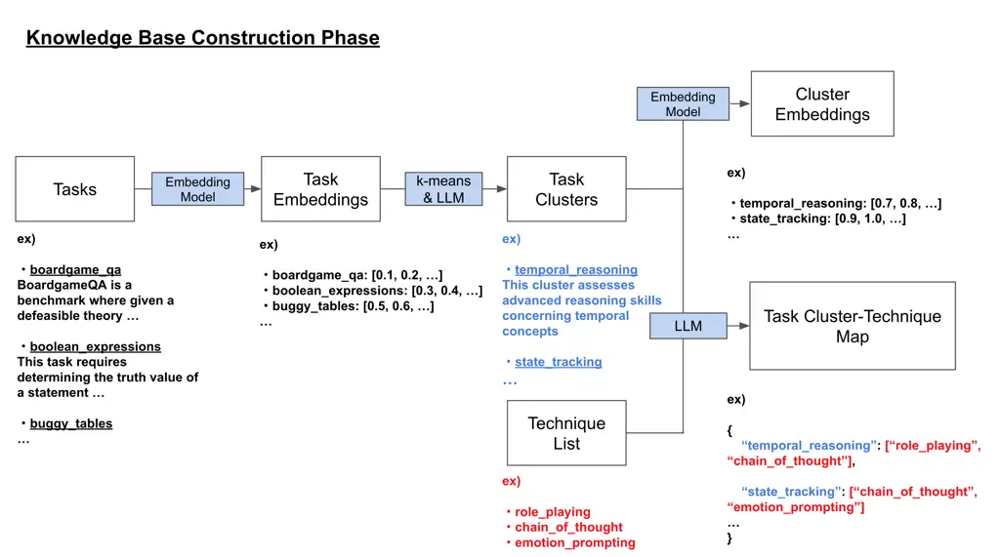

Figure 1: Processing flow diagram of Knowledge Base Construction Phase

#### 3.3.1 Task Cluster Definition and Semantic Space Construction

The core of this method is the definition of task clusters that
semantically classify and organize diverse user tasks. These clusters
provide the foundation for selecting appropriate prompting techniques.

Task Cluster Derivation Process: To ensure reproducibility, this study
combines quantitative clustering with LLM-based semantic interpretation
to derive task clusters.

- •
  Task Vectorization: Each task’s name and description are combined into
  a text representation and converted into high-dimensional vectors
  using the Embedding Model. This embeds the semantic features of each
  task in vector space.
- •
  Quantitative Determination of Optimal Cluster Number (K): The optimal
  number of clusters K is determined automatically using quantitative
  indicators. Specifically, k-means clustering (MacQueen, 1967) is
  executed across candidate values of K (ranging from 3 to fewer than
  the total number of tasks), and silhouette scores (Rousseeuw, 1987)
  are computed for each. The clustering result with the highest
  silhouette score is adopted.
- •
  LLM-based Cluster Semantic Assignment: For each cluster identified,
  the LLM is provided with the list of tasks and generates a description
  of shared characteristics and required capabilities. This yields both
  detailed descriptions (cluster_description) and short identifiers
  (cluster_id) that express each cluster’s features in human-readable
  form.
- •
  Task Cluster Semantic Space Construction: The Embedding Model is then
  applied to each cluster’s detailed description (cluster_description)
  to map the clusters into high-dimensional vector space.

#### 3.3.2 Knowledge Base Construction for Task Cluster-Prompting Technique Mapping

For each task cluster defined in Section 3.3.1, effective prompting
techniques are mapped to construct a knowledge base. This process is
designed to ensure reproducibility and logical consistency while
maximizing the effectiveness of LLMs.

Target Prompting Techniques: This study focuses on prompting techniques
with high versatility and demonstrated effectiveness among those
proposed in prior research on prompt engineering. Specifically,
approximately 15 types of techniques are considered, as shown in Table 2. These include methods that enhance prompts in various ways, such as
improving instruction delivery to LLMs, guiding reasoning processes, and
refining response quality.

|                    |                                                              |                                                                                                                             |
| ------------------ | ------------------------------------------------------------ | --------------------------------------------------------------------------------------------------------------------------- |
| Category           | Name                                                         | Description                                                                                                                 |
| Role Assignment    | Role Playing (Kong et al., 2024)                             | Elicits domain-specific knowledge and reasoning patterns by assigning expert roles to the LLM.                              |
| Emotional Stimulus | Emotion Prompting                                            | Incorporates emotional cues into prompts to influence responses.                                                            |
|                    | Stress Prompting (Shen et al., 2025)                         | Induces moderate stress conditions, grounded in psychological theory, to enhance LLM performance.                           |
| Reasoning          | Chain-of-Thought Prompting                                   | Improves performance on complex reasoning tasks by requiring explicit step-by-step reasoning.                               |
|                    | Logic-of-Thought Prompting (Liu et al., 2025)                | Strengthens logical reasoning by embedding propositional logic into the prompting process.                                  |
|                    | Least-to-Most Prompting (Zhou et al., 2023a)                 | Decomposes complex problems into simpler sub-problems solved sequentially, using earlier answers to improve generalization. |
|                    | Thread of Thought Prompting (Zhou et al., 2023c)             | Enhances comprehension and generation by progressively summarizing and analyzing long, disorganized contexts.               |
|                    | Plan-and-Solve Prompting (Wang et al., 2023)                 | Uses a two-stage process where LLMs first generate a plan and then execute it, improving reasoning accuracy.                |
|                    | Skeleton-of-Thought Prompting (Ning et al., 2024)            | Reduces response latency by generating a response “skeleton” before completing details through parallel processing.         |
| Others             | Decomposed Prompting (Khot et al., 2023)                     | Breaks down complex tasks into sub-tasks processed individually through prompts.                                            |
|                    | Ignore Irrelevant Conditions (Wu et al., 2024)               | Mitigates confusion by detecting and disregarding irrelevant information in problem statements.                             |
|                    | Highlighted Chain-of-Thought Prompting (Nguyen et al., 2025) | Improves accuracy and reduces hallucinations by highlighting essential information from long contexts before reasoning.     |
|                    | Skills-in-Context Prompting (Chen et al., 2024)              | Enables LLMs to compose and apply basic skills in context, supporting generalization to novel problems.                     |
|                    | Automatic Information Filtering (Jiang et al., 2025)         | Preprocesses prompts by having LLMs identify and remove irrelevant information prior to reasoning.                          |
|                    | Scratchpad Prompting (Nye et al., 2021)                      | Provides a “draft space” for intermediate reasoning steps, improving reliability in multi-step reasoning and calculations.  |

Table 1: Major Prompting Techniques Targeted (15 types)

Knowledge Base Construction Process: The mapping of prompting techniques
to each task cluster follows a set of clearly defined rules. The
systematic procedure is as follows:

- •
  Input Information Presentation: The LLM receives the cluster
  information (ID and detailed description) along with a list of all
  available prompting techniques (ID, name, description, and application
  cases).
- •
  Constraint-based Technique Selection: For each cluster, the LLM
  selects techniques according to four category constraints, resulting
  in three or four techniques per cluster.
  - –
    Role Assignment (Fixed): Role playing is always included as a basic
    persona-setting technique applied to all clusters.
  - –
    Emotional Stimulus (Required): One technique must be chosen from
    Emotion Prompting or Stress Prompting. This category improves the
    LLM’s response style and motivation.
  - –
    Reasoning (Required): One reasoning technique must be chosen to
    promote complex thought processes and logical reasoning.
  - –
    Others (Optional): Zero or one additional technique may be selected
    to provide complementary support for specific problem
    characteristics.

- •
  Knowledge Base Generation: Finally, a Task Cluster–Prompting Technique
  Mapping is created, where each cluster ID is linked to a list of
  selected technique IDs (three to four techniques).

This approach systematically combines techniques with distinct
roles—such as persona setting, emotional stimulation, logical reasoning,
and complementary support—rather than merely listing potentially useful
strategies. As a result, it establishes a multifaceted and robust
foundation for prompt design in each cluster.

### 3.4 Prompt Generation Phase

This phase dynamically generates task-adapted prompts based on user
input.

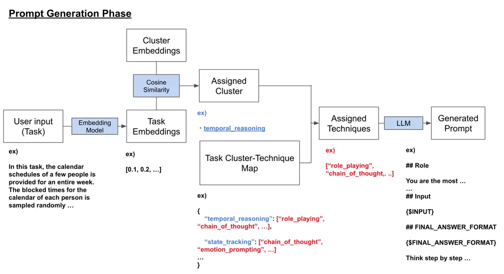

Figure 2: Processing flow of the Prompt Generation Phase

#### 3.4.1 User Input Task Vectorization

User-provided task descriptions and objectives in natural language are
vectorized using the same Embedding Model employed for task cluster
semantic space construction in Section 3.3.1. This process extracts the
semantic features of each input task, enabling its positioning within
the task cluster semantic space.

#### 3.4.2 User Input and Task Cluster Matching

Cosine similarity (Salton and McGill, 1983) is computed between the user
input task vector from Section 3.4.1 and each task cluster vector stored
in the database from Section 3.3.1. Based on these similarity scores,
the task cluster most semantically aligned with the user’s input is
identified. This step corresponds to interpreting the user’s implicit
task intentions by associating them with one of the predefined clusters.

#### 3.4.3 Adaptive Selection of Prompting Techniques

Using the task cluster identified in Section 3.4.2, the system
references the Task Cluster–Prompting Technique Mapping Pool constructed
in Section 3.3.2. From this pool, prompting techniques most suitable for
the user’s task are selected. The techniques corresponding to the
cluster with the highest similarity are adopted and supplied to the LLM
as in-context guidance for generating the final prompt.

#### 3.4.4 Prompt Generation

The user’s task description and the prompting techniques selected in
Section 3.4.3 are provided to the LLM to generate prompts. This process
produces high-quality prompts tailored to the user’s task intentions and
characteristics, strategically designed to enhance LLM effectiveness.

## 4 Experiments

This section presents the experiments conducted to evaluate the
effectiveness of the proposed method.

### 4.1 Experimental Setup

#### 4.1.1 Benchmark Dataset

The evaluation was conducted using 23 tasks from BIG-Bench Extra Hard
(BBEH) (Kazemi et al., 2025), an extension of the original BIG-Bench
(Srivastava et al., 2023). BBEH includes tasks that require diverse
reasoning capabilities and is widely adopted as an evaluation benchmark
for LLMs.

BBEH updates BBH (Suzgun et al., 2022) by replacing several tasks with
substantially more difficult variants, reflecting rapid advances in LLM
capabilities. It comprises 23 reasoning tasks that span a broad range of
cognitive abilities, including mathematical reasoning, language
understanding, logical reasoning, and spatial cognition.

The rationale for selecting BBEH as the evaluation benchmark is
two-fold:

1.  1.  Clear measurement of prompt effects at high difficulty: Because BBEH
        contains challenging tasks where standard prompts perform poorly,
        the impact of introducing prompting techniques can be assessed more
        distinctly.
2.  2.  Evaluation of versatility: With 23 diverse tasks, BBEH enables a
        comprehensive assessment of general prompting techniques across
        multiple domains.

#### 4.1.2 Comparison Methods

Two baseline methods were used as comparison targets for the proposed
approach:

- •
  BBEH Original Prompts (Original paper): Performance using the prompts
  provided in the original BBEH paper for each task.
- •
  Anthropic Prompt Generator (Anthropic): Performance using prompts
  automatically generated by the Prompt Generator developed by Anthropic
  Inc. As discussed in the related work, this tool is an appropriate
  baseline because it also generates prompts directly from user
  instructions.

To ensure statistical reliability, each method was evaluated over 10
independent trials. As evaluation metrics, we report average task
accuracy across trials as well as the arithmetic and harmonic means
aggregated across all tasks.

Representative examples of prompt templates for each method, including
the proposed approach, are provided in Appendix A.

Evaluation Metric Calculation Methods:

- •
  Per-task arithmetic mean: The arithmetic mean of accuracy rates across
  10 trials for each task.
- •
  Arithmetic mean across tasks: The arithmetic mean of per-task
  arithmetic means across all tasks.
- •
  Harmonic mean across tasks: The harmonic mean of per-task arithmetic
  means across all tasks. To avoid division by zero, 1 is added to each
  per-task arithmetic mean before computing the harmonic mean. This
  calculation follows the procedure in the BIG-Bench Extra Hard proposal
  paper.

Model Configuration: This experiment used gemini-2.0-flash for answer
generation. gemini-2.0-flash is the standard evaluation model in BBEH
benchmarks.

### 4.2 Experimental Procedure

The experimental procedure is standardized from prompt generation to
correctness evaluation for both the proposed method and the comparison
baseline (Anthropic’s Prompt Generator), ensuring fair comparison.

#### 4.2.1 Input Definition for Prompt Generators

Task information for each BBEH task is provided as input to both
Anthropic’s Prompt Generator and the proposed method. Specifically, the
README files included in each BBEH task directory of the
google-deepmind/bbeh GitHub repository (DeepMind, 2025) are used as
instructional input. This ensures that both systems receive task
overviews and objectives in a consistent format.

#### 4.2.2 Output Prompt Standardization and Evaluation Logic

To enable consistent and automated evaluation using generated prompts,
both Prompt Generators (Anthropic’s and the proposed method’s) are
required to include two placeholders in their output:

- •
  `{$INPUT}`: Replaced at runtime with the problem statements from each
  BBEH task.
- •
  `{$FINAL_ANSWER_FORMAT}`: Replaced with instructions that strictly
  control the format of final answers. The embedded instruction string
  is identical to that used in the BBEH paper.

Think step by step, and when you provide the final answer, please use
the prefix "The answer is:" without any modification, and provide the
answer directly, with no formatting, no bolding, and no markup. For
instance: "The answer is: 42" or "The answer is: yes". If the question
is multiple choice with a single correct answer, the final answer must
only be the letter corresponding to the correct answer. For example,
"The answer is: (a)".

Evaluation Logic: We use the official evaluate.py from the BBEH
repository without modification. Specifically, final answers are
extracted from LLM outputs using the following prefixes:

When an output contains any of these prefixes, it is treated as
format-compliant, and the subsequent string is extracted and evaluated
as the final answer. When none are present, the output is treated as
format-noncompliant and excluded from accuracy scoring. This procedure
yields a cleaner measure of each prompt’s ability to elicit correct
answers.

"The answer is:",

"The final answer is ",

"The final answer is: ",

"The answer is "

Details on format non-compliance tendencies between methods are provided
in Appendix B1, which reports scores without applying this correction
(i.e., treating non-compliant outputs as incorrect). Appendix B2
presents the proportion of format non-compliance occurrences for each
method and task.

Format Non-compliance Problem Examples: Examples of format
non-compliance include cases where output is interrupted before the
final answer due to exceeding gemini-2.0-flash’s maximum output length
(8192 tokens) during reasoning, as well as cases where the response
deviates from the required format (e.g., \## ANSWER (A), ANSWER: (A),
etc.).

### 4.3 Experimental Results

#### 4.3.1 Basic Experimental Results and Analysis

|                              |          |           |      |                              |
| ---------------------------- | -------- | --------- | ---- | ---------------------------- |
| task name                    | Original | Anthropic | Ours | Ours (temperature-optimized) |
| BoardgameQA                  | 42.1     | 42.8      | 43.6 | 46.0                         |
| Boolean Expressions          | 30.5     | 30.6      | 29.2 | 32.2                         |
| Buggy Tables                 | 3.4      | 5.4       | 3.7  | 5.0                          |
| Causal Understanding         | 53.0     | 51.5      | 50.9 | 51.9                         |
| DisambiguationQA             | 49.6     | 45.5      | 47.4 | 41.0                         |
| Dyck Languages               | 12.1     | 13.8      | 23.9 | 20.9                         |
| Geometric Shapes             | 33.6     | 25.8      | 17.6 | 18.1                         |
| Hyperbaton                   | 3.9      | 2.2       | 7.0  | 5.9                          |
| Linguini                     | 14.2     | 14.5      | 13.9 | 14.0                         |
| Movie Recommendation         | 57.4     | 74.0      | 71.3 | 65.2                         |
| Multistep Arithmetic         | 10.8     | 17.4      | 22.5 | 20.8                         |
| NYCC                         | 13.4     | 12.8      | 12.2 | 11.4                         |
| Object Counting              | 10.8     | 12.5      | 70.0 | 83.9                         |
| Object Properties            | 1.0      | 2.8       | 3.5  | 4.5                          |
| SARC Triples                 | 34.8     | 30.6      | 34.4 | 35.3                         |
| Shuffled Objects             | 16.0     | 17.6      | 7.8  | 11.6                         |
| Spatial Reasoning            | 17.0     | 19.0      | 37.2 | 32.9                         |
| SportQA                      | 21.1     | 25.0      | 23.0 | 24.5                         |
| Temporal Sequences           | 0.7      | 0.5       | 0.9  | 0.9                          |
| Time Arithmetic              | 42.8     | 41.0      | 39.4 | 41.6                         |
| Web of Lies                  | 19.9     | 20.0      | 21.3 | 21.1                         |
| Word Sorting                 | 24.5     | 20.6      | 21.7 | 22.1                         |
| Zebra Puzzles                | 37.8     | 42.7      | 40.7 | 45.7                         |
| arithmetic mean across tasks | 23.9     | 24.7      | 28.0 | 28.5                         |
| harmonic mean across tasks   | 9.7      | 10.5      | 12.5 | 13.3                         |

Table 2: Performance comparison of each prompt generation method on BBEH
dataset (average across 10 trials)

The table above reports per-task arithmetic means over 10 trials for
each method across 23 BBEH tasks. Aggregated scores are shown as the
arithmetic mean across tasks and the harmonic mean across tasks. For
harmonic mean calculation, 1 is added to the denominator to prevent
division by zero, following the procedure in the BIG-Bench Extra Hard
proposal paper.

The proposed method achieved an arithmetic mean of 28.0 across tasks,
outperforming Original (23.9) and Anthropic (24.7). For the harmonic
mean, the proposed method reached 12.5, again exceeding Original (9.7)
and Anthropic (10.5).

Analysis of arithmetic mean across tasks: The arithmetic mean reflects
average performance across all tasks. The proposed method’s score of
28.0 demonstrates consistently strong performance across BBEH’s diverse
tasks. Its improvements over Original (+4.1) and Anthropic (+3.3)
confirm its overall superiority.

Analysis of harmonic mean across tasks: The harmonic mean emphasizes
low-scoring tasks. The proposed method’s score of 12.5 indicates stable
performance even on the most difficult tasks. The gains over Original
(+2.8) and Anthropic (+2.0) are larger than for the arithmetic mean,
suggesting particular effectiveness in mitigating poor performance
cases.

These findings indicate that the proposed method generates more
effective prompts and better leverages LLM capabilities than both
standard prompts and existing automatic generation methods in the
high-difficulty BBEH benchmark. While notable improvements were observed
in tasks such as Object Counting, Spatial Reasoning, and Zebra Puzzles,
some tasks, including Boolean Expressions and Linguini, showed little or
no improvement, indicating directions for future work.

#### 4.3.2 Per-task Analysis

To analyze the proposed method’s performance in detail, we examine
per-task accuracy improvements. As shown in Table 2, the method produced
varied effects across the 23 tasks, with outcomes differing
significantly depending on task characteristics.

Tasks Showing Improvement: The proposed method improved performance in
15 tasks. Notable gains include Object Counting (+59.2), Spatial
Reasoning (+20.2), Movie Recommendation (+13.9), Multistep Arithmetic
(+11.7), and Dyck Languages (+11.8). Additional improvements were
observed in Hyperbaton (+3.1), Zebra Puzzles (+2.9), Object Properties
(+2.5), SportQA (+1.9), BoardgameQA (+1.5), Web of Lies (+1.4), Buggy
Tables (+0.3), and Temporal Sequences (+0.2).

Object Counting Success Analysis: The Object Counting task showed the
largest improvement. It requires extracting items meeting specific
conditions from complex sentences and performing numerical calculations.
Typical problems involve isolating possessions of a particular
individual (e.g., “me”) from distracting information (e.g., “uncle,”
“aunt”) and then computing totals through acquisition and loss histories
(e.g., “initial 22 → lose 20 → acquire 50 → lose 23 = 29”). The proposed
method’s explicit step-tracking strategy aligns with this multi-stage
process, yielding much higher accuracy than intuitive approaches.

Tasks Showing Degradation: Performance decreased in 8 tasks. The largest
declines occurred in Geometric Shapes (-16.0) and Shuffled Objects
(-8.2), with smaller drops in Time Arithmetic (-3.4), DisambiguationQA
(-2.2), Causal Understanding (-2.1), Boolean Expressions (-1.3), NYCC
(-1.2), and Linguini (-0.3).

Geometric Shapes Failure Analysis: The Geometric Shapes task requires
recognizing figures from SVG path coordinates (e.g., “M 0.0,9.0 L
23.94298,9.0”) and identifying the correct shape. Success depends on
spatial cognition (the ability to mentally visualize shapes from
coordinates). The language-focused reasoning strategies used in the
proposed method may have interfered with this holistic mapping,
suggesting that simpler visual reasoning approaches would be more
effective.

Relationship Between Task Characteristics and Effects: Overall, the
method proved highly effective for tasks requiring step-by-step
numerical processing (e.g., Object Counting) and multi-stage reasoning
(e.g., Multistep Arithmetic). In contrast, for tasks requiring intuitive
visual understanding (e.g., Geometric Shapes), complex strategies
sometimes hindered performance. These findings highlight the need to
refine technique selection mechanisms to better align with task
characteristics.

### 4.4 Temperature Optimization Experiments

Experimental Context and Theoretical Background: While prompt content
design has been the main focus of LLM performance optimization, runtime
parameters also play a critical role in shaping output quality. Among
them, the temperature parameter controls the balance between determinism
and creativity, with optimal values varying empirically by task type.

Research Hypothesis: We hypothesize that “different task characteristics
require different optimal temperature parameters.” This experiment
quantitatively evaluates the impact of task-specific temperature
optimization and examines the effectiveness of integrating prompt design
with execution parameter tuning.

To test this hypothesis, we conducted temperature optimization
experiments to assess whether adjusting parameters for individual tasks
yields additional performance gains.

#### 4.4.1 Optimization Experiment Setup

Temperature Parameter Candidates: Seven values were tested: 0.0, 0.2,
0.4, 0.6, 0.8, 1.0, and 1.3. These cover a wide spectrum of response
characteristics, from deterministic to creative outputs.

Constraints for Experimental Efficiency: Because optimizing across all
problems would be computationally prohibitive, 40 problems were randomly
sampled from each task for evaluation.

Evaluation Process: For each task–temperature pair, 10 independent
trials were conducted, and average scores were computed. The temperature
yielding the highest average score was selected as the optimal value for
that task.

#### 4.4.2 Optimization Results and Trend Analysis

As shown in Table 2, the proposed method with individually optimized
temperature parameters (Ours, temperature-optimized) achieved an
arithmetic mean of 28.5 and a harmonic mean of 13.3, further surpassing
the default configuration.

Temperature Parameter Effect Analysis Based on Statistical Significance:
To rigorously evaluate the effect of temperature parameter optimization,
we conducted a one-way ANOVA (Fisher, 1918) across temperature settings
for each task, and assessed statistical significance using F-statistics
and p-values.

Classification by Statistical Significance:

- •
  Highly Significant (p $`<`$ 0.001): 3 tasks Zebra Puzzles (F=12.36,
  p$`<`$0.001), Web of Lies (F=8.34, p$`<`$0.001), Hyperbaton (F=4.32,
  p$`<`$0.001) Task group where temperature parameters have extremely
  strong influence on performance
- •
  Significant (0.001 $`\leq`$ p $`<`$ 0.05): 3 tasks Boolean Expressions
  (F=3.42, p=0.003), Multistep Arithmetic (F=2.51, p=0.023), NYCC
  (F=3.87, p=0.001) Moderate influence task group where temperature
  parameter effects are statistically confirmed
- •
  Non-significant (p $`\geq`$ 0.05): 17 tasks Temperature parameter
  influence is not statistically detected in the majority of tasks
  including Geometric Shapes, Object Counting, etc.

Task Characteristic Analysis for Statistically Significant Tasks: Among
the six tasks in which temperature effects were statistically
significant, clear polarization in the optimal temperature values was
observed.

- •
  Low Temperature Type (0.0): Zebra Puzzles, Web of Lies, Boolean
  Expressions, Multistep Arithmetic, NYCC Task group requiring logical
  rigor, unique solution identification, and convergent thinking, where
  consistency assurance through low temperature is effective
- •
  High Temperature Type (1.3): Hyperbaton Tasks requiring interpretation
  of complex combination rules in multi-dimensional systems of adjective
  order (opinion, size, age, color, material, nationality, etc.),
  demanding linguistic intuition difficult to address through mechanical
  application. Response diversity through high temperature realizes
  natural word order judgment beyond statistical patterns

These results indicate that further performance gains can be achieved
through comprehensive optimization encompassing both prompt content and
LLM execution parameters. In particular, incorporating mechanisms that
adaptively adjust temperature settings based on task characteristics is
expected to enable the development of more versatile prompt generation
systems.

## 5 Conclusion

This paper presented a novel framework that interprets users’ abstract
task descriptions, adaptively selects optimal prompting techniques, and
automatically generates high-quality prompts from scratch. The core of
the method lies in constructing a knowledge base that maps Task
Clusters, which classify tasks according to their functional
characteristics, to diverse prompting techniques, and in dynamically
generating prompts that effectively achieve user objectives based on
this foundation.

Experiments using the BBEH dataset demonstrated that the proposed method
achieved an arithmetic mean of 28.0 and a harmonic mean of 12.5,
outperforming both standard prompts (arithmetic mean of 23.9, harmonic
mean of 9.7) and existing automatic prompt generation tools (arithmetic
mean of 24.7, harmonic mean of 10.5). Furthermore, with individual
temperature optimization, performance further improved to an arithmetic
mean of 28.5 and a harmonic mean of 13.3.

Although these results validate the effectiveness of the proposed
framework on the BBEH benchmark, several limitations should be
acknowledged. The knowledge base constructed in this study is tailored
to BBEH task characteristics, and it remains an open question whether
this knowledge base can be directly applied to other domains. This point
represents an important direction for future investigation.

The primary contribution of this research is the establishment of a
scalable framework for the semi-automatic construction of
task-to-technique knowledge bases, rather than a single instantiation. A
key advantage of this framework is its adaptability and low
customization cost across different domains. As demonstrated in this
work, both task clustering and the initial mapping of techniques can be
largely automated using LLMs. Consequently, expert analysis and design
costs for applying this framework to new domains can be significantly
reduced, representing a major advantage for practical implementation.

Given its high degree of customizability, the most promising future
direction is deployment in domain-specific applications. For example,
applying this framework to financial report analysis or manufacturing
defect detection could enable the rapid development of high-performance
prompt generators specialized for those fields. In this way, the method
has the potential to serve as a foundational technology for lowering
barriers to LLM utilization across diverse specialized domains and
accelerating their adoption.

Looking ahead, several extensions are envisioned. Incorporating
mechanisms to dynamically update and optimize knowledge bases based on
user feedback and emerging prompting techniques, and integrating
functionality that allows LLMs to predict and evaluate prompt
effectiveness in advance, would further enhance the framework’s
reliability and adaptability. Through such extensions, this research can
evolve into a core technology for fostering more seamless and effective
interaction between LLMs and human users.

## References

- Anthropic \[2024\] Anthropic. Anthropic prompt generator, 2024. URL
  [https://docs.anthropic.com/en/docs/build-with-claude/prompt-engineering/prompt-generator](https://docs.anthropic.com/en/docs/build-with-claude/prompt-engineering/prompt-generator).
  Accessed: 2025-07-31.
- Brown et al. \[2020\] Tom B. Brown, Benjamin Mann, Nick Ryder, Melanie
  Subbiah, Jared Kaplan, Prafulla Dhariwal, Arvind Neelakantan, Pranav
  Shyam, Girish Sastry, Amanda Askell, Sandhini Agarwal, Ariel
  Herbert-Voss, Gretchen Krueger, Tom Henighan, Rewon Child, Aditya
  Ramesh, Daniel M. Ziegler, Jeffrey Wu, Clemens Winter, Christopher
  Hesse, Mark Chen, Eric Sigler, Mateusz Litwin, Scott Gray, Benjamin
  Chess, Jack Clark, Christopher Berner, Sam McCandlish, Alec Radford,
  Ilya Sutskever, and Dario Amodei. Language models are few-shot
  learners, 2020. URL
  [https://arxiv.org/abs/2005.14165](https://arxiv.org/abs/2005.14165).
- Chen et al. \[2024\] Jiaao Chen, Xiaoman Pan, Dian Yu, Kaiqiang Song,
  Xiaoyang Wang, Dong Yu, and Jianshu Chen. Skills-in-context prompting:
  Unlocking compositionality in large language models, 2024. URL
  [https://arxiv.org/abs/2308.00304](https://arxiv.org/abs/2308.00304).
- DeepMind \[2025\] Google DeepMind. Bbeh github repository, 2025. URL
  [https://github.com/google-deepmind/bbeh](https://github.com/google-deepmind/bbeh).
  Accessed: 2025-07-31.
- Fisher \[1918\] R.A. Fisher. The correlation between relatives on the
  supposition of Mendelian inheritance. _Trans. Roy. Soc. Edinb._,
  52:399–433, 1918.
- Jiang et al. \[2025\] Ming Jiang, Tingting Huang, Biao Guo, Yao Lu,
  and Feng Zhang. Enhancing robustness in large language models:
  Prompting for mitigating the impact of irrelevant information, 2025.
  URL
  [https://arxiv.org/abs/2408.10615](https://arxiv.org/abs/2408.10615).
- Kazemi et al. \[2025\] Mehran Kazemi, Bahare Fatemi, Hritik Bansal,
  John Palowitch, Chrysovalantis Anastasiou, Sanket Vaibhav Mehta,
  Lalit K. Jain, Virginia Aglietti, Disha Jindal, Peter Chen, Nishanth
  Dikkala, Gladys Tyen, Xin Liu, Uri Shalit, Silvia Chiappa, Kate
  Olszewska, Yi Tay, Vinh Q. Tran, Quoc V. Le, and Orhan Firat.
  Big-bench extra hard, 2025. URL
  [https://arxiv.org/abs/2502.19187](https://arxiv.org/abs/2502.19187).
- Khot et al. \[2023\] Tushar Khot, Harsh Trivedi, Matthew Finlayson,
  Yao Fu, Kyle Richardson, Peter Clark, and Ashish Sabharwal. Decomposed
  prompting: A modular approach for solving complex tasks, 2023. URL
  [https://arxiv.org/abs/2210.02406](https://arxiv.org/abs/2210.02406).
- Kong et al. \[2024\] Aobo Kong, Shiwan Zhao, Hao Chen, Qicheng Li,
  Yong Qin, Ruiqi Sun, Xin Zhou, Enzhi Wang, and Xiaohang Dong. Better
  zero-shot reasoning with role-play prompting, 2024. URL
  [https://arxiv.org/abs/2308.07702](https://arxiv.org/abs/2308.07702).
- Li et al. \[2023\] Cheng Li, Jindong Wang, Yixuan Zhang, Kaijie Zhu,
  Wenxin Hou, Jianxun Lian, Fang Luo, Qiang Yang, and Xing Xie. Large
  language models understand and can be enhanced by emotional
  stimuli, 2023. URL
  [https://arxiv.org/abs/2307.11760](https://arxiv.org/abs/2307.11760).
- Liu et al. \[2025\] Tongxuan Liu, Wenjiang Xu, Weizhe Huang, Yuting
  Zeng, Jiaxing Wang, Xingyu Wang, Hailong Yang, and Jing Li.
  Logic-of-thought: Injecting logic into contexts for full reasoning in
  large language models, 2025. URL
  [https://arxiv.org/abs/2409.17539](https://arxiv.org/abs/2409.17539).
- MacQueen \[1967\] J. MacQueen. Some methods for classification and
  analysis of multivariate observations. 1967. URL
  [https://api.semanticscholar.org/CorpusID:6278891](https://api.semanticscholar.org/CorpusID:6278891).
- Nguyen et al. \[2025\] Tin Nguyen, Logan Bolton, Mohammad Reza
  Taesiri, and Anh Totti Nguyen. Hot: Highlighted chain of thought for
  referencing supporting facts from inputs, 2025. URL
  [https://arxiv.org/abs/2503.02003](https://arxiv.org/abs/2503.02003).
- Ning et al. \[2024\] Xuefei Ning, Zinan Lin, Zixuan Zhou, Zifu Wang,
  Huazhong Yang, and Yu Wang. Skeleton-of-thought: Prompting llms for
  efficient parallel generation, 2024. URL
  [https://arxiv.org/abs/2307.15337](https://arxiv.org/abs/2307.15337).
- Nye et al. \[2021\] Maxwell Nye, Anders Johan Andreassen, Guy Gur-Ari,
  Henryk Michalewski, Jacob Austin, David Bieber, David Dohan, Aitor
  Lewkowycz, Maarten Bosma, David Luan, Charles Sutton, and Augustus
  Odena. Show your work: Scratchpads for intermediate computation with
  language models, 2021. URL
  [https://arxiv.org/abs/2112.00114](https://arxiv.org/abs/2112.00114).
- Rousseeuw \[1987\] Peter J. Rousseeuw. Silhouettes: A graphical aid to
  the interpretation and validation of cluster analysis. _Journal of
  Computational and Applied Mathematics_, 20:53–65, 1987. ISSN
  0377-0427. doi: https://doi.org/10.1016/0377-0427(87)90125-7. URL
  [https://www.sciencedirect.com/science/article/pii/0377042787901257](https://www.sciencedirect.com/science/article/pii/0377042787901257).
- Salton and McGill \[1983\] Gerard Salton and Michael McGill.
  _Introduction to modern information retrieval_. McGraw-Hill, New York,
  NY, 1983.
- Shen et al. \[2025\] Guobin Shen, Dongcheng Zhao, Aorigele Bao, Xiang
  He, Yiting Dong, and Yi Zeng. Stressprompt: Does stress impact large
  language models and human performance similarly?, 2025. URL
  [https://arxiv.org/abs/2409.17167](https://arxiv.org/abs/2409.17167).
- Srivastava et al. \[2023\] Aarohi Srivastava, Abhinav Rastogi,
  Abhishek Rao, Abu Awal Md Shoeb, Abubakar Abid, Adam Fisch, Adam R.
  Brown, Adam Santoro, Aditya Gupta, Adria Garriga-Alonso, Agnieszka
  Kluska, Aitor Lewkowycz, Akshat Agarwal, Alethea Power, Alex Ray, Alex
  Warstadt, Alexander W. Kocurek, Ali Safaya, Ali Tazarv, Alice Xiang,
  Alicia Parrish, Allen Nie, Aman Hussain, Amanda Askell, Amanda Dsouza,
  Ambrose Slone, Ameet Rahane, Anantharaman S. Iyer, Anders Andreassen,
  Andrea Madotto, Andrea Santilli, Andreas Stuhlmueller, Andrew Dai,
  Andrew La, Andrew Lampinen, Andy Zou, Angela Jiang, Angelica Chen, Anh
  Vuong, Animesh Gupta, Anna Gottardi, Antonio Norelli, Anu Venkatesh,
  Arash Gholamidavoodi, Arfa Tabassum, Arul Menezes, Arun Kirubarajan,
  Asher Mullokandov, Ashish Sabharwal, Austin Herrick, Avia Efrat, Aykut
  Erdem, Ayla Karakas, B. Ryan Roberts, Bao Sheng Loe, Barret Zoph,
  Bartlomiej Bojanowski, Batuhan Özyurt, Behnam Hedayatnia, Behnam
  Neyshabur, Benjamin Inden, Benno Stein, Berk Ekmekci, Bill Yuchen Lin,
  Blake Howald, Bryan Orinion, Cameron Diao, Cameron Dour, Catherine
  Stinson, Cedrick Argueta, Cesar Ferri Ramirez, Chandan Singh, Charles
  Rathkopf, Chenlin Meng, Chitta Baral, Chiyu Wu, Chris Callison-Burch,
  Chris Waites, Christian Voigt, Christopher D. Manning, Christopher
  Potts, Cindy Ramirez, Clara E. Rivera, Clemencia Siro, Colin Raffel,
  Courtney Ashcraft, Cristina Garbacea, Damien Sileo, Dan Garrette, Dan
  Hendrycks, Dan Kilman, Dan Roth, Daniel Freeman, Daniel Khashabi,
  Daniel Levy, Daniel Mosegui Gonzalez, Danielle Perszyk, Danny
  Hernandez, Danqi Chen, Daphne Ippolito, Dar Gilboa, David Dohan, David
  Drakard, David Jurgens, Debajyoti Datta, Deep Ganguli, Denis Emelin,
  Denis Kleyko, Deniz Yuret, Derek Chen, Derek Tam, Dieuwke Hupkes,
  Diganta Misra, Dilyar Buzan, Dimitri Coelho Mollo, Diyi Yang, Dong-Ho
  Lee, Dylan Schrader, Ekaterina Shutova, Ekin Dogus Cubuk, Elad Segal,
  Eleanor Hagerman, Elizabeth Barnes, Elizabeth Donoway, Ellie Pavlick,
  Emanuele Rodola, Emma Lam, Eric Chu, Eric Tang, Erkut Erdem, Ernie
  Chang, Ethan A. Chi, Ethan Dyer, Ethan Jerzak, Ethan Kim,
  Eunice Engefu Manyasi, Evgenii Zheltonozhskii, Fanyue Xia, Fatemeh
  Siar, Fernando Martínez-Plumed, Francesca Happé, Francois Chollet,
  Frieda Rong, Gaurav Mishra, Genta Indra Winata, Gerard de Melo,
  Germán Kruszewski, Giambattista Parascandolo, Giorgio Mariani, Gloria
  Wang, Gonzalo Jaimovitch-Lopez, Gregor Betz, Guy Gur-Ari, Hana
  Galijasevic, Hannah Kim, Hannah Rashkin, Hannaneh Hajishirzi, Harsh
  Mehta, Hayden Bogar, Henry Shevlin, Hinrich Schuetze, Hiromu Yakura,
  Hongming Zhang, Hugh Mee Wong, Ian Ng, Isaac Noble, Jaap Jumelet, Jack
  Geissinger, Jackson Kernion, Jacob Hilton, Jaehoon Lee,
  Jaime Fernández Fisac, James B. Simon, James Koppel, James Zheng,
  James Zou, Jan Kocon, Jana Thompson, Janelle Wingfield, Jared Kaplan,
  Jarema Radom, Jascha Sohl-Dickstein, Jason Phang, Jason Wei, Jason
  Yosinski, Jekaterina Novikova, Jelle Bosscher, Jennifer Marsh, Jeremy
  Kim, Jeroen Taal, Jesse Engel, Jesujoba Alabi, Jiacheng Xu, Jiaming
  Song, Jillian Tang, Joan Waweru, John Burden, John Miller, John U.
  Balis, Jonathan Batchelder, Jonathan Berant, Joerg Frohberg, Jos
  Rozen, Jose Hernandez-Orallo, Joseph Boudeman, Joseph Guerr, Joseph
  Jones, Joshua B. Tenenbaum, Joshua S. Rule, Joyce Chua, Kamil
  Kanclerz, Karen Livescu, Karl Krauth, Karthik Gopalakrishnan, Katerina
  Ignatyeva, Katja Markert, Kaustubh D. Dhole, Kevin Gimpel, Kevin
  Omondi, Kory Mathewson, Kristen Chiafullo, Ksenia Shkaruta, Kumar
  Shridhar, Kyle McDonell, Kyle Richardson, Laria Reynolds, Leo Gao,
  Li Zhang, Liam Dugan, Lianhui Qin, Lidia Contreras-Ochando,
  Louis-Philippe Morency, Luca Moschella, Lucas Lam, Lucy Noble, Ludwig
  Schmidt, Luheng He, Luis Oliveros Colon, Luke Metz, Luetfi Kerem
  Senel, Maarten Bosma, Maarten Sap, Maartje ter Hoeve, Maheen Farooqi,
  Manaal Faruqui, Mantas Mazeika, Marco Baturan, Marco Marelli, Marco
  Maru, Maria Jose Ramirez Quintana, Marie Tolkiehn, Mario Giulianelli,
  Martha Lewis, Martin Potthast, Matthew L. Leavitt, Matthias Hagen,
  Matyas Schubert, Medina Orduna Baitemirova, Melody Arnaud, Melvin
  McElrath, Michael A. Yee, Michael Cohen, Michael Gu, Michael
  Ivanitskiy, Michael Starritt, Michael Strube, Michal Swedrowski,
  Michele Bevilacqua, Michihiro Yasunaga, Mihir Kale, Mike Cain, Mimee
  Xu, Mirac Suzgun, Mitch Walker, Mo Tiwari, Mohit Bansal, Moin
  Aminnaseri, Mor Geva, Mozhdeh Gheini, Mukund Varma T, Nanyun Peng,
  Nathan A. Chi, Nayeon Lee, Neta Gur-Ari Krakover, Nicholas Cameron,
  Nicholas Roberts, Nick Doiron, Nicole Martinez, Nikita Nangia, Niklas
  Deckers, Niklas Muennighoff, Nitish Shirish Keskar, Niveditha S. Iyer,
  Noah Constant, Noah Fiedel, Nuan Wen, Oliver Zhang, Omar Agha, Omar
  Elbaghdadi, Omer Levy, Owain Evans, Pablo Antonio Moreno Casares,
  Parth Doshi, Pascale Fung, Paul Pu Liang, Paul Vicol, Pegah
  Alipoormolabashi, Peiyuan Liao, Percy Liang, Peter Chang, Peter
  Eckersley, Phu Mon Htut, Pinyu Hwang, Piotr Milkowski, Piyush Patil,
  Pouya Pezeshkpour, Priti Oli, Qiaozhu Mei, Qing Lyu, Qinlang Chen,
  Rabin Banjade, Rachel Etta Rudolph, Raefer Gabriel, Rahel Habacker,
  Ramon Risco, Raphael Milliere, Rhythm Garg, Richard Barnes, Rif A.
  Saurous, Riku Arakawa, Robbe Raymaekers, Robert Frank, Rohan Sikand,
  Roman Novak, Roman Sitelew, Ronan LeBras, Rosanne Liu, Rowan Jacobs,
  Rui Zhang, Ruslan Salakhutdinov, Ryan Chi, Ryan Lee, Ryan Stovall,
  Ryan Teehan, Rylan Yang, Sahib Singh, Saif M. Mohammad, Sajant Anand,
  Sam Dillavou, Sam Shleifer, Sam Wiseman, Samuel Gruetter, Samuel R.
  Bowman, Samuel S. Schoenholz, Sanghyun Han, Sanjeev Kwatra, Sarah A.
  Rous, Sarik Ghazarian, Sayan Ghosh, Sean Casey, Sebastian Bischoff,
  Sebastian Gehrmann, Sebastian Schuster, Sepideh Sadeghi, Shadi Hamdan,
  Sharon Zhou, Shashank Srivastava, Sherry Shi, Shikhar Singh, Shima
  Asaadi, Shixiang Shane Gu, Shubh Pachchigar, Shubham Toshniwal, Shyam
  Upadhyay, Shyamolima, Debnath, Siamak Shakeri, Simon Thormeyer, Simone
  Melzi, Siva Reddy, Sneha Priscilla Makini, Soo-Hwan Lee, Spencer
  Torene, Sriharsha Hatwar, Stanislas Dehaene, Stefan Divic, Stefano
  Ermon, Stella Biderman, Stephanie Lin, Stephen Prasad, Steven T.
  Piantadosi, Stuart M. Shieber, Summer Misherghi, Svetlana Kiritchenko,
  Swaroop Mishra, Tal Linzen, Tal Schuster, Tao Li, Tao Yu, Tariq Ali,
  Tatsu Hashimoto, Te-Lin Wu, Theo Desbordes, Theodore Rothschild,
  Thomas Phan, Tianle Wang, Tiberius Nkinyili, Timo Schick, Timofei
  Kornev, Titus Tunduny, Tobias Gerstenberg, Trenton Chang, Trishala
  Neeraj, Tushar Khot, Tyler Shultz, Uri Shaham, Vedant Misra, Vera
  Demberg, Victoria Nyamai, Vikas Raunak, Vinay Ramasesh, Vinay Uday
  Prabhu, Vishakh Padmakumar, Vivek Srikumar, William Fedus, William
  Saunders, William Zhang, Wout Vossen, Xiang Ren, Xiaoyu Tong, Xinran
  Zhao, Xinyi Wu, Xudong Shen, Yadollah Yaghoobzadeh, Yair Lakretz,
  Yangqiu Song, Yasaman Bahri, Yejin Choi, Yichi Yang, Yiding Hao, Yifu
  Chen, Yonatan Belinkov, Yu Hou, Yufang Hou, Yuntao Bai, Zachary Seid,
  Zhuoye Zhao, Zijian Wang, Zijie J. Wang, Zirui Wang, and Ziyi Wu.
  Beyond the imitation game: Quantifying and extrapolating the
  capabilities of language models, 2023. URL
  [https://arxiv.org/abs/2206.04615](https://arxiv.org/abs/2206.04615).
- Suzgun et al. \[2022\] Mirac Suzgun, Nathan Scales, Nathanael
  Schaerli, Sebastian Gehrmann, Yi Tay, Hyung Won Chung, Aakanksha
  Chowdhery, Quoc V. Le, Ed H. Chi, Denny Zhou, and Jason Wei.
  Challenging big-bench tasks and whether chain-of-thought can solve
  them, 2022. URL
  [https://arxiv.org/abs/2210.09261](https://arxiv.org/abs/2210.09261).
- Wang et al. \[2023\] Lei Wang, Wanyu Xu, Yihuai Lan, Zhiqiang Hu,
  Yunshi Lan, Roy Ka-Wei Lee, and Ee-Peng Lim. Plan-and-solve prompting:
  Improving zero-shot chain-of-thought reasoning by large language
  models, 2023. URL
  [https://arxiv.org/abs/2305.04091](https://arxiv.org/abs/2305.04091).
- Wei et al. \[2023\] Jason Wei, Xuezhi Wang, Dale Schuurmans, Maarten
  Bosma, Brian Ichter, Fei Xia, Ed Chi, Quoc Le, and Denny Zhou.
  Chain-of-thought prompting elicits reasoning in large language
  models, 2023. URL
  [https://arxiv.org/abs/2201.11903](https://arxiv.org/abs/2201.11903).
- Wu et al. \[2024\] Zhenyu Wu, Chao Shen, and Meng Jiang. Instructing
  large language models to identify and ignore irrelevant
  conditions, 2024. URL
  [https://arxiv.org/abs/2403.12744](https://arxiv.org/abs/2403.12744).
- Zhou et al. \[2023a\] Denny Zhou, Nathanael Schaerli, Le Hou, Jason
  Wei, Nathan Scales, Xuezhi Wang, Dale Schuurmans, Claire Cui, Olivier
  Bousquet, Quoc Le, and Ed Chi. Least-to-most prompting enables complex
  reasoning in large language models, 2023a. URL
  [https://arxiv.org/abs/2205.10625](https://arxiv.org/abs/2205.10625).
- Zhou et al. \[2023b\] Yongchao Zhou, Andrei Ioan Muresanu, Ziwen Han,
  Keiran Paster, Silviu Pitis, Harris Chan, and Jimmy Ba. Large language
  models are human-level prompt engineers, 2023b. URL
  [https://arxiv.org/abs/2211.01910](https://arxiv.org/abs/2211.01910).
- Zhou et al. \[2023c\] Yucheng Zhou, Xiubo Geng, Tao Shen, Chongyang
  Tao, Guodong Long, Jian-Guang Lou, and Jianbing Shen. Thread of
  thought unraveling chaotic contexts, 2023c. URL
  [https://arxiv.org/abs/2311.08734](https://arxiv.org/abs/2311.08734).

## Appendix A Prompt Template Examples

This section presents examples of prompt templates for the three methods
compared in this paper. As described in Section 4. 2. 2, the prompt
template placeholders include `{$INPUT}` for the problem statement and
`{$FINAL_ANSWER_FORMAT}` for the final answer format specification. In
practice, these template placeholders are pre-populated with their
respective values before executing answer generation by the LLM.

### A.1 Prompt Template Example - Original

{\$INPUT}

{\$FINAL_ANSWER_FORMAT}

### A.2 Prompt Template Example - Anthropic

You will be evaluating arithmetic expressions that use custom operators
with special definitions. Here is the expression you need to evaluate:

\<expression\>

{\$INPUT}

\</expression\>

These expressions use custom arithmetic operators that have specific
definitions provided within the expression context. Here are the key
rules you need to follow:

Custom Operator Definitions:

- Each custom operator (like \>\<, @, \[\], etc.) will have a specific
  definition that tells you how to compute a op b

- Some operators may be defined in terms of other custom operators

- Always use the exact definitions provided

Composition Rules:

- When you see "a op1 op2 b", this means (a op1 b) op2 b

- For example: "4 +\* 5" means (4 + 5) \* 5 = 9 \* 5 = 45

- For example: "3 -\*+ 2" means (3 - 2) \*+ 2, which then becomes (1 \*

2. - 2 = 4

Evaluation Process:

1. First, identify all custom operators and their definitions

2. Parse the expression following standard order of operations
   (parentheses first, then left to right for same precedence)

3. When encountering composed operations (op1 op2), apply the
   composition rule

4. Substitute the definitions of custom operators and evaluate step by
   step

5. Show all intermediate calculations

Important Notes:

- Pay careful attention to parentheses and operator precedence

- When operators are defined recursively (using other custom operators),
  substitute definitions step by step

- Double-check each arithmetic calculation

- Be systematic and show every step of your work

Use the scratchpad below to work through the problem step by step, then
provide your final numerical answer.

\<scratchpad\>

\[Work through the problem systematically here, showing:

1. Identification of all custom operators and their definitions

2. Parsing of the expression structure

3. Step-by-step evaluation with all intermediate calculations

4. Verification of your final result\]

\</scratchpad\>

{\$FINAL_ANSWER_FORMAT}

### A.3 Prompt Template Example - Ours

\<role\>

You are a distinguished Professor of Formal Logic and Symbolic
Computation. Your expertise lies in interpreting abstract operational
systems, parsing complex symbolic expressions, and executing them with
flawless, step-by-step precision. You will approach this task with the
utmost rigor and clarity, adhering strictly to the provided definitions.

\</role\>

\<task\>

You are given a mathematical problem that involves newly defined
operators. Your task is to compute the final value of the expression by
strictly following the provided rules.

{\$INPUT}

To solve this problem, you must follow a structured, two-stage
methodology. First, you will analyze the problem and create a detailed
plan. Second, you will execute that plan meticulously. The new operator
definitions are fundamental axioms for this task; you must use them
exactly as stated.

Here is the required process:

\### 1. Difficulty Analysis

First, analyze the potential challenges in this specific problem.
Consider:

\* The complexity of the custom operator definitions.

\* The nesting of parentheses and the order of operations.

\* The application of the operator composition rule (e.g., ‘a op1 op2
b‘).

\* Any potential for misinterpretation or calculation errors.

\### 2. Plan

Based on your analysis, create a clear, step-by-step plan to solve the
expression. The plan must break down the main expression into a sequence
of smaller, manageable calculations.

\* Step 1: Explicitly list the definitions of all new operators to
confirm your understanding.

\* Step 2: Deconstruct the main expression, identifying the evaluation
order based on parentheses, starting from the innermost parts.

\* Step 3: Outline the sequence of substitutions and calculations
required to reach the final answer.

\### 3. Execution

Execute your plan step-by-step. Show every calculation and substitution
clearly. For each step, state which part of the expression you are
evaluating and which operator rule you are applying. Leave no part of
the process to implicit reasoning. Show your work in full.

\<final_answer_format\>

CRITICAL COMPLIANCE REQUIRED

MANDATORY FORMAT - ABSOLUTE ADHERENCE

You MUST provide the final answer in the following format. The automated
evaluation system will fail if this format is not followed precisely.

{\$FINAL_ANSWER_FORMAT}

\</final_answer_format\>

This task is a rigorous test of your logical and computational
abilities. Precision and accuracy are of the utmost importance. Please
consider every detail with extreme care and aim for a perfect,
error-free result. Your thoroughness and expertise in symbolic
manipulation will lead to a reliable and correct outcome.

## Appendix B Answer Format Compliance Analysis

|                              |          |           |      |                              |
| ---------------------------- | -------- | --------- | ---- | ---------------------------- |
| task name                    | Original | Anthropic | Ours | Ours (temperature-optimized) |
| BoardgameQA                  | 41.8     | 42.8      | 43.0 | 44.2                         |
| Boolean Expressions          | 30.4     | 30.4      | 27.2 | 21.6                         |
| Buggy Tables                 | 3.4      | 4.9       | 3.0  | 4.4                          |
| Causal Understanding         | 52.8     | 51.4      | 50.6 | 51.8                         |
| DisambiguationQA             | 49.5     | 45.5      | 47.4 | 41.0                         |
| Dyck Languages               | 12.1     | 13.8      | 23.9 | 20.8                         |
| Geometric Shapes             | 33.6     | 25.8      | 17.5 | 18.0                         |
| Hyperbaton                   | 3.8      | 2.2       | 7.0  | 5.9                          |
| Linguini                     | 14.2     | 13.8      | 13.9 | 13.6                         |
| Movie Recommendation         | 57.4     | 74.0      | 66.0 | 65.2                         |
| Multistep Arithmetic         | 10.6     | 17.2      | 20.7 | 19.4                         |
| NYCC                         | 13.4     | 12.8      | 12.2 | 11.4                         |
| Object Counting              | 10.8     | 12.5      | 70.0 | 83.8                         |
| Object Properties            | 1.0      | 2.8       | 3.0  | 3.4                          |
| SARC Triples                 | 34.4     | 30.6      | 34.4 | 35.3                         |
| Shuffled Objects             | 11.6     | 4.8       | 2.4  | 2.7                          |
| Spatial Reasoning            | 16.9     | 19.0      | 30.8 | 27.8                         |
| SportQA                      | 21.0     | 25.0      | 23.0 | 24.4                         |
| Temporal Sequences           | 0.7      | 0.5       | 0.8  | 0.9                          |
| Time Arithmetic              | 42.7     | 40.5      | 39.4 | 41.4                         |
| Web of Lies                  | 19.8     | 19.9      | 21.2 | 19.7                         |
| Word Sorting                 | 24.5     | 20.6      | 21.7 | 21.9                         |
| Zebra Puzzles                | 37.4     | 42.0      | 32.8 | 28.4                         |
| arithmetic mean across tasks | 23.6     | 24.0      | 26.6 | 26.4                         |
| harmonic mean across tasks   | 9.6      | 9.9       | 10.9 | 11.3                         |

Table 3: Pre-correction Score Table (Including Format Non-compliance)

| task name            | Original | Anthropic | Ours | Ours (temperature-optimized) |
| -------------------- | -------- | --------- | ---- | ---------------------------- |
| BoardgameQA          | 1.0      | 0.0       | 1.6  | 4.2                          |
| Boolean Expressions  | 0.4      | 0.7       | 6.6  | 32.5                         |
| Buggy Tables         | 1.8      | 10.4      | 16.6 | 10.6                         |
| Causal Understanding | 0.4      | 0.2       | 0.8  | 0.2                          |
| DisambiguationQA     | 0.2      | 0.0       | 0.0  | 0.2                          |
| Dyck Languages       | 1.0      | 0.2       | 0.2  | 0.0                          |
| Geometric Shapes     | 0.2      | 0.4       | 0.5  | 0.6                          |
| Hyperbaton           | 0.1      | 0.0       | 0.0  | 0.0                          |
| Linguini             | 0.7      | 4.6       | 0.2  | 2.3                          |
| Movie Recommendation | 0.0      | 0.0       | 7.4  | 0.0                          |
| Multistep Arithmetic | 1.0      | 1.0       | 6.6  | 6.4                          |
| NYCC                 | 0.0      | 0.0       | 0.0  | 0.0                          |
| Object Counting      | 0.0      | 0.0       | 0.0  | 0.2                          |
| Object Properties    | 0.8      | 0.9       | 18.8 | 24.7                         |
| SARC Triples         | 1.8      | 0.3       | 0.0  | 0.0                          |
| Shuffled Objects     | 27.5     | 68.2      | 68.2 | 75.1                         |
| Spatial Reasoning    | 0.7      | 0.0       | 13.3 | 13.8                         |
| SportQA              | 1.8      | 0.0       | 0.0  | 0.4                          |
| Temporal Sequences   | 0.2      | 0.1       | 2.2  | 8.0                          |
| Time Arithmetic      | 0.2      | 1.1       | 0.0  | 0.4                          |
| Web of Lies          | 0.4      | 0.5       | 0.4  | 6.3                          |
| Word Sorting         | 0.4      | 0.0       | 0.2  | 0.9                          |
| Zebra Puzzles        | 1.0      | 1.6       | 19.0 | 36.2                         |

Table 4: Detailed Table of Format Non-compliance Rates by Method and
Task

## Appendix C Box Plots of Score Distributions

Box plots showing the distribution of accuracy rates obtained from 10
independent trials for each task and each method, presented by task.

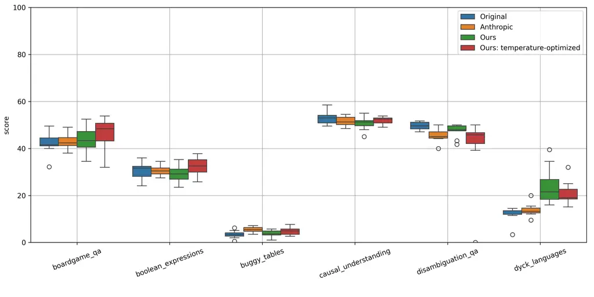

Figure 3: Box plots of score distributions (Tasks 1-6)

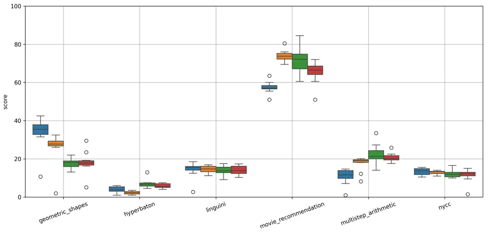

Figure 4: Box plots of score distributions (Tasks 7-12)

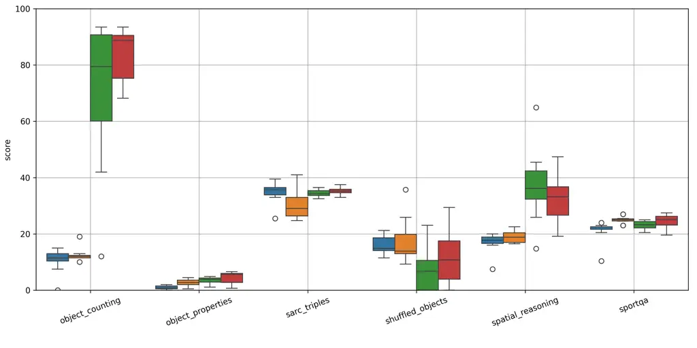

Figure 5: Box plots of score distributions (Tasks 13-18)

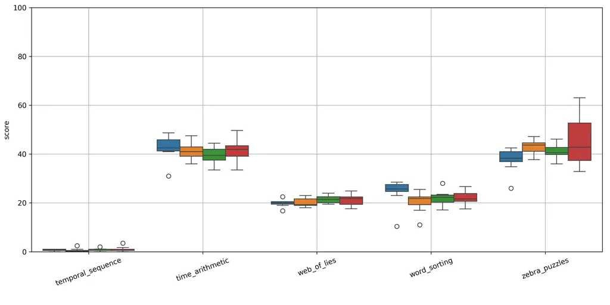

Figure 6: Box plots of score distributions (Tasks 19-23)

## Appendix D Temperature Parameter Optimization Results

|                      |                     |                    |                   |               |
| -------------------- | ------------------- | ------------------ | ----------------- | ------------- |
| task name            | optimal temperature | optimal mean score | F statistic value | ANOVA p value |
| BoardgameQA          | 0.2                 | 45.87              | 1.93              | 0.078         |
| Boolean Expressions  | 0.0                 | 33.73              | 3.42              | 0.003         |
| Buggy Tables         | 0.6                 | 3.24               | 0.85              | 0.531         |
| Causal Understanding | 1.0                 | 49.78              | 1.40              | 0.215         |
| DisambiguationQA     | 0.4                 | 41.29              | 0.97              | 0.446         |
| Dyck Languages       | 1.3                 | 19.06              | 1.47              | 0.189         |
| Geometric Shapes     | 0.0                 | 21.29              | 0.28              | 0.948         |
| Hyperbaton           | 1.3                 | 8.84               | 4.32              | $`<`$ 0.001   |
| Linguini             | 0.2                 | 24.10              | 0.85              | 0.53          |
| Movie Recommendation | 0.8                 | 74.94              | 0.64              | 0.698         |
| Multistep Arithmetic | 0.0                 | 28.20              | 2.51              | 0.023         |
| NYCC                 | 0.0                 | 15.00              | 3.87              | 0.001         |
| Object Counting      | 0.2                 | 88.04              | 0.32              | 0.926         |
| Object Properties    | 0.2                 | 5.27               | 1.64              | 0.139         |
| SARC Triples         | 0.2                 | 49.42              | 1.07              | 0.385         |
| Shuffled Objects     | 1.0                 | 9.78               | 1.61              | 0.147         |
| Spatial Reasoning    | 1.3                 | 32.00              | 1.32              | 0.248         |
| SportQA              | 0.2                 | 37.53              | 0.37              | 0.896         |
| Temporal Sequences   | 0.4                 | 1.54               | 1.10              | 0.361         |
| Time Arithmetic      | 1.0                 | 45.83              | 0.65              | 0.692         |
| Web of Lies          | 0.0                 | 19.82              | 8.34              | $`<`$ 0.001   |
| Word Sorting         | 1.0                 | 17.12              | 1.64              | 0.137         |
| Zebra Puzzles        | 0.0                 | 58.83              | 12.36             | $`<`$ 0.001   |

Table 5: Optimal Temperature Parameters for Each Task and ANOVA-based
Significance Analysis

## Appendix E Temperature Parameter Detailed Visualizations

The following presents score distributions and average scores for each
temperature parameter across tasks. Note that trial01-03 in the figures
below represent results calculated independently using different prompt
generation outcomes.

- •
  Left: Score distribution for each temperature
- •
  Right: Average scores by temperature with 95% confidence intervals

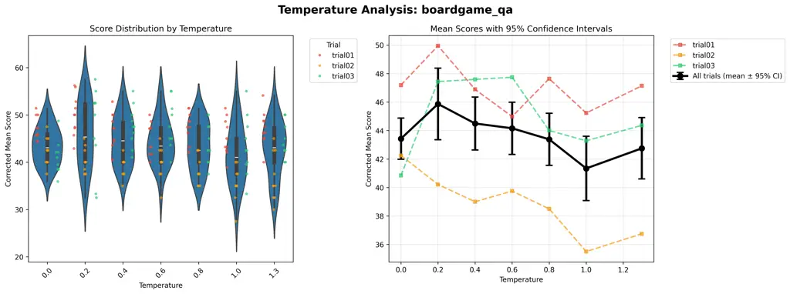

Figure 7: Temperature parameter analysis for BoardgameQA

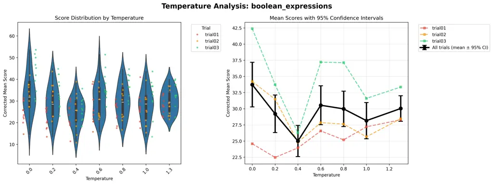

Figure 8: Temperature parameter analysis for Boolean Expressions

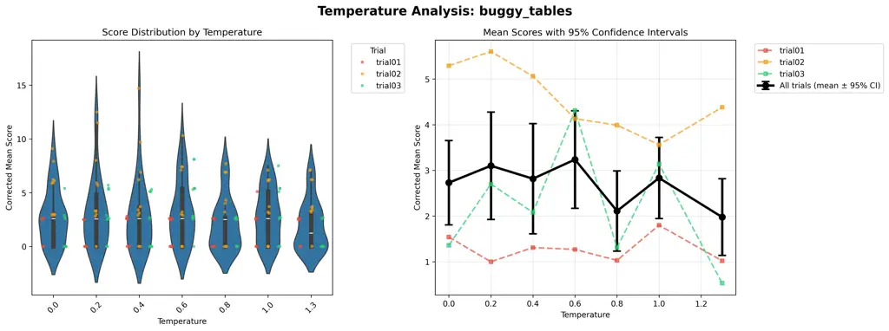

Figure 9: Temperature parameter analysis for Buggy Tables

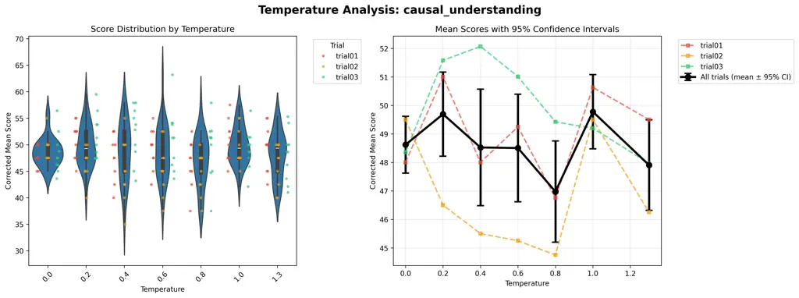

Figure 10: Temperature parameter analysis for Causal Understanding

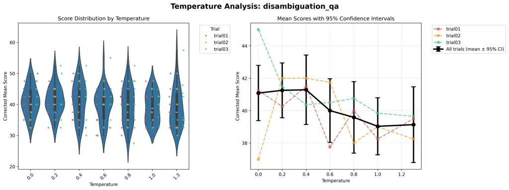

Figure 11: Temperature parameter analysis for DisambiguationQA

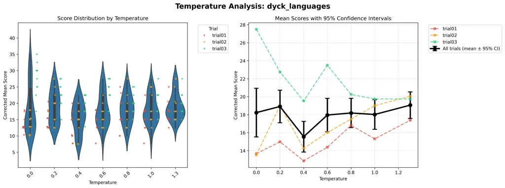

Figure 12: Temperature parameter analysis for Dyck Languages

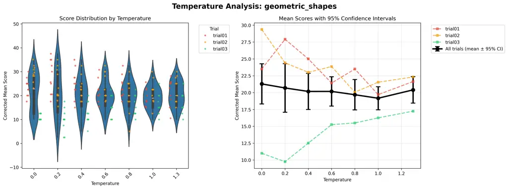

Figure 13: Temperature parameter analysis for Geometric Shapes

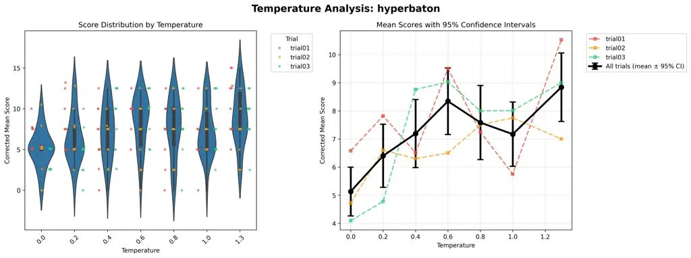

Figure 14: Temperature parameter analysis for Hyperbaton

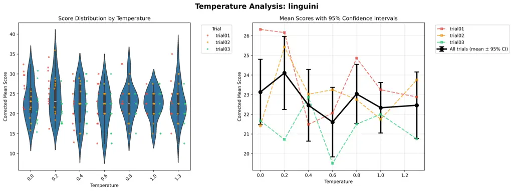

Figure 15: Temperature parameter analysis for Linguini

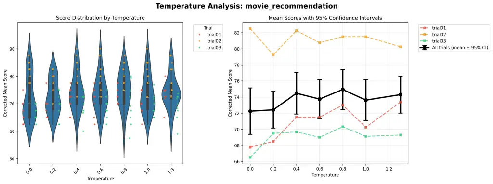

Figure 16: Temperature parameter analysis for Movie Recommendation

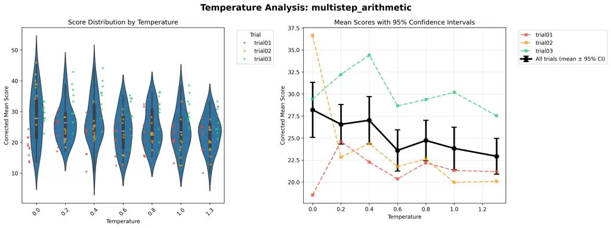

Figure 17: Temperature parameter analysis for Multistep Arithmetic

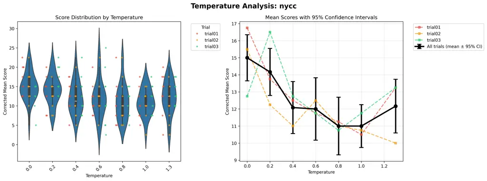

Figure 18: Temperature parameter analysis for NYCC

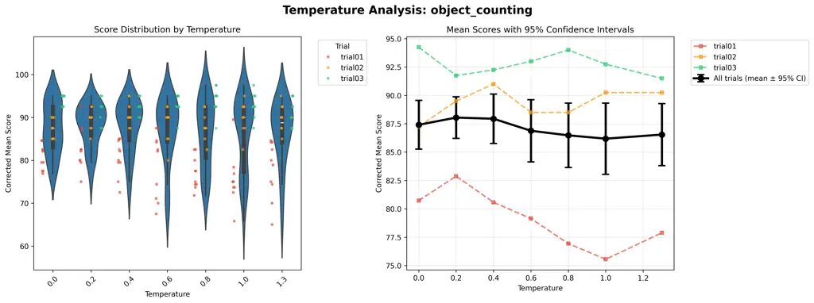

Figure 19: Temperature parameter analysis for Object Counting

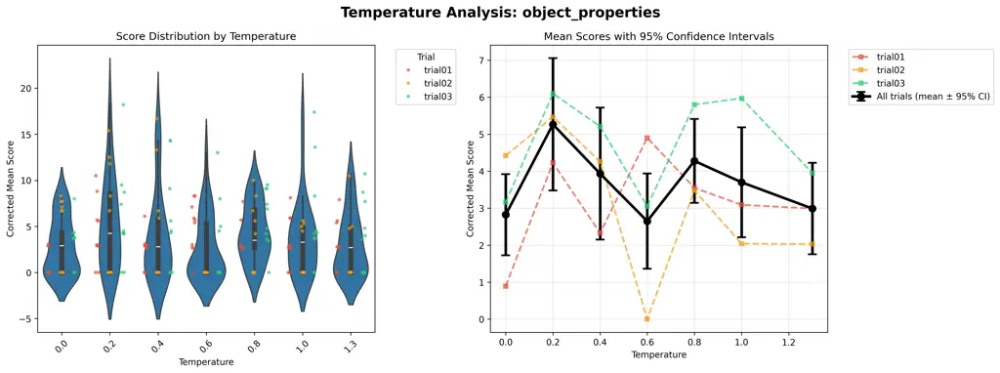

Figure 20: Temperature parameter analysis for Object Properties

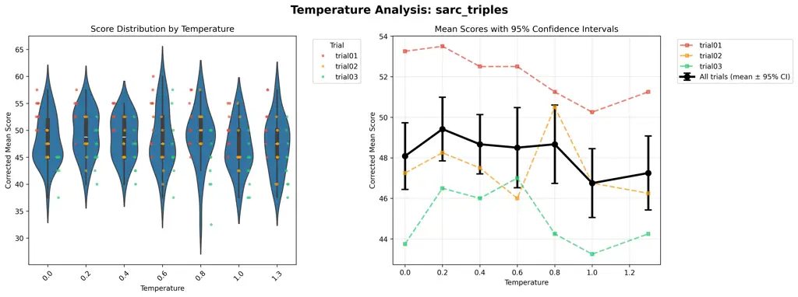

Figure 21: Temperature parameter analysis for SARC Triples

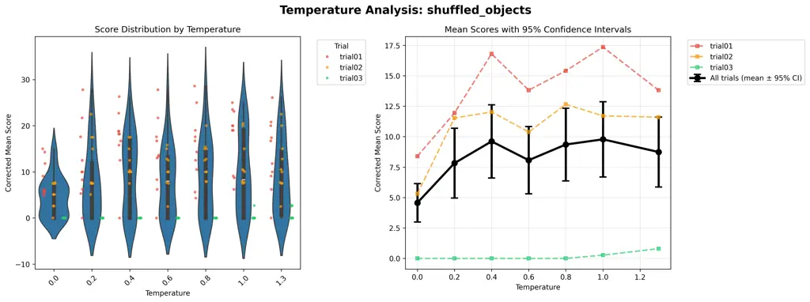

Figure 22: Temperature parameter analysis for Shuffled Objects

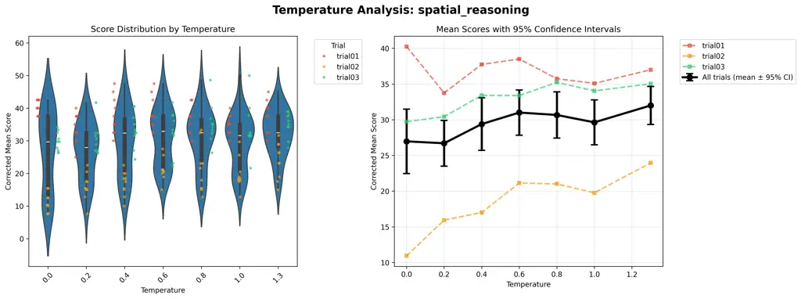

Figure 23: Temperature parameter analysis for Spatial Reasoning

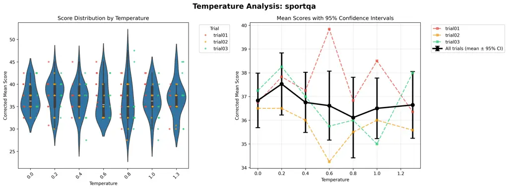

Figure 24: Temperature parameter analysis for SportQA

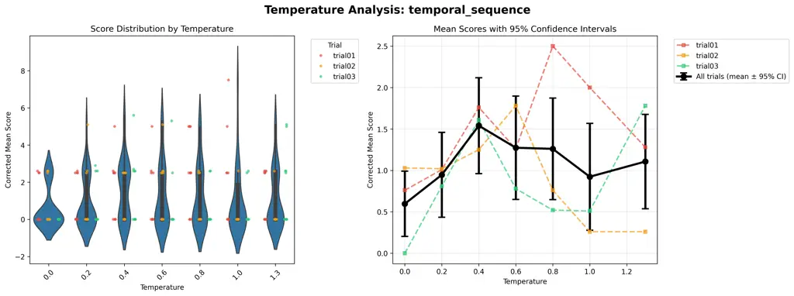

Figure 25: Temperature parameter analysis for Temporal Sequences

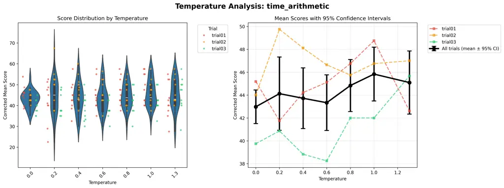

Figure 26: Temperature parameter analysis for Time Arithmetic

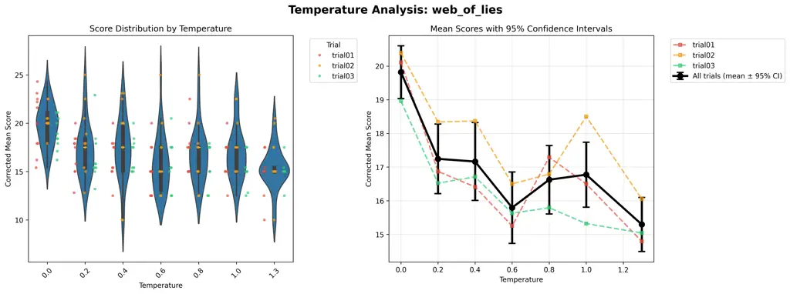

Figure 27: Temperature parameter analysis for Web of Lies

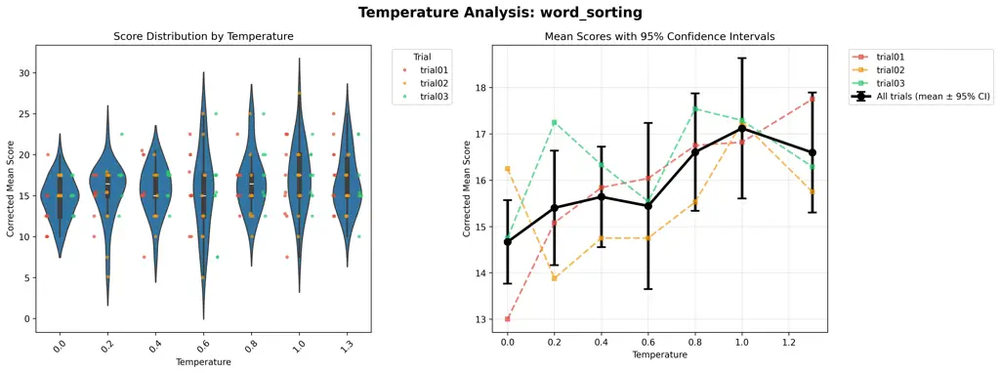

Figure 28: Temperature parameter analysis for Word Sorting

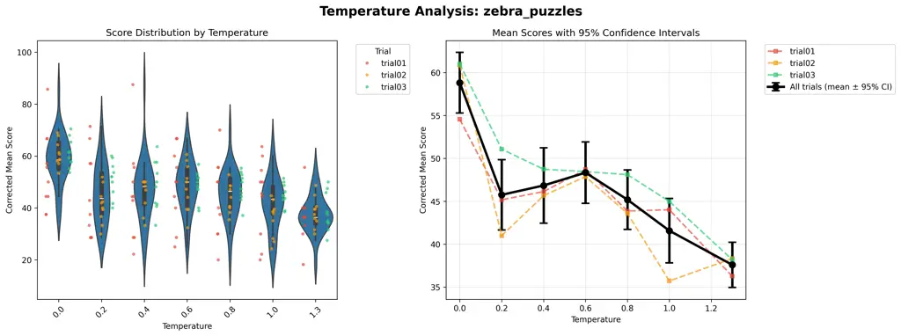

Figure 29: Temperature parameter analysis for Zebra Puzzles
