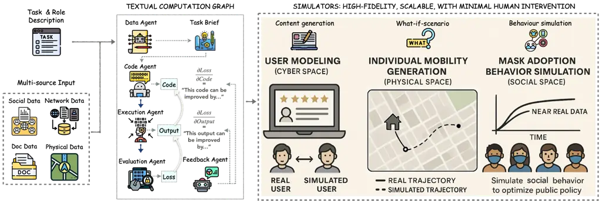

C. Amato, L. Dennis, V. Mascardi, J. Thangarajah (eds.)

# ![[Uncaptioned image]](arxiv-2510-18551v2--63a8f65dbed2.figures/figure-1.webp) \socia: Textual Gradient Meets Multi-Agent Orchestration for Automated Simulator GenerationConference: Proc. of the 25th International Conference on Autonomous Agents and Multiagent Systems (AAMAS 2026); May 25 – 29, 2026; Paphos, Cyprus

Yuncheng Hua, Sion Weatherhead, Mehdi Jafari, Hao Xue, Flora D. Salim²²
2 Corresponding author.  
School of Computer Science Engineering, University of New South Wales,
Australia  
{devin.hua, s.weatherhead, mahdi.jafari, hao.xue1,
flora.salim}@unsw.edu.au

2026© , 2026;

###### Abstract.

In this paper, we present \socia, an end-to-end, agentic framework that
treats simulator construction as _instance optimization over code_
within a textual computation graph. Specialized LLM-driven agents are
embedded as graph nodes, and a workflow manager executes a loss-driven
loop: code synthesis $`\rightarrow`$ execution $`\rightarrow`$
evaluation $`\rightarrow`$ code repair. The optimizer performs
Textual-Gradient Descent (TGD), while human-in-the-loop interaction is
reserved for task-spec confirmation, minimizing expert effort and
keeping the code itself as the trainable object. Across three CPS
tasks—User Modeling, Mask Adoption, and Personal Mobility—\sociaattains
state-of-the-art overall accuracy. By unifying multi-agent orchestration
with a loss-aligned optimization view, \sociaconverts brittle prompt
pipelines into reproducible, constraint-aware simulator code generation
that scales across domains and simulation granularities. We will release
the code soon.

###### Keywords: 

Textual Gradients, Multi-agent Orchestration, Simulator Code Generation,
End-to-end Agentic Framework, Data Calibration

## 1. Introduction



Figure 1. Overview of \socia. A multi-agent textual computation graph
takes task brief and input data, synthesizes simulator code, executes
it, and evaluates loss; the loss is converted into textual gradients
that drive code optimization. Right: three representative applications
illustrating alignment of simulated outputs with real observables.

Building simulators is a research hotspot because they offer a low-cost,
reproducible in-silico sandbox for controlled intervention and “what-if”
analysis, while enabling researchers to probe emergent outcomes under
shifts and unseen regimes (Bonabeau 2002; Cohen-Boulakia et al. 2017;
Alves Furtado and Nadalin 2023). By design, simulators span two
paradigms: _policy-oriented aggregate (system-dynamics / compartmental)
models_, which summarize populations through equations over aggregated
state variables, and _agent-based / microsimulation models_, which
follow heterogeneous decision units and their interactions to capture
fine-grained dynamics (Van Dyke Parunak et al. 1998; Mitton et al. 2000;
Macal and North 2005; Howick et al. 2024). These approaches arise across
cyber, physical, and social (CPS) domains (Ren et al. 2018a; Ren et al.
2018b; Kaur et al. 2020; Pasandideh et al. 2022; McCulloch et al. 2022),
making controlled, repeatable cross-domain experimentation feasible.

Regardless of form, simulators share a universal medium: executable
code. In practice, a simulator is only useful when its rules,
interfaces, and data flows are embodied in code that can be run,
evaluated, and calibrated (Kennedy and O’Hagan 2001; Law et al. 2007;
Grimm et al. 2020). This observation motivates a pragmatic goal: if we
could automate the construction of high-fidelity, extrapolatable
simulator code with minimal expert effort, we would substantially lower
the cost of building CPS simulators for computer scientists,
sociologists, and domain practitioners.

Existing pathways only partially meet this bar. *Manual, expert-built
simulators* (Zhang et al. 2025; Piao et al. 2025; Ju et al. 2025; JIAWEI
et al. 2024; Yang et al. 2024; Tang et al. 2024; Yan et al. 2024) are
accurate but expensive to produce and maintain. _Description-driven
systems_—for example, YuLan-OneSim (Wang et al. 2025), which converts
natural-language scenario descriptions into code using ODD
protocol (Grimm et al. 2010) and behavior graphs—reduce coding burden
but do not, by themselves, provide an inner loop for _data calibration_
of the generated programs. At the other end, recent _automatic
frameworks_ such as G-Sim (Holt et al. 2025) pair LLM-proposed designs
with simulation-based inference, showing promising alignment to observed
data; however, these efforts have largely focused on aggregate models
and may not readily extend to highly heterogeneous, micro-level
simulators.

In parallel, _multi-agent code generation_ has advanced rapidly:
CAMEL (Li et al. 2023a), ChatDev (Qian et al. 2023), AgentCoder (Huang
et al. 2023), AutoGen (Harper 2024), and AI Scientist-v2 (Yamada et al. 2025) stage specialized LLM agents to propose, test, and refine software
or to conduct scientific experiments. These frameworks demonstrate
compelling task decomposition and collaboration patterns, but they are
typically _prompt-sensitive, hand-tuned, and not designed for simulator
construction or data calibration_—their agent protocols and success
criteria are not embedded in a loss-compiled optimization view, and they
seldom close the loop from execution metrics back to targeted code
repair.

To overcome these challenges, we introduce \socia (Simulation
Orchestration for Computational Intelligence with Agents), an end-to-end
multi-agent framework that treats simulator building as _instance
optimization over code_ within a textual computation graph.
\sociadefines specialized agents for data analysis, code generation,
execution, evaluation, and feedback, and _embeds each agent as a node_
in a directed textual computation graph that carries both textual
artifacts (code, logs, critiques) and numeric signals (metrics). A
centralized workflow manager orchestrates _forward execution_ (generate
code $`\rightarrow`$ run simulator $`\rightarrow`$ compute validation
loss and constraint checks) and _backward repair_ (route _textual
gradients_—loss-aligned, natural-language critiques—toward the
responsible upstream code components). The optimizer uses _momentum_
(history-aware aggregation of critiques) and _projected gradient descent
(PGD)–style projection_ (constraint-aware repair to preserve
compilability and schema conformance) to stabilize long-horizon edits.
Human-in-the-loop (HITL) is employed for task-spec confirmation, but the
system aims to minimize expert effort by making the _code itself the
trainable object_ and iterating until convergence.

In summary, this paper makes three main contributions: (1) We present
\socia, a reliable, end-to-end simulator-code construction framework
that requires minimal human supervision, coordinating heterogeneous LLM
agents to synthesize, test, and refine executable simulators. (2) We
propose a _textual computation graph_ that embeds multi-agent reasoning
and treats _simulator code_ as the _optimization variable_, enabling
_loss-driven, constraint-aware textual-gradient updates_ with momentum
and projection. (3) We demonstrate empirically that \sociaconstructs
_accurate, extrapolatable simulators_ across CPS domains and across both
aggregate and agent-based modeling granularities.

## 2. Related Work

Multi-agent systems (MAS) in Software Engineering. MAS are widely used
for code and software generation (Huang et al. 2023; Li et al. 2023a;
Harper 2024; Jin et al. 2025). Frameworks like MetaGPT (Hong et al. 2024) and ChatDev (Qian et al. 2024) formalize workflows via structured
roles, while CodeR (Chen et al. 2024b), RGD (Jin et al. 2024),
UnitTest (Alshahwan et al. 2024), and AI Scientist-v2 (Yamada et al. 2025) target specific phases (issue resolution, testing, or
experimentation). Unlike these often predefined and human-supervised
pipelines, \sociaautonomously synthesizes, executes, and refines
_executable simulators_ from task descriptions and data.

Simulator construction. Prior work spans: (1) Domain-crafted simulators
which are authored by expert, creating an engineering bottleneck (Zhang
et al. 2025; Piao et al. 2025; Ju et al. 2025; JIAWEI et al. 2024; Yang
et al. 2024; Tang et al. 2024; Yan et al. 2024; Law et al. 2007); (2)
LLM-based multi-agent systems that compose simulators from
natural-language scenarios but lack a closed, loss-aligned inner loop to
edit code (Chen et al. 2024a; Rasal 2024; Harper 2024; Shang et al.
2025; Wang et al. 2025; Yue et al. 2025; Cui et al. 2025); (3)
Automated, data-calibrated pipelines (e.g., G-Sim) that align models to
observations yet emphasize aggregate calibration over localized code
repair (Holt et al. 2025). \sociaembeds specialized agents as nodes in a
textual computation graph, enabling instance-level, constraint-aware
code optimization.

Textual gradients & iterative self-improvement. DSPy (Khattab et al.
\[n.d.\]) formalizes LM pipelines as text-transformation graphs and
optimizes them algorithmically; TextGrad (Yüksekgönül et al. 2024)
improves upstream components in compound systems by _backpropagating
textual feedback_; and Self-Refine (Madaan et al. 2023) and
Reflexion (Shinn et al. 2023) demonstrate that iterative critiques and
episodic memory outperform one-shot prompting across tasks. Unlike these
approaches, \sociadelivers _loss-aligned, component-targeted_ updates
together with a _projector_ that enforces hard constraints—turning
reflection into _reproducible optimization_.

## 3. \socia: Approach

As shown in Figure 1, the \sociaframework adopts a multi-agent
architecture tailored to constructing high-fidelity simulators across
heterogeneous CPS domains. Given a task description and data as inputs,
\sociaoutputs _runnable, high-quality simulator code_; once executed by
the user, this code launches a high-fidelity simulator. In this chapter,
§3.1 elaborates the notions of computation graphs and textual gradients;
§3.2 describes the roles and capabilities of different agents in \socia;
and §3.3 explains how these agent functions are embedded into the
computation graph and how textual-gradient computation and
backpropagation are used to optimize the simulator code.

### 3.1. Computation Graphs and Textual Gradients

In mainstream ML, a computation graph is a directed acyclic graph (DAG)
whose nodes are operations and whose edges carry intermediate
values (Bergstra et al. 2010; Jia et al. 2014; Abadi et al. 2016; Paszke
et al. 2019); the forward pass evaluates the graph, and the backward
pass applies the chain rule to accumulate gradients for parameter
updates (Amari 1993).

Nowadays, many researchers have begun _building compound AI systems with
LLMs_, abstracting complex AI pipelines as _textual computation graphs_
and using *differentiation and gradients as a metaphor for LLM-produced
textual feedback* (Shinn et al. 2023; Pryzant et al. 2023; Yüksekgönül
et al. 2024). This leverages LLMs’ strengths in *reasoning,
self-checking, and self-refinement* (Bai et al. 2022; Madaan et al.
2023; Shinn et al. 2023; Li et al. 2023b; Khattab et al. \[n.d.\]; Yuan
et al. 2024) to optimize AI systems.

In \socia, we lift this idea from numeric operators to an _agentic
pipeline_ that builds a high-fidelity simulator. Each agent that
performs a specific function or behavior is a node in the DAG; edges
pass text or numeric artifacts (code, logs, metrics). Many nodes are
_non-differentiable_ (e.g., LLM calls, compilers, simulators). Following
TextGrad (Yüksekgönül et al. 2024), we endow this computation graph with
textual gradients—natural-language critiques that describe how to modify
upstream textual variables (here, the simulator code) to improve the
downstream objective (high-fidelity simulation). The framework
explicitly mirrors the _autograd_ metaphor but with _text as the
gradient carrier_, and provides a *PyTorch-like paradigm* (Paszke et al. 2019) to define losses and update variables.

As a textual-gradient paradigm with a prompt-LLM backbone, we must ask:
why textual gradients over plain prompt engineering? Prompt engineering
is model/version-dependent, phrasing-sensitive, and hard to evaluate
systematically (Salinas and Morstatter 2024), yielding brittleness, poor
portability, and dependence on measurement protocols (Polo et al. 2024).
_Textual gradients_ recast the problem as _principled optimization_—a
_loss-driven, backprop-style loop_ over the whole system that produces
targeted, evidence-grounded updates and improves reproducibility and
comparability (Khattab et al. \[n.d.\]). Rather than global prompt
fiddling, textual gradients enable _local, loss-aligned edits_:
downstream signals (metric diffs, failing cases, constraint violations)
are turned into _machine-readable, executable feedback_ and routed to
the responsible node (e.g., a faulty function), after which an optimizer
LLM proposes _small, verifiable_ patches that preserve working
components. Moreover, _iterative, feedback-driven refinement_
consistently outperforms one-shot prompting (Madaan et al. 2023; Shinn
et al. 2023), reinforcing the superiority of _loss-aligned local edits_
over _global prompt tweaks_. _In sum_, textual gradients transform
brittle, template-tuned systems into _reliable, loss-aligned
optimization pipelines_ with _targeted, verifiable updates_ that scale
across agents and tasks—precisely what plain prompt engineering
struggles to offer.

### 3.2. Orchestrated Agents

#### Workflow Manager

Serving as the hub, the Workflow Manager controls the multi-agent
workflow. Following the computation-graph design, it activates different
agents, loads the task-specific prompts that instruct each agent,
executes the graph’s forward/backward computations in order, and
terminates the iteration according to the convergence status of code
optimization.

#### Code Generation Agent (CGA)

CGA supports multiple prompts that each is aligned with a distinct
function. It ships with three working prompts:

- •
  _Initial code synthesis._ Before gradient computation begins, CGA
  reads the task brief and the predefined role description (see §3.3)
  and, using the code-generation prompt, produces the initial simulator
  code.
- •
  _Code optimization._ During textual-gradient–based optimization, CGA
  loads the code-optimization prompt and upgrades the code according to
  the back-propagated textual gradients (i.e., critiques on how to
  improve the code).
- •
  _Constraint repair._ CGA loads the code-fix prompt to handle _hard
  constraints_—coding conventions, interface contracts, and I/O
  requirements for the simulator (see §3.3).

Additionally, CGA implements a self-loop mechanism: after
generating/optimizing code, it performs automatic quality checks (e.g.,
compilation, syntax/static analyses for potential runtime errors,
empty-function checks), aggregates all detected issues, and applies
improvements. This _self-check $`\rightarrow`$ fix_ cycle runs up to
three times per iteration to enhance robustness.

#### Simulation Execution Agent (SEA)

The SEA compiles and executes the simulator code, generates simulation
outputs (e.g., agent trajectories or actions), and records any
compilation or runtime errors encountered during execution.

#### Result Evaluation Agent (REA)

Given SEA’s predictions and error logs, the REA computes fidelity losses
using task-specific evaluation metrics and performs code diagnostics
based on the compilation and runtime errors reported by SEA. The REA
incorporates _constraint satisfaction_ into the overall loss
computation.

#### Feedback Generation Agent (FGA)

FGA provides two dedicated working prompts. When _REA_’s computed losses
and diagnostic reports are available, the FGA loads the output-criticism
prompt to analyze the comparison between the simulator’s outputs and the
ground truth for the current iteration—identifying where the output
falls short, whether predictions exhibit distortion, and under what
conditions such distortion arises. In parallel, the FGA maintains a
historic log that records past errors and their corresponding fixes.
Conditioned on the current simulation code and the output criticisms,
the FGA loads the gradient-generation prompt and performs both
prediction attribution analysis (highlighting failure modes or
undesirable behaviors) and code-correction analysis, proposing
_executable, code-improving patches_ to remedy detected issues. It also
summarizes recent errors and fixes from the history window and
integrates them with the current round’s code-edit proposals before
delivering them to the CGA.

#### Data Analysis Agent (DAA)

DAA first consolidates the task description, the task dataset, and task
inputs (e.g., agent-related data such as profiles, historical
trajectories, and community context). Using a data-schema-analysis
prompt, it infers the data schema: attribute analyses, linkage and
interaction relationships across data sources, and the connections
between these data and simulator construction (e.g., which data build
agent profiles vs. which define the environment). Next, DAA loads a
task-brief-analysis prompt and, guided by a chain-of-thought (CoT)
procedure (Wei et al. 2022), iteratively reasons through and answers the
following to produce the simulator’s task brief: (1) clarify target
phenomena/outcomes and modeling stance; (2) specify time step, spatial
resolution, and population size; (3) define agent unit(s) and roles;
list static attributes and dynamic states of agents; (4) describe agent
interactions; (5) determine whether/how information diffuses; (6)
identify external signals/interventions and their access paths to
agents/modules; (7) define actions and the policy mapping
observations/signals to actions; (8) define task-relevant metrics.

Importantly, _after_ DAA drafts the task brief, we introduce a
human-in-the-loop (HITL) stage (So 2020; Wu et al. 2022; Mosqueira-Rey
et al. 2023; Natarajan et al. 2025): domain experts review and provide
feedback to confirm the simulator design. DAA incorporates human
feedback, produces a revised task brief, and repeats expert confirmation
until approval. In practice, leaving all design choices solely to an LLM
can lead to *hallucinations* (Liu et al. 2024; Xu et al. 2024); due to
CoT, early hallucinations may _propagate_ through the reasoning process,
causing substantial _semantic drift_ between the LLM’s final design and
user intent (Xue et al. 2023; Yee et al. 2024). Incorporating expert
feedback corrects such drift and significantly mitigates these
issues (Amirizaniani et al. 2024; Tonmoy et al. 2024). The goal is to
combine the LLM’s efficiency with human judgment to improve system
reliability and safety.

With these definitions of the central manager and agents in \socia, the
agents are instantiated as nodes in the computation graph described in
§3.3.

### 3.3. Textual-Gradient Optimization

Following *TextGrad* (Yüksekgönül et al. 2024), we abstract our AI
system as a computation graph, where functionally distinct agents are
represented as graph nodes. Optimizing the simulator code becomes an
_instance optimization problem_: we treat the code itself as an
optimization variable, compute “_textual gradients_” for that variable
via a backpropagation-like mechanism, and then apply a
gradient-descent-style procedure to iteratively improve the _code
variable_.

#### (1) Problem Definition

We study _instance optimization_ of a simulator whose implementation is
itself the trainable object.

- •
  Task brief (natural language): $`D`$ (generated by the DAA after
  executing the task-brief-analysis prompt).
- •
  Data: task inputs $`I`$ and ground-truth observables $`Y`$.
- •
  Variable: $`x\in\mathcal{X}`$, which is a _runnable simulator program_
  (code string).
- •
  Role description (text): $`r`$, specifies the intended
  interface/IO/semantics of $`x`$.
- •
  Hard constraints (feasible set):
  $`\mathcal{C}=\{\,x:\;c_{j}(x)\leq 0,\ j=1,\dots,J\,\}`$. Here,
  _constraints_ constitute an important part of our design, serving to
  restrict the generated simulator code so that it adheres to
  domain-specific requirements or predefined specifications. They are
  design rules for the simulator code, such as: _no syntax errors;
  compilable; read files according to policy; non-empty main flow;
  outputs match the specified schema_, etc.
- •
  Inequality-constrained Optimization Goal:

  ```math
  \min_{x\in\mathcal{X}}L(x)\ \ \text{s.t.}\ \ x\in\mathcal{C}
  ```

  Our objective is to ensure that, under the constraints
  $`\mathcal{C}`$, the generated code $`x`$ achieves minimum
  fidelity-loss.

- •
  We use the notation $`LLM(z)`$ to denote giving $`z`$ as a prompt to a
  language model and collecting its response.

#### (2) Textual Computation Graph

We model the system as a DAG $`\mathcal{G}=(V,E)`$, whose nodes are
_black-box operators_:

- •
  _LLM nodes_ produce or edit text (e.g., code).
- •
  _Function nodes_ execute code or compute metrics.

Each node $`v`$ computes $`z_{v}=f_{v}(\{z_{u}:u\in\mathrm{Pa}(v)\})`$,
where $`f_{v}`$ is a function that performs a specific capability, and
$`\mathrm{Pa}(v)`$ denotes the parents of node $`v`$. In our setting,
all nodes correspond to agents in \sociawith different abilities.
Although $`f_{v}`$ may be _non-differentiable_, we enable _backward
signal flow_ via _textual gradients_—natural-language critiques that
explain how to change an upstream text variable to reduce downstream
loss.

#### (3) Forward Pass and Loss with Constraints

We first perform _code initialization_ by synthesizing the code
variable: $`x_{0}=f_{\mathrm{LLM}}(D,r)`$, where the _input_ is the task
description $`D`$ (natural-language brief) and the role description
$`r`$ (the required interface/constraints for the simulator code). The
_output_ is the initial simulator program $`x_{0}`$ as text (simulator
code). The _job_ of this mapping is to turn the brief into an executable
baseline implementation that already adheres to the required API, I/O
policy, determinism, and output schema (with CGA executing
code-generation prompt).

At _iteration_ _$`t`$_, we use SEA to perform the _forward execution_:

```math
o_{t}=f_{\mathrm{Sim}}(x_{t},I).
```

Here, the _input_ is the current simulator code $`x_{t}`$ and the
evaluation inputs $`I`$ (validation data). The _output_ is the simulator
outputs $`o_{t}`$ (e.g., trajectories, curves, logs, intermediate
traces). The _job_ of this mapping is to compile/run $`x_{t}`$ on $`I`$,
producing the observables needed for scoring; it also yields run
metadata (errors, timing, determinism checks) that is later used as
evidence for feedback.

After the forward computation, we employ REA to compare the simulator’s
predictions against the ground-truth observables to compute the _loss_:

```math
L_{t}=\ell(o_{t},Y)+\lambda\sum_{j}\max\!\bigl(0,c_{j}(x_{t})\bigr).
```

The _input_ is the simulator outputs $`o_{t}`$ and the ground-truth
observables $`Y`$. The _output_ is a scalar loss $`L_{t}`$ (lower is
better). The _job_ of this mapping is to measure how closely the
simulator matches reality, e.g., via MSE/MAE over curves, distributional
distances (JS), or task-specific metrics.

In parallel, we use REA to enforce _constraint satisfaction_:
throughout, we require $`x_{t}\in\mathcal{C}`$ (no syntax errors;
compilable; policy-compliant I/O; non-empty main flow; output schema
conformity; etc.). Violations are both _forbidden_ for the final
solution and _used as evidence_ in the backward step.

#### (4) Textual Gradients (Backward as Text)

In our graph, $`x_{t}`$ has one numeric successor (_“simulate &
score”_). Therefore, by the chain rule, we have:

```math
\frac{\partial L_{t}}{\partial x_{t}}=\frac{\partial L_{t}}{\partial o_{t}}\cdot\frac{\partial o_{t}}{\partial x_{t}}=\nabla_{\mathrm{LLM}}(x_{t},o_{t},\tfrac{\partial L_{t}}{\partial o_{t}}).
```

Here, we use $`\nabla_{\mathrm{LLM}}`$ to compose natural-language
feedback such as “_This prediction can be improved by …_” where the
feedback _describes how to modify the variable_ to improve the
downstream objective, _analogous to gradients_ in standard Stochastic
Gradient Descent (SGD) (Li and Liang 2018).

We construct evidence $`\tfrac{\partial L_{t}}{\partial o_{t}}`$ to
describe the criticisms on the _prediction_ $`o_{t}`$ (completed by the
FGA using the output-criticism prompt.): _diffs_ between $`o_{t}`$ and
$`Y`$ revealed by evaluation metrics, and _constraint violations_
$`\{c_{j}(x_{t})>0\}`$ with failing tests (e.g., compile errors, IO
errors, abnormal outputs discovered during simulator execution). Then,
we have:

```math
\displaystyle g_{t}\;\triangleq\;\frac{\partial L_{t}}{\partial x_{t}} \displaystyle=\nabla_{\mathrm{LLM}}\!\left(x_{t},o_{t},\tfrac{\partial L_{t}}{\partial o_{t}}\right) \tag{1}
```

```math
\displaystyle\triangleq\;\mathrm{LLM}\Big(\text{We run simulator $x_{t}$ and obtain output $o_{t}$:}
```

```math
\displaystyle\quad\;\;\{o_{t}\mid x_{t}\}.
```

```math
\displaystyle\quad\;\;\text{Below are the critiques on $o_{t}$: }\big\{\tfrac{\partial L_{t}}{\partial o_{t}}\big\}.
```

```math
\displaystyle\quad\;\;\text{Explain how to improve $x_{t}$.}\Big) \tag{2}
```

The resulting _textual gradient_ is _a set of localized, actionable
code-edit patches_.

#### (5) Textual Momentum

In standard SGD, momentum (Polyak Heavy-Ball) (Scieur and Pedregosa 2020) uses a linear combination of past gradients and the most recent
one to define a new gradient for updating a variable. Analogously, to
_stabilize long-horizon editing_, we maintain a momentum buffer
$`m_{t}`$ as an _exponentially decayed synopsis_ of past critiques:

```math
m_{t}=\mathrm{Decay}_{\beta}(m_{t-1})\;\oplus\;g_{t},
```

where $`\oplus`$ denotes _ordered merge_, and $`\mathrm{Decay}_{\beta}`$
down-weights stale items (keep last $`K`$ iterations).

Concretely, we _keep track of past gradients_ by maintaining a _historic
log_ $`\{M\}`$ that records the optimization history across iterations.
After each code optimization round, we append the current gradient to
the tail of $`\{M\}`$. When forming the current Textual Momentum, we use
$`\mathrm{Decay}_{\beta}(m_{t-1})`$ to retrieve the _latest_ _$`K`$_ (in
our implementation $`K=3`$) historical gradient records from $`\{M\}`$,
and we _extract salient edits/themes_ from them to understand: (1) _what
mistakes_ prior code versions made (to avoid repeating them); (2) _how
we previously fixed issues_ (to inform the current round). We then merge
$`\mathrm{Decay}_{\beta}(m_{t-1})`$ with the _current_ detailed
code-edit feedback $`g_{t}`$ into $`m_{t}`$, which acts as the _refined
gradient_.

Our Momentum buffer—which summarizes prior critiques together with the
current feedback—plays the same memory/reflection role as in
Reflexion (Shinn et al. 2023) and the iterative self-feedback role in
Self-Refine (Madaan et al. 2023). By conditioning the next update on
history rather than only the latest signal, it operationalizes exactly
the mechanism these methods credit for outperforming one-shot prompting.
In our design, momentum enriches the optimizer’s context, enabling
progressively smaller, better-aligned edits over time and reducing the
chance of repeating past mistakes. Here, the FGA, loaded with the
gradient-generation prompt, is responsible for generating the _textual
gradients_ and _momentum-based_ summarization.

#### (6) Projected Gradient Descent (PGD)

In classical PGD (Agarwal et al. 2010; Chen and Wainwright 2015), each
gradient step is followed by a projection $`\Pi_{\mathcal{C}}`$ (mapping
$`z`$ to a point in the feasible set $`\mathcal{C}`$); analogously,
\sociaimplements a textual analogue of PGD.

Specifically, we employ Textual Momentum to perform _textual gradient
descent–based optimization_ and _variable updates_, we have:

```math
\displaystyle x_{t+1}^{\mathrm{unproj}} \displaystyle=\mathrm{TGD.step}(x_{t},m_{t};r)
```

```math
\displaystyle\triangleq\;\mathrm{LLM}(\begin{aligned} &\text{We have critiques on }\{x_{t}\}\text{: }\{m_{t}\}\text{.}\\
&\text{Incorporate them to optimize code.)}\end{aligned} \tag{3}
```

Here, TGD.step receives: (i) the current $`x_{t}`$; (ii) the aggregated
critiques $`m_{t}`$; (iii) the role description $`r`$, and returns the
_corrected code_ $`x_{t+1}^{\text{unproj}}`$. Here we use CGA to execute
code-optimization prompt to edit code.

Afterwards, we _project_ $`x_{t+1}^{\text{unproj}}`$ back to the
feasible set using a textual projector $`\Pi_{\mathcal{C}}`$ that
repairs violations via the _smallest necessary edits_:

```math
x_{t+1}=\Pi_{\mathcal{C}}(x_{t+1}^{\text{unproj}}),\qquad\Pi_{\mathcal{C}}:\mathcal{T}\rightarrow\{\,x:\;c_{j}(x)\leq 0\ \forall j\,\}.
```

_Practically_, $`\Pi_{\mathcal{C}}`$ is designed as a _constraint
repairer_ that sequentially performs _static checks_, _interface tests_,
_compilation checks_, etc.; if a violation is detected, it conducts
_minimal-edit repairs_ (an inner loop of CGA’s _code-fix_
$`\leftrightarrow`$ _self-check_; up to _three_ attempts per iteration).
We write the constraint rules into \<CONSTRAINTS\> in the CGA’s code-fix
prompt so that they become the target of the projector.

#### (7) One-Line Summary (All Pieces Together)


We iteratively optimize $`x`$, and _stop by early-stopping on
validation_ when $`L_{t}`$ _plateaus_ and _all constraints_ hold.

## 4. \socia: Experimental Setup

### 4.1. Benchmarks

We evaluate \sociaon three real-world–inspired simulation tasks.

#### (1) User Modeling

(cyber space, agent-based model), drawn from the AgentSociety
Challenge (Yan et al. 2025), uses an LLM as a tool to predict ratings
for new products from users’ historical star ratings on an e-commerce
platform.

#### (2) Mask Adoption Behavior Simulation

(social space, aggregate model), models the temporal dynamics of
mask-wearing decisions during a pandemic in a socially embedded
population. Decisions depend on heterogeneous social ties, risk
perception, and governmental interventions, with a public-health
campaign on Day 10 triggering diffusion. Inspired by the data paradigms
in BESSIE (Mortveit et al. 2022) and pandemic-era mask decision
simulators (Mitsopoulos et al. 2023), we generate manually perturbed,
LLM-based synthetic data for 1,000 agents embedded in a multi-relational
graph; note: from Day 10 onward, an external governmental intervention
affects community decisions, and the simulator must model this
intervention process.

#### (3) Personal Mobility Generation

(physical space, agent-based model), adopts the LLMob dataset (Wang
et al. 2024b) containing real-world spatiotemporal trajectories from
residents in Japan. The objective is to predict each individual’s
next-day mobility trajectory under three settings: (a) normal
$`\rightarrow`$ normal, (b) pandemic $`\rightarrow`$ pandemic, and (c)
normal $`\rightarrow`$ pandemic using only normal-period history. Note:
Personal Mobility includes both in-domain (ID) fitting
(normal$`\rightarrow`$normal and pandemic$`\rightarrow`$pandemic;
training and prediction data follow the same distribution) and
out-of-domain (OOD) extrapolation (normal$`\rightarrow`$pandemic),
requiring the simulator to generalize to new conditions to answer
“what-if” questions.

### 4.2. Baseline Methods.

We compare \sociaagainst several baselines.AI Scientist-v2 (Yamada
et al. 2025) is an automated pipeline that ingests experimental data and
constructs/executes ML-based models; however, due to the complexity of
simulator construction, AI Scientist-v2 still requires a certain amount
of manual code adjustments to complete code generation.

We also include YuLan-OneSim (Wang et al. 2025), which structures
scenarios via the ODD protocol (Grimm et al. 2010), generates code with
a Behavior Graph, and improves it via an iterative
_verify–repair–regenerate_ loop; note: YuLan-OneSim provides
scenario-aware data understanding (metrics, analysis, and real/Sim
alignment) for its simulations, but it is not a general-purpose
data-understanding or statistical calibration toolkit. Therefore, for
fairness, we equip it with \socia’s data-understanding module in our
implementation.

The G-SIM family (Holt et al. 2025) is another key baseline: it uses
LLMs to generate simulator code and integrates gradient-free
calibration, including evolutionary strategies (G-SIM-ES) and
simulation-based inference (G-SIM-SBI), to produce calibrated,
uncertainty-aware simulators; G-SIM-SBI offers stronger OOD
extrapolation.

Also, we compare with Reflexion (Shinn et al. 2023), which prompts an
LLM to self-reflect on code snippets, writes verbal reflections from
trial feedback and stores them in episodic memory to guide subsequent
trials, and—conditioned on these reflections and observed
errors—produces updated code. In our implementation, all other
mechanisms mirror \socia, except that Reflexion’s self-check/self-update
is used to refine simulator code.

### 4.3. Evaluation metrics and Implementation.

Evaluation metrics. We report means with 95% confidence intervals.
Stochastic LLM- and simulator-based runs are repeated with five
seeds (Colas et al. 2018), while SBI draws $`1{,}000`$ posterior samples
to propagate parameter uncertainty (Falkiewicz et al. 2023).
Task-specific metrics (following CoT-structured prompts, see §3.2) are:
MAE for User Modeling (Wang et al. 2024a); RMSE for Mask Adoption,
emphasizing large deviations; and DARD/STVD for Personal Mobility
Generation, measuring activity–time and spatiotemporal footprint
alignment. All are error distances, where lower $`\downarrow`$ indicates
better $`\uparrow`$ performance.

Implementation. All \sociaagents—and the reproduced baselines—are built
on GPT-5 (OpenAI 2025). We re-implemented baselines either via code
reproduction or via dataset-level reproduction to ensure evaluation
consistency.

## 5. \socia: Evaluation

| Methods $`\downarrow`$ | User.              | Mask.               | Mob. N$`\rightarrow`$N (ID) |                     | Mob. A$`\rightarrow`$A (ID) |                     | Mob. N$`\rightarrow`$A (OOD) |                     |
| ---------------------- | ------------------ | ------------------- | --------------------------- | ------------------- | --------------------------- | ------------------- | ---------------------------- | ------------------- |
|                        | MAE $`\downarrow`$ | RMSE $`\downarrow`$ | DARD $`\downarrow`$         | STVD $`\downarrow`$ | DARD $`\downarrow`$         | STVD $`\downarrow`$ | DARD $`\downarrow`$          | STVD $`\downarrow`$ |
| AI Scientist-v2        | 0.89±0.10          | 0.45±0.07           | 0.77±0.06                   | 0.82±0.06           | 0.78±0.06                   | 0.83±0.06           | 0.80±0.07                    | 0.85±0.06           |
| Yulan-OneSim           | 0.72±0.08          | 0.42±0.04           | 0.53±0.06                   | 0.59±0.07           | 0.58±0.04                   | 0.61±0.05           | 0.69±0.07                    | 0.70±0.04           |
| G-SIM-ES               | 0.60±0.07          | 0.30±0.08           | 0.45±0.02                   | 0.48±0.03           | 0.52±0.04                   | 0.56±0.04           | 0.58±0.05                    | 0.64±0.05           |
| G-SIM-SBI              | 0.69±0.08          | 0.20±0.10           | 0.54±0.03                   | 0.56±0.03           | 0.47±0.03                   | 0.53±0.03           | 0.60±0.05                    | 0.66±0.05           |
| Reflexion              | 0.57±0.08          | 0.36 ±0.04          | 0.42±0.05                   | 0.43±0.07           | 0.46±0.04                   | 0.50±0.05           | 0.55±0.04                    | 0.61±0.07           |
| \socia                 | 0.54±0.06          | 0.22±0.07           | 0.40±0.02                   | 0.41±0.03           | 0.43±0.03                   | 0.46±0.03           | 0.50±0.05                    | 0.59±0.06           |

Table 1. Evaluation results (±denotes 95% CIs) on three simulation
tasks, and lower values indicate better performance. The best and
second-best results are highlighted in bold and underlined. Mob.
N$`\rightarrow`$N, Mob. A$`\rightarrow`$A, and Mob. N$`\rightarrow`$A
denote Personal Mobility (training on normal period data and predicting
normal period trajectory), abnormal-to-abnormal (pandemic) prediction,
and abnormal prediction using only normal-period history, respectively.

### 5.1. Simulator Overview

Our \sociaderives task-specific simulator code through data-driven
self-checking and self-optimization. By inspecting the generated code,
we briefly summarize the construction of each simulator.

#### Mask Adoption.

\socia

implements the Mask Adoption Behavior Simulator as a networked system
that rolls forward 40 daily steps and couples data-driven calibration
with progressively richer decision mechanics. Individuals maintain
states (mask status, risk perception, memory) and typed ties across
family / workplace–school / community in a social network with learned
edge weights. Each day, the simulator performs a two-phase update to
compute a latent adoption score that aggregates (i) multi-layer social
influence with temporal decay and echo-chamber reinforcement, (ii)
environmental risk signals, (iii) habit formation / memory from past
choices, and (iv) exogenous intervention inputs; this score is mapped
through a sigmoid to yield a probabilistic adopt/keep decision. From Day
10, a policy module injects information via high-centrality nodes and
tracks intervention fatigue over time.

#### Personal Mobility Generation.

\socia

builds the Personal Mobility Simulator as a city-scale, agent-based
pipeline that consumes an individual’s historical spatiotemporal traces
and outputs a feasible next-day itinerary with timestamps and locations.
Concretely, the system defines Resident, Location, and Simulation
Environment primitives; ingests mobility logs; and derives resident
profiles (home/work anchors, daily routines, activity preferences) via
pattern extraction over step-length/interval distributions and
time-of-day frequencies. An LLM-based schedule generator then plans a
day as a sequence of activities (e.g., work, dining, study, shopping)
and selects candidate POIs using preference- and context-aware scoring
subject to spatiotemporal constraints (opening hours, travel-time
budgets, inter-POI distance). The simulator supports all three
experimental regimes by switching conditioning data and priors: (i)
normal → normal, (ii) abnormal → abnormal, and (iii) normal → abnormal
(distribution shift).

#### User Modeling.

\socia

implements the User Modeling Simulator as an agentic, modular
architecture composed of three functional agents—Planning, Reasoning,
and Memory—that respectively decompose high-level goals, infer user
behavior, and persist interaction history. The Planning Agent
orchestrates subtasks; the Reasoning Agent generates ratings (and review
text) via LLM reasoning; and the Memory Agent conditions decisions on
historical preferences and prior outputs. The system replaces ad-hoc
randomness with preference-aware scoring distributions, incorporates
platform awareness to control tone, style, and rating policies, and
introduces recommendation logic that aligns users with products based on
behavioral signals and attribute profiles.

### 5.2. Main Findings (Table 1)

#### (1) \sociadominates.

On all three simulations, \sociaattains the lowest error in 7/8 metrics:
User Modeling (MAE), Personal Mobility (ID: DARD/STVD for N→N and A→A),
and Mobility OOD (N→A: DARD/STVD). Only Mask Adoption RMSE is not the
best (where G-SIM-SBI edges out \sociaby 0.02). This pattern highlights
the advantage of our loss-driven, constraint-aware, instance
optimization loop over heterogeneous agent pipelines.

#### (2) \sociavs. G-SIM: wins broadly; close second on Mask.

Relative to G-SIM-ES/SBI, \sociaexcels on User Modeling and Mobility
because these tasks benefit from _LLM-based reasoning over data and
structure_ and from _textual-gradient_ updates that _repair specific
code components_ (add/modify logic, fix functions, adjust data handling,
then calibrate parameters as needed). By design, G-SIM does _not_ invoke
LLMs; it constructs simulators by assembling _mathematical models and
functional modules_ only. Consequently, on tasks that _only_ require a
fixed mathematical formulation—such as Mask Adoption (essentially
_parameter calibration + exogenous intervention modeling_)—G-SIM’s
_gradient-free_ calibration (ES/SBI) is naturally strong. That said,
even though \sociais _not_ a purpose-built parameter-calibration method,
it _nearly matches_ G-SIM on Mask Adoption (_0.22 vs. 0.20 RMSE_) thanks
to _constrained repairs_ and _projection (PGD)_, while _clearly
outperforming_ G-SIM on tasks that _require reasoning and structural
edits_ (User Modeling, Mobility).

#### (3) \sociavs. Reflexion: loss-aligned, component-level repairs.

Both systems iterate with feedback, but Reflexion relies on free-form
verbal reflections shaped by reward/success signals and episodic memory;
it _does not define a graph-wide loss or a backprop rule_, so guidance
can be looser and updates typically adjust _future decisions/strategies_
rather than issuing _component-level patches tied to a loss_. In
contrast, \socia performs _Textual-Gradient Descent (TGD)_ over a
_computation graph_, routing critiques grounded in _metric diffs,
failures, and constraint violations_ directly to the _offending
component_ (e.g., a specific function), then enforcing feasibility via
_projection_ and _hard constraints_—yielding _small, verifiable patches_
that preserve working parts and producing _consistent gains over
Reflexion across all metrics_.

#### (4) Strong ID fitting and OOD extrapolation.

Across all three tasks, \sociadelivers the strongest overall
performance: it achieves the best User Modeling error (MAE) and the best
Mobility scores in both ID (N$`\rightarrow`$N, A$`\rightarrow`$A) and
OOD (N$`\rightarrow`$A) settings, while ranking a close second on Mask
Adoption (RMSE)—narrowly behind G-SIM-SBI. This pattern indicates that
_data-calibrated textual gradients + Momentum + PGD_ not only fit
in-distribution behavior but also adapt under distribution shift via
targeted edits to dynamics, priors, and policy modules; meanwhile,
_projection_ keeps every update runnable, deterministic, and
schema-compliant.

#### (5) Why YuLan-OneSim and AI Scientist-v2 trail.

YuLan-OneSim excels at ODD/behavior-graph blueprinting and iterative
verify–repair during generation, _but it does not specify an inner-loop,
loss-aligned code–refinement step that uses a test/validation loss to
directly edit the simulator code itself_. By contrast, \socia’s explicit
goal is a _data-calibrated simulator_ whose _code is continuously
repaired_—under hard constraints—to _reduce a measurable test/validation
loss_ via _minimal, testable patches_. In other words, where
YuLan-OneSim lacks a _closed-loop, loss-driven code-editing procedure_
that optimizes a dataset-defined objective (e.g., validation loss), the
\sociaframework _makes this central_. Likewise, AI Scientist-v2 is
tailored to _ML_-based experimentation rather than simulator
construction, and it _does not provide data calibration_ for
instance-level code repair. These design gaps align with their weaker
results across tasks compared to \socia.

#### Takeaway.

SOCIA-$`\nabla`$’s textual computation graph + TGD with Momentum and PGD
delivers loss-aligned, constraint-aware, and localized code repairs,
translating directly into superior accuracy in-domain and under shift,
and outperforming baselines that either lack data-calibrated inner loops
(YuLan-OneSim), specialize in parameter-only calibration (G-SIM), or
rely on reflection without backprop-through-system variables
(Reflexion).

### 5.3. Qualitative Study

#### (1) LLM Calling

LLM calling is the core mechanism for constructing _agent-based_ models
(Personal Mobility Generation and User Modelling, see §5.1). When
building such simulators, one must craft well-structured contextual
prompts to drive the LLM in simulating individual behaviors (Lu et al.
2025). In practice, the simulator code (generated by \socia) must first
_construct information elements_ for the agent: in user modelling, we
aggregate a user’s historical ratings, peer ratings on the target item,
and cross-site rating distributions; in mobility, we assemble nuanced
resident profiles and personalized schedules to enhance behavioral
diversity and realism. A central challenge is then how to _package_
these elements into prompts—and how to script the prompt instructions—to
elicit reliable LLM reasoning about user behavior. In SOCIA-$`\nabla`$’s
design, this entire workflow is unified _inside the code_: \sociatreats
the optimization target as a _code variable_ and apply _textual
gradients_ to update the code itself. Consequently, during each
textual-gradient step the LLM’s self-check and self-correction not only
revise _simulator logic_ but also _co-optimize_ _information-element
construction_ and _prompt formulation_. This integrated approach
subsumes prompt optimization into code repair, enabling a single,
end-to-end loop that jointly improves data aggregation, prompt
elicitation, and executable simulator quality.

#### (2) Exogenous Interventions and OOD

In Mask Adoption (a _what-if_ intervention setting) and Personal
Mobility (OOD forecasting under shift), \sociaperforms strongly (Mask:
_second-best_, close to G-SIM-SBI; Mobility: best), because the
_generated simulator code_ explicitly anticipates and absorbs
distributional changes. For _Mask Adoption_, _iterative code upgrades_
add: (i) _government intervention_ handlers and _intervention fatigue_;
(ii) _habit formation_ and _dynamic decision thresholds_; (iii) refined
_social influence_ (echo chambers, environmental risk), two-phase
propagation, and _dynamic decay_; (iv) _multi-relationship networks_
(family/work/community) with weights, _cluster-specific parameters_, and
memory effects; (v) a _calibrate_parameters_ routine with
sigmoid/probabilistic decisions. For _Personal Mobility_, _code evolves_
to OOD-aware components: _resident personas_ and _daily pattern
extraction_; _motivation/history_ modeling; _LLM-based profile_ &
_schedule synthesis_; _POI selection_ and _location-aware scheduling_
(distance/opening hours); plus _transport modes_ and shortest-path
routing. Crucially, \sociaapplies _textual gradients with Momentum and
PGD_: metric diffs and violations back-propagate to offending functions;
the optimizer proposes _minimal, verifiable_ patches—coupling
_intervention-aware_ and _shift-aware_ code with a _loss-aligned_ loop
to deliver the observed ID (N$`\rightarrow`$N, A$`\rightarrow`$A) and
OOD (N$`\rightarrow`$A) gains.

### 5.4. Ablation Study (Table 2)

| Models $`\downarrow`$ | User.                        | Mask.                         | Mob. N$`\rightarrow`$A        |
| --------------------- | ---------------------------- | ----------------------------- | ----------------------------- |
|                       | $`\Delta`$MAE $`\downarrow`$ | $`\Delta`$RMSE $`\downarrow`$ | $`\Delta`$DARD $`\downarrow`$ |
| \socia                | -                            | -                             | -                             |
| w/o mom.              | +0.05$`\pm`$0.02             | +0.07$`\pm`$0.03              | +0.09$`\pm`$0.04              |
| w/o proj.             | +0.06$`\pm`$0.02             | +0.10$`\pm`$0.03              | +0.16$`\pm`$0.05              |
| w/o CoT               | +0.08$`\pm`$0.04             | +0.12$`\pm`$0.06              | +0.20$`\pm`$0.07              |
| w/o HITL              | +0.11$`\pm`$0.04             | +0.17$`\pm`$0.04              | +0.26$`\pm`$0.06              |
| w/o iter              | +0.18$`\pm`$0.06             | +0.28$`\pm`$0.07              | +0.38$`\pm`$0.09              |

Table 2. On the User Modeling (User.), Mask Adoption (Mask.), and
Personal Mobility (normal$`\rightarrow`$pandemic) (Mob.
N$`\rightarrow`$A) tasks, we conducted an ablation study using \sociaas
the baseline. Larger positive $`\Delta`$ values indicate greater
performance degradation.

We conduct an ablation study to quantify the contribution of each
component in \socia. Unless otherwise noted, we report performance
deltas ($`\Delta`$) relative to the full model on three tasks: User
Modeling ($`\Delta`$MAE), Mask Adoption ($`\Delta`$RMSE), and Personal
Mobility (normal$`\rightarrow`$abnormal, OOD) ($`\Delta`$DARD). Variants
are:

- •
  w/o mom.: remove the Momentum buffer (history of critiques/patches).
- •
  w/o proj.: remove Projected Gradient Descent (PGD), i.e., no
  constraint-based projection/repair.
- •
  w/o CoT: disable chain-of-thought guidance when the Data Analysis
  Agent derives the task brief (use only a basic task-analysis prompt).
- •
  w/o HITL: remove human-in-the-loop expert confirmation when
  drafting/refining the task brief.
- •
  w/o iter: disable iterative optimization, i.e., use only the first
  version of the code produced by the generation agent.

Results Summary. On Mask Adoption, Table 2 shows consistent
degradations. Extending this to User Modeling and Mobility (OOD:
N$`\rightarrow`$A) yields a coherent pattern: (i) _OOD extrapolation is
more sensitive_ to ablations than Mask/User; (ii) User Modeling is
especially sensitive to CoT/HITL (schema construction and prompt
design), while PGD and Momentum remain beneficial; and (iii) removing
_iteration_ is most damaging across tasks.

Component-wise Analysis.

(1) Momentum (w/o mom). Removing Momentum erases historical critiques,
yielding _moderate_ Mask degradation ($`\approx`$ +0.07), _smaller_
impact on User ($`\approx`$ +0.05), and _larger_ OOD Mobility drop
($`\approx`$ +0.09)—confirming Momentum prevents repeated mistakes and
stabilizes long-horizon edits, especially under distribution shift.

(2) Constraint Projection (w/o proj). Removing PGD drops the
compile/IO/schema/determinism projection, letting brittle edits pass
through; this yields _Mask_ +0.10, _User_ $`\Delta`$MAE $`\approx`$
+0.06, and _OOD_ $`\Delta`$DARD $`\approx`$ +0.16. The larger OOD
penalty underscores the need for feasibility-preserving repairs under
shift.

(3) Chain-of-Thought (w/o CoT). Disabling CoT during task-brief
derivation weakens _information-element construction_ and prompt
scaffolding: _Mask_ degrades more ($`\Delta`$RMSE $`\approx`$ +0.12)
than _User Modeling_, and OOD Mobility suffers further ($`\Delta`$DARD
$`\approx`$ +0.20) as poor specifications propagate downstream.

(4) Human-in-the-Loop (w/o HITL). Removing expert confirmation causes
mis-specified objectives and semantic drift, with _pronounced_
degradations: Mask (+0.17), User ($`\Delta`$MAE $`\approx`$ +0.11), and
especially OOD Mobility ($`\Delta`$DARD $`\approx`$ +0.26). Expert
feedback mitigates early hallucinations and anchors the design to domain
constraints—crucial for robust extrapolation.

(5) Iteration (w/o iter). Using only the first code draft blocks
error-driven refinement, causing the _largest_ degradations—Mask
($`\approx`$ +0.28), User ($`\approx`$ +0.18), and OOD Mobility
($`\approx`$ +0.38). Hence, iteration is essential for converging to
high-fidelity simulators.

Takeaways. Iteration is indispensable—it delivers the largest gains
across tasks. HITL and CoT are critical for problem specification,
especially for User Modeling and OOD Mobility, where mis-specified
briefs/prompt scaffolds propagate widely. PGD safeguards feasibility and
stability, with outsized benefits under shift. Momentum leverages
history to avoid regressions.

## 6. Conclusion and Future Work

#### Conclusion.

We introduced \socia, an end-to-end, _multi-agent_ framework that embeds
heterogeneous agents as _nodes_ in a textual computation graph—thereby
unifying the multi-agent system under a single, loss-compiled
abstraction and enabling seamless agent coordination via graph-based
forward/backward flow. Simulator construction is posed as _instance
optimization over code_ with a loss-driven loop—code synthesis
$`\rightarrow`$ execution $`\rightarrow`$ evaluation $`\rightarrow`$
textual-gradient repair—using _TGD_ with _Momentum_ (history-aware
critiques) and _PGD-style projection_ (constraint repair), complemented
by CoT-guided analysis and HITL verification. Across User Modeling, Mask
Adoption, and Personal Mobility, \sociaattains state-of-the-art results
overall (best on all Mobility ID/OOD metrics; close second on Mask), and
ablations confirm the importance of iteration, HITL/CoT, projection, and
momentum.

#### Future Work.

We will pursue two directions. (1) Scaling interaction complexity:
extend \socia from small, mostly linear exchanges to _large,
data-induced agent societies_ with thousands–millions of agents and
richer _parallel/asynchronous_ communication; upgrade the textual
projector for concurrency safety and interface contracts, and
incorporate distributed signals (stability, throughput, fairness) as
loss terms. (2) Domain/space generalization and model pretraining:
deploy \socia across diverse CPS settings to harvest per-iteration
_(code, loss)_ trajectories; use these as reinforcement-learning
supervision to train a _simulator-code LLM_ specialized for program
synthesis/repair, then adopt it as the coding agent’s base
model—reducing reliance on proprietary GPT-like systems and improving
efficiency and code quality for high-fidelity simulator generation.

## References

- (1)
- Abadi et al. (2016) Martín Abadi, Paul Barham, Jianmin Chen, Zhifeng
  Chen, Andy Davis, Jeffrey Dean, Matthieu Devin, Sanjay Ghemawat,
  Geoffrey Irving, Michael Isard, et al. 2016. $`\{`$TensorFlow$`\}`$: a
  system for $`\{`$Large-Scale$`\}`$ machine learning. In _12th USENIX
  symposium on operating systems design and implementation (OSDI 16)_.
  265–283.
- Agarwal et al. (2010) Alekh Agarwal, Sahand Negahban, and Martin J
  Wainwright. 2010. Fast global convergence rates of gradient methods
  for high-dimensional statistical recovery. _Advances in Neural
  Information Processing Systems_ 23 (2010).
- Alshahwan et al. (2024) Nadia Alshahwan, Jubin Chheda, Anastasia
  Finegenova, Beliz Gokkaya, Mark Harman, Inna Harper, Alexandru
  Marginean, Shubho Sengupta, and Eddy Wang. 2024. Automated Unit Test
  Improvement using Large Language Models at Meta.
  arXiv:2402.09171 \[cs.SE\]
  [https://arxiv.org/abs/2402.09171](https://arxiv.org/abs/2402.09171)
- Alves Furtado and Nadalin (2023) Bernardo Alves Furtado and Vanessa
  Nadalin. 2023. Policy Comparisons and Causality in an Agent-Based
  Model. In _Conference of the European Social Simulation Association_.
  Springer, 95–106.
- Amari (1993) Shun-ichi Amari. 1993. Backpropagation and stochastic
  gradient descent method. _Neurocomputing_ 5, 4-5 (1993), 185–196.
- Amirizaniani et al. (2024) Maryam Amirizaniani, Jihan Yao, Adrian
  Lavergne, Elizabeth Snell Okada, Aman Chadha, Tanya Roosta, and Chirag
  Shah. 2024. Developing a framework for auditing large language models
  using human-in-the-loop. _arXiv preprint arXiv:2402.09346_ (2024).
- Bai et al. (2022) Yuntao Bai, Andy Jones, Kamal Ndousse, Amanda
  Askell, Anna Chen, Nova DasSarma, Dawn Drain, Stanislav Fort, Deep
  Ganguli, Tom Henighan, et al. 2022. Training a helpful and harmless
  assistant with reinforcement learning from human feedback. _arXiv
  preprint arXiv:2204.05862_ (2022).
- Bergstra et al. (2010) James Bergstra, Olivier Breuleux, Frédéric
  Bastien, Pascal Lamblin, Razvan Pascanu, Guillaume Desjardins, Joseph
  Turian, David Warde-Farley, and Yoshua Bengio. 2010. Theano: a CPU and
  GPU math expression compiler. In _Proceedings of the Python for
  scientific computing conference (SciPy)_, Vol. 4. Austin, TX, 1–7.
- Bonabeau (2002) Eric Bonabeau. 2002. Agent-based modeling: Methods and
  techniques for simulating human systems. _Proceedings of the national
  academy of sciences_ 99, suppl_3 (2002), 7280–7287.
- Chen et al. (2024b) Dong Chen, Shaoxin Lin, Muhan Zeng, Daoguang Zan,
  Jian-Gang Wang, Anton Cheshkov, Jun Sun, Hao Yu, Guoliang Dong, Artem
  Aliev, Jie Wang, Xiao Cheng, Guangtai Liang, Yuchi Ma, Pan Bian, Tao
  Xie, and Qianxiang Wang. 2024b. CodeR: Issue Resolving with
  Multi-Agent and Task Graphs. arXiv:2406.01304 \[cs.CL\]
  [https://arxiv.org/abs/2406.01304](https://arxiv.org/abs/2406.01304)
- Chen et al. (2024a) Guangyao Chen, Siwei Dong, Yu Shu, Ge Zhang,
  Jaward Sesay, Börje Karlsson, Jie Fu, and Yemin Shi. 2024a.
  AutoAgents: A Framework for Automatic Agent Generation. In
  _Proceedings of the Thirty-Third International Joint Conference on
  Artificial Intelligence, IJCAI 2024, Jeju, South Korea, August 3-9,
  2024_. ijcai.org, 22–30.
  [https://www.ijcai.org/proceedings/2024/3](https://www.ijcai.org/proceedings/2024/3)
- Chen and Wainwright (2015) Yudong Chen and Martin J Wainwright. 2015.
  Fast low-rank estimation by projected gradient descent: General
  statistical and algorithmic guarantees. _arXiv preprint
  arXiv:1509.03025_ (2015).
- Cohen-Boulakia et al. (2017) Sarah Cohen-Boulakia, Khalid Belhajjame,
  Olivier Collin, Jérôme Chopard, Christine Froidevaux, Alban Gaignard,
  Konrad Hinsen, Pierre Larmande, Yvan Le Bras, Frédéric Lemoine,
  et al. 2017. Scientific workflows for computational reproducibility in
  the life sciences: Status, challenges and opportunities. _Future
  Generation Computer Systems_ 75 (2017), 284–298.
- Colas et al. (2018) Cédric Colas, Olivier Sigaud, and Pierre-Yves
  Oudeyer. 2018. How many random seeds? statistical power analysis in
  deep reinforcement learning experiments. _arXiv preprint
  arXiv:1806.08295_ (2018).
- Cui et al. (2025) Jiaxun Cui, Chen Tang, Jarrett Holtz, Janice Nguyen,
  Alessandro G Allievi, Hang Qiu, and Peter Stone. 2025. Talking
  Vehicles: Cooperative Driving via Natural Language.
  [https://openreview.net/forum?id=VYlfoA8I6A](https://openreview.net/forum?id=VYlfoA8I6A)
- Falkiewicz et al. (2023) Maciej Falkiewicz, Naoya Takeishi, Imahn
  Shekhzadeh, Antoine Wehenkel, Arnaud Delaunoy, Gilles Louppe, and
  Alexandros Kalousis. 2023. Calibrating neural simulation-based
  inference with differentiable coverage probability. _Advances in
  Neural Information Processing Systems_ 36 (2023), 1082–1099.
- Grimm et al. (2010) Volker Grimm, Uta Berger, Donald L DeAngelis,
  J Gary Polhill, Jarl Giske, and Steven F Railsback. 2010. The ODD
  protocol: a review and first update. _Ecological modelling_ 221, 23
  (2010), 2760–2768.
- Grimm et al. (2020) Volker Grimm, Steven F Railsback, Christian E
  Vincenot, Uta Berger, Cara Gallagher, Donald L DeAngelis, Bruce
  Edmonds, Jiaqi Ge, Jarl Giske, Juergen Groeneveld, et al. 2020. The
  ODD protocol for describing agent-based and other simulation models: A
  second update to improve clarity, replication, and structural realism.
  _Journal of Artificial Societies and Social Simulation_ 23, 2 (2020).
- Harper (2024) Jeremy Harper. 2024. AutoGenesisAgent: Self-Generating
  Multi-Agent Systems for Complex Tasks. arXiv:2404.17017 \[cs.MA\]
  [https://arxiv.org/abs/2404.17017](https://arxiv.org/abs/2404.17017)
- Holt et al. (2025) Samuel Holt, Max Ruiz Luyten, Antonin Berthon, and
  Mihaela van der Schaar. 2025. G-Sim: Generative Simulations with Large
  Language Models and Gradient-Free Calibration. _CoRR_ abs/2506.09272
  (2025).
  [https://doi.org/10.48550/ARXIV.2506.09272](https://doi.org/10.48550/ARXIV.2506.09272)
  arXiv:2506.09272
- Hong et al. (2024) Sirui Hong, Mingchen Zhuge, Jonathan Chen, Xiawu
  Zheng, Yuheng Cheng, Jinlin Wang, Ceyao Zhang, Zili Wang, Steven
  Ka Shing Yau, Zijuan Lin, Liyang Zhou, Chenyu Ran, Lingfeng Xiao,
  Chenglin Wu, and Jürgen Schmidhuber. 2024. MetaGPT: Meta Programming
  for A Multi-Agent Collaborative Framework. In _The Twelfth
  International Conference on Learning Representations, ICLR 2024,
  Vienna, Austria, May 7-11, 2024_. OpenReview.net.
  [https://openreview.net/forum?id=VtmBAGCN7o](https://openreview.net/forum?id=VtmBAGCN7o)
- Howick et al. (2024) Susan Howick, Itamar Megiddo, et al. 2024. A
  framework for conceptualising hybrid system dynamics and agent-based
  simulation models. _European Journal of Operational Research_ 315, 3
  (2024), 1153–1166.
- Huang et al. (2023) Dong Huang, Jie M Zhang, Michael Luck, Qingwen Bu,
  Yuhao Qing, and Heming Cui. 2023. Agentcoder: Multi-agent-based code
  generation with iterative testing and optimisation. _arXiv preprint
  arXiv:2312.13010_ (2023).
- Jia et al. (2014) Yangqing Jia, Evan Shelhamer, Jeff Donahue, Sergey
  Karayev, Jonathan Long, Ross Girshick, Sergio Guadarrama, and Trevor
  Darrell. 2014. Caffe: Convolutional architecture for fast feature
  embedding. In _Proceedings of the 22nd ACM international conference on
  Multimedia_. 675–678.
- JIAWEI et al. (2024) WANG JIAWEI, Renhe Jiang, Chuang Yang, Zengqing
  Wu, Ryosuke Shibasaki, Noboru Koshizuka, Chuan Xiao, et al. 2024.
  Large language models as urban residents: An llm agent framework for
  personal mobility generation. _Advances in Neural Information
  Processing Systems_ 37 (2024), 124547–124574.
- Jin et al. (2025) Haolin Jin, Linghan Huang, Haipeng Cai, Jun Yan, Bo
  Li, and Huaming Chen. 2025. From LLMs to LLM-based Agents for Software
  Engineering: A Survey of Current, Challenges and Future.
  arXiv:2408.02479 \[cs.SE\]
  [https://arxiv.org/abs/2408.02479](https://arxiv.org/abs/2408.02479)
- Jin et al. (2024) Haolin Jin, Zechao Sun, and Huaming Chen. 2024. RGD:
  Multi-LLM Based Agent Debugger via Refinement and Generation Guidance.
  arXiv:2410.01242 \[cs.SE\]
  [https://arxiv.org/abs/2410.01242](https://arxiv.org/abs/2410.01242)
- Ju et al. (2025) Chenlu Ju, Jiaxin Liu, Shobhit Sinha, Hao Xue, and
  Flora Salim. 2025. TrajLLM: A Modular LLM-Enhanced Agent-Based
  Framework for Realistic Human Trajectory Simulation. _CoRR_
  abs/2502.18712 (2025).
  [https://doi.org/10.48550/ARXIV.2502.18712](https://doi.org/10.48550/ARXIV.2502.18712)
  arXiv:2502.18712
- Kaur et al. (2020) Manpreet Kaur, Flora D. Salim, Yongli Ren, Jeffrey
  Chan, Martin Tomko, and Mark Sanderson. 2020. Joint Modelling of Cyber
  Activities and Physical Context to Improve Prediction of Visitor
  Behaviors. _ACM Trans. Sens. Networks_ 16, 3 (2020), 28:1–28:25.
  [https://doi.org/10.1145/3393692](https://doi.org/10.1145/3393692)
- Kennedy and O’Hagan (2001) Marc C Kennedy and Anthony O’Hagan. 2001.
  Bayesian calibration of computer models. _Journal of the Royal
  Statistical Society: Series B (Statistical Methodology)_ 63, 3 (2001),
  425–464.
- Khattab et al. (\[n.d.\]) Omar Khattab, Arnav Singhvi, Paridhi
  Maheshwari, Zhiyuan Zhang, Keshav Santhanam, Saiful Haq, Ashutosh
  Sharma, Thomas T Joshi, Hanna Moazam, Heather Miller, et al. \[n.d.\].
  Dspy: Compiling declarative language model calls into state-of-the-art
  pipelines. In _The Twelfth International Conference on Learning
  Representations_.
- Law et al. (2007) Averill M Law, W David Kelton, and W David
  Kelton. 2007. _Simulation modeling and analysis_. Vol. 3. Mcgraw-hill
  New York.
- Li et al. (2023a) Guohao Li, Hasan Hammoud, Hani Itani, Dmitrii
  Khizbullin, and Bernard Ghanem. 2023a. Camel: Communicative agents
  for" mind" exploration of large language model society. _Advances in
  Neural Information Processing Systems_ 36 (2023), 51991–52008.
- Li et al. (2023b) Xuechen Li, Tianyi Zhang, Yann Dubois, Rohan Taori,
  Ishaan Gulrajani, Carlos Guestrin, Percy Liang, and Tatsunori B
  Hashimoto. 2023b. Alpacaeval: An automatic evaluator of
  instruction-following models.
- Li and Liang (2018) Yuanzhi Li and Yingyu Liang. 2018. Learning
  overparameterized neural networks via stochastic gradient descent on
  structured data. _Advances in neural information processing systems_
  31 (2018).
- Liu et al. (2024) Fang Liu, Yang Liu, Lin Shi, Houkun Huang, Ruifeng
  Wang, Zhen Yang, Li Zhang, Zhongqi Li, and Yuchi Ma. 2024. Exploring
  and evaluating hallucinations in llm-powered code generation. _arXiv
  preprint arXiv:2404.00971_ (2024).
- Lu et al. (2025) Yuxuan Lu, Jing Huang, Yan Han, Bingsheng Yao, Sisong
  Bei, Jiri Gesi, Yaochen Xie, Qi He, Dakuo Wang, et al. 2025. Prompting
  is Not All You Need! Evaluating LLM Agent Simulation Methodologies
  with Real-World Online Customer Behavior Data. _arXiv preprint
  arXiv:2503.20749_ (2025).
- Macal and North (2005) Charles M Macal and Michael J North. 2005.
  Tutorial on agent-based modeling and simulation. In _Proceedings of
  the Winter Simulation Conference, 2005._ IEEE, 14–pp.
- Madaan et al. (2023) Aman Madaan, Niket Tandon, Prakhar Gupta, Skyler
  Hallinan, Luyu Gao, Sarah Wiegreffe, Uri Alon, Nouha Dziri, Shrimai
  Prabhumoye, Yiming Yang, et al. 2023. Self-refine: Iterative
  refinement with self-feedback. _Advances in Neural Information
  Processing Systems_ 36 (2023), 46534–46594.
- McCulloch et al. (2022) Josie McCulloch, Jiaqi Ge, Jonathan A Ward,
  Alison Heppenstall, J Gareth Polhill, and Nick Malleson. 2022.
  Calibrating agent-based models using uncertainty quantification
  methods. _Journal of Artificial Societies and Social Simulation_ 25, 2
  (2022).
- Mitsopoulos et al. (2023) Konstantinos Mitsopoulos, Lawrence Baker,
  Christian Lebiere, Peter Pirolli, Mark Orr, and Raffaele
  Vardavas. 2023. Masking behaviors in epidemiological networks with
  cognitively-plausible reinforcement learning. _arXiv preprint
  arXiv:2312.03301_ (2023).
- Mitton et al. (2000) Lavinia Mitton, Holly Sutherland, and Melvyn
  Weeks. 2000. _Microsimulation modelling for policy analysis:
  challenges and innovations_. Cambridge University Press.
- Mortveit et al. (2022) Henning S. Mortveit, Stephen C. Adams, Faraz
  Dadgostari, Samarth Swarup, and Peter A. Beling. 2022. BESSIE: A
  Behavior and Epidemic Simulator for Use With Synthetic Populations.
  _CoRR_ abs/2203.11414 (2022).
  [https://doi.org/10.48550/ARXIV.2203.11414](https://doi.org/10.48550/ARXIV.2203.11414)
  arXiv:2203.11414
- Mosqueira-Rey et al. (2023) Eduardo Mosqueira-Rey, Elena
  Hernández-Pereira, David Alonso-Ríos, José Bobes-Bascarán, and Ángel
  Fernández-Leal. 2023. Human-in-the-loop machine learning: a state of
  the art. _Artificial Intelligence Review_ 56, 4 (2023), 3005–3054.
- Natarajan et al. (2025) Sriraam Natarajan, Saurabh Mathur, Sahil
  Sidheekh, Wolfgang Stammer, and Kristian Kersting. 2025.
  Human-in-the-loop or AI-in-the-loop? Automate or Collaborate?. In
  _Proceedings of the AAAI Conference on Artificial Intelligence_,
  Vol. 39. 28594–28600.
- OpenAI (2025) OpenAI. 2025. Introducing gpt-5. (2025).
- Pasandideh et al. (2022) Shabnam Pasandideh, Pedro Pereira, and Luís
  Gomes. 2022. Cyber-Physical-Social Systems: Taxonomy, Challenges, and
  Opportunities. _IEEE Access_ 10 (2022), 42404–42419.
  [https://doi.org/10.1109/ACCESS.2022.3167441](https://doi.org/10.1109/ACCESS.2022.3167441)
- Paszke et al. (2019) Adam Paszke, Sam Gross, Francisco Massa, Adam
  Lerer, James Bradbury, Gregory Chanan, Trevor Killeen, Zeming Lin,
  Natalia Gimelshein, Luca Antiga, et al. 2019. Pytorch: An imperative
  style, high-performance deep learning library. _Advances in neural
  information processing systems_ 32 (2019).
- Piao et al. (2025) Jinghua Piao, Yuwei Yan, Jun Zhang, Nian Li, Junbo
  Yan, Xiaochong Lan, Zhihong Lu, Zhiheng Zheng, Jing Yi Wang, Di Zhou,
  Chen Gao, Fengli Xu, Fang Zhang, Ke Rong, Jun Su, and Yong Li. 2025.
  AgentSociety: Large-Scale Simulation of LLM-Driven Generative Agents
  Advances Understanding of Human Behaviors and Society. _CoRR_
  abs/2502.08691 (2025).
  [https://doi.org/10.48550/ARXIV.2502.08691](https://doi.org/10.48550/ARXIV.2502.08691)
  arXiv:2502.08691
- Polo et al. (2024) Felipe Maia Polo, Ronald Xu, Lucas Weber, Mírian
  Silva, Onkar Bhardwaj, Leshem Choshen, Allysson Flavio Melo de
  Oliveira, Yuekai Sun, and Mikhail Yurochkin. 2024. Efficient
  multi-prompt evaluation of LLMs. In _Proceedings of the 38th
  International Conference on Neural Information Processing Systems_.
  22483–22512.
- Pryzant et al. (2023) Reid Pryzant, Dan Iter, Jerry Li, Yin Lee,
  Chenguang Zhu, and Michael Zeng. 2023. Automatic Prompt Optimization
  with “Gradient Descent” and Beam Search. In _Proceedings of the 2023
  Conference on Empirical Methods in Natural Language Processing_.
  7957–7968.
- Qian et al. (2023) Chen Qian, Wei Liu, Hongzhang Liu, Nuo Chen, Yufan
  Dang, Jiahao Li, Cheng Yang, Weize Chen, Yusheng Su, Xin Cong,
  et al. 2023. Chatdev: Communicative agents for software development.
  _arXiv preprint arXiv:2307.07924_ (2023).
- Qian et al. (2024) Chen Qian, Wei Liu, Hongzhang Liu, Nuo Chen, Yufan
  Dang, Jiahao Li, Cheng Yang, Weize Chen, Yusheng Su, Xin Cong,
  et al. 2024. ChatDev: Communicative Agents for Software Development.
  In _Proceedings of the 62nd Annual Meeting of the Association for
  Computational Linguistics (Volume 1: Long Papers)_. 15174–15186.
- Rasal (2024) Sumedh Rasal. 2024. LLM Harmony: Multi-Agent
  Communication for Problem Solving.
  [https://doi.org/10.48550/arXiv.2401.01312](https://doi.org/10.48550/arXiv.2401.01312)
  arXiv:2401.01312 \[cs\]
- Ren et al. (2018b) Yongli Ren, Martin Tomko, Flora Dilys Salim,
  Jeffrey Chan, Charles L. A. Clarke, and Mark Sanderson. 2018b. A
  Location-Query-Browse Graph for Contextual Recommendation. _IEEE
  Trans. Knowl. Data Eng._ 30, 2 (2018), 204–218.
  [https://doi.org/10.1109/TKDE.2017.2766059](https://doi.org/10.1109/TKDE.2017.2766059)
- Ren et al. (2018a) Yongli Ren, Martin Tomko, Flora D. Salim, Jeffrey
  Chan, and Mark Sanderson. 2018a. Understanding the predictability of
  user demographics from cyber-physical-social behaviours in indoor
  retail spaces. _EPJ Data Sci._ 7, 1 (2018), 1.
  [https://doi.org/10.1140/EPJDS/S13688-017-0128-2](https://doi.org/10.1140/EPJDS/S13688-017-0128-2)
- Salinas and Morstatter (2024) Abel Salinas and Fred Morstatter. 2024.
  The butterfly effect of altering prompts: How small changes and
  jailbreaks affect large language model performance. _arXiv preprint
  arXiv:2401.03729_ (2024).
- Scieur and Pedregosa (2020) Damien Scieur and Fabian Pedregosa. 2020.
  Universal average-case optimality of Polyak momentum. In
  _International conference on machine learning_. PMLR, 8565–8572.
- Shang et al. (2025) Yu Shang, Yu Li, Keyu Zhao, Likai Ma, Jiahe Liu,
  Fengli Xu, and Yong Li. 2025. AgentSquare: Automatic LLM Agent Search
  in Modular Design Space.
  [https://doi.org/10.48550/arXiv.2410.06153](https://doi.org/10.48550/arXiv.2410.06153)
  arXiv:2410.06153 \[cs\]
- Shinn et al. (2023) Noah Shinn, Federico Cassano, Ashwin Gopinath,
  Karthik Narasimhan, and Shunyu Yao. 2023. Reflexion: Language agents
  with verbal reinforcement learning. _Advances in Neural Information
  Processing Systems_ 36 (2023), 8634–8652.
- So (2020) Chaehan So. 2020. Human-in-the-loop design cycles–a process
  framework that integrates design sprints, agile processes, and machine
  learning with humans. In _International Conference on Human-Computer
  Interaction_. Springer, 136–145.
- Tang et al. (2024) Jiakai Tang, Heyang Gao, Xuchen Pan, Lei Wang,
  Haoran Tan, Dawei Gao, Yushuo Chen, Xu Chen, Yankai Lin, Yaliang Li,
  et al. 2024. GenSim: A General Social Simulation Platform with Large
  Language Model based Agents. _arXiv preprint arXiv:2410.04360_ (2024).
- Tonmoy et al. (2024) SMTI Tonmoy, SM Zaman, Vinija Jain, Anku Rani,
  Vipula Rawte, Aman Chadha, and Amitava Das. 2024. A comprehensive
  survey of hallucination mitigation techniques in large language
  models. _arXiv preprint arXiv:2401.01313_ 6 (2024).
- Van Dyke Parunak et al. (1998) H Van Dyke Parunak, Robert Savit, and
  Rick L Riolo. 1998. Agent-based modeling vs. equation-based modeling:
  A case study and users’ guide. In _International workshop on
  multi-agent systems and agent-based simulation_. Springer, 10–25.
- Wang et al. (2024b) Jiawei Wang, Renhe Jiang, Chuang Yang, Zengqing
  Wu, Makoto Onizuka, Ryosuke Shibasaki, Noboru Koshizuka, and Chuan
  Xiao. 2024b. Large language models as urban residents: An llm agent
  framework for personal mobility generation. _Advances in Neural
  Information Processing Systems_ 37 (2024), 124547–124574.
- Wang et al. (2025) Lei Wang, Heyang Gao, Xiaohe Bo, Xu Chen, and
  Ji-Rong Wen. 2025. Yulan-onesim: Towards the next generation of social
  simulator with large language models. _arXiv preprint
  arXiv:2505.07581_ (2025).
- Wang et al. (2024a) Yancheng Wang, Ziyan Jiang, Zheng Chen, Fan Yang,
  Yingxue Zhou, Eunah Cho, Xing Fan, Yanbin Lu, Xiaojiang Huang, and
  Yingzhen Yang. 2024a. RecMind: Large Language Model Powered Agent For
  Recommendation. In _Findings of the Association for Computational
  Linguistics: NAACL 2024, Mexico City, Mexico, June 16-21, 2024_, Kevin
  Duh, Helena Gómez-Adorno, and Steven Bethard (Eds.). Association for
  Computational Linguistics, 4351–4364.
  [https://doi.org/10.18653/V1/2024.FINDINGS-NAACL.271](https://doi.org/10.18653/V1/2024.FINDINGS-NAACL.271)
- Wei et al. (2022) Jason Wei, Xuezhi Wang, Dale Schuurmans, Maarten
  Bosma, Fei Xia, Ed Chi, Quoc V Le, Denny Zhou, et al. 2022.
  Chain-of-thought prompting elicits reasoning in large language models.
  _Advances in neural information processing systems_ 35 (2022),
  24824–24837.
- Wu et al. (2022) Xingjiao Wu, Luwei Xiao, Yixuan Sun, Junhang Zhang,
  Tianlong Ma, and Liang He. 2022. A survey of human-in-the-loop for
  machine learning. _Future Generation Computer Systems_ 135 (2022),
  364–381.
- Xu et al. (2024) Ziwei Xu, Sanjay Jain, and Mohan Kankanhalli. 2024.
  Hallucination is inevitable: An innate limitation of large language
  models. _arXiv preprint arXiv:2401.11817_ (2024).
- Xue et al. (2023) Tianci Xue, Ziqi Wang, Zhenhailong Wang, Chi Han,
  Pengfei Yu, and Heng Ji. 2023. Rcot: Detecting and rectifying factual
  inconsistency in reasoning by reversing chain-of-thought. _arXiv
  preprint arXiv:2305.11499_ (2023).
- Yamada et al. (2025) Yutaro Yamada, Robert Tjarko Lange, Cong Lu,
  Shengran Hu, Chris Lu, Jakob Foerster, Jeff Clune, and David Ha. 2025.
  The ai scientist-v2: Workshop-level automated scientific discovery via
  agentic tree search. _arXiv preprint arXiv:2504.08066_ (2025).
- Yan et al. (2025) Yuwei Yan, Yu Shang, Qingbin Zeng, Yu Li, Keyu Zhao,
  Zhiheng Zheng, Xuefei Ning, Tianji Wu, Shengen Yan, Yu Wang, Fengli
  Xu, and Yong Li. 2025. AgentSociety Challenge: Designing LLM Agents
  for User Modeling and Recommendation on Web Platforms. _CoRR_
  abs/2502.18754 (2025).
  [https://doi.org/10.48550/ARXIV.2502.18754](https://doi.org/10.48550/ARXIV.2502.18754)
  arXiv:2502.18754
- Yan et al. (2024) Yuwei Yan, Qingbin Zeng, Zhiheng Zheng, Jingzhe
  Yuan, Jie Feng, Jun Zhang, Fengli Xu, and Yong Li. 2024. Opencity: A
  scalable platform to simulate urban activities with massive llm
  agents. _arXiv preprint arXiv:2410.21286_ (2024).
- Yang et al. (2024) Ziyi Yang, Zaibin Zhang, Zirui Zheng, Yuxian Jiang,
  Ziyue Gan, Zhiyu Wang, Zijian Ling, Jinsong Chen, Martz Ma, Bowen
  Dong, et al. 2024. Oasis: Open agents social interaction simulations
  on one million agents. _arXiv preprint arXiv:2411.11581_ (2024).
- Yee et al. (2024) Evelyn Yee, Alice Li, Chenyu Tang, Yeon Ho Jung,
  Ramamohan Paturi, and Leon Bergen. 2024. Faithful and unfaithful error
  recovery in chain of thought. In _First Conference on Language
  Modeling_.
- Yuan et al. (2024) Weizhe Yuan, Richard Yuanzhe Pang, Kyunghyun Cho,
  Xian Li, Sainbayar Sukhbaatar, Jing Xu, and Jason Weston. 2024.
  Self-rewarding language models. In _Proceedings of the 41st
  International Conference on Machine Learning_. 57905–57923.
- Yue et al. (2025) Ling Yue, Nithin Somasekharan, Yadi Cao, and Shaowu
  Pan. 2025. Foam-Agent: Towards Automated Intelligent CFD Workflows.
  _arXiv preprint arXiv:2505.04997_ (2025).
- Yüksekgönül et al. (2024) Mert Yüksekgönül, Federico Bianchi, Joseph
  Boen, Sheng Liu, Zhi Huang, Carlos Guestrin, and James Zou. 2024.
  TextGrad: Automatic "Differentiation" via Text. _CoRR_ abs/2406.07496
  (2024).
  [https://doi.org/10.48550/ARXIV.2406.07496](https://doi.org/10.48550/ARXIV.2406.07496)
  arXiv:2406.07496
- Zhang et al. (2025) Xinnong Zhang, Jiayu Lin, Xinyi Mou, Shiyue Yang,
  Xiawei Liu, Libo Sun, Hanjia Lyu, Yihang Yang, Weihong Qi, Yue Chen,
  et al. 2025. SocioVerse: A World Model for Social Simulation Powered
  by LLM Agents and A Pool of 10 Million Real-World Users. _arXiv
  preprint arXiv:2504.10157_ (2025).
