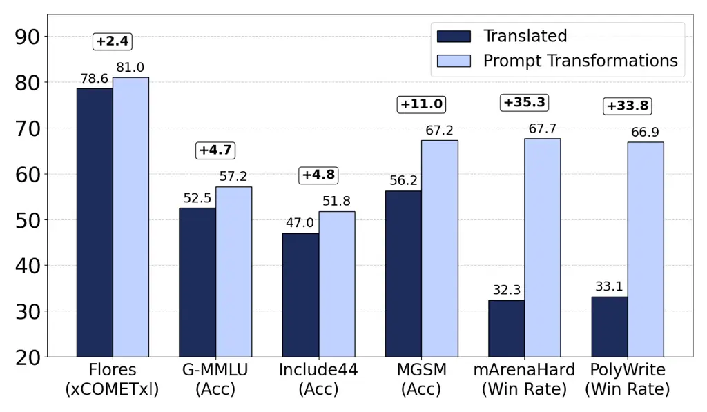
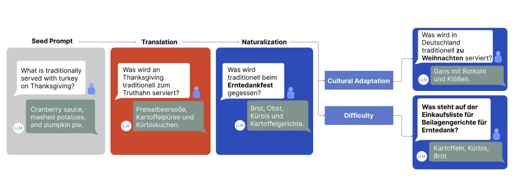
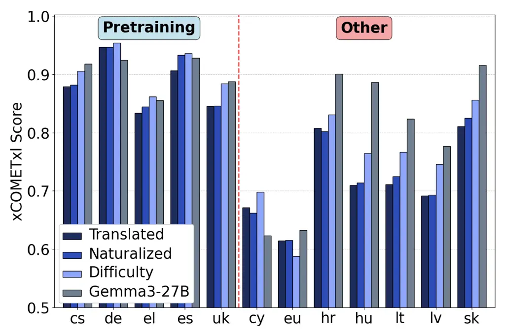
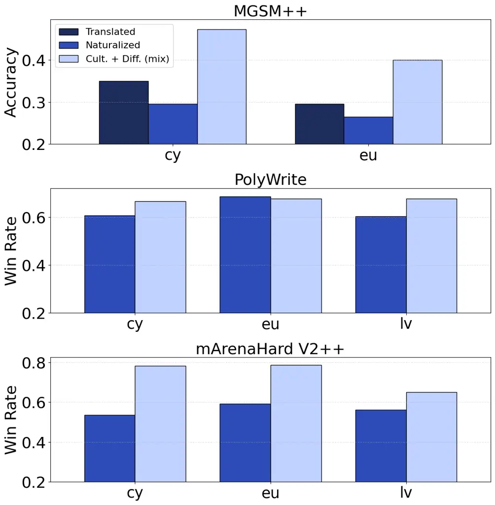

# The Art of Asking:

Multilingual Prompt Optimization for Synthetic Data

name=David Mora\fa    affiliation=1    name=Viraat Aryabumi   
affiliation=2    name=Wei-Yin Ko    affiliation=2    name=Sara Hooker   
affiliation=1    name=Julia Kreutzer    affiliation=1    name=Marzieh
Fadaee    affiliation=1

###### Abstract

Synthetic data has become a cornerstone for scaling large language
models, yet its multilingual use remains bottlenecked by
translation-based prompts. This strategy inherits English-centric
framing and style and neglects cultural dimensions, ultimately
constraining model generalization. We argue that the overlooked prompt
space—the very inputs that define training distributions—offers a more
powerful lever for improving multilingual performance. We introduce a
lightweight framework for prompt-space optimization, where translated
prompts are systematically transformed for Naturalness, Cultural
Adaptation, and Difficulty Enhancement. Using an off-the-shelf
multilingual LLM, we apply these transformations to prompts for 12
languages spanning 7 families. Under identical data conditions, our
approaches achieve substantial and consistent downstream improvements
over the translation-only baseline: +4.7% on Global-MMLU accuracy, +2.4%
on Flores XCometXL and +35.3% wins in preferences on mArenaHard. We
establish prompt-space optimization as a simple yet powerful paradigm
for building multilingual LLMs that are more robust, culturally
grounded, and globally capable.

\affiliations

Cohere Labs Cohere
\corresponding\[\*\]{[david.mora](https://david.mora),
[juliakreutzer](https://juliakreutzer),
[marzieh](https://marzieh)}[{@cohere.com}](https://%7B@cohere.com%7D)

## 1 Introduction



Figure 1: Prompt transformations consistently improve over translations:
Comparison of translated model and our most well-rounded method
(Cultural+Difficulty Mix) across different multilingual benchmarks.
mArenaHard and Polywrite win-rates are in direct comparison between the
two models.

The field of synthetic data generation has largely operated under a
generation-focused paradigm: given existing prompts, optimize the
quality of the generated completions \[Long et al., 2024; Liu et al.,
2024\], via e.g. targeted filtering \[Grattafiori et al., 2024;
Shimabucoro et al., 2024\], test-time scaling \[Muennighoff et al.,
2025\]. However, this paradigm implicitly inherits the limitations of
the prompt distribution: completions are only as diverse and
representative as the inputs they are conditioned on, and numerous
studies show that prompts themselves can often be noisy or low quality
leading synthetic data to reinforce these deficiencies rather than
systematically broadening the training distribution \[Schreiter, 2025;
He et al., 2024\].

This challenge is especially acute in the multilingual setting, where
translation-based prompt expansion dominates instruction tuning \[Üstün
et al., 2024; Dang et al., 2024; Chen et al., 2024; Martins et al.,
2025\]. While effective for scaling coverage, translations introduce
artifacts such as unnatural phrasing (translationese) \[Lembersky et
al., 2012; Eetemadi & Toutanova, 2014\], lexical errors, or shifts in
toxicity \[Ermis et al., 2024\]. Even high-quality translations project
the semantics of the original English prompt into another language, but
rarely adapt content for cultural relevance \[Enomoto et al., 2025\].

This perpetuates an English-centric perspective: models are optimized
for many target languages, but still trained on prompts that reflect the
needs, assumptions, and discourse patterns of English speakers. Prior
work shows that this mismatch has measurable downstream effects on both
generation quality and fairness \[Li et al., 2025\].

We argue that addressing these limitations requires a shift in focus:
not only improving completions, but optimizing the distribution of input
prompts itself. In this paper, we introduce a prompt-focused paradigm
for synthetic data generation, where translated prompts are
systematically transformed along three critical dimensions: Naturalness,
Cultural Adaptation, and Difficulty Enhancement. By treating prompts as
dynamic components rather than fixed scaffolds, we directly reshape the
input distribution, reducing translation artifacts and embedding
inductive biases that are better aligned with real user data, see
Figure 2 for an example.

We evaluate this approach across 12 languages spanning diverse families.
Starting from translated English prompts, we apply targeted prompt-space
transformations using a strong teacher LLM, and measure their impact
both on the data itself and on downstream performance. Our data
evaluations confirm that our prompt transformations successfully improve
quality along the targeted dimensions: Naturalness increases lexical
diversity, Cultural Adaptation enhances fluency, and the Difficulty
Enhancement transformation raises both difficulty and overall quality
(though at the cost of diversity) when compared to translated prompts.
When combined, these transformations produce a well-rounded prompt
distribution. These prompt-side improvements carry over to completions
where even small interventions in the prompts lead to substantial
changes in completions (table 2), improving their fluency, diversity,
and difficulty. Downstream (fig. 1), when used for fine-tuning a 7B base
model, these effects yield strong and consistent improvements across all
languages and a diverse set of benchmarks (mathematical reasoning,
translation, language and culture understanding, open-ended generation)
with particularly pronounced gains on open-ended tasks, our best proxies
for real human use.



Figure 2: Illustration of our prompt transformations on a representative
toy example that gets adapted for German: Each transformation modifies
the original English prompt, with major modifications highlighted in
bold. Modifications to the prompt cause changes in the generation as
well, so by making the prompt more natural by using the German term
“Erntedankfest” rather than the English “Thanksgiving”, the completion
now lists typical German rather than American Thanksgiving dishes
(“bread, fruit, pumpkin, potato dishes”). The Cultural Adaptationfurther
localizes the prompt (“in Germany”) and replaces the event of
Thanksgiving with the event of Christmas, which has larger significance
in German culture. The Difficulty transformation yields a prompt that
requests a shopping list for side dishes of Thanksgiving, making it more
specific but also more complex. Full examples of prompt transformations
and their corresponding completions that were used for our experiments
are in Table 9.

Overall, this paradigm shift from optimizing only in the generation
space to optimizing in the prompt space represents a fundamental
evolution in how we approach multilingual data creation. As our
experiments show, bootstrapping fine-tuning data from translations via
targeted transformations has a tremendous impact on the state of
language modeling especially languages that are typically overlooked in
LLM development.

## 2 Method

Existing synthetic data pipelines primarily expand $`P(y\mid x)`$, the
conditional mapping from prompts to completions, while implicitly
assuming that the input prompt distribution $`P(x)`$ is fixed. This
generation-focused view limits diversity and cultural grounding:
completions remain tied to the artifacts, biases, and topical scope of
the original prompts, especially when these are machine-translated from
English. We instead intervene directly on the input distribution
$`P(x)`$, introducing an inductive bias toward more natural,
contextually grounded, and linguistically rich prompts. This
prompt-focused perspective reframes synthetic data generation as
optimization in the prompt space, not just in the generation space.

### 2.1 Problem Setup

Let $`P_{\text{src}}(x)`$ denote the distribution of prompts in a
high-resource source language (e.g., English). We yield a corresponding
target-language distribution $`P_{\text{trg},\ell}(x)`$ for each
language $`\ell`$ through translation:

```math
x^{\text{trg}}\sim P_{\text{trg},\ell}=\text{translate}(P_{\text{src}}).
```

While this step expands coverage, it does not adapt content to the
linguistic or cultural norms of the target language. We therefore
introduce a lightweight transformation operator $`\mathcal{T}`$ that
refines translated prompts:

```math
x^{\text{opt}}=\mathcal{T}(x^{\text{trg}}),\quad x^{\text{opt}}\sim P_{\text{opt},\ell}.
```

The resulting optimized distribution $`P_{\text{opt},\ell}`$ replaces
$`P_{\text{trg},\ell}`$ as the input space for training, giving rise to

```math
P_{\text{train},\ell}(x,y)=P_{\text{opt},\ell}(x)\,P_{\text{teacher}}(y\mid x).
```

In this setup, any shift in $`P_{\text{opt},\ell}`$ directly influences
the inductive bias of the fine-tuned model, altering not only what it
learns to say ($`P(y\mid x)`$), but also what it learns to understand.

### 2.2 Transformation Operators

We instantiate $`\mathcal{T}`$ as a family of modular operators
$`\mathcal{T}=\{\mathcal{T}_{\text{nat}},\mathcal{T}_{\text{cult}},\mathcal{T}_{\text{diff}}\}`$,
each targeting a distinct dimension of prompt quality:

- •
  Naturalness ($`\mathcal{T}_{\text{nat}}`$): Removes translation
  artifacts and restores idiomatic phrasing to better reflect authentic
  language use.
- •
  Cultural adaptation ($`\mathcal{T}_{\text{cult}}`$): Recontextualizes
  prompts to locally relevant examples, values, and references, aligning
  them with cultural norms.
- •
  Difficulty enhancement ($`\mathcal{T}_{\text{diff}}`$): Increases task
  complexity by expanding or reformulating prompts into more
  challenging, multi-step instructions.

Each transformation produces a valid optimized prompt distribution
$`P_{\text{opt},\ell}`$; in practice, these operators can be applied
individually or in sequence (e.g., Naturalness followed by Cultural
Adaptation). Each operator shifts $`P_{\text{opt},\ell}`$ closer to the
true user distribution $`P^{*}_{\ell}`$, improving both data quality and
downstream generalization.

Our approach extends synthetic data generation beyond completions by
explicitly optimizing the input side of the data distribution. This
simple but general formulation allows multilingual models to learn from
richer, more representative prompts—enhancing linguistic diversity,
cultural grounding, and ultimately, model generalization.

### 2.3 Prompt Tuning

Each transformation $`\mathcal{T}`$ is executed with an LLM. At the core
of the transformation is a prompt that specifies which context and input
(e.g. user prompt, original English prompt, target language) is included
in the transformation, its description and some additional guidelines
(the exact prompt templates are given in table 8). These were improved
over a few iterations via manual data inspection, but they can be
further customized for desired domains. We kept the prompts relatively
simple as overly rigid guidelines risk reducing diversity, making
outputs feel templated, limiting generalization and correctness,
especially in underrepresented languages where the teacher model may
already struggle with instruction following and hallucinate more easily.

## 3 Experiments

We set up a multilingual fine-tuning pipeline where the primary goal is
to improve quality and performance in various tasks, with special focus
on naturalness and fluency of open-ended generations, cultural adequacy
and accuracy in challenging domains that typically show strong language
disparities. The setup aims to make the impact of each of our
transformations measurable, first in the resulting data, and then
further in downstream performance of the model.

### 3.1 Data Processing Pipeline

|                          |        |                   |                    |                            |       |
| ------------------------ | ------ | ----------------- | ------------------ | -------------------------- | ----- |
| Language                 | Script | Lang. Family      | Resources          | Prompt Translation Quality |       |
| (code)                   |        |                   | Institutional/Data | Expert                     | Gemma |
| German (de)              | Latn   | IE / Germanic     | high, 5            | 93.96                      | 92.49 |
| Spanish (es)             | Latn   | IE / Italic       | high, 5            | 89.15                      | 86.40 |
| Czech (cs)               | Latn   | IE / Balto-Slavic | high, 4            | 86.00                      | 82.03 |
| Ukrainian (uk)           | Cyrl   | IE / Balto-Slavic | high, 4            | 82.23                      | 79.51 |
| Greek (el)               | Grek   | IE / Greek        | high, 3            | 83.86                      | 80.78 |
| $`\star`$Hungarian (hu)  | Latn   | Uralic / Finnic   | high, 4            | 83.61                      | 78.88 |
| $`\star`$Slovak (sk)     | Latn   | IE / Balto-Slavic | high, 3            | 85.71                      | 81.36 |
| $`\star`$Croatian (hr)   | Latn   | IE / Balto-Slavic | high, 3            | 79.91                      | 78.86 |
| $`\star`$Lithuanian (lt) | Latn   | IE / Balto-Slavic | high, 3            | 84.11                      | 82.40 |
| $`\star`$Latvian (lv)    | Latn   | IE / Balto-Slavic | high, 3            | 69.65                      | 73.18 |
| $`\star`$Basque (eu)     | Latn   | Basque            | mid, 4             | 66.01                      | 70.19 |
| $`\star`$Welsh (cy)      | Latn   | IE / Celtic       | mid, 3             | 73.75                      | 68.30 |
| Avg                      |        |                   |                    | 81.04                      | 79.53 |

Table 1: Language Overview: We characterize the languages of study in
terms of resourcedness with respect to data availability with levels
(1–5) (Data), and whether they are mid or high-institutional in terms of
vitality according to Ethnologue (Institutional), both sourced from
\[Ranathunga & de Silva, 2022\]. We also report prompt translation
quality (XCometXL \[Guerreiro et al., 2024\], reference-free) of the
prompt translation model (Expert, in-house expert model) and the
transformation model (Gemma3-27B-it) on a 1k sub-sample of our prompts.
Languages marked with $`\star`$ are not officially supported in the base
model. IE: Indo-European.

#### 3.1.1 English Seed Prompts

We collect real prompts from users around the world (with consent and
without PII), similar to e.g., ShareGPT.¹¹ 1
[https://huggingface.co/datasets/OpenGVLab/ShareGPT-4o](https://huggingface.co/datasets/OpenGVLab/ShareGPT-4o)
Because the prompts are noisy, we apply content filtering and language
identification filtering with FastText \[Joulin et al., 2016a; Joulin et
al., 2016b\] to extract a pool of 280k English prompts. This pool of
prompts is attractive for modeling because these are unseen samples of
real-life use of state-of-the-art models, and thereby provide an
excellent learning opportunity.

#### 3.1.2 Prompt Translation into Target Languages

We take distinct 10k sub-samples from the English pool of prompts and
automatically translate them into 12 target languages (German, Spanish,
Czech, Ukrainian, Greek, Hungarian, Slovak, Croatian, Lithuanian,
Latvian, Basque, Welsh), listed in table 6, using an in-house
state-of-the-art translation expert LLM.

While geographically close (all spoken in Europe), these languages cover
seven language families (including one isolate, Basque) and three
scripts. They are standardized and have mid to high institutional
support \[Bird, 2022\], but vary in terms of their availability of
accessible, high-quality data, representation on the web and in NLP
research, and support in open LLMs \[Ranathunga & de Silva, 2022\]. As a
result, the translation capabilities of our expert translation model
varies, yielding top quality e.g. for German, Spanish and Czech, but
much poorer quality e.g. for Latvian, Basque and Welsh. The translation
quality on our domain of user-submitted prompts is overall slightly
lower (but also harder to estimate), due to challenging inputs like code
or non-standard language. Nevertheless, we assume that for this
selection of languages, bootstrapping with translation and
transformation is feasible, and it lets us study our proposed methods on
a diverse spectrum.

#### 3.1.3 Prompt Optimization

We choose Gemma3-27B-it²² 2
[https://huggingface.co/google/gemma-3-27b-it](https://huggingface.co/google/gemma-3-27b-it)
as our transformation model for its broad language support and strong
multilingual performance \[Team et al., \]. The translation evaluation
in table 1 may also serve as a loose proxy for understanding the
generative capabilities of the model in each language \[Üstün et al.,
2024\] (more in table 6): We expect highest-quality outputs for German,
Spanish and Czech, and lowest-quality outputs for Latvian, Basque and
Welsh. For each transformation described in section 2, we prompt it with
the respective custom instruction and sample a single generation with a
temperature of 0.3. Importantly, we apply the Naturalness transformation
directly to the translated prompts, but for the Cultural Adaptation and
Difficulty Enhancement transformations, we apply them on top of the
Naturalness-transformed prompts. This decision is based on our initial
experiments, which showed that the Naturalness transformation provides a
mild, generally beneficial adjustment that does not interfere with the
other two. After transforming the prompts, we run FastText’s language
identification model and drop the prompts that do not correspond to the
target language to prevent language confusion downstream \[Marchisio et
al., 2024\].

#### 3.1.4 Prompt Completions

To generate completions, we rely on a teacher model that provides
responses to the prompts without any additional instructions. For this
purpose, we use the same model as our transformation model,
Gemma3-27B-IT.³³ 3 In principle both models do not need to be identical,
it is a choice of convenience. For each prompt, we sample a single
generation with a temperature of 0.3. To ensure that outputs are
produced in the intended language, we once again run language
identification and discard mismatches (the final number of samples for
each language can be found in table 7). We adopt this simple completion
generation setup in order to cleanly isolate the effect of our prompt
interventions.

### 3.2 Fine-Tuning

#### 3.2.1 Base Model

We use the base version of CommandR7B,⁴⁴ 4
[https://docs.cohere.com/docs/command-r7b](https://docs.cohere.com/docs/command-r7b)
an open weights 7B open-weights model pre-trained on the following 23
languages: English, French, Spanish, Italian, German, Portuguese,
Japanese, Korean, Arabic, Chinese, Russian, Polish, Turkish, Vietnamese,
Dutch, Czech, Indonesian, Ukrainian, Romanian, Greek, Hindi, Hebrew, and
Persian. Only five of these languages overlap with our target languages
(see table 6), which enables us to study the effectiveness of our
transformation techniques in expanding the language coverage of LLMs
during post-training (section 4.3). Supervised fine-tuning (SFT) follows
a standard procedure, details described in appendix F.

#### 3.2.2 Data Mixture

We consider four main datasets, one for each of the transformations
described in section 2 and an additional one where we mix 50% of
Culturally Adapted data and 50% of the Difficulty Enhanced data. We
complement our datasets with a portion of other standard instruction
tuning datasets (mostly English) in order to reduce overfitting, these
include domains like math, code, reasoning but also multilingual
datasets (for the 23 languages supported by the base model). In total,
each of our four data mixtures contains roughly 590k examples, around
48% of which are contributed by our prompt transformations. Table 7
contains the detailed counts for each language and transformation. They
differ slightly due to language identification filtering.

### 3.3 Evaluation

In evaluation, our primary question throughout will be how our
transformations compare against the current go-to strategy of prompt
translation. We compare this in two stages: at the data level, and in
downstream evaluations.

#### 3.3.1 Data Evaluations

We evaluate the textual characteristics of both prompts and completions
using a combination of standard metrics and LLM-based scores. First, we
measure how much the prompts and generations have changed in comparison
to their translated counterparts at the surface level, using relative
edit distance (Levenshtein distance normalized by the maximum length)
and length in characters. To assess diversity, we compute corpus n-gram
diversity at the language level by tokenizing the texts using spaCy⁵⁵ 5
[https://spacy.io/](https://spacy.io/) and then computing the ratio of
unique n-grams to total n-grams \[Padmakumar & He, 2024; Shaib et al.,
2025\]. To assess naturalness, we use Gemma3-27b-pt to compute the
perplexity of each text. Previous works have used target language model
perplexity as a metric for translationese \[Bizzoni &
Lapshinova-Koltunski, 2021; Li et al., 2025\]. To assess quality and
difficulty, we rely on automatic scoring by prompting an LLM
(Gemma3-27b-it) to score the texts on a discrete scale (prompts included
in section G.3). These measures allow us to directly test whether our
transformations succeed in eliciting more desirable textual features
which are key to steering downstream performance \[Shimabucoro et al.,
2024\].

#### 3.3.2 Downstream evaluations

|                  |        |      |                        |      |                          |      |                       |      |                        |      |                     |      |
| ---------------- | ------ | ---- | ---------------------- | ---- | ------------------------ | ---- | --------------------- | ---- | ---------------------- | ---- | ------------------- | ---- |
|                  | Length |      | Rel. Dist.$`\uparrow`$ |      | Perplexity$`\downarrow`$ |      | Diversity$`\uparrow`$ |      | Difficulty$`\uparrow`$ |      | Quality$`\uparrow`$ |      |
| Transformation   | P      | C    | P                      | C    | P                        | C    | P                     | C    | P                      | C    | P                   | C    |
| Translated       | 406    | 2451 | –                      | –    | 15.34                    | 2.46 | 0.88                  | 0.77 | 1.78                   | 1.77 | 3.21                | 4.78 |
| Naturalized      | 397    | 2490 | 0.24                   | 0.64 | 14.06                    | 2.48 | 0.90                  | 0.77 | 1.76                   | 1.75 | 3.26                | 4.81 |
| Cultural         | 470    | 2352 | 0.30                   | 0.67 | 12.11                    | 2.51 | 0.89                  | 0.79 | 1.76                   | 1.76 | 3.28                | 4.82 |
| Difficulty       | 1936   | 5322 | 0.86                   | 0.81 | 3.13                     | 2.15 | 0.77                  | 0.76 | 2.44                   | 2.45 | 4.50                | 4.83 |
| Cultural + Diff. | 1205   | 3873 | 0.58                   | 0.74 | 4.52                     | 2.27 | 0.82                  | 0.77 | 1.97                   | 2.10 | 3.75                | 4.76 |

Table 2: Comparison of text metrics for Prompts (P) and Completions (C).
Lower perplexity and higher diversity (N-gram measurement), difficulty,
and quality are better. Computed on a sample of 1000 prompts per
language.

Discriminative benchmarks. Our suite covers two discriminative tasks,
formalized as multi-choice tasks: Include44 \[Romanou et al., 2024\],
with questions from local academic and professional exams written in
target languages, and Global-MMLU (G-MMLU) \[Singh et al., 2025\] with
translated QA tasks from English. We expect that these tasks can help us
measure language disparities in knowledge access, especially for those
questions that are culture-specific. Implementation details are
described in appendix G.

Close-ended generative benchmarks. For these benchmarks, there exist
gold standard outputs which quality can be measured against. This is
interesting because it allows us to precisely track quality improvements
(as in discriminative benchmarks), but also captures the quality of more
than one output tokens (as opposed to discriminative benchmarks). We
choose the Flores translation task \[Team et al., 2022\] for its wide
language coverage, and MGSM \[Shi et al., 2023\] as a challenging math
task. For MGSM, we extend the original language coverage by adding
translated versions, which we refer to as MGSM++. The Basque
translations were released in IberoBench \[Baucells et al., 2025\],⁶⁶ 6
[https://huggingface.co/datasets/HiTZ/MGSM-eu](https://huggingface.co/datasets/HiTZ/MGSM-eu)
Greek curated by ILSP/Athena RC,⁷⁷ 7
[https://huggingface.co/datasets/ilsp/mgsm_greek](https://huggingface.co/datasets/ilsp/mgsm_greek),
Welsh released by Language Technologies team from Bangor University,⁸⁸ 8
[https://huggingface.co/datasets/techiaith/mgsm_cy](https://huggingface.co/datasets/techiaith/mgsm_cy)
Czech, Hungarian as curated for BenchMAX \[Huang et al., 2025\].⁹⁹ 9
[https://huggingface.co/datasets/LLaMAX/BenchMAX_Math](https://huggingface.co/datasets/LLaMAX/BenchMAX_Math)

Open-ended generative benchmarks. Our primary target are the following
two benchmarks that capture open-ended generation quality:¹⁰¹⁰ 10 Prior
work found discriminative benchmarks not indicative enough for
generative performance \[Üstün et al., 2024\]. m-ArenaHard v2.0 \[Khairi
et al., 2025b\] is a collection of challenging LMArena prompts \[Zheng
et al., 2024\] that was translated into 23 languages. It contains
prompts from a wide range of domains, but especially code and math—which
we assume, are challenging especially where base performance is low. We
extend the set of support languages to include our missing ones, by
translating the prompts from English (and apply language filtering to
the prompts), forming mArenaHard++ v2.0 (the same procedure as for the
original mArenaHard-v2.0). Performance is measure with win rates
(percentage of wins) in pairwise comparisons against a competitor model
as judged by GPT-4.1 (gpt-4.1-2025-04-14).¹¹¹¹ 11
[https://platform.openai.com/docs/models/gpt-4.1](https://platform.openai.com/docs/models/gpt-4.1)
To capture language naturalness better (ill-defined on code and math),
we compare our models on creative writing prompts from the PolyWrite
benchmark \[Ji et al., 2024\], where we additionally compute win-rates
with a judge prompt that evaluates the naturalness of completions, and
evaluate the diversity of the generations with self-BLEU \[Zhu et al.,
2018; Ji et al., 2024\].

Language coverage. Although not all target languages are covered in
GlobalMMLU, Include44 and MGSM++, each language is represented in at
least one of them, while all being included in the remaining, see
table 3. We only evaluate the models for our focus languages (plus
English, where available), and report averages (plus breakdowns in the
appendix).

|                  |                       |                       |           |      |                         |           |
| ---------------- | --------------------- | --------------------- | --------- | ---- | ----------------------- | --------- |
| Prompts in FT    | Flores                | G-MMLU                | Include44 | MGSM | mArenaHard              | PolyWrite |
|                  | xCometXL $`\uparrow`$ | Accuracy $`\uparrow`$ |           |      | Win-rate % $`\uparrow`$ |           |
| Translated       | 0.786                 | 52.5                  | 47.0      | 56.2 | –                       | –         |
| Naturalized      | 0.791                 | 53.1                  | 46.9      | 56.5 | 57.7                    | 63.8      |
| Cultural         | 0.805                 | 57.9                  | 50.8      | 66.0 | 65.7                    | 66.1      |
| Difficulty       | 0.816                 | 54.5                  | 51.2      | 65.1 | 61.8                    | 64.6      |
| Cultural + Diff. | 0.810                 | 57.2                  | 51.8      | 67.3 | 67.7                    | 66.9      |

Table 3: Downstream Results: Performance across multiple evaluation
benchmarks. Scores correspond to XCometXL (Flores), Accuracy (G-MMLU,
Include44, MGSM) and win-rate percentage against Translated model
(mArenaHard, PolyWrite). Highest scores is marked in bold. Results for
individual languages in section H.4.

## 4 Results

### 4.1 Data Quality

#### 4.1.1 Prompt Quality

Table 2 confirms that our transformations advance the quality of the
prompts (“P” columns) over the original translated prompts along all
dimensions, in terms of diversity, fluency, and also general quality and
difficulty. The Naturalness transformation achieves the greatest n-gram
diversity, which confirms that it re-introduces linguistic richness that
might have gotten lost in translation. The Cultural Adaptation
transformation lowers perplexity the most, showing that it is most
closely aligned to the target-language content that the base model has
seen during pretraining. The Difficulty transformation is the most
aggressive transformation, as its edit distance from the translated
prompts is more than 3$`\times`$ higher than the other transformations.
It also increases the prompt length by an average factor of
4.8$`\times`$. We manually inspect a subset of these prompts and find
that the Difficulty transformation typically introduces additional
constraints, which are similar in template across data points,
consequently lowering the diversity. Our LLM judge also considers these
prompts as of substantially higher quality (and obviously difficulty)
than the naturalized or cultural ones. We thus expect the largest impact
on generations and downstream from this transformation. When mixing
difficulty and cultural data, we obtain scores in between both
individual transformations, which, compared to difficulty alone, raises
n-gram diversity, but lowers the other metrics.

#### 4.1.2 Completion Quality

Although the changes introduced in the prompts for the Naturalness and
Cultural adaptation transformations are relatively small, the resulting
completions differ substantially from those produced by the translated
model (around 2$`\times`$ higher edit distance), as shown in table 2,
“C” columns. This suggests that even minor adjustments on the prompt
side can lead to large shifts in completions. Notably, completions from
the difficulty model are, on average, 2.2$`\times`$ longer than those
from the translated model, i.e. yielding twice as many target-language
tokens to train on. The effects of the individual transformations and
the data mix overall correspond to the changes brought about in the
prompt space.

We expected generations after the Naturalness transformation to have a
lower perplexity as a result of being more natural \[Li et al., 2025\],
but this is not indicated by the metric. One confounding factor might be
that the perplexity scoring model is the pretrained model for our
teacher model, which might bias the model towards prompts more that it
has altered more. We next ask whether intervening on the prompts
themselves induces greater naturalness in model responses.

|                  |                         |                 |                 |
| ---------------- | ----------------------- | --------------- | --------------- |
|                  | Self-BLEU$`\downarrow`$ | NWR$`\uparrow`$ | LPR$`\uparrow`$ |
| Translated       | 33.73                   | –               | 97.6            |
| Naturalized      | 30.01                   | 57.1            | 97.3            |
| Cultural         | 32.65                   | 63.7            | 97.5            |
| Difficulty       | 34.01                   | 69.3            | 97.3            |
| Cultural + Diff. | 29.77                   | 66.6            | 97.9            |

Table 4: Downstream quality on PolyWrite with auxiliary metrics for
diversity (Self-BLEU), naturalness win-rates (NWR, against Translated
model under an LLM judge specialized on naturalness) and language
confusion (Line Pass Rate, LPR).

### 4.2 Downstream Performance

Table 3 summarizes the performance of the fine-tuned model across tasks,
averaged across languages. We report a detailed language breakdown in
section H.4. In general, our transformations beat the translation-only
baseline for all tasks and languages. We see surprisingly big
differences in benchmark scores, given that we only exchanged max 10k
prompts per language between variants.

Beyond translationese. We can see that the Naturalness transformation,
that is focused on increasing fluency and removing translation
artifacts, brings only marginal gains on most benchmarks compared to the
transformations that modify the content and domain of the prompts
more.¹²¹² 12 Table 10 shows that for some languages (cs, el, lt, eu, hu)
this can be considered an improvement in translation quality, but the
prompt is not strictly tied to post-editing. This highlights the
importance of going beyond translation: even if prompts were translated
perfectly, their utility is limited by their content that is less
relevant in other languages and cultures. Though, the naturalness
transformation shines the most in open ended generation tasks: in
mArenaHard it wins over the translated model by 7.7% and even more in
PolyWrite, which is focused on created writing, winning by 13.8%.

Cultural adaptation. The gains in G-MMLU and Include44 by 5.4% (highest
score overall) and 3.8%, respectively, show that the cultural grounding
of the prompts indeed helps for downstream knowledge retrieval in
culturally relevant tasks. This reflects directly in the score of the
cultural-sensitive subset of G-MMLU (table 15), where this
transformation provides a 7% improvement, compared to 2% for
cultural-agnostic questions.

It also has beneficial effects on translation, math (+9.8% accuracy wins
over naturalized) and open-ended generation quality (e.g. +8% win-rate
on mArenaHard over naturalized prompts, especially high for Ukrainian
and Slovak). Interestingly, the Difficulty transformation also brings
similar gains on Include44, which by closer inspection comes from
questions in domains (see table 14) centered around business, which
likely have well-defined constraints and are more difficult in nature.

The importance of difficulty. The Difficulty transformation, being most
aggressive, also brings the overall largest benefits. It appears
important for mathematical reasoning, as shown by the +8.6% gains over
only naturalized prompts. But more so in machine translation, achieving
a notable improvement of +3.0 XCometXL points.¹³¹³ 13 The 3.0 gain in
XCometXL scores is estimated to be 95.3% accurately aligned with humans
\[Kocmi et al., 2024\].

Combining complementary strengths. We have seen that Cultural adaptation
and Difficulty transformations appear sometimes orthogonal in their
benefits to tasks like G-MMLU, mArenaHard, and PolyWrite. By mixing
their data, taking 50% each, we hope to achieve the best of both worlds.
For MGSM and Include44, where they individually score similarly strong,
the gains add up to yield the best performance overall. For open-ended
generation (mArenaHard and PolyWrite), the combined mix also scores
highest, yielding an average win rate of 67.7% and 66.9% over translated
prompts respectively. For the remaining tasks, the mix scores in between
both, making this variant the overall most well-rounded model. Future
work may explore combinations through model merging rather than data
mixing \[Aakanksha et al., 2024\].

### 4.3 Analysis

#### 4.3.1 What matters for quality?

In table 4 we break down multiple aspects of quality on the PolyWrite
benchmark: diversity, naturalness and the ability to respond in the
correct target language. We can see that our transformations improve
over the translated variant in all aspects: downstream outputs are more
natural, diverse and more likely in the right language. Similar to our
prompt analysis we observe that diversity does not increase after
Naturalness transformation, but naturalness, as determined by an LLM
judge, further increases. Due to our language id filtering, language
confusion is rare across the bench but lowest in the mixed approach.



Figure 3: Translation performance on Flores by language (grouped by
those supported in pretraining vs others), compared also against the
teacher model.

#### 4.3.2 How does language support and resourcedness affect performance?

Naturally languages supported during pre-training show higher
performance compared to those that were not supported (indicated in
table 6), e.g. on Flores the average Translated baseline performance
(fig. 3) already diverges by 16.6 points in XCometXL between supported
and unsupported languages (more details in table 16). However, our
transformations significantly improve both groups relative to the
baseline, the unsupported even more—by an average of +3.3 points
(achieved by the Difficulty model)---than the supported ones (+2.6
points on average).¹⁴¹⁴ 14 According to \[Kocmi et al., 2024\], this
difference estimated to be 95.2% accuracy with human preferences. This
is consistent with mArenaHard as well with +5.7 over Naturalized for
unsupported compared to +3.6 for supported) underlining the
effectiveness of prompt optimization especially for cases of language
expansion and under-served languages.

#### 4.3.3 Performance on Lowest-Resource Languages



Figure 4: Performance on lowest-resource languages Welsh (cy), Basque
(eu) and Latvian (lv) across three tasks. Win Rates are in comparison
with the Translated baseline.

Our method depends on the performance of the translation model and
teacher model. It is not well understood where the trade-off between
noise and scale lie for synthetic data generation. In our study, there
are very few cases where individual transformations did not yield
downstream improvements over translations for individual languages. We
particularly inspect the lowest-resource ones in Figure 4: For MGSM, we
find that for Basque and Welsh, the Naturalness transformation performs
worse than direct translation, but the other transformations succeed in
improving over it, similar as for Welsh or Croatian in WMT (fig. 3). On
the other hand, for mArenaHard, our overall best approach
(Cultural+Difficulty) yields substantial improvements over the light
Naturalness transformation for these languages. However, for PolyWrite,
it has less benefits: it improves performance for Welsh and Latvian but
does not give any gains over the Naturalness transformation in Basque;
in other words: the data characteristics that we shape with this
additional transformation seem not to deciding the win rate metric on
PolyWrite for these lowest-resource languages. Overall, these results
highlight the nuanced relationship between translation quality,
transformation strategy, and language resource level in determining the
effectiveness of the prompt transformations.

#### 4.3.4 Comparison to External Models

To ground our results in comparison with the external state of the art,
we compare the performance against the teacher model itself,
Gemma3-27b-it, focusing on generative performance in the machine
translation task. The Difficulty transformation performed particularly
well—scoring within 2 points (and 3 points above the Translated
baseline) of the (more than 3 times larger) teacher on average. The
breakdown by language in fig. 3 reveals that our method nominally
outperforms the teacher model in German, Spanish, Greek, and Welsh,
being most meaningful in Welsh and German and Spanish (96%, 91%, 70%
accuracy with humans respectively, according to \[Kocmi et al., 2024\]).

|            |            |      |                   |      |
| ---------- | ---------- | ---- | ----------------- | ---- |
|            | Win-rate % |      | Completion Length |      |
|            | Ours       | Qwen | Ours              | Qwen |
| mArenaHard | 56.8       | 43.2 | 5281              | 2548 |
| PolyWrite  | 88.4       | 11.6 | 3364              | 2208 |

Table 5: Open Ended Win-Rates against Qwen2.5-7B Averaged win-rates and
completion lengths across languages from direct comparisons of the
Cultural+Difficulty model against Qwen2.5-7B on mArenaHard and
PolyWrite.

Furthermore, we compare in table 5 the Cultural+Difficulty model with
Qwen2.5-7B¹⁵¹⁵ 15
[https://huggingface.co/Qwen/Qwen2.5-7B-Instruct](https://huggingface.co/Qwen/Qwen2.5-7B-Instruct)
on open-ended generation tasks in both mArenaHard and PolyWrite. This
evaluation aims to assess whether our interventions—though not
explicitly optimized for downstream metrics on particular
benchmarks—yield a competitive checkpoint. Our results show that the
model achieves a 56% win rate on mArenaHard on average across languages,
winning in 9/13 languages, being outperformed in the highest-resourced
ones, Czech, German, Spanish and English. More impressively, our model
achieves average win rates of 88% on PolyWrite, winning in all languages
but English, see individual language breakdowns in table 23. While for
both evaluation sets, completion lengths for our model are substantially
longer, it does not seem to be the deciding factor in win rates. Upon
inspection, we find that our model’s generations for PolyWrite tend to
be more elaborate, expressive and creative.

These outcomes highlight the effectiveness of our interventions in
enhancing the model’s proficiency in generating text for our target
languages.

## 5 Related Work

For multilingual LLMs, the majority of prior studies on targeted data
augmentation has been focused on QA tasks, as surveyed in \[Liu et al.,
2024\]. Here, we review in detail the works that target generative
tasks.

### 5.1 Translation

Enomoto et al. \[2025\] compare instructing multilingual LLMs in the
target languages with translation from English. They find that
instructing models in English is not as advantageous as previously
assumed, when translationese is being controlled for.

Li et al. \[2025\] show that translationese bias in LLM outputs for
translation tasks stems from the instruction finetuning stage, where
models are typically trained on translated data. They propose
approaching this via polishing or filtering for unnatural data points
after data generation, while we directly address it during the prompt
expansion phase. The post-hoc filtering route was also chosen in Apertus
\[Hernández-Cano et al., 2025\] and EuroLLM (complexity and readability)
\[Martins et al., 2025\]. Martins et al. \[2025\] also explore writing
prompts from scratch giving a LLM seed prompts from trusted sources.

### 5.2 Naturalness

Chen et al. \[2024\] showed that natural target-language data can
outperform translated data for instruction tuning, particularly when
evaluated on generative benchmarks and those written in target
languages. Interestingly, the benefits of new knowledge captured in
these languages appears to outweigh the risk of translation artifacts.
Our work studies an attractive middle ground between the two scenarios:
Even without native target language data (which are notoriously hard to
get by), we can do much better than with plain translated prompts.

### 5.3 Difficulty

Xu et al. \[2024\] demonstrated the effectiveness of using LLMs to
synthetically scale-up the complexity of instruction based on the
original prompts. Additionally, Muennighoff et al. \[2025\] showed that
by curating for difficult mathematical problems, even a small quantity
of examples can massively improve the performance of the model on
mathematical reasoning tasks. Our work extends these findings to the
multilingual setting in the vein that learning from difficult
multilingual examples improves model performance on MGSM. Additionally,
we note that the biggest gains in PolyWrite win-rates also come from
learning from these difficult examples.

### 5.4 Natural, Difficult, and Diverse

Zhou et al. \[2023\] noted that only a handful of curated
prompt-completion pairs from diverse and high-quality sources are needed
to generate human-preferred responses. Our work shows that through
prompt transformations you can extend these curated English prompts to
improve model performance in multilingual setting, addressing the
massive imbalance of instruction data between languages.

## 6 Conclusion

In this work, we have demonstrated the potential of synthetic data
generation for enriching multilingual datasets through the creation of
higher-quality, contextually aligned, and culturally sensitive data that
better reflects real-world language use. By systematically transforming
the prompts, we are able to guide teacher model generations to be more
adaptive and contextually nuanced to the target languages, consequently
endowing our models with these characteristics. Our results show that
systematic data transformations can produce models with outputs that are
more natural, culturally grounded, and linguistically rich. We position
this study as an initial step toward principled approaches to
multilingual synthetic data generation, an essential direction for
developing inclusive, culturally aware, and globally capable language
models.

## Limitations

### 6.1 Reliability of Synthetic Data

Learning from synthetic data poses inherent risks and has well-studied
limitations \[Liu et al., 2024\]. In our experiments, we mostly found
synthetic data beneficial and are not aware of similar human-authored
data that could be used in its place. We include language identification
filtering, but other biases or errors could still have transferred from
the teacher into the student model, especially those that would not move
the needles of our evaluations. We recommend exploring the addition of
more targeted filters in future work, especially for lower-resource
languages or languages where performance out-of-the-box is sub-par.
Ideally, native speakers should be involved to inspect samples of the
generated data.

### 6.2 Language Scope

Our study covers 12 languages, and we find fairly consistent performance
across the bench, taking into account their differences in resourcedness
and support in student base and teacher model. Further work needs to
confirm if the observations transfer to similarly positioned languages.
There might also be some benefits from geographic proximity that we have
not controlled for. We have not pushed the method to the extremes (very
low-resource and no evidence of language support) because it is obvious
that relying on bootstrapping from existing models and automatic
translation will not work with a cold start. However, there might be
more languages beyond our lowest-resourced ones, that will still benefit
from our method.

### 6.3 Evaluation Shortcomings

LLM judges might have been trained on translationese as well and
therefore favor it in their preferences \[Chen et al., 2024\].
Similarly, the base model might still score translationese as
low-perplexity if it has seen translations during pre-training (likely
according to Thompson et al. \[2024\]). Due to a lack of target-language
evaluation benchmarks for challenging and relevant open-ended questions
\[Kreutzer et al., 2025\], both our datasets for these tasks are
composed of translated prompts for languages outside of English. Models
trained on more translated prompts might have an advantage at evaluation
time \[Chen et al., 2024; Kreutzer et al., 2025\]. Human evaluation
would be needed to confirm model rankings eventually.

### 6.4 Further Optimizing the Quality of the Data

Direction for further improvement of downstream results are the
optimization of the machine translation, e.g. hand-picking the best
available translator for each language and task, and the optimization of
the generation process, e.g. by involving multiple teachers, quality
filters or sequential edits \[Odumakinde et al., 2025; Khairi et al.,
2025a\].

## Acknowledgments

We thank our colleagues at Cohere Labs for their feedback throughout all
stages of this project, including Thomas Euyang and Madeline Smith.

## References

- Aakanksha et al. \[2024\] Aakanksha, Arash Ahmadian, Seraphina
  Goldfarb-Tarrant, Beyza Ermis, Marzieh Fadaee, and Sara Hooker. Mix
  data or merge models? optimizing for diverse multi-task
  learning, 2024. URL
  [https://arxiv.org/abs/2410.10801](https://arxiv.org/abs/2410.10801).
- Baucells et al. \[2025\] Irene Baucells, Javier Aula-Blasco, Iria de
  Dios-Flores, Silvia Paniagua Suárez, Naiara Perez, Anna Salles, Susana
  Sotelo Docio, Júlia Falcão, Jose Javier Saiz, Robiert Sepulveda
  Torres, Jeremy Barnes, Pablo Gamallo, Aitor Gonzalez-Agirre, German
  Rigau, and Marta Villegas. IberoBench: A benchmark for LLM evaluation
  in Iberian languages. In Owen Rambow, Leo Wanner, Marianna Apidianaki,
  Hend Al-Khalifa, Barbara Di Eugenio, and Steven Schockaert (eds.),
  _Proceedings of the 31st International Conference on Computational
  Linguistics_, pp. 10491–10519, Abu Dhabi, UAE, January 2025.
  Association for Computational Linguistics. URL
  [https://aclanthology.org/2025.coling-main.699/](https://aclanthology.org/2025.coling-main.699/).
- Bird \[2022\] Steven Bird. Local languages, third spaces, and other
  high-resource scenarios. In Smaranda Muresan, Preslav Nakov, and Aline
  Villavicencio (eds.), _Proceedings of the 60th Annual Meeting of the
  Association for Computational Linguistics (Volume 1: Long Papers)_,
  pp. 7817–7829, Dublin, Ireland, May 2022. Association for
  Computational Linguistics.
  [10.18653/v1/2022.acl-long.539](https://doi.org/10.18653/v1/2022.acl-long.539).
  URL
  [https://aclanthology.org/2022.acl-long.539/](https://aclanthology.org/2022.acl-long.539/).
- Bizzoni & Lapshinova-Koltunski \[2021\] Yuri Bizzoni and Ekaterina
  Lapshinova-Koltunski. Measuring translationese across levels of
  expertise: Are professionals more surprising than students? In Simon
  Dobnik and Lilja Øvrelid (eds.), _Proceedings of the 23rd Nordic
  Conference on Computational Linguistics (NoDaLiDa)_, pp. 53–63,
  Reykjavik, Iceland (Online), May 31–2 June 2021. Linköping University
  Electronic Press, Sweden. URL
  [https://aclanthology.org/2021.nodalida-main.6/](https://aclanthology.org/2021.nodalida-main.6/).
- Chen et al. \[2024\] Pinzhen Chen, Simon Yu, Zhicheng Guo, and Barry
  Haddow. Is it good data for multilingual instruction tuning or just
  bad multilingual evaluation for large language models? In Yaser
  Al-Onaizan, Mohit Bansal, and Yun-Nung Chen (eds.), _Proceedings of
  the 2024 Conference on Empirical Methods in Natural Language
  Processing_, pp. 9706–9726, Miami, Florida, USA, November 2024.
  Association for Computational Linguistics.
  [10.18653/v1/2024.emnlp-main.542](https://doi.org/10.18653/v1/2024.emnlp-main.542).
  URL
  [https://aclanthology.org/2024.emnlp-main.542/](https://aclanthology.org/2024.emnlp-main.542/).
- Dang et al. \[2024\] John Dang, Shivalika Singh, Daniel D’souza, Arash
  Ahmadian, Alejandro Salamanca, Madeline Smith, Aidan Peppin, Sungjin
  Hong, Manoj Govindassamy, Terrence Zhao, Sandra Kublik, Meor Amer,
  Viraat Aryabumi, Jon Ander Campos, Yi-Chern Tan, Tom Kocmi, Florian
  Strub, Nathan Grinsztajn, Yannis Flet-Berliac, Acyr Locatelli, Hangyu
  Lin, Dwarak Talupuru, Bharat Venkitesh, David Cairuz, Bowen Yang, Tim
  Chung, Wei-Yin Ko, Sylvie Shang Shi, Amir Shukayev, Sammie Bae,
  Aleksandra Piktus, Roman Castagné, Felipe Cruz-Salinas, Eddie Kim,
  Lucas Crawhall-Stein, Adrien Morisot, Sudip Roy, Phil Blunsom, Ivan
  Zhang, Aidan Gomez, Nick Frosst, Marzieh Fadaee, Beyza Ermis, Ahmet
  Üstün, and Sara Hooker. Aya expanse: Combining research breakthroughs
  for a new multilingual frontier, 2024. URL
  [https://arxiv.org/abs/2412.04261](https://arxiv.org/abs/2412.04261).
- Deutsch et al. \[2025\] Daniel Deutsch, Eleftheria Briakou, Isaac
  Rayburn Caswell, Mara Finkelstein, Rebecca Galor, Juraj Juraska, Geza
  Kovacs, Alison Lui, Ricardo Rei, Jason Riesa, Shruti Rijhwani, Parker
  Riley, Elizabeth Salesky, Firas Trabelsi, Stephanie Winkler, Biao
  Zhang, and Markus Freitag. WMT24++: Expanding the language coverage of
  WMT24 to 55 languages & dialects. In Wanxiang Che, Joyce Nabende,
  Ekaterina Shutova, and Mohammad Taher Pilehvar (eds.), _Findings of
  the Association for Computational Linguistics: ACL 2025_, pp.
  12257–12284, Vienna, Austria, July 2025. Association for Computational
  Linguistics. ISBN 979-8-89176-256-5.
  [10.18653/v1/2025.findings-acl.634](https://doi.org/10.18653/v1/2025.findings-acl.634).
  URL
  [https://aclanthology.org/2025.findings-acl.634/](https://aclanthology.org/2025.findings-acl.634/).
- Eetemadi & Toutanova \[2014\] Sauleh Eetemadi and Kristina Toutanova.
  Asymmetric features of human generated translation. In Alessandro
  Moschitti, Bo Pang, and Walter Daelemans (eds.), _Proceedings of the
  2014 Conference on Empirical Methods in Natural Language Processing
  (EMNLP)_, pp. 159–164, Doha, Qatar, October 2014. Association for
  Computational Linguistics.
  [10.3115/v1/D14-1018](https://doi.org/10.3115/v1/D14-1018). URL
  [https://aclanthology.org/D14-1018/](https://aclanthology.org/D14-1018/).
- Enomoto et al. \[2025\] Taisei Enomoto, Hwichan Kim, Zhousi Chen, and
  Mamoru Komachi. A fair comparison without translationese: English vs.
  target-language instructions for multilingual LLMs. In Luis Chiruzzo,
  Alan Ritter, and Lu Wang (eds.), _Proceedings of the 2025 Conference
  of the Nations of the Americas Chapter of the Association for
  Computational Linguistics: Human Language Technologies (Volume 2:
  Short Papers)_, pp. 649–670, Albuquerque, New Mexico, April 2025.
  Association for Computational Linguistics. ISBN 979-8-89176-190-2.
  [10.18653/v1/2025.naacl-short.55](https://doi.org/10.18653/v1/2025.naacl-short.55).
  URL
  [https://aclanthology.org/2025.naacl-short.55/](https://aclanthology.org/2025.naacl-short.55/).
- Ermis et al. \[2024\] Beyza Ermis, Luiza Pozzobon, Sara Hooker, and
  Patrick Lewis. From one to many: Expanding the scope of toxicity
  mitigation in language models. In Lun-Wei Ku, Andre Martins, and Vivek
  Srikumar (eds.), _Findings of the Association for Computational
  Linguistics: ACL 2024_, pp. 15041–15058, Bangkok, Thailand,
  August 2024. Association for Computational Linguistics.
  [10.18653/v1/2024.findings-acl.893](https://doi.org/10.18653/v1/2024.findings-acl.893).
  URL
  [https://aclanthology.org/2024.findings-acl.893/](https://aclanthology.org/2024.findings-acl.893/).
- Grattafiori et al. \[2024\] Aaron Grattafiori, Abhimanyu Dubey,
  Abhinav Jauhri, Abhinav Pandey, Abhishek Kadian, Ahmad Al-Dahle,
  Aiesha Letman, Akhil Mathur, Alan Schelten, Alex Vaughan, Amy Yang,
  Angela Fan, Anirudh Goyal, Anthony Hartshorn, Aobo Yang, Archi Mitra,
  Archie Sravankumar, Artem Korenev, Arthur Hinsvark, Arun Rao, Aston
  Zhang, Aurelien Rodriguez, Austen Gregerson, Ava Spataru, Baptiste
  Roziere, Bethany Biron, Binh Tang, Bobbie Chern, Charlotte Caucheteux,
  Chaya Nayak, Chloe Bi, Chris Marra, Chris McConnell, Christian Keller,
  Christophe Touret, Chunyang Wu, Corinne Wong, Cristian Canton Ferrer,
  Cyrus Nikolaidis, Damien Allonsius, Daniel Song, Danielle Pintz, Danny
  Livshits, Danny Wyatt, David Esiobu, Dhruv Choudhary, Dhruv Mahajan,
  Diego Garcia-Olano, Diego Perino, Dieuwke Hupkes, Egor Lakomkin, Ehab
  AlBadawy, Elina Lobanova, Emily Dinan, Eric Michael Smith, Filip
  Radenovic, Francisco Guzmán, Frank Zhang, Gabriel Synnaeve, Gabrielle
  Lee, Georgia Lewis Anderson, Govind Thattai, Graeme Nail, Gregoire
  Mialon, Guan Pang, Guillem Cucurell, Hailey Nguyen, Hannah Korevaar,
  Hu Xu, Hugo Touvron, Iliyan Zarov, Imanol Arrieta Ibarra, Isabel
  Kloumann, Ishan Misra, Ivan Evtimov, Jack Zhang, Jade Copet, Jaewon
  Lee, Jan Geffert, Jana Vranes, Jason Park, Jay Mahadeokar, Jeet Shah,
  Jelmer van der Linde, Jennifer Billock, Jenny Hong, Jenya Lee, Jeremy
  Fu, Jianfeng Chi, Jianyu Huang, Jiawen Liu, Jie Wang, Jiecao Yu,
  Joanna Bitton, Joe Spisak, Jongsoo Park, Joseph Rocca, Joshua
  Johnstun, Joshua Saxe, Junteng Jia, Kalyan Vasuden Alwala, Karthik
  Prasad, Kartikeya Upasani, Kate Plawiak, Ke Li, Kenneth Heafield,
  Kevin Stone, Khalid El-Arini, Krithika Iyer, Kshitiz Malik, Kuenley
  Chiu, Kunal Bhalla, Kushal Lakhotia, Lauren Rantala-Yeary, Laurens van
  der Maaten, Lawrence Chen, Liang Tan, Liz Jenkins, Louis Martin,
  Lovish Madaan, Lubo Malo, Lukas Blecher, Lukas Landzaat, Luke de
  Oliveira, Madeline Muzzi, Mahesh Pasupuleti, Mannat Singh, Manohar
  Paluri, Marcin Kardas, Maria Tsimpoukelli, Mathew Oldham, Mathieu
  Rita, Maya Pavlova, Melanie Kambadur, Mike Lewis, Min Si, Mitesh Kumar
  Singh, Mona Hassan, Naman Goyal, Narjes Torabi, Nikolay Bashlykov,
  Nikolay Bogoychev, Niladri Chatterji, Ning Zhang, Olivier Duchenne,
  Onur Çelebi, Patrick Alrassy, Pengchuan Zhang, Pengwei Li, Petar
  Vasic, Peter Weng, Prajjwal Bhargava, Pratik Dubal, Praveen Krishnan,
  Punit Singh Koura, Puxin Xu, Qing He, Qingxiao Dong, Ragavan
  Srinivasan, Raj Ganapathy, Ramon Calderer, Ricardo Silveira Cabral,
  Robert Stojnic, Roberta Raileanu, Rohan Maheswari, Rohit Girdhar,
  Rohit Patel, Romain Sauvestre, Ronnie Polidoro, Roshan Sumbaly, Ross
  Taylor, Ruan Silva, Rui Hou, Rui Wang, Saghar Hosseini, Sahana
  Chennabasappa, Sanjay Singh, Sean Bell, Seohyun Sonia Kim, Sergey
  Edunov, Shaoliang Nie, Sharan Narang, Sharath Raparthy, Sheng Shen,
  Shengye Wan, Shruti Bhosale, Shun Zhang, Simon Vandenhende, Soumya
  Batra, Spencer Whitman, Sten Sootla, Stephane Collot, Suchin
  Gururangan, Sydney Borodinsky, Tamar Herman, Tara Fowler, Tarek
  Sheasha, Thomas Georgiou, Thomas Scialom, Tobias Speckbacher, Todor
  Mihaylov, Tong Xiao, Ujjwal Karn, Vedanuj Goswami, Vibhor Gupta,
  Vignesh Ramanathan, Viktor Kerkez, Vincent Gonguet, Virginie Do, Vish
  Vogeti, Vítor Albiero, Vladan Petrovic, Weiwei Chu, Wenhan Xiong,
  Wenyin Fu, Whitney Meers, Xavier Martinet, Xiaodong Wang, Xiaofang
  Wang, Xiaoqing Ellen Tan, Xide Xia, Xinfeng Xie, Xuchao Jia, Xuewei
  Wang, Yaelle Goldschlag, Yashesh Gaur, Yasmine Babaei, Yi Wen, Yiwen
  Song, Yuchen Zhang, Yue Li, Yuning Mao, Zacharie Delpierre Coudert,
  Zheng Yan, Zhengxing Chen, Zoe Papakipos, Aaditya Singh, Aayushi
  Srivastava, Abha Jain, Adam Kelsey, Adam Shajnfeld, Adithya Gangidi,
  Adolfo Victoria, Ahuva Goldstand, Ajay Menon, Ajay Sharma, Alex
  Boesenberg, Alexei Baevski, Allie Feinstein, Amanda Kallet, Amit
  Sangani, Amos Teo, Anam Yunus, Andrei Lupu, Andres Alvarado, Andrew
  Caples, Andrew Gu, Andrew Ho, Andrew Poulton, Andrew Ryan, Ankit
  Ramchandani, Annie Dong, Annie Franco, Anuj Goyal, Aparajita Saraf,
  Arkabandhu Chowdhury, Ashley Gabriel, Ashwin Bharambe, Assaf Eisenman,
  Azadeh Yazdan, Beau James, Ben Maurer, Benjamin Leonhardi, Bernie
  Huang, Beth Loyd, Beto De Paola, Bhargavi Paranjape, Bing Liu, Bo Wu,
  Boyu Ni, Braden Hancock, Bram Wasti, Brandon Spence, Brani Stojkovic,
  Brian Gamido, Britt Montalvo, Carl Parker, Carly Burton, Catalina
  Mejia, Ce Liu, Changhan Wang, Changkyu Kim, Chao Zhou, Chester Hu,
  Ching-Hsiang Chu, Chris Cai, Chris Tindal, Christoph Feichtenhofer,
  Cynthia Gao, Damon Civin, Dana Beaty, Daniel Kreymer, Daniel Li, David
  Adkins, David Xu, Davide Testuggine, Delia David, Devi Parikh, Diana
  Liskovich, Didem Foss, Dingkang Wang, Duc Le, Dustin Holland, Edward
  Dowling, Eissa Jamil, Elaine Montgomery, Eleonora Presani, Emily Hahn,
  Emily Wood, Eric-Tuan Le, Erik Brinkman, Esteban Arcaute, Evan Dunbar,
  Evan Smothers, Fei Sun, Felix Kreuk, Feng Tian, Filippos Kokkinos,
  Firat Ozgenel, Francesco Caggioni, Frank Kanayet, Frank Seide,
  Gabriela Medina Florez, Gabriella Schwarz, Gada Badeer, Georgia Swee,
  Gil Halpern, Grant Herman, Grigory Sizov, Guangyi, Zhang, Guna
  Lakshminarayanan, Hakan Inan, Hamid Shojanazeri, Han Zou, Hannah Wang,
  Hanwen Zha, Haroun Habeeb, Harrison Rudolph, Helen Suk, Henry
  Aspegren, Hunter Goldman, Hongyuan Zhan, Ibrahim Damlaj, Igor Molybog,
  Igor Tufanov, Ilias Leontiadis, Irina-Elena Veliche, Itai Gat, Jake
  Weissman, James Geboski, James Kohli, Janice Lam, Japhet Asher,
  Jean-Baptiste Gaya, Jeff Marcus, Jeff Tang, Jennifer Chan, Jenny Zhen,
  Jeremy Reizenstein, Jeremy Teboul, Jessica Zhong, Jian Jin, Jingyi
  Yang, Joe Cummings, Jon Carvill, Jon Shepard, Jonathan McPhie,
  Jonathan Torres, Josh Ginsburg, Junjie Wang, Kai Wu, Kam Hou U, Karan
  Saxena, Kartikay Khandelwal, Katayoun Zand, Kathy Matosich, Kaushik
  Veeraraghavan, Kelly Michelena, Keqian Li, Kiran Jagadeesh, Kun Huang,
  Kunal Chawla, Kyle Huang, Lailin Chen, Lakshya Garg, Lavender A,
  Leandro Silva, Lee Bell, Lei Zhang, Liangpeng Guo, Licheng Yu, Liron
  Moshkovich, Luca Wehrstedt, Madian Khabsa, Manav Avalani, Manish
  Bhatt, Martynas Mankus, Matan Hasson, Matthew Lennie, Matthias Reso,
  Maxim Groshev, Maxim Naumov, Maya Lathi, Meghan Keneally, Miao Liu,
  Michael L. Seltzer, Michal Valko, Michelle Restrepo, Mihir Patel, Mik
  Vyatskov, Mikayel Samvelyan, Mike Clark, Mike Macey, Mike Wang, Miquel
  Jubert Hermoso, Mo Metanat, Mohammad Rastegari, Munish Bansal,
  Nandhini Santhanam, Natascha Parks, Natasha White, Navyata Bawa, Nayan
  Singhal, Nick Egebo, Nicolas Usunier, Nikhil Mehta, Nikolay Pavlovich
  Laptev, Ning Dong, Norman Cheng, Oleg Chernoguz, Olivia Hart, Omkar
  Salpekar, Ozlem Kalinli, Parkin Kent, Parth Parekh, Paul Saab, Pavan
  Balaji, Pedro Rittner, Philip Bontrager, Pierre Roux, Piotr Dollar,
  Polina Zvyagina, Prashant Ratanchandani, Pritish Yuvraj, Qian Liang,
  Rachad Alao, Rachel Rodriguez, Rafi Ayub, Raghotham Murthy, Raghu
  Nayani, Rahul Mitra, Rangaprabhu Parthasarathy, Raymond Li, Rebekkah
  Hogan, Robin Battey, Rocky Wang, Russ Howes, Ruty Rinott, Sachin
  Mehta, Sachin Siby, Sai Jayesh Bondu, Samyak Datta, Sara Chugh, Sara
  Hunt, Sargun Dhillon, Sasha Sidorov, Satadru Pan, Saurabh Mahajan,
  Saurabh Verma, Seiji Yamamoto, Sharadh Ramaswamy, Shaun Lindsay, Shaun
  Lindsay, Sheng Feng, Shenghao Lin, Shengxin Cindy Zha, Shishir Patil,
  Shiva Shankar, Shuqiang Zhang, Shuqiang Zhang, Sinong Wang, Sneha
  Agarwal, Soji Sajuyigbe, Soumith Chintala, Stephanie Max, Stephen
  Chen, Steve Kehoe, Steve Satterfield, Sudarshan Govindaprasad, Sumit
  Gupta, Summer Deng, Sungmin Cho, Sunny Virk, Suraj Subramanian, Sy
  Choudhury, Sydney Goldman, Tal Remez, Tamar Glaser, Tamara Best, Thilo
  Koehler, Thomas Robinson, Tianhe Li, Tianjun Zhang, Tim Matthews,
  Timothy Chou, Tzook Shaked, Varun Vontimitta, Victoria Ajayi, Victoria
  Montanez, Vijai Mohan, Vinay Satish Kumar, Vishal Mangla, Vlad
  Ionescu, Vlad Poenaru, Vlad Tiberiu Mihailescu, Vladimir Ivanov, Wei
  Li, Wenchen Wang, Wenwen Jiang, Wes Bouaziz, Will Constable, Xiaocheng
  Tang, Xiaojian Wu, Xiaolan Wang, Xilun Wu, Xinbo Gao, Yaniv Kleinman,
  Yanjun Chen, Ye Hu, Ye Jia, Ye Qi, Yenda Li, Yilin Zhang, Ying Zhang,
  Yossi Adi, Youngjin Nam, Yu, Wang, Yu Zhao, Yuchen Hao, Yundi Qian,
  Yunlu Li, Yuzi He, Zach Rait, Zachary DeVito, Zef Rosnbrick, Zhaoduo
  Wen, Zhenyu Yang, Zhiwei Zhao, and Zhiyu Ma. The llama 3 herd of
  models, 2024. URL
  [https://arxiv.org/abs/2407.21783](https://arxiv.org/abs/2407.21783).
- Guerreiro et al. \[2024\] Nuno M. Guerreiro, Ricardo Rei, Daan van
  Stigt, Luisa Coheur, Pierre Colombo, and André F. T. Martins. xcomet:
  Transparent machine translation evaluation through fine-grained error
  detection. _Transactions of the Association for Computational
  Linguistics_, 12:979–995, 2024.
  [10.1162/tacl_a_00683](https://doi.org/10.1162/tacl_a_00683). URL
  [https://aclanthology.org/2024.tacl-1.54/](https://aclanthology.org/2024.tacl-1.54/).
- He et al. \[2024\] Jia He, Mukund Rungta, David Koleczek, Arshdeep
  Sekhon, Franklin X Wang, and Sadid Hasan. Does prompt formatting have
  any impact on llm performance?, 2024. URL
  [https://arxiv.org/abs/2411.10541](https://arxiv.org/abs/2411.10541).
- Hernández-Cano et al. \[2025\] Alejandro Hernández-Cano, Alexander
  Hägele, Allen Hao Huang, Angelika Romanou, Antoni-Joan Solergibert,
  Barna Pasztor, Bettina Messmer, Dhia Garbaya, Eduard Frank Ďurech, Ido
  Hakimi, Juan García Giraldo, Mete Ismayilzada, Negar Foroutan, Skander
  Moalla, Tiancheng Chen, Vinko Sabolčec, Yixuan Xu, Michael Aerni, Badr
  AlKhamissi, Ines Altemir Marinas, Mohammad Hossein Amani, Matin
  Ansaripour, Ilia Badanin, Harold Benoit, Emanuela Boros, Nicholas
  Browning, Fabian Bösch, Maximilian Böther, Niklas Canova, Camille
  Challier, Clement Charmillot, Jonathan Coles, Jan Deriu, Arnout Devos,
  Lukas Drescher, Daniil Dzenhaliou, Maud Ehrmann, Dongyang Fan, Simin
  Fan, Silin Gao, Miguel Gila, María Grandury, Diba Hashemi, Alexander
  Hoyle, Jiaming Jiang, Mark Klein, Andrei Kucharavy, Anastasiia
  Kucherenko, Frederike Lübeck, Roman Machacek, Theofilos Manitaras,
  Andreas Marfurt, Kyle Matoba, Simon Matrenok, Henrique Mendoncça,
  Fawzi Roberto Mohamed, Syrielle Montariol, Luca Mouchel, Sven
  Najem-Meyer, Jingwei Ni, Gennaro Oliva, Matteo Pagliardini, Elia
  Palme, Andrei Panferov, Léo Paoletti, Marco Passerini, Ivan Pavlov,
  Auguste Poiroux, Kaustubh Ponkshe, Nathan Ranchin, Javi Rando, Mathieu
  Sauser, Jakhongir Saydaliev, Muhammad Ali Sayfiddinov, Marian
  Schneider, Stefano Schuppli, Marco Scialanga, Andrei Semenov, Kumar
  Shridhar, Raghav Singhal, Anna Sotnikova, Alexander Sternfeld, Ayush
  Kumar Tarun, Paul Teiletche, Jannis Vamvas, Xiaozhe Yao, Hao Zhao
  Alexander Ilic, Ana Klimovic, Andreas Krause, Caglar Gulcehre, David
  Rosenthal, Elliott Ash, Florian Tramèr, Joost VandeVondele, Livio
  Veraldi, Martin Rajman, Thomas Schulthess, Torsten Hoefler, Antoine
  Bosselut, Martin Jaggi, and Imanol Schlag. Apertus: Democratizing open
  and compliant llms for global language environments, 2025. URL
  [https://arxiv.org/abs/2509.14233](https://arxiv.org/abs/2509.14233).
- Huang et al. \[2025\] Xu Huang, Wenhao Zhu, Hanxu Hu, Conghui He, Lei
  Li, Shujian Huang, and Fei Yuan. Benchmax: A comprehensive
  multilingual evaluation suite for large language models, 2025. URL
  [https://arxiv.org/abs/2502.07346](https://arxiv.org/abs/2502.07346).
- Ji et al. \[2024\] Shaoxiong Ji, Zihao Li, Indraneil Paul, Jaakko
  Paavola, Peiqin Lin, Pinzhen Chen, Dayyán O’Brien, Hengyu Luo, Hinrich
  Schütze, Jörg Tiedemann, and Barry Haddow. EMMA-500: Enhancing
  massively multilingual adaptation of large language models. _arXiv
  preprint 2409.17892_, 2024. URL
  [https://arxiv.org/abs/2409.17892](https://arxiv.org/abs/2409.17892).
- Joulin et al. \[2016a\] Armand Joulin, Edouard Grave, Piotr
  Bojanowski, Matthijs Douze, Hérve Jégou, and Tomas Mikolov.
  Fasttext.zip: Compressing text classification models. _arXiv preprint
  arXiv:1612.03651_, 2016a.
- Joulin et al. \[2016b\] Armand Joulin, Edouard Grave, Piotr
  Bojanowski, and Tomas Mikolov. Bag of tricks for efficient text
  classification. _arXiv preprint arXiv:1607.01759_, 2016b.
- Khairi et al. \[2025a\] Ammar Khairi, Daniel D’souza, Marzieh Fadaee,
  and Julia Kreutzer. Making, not taking, the best of n, 2025a. URL
  [https://arxiv.org/abs/2510.00931](https://arxiv.org/abs/2510.00931).
- Khairi et al. \[2025b\] Ammar Khairi, Daniel D’souza, Ye Shen, Julia
  Kreutzer, and Sara Hooker. When life gives you samples: The benefits
  of scaling up inference compute for multilingual llms, 2025b. URL
  [https://arxiv.org/abs/2506.20544](https://arxiv.org/abs/2506.20544).
- Kocmi et al. \[2024\] Tom Kocmi, Vilém Zouhar, Christian Federmann,
  and Matt Post. Navigating the metrics maze: Reconciling score
  magnitudes and accuracies. In Lun-Wei Ku, Andre Martins, and Vivek
  Srikumar (eds.), _Proceedings of the 62nd Annual Meeting of the
  Association for Computational Linguistics (Volume 1: Long Papers)_,
  pp. 1999–2014, Bangkok, Thailand, August 2024. Association for
  Computational Linguistics.
  [10.18653/v1/2024.acl-long.110](https://doi.org/10.18653/v1/2024.acl-long.110).
  URL
  [https://aclanthology.org/2024.acl-long.110/](https://aclanthology.org/2024.acl-long.110/).
- Kreutzer et al. \[2025\] Julia Kreutzer, Eleftheria Briakou, Sweta
  Agrawal, Marzieh Fadaee, and Tom Kocmi. Déjà vu: Multilingual LLM
  evaluation through the lens of machine translation evaluation. In
  _Second Conference on Language Modeling_, 2025. URL
  [https://openreview.net/forum?id=yxzVanFoij](https://openreview.net/forum?id=yxzVanFoij).
- Lembersky et al. \[2012\] Gennadi Lembersky, Noam Ordan, and Shuly
  Wintner. Language models for machine translation: Original vs.
  translated texts. _Computational Linguistics_, 38(4):799–825, 12 2012.
  ISSN 0891-2017.
  [10.1162/COLI_a_00111](https://doi.org/10.1162/COLI_a_00111). URL
  [https://doi.org/10.1162/COLI_a_00111](https://doi.org/10.1162/COLI_a_00111).
- Li et al. \[2025\] Yafu Li, Ronghao Zhang, Zhilin Wang, Huajian Zhang,
  Leyang Cui, Yongjing Yin, Tong Xiao, and Yue Zhang. Lost in
  literalism: How supervised training shapes translationese in LLMs. In
  Wanxiang Che, Joyce Nabende, Ekaterina Shutova, and Mohammad Taher
  Pilehvar (eds.), _Proceedings of the 63rd Annual Meeting of the
  Association for Computational Linguistics (Volume 1: Long Papers)_,
  pp. 12875–12894, Vienna, Austria, July 2025. Association for
  Computational Linguistics. ISBN 979-8-89176-251-0.
  [10.18653/v1/2025.acl-long.630](https://doi.org/10.18653/v1/2025.acl-long.630).
  URL
  [https://aclanthology.org/2025.acl-long.630/](https://aclanthology.org/2025.acl-long.630/).
- Liu et al. \[2024\] Ruibo Liu, Jerry Wei, Fangyu Liu, Chenglei Si,
  Yanzhe Zhang, Jinmeng Rao, Steven Zheng, Daiyi Peng, Diyi Yang, Denny
  Zhou, and Andrew M. Dai. Best practices and lessons learned on
  synthetic data. In _First Conference on Language Modeling_, 2024. URL
  [https://openreview.net/forum?id=OJaWBhh61C](https://openreview.net/forum?id=OJaWBhh61C).
- Long et al. \[2024\] Lin Long, Rui Wang, Ruixuan Xiao, Junbo Zhao,
  Xiao Ding, Gang Chen, and Haobo Wang. On LLMs-driven synthetic data
  generation, curation, and evaluation: A survey. In Lun-Wei Ku, Andre
  Martins, and Vivek Srikumar (eds.), _Findings of the Association for
  Computational Linguistics: ACL 2024_, pp. 11065–11082, Bangkok,
  Thailand, August 2024. Association for Computational Linguistics.
  [10.18653/v1/2024.findings-acl.658](https://doi.org/10.18653/v1/2024.findings-acl.658).
  URL
  [https://aclanthology.org/2024.findings-acl.658/](https://aclanthology.org/2024.findings-acl.658/).
- Marchisio et al. \[2024\] Kelly Marchisio, Wei-Yin Ko, Alexandre
  Berard, Théo Dehaze, and Sebastian Ruder. Understanding and mitigating
  language confusion in LLMs. In Yaser Al-Onaizan, Mohit Bansal, and
  Yun-Nung Chen (eds.), _Proceedings of the 2024 Conference on Empirical
  Methods in Natural Language Processing_, pp. 6653–6677, Miami,
  Florida, USA, November 2024. Association for Computational
  Linguistics.
  [10.18653/v1/2024.emnlp-main.380](https://doi.org/10.18653/v1/2024.emnlp-main.380).
  URL
  [https://aclanthology.org/2024.emnlp-main.380/](https://aclanthology.org/2024.emnlp-main.380/).
- Martins et al. \[2025\] Pedro Henrique Martins, João Alves, Patrick
  Fernandes, Nuno M. Guerreiro, Ricardo Rei, Amin Farajian, Mateusz
  Klimaszewski, Duarte M. Alves, José Pombal, Nicolas Boizard, Manuel
  Faysse, Pierre Colombo, François Yvon, Barry Haddow, José G. C. de
  Souza, Alexandra Birch, and André F. T. Martins. Eurollm-9b: Technical
  report, 2025. URL
  [https://arxiv.org/abs/2506.04079](https://arxiv.org/abs/2506.04079).
- Muennighoff et al. \[2025\] Niklas Muennighoff, Zitong Yang, Weijia
  Shi, Xiang Lisa Li, Li Fei-Fei, Hannaneh Hajishirzi, Luke Zettlemoyer,
  Percy Liang, Emmanuel Candès, and Tatsunori Hashimoto. s1: Simple
  test-time scaling, 2025. URL
  [https://arxiv.org/abs/2501.19393](https://arxiv.org/abs/2501.19393).
- Odumakinde et al. \[2025\] Ayomide Odumakinde, Daniel D’souza, Pat
  Verga, Beyza Ermis, and Sara Hooker. Multilingual arbitration:
  Optimizing data pools to accelerate multilingual progress. In Wanxiang
  Che, Joyce Nabende, Ekaterina Shutova, and Mohammad Taher Pilehvar
  (eds.), _Proceedings of the 63rd Annual Meeting of the Association for
  Computational Linguistics (Volume 1: Long Papers)_, pp. 19142–19164,
  Vienna, Austria, July 2025. Association for Computational Linguistics.
  ISBN 979-8-89176-251-0.
  [10.18653/v1/2025.acl-long.939](https://doi.org/10.18653/v1/2025.acl-long.939).
  URL
  [https://aclanthology.org/2025.acl-long.939/](https://aclanthology.org/2025.acl-long.939/).
- Padmakumar & He \[2024\] Vishakh Padmakumar and He He. Does writing
  with language models reduce content diversity?, 2024. URL
  [https://arxiv.org/abs/2309.05196](https://arxiv.org/abs/2309.05196).
- Ranathunga & de Silva \[2022\] Surangika Ranathunga and Nisansa de
  Silva. Some languages are more equal than others: Probing deeper into
  the linguistic disparity in the NLP world. In Yulan He, Heng Ji,
  Sujian Li, Yang Liu, and Chua-Hui Chang (eds.), _Proceedings of the
  2nd Conference of the Asia-Pacific Chapter of the Association for
  Computational Linguistics and the 12th International Joint Conference
  on Natural Language Processing (Volume 1: Long Papers)_, pp. 823–848,
  Online only, November 2022. Association for Computational Linguistics.
  [10.18653/v1/2022.aacl-main.62](https://doi.org/10.18653/v1/2022.aacl-main.62).
  URL
  [https://aclanthology.org/2022.aacl-main.62/](https://aclanthology.org/2022.aacl-main.62/).
- Romanou et al. \[2024\] Angelika Romanou, Negar Foroutan, Anna
  Sotnikova, Zeming Chen, Sree Harsha Nelaturu, Shivalika Singh, Rishabh
  Maheshwary, Micol Altomare, Mohamed A. Haggag, Snegha A, Alfonso
  Amayuelas, Azril Hafizi Amirudin, Viraat Aryabumi, Danylo Boiko,
  Michael Chang, Jenny Chim, Gal Cohen, Aditya Kumar Dalmia, Abraham
  Diress, Sharad Duwal, Daniil Dzenhaliou, Daniel Fernando Erazo Florez,
  Fabian Farestam, Joseph Marvin Imperial, Shayekh Bin Islam, Perttu
  Isotalo, Maral Jabbarishiviari, Börje F. Karlsson, Eldar Khalilov,
  Christopher Klamm, Fajri Koto, Dominik Krzemiński, Gabriel Adriano de
  Melo, Syrielle Montariol, Yiyang Nan, Joel Niklaus, Jekaterina
  Novikova, Johan Samir Obando Ceron, Debjit Paul, Esther Ploeger,
  Jebish Purbey, Swati Rajwal, Selvan Sunitha Ravi, Sara Rydell, Roshan
  Santhosh, Drishti Sharma, Marjana Prifti Skenduli, Arshia Soltani
  Moakhar, Bardia Soltani Moakhar, Ran Tamir, Ayush Kumar Tarun, Azmine
  Toushik Wasi, Thenuka Ovin Weerasinghe, Serhan Yilmaz, Mike Zhang,
  Imanol Schlag, Marzieh Fadaee, Sara Hooker, and Antoine Bosselut.
  Include: Evaluating multilingual language understanding with regional
  knowledge, 2024. URL
  [https://arxiv.org/abs/2411.19799](https://arxiv.org/abs/2411.19799).
- Schreiter \[2025\] Dimitri Schreiter. Prompt engineering: How prompt
  vocabulary affects domain knowledge, 2025. URL
  [https://arxiv.org/abs/2505.17037](https://arxiv.org/abs/2505.17037).
- Shaib et al. \[2025\] Chantal Shaib, Joe Barrow, Jiuding Sun, Alexa F.
  Siu, Byron C. Wallace, and Ani Nenkova. Standardizing the measurement
  of text diversity: A tool and a comparative analysis of scores, 2025.
  URL
  [https://arxiv.org/abs/2403.00553](https://arxiv.org/abs/2403.00553).
- Shi et al. \[2023\] Freda Shi, Mirac Suzgun, Markus Freitag, Xuezhi
  Wang, Suraj Srivats, Soroush Vosoughi, Hyung Won Chung, Yi Tay,
  Sebastian Ruder, Denny Zhou, Dipanjan Das, and Jason Wei. Language
  models are multilingual chain-of-thought reasoners. In _The Eleventh
  International Conference on Learning Representations_, 2023. URL
  [https://openreview.net/forum?id=fR3wGCk-IXp](https://openreview.net/forum?id=fR3wGCk-IXp).
- Shimabucoro et al. \[2024\] Luísa Shimabucoro, Sebastian Ruder, Julia
  Kreutzer, Marzieh Fadaee, and Sara Hooker. LLM see, LLM do: Leveraging
  active inheritance to target non-differentiable objectives. In Yaser
  Al-Onaizan, Mohit Bansal, and Yun-Nung Chen (eds.), _Proceedings of
  the 2024 Conference on Empirical Methods in Natural Language
  Processing_, pp. 9243–9267, Miami, Florida, USA, November 2024.
  Association for Computational Linguistics.
  [10.18653/v1/2024.emnlp-main.521](https://doi.org/10.18653/v1/2024.emnlp-main.521).
  URL
  [https://aclanthology.org/2024.emnlp-main.521/](https://aclanthology.org/2024.emnlp-main.521/).
- Singh et al. \[2025\] Shivalika Singh, Angelika Romanou, Clémentine
  Fourrier, David Ifeoluwa Adelani, Jian Gang Ngui, Daniel Vila-Suero,
  Peerat Limkonchotiwat, Kelly Marchisio, Wei Qi Leong, Yosephine
  Susanto, Raymond Ng, Shayne Longpre, Sebastian Ruder, Wei-Yin Ko,
  Antoine Bosselut, Alice Oh, Andre Martins, Leshem Choshen, Daphne
  Ippolito, Enzo Ferrante, Marzieh Fadaee, Beyza Ermis, and Sara Hooker.
  Global MMLU: Understanding and addressing cultural and linguistic
  biases in multilingual evaluation. In Wanxiang Che, Joyce Nabende,
  Ekaterina Shutova, and Mohammad Taher Pilehvar (eds.), _Proceedings of
  the 63rd Annual Meeting of the Association for Computational
  Linguistics (Volume 1: Long Papers)_, pp. 18761–18799, Vienna,
  Austria, July 2025. Association for Computational Linguistics. ISBN
  979-8-89176-251-0.
  [10.18653/v1/2025.acl-long.919](https://doi.org/10.18653/v1/2025.acl-long.919).
  URL
  [https://aclanthology.org/2025.acl-long.919/](https://aclanthology.org/2025.acl-long.919/).
- \[39\] Gemma Team, Aishwarya Kamath, Johan Ferret, Shreya Pathak, Nino
  Vieillard, Ramona Merhej, Sarah Perrin, Tatiana Matejovicova,
  Alexandre Ramé, Morgane Rivière, Louis Rouillard, Thomas Mesnard,
  Geoffrey Cideron, Jean bastien Grill, Sabela Ramos, Edouard Yvinec,
  Michelle Casbon, Etienne Pot, Ivo Penchev, Gaël Liu, Francesco Visin,
  Kathleen Kenealy, Lucas Beyer, Xiaohai Zhai, Anton Tsitsulin, Robert
  Busa-Fekete, Alex Feng, Noveen Sachdeva, Benjamin Coleman, Yi Gao,
  Basil Mustafa, Iain Barr, Emilio Parisotto, David Tian, Matan Eyal,
  Colin Cherry, Jan-Thorsten Peter, Danila Sinopalnikov, Surya
  Bhupatiraju, Rishabh Agarwal, Mehran Kazemi, Dan Malkin, Ravin Kumar,
  David Vilar, Idan Brusilovsky, Jiaming Luo, Andreas Steiner, Abe
  Friesen, Abhanshu Sharma, Abheesht Sharma, Adi Mayrav Gilady, Adrian
  Goedeckemeyer, Alaa Saade, Alex Feng, Alexander Kolesnikov, Alexei
  Bendebury, Alvin Abdagic, Amit Vadi, András György, André Susano
  Pinto, Anil Das, Ankur Bapna, Antoine Miech, Antoine Yang, Antonia
  Paterson, Ashish Shenoy, Ayan Chakrabarti, Bilal Piot, Bo Wu, Bobak
  Shahriari, Bryce Petrini, Charlie Chen, Charline Le Lan,
  Christopher A. Choquette-Choo, CJ Carey, Cormac Brick, Daniel Deutsch,
  Danielle Eisenbud, Dee Cattle, Derek Cheng, Dimitris Paparas,
  Divyashree Shivakumar Sreepathihalli, Doug Reid, Dustin Tran, Dustin
  Zelle, Eric Noland, Erwin Huizenga, Eugene Kharitonov, Frederick Liu,
  Gagik Amirkhanyan, Glenn Cameron, Hadi Hashemi, Hanna
  Klimczak-Plucińska, Harman Singh, Harsh Mehta, Harshal Tushar Lehri,
  Hussein Hazimeh, Ian Ballantyne, Idan Szpektor, Ivan Nardini, Jean
  Pouget-Abadie, Jetha Chan, Joe Stanton, John Wieting, Jonathan Lai,
  Jordi Orbay, Joseph Fernandez, Josh Newlan, Ju yeong Ji, Jyotinder
  Singh, Kat Black, Kathy Yu, Kevin Hui, Kiran Vodrahalli, Klaus Greff,
  Linhai Qiu, Marcella Valentine, Marina Coelho, Marvin Ritter, Matt
  Hoffman, Matthew Watson, Mayank Chaturvedi, Michael Moynihan, Min Ma,
  Nabila Babar, Natasha Noy, Nathan Byrd, Nick Roy, Nikola Momchev,
  Nilay Chauhan, Noveen Sachdeva, Oskar Bunyan, Pankil Botarda, Paul
  Caron, Paul Kishan Rubenstein, Phil Culliton, Philipp Schmid, Pier
  Giuseppe Sessa, Pingmei Xu, Piotr Stanczyk, Pouya Tafti, Rakesh
  Shivanna, Renjie Wu, Renke Pan, Reza Rokni, Rob Willoughby, Rohith
  Vallu, Ryan Mullins, Sammy Jerome, Sara Smoot, Sertan Girgin, Shariq
  Iqbal, Shashir Reddy, Shruti Sheth, Siim Põder, Sijal Bhatnagar,
  Sindhu Raghuram Panyam, Sivan Eiger, Susan Zhang, Tianqi Liu, Trevor
  Yacovone, Tyler Liechty, Uday Kalra, Utku Evci, Vedant Misra, Vincent
  Roseberry, Vlad Feinberg, Vlad Kolesnikov, Woohyun Han, Woosuk Kwon,
  Xi Chen, Yinlam Chow, Yuvein Zhu, Zichuan Wei, Zoltan Egyed, Victor
  Cotruta, Minh Giang, Phoebe Kirk, Anand Rao, Kat Black, Nabila Babar,
  Jessica Lo, Erica Moreira, Luiz Gustavo Martins, Omar Sanseviero,
  Lucas Gonzalez, Zach Gleicher, Tris Warkentin, Vahab Mirrokni, Evan
  Senter, Eli Collins, Joelle Barral, Zoubin Ghahramani, Raia Hadsell,
  Yossi Matias, D. Sculley, Slav Petrov, Noah Fiedel, Noam Shazeer,
  Oriol Vinyals, Jeff Dean, Demis Hassabis, Koray Kavukcuoglu, Clement
  Farabet, Elena Buchatskaya, Jean-Baptiste Alayrac, Rohan Anil, Dmitry,
  Lepikhin, Sebastian Borgeaud, Olivier Bachem, Armand Joulin, Alek
  Andreev, Cassidy Hardin, Robert Dadashi, and Léonard Hussenot. Gemma 3
  technical report.
- Team et al. \[2022\] NLLB Team, Marta R. Costa-jussà, James Cross,
  Onur Çelebi, Maha Elbayad, Kenneth Heafield, Kevin Heffernan, Elahe
  Kalbassi, Janice Lam, Daniel Licht, Jean Maillard, Anna Sun, Skyler
  Wang, Guillaume Wenzek, Al Youngblood, Bapi Akula, Loic Barrault,
  Gabriel Mejia Gonzalez, Prangthip Hansanti, John Hoffman, Semarley
  Jarrett, Kaushik Ram Sadagopan, Dirk Rowe, Shannon Spruit, Chau Tran,
  Pierre Andrews, Necip Fazil Ayan, Shruti Bhosale, Sergey Edunov,
  Angela Fan, Cynthia Gao, Vedanuj Goswami, Francisco Guzmán, Philipp
  Koehn, Alexandre Mourachko, Christophe Ropers, Safiyyah Saleem, Holger
  Schwenk, and Jeff Wang. No language left behind: Scaling
  human-centered machine translation. 2022.
- Thompson et al. \[2024\] Brian Thompson, Mehak Dhaliwal, Peter Frisch,
  Tobias Domhan, and Marcello Federico. A shocking amount of the web is
  machine translated: Insights from multi-way parallelism. In Lun-Wei
  Ku, Andre Martins, and Vivek Srikumar (eds.), _Findings of the
  Association for Computational Linguistics: ACL 2024_, pp. 1763–1775,
  Bangkok, Thailand, August 2024. Association for Computational
  Linguistics.
  [10.18653/v1/2024.findings-acl.103](https://doi.org/10.18653/v1/2024.findings-acl.103).
  URL
  [https://aclanthology.org/2024.findings-acl.103/](https://aclanthology.org/2024.findings-acl.103/).
- Üstün et al. \[2024\] Ahmet Üstün, Viraat Aryabumi, Zheng Yong,
  Wei-Yin Ko, Daniel D’souza, Gbemileke Onilude, Neel Bhandari,
  Shivalika Singh, Hui-Lee Ooi, Amr Kayid, Freddie Vargus, Phil Blunsom,
  Shayne Longpre, Niklas Muennighoff, Marzieh Fadaee, Julia Kreutzer,
  and Sara Hooker. Aya model: An instruction finetuned open-access
  multilingual language model. In Lun-Wei Ku, Andre Martins, and Vivek
  Srikumar (eds.), _Proceedings of the 62nd Annual Meeting of the
  Association for Computational Linguistics (Volume 1: Long Papers)_,
  pp. 15894–15939, Bangkok, Thailand, August 2024. Association for
  Computational Linguistics.
  [10.18653/v1/2024.acl-long.845](https://doi.org/10.18653/v1/2024.acl-long.845).
  URL
  [https://aclanthology.org/2024.acl-long.845/](https://aclanthology.org/2024.acl-long.845/).
- Xu et al. \[2024\] Can Xu, Qingfeng Sun, Kai Zheng, Xiubo Geng, Pu
  Zhao, Jiazhan Feng, Chongyang Tao, Qingwei Lin, and Daxin Jiang.
  WizardLM: Empowering large pre-trained language models to follow
  complex instructions. In _The Twelfth International Conference on
  Learning Representations_, 2024. URL
  [https://openreview.net/forum?id=CfXh93NDgH](https://openreview.net/forum?id=CfXh93NDgH).
- Zheng et al. \[2024\] Lianmin Zheng, Wei-Lin Chiang, Ying Sheng,
  Tianle Li, Siyuan Zhuang, Zhanghao Wu, Yonghao Zhuang, Zhuohan Li, Zi
  Lin, Eric Xing, Joseph E. Gonzalez, Ion Stoica, and Hao Zhang.
  LMSYS-chat-1m: A large-scale real-world LLM conversation dataset. In
  _The Twelfth International Conference on Learning
  Representations_, 2024. URL
  [https://openreview.net/forum?id=BOfDKxfwt0](https://openreview.net/forum?id=BOfDKxfwt0).
- Zhou et al. \[2023\] Chunting Zhou, Pengfei Liu, Puxin Xu, Srini Iyer,
  Jiao Sun, Yuning Mao, Xuezhe Ma, Avia Efrat, Ping Yu, LILI YU, Susan
  Zhang, Gargi Ghosh, Mike Lewis, Luke Zettlemoyer, and Omer Levy. LIMA:
  Less is more for alignment. In _Thirty-seventh Conference on Neural
  Information Processing Systems_, 2023. URL
  [https://openreview.net/forum?id=KBMOKmX2he](https://openreview.net/forum?id=KBMOKmX2he).
- Zhu et al. \[2018\] Yaoming Zhu, Sidi Lu, Lei Zheng, Jiaxian Guo,
  Weinan Zhang, Jun Wang, and Yong Yu. Texygen: A benchmarking platform
  for text generation models. In _The 41st International ACM SIGIR
  Conference on Research & Development in Information Retrieval_, SIGIR
  ’18, pp. 1097–1100, New York, NY, USA, 2018. Association for Computing
  Machinery. ISBN 9781450356572.
  [10.1145/3209978.3210080](https://doi.org/10.1145/3209978.3210080).
  URL
  [https://doi.org/10.1145/3209978.3210080](https://doi.org/10.1145/3209978.3210080).

## Appendix A Use of AI Disclosure

For this paper we used AI to help with plotting code and grammar
correction.

## Appendix B Focus Languages

|                          |        |                   |               |       |         |       |        |       |         |       |
| ------------------------ | ------ | ----------------- | ------------- | ----- | ------- | ----- | ------ | ----- | ------- | ----- |
| Language                 | Script | Lang. Family      | Resourcedness |       | WMT24++ |       | Flores |       | Prompts |       |
| (code)                   |        |                   | Institution.  | Data  | Expert  | Gemma | Expert | Gemma | Expert  | Gemma |
| German (de)              | Latn   | IE / Germanic     | high          | 5     | 91.91   | 83.64 | 97.78  | 92.41 | 93.96   | 92.49 |
| Spanish (es)             | Latn   | IE / Italic       | high          | 5     | 87.98   | 73.30 | 96.26  | 92.78 | 89.15   | 86.40 |
| Czech (cs)               | Latn   | IE / Balto-Slavic | high          | 4     | 86.11   | 69.37 | 96.64  | 91.91 | 86.00   | 82.03 |
| Ukrainian (uk)           | Cyrl   | IE / Balto-Slavic | high          | 4     | 84.87   | 69.68 | 94.70  | 88.69 | 82.23   | 79.51 |
| Greek (el)               | Grek   | IE / Greek        | high          | 3     | 84.62   | 69.86 | 93.37  | 85.58 | 83.86   | 80.78 |
| $`\star`$Hungarian (hu)  | Latn   | Uralic / Finnic   | high          | 4     | 81.64   | 66.19 | 92.48  | 88.49 | 83.61   | 78.88 |
| $`\star`$Slovak (sk)     | Latn   | IE / Balto-Slavic | high          | 3     | 82.67   | 66.83 | 94.53  | 91.54 | 85.71   | 81.36 |
| $`\star`$Croatian (hr)   | Latn   | IE / Balto-Slavic | high          | 3     | 81.39   | 69.51 | 92.60  | 89.83 | 79.91   | 78.86 |
| $`\star`$Lithuanian (lt) | Latn   | IE / Balto-Slavic | high          | 3     | 76.58   | 61.12 | 89.10  | 82.45 | 84.11   | 82.40 |
| $`\star`$Latvian (lv)    | Latn   | IE / Balto-Slavic | high          | 3     | 64.15   | 60.90 | 76.86  | 77.59 | 69.65   | 73.18 |
| $`\star`$Basque (eu)     | Latn   | Basque            | mid           | 4     | —       |       | 62.87  | 63.20 | 66.01   | 70.19 |
| $`\star`$Welsh (cy)      | Latn   | IE / Celtic       | mid           | 3     | —       |       | 79.22  | 62.02 | 73.75   | 68.30 |
| Avg                      | –      | –                 | 82.19         | 69.04 | 88.87   | 83.87 | 81.04  | 79.53 |         |       |

Table 6: Language Overview: We characterize the languages of study (1)
in terms of resourcedness with respect to data availability with levels
estimated by Ranathunga & de Silva \[2022\] (Data), and whether they are
mid or high-institutional in terms of vitality according to Ethnologue
(Institution.) (data from \[Ranathunga & de Silva, 2022\]) and (2) in
terms of XCometXL \[Guerreiro et al., 2024\] scores of the prompt
translation model (Expert, in-house expert model) and the transformation
model (Gemma3-27B-it) on two traditional MT benchmarks: WMT24++
(en$`\rightarrow\cdot`$) \[Deutsch et al., 2025\] and Flores \[Team et
al., 2022\], and a 1k sub-sample of our prompts, where we use XCometXL
as a reference-free metric to estimate quality. Languages marked with
$`\star`$ are not officially supported in the base model. IE stands for
Indo-European.

Table 6 compares translation quality on WMT24++ \[Deutsch et al., 2025\]
and Flores \[Team et al., 2022\] and a subset of prompts, as measured by
XCometXL \[Guerreiro et al., 2024\]. For prompt translation, we do not
have references and use XCometXL as a quality estimation metric (i.e.
call it without references).

|                           |      |      |      |      |      |      |      |      |      |      |      |      |
| ------------------------- | ---- | ---- | ---- | ---- | ---- | ---- | ---- | ---- | ---- | ---- | ---- | ---- |
| Dataset                   | cs   | cy   | de   | el   | es   | eu   | hr   | hu   | lt   | lv   | sk   | uk   |
| Translated                | 9992 | 9990 | 9998 | 9995 | 9990 | 9994 | 9987 | 9996 | 9993 | 9997 | 9990 | 9982 |
| Naturalized               | 9583 | 9721 | 9570 | 9565 | 9516 | 9764 | 8740 | 9757 | 9752 | 9756 | 9597 | 9701 |
| Cultural                  | 9449 | 9118 | 9417 | 8780 | 9355 | 9493 | 7760 | 9593 | 9557 | 9571 | 9240 | 9571 |
| Difficulty                | 9417 | 9276 | 9517 | 9396 | 9269 | 5287 | 8406 | 9662 | 9649 | 9599 | 9425 | 9603 |
| Cultural + Difficulty Mix | 9457 | 9218 | 9465 | 9127 | 9348 | 7439 | 8150 | 9639 | 9617 | 9607 | 9375 | 9608 |

Table 7: Number of samples per language: Each sample consists of a
prompt and its corresponding completion.

## Appendix C Transformation Prompts

|                                                                                                                                                                                                                                                                                                                                                                                                                                                                                                                                                                                                                                                                                                                                                                                                                                                                                                                                                                                                                                                                                                                                                                                                                                                                                                                                                                                                                                                                                                                                                                                                        |
| ------------------------------------------------------------------------------------------------------------------------------------------------------------------------------------------------------------------------------------------------------------------------------------------------------------------------------------------------------------------------------------------------------------------------------------------------------------------------------------------------------------------------------------------------------------------------------------------------------------------------------------------------------------------------------------------------------------------------------------------------------------------------------------------------------------------------------------------------------------------------------------------------------------------------------------------------------------------------------------------------------------------------------------------------------------------------------------------------------------------------------------------------------------------------------------------------------------------------------------------------------------------------------------------------------------------------------------------------------------------------------------------------------------------------------------------------------------------------------------------------------------------------------------------------------------------------------------------------------ |
| Transformation Prompts                                                                                                                                                                                                                                                                                                                                                                                                                                                                                                                                                                                                                                                                                                                                                                                                                                                                                                                                                                                                                                                                                                                                                                                                                                                                                                                                                                                                                                                                                                                                                                                 |
| Naturalness                                                                                                                                                                                                                                                                                                                                                                                                                                                                                                                                                                                                                                                                                                                                                                                                                                                                                                                                                                                                                                                                                                                                                                                                                                                                                                                                                                                                                                                                                                                                                                                            |
| You are an expert linguist and cultural adapter specializing in {language}. Rephrase the prompt to sound natural and authentic. Please adhere to the following guidelines in your naturalization: - Never answer instructions or questions, only rephrase them. - Stay consistent in your rephrasing, always rephrase named entities in the same way. - Match the formality level of the original text. In case of ambiguity, prefer an informal tone. - Do not rephrase source code, but rephrase the comments within. - When rephrasing JSON, your rephrasing must follow the exact same schema as the input. Do not rephrase JSON keys. Only rephrase the values. - Follow the target language formatting conventions for dates and numbers. Here is the prompt to naturalize: {prompt}                                                                                                                                                                                                                                                                                                                                                                                                                                                                                                                                                                                                                                                                                                                                                                                                             |
| Cultural Adaptation                                                                                                                                                                                                                                                                                                                                                                                                                                                                                                                                                                                                                                                                                                                                                                                                                                                                                                                                                                                                                                                                                                                                                                                                                                                                                                                                                                                                                                                                                                                                                                                    |
| You are an expert cultural adapter for {language}. Adapt the prompt to be culturally appropriate and authentic. Follow these guidelines: - Do not answer the prompt; only adapt it culturally. - Apply adaptation only when a reference would feel unnatural or out of place to a typical language speaker. Leave neutral/standardized items unchanged (technical instructions, standardized formats, URLs, file paths, measurements, ISO dates, library APIs). Do not fabricate facts or invent new culture-specific references. - Preserve meaning, intent, and register. Keep personal names, trademarks, and official titles unless a well-established localized form exists. - Locations: When a non-local place is incidental, swap it for a culturally equivalent local reference with similar connotation and social register. If the place is factual or essential to identity, keep it. - Lexicon and orthography: Prefer native terms, spellings, and diacritics used in language. For common activities (e.g., sports), use the standard local term rather than anglicisms. - Idioms and references: Replace idioms, holidays, and pop-culture references with well-known local equivalents; if none exists, paraphrase to preserve intent. - Formatting: Use language-appropriate formats for dates, numbers, and units; convert units only when it aids comprehension without changing factual content. - Code and structured data: Do not alter source code; comments may be adapted. For JSON, keep the same schema and keys; only adapt values. Here is the prompt to adapt: {prompt} |
| Difficulty                                                                                                                                                                                                                                                                                                                                                                                                                                                                                                                                                                                                                                                                                                                                                                                                                                                                                                                                                                                                                                                                                                                                                                                                                                                                                                                                                                                                                                                                                                                                                                                             |
| You are an expert task designer for {language}. Rewrite the prompt to increase its difficulty and complexity while preserving the original intent and domain. Follow these guidelines: - Do not answer the prompt; only rewrite it to be more difficult. - Preserve the original intent and domain. Do not change the topic or introduce factual errors. - Tailor the rewrite to the prompt’s task type (e.g., coding, data wrangling/SQL, creative writing, analysis/explanation, classification, dialogue/roleplay). - Code and JSON: do not alter source code; comments/instructions may be made more demanding. For JSON, keep the same schema and keys; only adapt values and constraints. - Ensure the task remains solvable with the given information; if extra assumptions are needed, require the solver to list and justify them. Here is the prompt to complexify: {prompt}                                                                                                                                                                                                                                                                                                                                                                                                                                                                                                                                                                                                                                                                                                                |

Table 8: Transformation prompt templates with placeholders for language
and source prompt.

Table 8 lists the exact prompts we used for our transformations.

## Appendix D Example Transformations

Table 9 lists sample transformations.

|                     |                                                                                                                                                                                                                                                                                                                                                                                                                                                                                                                                                                                                                                                                                                                                                                                                                                                                                                                                                                                                                                                                                                                                                                                                                                                                                                                                                                                                                                                                                                                                                                                                                                                                                                                                                                                                                                                                                                                                                                                                             |
| ------------------- | ----------------------------------------------------------------------------------------------------------------------------------------------------------------------------------------------------------------------------------------------------------------------------------------------------------------------------------------------------------------------------------------------------------------------------------------------------------------------------------------------------------------------------------------------------------------------------------------------------------------------------------------------------------------------------------------------------------------------------------------------------------------------------------------------------------------------------------------------------------------------------------------------------------------------------------------------------------------------------------------------------------------------------------------------------------------------------------------------------------------------------------------------------------------------------------------------------------------------------------------------------------------------------------------------------------------------------------------------------------------------------------------------------------------------------------------------------------------------------------------------------------------------------------------------------------------------------------------------------------------------------------------------------------------------------------------------------------------------------------------------------------------------------------------------------------------------------------------------------------------------------------------------------------------------------------------------------------------------------------------------------------- |
| Transformation      | Result                                                                                                                                                                                                                                                                                                                                                                                                                                                                                                                                                                                                                                                                                                                                                                                                                                                                                                                                                                                                                                                                                                                                                                                                                                                                                                                                                                                                                                                                                                                                                                                                                                                                                                                                                                                                                                                                                                                                                                                                      |
| Seed prompt         | What’s the difference between thai ginger and regular ginger?                                                                                                                                                                                                                                                                                                                                                                                                                                                                                                                                                                                                                                                                                                                                                                                                                                                                                                                                                                                                                                                                                                                                                                                                                                                                                                                                                                                                                                                                                                                                                                                                                                                                                                                                                                                                                                                                                                                                               |
| Translation(de)     | Was ist der Unterschied zwischen thailändischem Ingwer und normalem Ingwer?                                                                                                                                                                                                                                                                                                                                                                                                                                                                                                                                                                                                                                                                                                                                                                                                                                                                                                                                                                                                                                                                                                                                                                                                                                                                                                                                                                                                                                                                                                                                                                                                                                                                                                                                                                                                                                                                                                                                 |
| Naturalisation      | Was ist der Unterschied zwischen thailändischem Ingwer und dem Ingwer, den man normalerweise kennt?                                                                                                                                                                                                                                                                                                                                                                                                                                                                                                                                                                                                                                                                                                                                                                                                                                                                                                                                                                                                                                                                                                                                                                                                                                                                                                                                                                                                                                                                                                                                                                                                                                                                                                                                                                                                                                                                                                         |
| Cultural Adaptation | Was ist der Unterschied zwischen thailändischem Ingwer und dem Ingwer, den man hierzulande üblicherweise im Handel findet?                                                                                                                                                                                                                                                                                                                                                                                                                                                                                                                                                                                                                                                                                                                                                                                                                                                                                                                                                                                                                                                                                                                                                                                                                                                                                                                                                                                                                                                                                                                                                                                                                                                                                                                                                                                                                                                                                  |
| Difficulty          | Vergleichen und kontrastieren Sie detailliert thailändischen Ingwer (Kha) mit dem in der europäischen Küche üblicherweise verwendeten Ingwer (Zingiber officinale). Ihre Analyse soll folgende Aspekte berücksichtigen: botanische Unterschiede (einschließlich, aber nicht beschränkt auf Rhizom-Morphologie und ätherische Öl-Zusammensetzung), typische Anbaubedingungen und -methoden in Thailand versus anderen Anbauregionen, kulinarische Anwendungen und Geschmacksnuancen (unter Berücksichtigung regionaler Variationen innerhalb Thailands und Europas), sowie traditionelle medizinische Verwendungen in den jeweiligen Kulturen.\n\nIhre Antwort soll in Form eines strukturierten Essays verfasst sein, der mindestens 500 Wörter umfasst. Zitieren Sie mindestens drei wissenschaftliche Quellen (z.B. botanische Datenbanken, ethnobotanische Studien, landwirtschaftliche Forschungsberichte) und zwei Kochbücher oder kulinarische Fachartikel, die sich explizit mit Ingwer befassen.\n\nDarüber hinaus sollen Sie eine Tabelle erstellen, die die wichtigsten Unterschiede in den oben genannten Aspekten übersichtlich zusammenfasst.\n\nSollten Sie Annahmen über spezifische Ingwersorten innerhalb Europas treffen (z.B. hinsichtlich Herkunft oder Anbaumethoden), so sind diese explizit zu benennen und zu begründen. Ebenso sind etwaige Schwierigkeiten bei der Beschaffung spezifischer Informationen zu Kha zu erwähnen und die angewandten Strategien zur Informationsfindung zu erläutern.                                                                                                                                                                                                                                                                                                                                                                                                                                                                                 |
| Seed prompt         | Is it possible to have a permanent job and a part-time job at the same time in the UK?                                                                                                                                                                                                                                                                                                                                                                                                                                                                                                                                                                                                                                                                                                                                                                                                                                                                                                                                                                                                                                                                                                                                                                                                                                                                                                                                                                                                                                                                                                                                                                                                                                                                                                                                                                                                                                                                                                                      |
| Translation (es)    | ¿Es posible tener un trabajo permanente y un trabajo a tiempo parcial al mismo tiempo en el Reino Unido?                                                                                                                                                                                                                                                                                                                                                                                                                                                                                                                                                                                                                                                                                                                                                                                                                                                                                                                                                                                                                                                                                                                                                                                                                                                                                                                                                                                                                                                                                                                                                                                                                                                                                                                                                                                                                                                                                                    |
| Naturalisation      | ¿Se puede tener un trabajo fijo y otro a media jornada a la vez en el Reino Unido?                                                                                                                                                                                                                                                                                                                                                                                                                                                                                                                                                                                                                                                                                                                                                                                                                                                                                                                                                                                                                                                                                                                                                                                                                                                                                                                                                                                                                                                                                                                                                                                                                                                                                                                                                                                                                                                                                                                          |
| Cultural Adaptation | ¿Es posible compaginar un trabajo a tiempo completo con otro a media jornada en el Reino Unido?                                                                                                                                                                                                                                                                                                                                                                                                                                                                                                                                                                                                                                                                                                                                                                                                                                                                                                                                                                                                                                                                                                                                                                                                                                                                                                                                                                                                                                                                                                                                                                                                                                                                                                                                                                                                                                                                                                             |
| Difficulty          | Un ciudadano español está considerando una oferta de empleo a tiempo parcial en el Reino Unido mientras ya mantiene un contrato de trabajo a tiempo completo con una empresa española que permite el trabajo remoto desde el extranjero. Analice exhaustivamente la legalidad y las implicaciones fiscales de esta situación, considerando tanto la legislación laboral del Reino Unido como las regulaciones fiscales españolas e internacionales (incluyendo posibles convenios de doble imposición). Su respuesta debe:\n\n1. \*\*Detallar las restricciones legales del Reino Unido\*\* con respecto a la compatibilidad de empleos, incluyendo la consideración de las cláusulas de exclusividad en los contratos de trabajo (si las hubiera) y las regulaciones específicas para trabajadores extranjeros.\n2. \*\*Explicar las obligaciones fiscales del ciudadano español\*\* en España, incluyendo cómo se tratarían los ingresos obtenidos en el Reino Unido y si estaría sujeto a algún tipo de declaración especial.\n3. \*\*Evaluar las posibles implicaciones en la Seguridad Social\*\* tanto en España como en el Reino Unido, considerando la posibilidad de cotizaciones en ambos países y cómo esto afectaría a sus derechos a futuras prestaciones.\n4. \*\*Identificar y justificar cualquier suposición\*\* que deba hacerse para completar el análisis, por ejemplo, sobre el tipo de contrato de trabajo en España, el nivel de ingresos en ambos empleos, o la existencia de un convenio de doble imposición aplicable.\n5. \*\*Presentar un resumen conciso\*\* de los riesgos y beneficios clave para el ciudadano español, incluyendo recomendaciones sobre los pasos a seguir para garantizar el cumplimiento legal y fiscal.\n\nLa respuesta debe estar redactada en un español formal y preciso, demostrando un conocimiento profundo de la legislación laboral y fiscal relevante. Se valorará la capacidad de presentar información compleja de manera clara y organizada. |

Table 9: Example prompts and their respective transformations for German
(de) above and Spanish (es) below.

## Appendix E Naturalness vs Translation

Our naturalness transformation can be seen as a form of post-editing.
Therefore, we evaluate the transformed prompts with a reference-free
machine translation metric, XCometXL. Table 10 shows that for most
languages (7/12), translation quality is worsening after naturalization.
This does not mean that quality decreases, it just means that it is less
directly aligned with the source prompt before translation, according to
the metric. Naturally, the languages with lowest translation quality
have the highest potential for improving translation quality via the
naturalness process, here Basque and Welsh.

|          |             |             |            |
| -------- | ----------- | ----------- | ---------- |
| Language | Translation | Naturalized | $`\Delta`$ |
| de       | 91.50       | 91.11       | -0.39      |
| es       | 85.42       | 84.88       | -0.56      |
| cs       | 86.21       | 83.27       | -2.95      |
| hu       | 84.84       | 85.25       | +0.41      |
| hr       | 80.45       | 79.68       | -0.77      |
| uk       | 85.34       | 85.10       | -0.24      |
| el       | 82.46       | 84.14       | +1.70      |
| sk       | 80.21       | 77.86       | -2.35      |
| lt       | 77.67       | 79.07       | +1.40      |
| lv       | 68.07       | 67.11       | -0.96      |
| eu       | 62.53       | 65.43       | +2.90      |
| cy       | 69.62       | 70.32       | +0.70      |
| Avg      | 79.53       | 79.43       | -0.10      |

Table 10: Translation Quality of Naturalized vs Machine-Translated: We
compare reference-free XCometXL scores before and after the naturalness
transformation on a random sample of 100 prompts.

## Appendix F Training

We trained the model using supervised fine-tuning (SFT) with a
cross-entropy loss function. Optimization was carried out using the Adam
optimizer, configured with hyperparameters $`\beta_{1}=0.9`$,
$`\beta_{2}=0.95`$, and $`\epsilon=10^{-8}`$. We applied an additive
weight decay of $`0.1`$ and used gradient clipping with a maximum norm
of $`1.0`$. Training was conducted for two epochs, and evaluation was
performed using the final checkpoint. We used a batch size of 32 and
employed a cosine learning rate decay schedule, with a peak learning
rate of $`2.5\times 10^{-4}`$ and an end learning rate of
$`1.25\times 10^{-4}`$.

## Appendix G Evaluation

### G.1 Overview

|                   |                                                    |                      |
| ----------------- | -------------------------------------------------- | -------------------- |
| Name              | Language List                                      | Metric               |
| GlobalMMLU        | cs, en, de, el, lt, es, uk                         | Accuracy             |
| Include44         | eu, hr, de, el, hu, lt, es, uk                     | Accuracy             |
| Flores            | eu, hr, cs, de, el, hu, lv, lt, sk, es, uk, cy     | xCometXL             |
| MGSM++            | eu, cs, en, de, el, hu, es, cy                     | Accuracy             |
| PolyWrite         | en, de, es, cs, uk, hu, el, sk, hr, lt, lv, eu, cy | self-BLEU, win rates |
| mArenaHard-v2.0++ | en, de, es, cs, uk, el, lv, lt, hu, hr, sk, cy, eu | win rates            |

Table 11: Evaluation suite: We evaluate on close-ended and open-ended
tasks, which each cover a subset of our 13 focus languages. MGSM++ is an
extension of MGSM \[Shi et al., 2023\] based on publicly available
high-quality translations.

Table 3 lists covered languages and metrics for each of the included
benchmarks.

### G.2 Implementation

For MGSM, use simple-evals,¹⁶¹⁶ 16
[https://github.com/openai/simple-evals](https://github.com/openai/simple-evals)
for MCQA tasks we use the generative form of evaluation that operates on
tokens and not on likelihoods, as also implemented in simple-evals. For
win-rates we use our own in-house implementation with LLM judge prompts
specified in the next section. The order of models presented in
preference ratings is shuffled.

### G.3 Prompts

For general win-rates we follow the LLM judge prompt proposed in \[Üstün
et al., 2024\] that not only asks the judge to select the more correct
generation, but also specifies the target language and indicates that it
should be grammatically correct and fluent. For naturalness win-rates we
use the prompt defined in table 13.

To grade prompts and completions according to difficulty and quality
using an LLM as described in section 3.3.1, we used the prompt defined
in table 12.

|                                                                                                                                                                                                                                                                                                                                                                                                                                                                                |
| ------------------------------------------------------------------------------------------------------------------------------------------------------------------------------------------------------------------------------------------------------------------------------------------------------------------------------------------------------------------------------------------------------------------------------------------------------------------------------ |
| Completion Grader (Quality & Difficulty Evaluation)                                                                                                                                                                                                                                                                                                                                                                                                                            |
| You are a strict grader of responses. The questions are enclosed in \<question\>\</question\> tags, and the answers are enclosed in \<answer\>\</answer\> tags. Given a question–answer pair, evaluate the \<answer\> according to the following criteria:                                                                                                                                                                                                                     |
| - Does the \<answer\> address the \<question\> fully in all parts? - Is the \<question\> logically sound? - Is the \<answer\> logically sound? - Is the \<answer\> factually correct and coherent? - Does the \<answer\> contain any hallucinations? - Is the \<answer\> properly formatted? - Does the \<answer\> use correct punctuation for the given language? - Are there any other issues with the \<question\> or \<answer\> not covered above?                         |
|                                                                                                                                                                                                                                                                                                                                                                                                                                                                                |
| Any \<question\> or \<answer\> that fails to meet the above criteria should be penalized accordingly.                                                                                                                                                                                                                                                                                                                                                                          |
| - Give the question and answer pair a quality rating between \[A,B,C,D,E\] with A being best and E being worst. The rating should be at the very end and inside the tag "\<quality\> \</quality\>" without markdown formatting. - Give the question and answer pair a difficulty rating between \[easy, medium, hard\]. The rating should come after the quality rating and inside the tag "\<difficulty\> \</difficulty\>" without markdown formatting.                       |
| Prompt Grader (Prompt Quality & Difficulty Evaluation)                                                                                                                                                                                                                                                                                                                                                                                                                         |
| You are a strict Grader of prompts. The prompt is inside \<prompt\>\</prompt\> tags. Given the following \<prompt\>, please grade it based on the following criteria:                                                                                                                                                                                                                                                                                                          |
| - Is the \<prompt\> clear and unambiguous? - Is the \<prompt\> logically sound and coherent? - Is the \<prompt\> factually correct? - Does the \<prompt\> provide sufficient context for a meaningful response? - Is the \<prompt\> well-structured and grammatically correct? - Does the \<prompt\> have a clear objective or question? - Is the \<prompt\> appropriately scoped (not too broad or too narrow)? - Does the \<prompt\> avoid contradictions or false premises? |
|                                                                                                                                                                                                                                                                                                                                                                                                                                                                                |
| Any \<prompt\> that fails to address any of the criteria sufficiently should be penalized accordingly.                                                                                                                                                                                                                                                                                                                                                                         |
|                                                                                                                                                                                                                                                                                                                                                                                                                                                                                |
| Please think step-by-step and elaborate first before doing the following:                                                                                                                                                                                                                                                                                                                                                                                                      |
| - Give the prompt a quality rating between \[A,B,C,D,E\] with A being best and E being worst. The rating should be at the very end and inside the tag "\<quality\> \</quality\>" without markdown formatting. - Give the prompt a difficulty rating between \[easy, medium, hard\]. The rating should come after the quality rating and inside the tag "\<difficulty\> \</difficulty\>" without markdown formatting.                                                           |

Table 12: Grader prompts to evaluate completions and prompts for overall
quality and difficulty.

|                                                                                                                                                                                                                                                                                                                                                                                                                                                                                                                                                                                                                                                                                                                 |
| --------------------------------------------------------------------------------------------------------------------------------------------------------------------------------------------------------------------------------------------------------------------------------------------------------------------------------------------------------------------------------------------------------------------------------------------------------------------------------------------------------------------------------------------------------------------------------------------------------------------------------------------------------------------------------------------------------------- |
| Judge Prompt                                                                                                                                                                                                                                                                                                                                                                                                                                                                                                                                                                                                                                                                                                    |
| Which of the following responses is the most natural-sounding and overall best one for the given instruction in {language}? A good response should follow these rules, with a primary focus on Rule 5 (Naturalness): - 1) It should be in {language}. - 2) It should complete the request in the instruction. - 3) It should be factually correct and semantically comprehensible. - 4) It should be grammatically correct and fluent. - 5) Crucially, it should sound natural in {language}. This means it uses common phrasing, appropriate tone, and idiomatic expressions (where suitable) that a native speaker would typically use. It should avoid awkward, stilted, or "translated-sounding" sentences. |
|                                                                                                                                                                                                                                                                                                                                                                                                                                                                                                                                                                                                                                                                                                                 |
| Instruction: {prompt} Response (A): {completion_a} Response (B): {completion_b}                                                                                                                                                                                                                                                                                                                                                                                                                                                                                                                                                                                                                                 |
|                                                                                                                                                                                                                                                                                                                                                                                                                                                                                                                                                                                                                                                                                                                 |
| FIRST provide a concise comparison of the two responses, evaluating primarily which response sounds more natural and authentic in {language}. Consider if it uses common phrasing and tone typical of a native speaker, while also meeting the other criteria (completeness, correctness, grammar). If one Response is better, explain which you prefer and why, highlighting differences in naturalness. If both responses are identical or equally good or bad (especially in terms of naturalness), explain why. SECOND, on a new line, state exactly one of ’Response (A)’ or ’Response (B)’ or ’TIE’ to indicate your choice of preferred response.                                                        |
|                                                                                                                                                                                                                                                                                                                                                                                                                                                                                                                                                                                                                                                                                                                 |
| Your response should use the format: Comparison: \<concise comparison and explanation, focusing on naturalness\> Preferred: \<’Response (A)’ or ’Response (B)’ or ’TIE’\>                                                                                                                                                                                                                                                                                                                                                                                                                                                                                                                                       |

Table 13: Judge prompt to do pairwise open-ended evaluation focused on
naturalness.

## Appendix H Grouped results

### H.1 Include44 Results by Domain

Table 14 presents a domain breakdown of the Include44 results for each
model.

|                     |          |         |        |       |       |
| ------------------- | -------- | ------- | ------ | ----- | ----- |
| Category            | Business | Culture | Health | Other | STEM  |
| Translated          | 0.524    | 0.524   | 0.320  | 0.396 | 0.410 |
| Naturalized         | 0.627    | 0.515   | 0.372  | 0.372 | 0.439 |
| Cultural            | 0.534    | 0.568   | 0.372  | 0.399 | 0.482 |
| Difficulty          | 0.689    | 0.581   | 0.399  | 0.372 | 0.444 |
| Cult. + Diff. (mix) | 0.588    | 0.587   | 0.393  | 0.411 | 0.447 |

Table 14: Include44 Accuracy By Domain: average accuracy for each model
by question domain. Highest value per domain is highlighted in bold.

### H.2 G-MMLU Cultural Sensitivity

Table 15 presents Global-MMLU results for questions annotated as
cultural-agnostic(CA) and cultural-sensitive(CS). Each category contains
200 questions and annotations are only available for English, German and
Spanish.

|                           |                        |                         |
| ------------------------- | ---------------------- | ----------------------- |
| Model                     | Cultural-Agnostic (CA) | Cultural-Sensitive (CS) |
| Translated                | 0.677                  | 0.605                   |
| Naturalized               | 0.676                  | 0.635                   |
| Cultural                  | 0.700                  | 0.670                   |
| Difficulty                | 0.708                  | 0.666                   |
| Cultural + Difficulty Mix | 0.683                  | 0.642                   |

Table 15: Performance on GMMLU by cultural sensitivity. Comparison of
model accuracies on cultural-agnostic (CA) and cultural-sensitive (CS)
subsets. Higher is better. Only includes English, German and Spanish,
the CS-annotated languages that overlap with our subset of languages.

### H.3 Supported vs Unsupported performance

Table 16 presents performance comparison on Flores for languages grouped
by supported languages (languages that were included during pretraining
of the base model) and unsupported languages. List of supported
languages is showed in section 3.2.1.

|                           |             |           |
| ------------------------- | ----------- | --------- |
| Model                     | Unsupported | Supported |
| Translated                | 0.716       | 0.882     |
| Naturalized               | 0.719       | 0.890     |
| Cultural                  | 0.732       | 0.907     |
| Difficulty                | 0.749       | 0.908     |
| Cultural + Difficulty Mix | 0.742       | 0.905     |

Table 16: Performance comparison in machine translation (XCometXL score
on Flores), averaged across languages grouped by pretraining support
(see table 1).

### H.4 Downstream Results By Language

Table 17, table 18, table 19, table 20, table 21 and table 22 present
language breakdowns for the performance of each model on the benchmarks.
Table 23 presents the language breakdowns for the performance of the
Cultural+Difficulty model against an external model in open-ended
generation.

|                   |       |         |         |       |       |       |         |         |       |       |       |         |       |         |
| ----------------- | ----- | ------- | ------- | ----- | ----- | ----- | ------- | ------- | ----- | ----- | ----- | ------- | ----- | ------- |
| Model             | cs    | cy      | de      | el    | en    | es    | eu      | hr      | hu    | lt    | lv    | sk      | uk    | Average |
| Naturalized       | 0.552 | 0.537\* | 0.533\* | 0.550 | 0.800 | 0.568 | 0.592   | 0.517\* | 0.545 | 0.600 | 0.562 | 0.558   | 0.600 | 0.578   |
| Cultural          | 0.623 | 0.606   | 0.646   | 0.629 | 0.846 | 0.700 | 0.622   | 0.636   | 0.640 | 0.666 | 0.602 | 0.601   | 0.723 | 0.657   |
| Difficulty        | 0.597 | 0.564   | 0.653   | 0.630 | 0.815 | 0.667 | 0.544\* | 0.578   | 0.605 | 0.587 | 0.655 | 0.540\* | 0.600 | 0.618   |
| Cult. + Diff. Mix | 0.617 | 0.685   | 0.630   | 0.643 | 0.851 | 0.692 | 0.623   | 0.676   | 0.714 | 0.683 | 0.663 | 0.654   | 0.662 | 0.676   |

Table 17: mArenaHard++ results: win-rates over translated baseline. Best
score per language in bold. Values marked with an asterisks indicate
win-rate differences are not significant according to 95% CIs.

|                           |       |       |       |         |         |       |       |         |       |       |       |         |       |         |
| ------------------------- | ----- | ----- | ----- | ------- | ------- | ----- | ----- | ------- | ----- | ----- | ----- | ------- | ----- | ------- |
| Model                     | cs    | cy    | de    | el      | en      | es    | eu    | hr      | hu    | lt    | lv    | sk      | uk    | Average |
| Naturalized               | 0.682 | 0.607 | 0.662 | 0.626   | 0.632   | 0.684 | 0.686 | 0.597   | 0.623 | 0.600 | 0.603 | 0.675   | 0.617 | 0.638   |
| Cultural                  | 0.692 | 0.613 | 0.701 | 0.619   | 0.594   | 0.774 | 0.677 | 0.649   | 0.672 | 0.665 | 0.626 | 0.630   | 0.682 | 0.661   |
| Difficulty                | 0.646 | 0.598 | 0.766 | 0.555\* | 0.574\* | 0.787 | 0.697 | 0.571\* | 0.695 | 0.710 | 0.594 | 0.552\* | 0.656 | 0.646   |
| Cultural + Difficulty Mix | 0.591 | 0.668 | 0.740 | 0.568\* | 0.742   | 0.755 | 0.677 | 0.649   | 0.682 | 0.684 | 0.677 | 0.623   | 0.643 | 0.669   |

Table 18: PolyWrite results: win-rates over Translated baseline. Best
score per language in bold. Values marked with an asterisks indicate
win-rate differences are not significant according to 95% CIs.

|                           |       |       |       |       |       |       |       |         |
| ------------------------- | ----- | ----- | ----- | ----- | ----- | ----- | ----- | ------- |
| Model                     | cs    | de    | el    | en    | es    | lt    | uk    | Average |
| Translated                | 0.529 | 0.533 | 0.506 | 0.605 | 0.558 | 0.440 | 0.503 | 0.525   |
| Naturalized               | 0.535 | 0.546 | 0.507 | 0.602 | 0.567 | 0.450 | 0.510 | 0.531   |
| Cultural                  | 0.579 | 0.590 | 0.556 | 0.665 | 0.619 | 0.486 | 0.554 | 0.579   |
| Difficulty                | 0.555 | 0.535 | 0.540 | 0.575 | 0.565 | 0.495 | 0.555 | 0.545   |
| Cultural + Difficulty Mix | 0.573 | 0.583 | 0.550 | 0.649 | 0.613 | 0.488 | 0.551 | 0.572   |

Table 19: Global MMLU results: Accuracy. Best score per language in
bold.

|                           |       |       |       |       |       |       |       |       |         |
| ------------------------- | ----- | ----- | ----- | ----- | ----- | ----- | ----- | ----- | ------- |
| Model                     | de    | el    | es    | eu    | hr    | hu    | lt    | uk    | Average |
| Translated                | 0.489 | 0.409 | 0.544 | 0.358 | 0.556 | 0.373 | 0.489 | 0.542 | 0.470   |
| Naturalized               | 0.460 | 0.427 | 0.575 | 0.334 | 0.567 | 0.391 | 0.453 | 0.542 | 0.469   |
| Cultural                  | 0.496 | 0.447 | 0.613 | 0.346 | 0.620 | 0.405 | 0.530 | 0.609 | 0.508   |
| Difficulty                | 0.518 | 0.465 | 0.598 | 0.336 | 0.651 | 0.407 | 0.539 | 0.580 | 0.512   |
| Cultural + Difficulty Mix | 0.482 | 0.480 | 0.644 | 0.372 | 0.644 | 0.405 | 0.530 | 0.584 | 0.518   |

Table 20: Include 44 results: Accuracy. Best score per language in bold.

|                           |       |       |       |       |       |       |       |       |       |       |       |       |         |
| ------------------------- | ----- | ----- | ----- | ----- | ----- | ----- | ----- | ----- | ----- | ----- | ----- | ----- | ------- |
| Model                     | cs    | cy    | de    | el    | es    | eu    | hr    | hu    | lt    | lv    | sk    | uk    | Average |
| Translated                | 0.879 | 0.671 | 0.947 | 0.834 | 0.906 | 0.614 | 0.808 | 0.710 | 0.711 | 0.692 | 0.810 | 0.845 | 0.786   |
| Naturalized               | 0.882 | 0.662 | 0.946 | 0.844 | 0.933 | 0.615 | 0.802 | 0.714 | 0.725 | 0.693 | 0.825 | 0.846 | 0.791   |
| Cultural                  | 0.904 | 0.673 | 0.954 | 0.858 | 0.935 | 0.614 | 0.821 | 0.733 | 0.736 | 0.707 | 0.842 | 0.881 | 0.805   |
| Difficulty                | 0.905 | 0.698 | 0.954 | 0.861 | 0.936 | 0.588 | 0.831 | 0.764 | 0.767 | 0.746 | 0.856 | 0.884 | 0.816   |
| Cultural + Difficulty Mix | 0.900 | 0.684 | 0.954 | 0.856 | 0.933 | 0.601 | 0.822 | 0.747 | 0.757 | 0.731 | 0.855 | 0.880 | 0.810   |
| Gemma3-27B                | 0.918 | 0.623 | 0.924 | 0.855 | 0.928 | 0.633 | 0.901 | 0.886 | 0.824 | 0.776 | 0.916 | 0.888 | 0.839   |

Table 21: Flores: XCometXL scores. Best score per language in bold.

|                           |       |       |       |       |       |       |       |       |         |
| ------------------------- | ----- | ----- | ----- | ----- | ----- | ----- | ----- | ----- | ------- |
| Model                     | cs    | cy    | de    | el    | en    | es    | eu    | hu    | Average |
| Translated                | 0.665 | 0.350 | 0.645 | 0.625 | 0.745 | 0.705 | 0.295 | 0.470 | 0.5625  |
| Naturalized               | 0.640 | 0.295 | 0.665 | 0.680 | 0.750 | 0.735 | 0.265 | 0.490 | 0.5650  |
| Cultural                  | 0.736 | 0.456 | 0.740 | 0.752 | 0.840 | 0.800 | 0.376 | 0.580 | 0.660   |
| Difficulty                | 0.750 | 0.385 | 0.775 | 0.780 | 0.810 | 0.790 | 0.320 | 0.595 | 0.6506  |
| Cultural + Difficulty Mix | 0.780 | 0.472 | 0.756 | 0.752 | 0.876 | 0.788 | 0.400 | 0.556 | 0.673   |

Table 22: MGSM++: best score per language in bold.

|            |       |       |       |       |       |       |       |       |       |       |       |       |       |         |
| ---------- | ----- | ----- | ----- | ----- | ----- | ----- | ----- | ----- | ----- | ----- | ----- | ----- | ----- | ------- |
| Benchmark  | cs    | cy    | de    | el    | en    | es    | eu    | hr    | hu    | lt    | lv    | sk    | uk    | Average |
| mArenaHard | 0.427 | 0.794 | 0.438 | 0.696 | 0.226 | 0.421 | 0.766 | 0.578 | 0.603 | 0.660 | 0.648 | 0.568 | 0.556 | 0.568   |
| PolyWrite  | 0.942 | 0.794 | 0.890 | 0.994 | 0.284 | 0.768 | 0.974 | 0.974 | 0.987 | 0.981 | 0.948 | 0.987 | 0.974 | 0.884   |

Table 23: Open Ended Win-Rates against Qwen2.5-7B: Win-rates across
languages from direct comparisons of the Cultural+Difficulty model
against Qwen2.5-7B on mArenaHard and PolyWrite. Language where our model
wins are in bold. All win-rate differences are significant according to
95% CIs.
