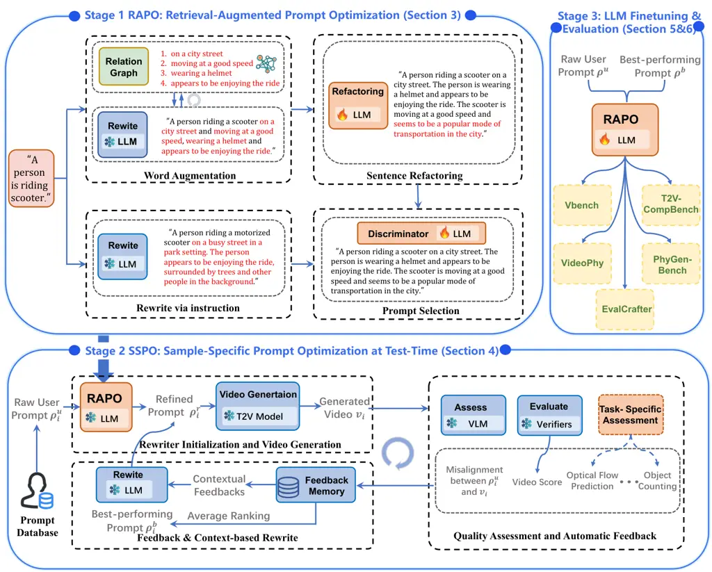
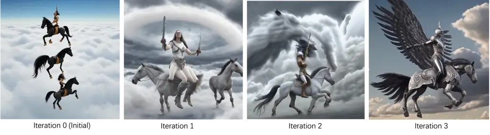
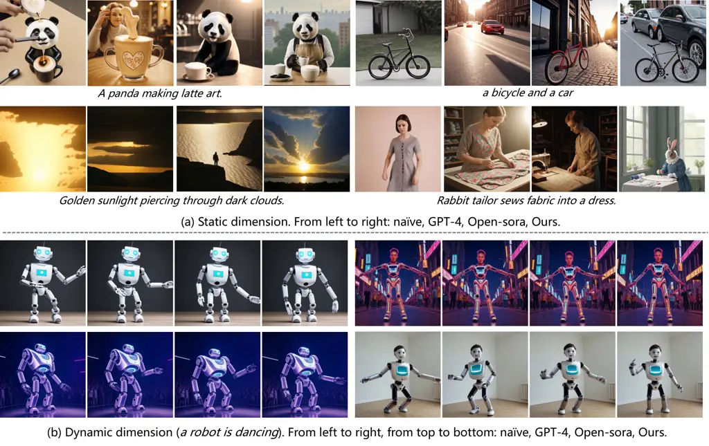
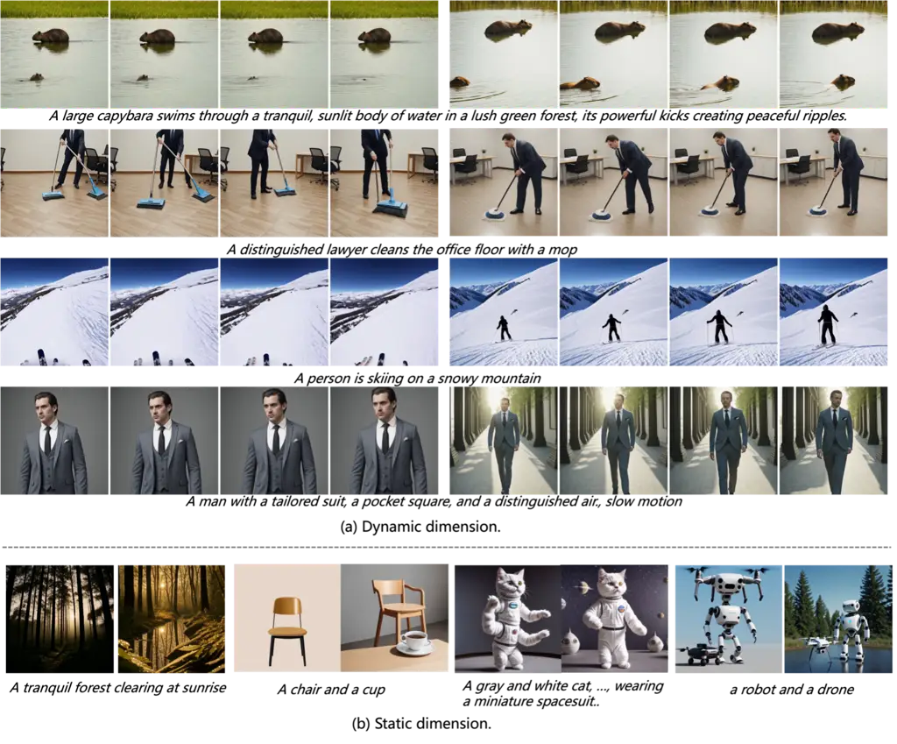
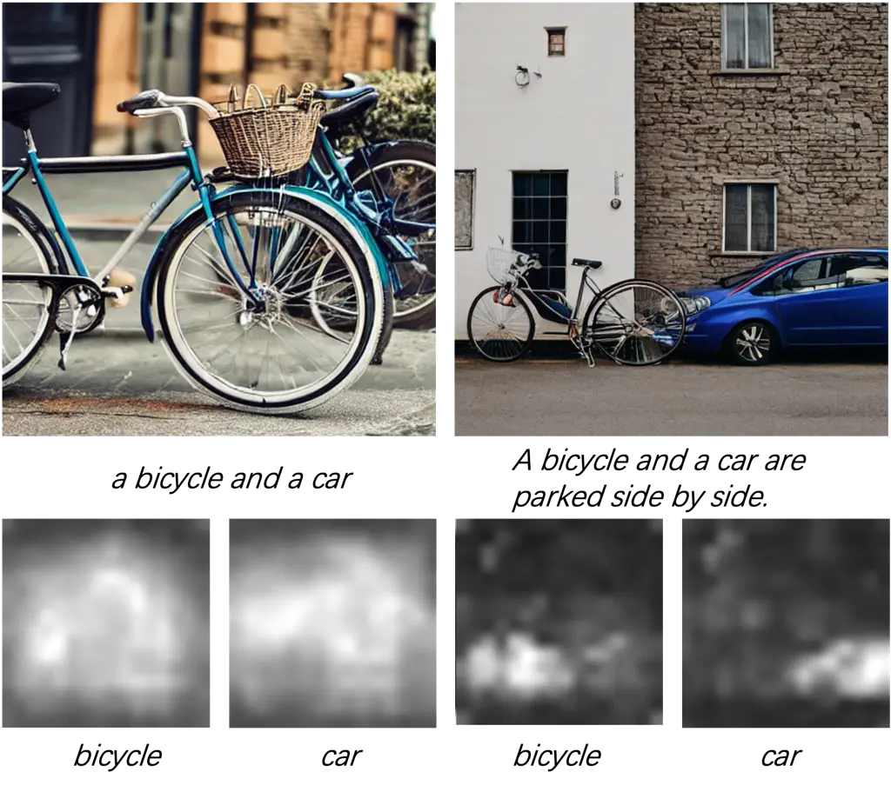
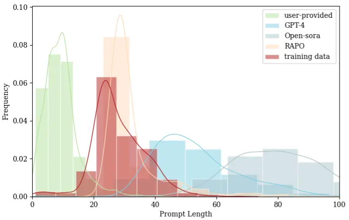
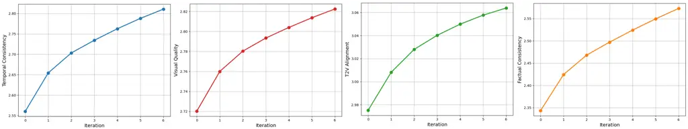

# RAPO++: Cross-Stage Prompt Optimization for Text-to-Video Generation via Data Alignment and Test-Time Scaling

Bingjie Gao, Qianli Ma, Xiaoxue Wu, Shuai Yang, Guanzhou Lan, Haonan
Zhao, Jiaxuan Chen    Qingyang Liu    Yu Qiao ^(†)^(†)thanks: B. Gao, S.
Yang, Q. Ma, J. Chen, H. Zhao, Q. Liu, L. Niu are with Shanghai Jiao
Tong University, Shanghai 200240, China. E-mail:{whynothaha, yang_shuai,
mqlqianli, chenjiaxuan, 2zz-n-24, narumimaria, ustcnewly}@sjtu.edu.cn X.
Wu, G. Lan, Y. Qiao, X. Chen, Y. Wang are with Shanghai Artificial
Intelligence Laboratory, Shanghai 201112, China. E-mail:{wuxiaoxue,
languanzhou, qiaoyu, chenxinyuan, wangyaohui}@pjlab.org.cn Corresponding
author. ^(\*)Project lead.    Senior Member    IEEE    Xinyuan Chen
^(†)^(†)thanks: B. Gao, S. Yang, Q. Ma, J. Chen, H. Zhao, Q. Liu, L. Niu
are with Shanghai Jiao Tong University, Shanghai 200240, China.
E-mail:{whynothaha, yang_shuai, mqlqianli, chenjiaxuan, 2zz-n-24,
narumimaria, ustcnewly}@sjtu.edu.cn X. Wu, G. Lan, Y. Qiao, X. Chen, Y.
Wang are with Shanghai Artificial Intelligence Laboratory, Shanghai
201112, China. E-mail:{wuxiaoxue, languanzhou, qiaoyu, chenxinyuan,
wangyaohui}@pjlab.org.cn Corresponding author. ^(\*)Project lead.   
Yaohui Wang^(\*) ^(†)^(†)thanks: B. Gao, S. Yang, Q. Ma, J. Chen, H.
Zhao, Q. Liu, L. Niu are with Shanghai Jiao Tong University, Shanghai
200240, China. E-mail:{whynothaha, yang_shuai, mqlqianli, chenjiaxuan,
2zz-n-24, narumimaria, ustcnewly}@sjtu.edu.cn X. Wu, G. Lan, Y. Qiao, X.
Chen, Y. Wang are with Shanghai Artificial Intelligence Laboratory,
Shanghai 201112, China. E-mail:{wuxiaoxue, languanzhou, qiaoyu,
chenxinyuan, wangyaohui}@pjlab.org.cn Corresponding author. ^(\*)Project
lead.    Li Niu ^(†)^(†)thanks: B. Gao, S. Yang, Q. Ma, J. Chen, H.
Zhao, Q. Liu, L. Niu are with Shanghai Jiao Tong University, Shanghai
200240, China. E-mail:{whynothaha, yang_shuai, mqlqianli, chenjiaxuan,
2zz-n-24, narumimaria, ustcnewly}@sjtu.edu.cn X. Wu, G. Lan, Y. Qiao, X.
Chen, Y. Wang are with Shanghai Artificial Intelligence Laboratory,
Shanghai 201112, China. E-mail:{wuxiaoxue, languanzhou, qiaoyu,
chenxinyuan, wangyaohui}@pjlab.org.cn Corresponding author. ^(\*)Project
lead.

###### Abstract

Prompt design plays a crucial role in text-to-video (T2V) generation,
yet user-provided prompts are often short, unstructured, and misaligned
with training data, limiting the generative potential of diffusion-based
T2V models. We present RAPO++, a cross-stage prompt optimization
framework that unifies training-data–aligned refinement, test-time
iterative scaling, and large language model (LLM) fine-tuning to
substantially improve T2V generation without modifying the underlying
generative backbone. In Stage 1, Retrieval-Augmented Prompt Optimization
(RAPO) enriches user prompts with semantically relevant modifiers
retrieved from a relation graph and refactors them to match training
distributions, enhancing compositionality and multi-object fidelity.
Stage 2 introduces Sample-Specific Prompt Optimization (SSPO), a
closed-loop mechanism that iteratively refines prompts using
multi-source feedback—including semantic alignment, spatial fidelity,
temporal coherence, and task-specific signals such as optical
flow—yielding progressively improved video generation quality. Stage 3
leverages optimized prompt pairs from SSPO to fine-tune the rewriter
LLM, internalizing task-specific optimization patterns and enabling
efficient, high-quality prompt generation even before inference.
Extensive experiments across five state-of-the-art T2V models and five
benchmarks demonstrate that RAPO++ achieves significant gains in
semantic alignment, compositional reasoning, temporal stability, and
physical plausibility, outperforming existing methods by large margins.
Our results highlight RAPO++ as a model-agnostic, cost-efficient, and
scalable solution that sets a new standard for prompt optimization in
T2V generation. The code is available at [this https
URL](https://github.com/Vchitect/RAPO).

###### Index Terms: 

Text-to-Video Generation, Prompt Optimization, Test-Time Scaling.



Figure. 1: Overview of RAPO++. The framework couples
training-data–aligned prompt refinement with test-time scaling to
enhance Text-to-Video (T2V) generation without altering the generative
backbone. Stage 1 RAPO: Retrieval-Augmented Prompt Optimization
(Sec. III). User prompts are augmented via a retrieval-based relation
graph and refactored by a fine-tuned LLM, while a frozen LLM provides
alternative rewrites. A discriminator then selects the best candidate,
ensuring prompts align with training distributions while preserving
intent. Stage 2 SSPO: Sample-Specific Prompt Optimization at Test-time
(Sec. IV). Multiple candidates are evaluated by VLM verifiers and
task-specific metrics, with misalignments guiding iterative refinement.
This process enhances temporal coherence, fidelity, and semantic
alignment during inference, and also yields prompt pairs for LLM
fine-tuning. Stage 3: LLM Fine-Tuning & Evaluation (Sec. IV-B& V). The
prompt pairs collected from Stage 2 are used to fine-tune the LLM,
further enhancing its generalization and robustness across models. The
fine-tuned LLM is then validated across different benchmarks,
demonstrating consistent and transferable improvements in T2V
generation.

## I Introduction

With the rapid advancement of diffusion models \[1, 2, 3\], visual
content creation has experienced remarkable progress in recent years.
The generation of images, as well as videos from text prompts utilizing
large-scale diffusion models, referred to as text-to-images (T2I) \[4,
5\] and text-to-videos (T2V) \[6, 7, 8\] generation, have attracted
significant interest due to the broad range of applications in
real-world scenarios. Various efforts have been made to enhance the
performance of these models, including improvements in model
architecture \[9, 10, 10\], learning strategies \[11, 12\], and data
curation \[13, 14, 15\].

Recent studies \[16, 17, 11\] have revealed that employing long,
detailed prompts with a pre-trained model typically produces superior
quality outcomes compared to utilizing shallow descriptions provided by
users. This has underscored the significance of prompt optimization as
an important challenge in text-based visual content creation. The
prompts provided by users are often brief and lack the essential details
required to generate vivid images or videos. Simply attempting to
optimize prompts by manually adding random descriptions can potentially
mislead models and degrade the quality of generative results, resulting
in outputs that may not align with user intentions. Therefore,
developing automated methods to enhance user-provided prompts becomes
essential for improving the overall quality of generated content.

Towards improving image aesthetics and ensuring semantic consistency,
several attempts \[18, 19, 20\] have been made in previous T2I works for
prompt optimization. These efforts primarily involve instructing a
pre-trained or fine-tuned Large Language Model (LLM) to incorporate
detailed modifiers into original prompts, with the aim of enhancing
spatial elements such as color and relationships. While these approaches
have displayed promising outcomes in image generation, studies \[17,
21\] reveal that their impact on video generation remains limited,
especially in terms of enhancing temporal aspects such as motion
smoothness and minimizing temporal flickering.

For T2V generation, recent efforts \[22, 11, 23, 24\] have explored
prompt rewriting strategies, where user-provided prompts are
reformulated to address variability in linguistic style, length, and
expressivity. Such approaches aim to improve alignment between textual
descriptions and video outputs by standardizing or enriching the input
language. However, existing practices in T2V prompt engineering remain
largely model-specific. There is still a lack of generalizable
optimization strategies that can systematically guide prompt refinement
across diverse models and tasks.

To address the above issue, some RLHF-based prompt optimization
methods \[18, 17\] mitigate model-specific variability in user prompts
by training a dedicated prompt rewriter through a two-stage procedure:
supervised initialization on curated high-quality prompts followed by
reinforcement learning (_e.g._, PPO and GRPO) against a learned reward
model that encodes human preferences or alignment metrics. This pipeline
effectively enables exploration beyond hand-crafted templates without
altering the generator’s weights. Recent variants \[25, 26\] further
decouple the rewriter from the generator and incorporate
chain-of-thought or evaluator-guided rewriting to improve
generalization. However, these methods focus on T2I generation and
extending this RLHF recipe T2V generation faces fundamental practical
and methodological barriers. Video generation introduces heavy temporal
structure and substantially higher inference cost, so RLHF’s reliance on
large numbers of generator rollouts for reward estimation and policy
search becomes prohibitively expensive. To this end, naively scaling
those approaches to T2V generation is computationally impractical
without additional algorithmic designs that address temporal evaluation
and inference-time cost.

In this paper, we propose RAPO++ as shown in Fig. 1, a cross-stage
prompt optimization framework that unifies training-data–aligned
refinement with test-time iterative scaling. The framework is organized
into three complementary stages. In the first stage, the proposed
retrieval-augmented prompt optimization method (RAPO) leverages training
corpus statistics to guide prompt refinement. A relation graph built
from large-scale video–text data retrieves semantically relevant
modifiers, which are merged into user prompts via a word augmentation
mechanism. These enriched prompts are then refactored through an
instruction-tuned LLM to match the structural and stylistic distribution
of training prompts, ensuring compatibility with the generative
backbone. In parallel, an alternative rewriting branch produces
candidate prompts directly from a frozen LLM. A discriminator LLM
subsequently selects the most effective candidate, yielding optimized
prompts that preserve user intent while aligning more closely with the
data distribution. This stage systematically addresses the challenge of
model-specificity by anchoring prompts in training-grounded semantics
and structure, improving compositionality and multi-object fidelity.



Figure. 2: Generation results under different iterations of prompt
refinement at inference utilizing SSPO. The initial prompt is “valkyrie
riding flying horses through the clouds”. As the number of iterations
increases (from left to right), the generated video becomes more
detailed and vivid, and more consistent with the user’s intent.

Building upon Stage 1, which aligns prompts with training data semantics
and structure, Stage 2 introduces Sample-Specific Prompt Optimization
(SSPO), a test-time scaling mechanism that iteratively refines prompts
through a closed-loop reflection process. SSPO consists of three
modules: Rewriter Initialization and Video Generation, Quality
Assessment and Automatic Feedback, and Feedback and Context-based
Rewrite. Starting from the RAPO-refined prompt, the system generates an
initial video and evaluates it using vision-language alignment checks,
ensemble verifiers for spatial fidelity, temporal coherence, and
alignment quality, and optional task-specific modules (e.g., optical
flow or object counting) for physical plausibility. Multi-source
feedback is stored in a memory bank and used by a large language model
to rewrite prompts, progressively improving semantic alignment, temporal
consistency, and motion realism. An average-ranking mechanism selects
the best candidate for subsequent inference. Through this
reflection-driven loop, SSPO significantly enhances video quality
without modifying the generative backbone, achieving finer temporal
control, stronger compositional reasoning, and higher semantic fidelity.
As shown in Fig. 2, we present an example of generative results under
different iterations of prompt refinement at inference utilizing SSPO.
With each successive iteration (from left to right), the generated video
gains more detail and vividness, and aligns more closely with the user’s
intent.

Stage 3 consolidates these improvements through LLM fine-tuning,
transforming the iterative optimization knowledge from Stage 2 into a
reusable capability. During SSPO, the system collects paired data of
original prompts and their optimized versions, which are used to
fine-tune the rewriter LLM via instruction tuning. This enables the
model to internalize task-specific patterns, generalize beyond seen
examples, and generate high-quality prompts even before inference,
reducing test-time computation and improving optimization
generalization. The fine-tuned LLM accelerates convergence and extends
RAPO++ to diverse T2V architectures and downstream tasks. Together,
Stages 2 and 3 complement the training-aligned refinement of Stage 1,
forming a unified pipeline that couples inference-time adaptation with
model-level enhancement. This cross-stage design empowers RAPO++ to
achieve substantial gains in compositional generation, temporal
stability, and physics-aware realism, setting a new benchmark for prompt
optimization in text-to-video generation.

Extensive experiments across five representative T2V models (LaVie,
Latte, HunyuanVideo, CogVideoX, and Wan2.1) and five complementary
benchmarks (VBench, T2V-CompBench, EvalCrafter, VideoPhy, and
PhyGenBench) demonstrate the effectiveness and generalizability of
RAPO++. Compared to existing prompt optimization methods, RAPO++
achieves consistent and significant improvements in semantic alignment,
compositional reasoning, temporal stability, and physical plausibility.
On VBench, RAPO++ attains a total score of 82.65% with LaVie and 80.75%
with Latte, while on T2V-CompBench it delivers state-of-the-art
performance across challenging categories such as consistent attribute
binding and object interactions. These results reflect RAPO++’s ability
to generate videos with sharper spatial details, smoother motion
dynamics, and stronger text–video alignment than baseline approaches.
RAPO++ also demonstrates strong scalability and adaptability in
task-specific settings. Integrating physics-aware evaluators into the
SSPO loop enables substantial gains in physical consistency and semantic
alignment on PhyGenBench and VideoPhy, with performance steadily
improving over iterative refinement rounds.

Analyses further reveal that optimized prompts produced by RAPO++
closely match the training distribution in length and structure,
unlocking the full generative potential of T2V models. Fine-tuned LLMs
significantly enhance multi-object fidelity and compositional
generation, while inference-time scaling yields progressive gains across
temporal consistency, visual quality, and factual alignment. Ablation
studies confirm the complementary contributions of each module and the
robustness of RAPO++ across different LLM backbones, establishing it as
a model-agnostic and cost-efficient solution for high-quality
text-to-video generation.

Difference from our conference version: This manuscript improves the
conference version \[27\] substantially with new methodology, wider
extension to more models and tasks, and broader analyses. 1) We extend
the original RAPO into a three-stage framework called RAPO++
(Section IV), which integrates prompt refinement with Sample-Specific
Prompt Optimization (SSPO) and LLM finetuning, forming a unified
pipeline that enhances semantic fidelity, temporal coherence, and
compositional reasoning without modifying the generative backbone. 2) We
apply RAPO++ to a broader range of T2V models and evaluate it on
multiple benchmarks in Section V, demonstrating its effectiveness,
scalability, and strong generalization across architectures and tasks. 3) We conduct more comprehensive analyses in Section V-E, including
multi-object generation, prompt statistics, physical consistency, and
inference-time scaling behavior. We also provide deeper discussions of
concurrent works and inference-time scaling strategies in Section II to
better position RAPO++ within the evolving landscape of T2V prompt
optimization research.

## II Related Work

Text-to-Video Generation. With the remarkable breakthroughs of diffusion
models \[1, 2, 3\], the generations of 3D content \[28, 29, 30\], images
\[4, 31, 32, 33, 34\], and videos \[6, 35\] from text descriptions
achieve rapid advancement. Text-to-Video (T2V) \[36, 8\] Generation aims
to automatically create videos that match given textual descriptions.
This process generally involves comprehending the scenes, objects, and
actions described in the text and converting them into a sequence of
cohesive visual frames, producing a video that is logically and visually
consistent. T2V generation is wildly used in applications, such as
animations \[37, 38, 39\] and automatic movie generation \[40, 41, 42\].
However, large T2V generative models \[8, 10, 11\] trained on
large-scale dataset could not adequately demonstrate their potential in
generation due to mismatch between training and inference.

Prompt optimization. T2I and T2V generative models are sensitive to
input prompts. However, the well-performed prompts are often
model-specific and coherent with training prompts, misaligned with user
input. Therefore, several studies \[17, 43, 18, 44\] are conducted to
explore the generative potential of T2I and T2V generative models. Hao
_et al._ \[17\] propose a learning-based prompt optimizing framework
unitizing reinforce learning for generating more aesthetically pleasing
images. Chen _et al._ \[43\] enhance user prompts by leveraging the
user’s historical interactions with the system. Mo _et al._ \[18\]
propose Prompt Auto-Editing (PAE) method to decide the weights and
injection time steps of each word without manual intervention. These
methods primarily focus on prompts optimizing for T2I models and lack
extension to T2V models. Yang _et al._ \[11\] use large language models
(LLMs) to transform short prompts into more detailed ones, maintaining a
consistent visual structure. Polyak _et al._ \[16\] develop a
teacher-student distillation approach for prompt optimization to improve
computational efficiency and reduce latency. However, the results of
optimized prompts usually could not be well-aligned with training
prompts due to the misleading of the LLMs and the lack of more refined
guidance.

Test-Time Scaling. Test-time scaling \[45, 46\] refers to increasing
computational resources during inference to enhance model performance.
By employing larger models or more sophisticated search strategies, it
yields more accurate, coherent, and contextually relevant outputs.
Leveraging extra compute after training allows models to refine
predictions and better adapt to inputs, producing higher-quality
results. In large language models, it improves response quality and
contextual relevance, and recent work \[47, 48, 49, 50, 51, 52, 53, 54\]
has extended this concept to diffusion models \[51, 55\]. Ma _et al._
\[50\] propose a framework for test-time scaling in diffusion models,
searching for better noise candidates during the diffusion sampling
process, and the results show substantial quality improvements in image
generation across different tasks and model sizes. Xie _et al._ \[51\]
leverage efficient training, depth pruning, and Test-time scaling to
enhance text-to-image generation quality while reducing computational
costs. Oshima _et al._ \[55\] propose a method called Diffusion Latent
Beam Search (DLBS) with a lookahead estimator to optimize the quality of
generated videos by selecting better diffusion latents and calibrating
rewards to enhance perceptual quality without model updates. However,
there is few research focus on the test-time scaling for generative
models via iteratively refining prompts.

## III RAPO

As illustrated in Fig. 1, RAPO mainly consists of three parts, 1) a word
augmentation module, 2) a sentence refactoring module, as well as 3) a
prompt selection module. Given a user-provided prompt $`x_{i}`$,
firstly, the word augmentation module utilizes an interactive
retrieval-merge mechanism between a relation graph $`\mathcal{G}`$ and a
LLM $`\mathcal{L}`$ to augment the prompt by adding related subject,
action and atmosphere modifiers. Then, a fine-tuned LLM
$`\mathcal{L}_{r}`$ is applied to refactor the entire sentence into
$`x_{r}`$. $`x_{r}`$ has a more unified format which is consistent with
the prompt length and format distribution in training data. Finally, a
discriminator in the prompt selection module decides between $`x_{r}`$
and a naively augmented prompt $`x_{n}`$ obtained directly from a LLM
via instruction, as the most suitable augmented prompt for T2V
generation. We proceed to introduce each module in detail in the
following sections.

### III-A Word Augmentation Module

Given a user-provided prompt $`x_{i}`$, the word augmentation module
aims to enrich $`x_{i}`$ with more multiple, straightforward and
relevant modifiers. It is achieved through retrieving modifiers meeting
the requirements from a built relation graph $`\mathcal{G}`$, and
merging them into $`x_{i}`$ through $`\mathcal{L}`$ via instruction. In
this section, we first introduce the construction and retrieval of
relation graph. And we introduce the instruction format and
retrieval-merge mechanism of $`\mathcal{L}`$.

Figure. 3: The construction of relation graph. Relation graph consists
of multiple nodes (scenes acting as core nodes with modifiers connected
as sub-nodes). For each prompt in database, LLM extracts scene and
related modifiers. Based on whether the extracted scene is already in
the graph or not, different methods are used to incorporate the new
information into the graph.

Relation Graph $`\mathcal{G}`$. As shown in Fig. 3, we construct
relation graph $`\mathcal{G}`$ based on training prompts database. For
each training prompt, we utilize $`\mathcal{L}`$ to extract scene and
corresponding related modifiers (subject, action, atmosphere
descriptions). Each scene serves as a core node, with subject, action
and atmosphere modifiers connected as individual sub-nodes in relation
graph. For each extracted scene, we first check whether it exists in
relation graph or not. If so the extracted related modifiers will be
connected to the existing one. If not the extracted scene becomes a new
core node with related modifiers connected. Finally, we can obtain a
relation graph covering diverse scenes with multiple modifiers
connected.

For relation graph retrieval, we utilize a sentence transformer
pre-trained model to extract features of prompt, and employ the cosine
similarity to measure similarity between sentence features. We first
retrieve the top-k relevant scenes from $`\mathcal{G}`$ for $`x_{i}`$.
Then we retrieve all modifiers connected to the retrieved scenes. We
select the top-k relevant modifiers $`\{p_{n}|_{n=0}^{k-1}\}`$ from all
retrieved modifiers, preparing for the retrieval-merge mechanism of
$`\mathcal{L}`$.

LLM $`\mathcal{L}`$. We augment $`x_{i}`$ with retrieved modifiers
$`\{p_{n}|_{n=0}^{k-1}\}`$ from relation graph. We rename $`x_{i}`$ with
$`x^{0}_{i}`$ to illustrate the process of iterative merging.
Specifically, the retrieved modifiers are merged into input prompt
$`x^{0}_{i}`$ one by one through prompting $`\mathcal{L}`$, to maintain
the information of the original input while adding relevant modifiers.

```math
x^{m+1}_{i}=f(x^{m}_{i},p^{m}_{i}), \tag{1}
```

where $`m=0,1,...,k-1`$. $`f`$ is a function that combine $`x^{m}_{i}`$
and $`p^{m}_{i}`$ reasonably by $`\mathcal{L}`$. For instance, a merged
prompt “a woman dressed in a black suit representing a funeral” is
resulted from merging the user-provided prompt ”a woman representing a
funeral” and a retrieved modifier ”a black suit”. We prompt
$`\mathcal{L}`$ to perform general prompt merging in a normal manner as
the template in Tab. I. In instruction, we provide some prompt pairs
$`E=\{e_{i}|_{i=0}^{n}\}`$ as examples, in which $`e_{i}`$ contains
input prompt, a modifier and corresponding merged result.

| LLM Template for Retrieval-Merge Mechanism                                                                                                                                                                                                                                                                                                                     |
| -------------------------------------------------------------------------------------------------------------------------------------------------------------------------------------------------------------------------------------------------------------------------------------------------------------------------------------------------------------- | ---------------- |
| Suppose you are a Text Merger. You receive two inputs from the user: a description body and a relevant modifier. Your task is to enrich the description body with relevant modifiers while retaining the description body. You should ensure that the output text is coherent, contextually relevant, and follows the same structure as the examples provided. |
| Examples of prompt-pairs provided: $`E=\{e\_{i}                                                                                                                                                                                                                                                                                                                | \_{i=0}^{n}\}`$. |
| Input description body and modifier are: {$`x^{m}_{i}`$,$`p^{m}_{i}`$}.                                                                                                                                                                                                                                                                                        |
| The merged prompt is: {$`x^{m+1}_{i}`$}.                                                                                                                                                                                                                                                                                                                       |

TABLE I: Input template for retrieval-merge mechanism. This template
specifies how a frozen LLM iteratively merges user-provided prompt texts
with relevant modifiers retrieved from a relation graph, thereby
enriching the prompt’s semantic content and aligning it with the
training prompt structure for improved text-to-video synthesis.

### III-B Sentence Refactoring Module

Sentence refactoring module aims to refactor word augmented prompts from
word augmentation module to be more consistent with prompt format in
training data. It is achieved through a fine-tuned LLM $`L_{r}`$ named
as refactoring model. In this section, we introduce the training data
preparation and instruction tuning for $`L_{r}`$.

Data preparation. We represent the required dataset for training
refactoring model by $`\{D_{r}=r_{i}|_{i=1}^{N^{r}}\}`$, in which
$`r_{i}`$ involves a pair of prompts and $`N^{r}`$ is the number of
training prompts pairs. Specifically, $`r_{i}=(w_{i},c_{i})`$, in which
$`w_{i}`$ targets to simulate world augmented prompt, and $`c_{i}`$
represents the target prompt, that is, a training prompt for T2V models.
$`w_{i}`$ and $`c_{i}`$ share similar semantics while different in the
prompt format and length. Therefore, we generate $`w_{i}`$ automatically
through rewriting $`c_{i}`$ utilizing $`\mathcal{L}`$ via instruction to
break the unified training prompt format but maintaining the original
semantics.

Instruction tuning for $`L_{r}`$. We employ instruction tuning for
fine-tuning a LLM on our constructed dataset of instructional prompts
and corresponding outputs. The constructed dataset is based on
$`\{D_{r}=r_{i}|_{i=1}^{N^{r}}\}`$ containing instructional prompts and
corresponding outputs. The template of the instruction tuning dataset
for $`L_{r}`$ is shown as Tab. II.

| Instruction Tuning Dataset for $`L_{r}`$                                                                                                                                                                                                  |
| ----------------------------------------------------------------------------------------------------------------------------------------------------------------------------------------------------------------------------------------- |
| Instruction. Refine format and word length of the sentence: $`w_{i}`$. Maintain the original subject descriptions, actions, scene descriptions. Append additional straightforward actions to make the sentence more dynamic if necessary. |
| Output: target prompt $`c_{i}`$.                                                                                                                                                                                                          |

TABLE II: Instruction tuning dataset template for $`L_{r}`$. This
template directs LLM fine-tuning to restructure augmented prompts by
adjusting their format while preserving semantics, aligning them with
the training data’s style for improved T2V generation.

### III-C Prompt Selection Module

As shown in Fig. 1, prompt selection module contains a fine-tuned LLM
$`\mathcal{L}_{d}`$ named prompt discriminator to select the better one
between $`x_{r}`$ from sentence refactoring module, and a naively
augmented prompt $`x_{n}`$ obtained directly from a LLM via instruction.
In this section, we introduce the training data preparation and
instruction tuning for $`\mathcal{L}_{d}`$.

Data preparation. We represent the required dataset for training
refactoring model by $`\{D_{d}=d_{i}|_{i=1}^{N^{d}}\}`$, in which
$`d_{i}`$ contains three prompts and $`N^{d}`$ is the number of training
prompts triples. Specifically, $`d_{i}=(x_{i},x_{r},x_{n},y_{d})`$, in
which $`y_{d}`$ represents the discriminator label to select the better
one for T2V generation from $`x_{r}`$ and $`x_{n}`$ given input prompt
$`x_{i}`$. To simulate the user-provided prompts, we collect diverse
prompts from several T2V benchmarks and generate more utilizing
$`\mathcal{L}`$ via instruction. $`x_{r}`$ and $`x_{n}`$ can be obtained
from the proposed RAPO as shown in Fig. 1 given $`x_{i}`$. We determine
$`y_{d}`$ through the evaluation of generated videos conditioned on
$`x_{r}`$ and $`x_{n}`$. Specifically, the evaluations of T2V models
performance involves diverse dimensions. For collected or generated
prompts, we need to determine the evaluation dimension according to
prompt content. We automatically decide the evaluation dimension of
input prompts utilizing $`\mathcal{L}`$, then choose the corresponding
metrics to evaluate generated videos.

Instruction tuning for $`L_{d}`$. Similar to $`L_{r}`$, we employ
instruction tuning for $`L_{d}`$ based on
$`\{D_{d}=d_{i}|_{i=1}^{N^{d}}\}`$. The template of the instruction
tuning dataset for $`L_{d}`$ is shown as Tab. III.

| Instruction Tuning Dataset for $`L_{d}`$                                                                                                                                                                                                                                   |
| -------------------------------------------------------------------------------------------------------------------------------------------------------------------------------------------------------------------------------------------------------------------------- |
| Instruction. Given user-provided prompt $`x_{i}`$, select the better optimized prompt from $`x_{r}`$ and $`x_{n}`$. The chosen prompt is required to contain multiple, straightforward, and relevant modifiers about $`x_{i}`$ while involving the semantics of $`x_{i}`$. |
| Output: discriminator label $`y_{d}`$.                                                                                                                                                                                                                                     |

TABLE III: Instruction tuning dataset template for $`L_{d}`$. This
template aims to train a discriminator LLM that evaluates multiple
refined prompts and selects the optimal one based on the inclusion of
clear, straightforward modifiers and faithful semantic alignment.

## IV RAPO++

As illustrated in Fig. 1, building upon RAPO, RAPO++ additionally
introduces a three-stage framework that integrates Stage 2 SSPO
(Sample-Specific Prompt Optimization at Test-Time) and Stage 3 (LLM
Fine-Tuning), forming a unified pipeline for test-time refinement and
model-level enhancement. We proceed to introduce each part in detail in
the following sections.

### IV-A SSPO Mechanism

As shown in Fig. 1, the SSPO mechanism of RAPO++ consists of three
parts, 1) a Rewriter Initialization and Video Generation module, 2) a
Quality Assessment and Automatic Feedback module, as well as 3) a
Feedback and Context-based Rewrite module. Based on RAPO in Stage 1, a
Raw User Prompt $`\rho^{u}_{i}`$ is first transformed into a Refined
Prompt $`\rho^{r}_{i}`$, which is then used to generate a video
$`v_{i}`$ through the T2V model. The generated video undergoes _Quality
Assessment and Automatic Feedback_ module, including misalignment
detection between the Generated Video $`v_{i}`$ and Raw User
Prompt $`\rho^{u}_{i}`$ via a Vision-Language Model (VLM) ,
ensemble-based video scores from different verifiers, and optional
task-specific assessment (_e.g._, optical-flow prediction or object
counting). These feedback signals are passed to the _Feedback and
Context-based Rewrite_ module, where a _Feedback Memory_ database stores
prior evaluations and provides contextual feedbacks to the LLM. A Large
Language Model (LLM) then incorporates these contextual signals to
rewrite the current Refined Prompt $`\rho^{r}_{i}`$, enabling a
reflection-driven optimization loop that progressively enhances temporal
coherence, fidelity, and semantic alignment. An Average Ranking strategy
is applied across multiple evaluation dimensions (_e.g._, semantic
alignment, temporal coherence, and physical plausibility) to select the
best-performing prompt from this candidate set, yielding the
best-performing optimized prompt $`\rho^{b}_{i}`$. This
reflection-driven optimization loop progressively enhances temporal
coherence, visual fidelity, and semantic alignment while producing
aligned prompt pairs $`\{(\rho^{u}_{i},\rho^{b}_{i})|_{i=0}^{n-1}\}`$
for LLM finetuning in Stage 3, where $`n`$ denotes the total number of
prompts contained in the prompt database.

Rewriter Initialization and Video Generation. This module refines a raw
user prompt $`\rho^{u}_{i}`$ through the RAPO framework, which retrieves
semantically relevant modifiers from a relation graph and restructures
them via fine-tuned Large Language Models (LLMs) to match the
distribution of training data. The refined prompt $`\rho^{r}_{i}`$ is
then fed into a Text-to-Video (T2V) model to generate the corresponding
video $`v_{i}`$. Both the RAPO rewriter and the T2V generative model are
modular and can be replaced with other existing T2V models (_e.g._,
HunyuanVideo \[22\], CogVideoX \[11\], Wan \[24\]), enabling flexible
integration and generalization across different architectures.

Quality Assessment and Automatic Feedback. This module evaluates the
generated video $`v_{i}`$ through multiple complementary feedback
signals that jointly capture its consistency with the input
prompt $`\rho^{u}_{i}`$. A Vision-Language Model (VLM) estimates the
semantic misalignment between the raw user prompt $`\rho^{u}_{i}`$ and
the generated video $`v_{i}`$, denoted as
$`\mathcal{M}(\rho^{u}_{i},v_{i})`$. Simultaneously, a set of verifiers
$`\{\mathcal{V}_{k}\}_{k=1}^{K}`$ assess the overall generation quality
across various dimensions, including spatial fidelity, temporal
coherence, and semantic alignment, producing video scores
$`\{s_{k}\}_{k=1}^{K}`$ that are aggregated into a unified evaluation
score $`\mathcal{S}(v_{i})=\frac{1}{K}\sum_{k=1}^{K}s_{k}`$. In
addition, a Task-Specific Assessment branch can be flexibly designed to
enhance the generalization ability of this module across diverse tasks.
For instance, in physical-aware video generation, an optical flow
prediction module $`\mathcal{O}(v_{i})`$ can be incorporated to evaluate
motion dynamics and physical plausibility by analyzing flow consistency
and object trajectories. All feedback signals
$`\{\mathcal{M}(\rho^{u}_{i},v_{i}),\mathcal{S}(v_{i}),\mathcal{O}(v_{i})\}`$
are passed to the next module and utilized as contextual information to
guide subsequent prompt rewriting and iterative refinement.

Feedback and Context-based Rewrite. This module leverages accumulated
feedback to iteratively refine prompts through a reflection-driven
rewriting process. A dedicated feedback memory database is designed to
record multi-source feedback signals
$`\{\mathcal{M}(\rho^{u}_{i},v_{i}),\mathcal{S}(v_{i}),\mathcal{O}(v_{i})\}`$.
Rather than processing each generation independently, the feedback
memory database maintains a historical record of previous assessments
and refinement outcomes, allowing the system to capture temporal
dependencies and long-term optimization patterns. During each iteration,
contextual information retrieved from the feedback memory database
provides the Large Language Model (LLM) with a comprehensive
understanding of prior errors, successful refinements, and evolving
feedback trends. The LLM then performs a context-based rewriting of the
current refined prompt $`\rho^{r}_{i}`$, integrating historical and
current feedback signals to produce an updated version. This
reflection-driven mechanism enables the framework to progressively
enhance temporal coherence, visual fidelity, and semantic alignment over
multiple iterations, ensuring that prompt optimization remains adaptive,
memory-informed, and dynamically responsive to generation quality.

Average Ranking for Prompt Selection. To ensure that the optimized
prompt achieves robust generalization across multiple evaluation
dimensions, we introduce an Average Ranking mechanism to guide the
selection of $`\rho^{b}_{i}`$. Instead of relying on a single metric,
each candidate refined prompt is evaluated using multiple criteria such
as semantic alignment, spatial fidelity, temporal consistency, and
physical plausibility. Each candidate receives a rank for every metric,
and an average rank score is computed as the mean of its ranks across
all metrics. The candidate with the lowest average rank is then selected
as $`\rho^{b}_{i}`$. This ranking-based approach mitigates bias from any
single metric and ensures balanced performance across compositional,
temporal, and physical dimensions.

Instruction Template of Refining Prompts. To enable context-aware and
memory-guided rewriting, we design an instruction template that guides
the Large Language Model (LLM) in refining prompts based on prior
feedback signals stored in the Feedback Memory. The template
incorporates three key components: (1) the initial user prompt
$`\rho^{u}_{i}`$, (2) previously optimized prompts with their
corresponding misalignment assessments
$`\{(\mathcal{M}(\rho^{u}_{t},v_{t}),\rho^{u}_{t})|_{t=0}^{i-1}\}`$, and
(3) the unified evaluation score $`\mathcal{S}(v_{i})`$ derived from
multi-verifier feedback. By referencing these structured inputs, the LLM
is able to infer patterns of improvement and identify the semantic gaps
that most strongly influence video-text inconsistency. Through this
reflection-driven instruction, the model generates a refined prompt
$`\rho_{i+1}^{r}`$ that balances textual precision and generative
controllability, leading to improved temporal coherence and
visual-textual alignment in subsequent generations. The complete
instruction template used for prompt refinement is shown as Tab. IV.

| Instruction Template for Prompt Refinement                                                                                                                                                                                                                                                                                                                                                                                                                                              |
| --------------------------------------------------------------------------------------------------------------------------------------------------------------------------------------------------------------------------------------------------------------------------------------------------------------------------------------------------------------------------------------------------------------------------------------------------------------------------------------- | ----------------------------------------------------------------------------------------------------------------------------------------------------------------------------------------------------------------------------------------------------------------------------------------------------------------------------------------------------------------------------------------------------------------------------------- |
| You are a prompt engineering expert using a diffusion-based Text-to-Video (T2V) model. Your task is to refine the current refined prompt $`\rho^{r}_{i}`$ to improve the alignment between the generated video and the input textual semantics. You should consider both the historical and current feedback signals stored in the Feedback Memory, including the raw user prompt $`\rho^{u}_{i}`$, the historical feedback records $`\{(\mathcal{M}(\rho^{u}_{t},v_{t}),\rho^{u}\_{t}) | _{t=0}^{i-1}\}`$, overall video scores $`\mathcal{S}(v_{i})`$, and task-specific assessments $`\mathcal{O}(v\_{i})`$. Please analyze these feedbacks together with the previous optimized prompts and their evaluation results to propose a new, improved prompt. The goal is to generate a refined prompt that minimizes semantic misalignment, enhances temporal and spatial coherence, and improves overall perceptual fidelity. |
| Historical Feedback Records: $`\{(\mathcal{M}(\rho^{u}_{t},v_{t}),\rho^{u}\_{t})                                                                                                                                                                                                                                                                                                                                                                                                        | \_{t=0}^{i-1}\}`$                                                                                                                                                                                                                                                                                                                                                                                                                   |
| Raw User Prompt: $`\rho^{u}_{i}`$                                                                                                                                                                                                                                                                                                                                                                                                                                                       |
| Current Refined Prompt: $`\rho^{r}_{i}`$                                                                                                                                                                                                                                                                                                                                                                                                                                                |
| Final Output (Updated Refined Prompt): $`\rho_{i+1}^{r}`$                                                                                                                                                                                                                                                                                                                                                                                                                               |

TABLE IV: Context-Aware Instruction Template for Feedback-Driven Prompt
Refinement. This template guides the LLM to iteratively refine prompts
by integrating historical and current feedback from the Feedback Memory,
improving semantic alignment, temporal coherence, and perceptual
fidelity.

### IV-B LLM Fine-Tuning

The prompt pairs $`\{(\rho^{u}_{i},\rho^{b}_{i})|_{i=0}^{n-1}\}`$
collected from Stage 2, where $`n`$ denotes the total number of prompts
contained in the prompt database, are then used to fine-tune the
rewriter LLM, reinforcing its generalization capacity and mitigating
local optima. The fine-tuned LLM strengthens the overall refinement
pipeline when deployed at inference. Fine-tuning the LLM used in Stage 2
is both necessary and beneficial, as it further improves the initial
prompt optimization module and prevents optimization from falling into
local minima. We employ instruction tuning based on these
initial–optimized pairs
$`\{(\rho^{u}_{i},\rho^{b}_{i})|_{i=0}^{n-1}\}`$. The template of the
instruction used for fine-tuning is shown in Tab. V.

| LLM Template for Fine-Tuning LLM                                                                                                                                                                                                                                                                                                                                                                     |
| ---------------------------------------------------------------------------------------------------------------------------------------------------------------------------------------------------------------------------------------------------------------------------------------------------------------------------------------------------------------------------------------------------- |
| You are a prompt engineering expert and using a diffusion model to generate video by giving a prompt. Your task is to refine the prompt to add more related and vivid descriptions (Optional: camera language, light and shadow, atmosphere) for better generative performance. Conceive some additional actions to make the sentence more dynamic. Make sure it is a fluent sentence, not nonsense. |
| Initial Prompt: $`\rho^{u}_{i}`$.                                                                                                                                                                                                                                                                                                                                                                    |
| Target Optimized Prompt $`\rho^{b}_{i}`$.                                                                                                                                                                                                                                                                                                                                                            |

TABLE V: Input template for fine-tuning LLM. The initial prompt
$`\rho^{u}_{i}`$ is refined into a detailed target prompt
$`\rho^{b}_{i}`$ through the incorporation of vivid descriptions,
dynamic actions, and specific contextual enhancements such as camera
language, lighting, and atmosphere.

## V Experiments

In Section V-A, we introduce the evaluation metrics, benchmarks, and
comparative methods. In Section V-B, we detail the technical
configurations and parameter settings used in the experiments. In
Section V-C, we present performance improvements through both
quantitative and qualitative comparisons. In Section V-E, we provide a
comprehensive analysis of compositionality, multi-object binding,
temporal stability, and prompt statistics, complemented by attention
visualization, inference-time scaling evaluation, and assessments of LLM
fine-tuning and task-specific modules on semantic alignment and motion
realism. In Section V-F, we validate the importance of individual
components through systematic ablation experiments.



Figure. 4: Qualitative comparisons across dynamic and static dimensions.
This figure showcases videos generated using LaVie with short prompts,
GPT-4 and Open-sora prompt optimizations, and our RAPO method. Videos
produced with RAPO exhibit significantly sharper spatial details,
smoother temporal transitions, and a closer semantic alignment with the
input text.

### V-A Experimental Setup

Models & Evaluation. We applied RAPO++ on several open-source
Text-to-Video (T2V) models and benchmarks, as listed below, to examine
how the proposed framework enhances the generative performance of
generated videos, such as semantic fidelity, compositional accuracy, and
physical plausibility.

- •
  LaVie \[8\]: A cascaded latent unet–based T2V model. LaVie composes
  three modules—base video diffusion, temporal interpolation, and video
  super-resolution—to generate visually high-fidelity and temporally
  coherent videos.
- •
  Latte \[10\]: A DiT-based T2V model that formulates video generation
  in a tokenized latent space. It first extracts spatio-temporal tokens
  and then uses Transformer blocks to model the video distribution.
- •
  HunyuanVideo \[22\]: HunyuanVideo emphasizes large-scale joint
  training across image and video domains, efficient infrastructure for
  large-scale inference, and robust text–video alignment.
- •
  CogVideoX \[11\]: A derivative of the CogVideo family, CogVideoX is an
  open-source T2V model that generates videos of moderate length (_e.g._
  10 seconds) from textual prompts. It offers multiple variants (_e.g._
  2B, 5B) and has been adopted in benchmark comparisons of T2V
  generation.
- •
  Wan2.1 \[24\]: Wan2.1 is available in a 14B–parameter version for
  480P/720P output, as well as a lighter 1.3B variant for more limited
  hardware. It also supports bilingual text generation (Chinese and
  English) in video frames.

To better and more comprehensively assess the generalization ability of
RAPO++, we evaluate it across five complementary benchmarks. These
benchmarks probe different aspects of video generation—such as visual
quality, semantic alignment, compositional generalization, temporal
consistency, and physical commonsense—and together provide a more
holistic view of RAPO++’s strengths and limitations. Below we briefly
summarize the key features and evaluation design of each benchmark:

- •
  VBench \[56\]: A hierarchical benchmark decomposing video quality into
  fine-grained dimensions (_e.g._, identity and background consistency,
  motion smoothness, temporal flicker, spatial relations) with tailored
  prompts and evaluation pipelines.
- •
  T2V-CompBench \[57\]: A compositional benchmark assessing T2V models’
  ability to coherently combine objects, attributes, actions, spatial
  relations, interactions, and numeracy, structured into seven
  categories and evaluated using MLLM-based and detection/tracking
  metrics.
- •
  EvalCrafter \[58\]: A large-scale evaluation pipeline using 700
  prompts and 17 metrics to comprehensively assess visual quality,
  content alignment, motion dynamics, and temporal consistency.
- •
  VideoPhy \[59\]: A benchmark testing whether generated motions follow
  physical commonsense principles such as momentum conservation,
  collision dynamics, and realistic trajectories.
- •
  PhyGenBench \[60\]: A physics-oriented benchmark with 160 prompts
  across 27 physical laws, using the hierarchical PhyGenEval framework
  and VLM/GPT-based reasoning to assess physical law adherence from
  single frames to full videos.

Comparison to other methods.To validate the effectiveness of RAPO++, we
compare it to five baseline strategies. These baselines cover a spectrum
from no prompt change to dynamic prompt editing, providing a
comprehensive comparison. Below we concisely introduce each:

- •
  Naive Prompt: feed the original user prompt unchanged — the simplest
  baseline.
- •
  GPT-4 Refiner \[61\]: use GPT-4 to rewrite or enrich the prompt prior
  to generation, aiming to supplement missing details or disambiguate.
- •
  Prompt Refiner \[23\]: a controlled rewriting module (inspired by
  Open-Sora) that expands or adjusts prompts in a semantically
  consistent way to improve granularity.
- •
  Promptist \[17\]: a learned prompt optimizer that explores variant
  prompts under a reward function utilizing reinforce learning,
  selecting forms that better align with the model’s strengths.
- •
  PAE \[18\]: a dynamic editing method that refines prompts via
  reinforcement learning, adjusting token weights or insertion timing to
  maximize generation quality.

### V-B Implementation Details

RAPO. The well-performed prompts are model-specific and aligned with the
distribution of training prompts. We employ Vimeo25M \[8\], a training
dataset consisting of 25 million text-video pairs as our analysis
dataset. At the same time, we choose LaVie \[8\] and Latte \[10\] as
analysis T2V models, which belong to the diffusion-based and DiT
architectures respectively and use Vimeo25M as one of training datasets.
For relation graph construction, we utilize Mistral \[62\] to extract
scenes with corresponding subject, action and atmosphere descriptions
from Vimeo25M dataset, and use all-MiniLM-L6-v2 as sentence transformer
pre-trained model. We filter about 2.1M valid sentences from from
Vimeo25M dataset. For refactoring model training data, we prepare about
86k prompt-pairs following data preparation method in Section III-B. For
prompt discriminator training data, we first generate 7K text captions
using Mistral, covering all the dimensions in VBench \[56\]. We perform
LoRA fine-tuning using LLaMA 3.1 \[63\], and fine-tune 8 epochs and 3
epochs for refactoring model and prompt discriminator respectively with
a single A100, using a batch size of 32 and a LoRA rank of 64.

SSPO and LLM Finetuning. We utilize LLaVA-OneVision \[64\] to capture
the misalignment between the initial prompt and the generated video. For
user-provided prompts, we design about 12k prompts generated by GPT-4
\[61\] covering diverse scenes and actions. We choose LaVie \[8\] and
Latte \[10\] as analysis T2V models. For the rewriting process, we adopt
Qwen2.5-7B-Instruct \[65\] as the LLM to perform instruction-guided
prompt refinement tailored to each sample. Additionally, for
physical-aware video generation tasks, we conduct experiments on three
representative DiT-based T2V models (WanX2.1, HunyuanVideo, and
CogVideoX), and predict the optical flow of the generated videos to
extract motion field information. This motion-aware feedback is
integrated into the assessment module as an additional condition,
enabling more accurate detection of physical violations (_e.g._,
unrealistic momentum transfer, inconsistent motion trajectories) and
guiding prompt optimization toward physics-consistent generations. In
the LLM fine-tuning stage, we perform LoRA fine-tuning using LLaMA 3.1
for 8 and 3 epochs respectively, with a batch size of 32 and a LoRA rank
of 64, on a single A100 GPU within 5 hours per iteration.

[TABLE]

TABLE VI: Quantitative comparisons on EvalCrafter \[58\] and
T2V-CompBench \[57\]. The best performance among all methods for each
metric is in bold, and the second best is underlined. RAPO and RAPO++
consistently outperform the baselines, achieving highest scores on both
video quality and compositional benchmarks.

[TABLE]

TABLE VII: Quantitative comparisons on VBench \[56\]. The best
performance among all methods for each metric is in bold, and the second
best is underlined. RAPO++ lead across nearly all VBench submetrics
(temporal flickering, object correctness, spatial relations, etc.),
showing strong generalization and robust prompt optimization in
text-to-video generation.

### V-C Evaluation Results

Quantitative comparisons. As shown in Tab. VI and Tab. VII, RAPO and
RAPO++ consistently achieve superior performance over all baseline
methods across both static dimensions (_e.g._, visual quality, object
class) and dynamic dimensions (_e.g._, human action, temporal
flickering), demonstrating their robustness and versatility in diverse
text-to-video generation scenarios. While other methods attempt to
enrich user prompts with additional scene and action details, these
verbose and complex descriptions often lead to over-specification and
confusion for the generation model, thereby limiting their
effectiveness. In contrast, RAPO provides more structured and
model-aware prompt refinements, resulting in substantial improvements
across multiple benchmarks. In particular, RAPO significantly boosts
compositional understanding and multi-entity reasoning: the
multiple-objects score improves from 37.71% to 64.86% with LaVie and
from 29.55% to 52.78% with Latte, highlighting its superior capacity to
generate scenes involving multiple subjects and complex interactions. On
T2V-CompBench, RAPO and RAPO++ achieve state-of-the-art performance in
challenging compositional dimensions such as consistent attribute
binding and object interactions, validating their strength in capturing
intricate spatial and semantic relationships. Moreover, RAPO++ further
advances the overall performance on VBench, reaching a total score of
82.65% with LaVie and 80.75% with Latte, and attaining the best or
second-best results across almost all sub-metrics, including imaging
quality, spatial relationships, and temporal stability. These results
collectively demonstrate that RAPO and RAPO++ deliver substantial
advantages over existing prompt optimization strategies, enabling more
coherent, compositional, and semantically faithful text-to-video
generation.

Qualitative comparisons. The qualitative examples in Fig. 4 and Fig. 5
vividly demonstrate that RAPO and RAPO++ produce more visually coherent
and semantically faithful videos than baseline methods. Objects maintain
consistent appearance and attributes across frames, motion trajectories
are smooth and natural, and compositional interactions (such as multiple
objects or relative spatial transitions) better reflect the intended
prompt. RAPO++ in particular suppresses flickering, avoids sudden object
deformation or disappearance, and handles complex conditions with
greater fidelity, showing that the improvements observed in Tab. VI and
Tab. VII indeed translate into tangible gains in visual realism and
consistency.



Figure. 5: Qualitative comparisons using LaVie with initial prompts
(left) and optimized prompts from RAPO++ (right). We present qualitative
comparisons from the dynamic and static dimension. The videos generated
by RAPO++ exhibit sharper details, smoother temporal transitions, and
better alignment with the input text.

### V-D Extension to Physical-aware Video Generation

To further evaluate the effectiveness of Stage 2 SSPO (Sample-Specific
Prompt Optimization at Test-Time) in handling task-specific scenarios,
we extend our experiments to physical-aware video generation, where the
generation quality is tightly linked to physical plausibility. This
setting allows us to validate the impact of incorporating Task-Specific
Assessment into the SSPO framework, which introduces physics-based
evaluators (_e.g._, physical consistency and semantic alignment) during
the iterative prompt refinement process. We conduct experiments using
three advanced T2V models (HunyuanVideo, CogVideoX-5B, and Wan2.1) on
two physics-oriented datasets, PhyGenBench and VideoPhy. The
experimental results, summarized in Tab. VIII and Tab. IX, demonstrate
how performance evolves across iterative refinement rounds under this
task-specific evaluation setting.

The results in Tab. VIII and Tab. IX clearly show that integrating
Task-Specific Assessment within SSPO leads to consistent and significant
performance gains across all models and datasets. Here, one iteration
refers to a complete cycle of the SSPO process, where the generated
video is evaluated with multi-source feedback (_e.g._, semantic
alignment, temporal coherence, and physical plausibility), and the
prompt is subsequently rewritten based on this feedback before
generating a new video. Repeating this iterative loop progressively
improves the video quality across refinement rounds. For PhyGenBench,
physical consistency (PC) and semantic alignment (SA) scores steadily
improve with each iteration, with HunyuanVideo increasing from 0.38 to
0.57 in PC and from 0.24 to 0.42 in SA after four refinement rounds.
Similar trends are observed for CogVideoX-5B and Wan2.1, confirming that
iterative prompt optimization effectively enhances the physical realism
and semantic alignment of generated videos. On the more challenging
VideoPhy benchmark, improvements are consistent across all three
interaction types (solid-solid, solid-fluid, and fluid-fluid). For
example, HunyuanVideo achieves a PC improvement from 0.28 to 0.40 and an
SA increase from 0.41 to 0.65 in the solid-solid category, while similar
upward trajectories are seen for the other categories and models. These
results validate that the Task-Specific Assessment module in Stage 2
enables SSPO to adaptively guide prompt refinement toward
physics-consistent video generation, thereby extending RAPO++’s
applicability to more complex, physically grounded scenarios.

|                         |            | Round |      |      |      |      |
| ----------------------- | ---------- | ----- | ---- | ---- | ---- | ---- |
| Model                   | Metric     | 0     | 1    | 2    | 3    | 4    |
| HunyuanVideo \[22\]     | PC         | 0.38  | 0.49 | 0.53 | 0.55 | 0.57 |
|                         | SA         | 0.24  | 0.34 | 0.37 | 0.41 | 0.42 |
| CogVideoX-5B \[11\]     | PC         | 0.34  | 0.44 | 0.49 | 0.51 | 0.53 |
|                         | SA         | 0.28  | 0.34 | 0.36 | 0.38 | 0.39 |
| Wan2.1 \[24\]           | PC         | 0.40  | 0.42 | 0.44 | 0.48 | 0.50 |
|                         | SA         | 0.32  | 0.38 | 0.40 | 0.43 | 0.45 |

TABLE VIII: Iterative prompt optimization improves physical consistency
on PhyGenBench. Video quality steadily improves over multiple refinement
rounds, demonstrating that task-specific assessment in SSPO enhances
physical consistency (PC) and semantic alignment (SA) across different
T2V models.

|                         |            | Solid-Solid     |      |      |      |          | Solid-Fluid     |      |      |      |          | Fluid-Fluid |      |      |      |      |
| ----------------------- | ---------- | --------------- | ---- | ---- | ---- | -------- | --------------- | ---- | ---- | ---- | -------- | ----------- | ---- | ---- | ---- | ---- |
| Model                   | Metric     | 0               | 1    | 2    | 3    | 4        | 0               | 1    | 2    | 3    | 4        | 0           | 1    | 2    | 3    | 4    |
| HunyuanVideo \[22\]     | PC         | 0.28            | 0.35 | 0.37 | 0.39 | 0.40     | 0.35            | 0.44 | 0.49 | 0.51 | 0.52     | 0.42        | 0.55 | 0.58 | 0.59 | 0.61 |
|                         | SA         | 0.41            | 0.54 | 0.61 | 0.64 | 0.65     | 0.65            | 0.74 | 0.76 | 0.77 | 0.78     | 0.51        | 0.63 | 0.66 | 0.69 | 0.71 |
| CogVideoX-5B \[11\]     | PC         | 0.27            | 0.32 | 0.35 | 0.38 | 0.39     | 0.38            | 0.48 | 0.50 | 0.52 | 0.54     | 0.43        | 0.53 | 0.57 | 0.61 | 0.62 |
|                         | SA         | 0.54            | 0.55 | 0.57 | 0.58 | 0.60     | 0.67            | 0.69 | 0.70 | 0.70 | 0.71     | 0.54        | 0.63 | 0.64 | 0.65 | 0.65 |
| Wan2.1 \[24\]           | PC         | 0.26            | 0.32 | 0.37 | 0.39 | 0.41     | 0.31            | 0.42 | 0.46 | 0.48 | 0.49     | 0.30        | 0.44 | 0.50 | 0.51 | 0.53 |
|                         | SA         | 0.50            | 0.55 | 0.59 | 0.62 | 0.64     | 0.62            | 0.68 | 0.72 | 0.74 | 0.75     | 0.47        | 0.61 | 0.63 | 0.66 | 0.67 |

TABLE IX: Task-specific SSPO boosts physical awareness on VideoPhy.
Across different interaction types, iterative refinement consistently
improves physical consistency (PC) and semantic alignment (SA), showing
that task-aware optimization generalizes well across complex physical
dynamics.


Figure. 6: Qualitative examples illustrating the limitation of RAPO++ in
numeracy-related compositional tasks. Given prompts ”Five colorful
parrots perch on a tree branch” (left) and ”Three majestic giraffes
graze on the leaves of tall trees in the African savannah, their long
necks reaching high, Salvador Dali style” (right), the generated frames
fail to accurately match the specified object counts, highlighting
persistent challenges in precise numeracy understanding.

### V-E Analyses

Multiple objects. Synthesis quality of generated videos often declines
when tasked with generating outputs that accurately represent prompts
involving multiple objects. This issue is also prevalent in the T2I
model, and several studies \[66\] have highlighted that the blended
context created by the CLIP text encoder leads to improper binding.
Meanwhile, some related works \[67, 68\] focus on image latents to
address information loss, while the others \[21, 69\] pay more attention
to text embedding to deal with the issue. However, few have explored
optimizing prompts to improve the performance of multiple obejsts task.
We apply our method to text-to-image using SD 1.4 \[3\], which uses the
same text encoder with LaVie \[8\]. We test on prompts about multiple
objects, and remove the irrelevant modifiers like action and atmosphere
descriptions. As shown in Fig. 7, we can find the relevant spatial
descriptions boost the performance of multiple objects.



Figure. 7: Visualization on attention map on multiple objects from
different prompts. Adding description of the relative spatial position
between objects can improve multi-object generation.

Statistical analysis of text. As shown in Fig. 8, we compared the word
length distributions of prompts from the T2V training set, user prompts
(simulated via VBench, EvalCrafter, and T2V-CompBench), and optimized
prompts generated by various methods. The results show that the prompt
length distribution produced by RAPO is closest to that of the training
set, and this consistency unleashes the model’s generative potential to
produce better videos. In contrast, user prompts are too short and lack
necessary details, while other methods generate longer prompts that
contain excessive details and complex vocabulary, which may be
counterproductive, as shown in Tab. VI and Tab. VII.



Figure. 8: Prompt length distribution comparison among various methods.
The distribution of RAPO-optimized prompts is more closer to the
training prompts.

Fine-tuning LLM. As shown in Tab.VI and Tab.VII, the fine-tuned LLM
significantly enhance generative performance of multiple objects and
compositional T2V generation. For example, as shown in Fig. 9, the
optimized prompt demonstrates significantly better accuracy and detail
compared to the initial prompt. It more clearly instructs the model to
generate an image of a panda wearing a red apron and name tag, working
as a cashier in a Chinese New Year-themed supermarket, rather than
defaulting to a human cashier. The main reasons for this improvement are
the prompt’s greater specificity, clearer structure, stronger contextual
emphasis, and explicit handling of the unusual concept (a panda taking
on a human role), all of which help the model better understand and
produce the desired scene.


Figure. 9: A complex unusual example (a panda bear in a red apron and
name tag works as a cashier in a Chinese New Year-themed supermarket)
generated by initial prompt (left) or optimized prompt (right). The
generated video from optimized prompt is more consistent with initial
prompt and user intention.

Inference-time scaling performance. We further verify the inference-time
scaling performance via iteratively prompt refinement. We conduct
experiments on VideoScore \[70\] across temporal consistency, visual
quality, T2V alignment, and factual consistency. We conduct experiments
using LaVie \[8\], and use 2.2k T2V prompts provided in \[71\] as
initial prompts. As shown in Fig. 10, each metric consistently increases
across iterations, suggesting that RAPO++ leads to progressively refined
outputs. Temporal Consistency and Visual Quality both show steady
growth, reflecting improvements in coherent frame transitions and
overall visual fidelity. T2V Alignment also demonstrates a pronounced
upward trend, indicating enhanced alignment between textual input and
generated video content. Factual Consistency improves with each
iteration, underscoring the system’s growing ability to maintain
accurate details throughout the generation process. Overall, these
findings highlight the effectiveness of RAPO++ in bolstering multiple
dimensions of video generation quality.



Figure. 10: Inference-time scaling performance tested on temporal
consistency, visual quality, T2V alignment, and factual consistency. We
conduct experiments using LaVie \[8\] and utilize 2.2k T2V prompts
provided in \[71\]. Each metric exhibits a consistent upward trajectory
as iteration count increases, underscoring the effectiveness of RAPO++
in enhancing generative performance.

Key Attributes of RAPO++. RAPO++ achieves its desirable properties
through a carefully designed iterative prompt optimization mechanism
that operates independently of any specific T2V model architecture. The
SSPO mechanism refines the input prompt without relying on the internal
structure of the T2V model, making it universally applicable to various
architectures such as unet-based or DiT-based systems. By leveraging
finetuned LLM, RAPO++ enhances video generation quality with minimal
additional computational overhead, avoiding the need for expensive
retraining while effectively aligning textual inputs with generated
outputs. Its modular design also allows for seamless integration with
existing prompt optimization methods, ensuring high compatibility across
different frameworks. Together, these factors make RAPO++ a
model-unaware, cost-efficient, and highly compatible solution for
improving T2V generation.

Trade-offs between computational cost and performance. In our
experiments, running several iterations at inference, each adding one
extra pass through the T2V model plus a VLM assessment, pushes inference
time to roughly $`3\times`$ that of a single-pass baseline. Despite this
overhead, RAPO++ delivers average gains of $`3.5\%`$ on VBench (16
dimensions) and $`18.1\%`$ on T2V-CompBench (4 dimensions) across LaVie
and Latte, highlighting an efficient compute–performance trade-off. The
additional $`\sim 2\ \mathrm{GB}`$ memory for LLaVA-OneVision is
negligible compared to the T2V model’s requirements.

### V-F Ablation Study

We conduct ablation experiments on the VBench and T2V-CompBench
benchmark to examine the individual and combined effects of different
modules in RAPO/RAPO++. Additionally, we perform ablation experiments on
various configurations of rewriter LLM $`\mathcal{L}`$ in Section III.
Owing to space constraints, additional visual results for the ablation
study are available on our [project
website](https://github.com/Vchitect/RAPO).

Ablating each modules in RAPO. We directly obtain the related modifiers
about input prompts utilizing GPT-4 \[61\], and merging them into inputs
at one time as the comparison of word augmentation. We randomly select
one of optimized prompts as the comparison of prompt selection. The
optimal result is achieved by the full-fledged framework as shown in row
(f).

|       |                   |                      |                  |                    |
| ----- | ----------------- | -------------------- | ---------------- | ------------------ |
|       | word augmentation | sentence refactoring | prompt selection | VBench Total Score |
| \(a\) | $`\checkmark`$    |                      |                  | 80.37%             |
| \(b\) |                   | $`\checkmark`$       |                  | 79.75%             |
| \(c\) | $`\checkmark`$    | $`\checkmark`$       |                  | 81.58%             |
| \(d\) |                   | $`\checkmark`$       | $`\checkmark`$   | 81.75%             |
| \(e\) | $`\checkmark`$    |                      | $`\checkmark`$   | 80.60%             |
| \(f\) | $`\checkmark`$    | $`\checkmark`$       | $`\checkmark`$   | 82.38%             |

TABLE X: Ablation studies of different modules in RAPO on VBench. Each
module improves performance, while the combined use of all three leads
to the highest evaluation score, confirming the synergistic effect of
the full RAPO framework.

|                    |        |         |        |
| ------------------ | ------ | ------- | ------ |
|                    | GPT-4  | Mistral | LLaMA  |
| VBench Total Score | 82.38% | 82.25%  | 82.10% |

TABLE XI: Ablation studies on different $`\mathcal{L}`$. The results
suggest that RAPO is robust and effective across various LLMs.

Ablation experiments on different $`\mathcal{L}`$. We conduct ablation
experiments on GPT-4 \[61\], Mistral \[62\] and LLaMA 3.1 \[63\]. As
shown in Tab. XI, although GPT-4 achieves the best overall score, the
differences are marginal, which suggests that RAPO is robust and
effective across various LLMs in generating optimized prompts for T2V
generation.

Ablating SSPO mechanism and fine-tuning LLM in RAPO++. We conduct
ablation experiments on the T2V-CompBench \[57\] to evaluate the impact
of fine-tuning LLM $`L_{o}`$ and SSPO mechanism. As shown in Tab. XII,
either fine-tuning $`L_{o}`$ or employing SSPO at inference improves
performance across metrics such as consistent attribute binding, dynamic
action binding, and object interaction. Combining both yields the best
results.

Method Consistent Attribute Binding Dynamic Attribute Binding Action
Binding Object Interactions w/o fine-tuning $`L_{o}`$, w/o SSPO 0.620
0.232 0.483 0.760 w/o fine-tuning $`L_{o}`$, w/ SSPO 0.629 0.236 0.542
0.778 w/ fine-tuning $`L_{o}`$, w/o SSPO 0.659 0.253 0.552 0.835 w/
fine-tuning $`L_{o}`$, w/ SSPO 0.742 0.294 0.632 0.849

TABLE XII: Ablation results on T2V-CompBench \[57\] using LaVie \[8\].
The evaluation results verify the effectiveness of fine-tuning $`L_{o}`$
and SSPO mechanism. The best is in bold.

### V-G Limitation

Although RAPO++ achieves strong gains in compositionality, temporal
stability, and physical plausibility, it still faces challenges in
numeracy-related tasks. As shown in Fig. 6, when prompts explicitly
specify object counts — such as ”five parrots” or ”three giraffes” — the
generated videos often fail to match the intended number of entities.
This limitation stems from current T2V models’ tendency to blur
numerical information with broader semantics and from SSPO’s lack of
fine-grained, count-aware feedback. Future work could integrate
specialized counting verifiers and numeracy-sensitive assessment modules
to better detect and penalize count mismatches, thereby improving number
grounding and enhancing RAPO++’s robustness in tasks requiring precise
quantitative understanding.

## VI Conclusion and Future Work

In this work, we propose RAPO++, a three-stage prompt optimization
framework that boosts T2V generation without changing the backbone by
refining prompts (Stage 1), iteratively improving them with feedback
(Stage 2), and fine-tuning the LLM for better generalization (Stage 3),
achieving superior compositionality, dynamics, and physical realism over
existing methods. In the future, we plan to make RAPO++ more efficient
for real-time inference and extend it beyond T2V to tasks like
controllable video editing, multimodal scene synthesis, and text-to-3D
generation, establishing prompt optimization as a core capability for
future generative video systems.

## References

- \[1\] W. Peebles and S. Xie (2023) Scalable diffusion models with
  transformers. In Proceedings of the IEEE/CVF international conference
  on computer vision, pp. 4195–4205. Cited by: §I, §II.
- \[2\] A. Ramesh, P. Dhariwal, A. Nichol, C. Chu, and M. Chen (2022)
  Hierarchical text-conditional image generation with clip latents.
  arXiv preprint arXiv:2204.06125 1 (2), pp. 3. Cited by: §I, §II.
- \[3\] R. Rombach, A. Blattmann, D. Lorenz, P. Esser, and B.
  Ommer (2022) High-resolution image synthesis with latent diffusion
  models. In Proceedings of the IEEE/CVF conference on computer vision
  and pattern recognition, pp. 10684–10695. Cited by: §I, §II, §V-E.
- \[4\] P. Esser, S. Kulal, A. Blattmann, R. Entezari, J. Müller, H.
  Saini, Y. Levi, D. Lorenz, A. Sauer, F. Boesel, et al. (2024) Scaling
  rectified flow transformers for high-resolution image synthesis. In
  Forty-first international conference on machine learning, Cited by:
  §I, §II.
- \[5\] C. Saharia, W. Chan, S. Saxena, L. Li, J. Whang, E. L.
  Denton, K. Ghasemipour, R. Gontijo Lopes, B. Karagol Ayan, T.
  Salimans, et al. (2022) Photorealistic text-to-image diffusion models
  with deep language understanding. Advances in neural information
  processing systems 35, pp. 36479–36494. Cited by: §I.
- \[6\] T. Brooks, B. Peebles, C. Holmes, W. DePue, Y. Guo, L. Jing, D.
  Schnurr, J. Taylor, T. Luhman, E. Luhman, et al. (2024) Video
  generation models as world simulators. OpenAI Blog 1 (8), pp. 1. Cited
  by: §I, §II.
- \[7\] P. Esser, J. Chiu, P. Atighehchian, J. Granskog, and A.
  Germanidis (2023) Structure and content-guided video synthesis with
  diffusion models. In Proceedings of the IEEE/CVF international
  conference on computer vision, pp. 7346–7356. Cited by: §I.
- \[8\] Y. Wang, X. Chen, X. Ma, S. Zhou, Z. Huang, Y. Wang, C. Yang, Y.
  He, J. Yu, P. Yang, et al. (2025) Lavie: high-quality video generation
  with cascaded latent diffusion models. International Journal of
  Computer Vision 133 (5), pp. 3059–3078. Cited by: §I, §II, Figure. 10,
  Figure. 10, 1st item, §V-B, §V-B, §V-E, §V-E, TABLE XII, TABLE XII.
- \[9\] Y. Jin, Z. Sun, N. Li, K. Xu, H. Jiang, N. Zhuang, Q. Huang, Y.
  Song, Y. Mu, and Z. Lin (2025) Pyramidal flow matching for efficient
  video generative modeling. In International Conference on Learning
  Representations, Vol. 2025, pp. 23378–23402. Cited by: §I.
- \[10\] X. Ma, Y. Wang, X. Chen, G. Jia, Z. Liu, Y. Li, C. Chen, and Y.
  Qiao (2024) Latte: latent diffusion transformer for video generation.
  arXiv preprint arXiv:2401.03048. Cited by: §I, §II, 2nd item, §V-B,
  §V-B.
- \[11\] Z. Yang, J. Teng, W. Zheng, M. Ding, S. Huang, J. Xu, Y.
  Yang, W. Hong, X. Zhang, G. Feng, et al. (2025) Cogvideox:
  text-to-video diffusion models with an expert transformer. In
  International Conference on Learning Representations, Vol. 2025,
  pp. 83048–83077. Cited by: §I, §I, §I, §II, §II, §IV-A, 4th item,
  TABLE VIII, TABLE IX.
- \[12\] U. Singer, A. Polyak, T. Hayes, X. Yin, J. An, S. Zhang, Q.
  Hu, H. Yang, O. Ashual, O. Gafni, et al. (2022) Make-a-video:
  text-to-video generation without text-video data. arXiv preprint
  arXiv:2209.14792. Cited by: §I.
- \[13\] H. Qiu, M. Xia, Y. Zhang, Y. He, X. Wang, Y. Shan, and Z.
  Liu (2024) Freenoise: tuning-free longer video diffusion via noise
  rescheduling. In International Conference on Learning Representations,
  Vol. 2024, pp. 5260–5274. Cited by: §I.
- \[14\] F. Wang, W. Chen, G. Song, H. Ye, Y. Liu, and H. Li (2023)
  Gen-l-video: multi-text to long video generation via temporal
  co-denoising. arXiv preprint arXiv:2305.18264. Cited by: §I.
- \[15\] Y. Wang, T. Xiong, D. Zhou, Z. Lin, Y. Zhao, B. Kang, J. Feng,
  and X. Liu (2024) Loong: generating minute-level long videos with
  autoregressive language models. arXiv preprint arXiv:2410.02757. Cited
  by: §I.
- \[16\] A. Polyak, A. Zohar, A. Brown, A. Tjandra, A. Sinha, A. Lee, A.
  Vyas, B. Shi, C. Ma, C. Chuang, et al. (2024) Movie gen: a cast of
  media foundation models. arXiv preprint arXiv:2410.13720. Cited by:
  §I, §II.
- \[17\] Y. Hao, Z. Chi, L. Dong, and F. Wei (2023) Optimizing prompts
  for text-to-image generation. Advances in Neural Information
  Processing Systems 36, pp. 66923–66939. Cited by: §I, §I, §I, §II, 4th
  item, TABLE VI, TABLE VI, TABLE VII, TABLE VII.
- \[18\] W. Mo, T. Zhang, Y. Bai, B. Su, J. Wen, and Q. Yang (2024)
  Dynamic prompt optimizing for text-to-image generation. In Proceedings
  of the IEEE/CVF Conference on Computer Vision and Pattern Recognition,
  pp. 26627–26636. Cited by: §I, §I, §II, 5th item, TABLE VI, TABLE VI,
  TABLE VII, TABLE VII.
- \[19\] N. Hei, Q. Guo, Z. Wang, Y. Wang, H. Wang, and W. Zhang (2024)
  A user-friendly framework for generating model-preferred prompts in
  text-to-image synthesis. In Proceedings of the AAAI Conference on
  Artificial Intelligence, Vol. 38, pp. 2139–2147. Cited by: §I.
- \[20\] J. Zhan, Q. Ai, Y. Liu, Y. Pan, T. Yao, J. Mao, S. Ma, and T.
  Mei (2024) Prompt refinement with image pivot for text-to-image
  generation. In Proceedings of the 62nd Annual Meeting of the
  Association for Computational Linguistics (Volume 1: Long Papers),
  pp. 941–954. Cited by: §I.
- \[21\] C. Chen, C. Tseng, L. Tsao, and H. Shuai (2024) A cat is a cat
  (not a dog!): unraveling information mix-ups in text-to-image encoders
  through causal analysis and embedding optimization. Advances in Neural
  Information Processing Systems 37, pp. 57944–57969. Cited by: §I,
  §V-E.
- \[22\] W. Kong, Q. Tian, Z. Zhang, R. Min, Z. Dai, J. Zhou, J.
  Xiong, X. Li, B. Wu, J. Zhang, et al. (2024) Hunyuanvideo: a
  systematic framework for large video generative models. arXiv preprint
  arXiv:2412.03603. Cited by: §I, §IV-A, 3rd item, TABLE VIII, TABLE IX.
- \[23\] Z. Zheng, X. Peng, T. Yang, C. Shen, S. Li, H. Liu, Y. Zhou, T.
  Li, and Y. You (2024) Open-sora: democratizing efficient video
  production for all. arXiv preprint arXiv:2412.20404. Cited by: §I, 3rd
  item, TABLE VI, TABLE VI, TABLE VII, TABLE VII.
- \[24\] T. Wan, A. Wang, B. Ai, B. Wen, C. Mao, C. Xie, D. Chen, F.
  Yu, H. Zhao, J. Yang, et al. (2025) Wan: open and advanced large-scale
  video generative models. arXiv preprint arXiv:2503.20314. Cited by:
  §I, §IV-A, 5th item, TABLE VIII, TABLE IX.
- \[25\] M. Wu, L. Wang, P. Zhao, F. Yang, J. Zhang, J. Liu, Y. Zhan, W.
  Han, H. Sun, J. Ji, et al. (2025) Reprompt: reasoning-augmented
  reprompting for text-to-image generation via reinforcement learning.
  arXiv preprint arXiv:2505.17540. Cited by: §I.
- \[26\] L. Wang, X. Xing, Y. Cheng, Z. Zhao, D. Li, T. Hang, J. Tao, Q.
  Wang, R. Li, C. Chen, et al. (2025) Promptenhancer: a simple approach
  to enhance text-to-image models via chain-of-thought prompt rewriting.
  arXiv preprint arXiv:2509.04545. Cited by: §I.
- \[27\] B. Gao, X. Gao, X. Wu, Y. Zhou, Y. Qiao, L. Niu, X. Chen,
  and Y. Wang (2025) The devil is in the prompts: retrieval-augmented
  prompt optimization for text-to-video generation. In Proceedings of
  the Computer Vision and Pattern Recognition Conference, pp. 3173–3183.
  Cited by: §I.
- \[28\] S. Yang, J. Tan, M. Zhang, T. Wu, G. Wetzstein, Z. Liu, and D.
  Lin (2025) Layerpano3d: layered 3d panorama for hyper-immersive scene
  generation. In Proceedings of the special interest group on computer
  graphics and interactive techniques conference conference papers,
  pp. 1–10. Cited by: §II.
- \[29\] C. Lin, J. Gao, L. Tang, T. Takikawa, X. Zeng, X. Huang, K.
  Kreis, S. Fidler, M. Liu, and T. Lin (2023) Magic3d: high-resolution
  text-to-3d content creation. In Proceedings of the IEEE/CVF conference
  on computer vision and pattern recognition, pp. 300–309. Cited by:
  §II.
- \[30\] Q. Liu, B. Gao, W. Huang, J. Zhang, Z. Sun, Y. Wei, F. Liu, Z.
  Peng, Q. Ma, S. Yang, et al. (2026) AnimateScene: camera-controllable
  animation in any scene. In ICASSP 2026-2026 IEEE International
  Conference on Acoustics, Speech and Signal Processing (ICASSP),
  pp. 10277–10281. Cited by: §II.
- \[31\] J. Betker, G. Goh, L. Jing, T. Brooks, J. Wang, L. Li, L.
  Ouyang, J. Zhuang, J. Lee, Y. Guo, et al. (2023) Improving image
  generation with better captions. Computer Science. https://cdn.
  openai. com/papers/dall-e-3. pdf 2 (3), pp. 8. Cited by: §II.
- \[32\] Q. Ma, X. Ning, D. Liu, L. Niu, and L. Zhang (2025)
  Decouple-then-merge: finetune diffusion models as multi-task learning.
  In Proceedings of the Computer Vision and Pattern Recognition
  Conference, pp. 23281–23291. Cited by: §II.
- \[33\] B. Gao, B. Zhang, and L. Niu (2025) Object placement for
  anything. In 2025 IEEE International Conference on Multimedia and Expo
  (ICME), pp. 1–6. Cited by: §II.
- \[34\] Q. Ma, S. Wang, Y. Chen, Y. Tang, Y. Yang, C. Guo, B. Gao, Z.
  Xing, Y. Sun, and Z. Zhang (2025) Human-agent collaborative
  paper-to-page crafting for under $`0.1`$. arXiv preprint
  arXiv:2510.19600. Cited by: §II.
- \[35\] Z. Huang, F. Zhang, X. Xu, Y. He, J. Yu, Z. Dong, Q. Ma, N.
  Chanpaisit, C. Si, Y. Jiang, et al. (2025) Vbench++: comprehensive and
  versatile benchmark suite for video generative models. IEEE
  Transactions on Pattern Analysis and Machine Intelligence. Cited by:
  §II.
- \[36\] H. Chen, Y. Zhang, X. Cun, M. Xia, X. Wang, C. Weng, and Y.
  Shan (2024) Videocrafter2: overcoming data limitations for
  high-quality video diffusion models. In Proceedings of the IEEE/CVF
  conference on computer vision and pattern recognition, pp. 7310–7320.
  Cited by: §II.
- \[37\] Y. He, M. Xia, H. Chen, X. Cun, Y. Gong, J. Xing, Y. Zhang, X.
  Wang, C. Weng, Y. Shan, et al. (2023) Animate-a-story: storytelling
  with retrieval-augmented video generation. arXiv preprint
  arXiv:2307.06940. Cited by: §II.
- \[38\] Y. Guo, C. Yang, A. Rao, Z. Liang, Y. Wang, Y. Qiao, M.
  Agrawala, D. Lin, and B. Dai (2023) Animatediff: animate your
  personalized text-to-image diffusion models without specific tuning.
  arXiv preprint arXiv:2307.04725. Cited by: §II.
- \[39\] X. Chen, Y. Wang, L. Zhang, S. Zhuang, X. Ma, J. Yu, Y.
  Wang, D. Lin, Y. Qiao, and Z. Liu (2023) Seine: short-to-long video
  diffusion model for generative transition and prediction. In The
  Twelfth International Conference on Learning Representations, Cited
  by: §II.
- \[40\] C. Zhao, M. Liu, W. Wang, W. Chen, F. Wang, H. Chen, B. Zhang,
  and C. Shen (2025) Moviedreamer: hierarchical generation for coherent
  long visual sequences. In International Conference on Learning
  Representations, Vol. 2025, pp. 50060–50090. Cited by: §II.
- \[41\] S. Yang, Y. Du, B. Dai, D. Schuurmans, J. B. Tenenbaum, and P.
  Abbeel (2024) Probabilistic adaptation of black-box text-to-video
  models. In International Conference on Learning Representations, Vol.
  2024, pp. 53626–53642. Cited by: §II.
- \[42\] X. Wu, B. Gao, Y. Qiao, Y. Wang, and X. Chen (2025) Cinetrans:
  learning to generate videos with cinematic transitions via masked
  diffusion models. arXiv preprint arXiv:2508.11484. Cited by: §II.
- \[43\] Z. Chen, L. Zhang, F. Weng, L. Pan, and Z. Lan (2024) Tailored
  visions: enhancing text-to-image generation with personalized prompt
  rewriting. In Proceedings of the IEEE/CVF Conference on Computer
  Vision and Pattern Recognition, pp. 7727–7736. Cited by: §II.
- \[44\] J. Zhan, Q. Ai, Y. Liu, J. Chen, and S. Ma (2024)
  Capability-aware prompt reformulation learning for text-to-image
  generation. In Proceedings of the 47th International ACM SIGIR
  Conference on Research and Development in Information Retrieval,
  pp. 2145–2155. Cited by: §II.
- \[45\] Q. Zhang, F. Lyu, Z. Sun, L. Wang, W. Zhang, W. Hua, H. Wu, Z.
  Guo, Y. Wang, N. Muennighoff, et al. (2025) A survey on test-time
  scaling in large language models: what, how, where, and how well?.
  arXiv preprint arXiv:2503.24235. Cited by: §II.
- \[46\] N. Muennighoff, Z. Yang, W. Shi, X. L. Li, L. Fei-Fei, H.
  Hajishirzi, L. Zettlemoyer, P. Liang, E. Candès, and T. B.
  Hashimoto (2025) S1: simple test-time scaling. In Proceedings of the
  2025 Conference on Empirical Methods in Natural Language Processing,
  pp. 20286–20332. Cited by: §II.
- \[47\] M. Uehara, Y. Zhao, C. Wang, X. Li, A. Regev, S. Levine, and T.
  Biancalani (2025) Inference-time alignment in diffusion models with
  reward-guided generation: tutorial and review. arXiv preprint
  arXiv:2501.09685. Cited by: §II.
- \[48\] G. Wang, Y. Schiff, S. Sahoo, and V. Kuleshov (2026) Remasking
  discrete diffusion models with inference-time scaling. Advances in
  Neural Information Processing Systems 38, pp. 147282–147339. Cited by:
  §II.
- \[49\] X. Zhang, H. Lin, H. Ye, J. Zou, J. Ma, Y. Liang, and Y.
  Du (2025) Inference-time scaling of diffusion models through classical
  search. arXiv preprint arXiv:2505.23614. Cited by: §II.
- \[50\] N. Ma, S. Tong, H. Jia, H. Hu, Y. Su, M. Zhang, X. Yang, Y.
  Li, T. Jaakkola, X. Jia, et al. (2025) Inference-time scaling for
  diffusion models beyond scaling denoising steps. arXiv preprint
  arXiv:2501.09732. Cited by: §II.
- \[51\] E. Xie, J. Chen, Y. Zhao, J. Yu, L. Zhu, C. Wu, Y. Lin, Z.
  Zhang, M. Li, J. Chen, et al. (2025) Sana 1.5: efficient scaling of
  training-time and inference-time compute in linear diffusion
  transformer. arXiv preprint arXiv:2501.18427. Cited by: §II.
- \[52\] D. X. Long, X. Wan, H. Nakhost, C. Lee, T. Pfister, and S. Ö.
  Arık (2025) VISTA: a test-time self-improving video generation agent.
  arXiv preprint arXiv:2510.15831. Cited by: §II.
- \[53\] Q. Liu, J. Li, Z. Peng, S. Wang, Z. Liao, S. Chang, B. Gao, H.
  Zhao, M. Liu, J. Jiang, et al. (2026) Bridging visual dynamics and
  narrative reasoning: multimodal large language models for short drama
  quality assessment. In Proceedings of the ACM Web Conference 2026,
  pp. 7890–7901. Cited by: §II.
- \[54\] B. Gao, Q. Zhou, and Y. Deng (2024) HIE-edt: hierarchical
  interval estimation-based evidential decision tree. Pattern
  Recognition 146, pp. 110040. Cited by: §II.
- \[55\] Y. Oshima, M. Suzuki, Y. Matsuo, and H. Furuta (2026)
  Inference-time text-to-video alignment with diffusion latent beam
  search. Advances in Neural Information Processing Systems 38,
  pp. 13170–13216. Cited by: §II.
- \[56\] Z. Huang, Y. He, J. Yu, F. Zhang, C. Si, Y. Jiang, Y. Zhang, T.
  Wu, Q. Jin, N. Chanpaisit, et al. (2024) Vbench: comprehensive
  benchmark suite for video generative models. In Proceedings of the
  IEEE/CVF Conference on Computer Vision and Pattern Recognition,
  pp. 21807–21818. Cited by: 1st item, §V-B, TABLE VII, TABLE VII.
- \[57\] K. Sun, K. Huang, X. Liu, Y. Wu, Z. Xu, Z. Li, and X.
  Liu (2025) T2v-compbench: a comprehensive benchmark for compositional
  text-to-video generation. In Proceedings of the Computer Vision and
  Pattern Recognition Conference, pp. 8406–8416. Cited by: 2nd item,
  §V-F, TABLE XII, TABLE XII, TABLE VI, TABLE VI.
- \[58\] Y. Liu, X. Cun, X. Liu, X. Wang, Y. Zhang, H. Chen, Y. Liu, T.
  Zeng, R. Chan, and Y. Shan (2024) Evalcrafter: benchmarking and
  evaluating large video generation models. In Proceedings of the
  IEEE/CVF conference on computer vision and pattern recognition,
  pp. 22139–22149. Cited by: 3rd item, TABLE VI, TABLE VI.
- \[59\] H. Bansal, Z. Lin, T. Xie, Z. Zong, M. Yarom, Y. Bitton, C.
  Jiang, Y. Sun, K. Chang, and A. Grover (2025) Videophy: evaluating
  physical commonsense for video generation. In International Conference
  on Learning Representations, Vol. 2025, pp. 102075–102121. Cited by:
  4th item.
- \[60\] F. Meng, J. Liao, X. Tan, W. Shao, Q. Lu, K. Zhang, Y.
  Cheng, D. Li, Y. Qiao, and P. Luo (2024) Towards world simulator:
  crafting physical commonsense-based benchmark for video generation.
  arXiv preprint arXiv:2410.05363. Cited by: 5th item.
- \[61\] J. Achiam, S. Adler, S. Agarwal, L. Ahmad, I. Akkaya, F. L.
  Aleman, D. Almeida, J. Altenschmidt, S. Altman, S. Anadkat, et
  al. (2023) Gpt-4 technical report. arXiv preprint arXiv:2303.08774.
  Cited by: 2nd item, §V-B, §V-F, §V-F, TABLE VI, TABLE VI, TABLE VII,
  TABLE VII.
- \[62\] A. Q. Jiang, A. Sablayrolles, A. Mensch, C. Bamford, D. S.
  Chaplot, et al. (2023) Mistral 7b. External Links: 2310.06825 Cited
  by: §V-B, §V-F.
- \[63\] H. Touvron, T. Lavril, G. Izacard, X. Martinet, M. Lachaux, T.
  Lacroix, B. Rozière, N. Goyal, E. Hambro, F. Azhar, et al. (2023)
  Llama: open and efficient foundation language models. arXiv preprint
  arXiv:2302.13971. Cited by: §V-B, §V-F.
- \[64\] B. Li, Y. Zhang, D. Guo, R. Zhang, F. Li, H. Zhang, K.
  Zhang, P. Zhang, Y. Li, Z. Liu, et al. (2024) Llava-onevision: easy
  visual task transfer. arXiv preprint arXiv:2408.03326. Cited by: §V-B.
- \[65\] J. Bai, S. Bai, Y. Chu, Z. Cui, K. Dang, X. Deng, Y. Fan, W.
  Ge, Y. Han, F. Huang, et al. (2023) Qwen technical report. arXiv
  preprint arXiv:2309.16609. Cited by: §V-B.
- \[66\] W. Feng, X. He, T. Fu, V. Jampani, A. Akula, P. Narayana, S.
  Basu, X. E. Wang, and W. Y. Wang (2022) Training-free structured
  diffusion guidance for compositional text-to-image synthesis. arXiv
  preprint arXiv:2212.05032. Cited by: §V-E.
- \[67\] H. Chefer, Y. Alaluf, Y. Vinker, L. Wolf, and D.
  Cohen-Or (2023) Attend-and-excite: attention-based semantic guidance
  for text-to-image diffusion models. ACM transactions on Graphics (TOG)
  42 (4), pp. 1–10. Cited by: §V-E.
- \[68\] Q. Phung, S. Ge, and J. Huang (2024) Grounded text-to-image
  synthesis with attention refocusing. In Proceedings of the IEEE/CVF
  Conference on Computer Vision and Pattern Recognition, pp. 7932–7942.
  Cited by: §V-E.
- \[69\] C. Zhuang, Y. Hu, and P. Gao (2024) Magnet: we never know how
  text-to-image diffusion models work, until we learn how
  vision-language models function. Advances in Neural Information
  Processing Systems 37, pp. 57115–57149. Cited by: §V-E.
- \[70\] X. He, D. Jiang, G. Zhang, M. Ku, A. Soni, S. Siu, H. Chen, A.
  Chandra, Z. Jiang, A. Arulraj, et al. (2024) Videoscore: building
  automatic metrics to simulate fine-grained human feedback for video
  generation. In Proceedings of the 2024 Conference on Empirical Methods
  in Natural Language Processing, pp. 2105–2123. Cited by: §V-E.
- \[71\] Y. Wang, Z. Tan, J. Wang, X. Yang, C. Jin, and H. Li (2024)
  Lift: leveraging human feedback for text-to-video model alignment.
  arXiv preprint arXiv:2412.04814. Cited by: Figure. 10, Figure. 10,
  §V-E.
