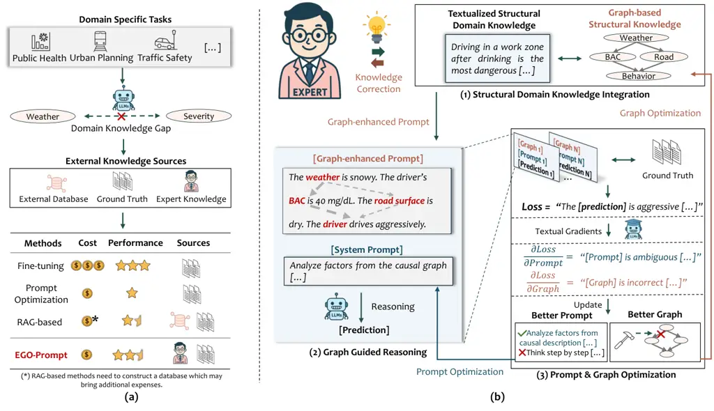
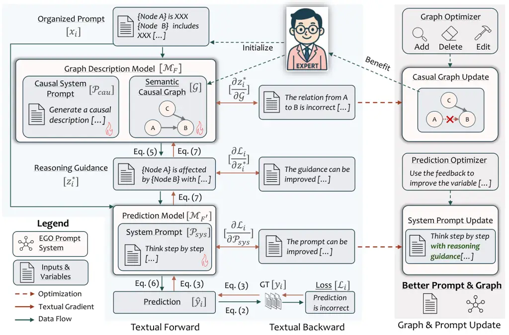
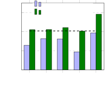
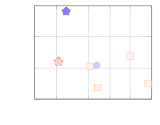

# How to Auto-optimize Prompts for Domain Tasks? Adaptive Prompting and Reasoning through Evolutionary Domain Knowledge Adaptation

Yang Zhao Affiliation: Johns Hopkins University    Pu Wang
Affiliation: {yzhao229, pwang80, haofrankyang}@jhu.edu    Hao Frank Yang
^(†)^(†)thanks: Corresponding author. Affiliation: Project page:
[https://miemieyanga.github.io/EGOPrompt/](https://miemieyanga.github.io/EGOPrompt/)

###### Abstract

Designing optimal prompts and reasoning processes for large language
models (LLMs) on domain-specific tasks is both necessary and challenging
in real-world applications. Determining how to integrate domain
knowledge, enhance reasoning efficiency, and even provide domain experts
with refined knowledge integration hints are particularly crucial yet
unresolved tasks. In this research, we propose Evolutionary Graph
Optimization for Prompting (EGO-Prompt), an automated framework to
designing better prompts, efficient reasoning processes and providing
enhanced causal-informed process. EGO-Prompt begins with a general
prompt and fault-tolerant initial Semantic Causal Graph (SCG)
descriptions, constructed by human experts, which is then automatically
refined and optimized to guide LLM reasoning. Recognizing that
expert-defined SCGs may be partial or imperfect and that their optimal
integration varies across LLMs, EGO-Prompt integrates a novel
causal-guided textual gradient process in two steps: first, generating
nearly deterministic reasoning guidance from the SCG for each instance,
and second, adapting the LLM to effectively utilize the guidance
alongside the original input. The iterative optimization algorithm
further refines both the SCG and the reasoning mechanism using textual
gradients with ground-truth. We tested the framework on real-world
public health, transportation and human behavior tasks. EGO-Prompt
achieves 7.32%–12.61% higher F1 than cutting-edge methods, and allows
small models to reach the performence of larger models at under 20% of
the original cost. It also outputs a refined, domain-specific SCG that
improves interpretability.

## 1 Introduction

Foundation models, particularly Large Language Models (LLMs), are
increasingly being adapted for domain-specific tasks, providing
reasoning and decision support across real-world applications, such as
public health \[1, 2, 3\], transportation \[4, 5, 6, 7\], medical
treatment \[8, 9\], and robotics \[10, 11, 12\]. For these models to be
used effectively in particular domains, additional task adaptations are
usually necessary. Prompt engineering has emerged as the primary,
flexible, and cost-effective method for this adaptation \[4, 13, 14, 15,
16\]. In this process, domain experts generally incorporate specialized
knowledge and priors into prompt design by structuring the prompts and
excluding irrelevant information to enhance the reasoning process.
However, experts can also inadvertently introduce assumptions,
mechanisms, even biases in prompt engineering \[17, 18\]. Therefore,
critical questions arise – how can we optimize prompts and reasoning
procedures, and discover better combinations that integrate structured
domain knowledge for domain-specific tasks? Furthermore, how can we
automate this prompt-and-reasoning optimization?

Seeking the potentially better prompt and reasoning procedure for
domain-specific tasks without fine-tuning involves three challenges: 1)
Domain-knowledge Adaptation involves organizing extensive domain
knowledge in textual form to maximize task performance while minimizing
bias \[19, 20\]. For example, in traffic crash modeling \[4, 21\], LLMs
must consider a broad range of textual inputs, including driver
attributes, vehicle characteristics, infrastructure conditions,
environmental factors, and driving behaviors, etc. Although these
elements are represented in text, factors such as word choice,
linguistic description, level of detail, and paragraph organization can
influence how effectively the model learns and reasons about the domain. 2) Optimal Domain-adaptive Reasoning recognizes that even with
high-quality textual descriptions, physical priors still play a crucial
role. Domain-specific conditional distributions and causal graphs
strongly influence the reasoning process and performance \[22\].
Leveraging these priors can further guide the reasoning procedure,
resulting in a more efficient overall process \[23\]. Without explicit
guidance, LLMs may overlook key domain relationships \[19\], leading to
hallucinations or outputs lacking verifiable evidence. To bridge the gap
between a model’s general reasoning abilities and the domain-specific
priors needed for robust inference, it is crucial to incorporate causal
structures and other form of domain representations. 3) Task
Evolutionary then considers whether LLMs can continue refining their
reasoning once domain knowledge and causal relations are effectively
integrated. For instance, can active knowledge or ground truth data help
a domain-adaptive prompt match or surpass state-of-the-art legacy
models? If so, the resulting improved domain knowledge and causal
relations can further support evolving domain knowledge and uncover
hidden factors, thereby reinvigorating expert-driven research.

In response, a promising approach is to leverage graph-based structural
domain knowledge to guide both prompt design and the reasoning process
\[24\]. Graph data offers explicit representations of entities and their
conditional relationships, capturing key domain features correlations,
whether factual (e.g., alcohol involvement increases crash severity
regardless of consumption level) or causal (e.g., how alcohol
consumption, road-surface conditions, and other factors jointly affect
crash severity). By integrating these explicit relational structures,
LLMs can better connect textual descriptions to domain-specific causal
dependencies, reducing the likelihood of overlooked relationships or
unsupported conclusions. Recent work has explored knowledge and causal
graphs to enhance LLM reasoning \[24, 25, 26\], often via
Retrieval-Augmented Generation (RAG) \[27, 28, 29\], which retrieves
relevant subgraphs or facts to guide the model during inference \[24,
25\]. While this line of research is promising, there remain critical
challenges for adaptive reasoning:

1.  1.  Limited and Incomplete Domain Knowledge and Graphs. In real-world
        settings, domain experts often have access only to partial knowledge
        or graphs for prompt design and reasoning \[30\]. However, many
        methods assume the availability of fully curated knowledge or causal
        graphs \[26, 31\], which is an unrealistic and task-inflexible
        requirement (e.g., in RAG scenarios where no relevant knowledge
        graphs exist).
2.  2.  Interpretability and Knowledge Refinement. Information in external
        graph databases may be inaccurate, yet existing methods often treat
        it as a ground-truth reference, potentially leading to performance
        degradation \[18, 32, 33\].
3.  3.  Fixed External Priors. Many current methods depend on fixed,
        external graph databases that can lack coverage or fail to actively
        evolve with the domain, limiting their adaptability to emerging
        contexts or newly available information \[24, 25, 26\].
4.  4.  Automated Evolution. In existing methods, the interaction is
        typically one-way: external knowledge is used to strengthen LLM
        reasoning, but the model does not feed back corrections or
        enhancements to the experts. As a result, experts must invest
        additional effort to extract new insights from the model’s outputs
        \[24, 25, 26\].

Given these constraints, effectively adapting LLMs to novel tasks often
requires an active process of graph integration and evolution for
improved prompt design and reasoning. In this research, we propose
EGO-Prompt (Evolutionary Graph Optimization for Prompt) for
evolutionarily incorporating domain structural knowledge into more
effective reasoning in LLMs. As shown in Figure 1, we begin by
representing expert knowledge as an active, expert-constructed Semantic
Causal Graph (SCG) $`\mathcal{G}`$. EGO-Prompt then decomposes the
graph-guided reasoning process into two stages: 1) Generating
instance-specific reasoning guidance $`z^{\!*}(x,\mathcal{G})`$ derived
from the SCG $`\mathcal{G}`$ and the input data $`x`$, subject to output
constraints, and 2) Performing reasoning conditioned on this guidance.
This process can be abstracted as the following equation:

```math
\displaystyle p(y\mid x,\mathcal{G})\;=\;p\bigl(y\mid x,\overbrace{z^{\!*}(x,\mathcal{G})}^{\mathclap{\text{Instance-specific Reasoning Guidance}}}) \tag{1}
```

where $`y`$ is the target reasoning result. The derivation is provided
in Appendix 8.1. With this reasoning workflow, both the SCG and the
reasoning process are then jointly refined through an evolutionary
optimization algorithm that learns factual patterns from ground-truth
data. This dynamic adaptation not only enhances the model’s reasoning
accuracy but also improves the quality of the SCG and its alignment with
the prompt. Experiments across three domain-specific tasks demonstrate
that EGO-Prompt consistently outperforms previous methods, achieving an
average F1 improvement of 7.32%–12.61% over the strongest baseline.
Moreover, EGO-Prompt enhances the performance of lightweight models such
as GPT-4o mini, surpassing reasoning models like o4-mini and o1, despite
their inference costs being 6 to 140 times higher.



Figure 1: Overview of the proposed EGO-Prompt. (a) LLMs often struggle
with domain-specific tasks due to the optimal prompt design and domain
knowledge gap. Existing methods rely on the external database or
established graph. In comparison, EGO-Prompt evolutionarily incorporates
expert knowledge with minimal cost. (b) We represent external knowledge
as a graph-based structure. A graph-enhanced prompt is then generated to
guide the LLM’s reasoning. Both the graph and the prompt are iteratively
optimized using textual gradients from ground-truth data.

## 2 Related Works

#### Generalized Multi-step Reasoning.

Currently, enhancing the multi-step reasoning capabilities of LLMs is
primarily achieved through two turning-free approaches \[34\]: 1)
In-Context Learning (ICL) \[35, 36, 37\] and Chain-of-Thought (CoT)
\[14, 15, 38\], 2) Prompt Optimization \[39, 40\]. The open-ended nature
of the reasoning space in ICL makes identifying optimal demonstrations
and paths challenging \[38, 41\]. Prompt optimization aims to find the
best prompt to guide LLMs towards better reasoning, with Automatic
Prompt Optimization (APO) automating this process through candidate
generation, evaluation, and filtering \[13, 42\]. A recent APO
framework, TextGrad \[16\], draws inspiration from deep learning
optimization methods (e.g., PyTorch \[43\]). However, it is highly prone
to overfitting the training set after several iterations, where the
adjusted prompt focuses on case-by-case details rather than general
feature distribution.

Recent works have also explored using Reinforcement Learning (RL) to
edit and optimize prompts for LLM reasoning \[44, 45, 46, 47, 48, 49,
50, 51, 52\]. TEMPERA \[46\] employs an attention-based policy model to
edit prompts for LLMs and uses the logits difference between the LLM’s
predictions and the ground truth \[45\] as the reward function to
fine-tune the policy. This approach effectively improves performance by
producing higher-quality prompts. However, such methods rely on access
to the model’s logits during training. Recent studies have extended this
RL framework to black-box LLMs by adopting logit-free reward designs
\[50, 49\]. While these RL methods can be more stable after careful
fine-tuning compared to APO methods (thanks to their numerical
optimization framework) they still require fine-tuning a policy model.
Importantly, the policy model must be reasonably strong, ideally not
much weaker than the target LLM (typically 7B parameters or larger),
which imposes substantial demands on fine-tuning expertise and
computational resources. In our tasks, the motivation is to leverage
available LLMs for better adaptation to domain-specific applications
(e.g., public health, transportation), where end users are often domain
experts with limited access to large-scale computation.

|                          |                     |                        |                           |                  |                          |                  |
| ------------------------ | ------------------- | ---------------------- | ------------------------- | ---------------- | ------------------------ | ---------------- |
|                          | Prompt Engineering  |                        | Domain Knowledge Database |                  | Graph-Enhanced Reasoning |                  |
|                          | Manual Optimization | Automated Optimization | Knowledge Reference       | Active Knowledge | Reasoning Guidance       | Graph Correction |
| RAG \[27\]               | ✓                   |                        | ✓                         |                  |                          |                  |
| ICL \[35\]               | ✓                   |                        |                           |                  |                          |                  |
| Zero-Shot-CoT \[14\]     | ✓                   |                        |                           |                  |                          |                  |
| APE \[13\]               | $`\triangle`$       | ✓                      |                           |                  |                          |                  |
| ProTeGi \[42\]           | $`\triangle`$       | ✓                      |                           |                  |                          |                  |
| CoK \[31\]               | ✓                   |                        | ✓                         |                  |                          |                  |
| Li et al. \[24\]         | ✓                   |                        | ✓                         |                  |                          |                  |
| RoG \[25\]               | ✓                   |                        | ✓                         |                  | ✓                        |                  |
| PHP \[37\]               | ✓                   |                        |                           |                  |                          |                  |
| $`G^{2}`$-Reasoner\[26\] | ✓                   |                        | ✓                         |                  | ✓                        |                  |
| TextGrad \[16\]          | $`\triangle`$       | ✓                      |                           |                  |                          |                  |
| Luo et al. \[53\]        | ✓                   | ✓                      | ✓                         |                  | ✓                        |                  |
| EGO-Prompt               | $`\triangle`$       | ✓                      | ✓                         | ✓                | ✓                        | ✓                |

Table 1: Taxonomy of related literature. The $`\checkmark`$ represents
the technique is used or implemented by the method. The $`\triangle`$
means the method needs manual designed prompts as seeds to start the
optimization process.

#### Domain Adaptive Reasoning.

LLMs often need external knowledge for effective reasoning in applicable
or evolving domains (e.g., robotics \[10\], public health modeling
\[1\], urban planning \[54, 55\], traffic safety \[4, 56\], autonomous
driving \[57, 58\]). Retrieval-Augmented Generation (RAG) \[27\] is one
of the solutions by retrieving relevant information from a corpus based
on the input query. However, suitable text corpora are not always
available, and simply incorporating retrieved text does not guarantee
improved reasoning processes \[59\]. To address this, structured
knowledge representations like Knowledge Graphs and Causal Graphs offer
promising alternatives. Knowledge Graph can explicitly represent
entities and relations, enabling more structured reasoning guidance
compared to raw text retrieval. Existing methods focus on retrieve
related paths from knowledge graph database to guide LLMs’ reasoning
\[24, 31\]. Causal Graph, in particular, offer detailed causal
information distinct from general KGs \[53, 60\]. Most existing
mentioned graph integration methods are static, utilizing pre-defined
graph database, which limits the generalization capabilities of LLMs and
may introduce biases originating from domain-specific graphs (see Table
1). Therefore, the primary objective of this research is to develop an
evolutionary information integration approach that organically merges
structural graph priors with the flexibility of textual information,
thereby enabling an optimal reasoning process for real-world domain
applications.

## 3 Prompt Optimization through Textual Gradients

Textual gradients is one type of automatic prompt optimization method
that leverages the natural language feedback generated by LLMs to
iteratively refine and enhance various components of AI systems \[42,
16\]. The core idea is to emulate the forward-backward learning paradigm
in deep learning frameworks such as PyTorch \[43\], enabling the system
to update prompts through a loop of evaluation and revision. The entire
process can be divided into a textual forward and a textual backward
phase \[61\]:

Textual Forward. For a classification task, given a system prompt
$`\mathcal{P}_{\text{sys}}`$, input data $`x_{i}`$, and its
corresponding label $`y_{i}`$, the forward model $`\mathcal{M}_{F}`$
generates a prediction
$`\hat{y}_{i}=\mathcal{M}_{F}(x_{i};\mathcal{P}_{\text{sys}})`$.

Textual Backward. Distinct from traditional numerical learning
frameworks, the textual gradients method \[42, 16\] leverages a
text-based loss function $`\mathcal{L}`$ to evaluate the alignment
between the prediction $`\hat{y}_{i}`$ and the ground truth $`y_{i}`$.
For example:

```math
\mathcal{L}(\hat{y}_{i},y_{i})=\begin{cases}\texttt{"Prediction matches the ground truth."},&\text{if }\hat{y}_{i}=y_{i}\\
\texttt{"Prediction does not match."},&\text{otherwise}\end{cases} \tag{2}
```

In conventional deep learning frameworks such as PyTorch \[43\],
gradients are computed numerically and used to update parameters via
gradient descent. In contrast, textual gradients emulate this process by
using LLMs to generate natural language feedback that guides prompt
revision such as The prompt can be improved by \[strategies\]. The
textual gradient of $`\mathcal{P}_{\text{sys}}`$ with respect to the
loss is defined as:

```math
\displaystyle\nabla_{\mathcal{P}_{\text{sys}}}\mathcal{L}_{i} \displaystyle=\frac{\partial\mathcal{L}_{i}}{\partial\mathcal{P}_{\text{sys}}}=\frac{\partial\mathcal{L}_{i}}{\partial\hat{y}_{i}}\cdot\frac{\partial\hat{y}_{i}}{\partial\mathcal{P}_{\text{sys}}}\quad\text{(Chain Rule)} \tag{3}
```

```math
\displaystyle=\mathcal{M}_{B}\!\left(\mathcal{P}_{\text{sys}},\hat{y}_{i},\frac{\partial\mathcal{L}_{i}}{\partial\hat{y}_{i}}\right)\quad\text{(Implementation)},
```

where $`\mathcal{M}_{B}`$ denotes the textual backward engine, typically
stronger than the forward model $`\mathcal{M}_{F}`$. The system prompt
for the $`\mathcal{M}_{B}`$ is omitted here. The quantity
$`\frac{\partial\mathcal{L}_{i}}{\partial\hat{y}_{i}}=\mathcal{M}_{B}(\hat{y}_{i},\mathcal{L}_{i})`$
represents the feedback generated by the backward engine, indicating the
improvement direction for the predictions. This gradient follows from
the chain rule and can be accumulated across iterations by concatenating
past gradients \[16\]. The updated system prompt
$`\mathcal{P}_{\text{sys}}^{\prime}`$ is then obtained by applying the
textual gradient:

```math
\mathcal{P}_{\text{sys}}^{\prime}=\mathcal{M}_{B}(\mathcal{P}_{\text{sys}},\nabla_{\mathcal{P}_{\text{sys}}}\mathcal{L}_{i}) \tag{4}
```

## 4 Domain-Specific Reasoning with Expert Knowledge Guidance

### 4.1 Human-guided Graph Initialization

#### Textualization of Raw Data.

Domain-specific tasks often involve knowledge and information in
heterogeneous formats, such as numerical, textual and tabular data.To
enable LLMs to process the structured data, a common first step is to
construct manually designed templates that convert relevant information
into textual prompts \[1, 4\]. Prompt 4.1 shows an example of partial
prompt used in crash prediction task. The full prompt can be found in
the Appendix 8.7.


Graph Establishment. To better leveraging the reasoning process of LLMs
with causal information, we propose the Semantic Causal Graph (SCG) as a
Directed Acyclic Graph (DAG), where nodes represent entities or events
extracted from the organized prompt, and edges denote causally-related
semantic relations inferred from expert knowledge. Since this graph is
not used for strict causal inference, we do not require it to satisfy
the causal Markov assumption or the faithfulness assumption \[62\].
Formally, SCG for a domain-specific task can be represented as
$`\mathcal{G}=\{(n_{i},r_{ij},n_{j})\mid n_{i},n_{j}\in\mathcal{N},\ r_{ij}\in\mathcal{R}\}`$,
where $`\mathcal{N}`$ is the set of semantic nodes and $`\mathcal{R}`$
is the set of semantic causal relations. Each node
$`n_{i}\in\mathcal{N}`$ corresponds to a information block extracted
from the organized prompt. Each edge $`r_{ij}\in\mathcal{R}`$ denotes a
directed causal relation from $`n_{i}`$ to $`n_{j}`$, capturing the
semantic causal link between them as expressed in natural language. In
EGO-Prompt, the initial construction of the SCG relies on expert
knowledge or external data analysis.

The biggest difference between the proposed work and most existing works
is that the original input of the SCG does not need to be perfectly
accurate or complete, given the evolutionary process of graph growth.
Automatic correction will be involved and discussed in the Section 6.2.
Below is an example SCG prompt for the crash prediction task and a full
SCG is shown in the Appendix 8.8.


### 4.2 Reasoning with Instance-specific Guidance



Figure 2: The optimization process of EGO-Prompt. The graph model
generates reasoning guidance from the SCG and input prompt, which the
prediction model uses to produce an output. Textual gradients are used
to update the system prompt and refine the SCG through targeted
operations.

Given the expert-constructed SCG $`\mathcal{G}`$, our goal is to
maximize the likelihood of the ground-truth label $`y`$ conditioned on
the input $`x`$ and $`\mathcal{G}`$, i.e. $`p(y\mid x,\mathcal{G})`$.
Because $`\mathcal{G}`$ is a global description that (i) always contains
information irrelevant to the current case and (ii) can be partially
missing for a particular instance (e.g. the BAC field may be None in
Prompt 4.1), feeding it directly to the predictor is sub-optimal.
Instead, as shown in Eq. (1), we first distill instance-specific
reasoning guidance, denoted $`z^{\!*}(x,\mathcal{G})`$, from the graph
$`\mathcal{G}`$ based on the input $`x`$. This guidance is then used for
predicting the final results. As shown in Fig. 2, a graph description
model $`\mathcal{M}_{F}`$ produces the reasoning guidance
$`z^{\!*}_{i}`$ for each input $`x_{i}`$:

```math
z^{\!*}_{i}\;=\;\mathcal{M}_{F}~\!\bigl(x_{i};\,\mathcal{P}_{\text{cau}},\mathcal{G}\bigr), \tag{5}
```

where $`\mathcal{P}_{\text{cau}}`$ is a causal-system prompt steering
$`\mathcal{M}_{F}`$ to ground its deterministic generation process with
$`x_{i}`$ and $`\mathcal{G}`$. The predictor
$`\mathcal{M}_{F^{\prime}}`$ then reasons jointly over $`x_{i}`$ and
$`z^{\!*}_{i}`$:

```math
\hat{y}_{i}\;=\;\mathcal{M}_{F^{\prime}}~\!\bigl(x_{i},z^{\!*}_{i};\,\mathcal{P}_{\text{sys}}\bigr), \tag{6}
```

with $`\mathcal{P}_{\text{sys}}`$ instructing
$`\mathcal{M}_{F^{\prime}}`$ to integrate the original description and
the generated reasoning guidance. This two-stage factorization filters
out extraneous or missing details in $`\mathcal{G}`$ while preserving
its causal structure, yielding cleaner and more informative context for
the final prediction (see Section 6.1).

### 4.3 Optimizing SCG and Reasoning Process Through Textual Gradients

Optimization through Textual Gradients. Ideally, a well-constructed SCG
and an effective system prompt can substantially enhance the model’s
reasoning process and predictive performance. However, the performance
may vary due to two issues: (1) the SCG is incomplete or flawed, and (2)
the system prompt fails to guide the model effectively. To address this,
we innovated textual gradients method with graph priors \[16, 42\] to
update flawed SCGs and optimize the system prompt, thereby enabling more
effective SCG-based reasoning. We define the loss function
$`\mathcal{L}_{i}=\mathcal{L}(\hat{y}_{i},y_{i})`$ similar to Eq. (2) to
evaluate the difference between the final prediction $`\hat{y}_{i}`$ and
the ground truth $`y_{i}`$. To improve the system prompt, we compute its
textual gradients $`\nabla_{\mathcal{P}_{\text{sys}}}\mathcal{L}_{i}`$
using the chain rule in Eq. (3), which estimates how changes in the
system prompt $`\mathcal{P}_{\text{sys}}`$ influence the loss through
the model’s output. The textual gradients for the SCG $`\mathcal{G}`$
and the causal system prompt $`\mathcal{P}_{\text{cau}}`$ can be
formulated as:

```math
\nabla_{\mathcal{G}}\mathcal{L}_{i}=\nabla_{z^{\!*}_{i}}\mathcal{L}_{i}\cdot\frac{\partial z^{\!*}_{i}}{\partial\mathcal{G}},\nabla_{\mathcal{P}_{\text{cau}}}\mathcal{L}_{i}=\nabla_{z^{\!*}_{i}}\mathcal{L}_{i}\cdot\frac{\partial z^{\!*}_{i}}{\partial\mathcal{P}_{\text{cau}}} \tag{7}
```

where
$`\nabla_{z^{\!*}_{i}}\mathcal{L}_{i}=\frac{\partial\mathcal{L}_{i}}{\partial\hat{y}_{i}}\cdot\frac{\partial\hat{y}_{i}}{\partial z^{\!*}_{i}}`$
is the textual gradients for the reasoning guidance $`z^{\!*}_{i}`$.

1: $`P_{\text{sys}}^{0},P_{\text{cau}}^{0},\mathcal{G}^{0}`$, dataset
$`\mathcal{D}=\{(x_{i},y_{i})\}_{i=1}^{N}`$, steps $`T`$

2:
$`P_{\text{sys}},P_{\text{cau}},\mathcal{G}\leftarrow P_{\text{sys}}^{0},P_{\text{cau}}^{0},\mathcal{G}^{0}`$

3: Test on validation set and get F1
$`f\leftarrow\text{F}_{1}(P_{\text{sys}},P_{\text{cau}},\mathcal{G};\mathcal{D})`$

4: for $`t=1`$ to $`T`$ do

5:    Sample $`(x_{i},y_{i})\sim\mathcal{D}`$; derive reasoning guidance
$`z^{\!*}_{i}`$ (Eq. (5))

6:
   $`\hat{y}_{i}\leftarrow\text{Eq.}~\eqref{eq:pred}`$; $`\mathcal{L}_{i}\leftarrow\text{Eq.}~\eqref{eq:textloss}`$

7:
   $`(\nabla_{\text{sys}},\nabla_{\text{cau}},\nabla_{\text{SCG}})\leftarrow\text{Eqs.}~\eqref{eq:textgrad}\text{ and }\eqref{eq:tg_SCG}`$

8: Stage 1: Update system prompt

9:
   $`P^{\prime}_{\text{sys}}\leftarrow\operatorname{Apply}(P_{\text{sys}},\nabla_{\text{sys}})`$

10:
   $`f^{\prime}\leftarrow\text{F}_{1}(P^{\prime}_{\text{sys}},P_{\text{cau}},\mathcal{G})`$

11:    if $`f^{\prime}>f`$ then
$`P_{\text{sys}},f\leftarrow P^{\prime}_{\text{sys}},f^{\prime}`$

12:    end if

13: Stage 2: Update SCG & causal prompt

14:
   $`P^{\prime}_{\text{cau}}\leftarrow\operatorname{Apply}(P_{\text{cau}},\nabla_{\text{cau}})`$;
$`\mathcal{G}^{\prime}\leftarrow\operatorname{Apply}(\mathcal{G},\nabla_{\text{SCG}})`$

15:
   $`f^{\prime}\leftarrow\text{F}_{1}(P_{\text{sys}},P^{\prime}_{\text{cau}},\mathcal{G}^{\prime})`$

16:    if $`f^{\prime}>f`$ then
$`(P_{\text{cau}},\mathcal{G},f)\leftarrow(P^{\prime}_{\text{cau}},\mathcal{G}^{\prime},f^{\prime})`$

17:    end if

18: end for

19: return $`(P_{\text{sys}},\mathcal{G},P_{\text{cau}})`$

Algorithm 1 EGO-Prompt Iterative Optimization

With textual gradients, the system prompt, SCG, and causal system prompt
can be updated based on Eq. (4). As shown in Figure 2, SCG refinement is
constrained to three operations: (1) Add a node from the candidate set
$`\mathcal{N}`$ with its causal description and links; (2) Delete a node
and its associated descriptions; and (3) Edit existing descriptions
which is incorrect or unnecessary.

#### Iterative Optimization.

The goal of the proposed optimization is to identify the optimal system
prompt $`\mathcal{P}_{\text{sys}}`$, SCG $`\mathcal{G}`$, and causal
system prompt $`\mathcal{P}_{\text{cau}}`$. These components are
co-optimized by two optimizers in our framework (see Figure 2), each
governed by distinct update rules. Performing all updates with a single
LLM in a single iteration may lead to suboptimal performance due to
conflicting update signals. Therefore, we adopt an iterative
optimization strategy that updates the SCG and prompt components
separately. One component is updated only when it yields an individual
performance improvement while the other component is fixed. We perform a
fixed number of optimization steps per task. The full optimization
procedures are shown in Algorithm 1.

## 5 Experiments on Three Domain Tasks

Experimental Objectives for Testing the Proposed EGO Prompt. We evaluate
the proposed EGO Prompt based on three main criteria: 1) Performance
Improvement: compare the performance of EGO Prompt with existing
prompt-optimization frameworks to determine whether it yields better
results. 2) Generalization: assess how well EGO Prompt generalizes
across a wide range of real-world tasks on diverse LLM model zoos \[63,
64\]. 3) Efficiency and Cost-Effectiveness: examine whether a
smaller-parameter, lower-reasoning-capacity model (e.g., GPT-4o mini)
can achieve comparable performance to a larger model (e.g., o4-mini or
o1) after optimization using EGO Prompt. Measure the resulting cost
savings relative to the performance level of the larger model.

### 5.1 Datasets for Public Health, Transportation, and Human Behavior Modeling

To assess the generalization and cross-domain adaptivity of EGO Prompt,
we evaluate its performance using three real-world applications with
publicly available datasets: Pandemic \[1\], TrafficSafe \[4\], and
Swissmetro \[65\]. These datasets span the domains of public health,
traffic safety, and human behavior, respectively. LLMs have been
extensively utilized in these domains due to their capability to
interpret complex textual inputs (e.g., crash reports) and generalize
knowledge across diverse scenarios (e.g., from COVID-19 to future
pandemics). Specifically, as shown in table in Table 2: 1) Public
Health - Pandemic Hospitalization Dataset \[1, 66\] consists of textual
descriptions for forecasting pandemic hospitalization trends. It is
constructed from CDC COVID-19 reports \[67\], reformulated into
human-designed prompts. Each instance includes demographic information,
COVID-19 case counts, vaccination rates, and hospitalization patterns
for individual states, with the target variable being the
hospitalization trend for the subsequent week. 2) Crash Modeling for
Transportation – TrafficSafe Dataset \[4, 68, 69, 70, 71\] comprises
structured textual records derived from real-world crash reports across
the United States \[72\]. Each entry provides details about crash time,
location, weather conditions, road surface conditions, vehicle
maneuvers, and driver behaviors, paired with the corresponding crash
severity outcomes. 3) Human Behavior Modeling – Travel Mode Choice
Dataset \[65, 73\] originates from a stated-preference survey conducted
in Switzerland. It presents respondents with hypothetical travel
scenarios, prompting them to choose between Swissmetro, traditional
trains, and cars based on various factors including travel time, cost,
and comfort.

|                   |                |                        |                                                                                                  |              |
| ----------------- | -------------- | ---------------------- | ------------------------------------------------------------------------------------------------ | ------------ |
| Dataset           | Domain         | Prediction Targets     | Domain Task labels                                                                               | Dataset Size |
| Pandemic \[1\]    | Public Health  | Pandemic Trends        | substantial decreasing, moderate decreasing, stable, moderate increasing, substantial increasing | 5,200        |
| TrafficSafe \[4\] | Traffic Safety | Traffic Crash Severity | no apparent injury, minor injury, serious injury, fatal                                          | 16,188       |
| Swissmetro \[65\] | Human Behavior | Travel Mode Choice     | swissmetro, car, train                                                                           | 10,728       |

Table 2: Overview of the Datasets Employed in This Study.

### 5.2 Settings

Experimental Settings. Following prior work on automatic prompt
optimization \[16, 42\], we randomly sample a balanced subset from each
dataset: 100 instances for validation, 100 for testing, and the rest for
training. Due to the inherent stochasticity of LLM API calls (see
Section 8.5), we repeat each experiment three times and report the best
result to represent the achievable upper-bound performance under
identical settings (same random seed). We report weighted F1 and
accuracy, using a batch size 3 to perform 6 to 12 optimization steps per
task.

Models. We use gpt-4o-2024-08-06 \[63\] as the backward engine
$`\mathcal{M}_{B}`$ across all experiments, as it is considered more
powerful than the forward engine \[74\]. For the forward engine
$`\mathcal{M}_{F}`$, we evaluate several mainstream commercial models
\[63, 64\], including gpt-4o-mini-2024-07-18, gpt-4.1-mini-2025-04-14,
gemini-2.0-flash, and gemini-2.5-flash-preview-04-17. The graph
description model $`\mathcal{M}_{F^{\prime}}`$ is always set to be the
same as $`\mathcal{M}_{F}`$.

Baseline Methods. We compare our approach against two APO methods: 1)
ProTeGi \[42\]. ProTeGi is the first framework to use natural language
“gradients” to generate feedback for prompt optimization, combining beam
search with bandit-based selection to identify the optimal prompts. 2)
TextGrad \[16\]. This method is introduced in Section 3. We further
incorporate three prompt engineering methods: 3) Zero-Shot-CoT approach
\[14\], which enables step-by-step reasoning without in-context
examples; 4) PHP \[37\], which progressively integrates historical model
predictions as hints appended to the prompt to guide reasoning; and 5)
Auto-CoT \[75\], which is an automatic prompting method that generates
diverse CoT demonstrations using LLMs. RAG-based methods are excluded
due to the lack of accessible domain-specific graph databases for our
datasets. We also include the 6) Expert Organized Prompt, which uses the
original input (specifically, the initial $`x_{i}`$ and
$`\mathcal{P}_{\text{sys}}`$) to make direct predictions.

### 5.3 Results Comparison and Summary

#### Comparison with Cutting-edge Baselines.

Table 3 shows the performance of EGO-Prompt compared to baselines on the
Pandemic, TrafficSafe, and Travel Mode Choice datasets. EGO-Prompt
consistently outperforms all methods, achieving average F1 gains of
7.32% with GPT-4o mini, 12.61% with Gemini 2.5 Flash, and 9.07% with
GPT-5-mini over the best baseline. In contrast, some methods such as
TextGrad show limited or even negative improvement in certain cases
(e.g., Pandemic with GPT-4o mini, F1 score only improve from 0.347 to
0.359). This is primarily attributed to the tendency of these methods to
overfit the validation set (e.g., potentially generating overly long
prompts with TextGrad), leading to a performance decline on the test
set.

|                  |                      |               |          |       |             |       |             |       |         |             |
| ---------------- | -------------------- | ------------- | -------- | ----- | ----------- | ----- | ----------- | ----- | ------- | ----------- |
| Forward Engine   | Method               | Venue/Journal | Pandemic |       | TrafficSafe |       | Mode Choice |       | Mean F1 |             |
|                  |                      |               | Acc      | F1    | Acc         | F1    | Acc         | F1    | Value   | Imp.        |
| GPT-4o mini      | Organized Prompt     | —             | 0.360    | 0.347 | 0.300       | 0.232 | 0.459       | 0.406 | 0.328   | —           |
|                  | Zero-Shot-CoT \[14\] | NeurIPS’22    | 0.370    | 0.361 | 0.280       | 0.221 | 0.494       | 0.435 | 0.339   | 3.2%        |
|                  | ProTeGi \[42\]       | EMNLP’23      | 0.370    | 0.361 | 0.370       | 0.304 | 0.529       | 0.481 | 0.382   | 16.3%       |
|                  | Auto-CoT \[75\]      | ICLR’23       | 0.380    | 0.352 | 0.320       | 0.220 | 0.447       | 0.462 | 0.345   | 5.0%        |
|                  | PHP \[37\]           | ICLR’24       | 0.330    | 0.327 | 0.320       | 0.268 | 0.376       | 0.370 | 0.322   | -2.0%       |
|                  | TextGrad \[16\]      | Nature’25     | 0.380    | 0.359 | 0.300       | 0.243 | 0.506       | 0.432 | 0.345   | 5.0%        |
|                  | EGO-Prompt           | This work     | 0.410    | 0.399 | 0.380       | 0.333 | 0.506       | 0.498 | 0.410   | 24.9% ^(\*) |
| Gemini 2.5 Flash | Organized Prompt     | —             | 0.470    | 0.470 | 0.340       | 0.319 | 0.459       | 0.392 | 0.394   | —           |
|                  | Zero-Shot-CoT \[14\] | NeurIPS’22    | 0.490    | 0.490 | 0.400       | 0.390 | 0.482       | 0.398 | 0.426   | 8.1%        |
|                  | ProTeGi \[42\]       | EMNLP’23      | 0.470    | 0.482 | 0.420       | 0.400 | 0.494       | 0.425 | 0.435   | 10.6%       |
|                  | Auto-CoT \[75\]      | ICLR’23       | 0.380    | 0.352 | 0.340       | 0.230 | 0.447       | 0.462 | 0.348   | 6.0%        |
|                  | PHP \[37\]           | ICLR’24       | 0.520    | 0.515 | 0.360       | 0.334 | 0.494       | 0.436 | 0.428   | 8.6%        |
|                  | TextGrad \[16\]      | Nature’25     | 0.470    | 0.483 | 0.380       | 0.374 | 0.494       | 0.428 | 0.428   | 8.6%        |
|                  | EGO-Prompt           | This work     | 0.540    | 0.546 | 0.430       | 0.428 | 0.518       | 0.499 | 0.491   | 24.6%       |
| GPT-5-mini       | Organized Prompt     | —             | 0.420    | 0.387 | 0.330       | 0.265 | 0.435       | 0.435 | 0.362   | —           |
|                  | Zero-Shot-CoT \[14\] | NeurIPS’22    | 0.430    | 0.415 | 0.330       | 0.281 | 0.424       | 0.428 | 0.375   | 3.4%        |
|                  | ProTeGi \[42\]       | EMNLP’23      | 0.420    | 0.413 | 0.320       | 0.267 | 0.471       | 0.454 | 0.378   | 4.4%        |
|                  | Auto-CoT \[75\]      | ICLR’23       | 0.410    | 0.408 | 0.310       | 0.280 | 0.506       | 0.470 | 0.386   | 6.6%        |
|                  | PHP \[37\]           | ICLR’24       | 0.430    | 0.397 | 0.320       | 0.240 | 0.435       | 0.431 | 0.356   | -1.8%       |
|                  | TextGrad \[16\]      | Nature’25     | 0.430    | 0.415 | 0.250       | 0.230 | 0.494       | 0.485 | 0.377   | 4.0%        |
|                  | EGO-Prompt           | This work     | 0.460    | 0.448 | 0.340       | 0.305 | 0.529       | 0.511 | 0.421   | 16.3%       |

- \*
  See Appendix 8.5 for the distribution.

Table 3: Performance comparison with baselines.



Figure 3: Mean F1 Score Across 3 Datasets.



Figure 4: Mean F1 Score and Mean Price with Reasoning Models.

#### Generalization.

EGO-Prompt also brings consistent improvements across different backbone
models. As shown in Figure 4, it enhances performance on all three tasks
when using GPT-4o mini, GPT-4.1 mini, GPT-5o mini, Gemini 2.0 Flash, and
Gemini 2.5 Flash as the forward engine. Specifically, EGO-Prompt
achieves relative F1 score gains ranging from 13.3% to 37.0% compared to
the organized prompt baseline, showing robust generalization capability
across both models and domains. See Appendix 8.2 for more results for
commercial and open-source models.

#### Efficiency and Cost-Effectiveness.

EGO-Prompt enables smaller LLMs to rival or exceed the accuracy of
larger, costlier models. As illustrated in Figure 4, EGO-Prompt
effectively boosts the average performance of compact models, matching
the effectiveness of the reasoning model o4-mini. Moreover, as shown in
Figure 4, the mean inference cost per 100 samples using EGO-Prompt is
only \$0.057, substantially lower than that of o4-mini (\$0.33) and
other reasoning models.

## 6 Analysis and Insights

### 6.1 Ablation Study

#### Instance-specific Reasoning Guidance.

The instance-specific reasoning guidance mechanism in Eq. (1) plays a
critical role in enhancing optimization effectiveness. As shown in
Table 4, removing the decomposition process in Eq. (1) and using a
single model leads to noticeably worse performance. Specifically, the F1
scores across the three tasks drop from 0.399, 0.333, and 0.498 to
0.397, 0.247, and 0.445, respectively.

|              |          |       |             |       |            |       |
| ------------ | -------- | ----- | ----------- | ----- | ---------- | ----- |
| Base Model   | Pandemic |       | TrafficSafe |       | Swissmetro |       |
|              | Acc      | F1    | Acc         | F1    | Acc        | F1    |
| Single Model | 0.390    | 0.397 | 0.340       | 0.247 | 0.482      | 0.445 |
| EGO-Prompt   | 0.410    | 0.399 | 0.380       | 0.333 | 0.506      | 0.498 |

Table 4: Ablation Study of Instance-specific Reasoning Guidance. GPT-4o
mini is used for all the ablation study and analysis experiments.

#### Model Components.

We conduct an ablation study to evaluate the contribution of the graph
description model (with variables $`\mathcal{G}`$ and
$`\mathcal{P}_{\text{cau}}`$) and the prediction model (with variable
$`\mathcal{P}_{\text{sys}}`$) to the overall performance. As shown in
Table 5, our full framework, where both components are used and updated
during optimization, achieves the best performance across all three
tasks. Fixing either the graph description model or the prediction model
leads to noticeable performance drops. Furthermore, removing the graph
description model entirely (i.e., only using the prediction model,
similar to the TextGrad method \[16\]) results in consistently lower F1
scores.

|                                                |                              |          |       |             |       |            |       |
| ---------------------------------------------- | ---------------------------- | -------- | ----- | ----------- | ----- | ---------- | ----- |
| $`\mathcal{G}`$ & $`\mathcal{P}_{\text{cau}}`$ | $`\mathcal{P}_{\text{sys}}`$ | Pandemic |       | TrafficSafe |       | Swissmetro |       |
|                                                |                              | Acc      | F1    | Acc         | F1    | Acc        | F1    |
|                                                | ✓                            | 0.380    | 0.359 | 0.300       | 0.243 | 0.506      | 0.432 |
| $`\triangle`$                                  | ✓                            | 0.370    | 0.337 | 0.270       | 0.246 | 0.471      | 0.418 |
| ✓                                              | $`\triangle`$                | 0.370    | 0.354 | 0.330       | 0.257 | 0.471      | 0.418 |
| ✓                                              | ✓                            | 0.410    | 0.399 | 0.380       | 0.333 | 0.506      | 0.498 |

Table 5: Ablation Study of Model Components. A checkmark (✓) indicates
the component is used and updated during optimization, while a triangle
($`\triangle`$) indicates it is used but kept fixed.

#### Iterative Optimization.

We conduct an ablation study to assess the effectiveness of our
optimization strategy by comparing three variants: (1) removing the
optimization process entirely (W/O Opt.), (2) disabling the iterative
optimization process (W/O Iterative Opt.), and (3) using the full
strategy in EGO-Prompt. As shown in Table 6, the absence of optimization
results in reduced performance, with F1 scores dropping to 0.359, 0.293,
and 0.434 on three tasks, respectively. When iterative refinement is
removed, the F1 scores are moderately improved (0.369, 0.272, and 0.447)
but still lag behind the full model.

|                    |          |       |             |       |            |       |
| ------------------ | -------- | ----- | ----------- | ----- | ---------- | ----- |
| Base Model         | Pandemic |       | TrafficSafe |       | Swissmetro |       |
|                    | Acc      | F1    | Acc         | F1    | Acc        | F1    |
| W/O Opt.           | 0.360    | 0.359 | 0.340       | 0.293 | 0.471      | 0.434 |
| W/O Iterative Opt. | 0.410    | 0.369 | 0.310       | 0.272 | 0.447      | 0.447 |
| EGO-Prompt         | 0.410    | 0.399 | 0.380       | 0.333 | 0.506      | 0.498 |

Table 6: Ablation Study of Iterative Optimization.

### 6.2 Automatic SCG Correction

Figure 5: Automatic SCG Correction for the Pandemic Dataset. Green line
denotes newly added relations; red dash denotes deleted relation.

EGO-Prompt automatically refines a human-designed SCG during iterative
optimization by restricting the graph description updates to three
operations: addition, deletion, and modification of causal description.
These targeted updates correct biases or flaws in the expert-constructed
SCG, guided by ground-truth data. Figure 5 illustrates this correction
process on the Pandemic dataset, where EGO-Prompt identifies and
incorporates missing connections (e.g., from Healthcare System Condition
to Hospitalization per 100k) and removes weak or incorrect ones (e.g.,
from Demographic Information to Restriction Policy Response). The system
prompt is also co-optimized throughout this process. Additional
corrected SCGs and adjusted system prompts for other datasets are
provided in Appendix 8.9.

## 7 Conclusion

We propose a novel method called EGO-Prompt, which integrates expert
knowledge to enhance the adaptivity and interpretability of LLMs for
domain-specific tasks. By decomposing graph-based reasoning into two
stages: generation of reasoning guidance and model reasoning conditioned
on that guidance, EGO-Prompt not only outperforms existing prompt
optimization baselines, but also enables automatic correction of the SCG
and refinement of the reasoning process. In future work, EGO-Prompt
holds promise not only for a broader range of domain-specific
applications but also in other emerging directions such as Dynamic RAG
(real-time updates to the graph database), domain-specific knowledge
graph construction, and causal discovery. One noticeable limitation of
EGO-Promptis that it requires additional computational resources for
causal-guided textual gradient, especially when scaling to larger sample
sets. Another limitation is the results can be unstable due to API
variability and the inherent sensitivity of the Textual Gradients method
(see Appendix 8.5 and 8.6 for details).

## Acknowledgments

Yang Zhao acknowledge the fellowship from JHU + Amazon Initiative for
Interactive AI (AI2AI).

## References

- \[1\] Hongru Du, Jianan Zhao, Yang Zhao, Shaochong Xu, Xihong Lin,
  Yiran Chen, Lauren M Gardner, and Hao Frank Yang. Advancing real-time
  pandemic forecasting using large language models: A covid-19 case
  study. _arXiv preprint arXiv:2404.06962_, 2024.
- \[2\] Jianing Qiu, Kyle Lam, Guohao Li, Amish Acharya, Tien Yin Wong,
  Ara Darzi, Wu Yuan, and Eric J Topol. Llm-based agentic systems in
  medicine and healthcare. _Nature Machine Intelligence_,
  6(12):1418–1420, 2024.
- \[3\] Jan Clusmann, Fiona R Kolbinger, Hannah Sophie Muti, Zunamys I
  Carrero, Jan-Niklas Eckardt, Narmin Ghaffari Laleh, Chiara
  Maria Lavinia Löffler, Sophie-Caroline Schwarzkopf, Michaela Unger,
  Gregory P Veldhuizen, et al. The future landscape of large language
  models in medicine. _Communications medicine_, 3(1):141, 2023.
- \[4\] Yang Zhao, Pu Wang, Yibo Zhao, Hongru Du, and Hao Frank Yang.
  Safetraffic copilot: adapting large language models for trustworthy
  traffic safety assessments and decision interventions. _Nature
  Communications_, 16(1):8846, 2025.
- \[5\] Zijian Zhang, Yujie Sun, Zepu Wang, Yuqi Nie, Xiaobo Ma, Peng
  Sun, and Ruolin Li. Large language models for mobility in
  transportation systems: A survey on forecasting tasks. _arXiv preprint
  arXiv:2405.02357_, 2024.
- \[6\] Xusen Guo, Qiming Zhang, Junyue Jiang, Mingxing Peng, Meixin
  Zhu, and Hao Frank Yang. Towards explainable traffic flow prediction
  with large language models. _Communications in Transportation
  Research_, 4:100150, 2024.
- \[7\] Li Chen, Penghao Wu, Kashyap Chitta, Bernhard Jaeger, Andreas
  Geiger, and Hongyang Li. End-to-end autonomous driving: Challenges and
  frontiers. _IEEE Transactions on Pattern Analysis and Machine
  Intelligence_, 2024.
- \[8\] Arun James Thirunavukarasu, Darren Shu Jeng Ting, Kabilan
  Elangovan, Laura Gutierrez, Ting Fang Tan, and Daniel Shu Wei Ting.
  Large language models in medicine. _Nature medicine_,
  29(8):1930–1940, 2023.
- \[9\] Karan Singhal, Shekoofeh Azizi, Tao Tu, S Sara Mahdavi, Jason
  Wei, Hyung Won Chung, Nathan Scales, Ajay Tanwani, Heather Cole-Lewis,
  Stephen Pfohl, et al. Large language models encode clinical knowledge.
  _Nature_, 620(7972):172–180, 2023.
- \[10\] Jiaqi Wang, Enze Shi, Huawen Hu, Chong Ma, Yiheng Liu, Xuhui
  Wang, Yincheng Yao, Xuan Liu, Bao Ge, and Shu Zhang. Large language
  models for robotics: Opportunities, challenges, and perspectives.
  _Journal of Automation and Intelligence_, 2024.
- \[11\] Michael Ahn, Debidatta Dwibedi, Chelsea Finn, Montse Gonzalez
  Arenas, Keerthana Gopalakrishnan, Karol Hausman, Brian Ichter, Alex
  Irpan, Nikhil Joshi, Ryan Julian, et al. Autort: Embodied foundation
  models for large scale orchestration of robotic agents. _arXiv
  preprint arXiv:2401.12963_, 2024.
- \[12\] Bingqian Lin, Yunshuang Nie, Ziming Wei, Jiaqi Chen, Shikui Ma,
  Jianhua Han, Hang Xu, Xiaojun Chang, and Xiaodan Liang. Navcot:
  Boosting llm-based vision-and-language navigation via learning
  disentangled reasoning. _IEEE Transactions on Pattern Analysis and
  Machine Intelligence_, 47(7):5945–5957, 2025. doi:
  10.1109/TPAMI.2025.3554559.
- \[13\] Yongchao Zhou, Andrei Ioan Muresanu, Ziwen Han, Keiran Paster,
  Silviu Pitis, Harris Chan, and Jimmy Ba. Large language models are
  human-level prompt engineers. In _The Eleventh International
  Conference on Learning Representations_, 2022.
- \[14\] Takeshi Kojima, Shixiang Shane Gu, Machel Reid, Yutaka Matsuo,
  and Yusuke Iwasawa. Large language models are zero-shot reasoners.
  _Advances in neural information processing systems_,
  35:22199–22213, 2022.
- \[15\] Jason Wei, Xuezhi Wang, Dale Schuurmans, Maarten Bosma, Fei
  Xia, Ed Chi, Quoc V Le, Denny Zhou, et al. Chain-of-thought prompting
  elicits reasoning in large language models. _Advances in neural
  information processing systems_, 35:24824–24837, 2022.
- \[16\] Mert Yuksekgonul, Federico Bianchi, Joseph Boen, Sheng Liu, Pan
  Lu, Zhi Huang, Carlos Guestrin, and James Zou. Optimizing generative
  ai by backpropagating language model feedback. _Nature_,
  639(8055):609–616, 2025.
- \[17\] Aniket Vashishtha, Abbavaram Gowtham Reddy, Abhinav Kumar,
  Saketh Bachu, Vineeth N Balasubramanian, and Amit Sharma. Causal
  inference using llm-guided discovery. _arXiv preprint
  arXiv:2310.15117_, 2023.
- \[18\] Stephanie Long, Tibor Schuster, and Alexandre Piché. Can large
  language models build causal graphs? _arXiv preprint
  arXiv:2303.05279_, 2023.
- \[19\] Rohan Alur, Manish Raghavan, and Devavrat Shah. Human expertise
  in algorithmic prediction. _Advances in Neural Information Processing
  Systems_, 37:138088–138129, 2024.
- \[20\] Xinyuan Wang, Chenxi Li, Zhen Wang, Fan Bai, Haotian Luo,
  Jiayou Zhang, Nebojsa Jojic, Eric P Xing, and Zhiting Hu. Promptagent:
  Strategic planning with language models enables expert-level prompt
  optimization. _arXiv preprint arXiv:2310.16427_, 2023a.
- \[21\] Hao Zhen and Jidong J Yang. Crashsage: A large language
  model-centered framework for contextual and interpretable traffic
  crash analysis. _arXiv preprint arXiv:2505.07853_, 2025.
- \[22\] Bailin Wang, Zi Wang, Xuezhi Wang, Yuan Cao, Rif A Saurous, and
  Yoon Kim. Grammar prompting for domain-specific language generation
  with large language models. _Advances in Neural Information Processing
  Systems_, 36:65030–65055, 2023b.
- \[23\] Alon Talmor, Oyvind Tafjord, Peter Clark, Yoav Goldberg, and
  Jonathan Berant. Leap-of-thought: Teaching pre-trained models to
  systematically reason over implicit knowledge. _Advances in Neural
  Information Processing Systems_, 33:20227–20237, 2020.
- \[24\] Shiyang Li, Yifan Gao, Haoming Jiang, Qingyu Yin, Zheng Li,
  Xifeng Yan, Chao Zhang, and Bing Yin. Graph reasoning for question
  answering with triplet retrieval. _arXiv preprint
  arXiv:2305.18742_, 2023.
- \[25\] Linhao Luo, Yuan-Fang Li, Gholamreza Haffari, and Shirui Pan.
  Reasoning on graphs: Faithful and interpretable large language model
  reasoning. _arXiv preprint arXiv:2310.01061_, 2023.
- \[26\] Haoang Chi, He Li, Wenjing Yang, Feng Liu, Long Lan, Xiaoguang
  Ren, Tongliang Liu, and Bo Han. Unveiling causal reasoning in large
  language models: Reality or mirage? _Advances in Neural Information
  Processing Systems_, 37:96640–96670, 2024.
- \[27\] Patrick Lewis, Ethan Perez, Aleksandra Piktus, Fabio Petroni,
  Vladimir Karpukhin, Naman Goyal, Heinrich Küttler, Mike Lewis, Wen-tau
  Yih, Tim Rocktäschel, et al. Retrieval-augmented generation for
  knowledge-intensive nlp tasks. _Advances in neural information
  processing systems_, 33:9459–9474, 2020.
- \[28\] Boci Peng, Yun Zhu, Yongchao Liu, Xiaohe Bo, Haizhou Shi,
  Chuntao Hong, Yan Zhang, and Siliang Tang. Graph retrieval-augmented
  generation: A survey. _arXiv preprint arXiv:2408.08921_, 2024.
- \[29\] Qinggang Zhang, Shengyuan Chen, Yuanchen Bei, Zheng Yuan,
  Huachi Zhou, Zijin Hong, Junnan Dong, Hao Chen, Yi Chang, and Xiao
  Huang. A survey of graph retrieval-augmented generation for customized
  large language models. _arXiv preprint arXiv:2501.13958_, 2025.
- \[30\] Zhou Yu, Xuecheng Ouyang, Zhenwei Shao, Meng Wang, and Jun Yu.
  Prophet: Prompting large language models with complementary answer
  heuristics for knowledge-based visual question answering. _IEEE
  Transactions on Pattern Analysis and Machine Intelligence_,
  47(8):6797–6808, 2025. doi: 10.1109/TPAMI.2025.3562422.
- \[31\] Jianing Wang, Qiushi Sun, Xiang Li, and Ming Gao. Boosting
  language models reasoning with chain-of-knowledge prompting. _arXiv
  preprint arXiv:2306.06427_, 2023c.
- \[32\] Bingcong Xue and Lei Zou. Knowledge graph quality management: A
  comprehensive survey. _IEEE Transactions on Knowledge and Data
  Engineering_, 35(5):4969–4988, 2022.
- \[33\] Kai Guo, Harry Shomer, Shenglai Zeng, Haoyu Han, Yu Wang, and
  Jiliang Tang. Empowering graphrag with knowledge filtering and
  integration. _arXiv preprint arXiv:2503.13804_, 2025.
- \[34\] Wayne Xin Zhao, Kun Zhou, Junyi Li, Tianyi Tang, Xiaolei Wang,
  Yupeng Hou, Yingqian Min, Beichen Zhang, Junjie Zhang, Zican Dong,
  et al. A survey of large language models. _arXiv preprint
  arXiv:2303.18223_, 1(2), 2023.
- \[35\] Tom Brown, Benjamin Mann, Nick Ryder, Melanie Subbiah, Jared D
  Kaplan, Prafulla Dhariwal, Arvind Neelakantan, Pranav Shyam, Girish
  Sastry, Amanda Askell, et al. Language models are few-shot learners.
  _Advances in neural information processing systems_,
  33:1877–1901, 2020.
- \[36\] Andrew K Lampinen, Ishita Dasgupta, Stephanie CY Chan, Kory
  Matthewson, Michael Henry Tessler, Antonia Creswell, James L
  McClelland, Jane X Wang, and Felix Hill. Can language models learn
  from explanations in context? _arXiv preprint arXiv:2204.02329_, 2022.
- \[37\] Chuanyang Zheng, Zhengying Liu, Enze Xie, Zhenguo Li, and
  Yu Li. Progressive-Hint Prompting Improves Reasoning in Large Language
  Models, October 2024. URL
  [http://arxiv.org/abs/2304.09797](http://arxiv.org/abs/2304.09797).
  arXiv:2304.09797 \[cs\].
- \[38\] Denny Zhou, Nathanael Schärli, Le Hou, Jason Wei, Nathan
  Scales, Xuezhi Wang, Dale Schuurmans, Claire Cui, Olivier Bousquet,
  Quoc Le, and Ed Chi. Least-to-Most Prompting Enables Complex Reasoning
  in Large Language Models, April 2023. URL
  [http://arxiv.org/abs/2205.10625](http://arxiv.org/abs/2205.10625).
  arXiv:2205.10625 \[cs\].
- \[39\] Han He, Qianchu Liu, Lei Xu, Chaitanya Shivade, Yi Zhang,
  Sundararajan Srinivasan, and Katrin Kirchhoff. Crispo: Multi-aspect
  critique-suggestion-guided automatic prompt optimization for text
  generation. In _Proceedings of the AAAI Conference on Artificial
  Intelligence_, volume 39, pages 24014–24022, 2025.
- \[40\] Kiran Ramnath, Kang Zhou, Sheng Guan, Soumya Smruti Mishra,
  Xuan Qi, Zhengyuan Shen, Shuai Wang, Sangmin Woo, Sullam Jeoung, Yawei
  Wang, Haozhu Wang, Han Ding, Yuzhe Lu, Zhichao Xu, Yun Zhou,
  Balasubramaniam Srinivasan, Qiaojing Yan, Yueyan Chen, Haibo Ding,
  Panpan Xu, and Lin Lee Cheong. A Systematic Survey of Automatic Prompt
  Optimization Techniques, April 2025. URL
  [http://arxiv.org/abs/2502.16923](http://arxiv.org/abs/2502.16923).
  arXiv:2502.16923 \[cs\].
- \[41\] Zhuosheng Zhang, Aston Zhang, Mu Li, and Alex Smola. Automatic
  Chain of Thought Prompting in Large Language Models, October 2022a.
  URL
  [http://arxiv.org/abs/2210.03493](http://arxiv.org/abs/2210.03493).
  arXiv:2210.03493 \[cs\].
- \[42\] Reid Pryzant, Dan Iter, Jerry Li, Yin Tat Lee, Chenguang Zhu,
  and Michael Zeng. Automatic prompt optimization with" gradient
  descent" and beam search. _arXiv preprint arXiv:2305.03495_, 2023.
- \[43\] A Paszke. Pytorch: An imperative style, high-performance deep
  learning library. _arXiv preprint arXiv:1912.01703_, 2019.
- \[44\] Han Guo, Bowen Tan, Zhengzhong Liu, Eric P Xing, and Zhiting
  Hu. Efficient (soft) q-learning for text generation with limited good
  data. _arXiv preprint arXiv:2106.07704_, 2021.
- \[45\] Mingkai Deng, Jianyu Wang, Cheng-Ping Hsieh, Yihan Wang, Han
  Guo, Tianmin Shu, Meng Song, Eric P Xing, and Zhiting Hu. Rlprompt:
  Optimizing discrete text prompts with reinforcement learning. _arXiv
  preprint arXiv:2205.12548_, 2022.
- \[46\] Tianjun Zhang, Xuezhi Wang, Denny Zhou, Dale Schuurmans, and
  Joseph E Gonzalez. Tempera: Test-time prompting via reinforcement
  learning. _arXiv preprint arXiv:2211.11890_, 2022b.
- \[47\] Chengzhengxu Li, Xiaoming Liu, Yichen Wang, Duyi Li, Yu Lan,
  and Chao Shen. Dialogue for prompting: A policy-gradient-based
  discrete prompt generation for few-shot learning. In _Proceedings of
  the AAAI Conference on Artificial Intelligence_, volume 38, pages
  18481–18489, 2024.
- \[48\] Shivam Shandilya, Menglin Xia, Supriyo Ghosh, Huiqiang Jiang,
  Jue Zhang, Qianhui Wu, and Victor Rühle. Taco-rl: Task aware prompt
  compression optimization with reinforcement learning. _arXiv preprint
  arXiv:2409.13035_, 2024.
- \[49\] Weize Kong, Spurthi Amba Hombaiah, Mingyang Zhang, Qiaozhu Mei,
  and Michael Bendersky. Prewrite: Prompt rewriting with reinforcement
  learning. _arXiv preprint arXiv:2401.08189_, 2024.
- \[50\] Minchan Kwon, Gaeun Kim, Jongsuk Kim, Haeil Lee, and Junmo Kim.
  Stableprompt: Automatic prompt tuning using reinforcement learning for
  large language models, 2024. _URL https://arxiv. org/abs/2410.07652_.
- \[51\] PaweĹ Batorski, Adrian Kosmala, and Paul Swoboda. Prl: Prompts
  from reinforcement learning. _arXiv preprint arXiv:2505.14412_, 2025.
- \[52\] Anita Kriz, Elizabeth Laura Janes, Xing Shen, and Tal Arbel.
  Prompt4trust: A reinforcement learning prompt augmentation framework
  for clinically-aligned confidence calibration in multimodal large
  language models. _arXiv preprint arXiv:2507.09279_, 2025.
- \[53\] Hang Luo, Jian Zhang, and Chujun Li. Causal graphs meet
  thoughts: Enhancing complex reasoning in graph-augmented llms. _arXiv
  preprint arXiv:2501.14892_, 2025.
- \[54\] He Zhu, Wenjia Zhang, Nuoxian Huang, Boyang Li, Luyao Niu,
  Zipei Fan, Tianle Lun, Yicheng Tao, Junyou Su, Zhaoya Gong, et al.
  Plangpt: Enhancing urban planning with tailored language model and
  efficient retrieval. _arXiv preprint arXiv:2402.19273_, 2024.
- \[55\] Yu Zheng, Longyi Liu, Yuming Lin, Jie Feng, Guozhen Zhang,
  Depeng Jin, and Yong Li. Urbanplanbench: A comprehensive urban
  planning benchmark for evaluating large language models. _arXiv
  preprint arXiv:2504.21027_, 2025.
- \[56\] Hao Zhen, Yucheng Shi, Yongcan Huang, Jidong J Yang, and
  Ninghao Liu. Leveraging large language models with chain-of-thought
  and prompt engineering for traffic crash severity analysis and
  inference. _Computers_, 13(9):232, 2024.
- \[57\] Ming Nie, Renyuan Peng, Chunwei Wang, Xinyue Cai, Jianhua Han,
  Hang Xu, and Li Zhang. Reason2drive: Towards interpretable and
  chain-based reasoning for autonomous driving. In _European Conference
  on Computer Vision_, pages 292–308. Springer, 2024.
- \[58\] Shili Sheng, Erfan Pakdamanian, Kyungtae Han, Ziran Wang, John
  Lenneman, David Parker, and Lu Feng. Planning for automated vehicles
  with human trust. _ACM Transactions on Cyber-Physical Systems_,
  6(4):1–21, 2022.
- \[59\] Scott Barnett, Stefanus Kurniawan, Srikanth Thudumu, Zach
  Brannelly, and Mohamed Abdelrazek. Seven failure points when
  engineering a retrieval augmented generation system. In _Proceedings
  of the IEEE/ACM 3rd International Conference on AI
  Engineering-Software Engineering for AI_, pages 194–199, 2024.
- \[60\] Junda Wu, Tong Yu, Xiang Chen, Haoliang Wang, Ryan Rossi,
  Sungchul Kim, Anup Rao, and Julian McAuley. Decot: Debiasing
  chain-of-thought for knowledge-intensive tasks in large language
  models via causal intervention. In _Proceedings of the 62nd Annual
  Meeting of the Association for Computational Linguistics (Volume 1:
  Long Papers)_, pages 14073–14087, 2024.
- \[61\] Dengyun Peng, Yuhang Zhou, Qiguang Chen, Jinhao Liu, Jingjing
  Chen, and Libo Qin. Dlpo: Towards a robust, efficient, and
  generalizable prompt optimization framework from a deep-learning
  perspective. _arXiv preprint arXiv:2503.13413_, 2025.
- \[62\] Judea Pearl. Causal inference in statistics: An overview. 2009.
- \[63\] OpenAI. Gpt-4o technical report.
  [https://openai.com/research/gpt-4o](https://openai.com/research/gpt-4o), 2024.
- \[64\] Google DeepMind. Gemini 1.5 technical report.
  [https://deepmind.google/technologies/gemini/](https://deepmind.google/technologies/gemini/), 2024.
- \[65\] Kay W. Axhausen. Swissmetro.
  [https://www.research-collection.ethz.ch/handle/20.500.11850/69494](https://www.research-collection.ethz.ch/handle/20.500.11850/69494), 2013.
  ETH Zurich Research Collection. Survey data collected in March 1998 on
  trains between St. Gallen and Geneva, Switzerland.
- \[66\] Kin On Kwok, Tom Huynh, Wan In Wei, Samuel YS Wong, Steven
  Riley, and Arthur Tang. Utilizing large language models in infectious
  disease transmission modelling for public health preparedness.
  _Computational and Structural Biotechnology Journal_,
  23:3254–3257, 2024.
- \[67\] Ensheng Dong, Hongru Du, and Lauren Gardner. An interactive
  web-based dashboard to track covid-19 in real time. _The Lancet
  infectious diseases_, 20(5):533–534, 2020.
- \[68\] Yanyong Guo, Jibiao Zhou, Yao Wu, and Jingxu Chen. Evaluation
  of factors affecting e-bike involved crash and e-bike license plate
  use in china using a bivariate probit model. _Journal of advanced
  transportation_, 2017(1):2142659, 2017.
- \[69\] Ramina Javid, Eazaz Sadeghvaziri, Seyedmirsajad
  Mokhtarimousavi, and Hananeh Omidi. Predicting bicycle-involved
  crashes in the scag region: A machine learning analysis using hsis
  data from california state. In _International Conference on
  Transportation and Development 2024_, pages 305–314, 2024.
- \[70\] Dominique Lord and Fred Mannering. The statistical analysis of
  crash-frequency data: A review and assessment of methodological
  alternatives. _Transportation research part A: policy and practice_,
  44(5):291–305, 2010.
- \[71\] Kundan Parajulee, Joshua Q Li, and Cody Hamblin. Multi-scale
  temporal analysis of connected vehicle data for safety analysis. In
  _International Conference on Transportation and Development 2025_,
  pages 533–543, 2025.
- \[72\] U.S. Department of Transportation, Federal Highway
  Administration. Highway Safety Information System (HSIS).
  [https://highways.dot.gov](https://highways.dot.gov), 2025. Accessed:
  January 13, 2025.
- \[73\] Weike Lu, Jun Liu, Xing Fu, Jidong Yang, and Steven Jones.
  Integrating machine learning into path analysis for quantifying
  behavioral pathways in bicycle-motor vehicle crashes. _Accident
  Analysis & Prevention_, 168:106622, 2022.
- \[74\] Lianmin Zheng, Wei-Lin Chiang, Ying Sheng, Siyuan Zhuang,
  Zhanghao Wu, Yonghao Zhuang, Zi Lin, Zhuohan Li, Dacheng Li, Eric. P
  Xing, Hao Zhang, Joseph E. Gonzalez, and Ion Stoica. Judging
  llm-as-a-judge with mt-bench and chatbot arena, 2023.
- \[75\] Zhuosheng Zhang, Aston Zhang, Mu Li, and Alex Smola. Automatic
  chain of thought prompting in large language models. _arXiv preprint
  arXiv:2210.03493_, 2022c.
- \[76\] Jinze Bai, Shuai Bai, Yunfei Chu, Zeyu Cui, Kai Dang, Xiaodong
  Deng, Yang Fan, Wenbin Ge, Yu Han, Fei Huang, et al. Qwen technical
  report. _arXiv preprint arXiv:2309.16609_, 2023.
- \[77\] Aixin Liu, Bei Feng, Bing Xue, Bingxuan Wang, Bochao Wu,
  Chengda Lu, Chenggang Zhao, Chengqi Deng, Chenyu Zhang, Chong Ruan,
  et al. Deepseek-v3 technical report. _arXiv preprint
  arXiv:2412.19437_, 2024.
- \[78\] Aaron Grattafiori, Abhimanyu Dubey, Abhinav Jauhri, Abhinav
  Pandey, Abhishek Kadian, Ahmad Al-Dahle, Aiesha Letman, Akhil Mathur,
  Alan Schelten, et al. The llama 3 herd of models. _arXiv preprint
  arXiv:2407.21783_, 2024.
- \[79\] Horace He and Thinking Machines Lab. Defeating nondeterminism
  in llm inference. _Thinking Machines Lab: Connectionism_, 2025. doi:
  10.64434/tml.20250910.
  https://thinkingmachines.ai/blog/defeating-nondeterminism-in-llm-inference/.

## 8 Technical Appendices and Supplementary Material

### 8.1 Generation of Reasoning Guidance

#### Derivation.

Let $`x`$ denote the structured prompt for the domain-specific task,
$`\mathcal{G}`$ the semantic causal graph (SCG), and $`z`$ the reasoning
guidance distilled from $`(x,\mathcal{G})`$. Starting from the product
rule,

```math
\displaystyle p(y\mid x,\mathcal{G}) \displaystyle=\sum_{z}p(y,z\mid x,\mathcal{G}) \tag{8}
```

```math
\displaystyle=\sum_{z}p(y\mid x,\mathcal{G},z)\;p(z\mid x,\mathcal{G}). \tag{9}
```

(A1) Conditional independence. Because the SCG $`\mathcal{G}`$ is
identical for every data point, once $`(x,z)`$ are given, the remaining
information in $`\mathcal{G}`$ is irrelevant to $`y`$:

```math
p(y\mid x,\mathcal{G},z)=p(y\mid x,z).
```

Applying (A1) to (9) yields

```math
\displaystyle p(y\mid x,\mathcal{G})=\sum_{z}p(y\mid x,z)\;p(z\mid x,\mathcal{G}). \tag{10}
```

(A2) Deterministic guidance. To guarantee that the graph description
model $`\mathcal{M}_{F^{\prime}}`$ yields a single, repeatable guidance
for each $`(x,\mathcal{G})`$, we impose the following output constraint
in the optimizer:


Because every instance is processed with the same causal system prompt
$`\mathcal{P}_{\text{cau}}`$ and this constraint, the model behaves
almost deterministically, inducing the mapping

```math
z^{\!*}(x,\mathcal{G})\;=\;\mathcal{M}_{F^{\prime}}(x,\mathcal{G};\mathcal{P}_{\text{cau}}).
```

so that the posterior over $`z`$ collapses to a Dirac delta,
$`p(z\mid x,\mathcal{G})=\delta\!\bigl(z-z^{\!*}(x,\mathcal{G})\bigr).`$
Substituting this into (10):

```math
\displaystyle p(y\mid x,\mathcal{G}) \displaystyle=p\bigl(y\mid x,z^{\!*}(x,\mathcal{G})\bigr)\sum_{z}\delta\!\bigl(z-z^{\!*}(x,\mathcal{G})\bigr)
```

```math
\displaystyle=p\bigl(y\mid x,z^{\!*}(x,\mathcal{G})\bigr). \tag{11}
```

Equation (11) shows that, under assumptions (A1)–(A2), the global graph
$`\mathcal{G}`$ can be replaced by the sample-specific deterministic
guidance $`z^{\!*}(x,\mathcal{G})`$ without losing any predictive
information.

### 8.2 Performance Comparison of Open Source Models and Commercial Models

In addition to the commercial models GPT-4o-mini, GPT-4.1-mini,
GPT-5-mini, Gemini 2.5 Flash, and Gemini 2.0 Flash, we extended our
experiments to evaluate EGO-Prompt on open-source models, including
Qwen3 (1.7B, 8B, 14B, 32B) \[76\], DeepSeek-V3 \[77\], and Llama-3.3
(8B, 70B), and Llama-4-Scout-17B \[78\]. Table 7 shows the experiment
results. Several findings can be summarized:

- •
  EGO-Prompt is effective for open source models. EGO-Prompt boosts the
  performance of open-source models by 49.9%, which is substantially
  higher than its improvement on commercial models (22.7%).
- •
  Commercial models achieve better and more stable performance. Across
  both the initial organized prompt and the optimized settings,
  commercial models consistently outperform open-source models,
  achieving higher F1 scores and greater robustness across tasks
  compared with open-source models (0.427 vs. 0.351).
- •
  Model size substantially influences the performance ceiling. Models
  with more parameters achieve better optimized performance, consistent
  with the scaling law. For example, the Qwen3 series improves from an
  F1 score of 0.265 for the 1.7B model to 0.390 for the 32B model.
  DeepSeek-V3, with 671B parameters, achieves the highest performance
  among the open-source models. These results suggest that our method
  can consistently enhance performance across models of varying sizes.
- •
  EGO-Prompt enhances reasoning in smaller models. Models such as
  Qwen3-1.7B and Qwen3-8B fail to generate structured outputs under the
  initial organized prompt. However, with EGO-Prompt, they are able to
  produce more structured predictions and follow certain reasoning paths
  to make predictions, although their overall performance remains
  limited.

|             |                            |          |       |             |       |             |       |                 |
| ----------- | -------------------------- | -------- | ----- | ----------- | ----- | ----------- | ----- | --------------- |
| Type        | Base Model                 | Pandemic |       | TrafficSafe |       | Mode Choice |       | Mean F1 (↑%)    |
|             |                            | Acc      | F1    | Acc         | F1    | Acc         | F1    |                 |
| Open Source | Qwen-1.7B                  | 0.120    | 0.158 | 0.110       | 0.120 | 0.047       | 0.084 | 0.121           |
|             | Qwen-1.7B with EGO         | 0.190    | 0.178 | 0.200       | 0.230 | 0.412       | 0.386 | 0.265 (↑119.5%) |
|             | Qwen-8B                    | 0.060    | 0.080 | 0.220       | 0.100 | 0.059       | 0.096 | 0.092           |
|             | Qwen-8B with EGO           | 0.140    | 0.199 | 0.290       | 0.202 | 0.459       | 0.427 | 0.276 (↑200.1%) |
|             | Qwen-14B                   | 0.360    | 0.299 | 0.330       | 0.227 | 0.424       | 0.309 | 0.279           |
|             | Qwen-14B with EGO          | 0.390    | 0.339 | 0.340       | 0.271 | 0.471       | 0.457 | 0.356 (↑27.7%)  |
|             | Qwen-32B                   | 0.340    | 0.284 | 0.310       | 0.229 | 0.412       | 0.321 | 0.278           |
|             | Qwen-32B with EGO          | 0.430    | 0.405 | 0.350       | 0.285 | 0.494       | 0.481 | 0.390 (↑40.3%)  |
|             | DeepSeek-V3                | 0.210    | 0.231 | 0.340       | 0.211 | 0.459       | 0.457 | 0.300           |
|             | DeepSeek-V3 with EGO       | 0.460    | 0.464 | 0.400       | 0.371 | 0.506       | 0.501 | 0.445 (↑48.7%)  |
|             | LLaMA-3.3-8B               | 0.350    | 0.274 | 0.310       | 0.210 | 0.310       | 0.210 | 0.231           |
|             | LLaMA-3.3-8B with EGO      | 0.370    | 0.326 | 0.330       | 0.289 | 0.377       | 0.335 | 0.316 (↑36.8%)  |
|             | LLaMA-3.3-70B              | 0.370    | 0.317 | 0.250       | 0.176 | 0.400       | 0.275 | 0.256           |
|             | LLaMA-3.3-70B with EGO     | 0.420    | 0.378 | 0.340       | 0.273 | 0.459       | 0.419 | 0.357 (↑39.5%)  |
|             | Llama-4-Scout-17B          | 0.360    | 0.307 | 0.260       | 0.237 | 0.294       | 0.287 | 0.277           |
|             | Llama-4-Scout-17B with EGO | 0.420    | 0.376 | 0.320       | 0.268 | 0.482       | 0.459 | 0.368 (↑33.0%)  |
|             | Average                    | 0.279    | 0.248 | 0.271       | 0.193 | 0.313       | 0.262 | 0.235           |
|             | Average with EGO           | 0.361    | 0.341 | 0.324       | 0.275 | 0.461       | 0.438 | 0.351 (↑49.9%)  |
| Commercial  | GPT-4o-mini                | 0.360    | 0.347 | 0.300       | 0.232 | 0.459       | 0.406 | 0.328           |
|             | GPT-4o-mini with EGO       | 0.410    | 0.399 | 0.380       | 0.333 | 0.506       | 0.498 | 0.410 (↑24.9%)  |
|             | GPT-4.1-mini               | 0.400    | 0.374 | 0.350       | 0.246 | 0.506       | 0.468 | 0.363           |
|             | GPT-4.1-mini with EGO      | 0.430    | 0.420 | 0.370       | 0.292 | 0.553       | 0.522 | 0.411 (↑13.2%)  |
|             | GPT-5-mini                 | 0.420    | 0.387 | 0.330       | 0.265 | 0.435       | 0.435 | 0.362           |
|             | GPT-5-mini with EGO        | 0.460    | 0.448 | 0.340       | 0.305 | 0.529       | 0.511 | 0.421 (↑16.3%)  |
|             | Gemini-2.5-Flash           | 0.470    | 0.470 | 0.340       | 0.319 | 0.459       | 0.392 | 0.394           |
|             | Gemini-2.5-Flash with EGO  | 0.540    | 0.546 | 0.430       | 0.428 | 0.518       | 0.499 | 0.491 (↑24.6%)  |
|             | Gemini-2.0-Flash           | 0.300    | 0.268 | 0.330       | 0.264 | 0.259       | 0.351 | 0.294           |
|             | Gemini-2.0-Flash with EGO  | 0.430    | 0.412 | 0.400       | 0.327 | 0.506       | 0.470 | 0.403 (↑37.0%)  |
|             | Average                    | 0.390    | 0.369 | 0.330       | 0.265 | 0.424       | 0.410 | 0.348           |
|             | Average with EGO           | 0.454    | 0.445 | 0.384       | 0.337 | 0.522       | 0.500 | 0.427 (↑22.7%)  |

Table 7: Performance comparison of open source models and commercial
models across three datasets.

### 8.3 Human-Expert Involvement Evaluation

To assess how human involvement and the completeness of the SCG affect
the reasoning process, we evaluate our method under several SCG
completeness settings (Table 8): 1) Reversed SCG. To test sensitivity to
incorrect causal structures, we reversed all edges in the
expert-designed SCGs used in the main experiments (see Figure 6). This
allows us to compare performance differences between mostly correct and
mostly incorrect SCGs. 2) Empty SCG. We removed the initial SCG and let
the model construct it during optimization. This tests whether providing
a good initial SCG improves performance and whether SCG can be
constructed automatically. 3) 33% and 66% SCG. These settings randomly
retain only 33% or 66% of the original cauasl edges, reflecting
different degrees of SCG completeness. The key observations are as
follows:

- •
  Incorrect SCG degrades reasoning performance. On the Pandemic dataset,
  the reversed SCG substantially degrades the performance (F1 from 0.359
  to 0.303), suggesting that incorrect prior knowledge can misguide the
  optimization process.
- •
  Randomly removing causal edges can impair the model’s reasoning
  capability. The initial SCG represents a complete reasoning path.
  Although it may not be entirely correct, it maintains structural
  integrity and connected as a DAG. Random removal of edges disrupts
  this structure, leading to degraded performance. For example, the 33%
  SCG setting yields a lower mean F1 score than the Empty SCG,
  indicating that a partially broken causal graph may be worse than
  having no guidance at all.
- •
  Greater completeness in the SCG supports better reasoning. The 66% SCG
  setting achieves performance close to that of the full SCG, suggesting
  that more complete causal guidance helps the model reason more
  effectively.
- •
  If a user is unsure about the completeness or correctness of the SCG,
  it is advisable to start with an empty SCG and iteratively refine it.
  This allows gradual construction of a reliable causal graph without
  risking the adverse effects of incorrect or incomplete edges.

Figure 6: Reversed Pandemic SCG.

|             |          |       |             |       |             |       |         |
| ----------- | -------- | ----- | ----------- | ----- | ----------- | ----- | ------- |
| SCG Setting | Pandemic |       | TrafficSafe |       | Mode Choice |       | Mean F1 |
|             | Acc      | F1    | Acc         | F1    | Acc         | F1    |         |
| No SCG      | 0.380    | 0.359 | 0.300       | 0.243 | 0.506       | 0.432 | 0.345   |
| Reversed    | 0.310    | 0.303 | 0.290       | 0.260 | 0.482       | 0.457 | 0.350   |
| Empty       | 0.370    | 0.372 | 0.330       | 0.317 | 0.506       | 0.470 | 0.394   |
| 33%         | 0.390    | 0.389 | 0.300       | 0.270 | 0.459       | 0.462 | 0.378   |
| 66%         | 0.400    | 0.387 | 0.310       | 0.314 | 0.506       | 0.493 | 0.402   |
| Full        | 0.410    | 0.399 | 0.380       | 0.333 | 0.506       | 0.498 | 0.421   |

Table 8: Performance under different SCG settings. We use GPT-4o-mini as
the forward engine.

### 8.4 Analyzing the Trade-off Between Performance and Cost

As shown in Table 9, we evaluate the inference performance and cost of
our model compared to mainstream reasoning models, including OpenAI
models (o3-mini-2025-01-31, o4-mini-2025-04-16, o1-2024-12-17,
o3-2025-04-16) and Google’s gemini-2.5-pro-preview-05-06. Costs for
OpenAI models were recorded based on actual API platform expenses, while
costs for Google models were estimated from input and output token
counts. Results show that our EGO-Prompt (GPT-4o mini) matches the
performance of o4-mini at roughly one-sixth the cost, and outperforms o1
at over one-hundredth the cost.

|                               |          |       |         |             |       |        |            |       |        |
| ----------------------------- | -------- | ----- | ------- | ----------- | ----- | ------ | ---------- | ----- | ------ |
|                               | Pandemic |       |         | TrafficSafe |       |        | Swissmetro |       |        |
| Model                         | Acc      | F1    | Price   | Acc         | F1    | Price  | Acc        | F1    | Price  |
| o3-mini                       | 0.390    | 0.383 | \$0.50  | 0.330       | 0.282 | \$0.57 | 0.494      | 0.442 | \$0.45 |
| o4-mini                       | 0.430    | 0.418 | \$0.33  | 0.380       | 0.334 | \$0.26 | 0.494      | 0.456 | \$0.29 |
| o1                            | 0.410    | 0.409 | \$10.19 | 0.310       | 0.219 | \$7.18 | 0.541      | 0.496 | \$7.04 |
| o3                            | 0.450    | 0.425 | \$3.06  | 0.410       | 0.385 | \$2.12 | 0.506      | 0.444 | \$3.32 |
| Gemini 2.5 pro                | 0.400    | 0.399 | \$0.79  | 0.410       | 0.411 | \$0.45 | 0.471      | 0.402 | \$0.19 |
| EGO-Prompt (GPT-4o mini)      | 0.410    | 0.399 | \$0.04  | 0.380       | 0.333 | \$0.08 | 0.506      | 0.498 | \$0.05 |
| EGO-Prompt (Gemini 2.5 Flash) | 0.540    | 0.546 | \$0.06  | 0.430       | 0.428 | \$0.07 | 0.518      | 0.499 | \$0.13 |

Table 9: Comparison of model performance with their price. Price is
measured in USD per 100 inferences.

As our model optimizes the reasoning process using ground truth data,
the training incurs additional cost. The cost of our method throughout
the optimization process is evaluated using GPT-4o-mini as the forward
engine and GPT-4o as the backward engine. Each optimization step
includes two forward passes through both the graph description model and
the prediction model, two backward passes to iteratively update the SCG,
system prompt, and causal system prompt, as well as two evaluations on
the validation set and zero or one evaluation on the test set (see
Algorithm 1). We recorded the actual costs using the OpenAI API platform
during the optimization and reported the average cost over three steps
for each task. As shown in Table 10, each optimization step for the
three tasks costs approximately \$0.3–\$0.4. Given that each task
typically requires 6 to 12 optimization steps, the total cost for the
full optimization process ranges from approximately \$2 to \$5 per task.
However, in real-world domain-specific tasks, such as traffic safety
modeling with hundreds of thousands of crashes reported annually in a
single state, the training cost becomes relatively negligible compared
to the inference cost.

|             |                          |
| ----------- | ------------------------ |
| Dataset     | Opt. Cost per Step (USD) |
| Pandemic    | 0.310                    |
| TrafficSafe | 0.403                    |
| Swissmetro  | 0.313                    |

Table 10: Optimization cost per step for each dataset, measured in USD.

### 8.5 Variability of the Performance

Due to the inherent non-deterministic nature of LLM outputs (unstable
even when temperature=0) \[79\], as well as the instability of the
Textual Gradient method, our results exhibit fluctuations within a
certain range. Figure 7 presents the box plots of the performance of the
organized prompt and EGO-Prompt across 10 independent runs on three
tasks. We observe that our method may exhibit up to 20% variability in
performance across the three tasks. In some cases, as only a very
limited number of training examples are used in our method, the model
may overfit to the validation set in certain training step, leading to
degraded performance on the test set. Addressing this issue will be an
important direction for future work.

Figure 7: Performance of organized prompt and EGO-Prompt across 10
independent runs on three tasks. We use GPT-4o-mini as the forward
engine.

### 8.6 Limitations

The primary limitation of our work lies in the inherent variability
introduced by the API-based inference process. To explore the
upper-bound performance under identical settings (same random seed), we
perform multiple runs for each experiment and report best results.
However, similar to other prompt optimization methods, this
stochasticity cannot be fully eliminated and may still influence
performance evaluation. Additionally, due to the relatively small number
of validation and test examples (consistent with prior work on prompt
optimization) there is a risk of overfitting to the validation set in
certain runs. Future work may address these challenges by incorporating
more robust evaluation protocols and exploring prompt tuning strategies
that are less sensitive to sampling noise.

In addition, our method can enhance the performance of LLMs on
domain-specific tasks, thereby enabling more effective decision support
(e.g., identifying turning points in pandemic trends). However, the
reasoning processes of LLMs may produce incorrect or unreliable results
for certain cases. Future research could focus on improving the
trustworthiness of LLMs in such domain-specific applications.

### 8.7 Example of Organized Prompts


### 8.8 Initial SCG


### 8.9 Refined SCG


### 8.10 Constraints for SCG Optimizer


