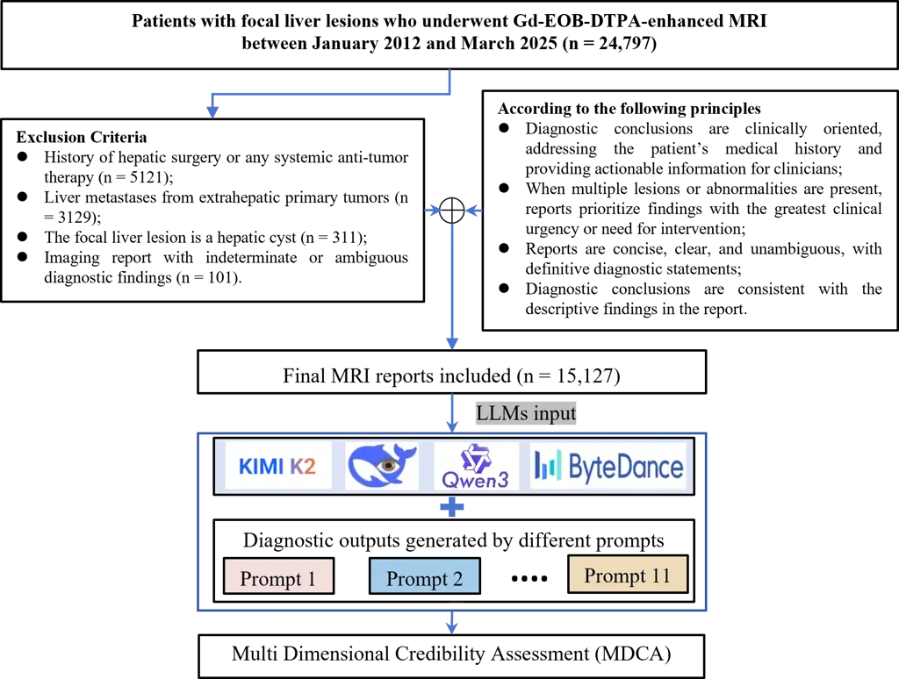
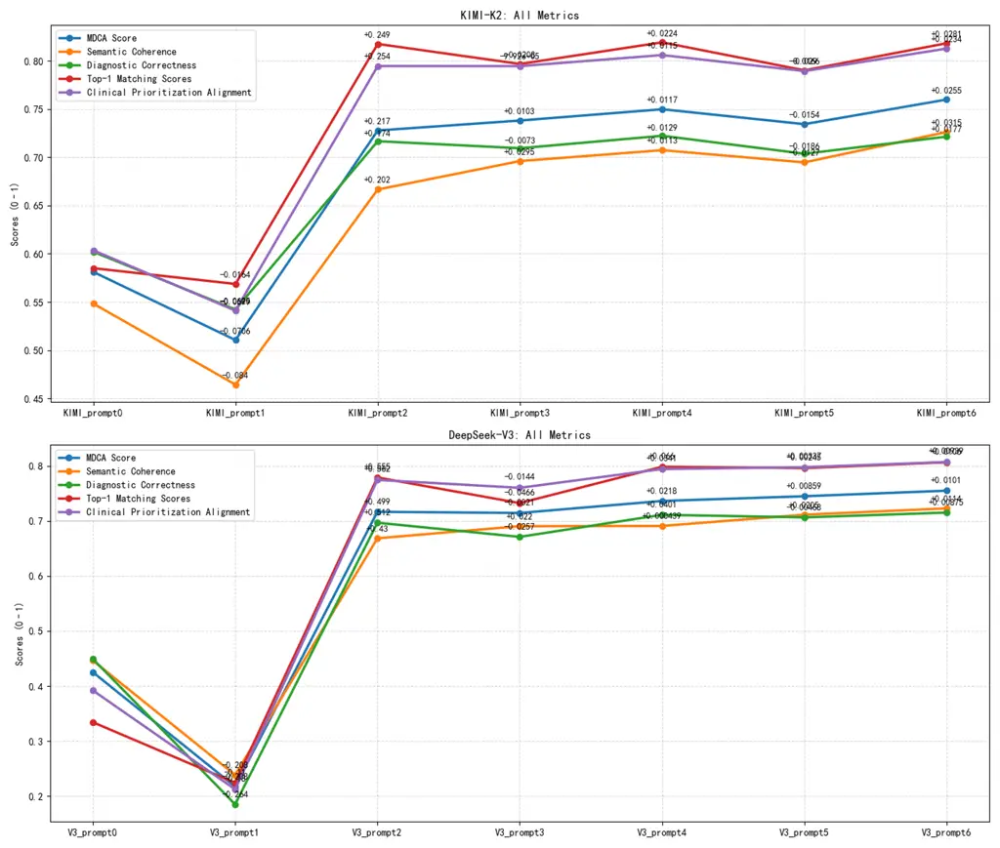
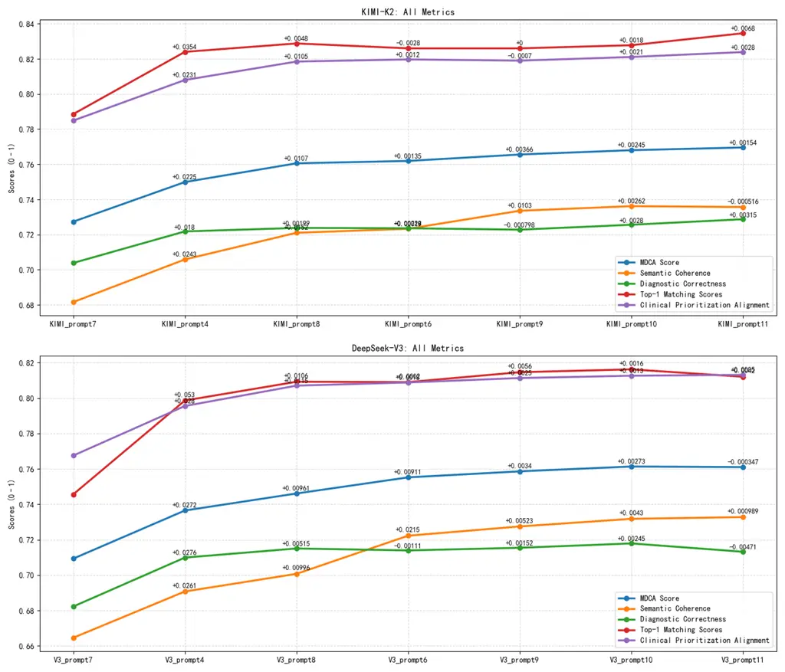
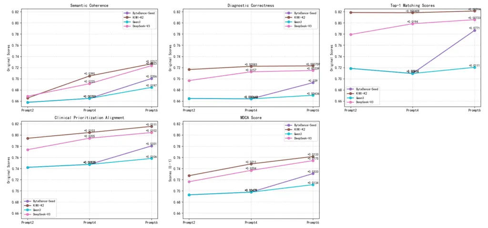
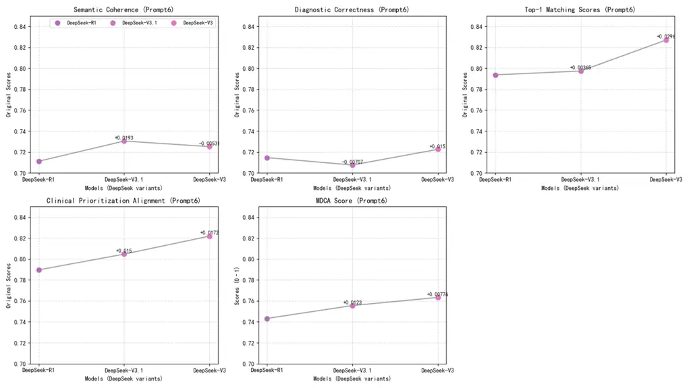
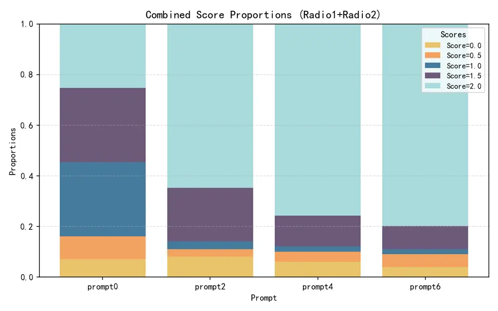

# From Prompt Optimization to Multi-Dimensional Credibility Evaluation: Enhancing Trustworthiness of Chinese LLM-Generated Liver MRI Reports - with Preliminary Extension to Lung Cancer Thanks:  Corresponding authors: X. Li and W. Chen. Q. Wang, X. Sun contributed equally to this manuscript.

Qiuli Wang^(1,2), Xinhuan Sun¹, Yonglin Chen², Jie Cheng², Yongxu Liu¹,
Xingpeng Zhang³,  
Xiaoming Li², and Wei Chen² Affiliation:  Affiliation: ¹Yu-Yue Pathology
Research Center, Jinfeng Laboratory, Chongqing, China Affiliation: ²7T
Magnetic Resonance Imaging Translational Medical Center, Department of
Radiology,  
Southwest Hospital, Army Medical University, Chongqing, China
Affiliation: ³School of Computer Science and Software Engineering,  
Southwest Petroleum University, Chengdu, China

###### Abstract

_Background:_ Large language models (LLMs) have demonstrated promising
performance in generating diagnostic conclusions from imaging findings,
thereby supporting radiology reporting, trainee education, and quality
control. However, systematic guidance on how to optimize prompt design
across different clinical contexts remains underexplored. Moreover, a
comprehensive and standardized framework for assessing the
trustworthiness of LLM-generated radiology reports is yet to be
established.

_Purpose:_ This study aims to enhance the trustworthiness of
LLM-generated liver MRI reports by introducing a Multi-Dimensional
Credibility Assessment (MDCA) framework and providing guidance on
institution-specific prompt optimization. The proposed framework is
applied to evaluate and compare the performance of several advanced LLMs
using the SiliconFlow platform. Cross-center generalizability and
cross-disease applicability were further examined using an external
liver MRI cohort and an in-house lung cancer dataset.

_Materials and Methods:_ Four large language models (Kimi-K2,
Qwen3-235B, DeepSeek-V3, and ByteDance-Seed) were used to generate
diagnostic conclusions from liver MRI findings via the SiliconFlow
platform. Report quality was assessed using the Multi-Dimensional
Credibility Assessment (MDCA) framework across three dimensions:
Semantic Coherence (SC), Diagnostic Correctness (DC), and Clinical
Prioritization Alignment (CPA). Eleven prompt configurations were
compared, combining role definition, task specification, tiered
diagnostic taxonomy, verification items, structure standards, imaging
principles, and example-based guidance. Validation was conducted on
15,127 liver MRI reports from the primary center, with 1,009 external
reports and 1692 lung cancer reports used to test cross-center and
cross-disease generalizability.

_Results:_ The MDCA framework effectively distinguished report quality
across prompts and models. Optimized prompts markedly improved
diagnostic correctness and clinical prioritization, whereas
example-based prompts primarily enhanced semantic coherence. Under
limited computational resources, approximately ten examples provided the
optimal performance-efficiency trade-off. Kimi-K2 achieved the highest
composite score (0.7615) (2025/11), followed closely by DeepSeek-V3
(0.7541). The optimized prompt strategy yielded consistent gains on both
external liver MRI and lung cancer datasets, confirming cross-center and
cross-disease generalizability.

_Conclusion:_ Institution-specific prompt optimization paired with
multi-dimensional credibility assessment substantially improves the
trustworthiness of LLM-generated liver MRI reports, with cross-center
and cross-disease validation confirming generalizability. These
approaches enhance reliability and interpretability while providing
practical tools for radiology quality control and trainee education,
supporting the safe integration of LLMs into clinical workflows.

###### Index Terms: 

Large Language Models, Prompt Engineering, Radiology Report Generation,
Liver MRI, Credibility Assessment

## I Introduction

Hepatic space-occupying lesions, particularly hepatocellular carcinoma
(HCC), are highly prevalent in China and pose a substantial clinical
challenge \[1, 2, 3\]. Gadoxetate disodium (Gd-EOB-DTPA)-enhanced MRI
has become an indispensable modality for lesion characterization, early
detection, and surgical planning \[4, 5\]. At the Department of
Radiology, The First Affiliated Hospital of Army Medical University in
Chongqing, China, the steadily increasing demand for liver-specific MRI
examinations has placed mounting pressure on radiologists. The sheer
volume and complexity of imaging data frequently compromise report
quality, resulting in vague terminology, inconsistent interpretations,
and suboptimal standardization.

The rapid advancement of Chinese large language models (LLMs)—including
Kimi-K2, Qwen3, DeepSeek-V3, and ByteDance-Seed—has opened new avenues
for radiology report generation in native-language clinical practice
\[6, 7, 8, 9, 10\]. These models demonstrate strong capabilities in
producing coherent, standardized, and stylistically consistent
diagnostic narratives, while also supporting quality control and
radiologist training \[11, 12, 13, 14\]. However, their performance in
liver MRI reporting remains heterogeneous across tasks and institutions,
leaving two major challenges unresolved:

_(1) How can the credibility of LLM-generated radiology reports be
objectively evaluated?_ Existing approaches often rely on LLMs
themselves for output quality assessment, which incurs substantial
computational overhead, constrains real-time deployment, and requires
additional evaluation prompts. Moreover, such self-assessment methods
risk perpetuating model-intrinsic biases and lack interpretability \[15,
16\]. Although expert validation by radiologists could improve
reliability, manually reviewing tens of thousands of reports is
practically infeasible given the prohibitive workload and time demands.
To date, no standardized, objective framework exists for assessing the
semantic integrity and diagnostic reliability of LLM-generated reports
in a model-agnostic and reproducible manner \[17\].

_(2) How can LLMs be effectively guided to interpret imaging findings
and formulate diagnostic conclusions through prompt design?_ Although
several studies have explored various prompting strategies, most remain
narrowly tailored to specific tasks or datasets and lack adaptability to
institutional reporting conventions. This specificity limits
generalizability and impedes clinical deployment across heterogeneous
environments. In the absence of well-established design principles,
prompt engineering remains largely empirical, driven by iterative
trial-and-error rather than systematic guidance \[18, 19\].

To address these challenges, we developed a unified prompt design
protocol compatible with multiple LLMs and established an objective
evaluation framework to assess the credibility and quality of
LLM-generated radiology reports. First, we systematically evaluated 11
customized prompting strategies—ranging from minimal to example-based
and checklist-guided designs—to assess their influence on report
reliability and consistency. These strategies were validated on a
primary-center liver MRI cohort (n = 15,127) and further examined on an
external-center cohort (n = 1,009) to confirm cross-center
generalizability. Second, we introduced a Multi-Dimensional Credibility
Assessment (MDCA) framework that evaluates report quality across three
clinically relevant dimensions: Semantic Coherence (SC), Diagnostic
Correctness (DC), and Clinical Prioritization Alignment (CPA) \[20,
21\]. Finally, applying the MDCA framework, we benchmarked multiple
state-of-the-art Chinese LLMs—including Kimi-K2-Instruct-0905,
Qwen3-235B-A22B-Instruct-2507, DeepSeek-V3, and
ByteDance-Seed-OSS-36B-Instruct—on the same SiliconFlow platform to
identify practical strategies for improving reporting quality,
supporting radiology quality assurance, and facilitating trainee
education \[7, 9, 13, 22\]. Cross-disease applicability was further
assessed using 1692 lung cancer reports from the primary center.

## II Materials and Methods

This retrospective study was conducted at Department of Radiology, The
First Affiliated Hospital of Army Medical University. The requirement
for informed consent was waived due to the use of de-identified patient
data. Liver radiology reports without diagnostic conclusions were input
to the LLMs between April 30, 2025, and May 14, 2025.

### II-A Collection of Clinical Reports

The collection process of clinical reports is shown in Figure 1. All
reports were obtained from our center for patients who underwent
Gd-EOB-DTPA-enhanced liver MRI between January and December 2024 (n =
24,797). Exclusion criteria included a history of hepatic surgery or any
systemic anti-tumor therapy, a history of extrahepatic primary
malignancy, absence of any benign or malignant hepatic lesions, and
poor-quality MRI images that prevented reliable assessment. The review
process yielded 15,127 eligible liver MRI reports for inclusion in the
study.



Fig. 1: The collection process of clinical reports. This process
followed a well-designed exclusion criteria to ensure the quality and
relevance of the reports used for LLM evaluation.

### II-B Multi-Dimensional Credibility Assessment Framework

To independently evaluate the synthesized reports, we proposed a MDCA
framework, which evaluated the synthesized reports in three dimensions:
SC, DC, and CPA \[20, 21, 23, 24\].

_Semantic Coherence (SC)_: This metric assessed the overall semantic
alignment between the generated diagnostic conclusion and the reference
diagnostic conclusion at the document level, indicating how closely the
LLM output adhered to the linguistic style and radiological writing
conventions of the target institution. Specifically, a pre-trained BERT
model was used to encode the complete diagnostic conclusion text of the
target report $`R_{T}`$ and that of the synthesized report $`R_{S}`$
into fixed-length vector representations, following the semantic textual
similarity (STS) paradigm. The SC score was defined as the cosine
similarity between the two document-level embeddings:

```math
\displaystyle SC=\cos\!\big(\mathrm{BERT}(R_{T}),\;\mathrm{BERT}(R_{S})\big) \tag{1}
```

where $`\mathrm{BERT}(\cdot)`$ denotes the pooled output embedding of
the full diagnostic conclusion. Higher SC values reflected greater
semantic similarity to the reference report, indicating better fluency
and stronger alignment with institutional radiological writing
conventions. This metric focused solely on textual and stylistic
coherence and did not assess diagnostic accuracy.

_Diagnostic Correctness (DC)_: This dimension evaluated the diagnostic
accuracy and completeness of the synthesized report relative to the
target report. The assessment followed a two-stage keyword-level
matching procedure, termed KMAT. In the extraction stage, diagnostic
keywords were identified from both the target report $`R_{T}`$ and the
synthesized report $`R_{S}`$ against a predefined institutional lexicon
of medical diagnostic terms, yielding keyword sets
$`\mathcal{K}_{T}=\{k_{T,1},k_{T,2},\dots,k_{T,m}\}`$ and
$`\mathcal{K}_{S}=\{k_{S,1},k_{S,2},\dots,k_{S,n}\}`$, respectively. In
the matching stage, each keyword in $`\mathcal{K}_{T}`$ was checked
against all keywords in $`\mathcal{K}_{S}`$ to determine whether the
corresponding diagnostic entity had been correctly captured. The DC
score was then defined as the proportion of target keywords that were
successfully matched:

```math
\displaystyle DC= \displaystyle\text{KMAT}(R_{T},R_{S}) \tag{2}
```

```math
\displaystyle= \displaystyle\frac{|\{\,k\in\mathcal{K}_{T}:\exists\,k^{\prime}\in\mathcal{K}_{S},\;\text{match}(k,k^{\prime})\,\}|}{|\mathcal{K}_{T}|} \tag{3}
```

A higher DC score indicated stronger diagnostic coverage and terminology
precision, reflecting that the synthesized report captured a greater
proportion of clinically relevant findings \[25, 26, 27\].

_Clinical Prioritization Alignment (CPA)_: This metric assessed whether
the most clinically urgent or important findings were presented at the
top of the report, consistent with real-world diagnostic priorities. For
example, malignant tumors or acute conditions (e.g., hemorrhage) should
have appeared at the very first. Scoring was based on whether such
high-priority diagnoses appeared within the top 1, top 3, or top 5
positions in the report. Expert radiologists validated prioritization
alignment according to institutional guidelines. Based on the clinical
requirements in the Department of Radiology, The First Affiliated
Hospital of Army Medical University (Southwest Hospital) , the
calculation process was defined in two steps:

Step 1: $`t_{RT1}`$ would be compared with $`t_{ST1}`$. If they match, a
score of 1 was assigned; otherwise, the score was 0. Thus, the score for
this step $`X_{1}`$ was either 1 or 0.;

Step2: each $`t_{RTo}`$ would be compared with $`t_{STo-1}`$,
$`t_{STo}`$, and $`t_{STo+1}`$, where $`o>1`$, was the sentence number.
For example, $`t_{RT2}`$ would be matched with $`t_{RS1}`$, $`t_{RS2}`$,
and $`t_{RS3}`$. This pattern continued accordingly. Each matched
diagnosis was assigned a score of 1, and the total score was obtained by
summing all matched instances. The total score for given reports was
then normalized by dividing the number of matched diagnoses by the total
number of candidate diagnoses, resulting in a final score $`X_{2}`$
between 0 and 1. The final CPA was calculated as:

```math
\displaystyle CPA=0.5\times X_{1}+0.5\times X_{2} \tag{4}
```

In addition, Top-1 matching scores were calculated to further evaluate
model performance in identifying the key diagnostic conclusions. A score
of 1 was assigned when the model’s primary diagnosis exactly matched the
ground truth, and 0 otherwise. MDCA Score: The final MDCA score was
defined as follow:

```math
\displaystyle MDCA=0.4\times SC+0.2\times DC+0.4\times CPA \tag{5}
```

Generally, all three dimensions contribute to the overall credibility of
a generated report, but their clinical priorities differ. In this
framework, SC and CPA were each assigned a weight of 0.4, reflecting the
importance of both linguistic conformity to institutional standards and
clinically prioritized content organization. DC, which assesses the
accuracy of individual diagnostic terms, was assigned a lower weight of
0.2. This is because diagnostic correctness is highly dependent on the
completeness of the finding description and the specificity of the
diagnostic lexicon, and minor terminological mismatches do not
necessarily indicate clinically meaningful errors. The weight assignment
is adjustable and can be adapted to the requirements of different
institutions.

### II-C Prompt Design and Implementation

As shown in Table I, the prompt content were categorized into two major
types: instruction-based components, and example-based guidance. The
instruction-based components contained (1) role specification, (2) task
definition, (3) tiered diagnostic taxonomy (TOP system), (4) mandatory
verification checkpoints, (5) report formatting standards, and (6)
radiologic diagnostic principles. The example-based component consisted
of sample reports written by experienced radiologists, which provided
reference style and diagnostic reasoning patterns.

[TABLE]

TABLE I: Summary of Prompt Design Components and Example Content

To systematically evaluated the contribution of each component, 11
prompt combinations were developed by selectively integrating different
elements from these categories. This design enabled quantitative
assessment of how individual and combined prompt features influence the
diagnostic reliability, coherence, and consistency of LLM-generated
liver MRI reports. Full prompt formulations are provided in the
Table II.

Prompts P0-P6 were designed to test different combinations of
instruction-based and example-based components, enabling the
identification of the most effective prompt composition strategy.
Prompts P5-P11 were further used to examine how the number of examples
influences model learning and output performance, thereby clarifying the
role of sample augmentation in improving large language model
adaptability and diagnostic consistency. We also provided the
information for each prompt’s character length in Table II.

|           |                 |                         |                         |                              |                            |                               |                    |                            |
| --------- | --------------- | ----------------------- | ----------------------- | ---------------------------- | -------------------------- | ----------------------------- | ------------------ | -------------------------- |
| Prompt ID | Role Definition | Core Task Specification | TOP Diagnostic Taxonomy | Mandatory Verification Items | Report Structure Standards | Imaging Diagnostic Principles | Number of Examples | Character Length (Chinese) |
| Prompt 0  | ✓               | -                       | -                       | -                            | -                          | -                             | 0                  | 124                        |
| Prompt 1  | ✓               | ✓                       | -                       | -                            | -                          | -                             | 0                  | 270                        |
| Prompt 2  | ✓               | ✓                       | -                       | -                            | -                          | -                             | 3                  | 1411                       |
| Prompt 3  | ✓               | ✓                       | ✓                       | -                            | ✓                          | -                             | 3                  | 2036                       |
| Prompt 4  | ✓               | ✓                       | ✓                       | ✓                            | ✓                          | ✓                             | 3                  | 3147                       |
| Prompt 5  | ✓               | ✓                       | -                       | -                            | -                          | -                             | 10                 | 3946                       |
| Prompt 6  | ✓               | ✓                       | ✓                       | ✓                            | ✓                          | ✓                             | 10                 | 5709                       |
| Prompt 7  | ✓               | ✓                       | ✓                       | ✓                            | ✓                          | ✓                             | 0                  | 2104                       |
| Prompt 8  | ✓               | ✓                       | ✓                       | ✓                            | ✓                          | ✓                             | 5                  | 3953                       |
| Prompt 9  | ✓               | ✓                       | ✓                       | ✓                            | ✓                          | ✓                             | 15                 | 7609                       |
| Prompt 10 | ✓               | ✓                       | ✓                       | ✓                            | ✓                          | ✓                             | 20                 | 9457                       |
| Prompt 11 | ✓               | ✓                       | ✓                       | ✓                            | ✓                          | ✓                             | 25                 | 11025                      |

TABLE II: Composition Matrix of the 11 Prompt Configurations.

### II-D Preparation of Large Language Models

Four advanced Chinese large language models (LLMs) were evaluated in
this study: Kimi-K2-Instruct-0905 (Moonshot AI),
Qwen3-235B-A22B-Instruct-2507 (Alibaba Group), DeepSeek-V3 (DeepSeek
AI), and ByteDance-Seed-OSS-36B-Instruct (ByteDance). These models
represent the leading generation of instruction-tuned Chinese LLMs, each
trained on large-scale multimodal or text-based corpora and optimized
for complex reasoning and task following \[28, 29\].

To further assess intra-model consistency, the DeepSeek family was
additionally tested with its upgraded version DeepSeek-V3.1 and
DeepSeek-R1 with Chain-of-Thought \[30, 31\]. This comparison allowed
evaluation of how incremental model updates and explicit reasoning
mechanisms affect diagnostic accuracy and report credibility in liver
MRI interpretation.

All models were accessed and executed via standardized SiliconFlow APIs
to ensure a consistent computational environment and to minimize
confounding factors related to hardware or deployment variability. The
parameter $`enable_{t}hinking`$ (if applicable) was uniformly set to
$`False`$ to disable the models’ internal ”thinking” function, as long
conversational contexts were not considered in this study. The
parameters $`temperature`$, $`top_{p}`$, and $`max_{tokens}`$ were set
to 0.5, 0.95, and 1024, respectively.

## III Results

The results are presented in three parts, corresponding to the
experimental workflow. First, DeepSeek-V3 and Kimi-K2 were used to
illustrate how different prompt compositions affect model performance.
Second, these two models were further applied to evaluate the influence
of varying the number of example reports on report quality. Finally, we
compared multiple Chinese large language models and validated the
DeepSeek family to clarify why DeepSeek-V3 and Kimi-K2 were selected as
representative models for subsequent experiments. In addition, we aimed
to demonstrate that the designed prompt settings yielded consistent
performance patterns across different models, supporting the
generalizability of the proposed approach.

### III-A Effect of Prompt Composition on Model Performance

In this section, DeepSeek-V3 and Kimi-K2 were evaluated using Prompts
P0-P6, as detailed in Table 1. For each prompt configuration, a total of
15,127 liver MRI reports were tested, corresponding to 181,524 chat
sessions conducted through the LLM interfaces.

As shown in Figure 2 and Table III, which present the experimental
results for prompt designs with Kimi-K2 and DeepSeek-V3, Kimi-K2
consistently outperformed DeepSeek-V3 across all prompt settings.
Kimi-K2 with Prompt 6 achieved the highest scores in Semantic Coherence
(SC), Clinical Prioritization Alignment (CPA), and overall MDCA, whereas
Kimi-K2 with Prompt 4 yielded the best Diagnostic Correctness (DC) and
Top-1 matching scores. Performance trends between the two LLMs were
highly consistent across all prompt configurations. In addition, higher
mean values were accompanied by lower standard deviations, indicating
stable model behavior.

Overall, three major observations were identified.

First, prompts that included role definition but lacked explicit
diagnostic guidance performed poorly, and those containing only role
definition and core task specification without structured support
achieved even lower scores (Prompts 0 and 1).

Second, compared with instruction-only prompts, the inclusion of
example-based guidance substantially improved overall performance
(Prompts 1, 2, 5, and 4, 6), although this required greater token
consumption and communication overhead.

Finally, the integration of key instruction-based
components—specifically the tiered diagnostic taxonomy, mandatory
verification items, report structure standards, and imaging diagnostic
principles—further enhanced SC, DC, and Top-1 matching scores, leading
to more accurate and diagnostically reliable outputs (Prompts 3, 4, and
5, 6).



Fig. 2: Experimental results for Prompt Designs with KIMI-K2 and
DeepSeek-V3. The figure illustrates the performance of both models
across various prompt configurations, highlighting the impact of
different prompt components on Semantic Coherence (SC), Diagnostic
Correctness (DC), Top-1 matching, Clinical Prioritization Alignment
(CPA), and overall MDCA scores.

|                    |                 |                 |                 |                 |                 |                 |                 |
| ------------------ | --------------- | --------------- | --------------- | --------------- | --------------- | --------------- | --------------- |
| KIMI Mean(STD)     | Prompt 0        | Prompt 1        | Prompt 2        | Prompt 3        | Prompt 4        | Prompt 5        | Prompt 6        |
| SC                 | 0.5483 (0.2651) | 0.4643 (0.251)  | 0.6666 (0.1966) | 0.6961 (0.1962) | 0.7073 (0.1925) | 0.6947 (0.1967) | 0.7262 (0.191)  |
| DC                 | 0.6021 (0.3352) | 0.5422 (0.3708) | 0.7167 (0.2752) | 0.7094 (0.2799) | 0.7223 (0.2725) | 0.7036 (0.2839) | 0.7214 (0.2742) |
| Top-1              | 0.5851 (0.4927) | 0.5687 (0.4953) | 0.8175 (0.3863) | 0.7967 (0.4025) | 0.8191 (0.3849) | 0.7901 (0.4073) | 0.8182 (0.3857) |
| CPA                | 0.6035 (0.3995) | 0.541 (0.41)    | 0.7945 (0.2982) | 0.7944 (0.3028) | 0.8059 (0.2892) | 0.7893 (0.3019) | 0.8127 (0.2867) |
| MDCA Score         | 0.5812 (0.2834) | 0.5106 (0.2878) | 0.7278 (0.1907) | 0.7381 (0.1954) | 0.7498 (0.1865) | 0.7343 (0.1949) | 0.7598 (0.1869) |
| DeepSeek Mean(STD) | Prompt 0        | Prompt 1        | Prompt 2        | Prompt 3        | Prompt 4        | Prompt 5        | Prompt 6        |
| SC                 | 0.4462 (0.2436) | 0.2381 (0.3157) | 0.6683 (0.1952) | 0.6903 (0.1952) | 0.6908 (0.1948) | 0.7112 (0.1947) | 0.7227 (0.1914) |
| DC                 | 0.4492 (0.3596) | 0.1848 (0.3065) | 0.6966 (0.2879) | 0.6709 (0.2995) | 0.711 (0.282)   | 0.7063 (0.2844) | 0.7151 (0.2806) |
| Top-1              | 0.334 (0.4717)  | 0.2239 (0.4169) | 0.7789 (0.415)  | 0.7323 (0.4428) | 0.7983 (0.4013) | 0.7959 (0.4031) | 0.8065 (0.3951) |
| CPA                | 0.3918 (0.3804) | 0.2121 (0.3612) | 0.7744 (0.3128) | 0.76 (0.3232)   | 0.7942 (0.3009) | 0.7975 (0.2976) | 0.8069 (0.2927) |
| MDCA Score         | 0.4250 (0.2667) | 0.2170 (0.3066) | 0.7164 (0.1973) | 0.7143 (0.2051) | 0.7362 (0.1922) | 0.7448 (0.1928) | 0.7548 (0.1894) |

TABLE III: Evaluation Metrics for KIMI-K2 and DeepSeek-V3 with Different
Prompt Designs.

### III-B Effect of Example Number on Model Performance

In this section, DeepSeek-V3 and Kimi-K2 were evaluated using Prompts 4
and 6-11. When sorted by the number of examples, these correspond to
Prompts 7, 4, 8, 6, 9, 10, and 11, which contained 0, 3, 5, 10, 15, and
20 examples, respectively. For each prompt configuration, a total of
5,000 liver MRI reports were tested, corresponding to 70,000 chat
sessions conducted through the LLM interfaces. The experimental results
are summarized in Figure 3 and Table IV.

Both Kimi-K2 and DeepSeek-V3 exhibited consistent improvement across all
evaluation dimensions as the number of examples increased. Performance
gains were most notable in Semantic Coherence (SC) and Top-1 matching
accuracy, indicating that additional examples enhanced the models’
ability to generate fluent, contextually coherent, and diagnostically
aligned reports.

Model performance increased steadily up to approximately 20 examples,
beyond which further expansion yielded marginal or slightly negative
effects. The composite score for DeepSeek-V3 peaked at 0.7613 (Prompt
10), while Kimi-K2 reached 0.7696 (Prompt 11), after which performance
plateaued. Overall, the improvements beyond 20 examples were limited.
These findings suggest that while moderate example augmentation—around
10 to 20 examples—substantially improves language fluency and diagnostic
completeness, excessive examples may introduce contextual noise and
redundancy that hinder performance.

Notably, both models followed highly similar trends across all metrics,
confirming that the effect of example number is consistent and
model-agnostic. This consistency suggests that the observed performance
gains stem from the underlying optimization of contextual understanding
rather than model-specific characteristics, thereby supporting the
generalizability of this prompt-scaling strategy across Chinese LLMs.

Finally, when instruction-based components are limited, we believe
expanding the number of examples provides an effective alternative for
improving performance, albeit with higher token and communication costs.
In practical deployment, we recommend using a comprehensive
instruction-based prompt design combined with approximately 10-15
representative examples, which offers an optimal balance between
performance, efficiency, and feasibility for most clinical institutions.



Fig. 3: Experimental Results with Different Example Numbers. The figure
illustrates how varying the number of example reports in the prompts
affects the performance of KIMI-K2 and DeepSeek-V3 across multiple
evaluation metrics, including Semantic Coherence (SC), Diagnostic
Correctness (DC), Top-1 matching, Clinical Prioritization Alignment
(CPA), and overall MDCA scores.

|                    |                 |                 |                 |                 |                 |                 |                 |
| ------------------ | --------------- | --------------- | --------------- | --------------- | --------------- | --------------- | --------------- |
| KIMI Mean(STD)     | Prompt 7        | Prompt 4        | Prompt 8        | Prompt 6        | Prompt 9        | Prompt 10       | Prompt 11       |
| SC                 | 0.6816 (0.1934) | 0.7058 (0.1925) | 0.721 (0.1906)  | 0.7233 (0.1922) | 0.7335 (0.1898) | 0.7362 (0.189)  | 0.7357 (0.1887) |
| DC                 | 0.7038 (0.2826) | 0.7218 (0.2701) | 0.7238 (0.2704) | 0.7236 (0.2697) | 0.7228 (0.2716) | 0.7256 (0.2692) | 0.7287 (0.2682) |
| Top-1              | 0.7886 (0.4084) | 0.824 (0.3809)  | 0.8288 (0.3768) | 0.826 (0.3792)  | 0.826 (0.3792)  | 0.8278 (0.3776) | 0.8346 (0.3716) |
| CPA                | 0.7849 (0.3084) | 0.808 (0.2891)  | 0.8185 (0.2822) | 0.8197 (0.2842) | 0.819 (0.2824)  | 0.8211 (0.2808) | 0.8239 (0.2796) |
| MDCA Score         | 0.7273 (0.1981) | 0.7500 (0.1856) | 0.7605 (0.1834) | 0.7619 (0.1852) | 0.7656 (0.1839) | 0.7680 (0.1826) | 0.7696 (0.1812) |
| DeepSeek Mean(STD) | Prompt 7        | Prompt 4        | Prompt 8        | Prompt 6        | Prompt 9        | Prompt 10       | Prompt 11       |
| SC                 | 0.6646 (0.194)  | 0.6907 (0.1943) | 0.7007 (0.1927) | 0.7222 (0.1895) | 0.7275 (0.1923) | 0.7318 (0.1918) | 0.7328 (0.1935) |
| DC                 | 0.6822 (0.2932) | 0.7099 (0.2805) | 0.715 (0.2789)  | 0.7139 (0.2796) | 0.7154 (0.2775) | 0.7179 (0.2765) | 0.7132 (0.279)  |
| Top-1              | 0.7456 (0.4356) | 0.7986 (0.4011) | 0.8092 (0.393)  | 0.809 (0.3931)  | 0.8146 (0.3887) | 0.8162 (0.3874) | 0.812 (0.3908)  |
| CPA                | 0.7675 (0.3189) | 0.7955 (0.2982) | 0.807 (0.2929)  | 0.8088 (0.2916) | 0.8113 (0.2884) | 0.8126 (0.2871) | 0.8131 (0.2885) |
| MDCA Score         | 0.7093 (0.2041) | 0.7365 (0.1902) | 0.7461 (0.1886) | 0.7552 (0.1881) | 0.7586 (0.1874) | 0.7613 (0.1865) | 0.7610 (0.1889) |

TABLE IV: Evaluation Metrics for KIMI-K2 and DeepSeek-V3 with Different
Example Numbers.

### III-C Comparison of Chinese LLMs and Validation within the DeepSeek Family

In this section, four major Chinese large language
models—Kimi-K2-Instruct-0905, DeepSeek-V3,
ByteDance-Seed-OSS-36B-Instruct, and Qwen3-235B-A22B-Instruct-2507—were
evaluated under prompt configurations of varying complexity (Prompts 2,
4, and 6). For each model-prompt combination, 7,500 liver MRI reports
were tested, resulting in approximately 90,000 chat sessions conducted
through the SiliconFlow platform. Experimental results are summarized in
Figure 4.



Fig. 4: Experimental Results with Four LLMs. The figure illustrates the
performance of KIMI-K2, DeepSeek-V3, ByteDance-Seed, and Qwen3-235B
across various prompt configurations.

All models demonstrated consistent performance gains with increasing
prompt sophistication, highlighting the crucial role of structured
instruction and contextual guidance. Kimi-K2 achieved the best overall
performance, with composite scores improving from 0.7271 (Prompt 2) to
0.7615 (Prompt 6). DeepSeek-V3 followed closely, reaching 0.7541 under
the same condition. In contrast, ByteDance-Seed and Qwen3-235B showed
limited improvements, particularly in Semantic Coherence (SC) and
Clinical Prioritization Alignment (CPA), indicating weaker adaptability
to complex prompt instructions.

Further validation within the DeepSeek family was conducted using 2,500
liver MRI reports per model-prompt configuration, enabling detailed
comparison among DeepSeek-V3, DeepSeek-V3.1, and DeepSeek-R1. As shown
in Figure 5, DeepSeek-V3 achieved the highest composite score (0.7633),
outperforming V3.1 (0.7555) and R1 (0.7433). While V3.1 exhibited
marginally higher Semantic Coherence (0.730 vs. 0.725), V3 demonstrated
superior Diagnostic Correctness (DC), Top-1 matching accuracy, and CPA,
producing more diagnostically reliable reports. The reasoning-augmented
R1 achieved slightly higher semantic correctness (0.715) but at the cost
of reduced consistency and fluency. These findings indicate that
explicit Chain-of-Thought reasoning does not necessarily enhance
clinical reliability, and that optimized instruction design remains more
impactful for structured diagnostic generation.



Fig. 5: Experimental Results with DeepSeek Family. The figure
illustrates the performance of DeepSeek-V3, DeepSeek-V3.1, and
DeepSeek-R1 across various prompt configurations.

Overall, both Kimi-K2 and DeepSeek-V3 emerged as the most reliable and
balanced performers, consistently benefiting from prompt and sample
optimization. The performance patterns across all models—characterized
by steady improvement with increased instruction richness—demonstrate
the model-agnostic generalizability of the proposed prompt customization
and credibility evaluation frameworks. Consequently, these two models
were selected as representative systems for subsequent experiments,
reflecting their strong baseline capability, responsiveness to
structured prompting, and robustness across diverse evaluation
dimensions.

### III-D Cross-Center Validation on External Liver MRI Cohort

To evaluate whether the proposed prompt optimization strategy
generalizes across institutions, an independent external cohort of 1,009
liver MRI reports was tested using Kimi-K2 and DeepSeek-V3. Beyond
directly transferring the original prompts, we further examined a
practical deployment scenario: when moving to a new center, the
terminology and tiered diagnostic taxonomy (TOP system) were modestly
revised to align with local reporting conventions, and all example
reports were replaced with those sourced from the target center.

Five prompt variants were compared:

- •
  Prompt 7 and Prompt 11: the original instruction-based prompt (zero
  examples) and the full-configuration prompt (25 primary-center
  examples), respectively, as defined in Table II;
- •
  Prompt 11 V2: Prompt 11 with revised terminology and diagnostic
  taxonomy adapted to the external center;
- •
  Prompt 7 V2: Prompt 11 V2 with all example reports removed, i.e.,
  adapted instructions only, zero examples;
- •
  Prompt 11 V3: Prompt 7 V2 with all example reports replaced by 25
  external-center samples.

The results are summarized in Table V. Three key findings emerged.

First, directly transplanting the original Prompt 7 and Prompt 11 to the
external center yielded MDCA scores of 0.615–0.673 (Kimi-K2) and
0.651–0.691 (DeepSeek-V3), confirming that the proposed framework
retained reasonable performance without any center-specific adaptation.
However, these scores were notably lower than those observed on the
primary center (cf. Table III), reflecting inter-institutional
differences in reporting style and diagnostic phrasing.

Second, adapting terminology and replacing examples with local samples
(Prompt 11 V3) produced the highest scores across both models: MDCA
reached 0.774 (Kimi-K2) and 0.768 (DeepSeek-V3). Importantly, even
terminology adaptation alone without examples (Prompt 7 V2) yielded
competitive performance (Kimi-K2: 0.703; DeepSeek-V3: 0.692),
approaching or surpassing the original Prompt 11 with primary-center
examples.

Third, DeepSeek-V3 exhibited a higher zero-shot baseline than Kimi-K2
under the original Prompt 7 (MDCA: 0.651 vs. 0.615), whereas Kimi-K2
responded more substantially to example augmentation and terminology
refinement, ultimately achieving the highest composite score.

These results demonstrate that institution-specific prompt
adaptation—combining modest terminology revision with locally sourced
example reports—enables high-quality LLM-generated reports in a new
center at relatively low adaptation cost, avoiding the need to redesign
the entire prompt from scratch.

|                        |                 |                 |                 |                 |                 |
| ---------------------- | --------------- | --------------- | --------------- | --------------- | --------------- |
| Kimi-K2 (mean_std)     | Prompt 7        | Prompt 11       | Prompt 11 V2    | Prompt 7 V2     | Prompt 11 V3    |
| SC                     | 0.7057 (0.1769) | 0.7634 (0.1547) | 0.7894 (0.1415) | 0.6944 (0.1816) | 0.7883 (0.1448) |
| DC                     | 0.4793 (0.3002) | 0.5210 (0.2940) | 0.5788 (0.2775) | 0.6499 (0.2855) | 0.6926 (0.2703) |
| Top-1                  | 0.6868 (0.4640) | 0.7889 (0.4083) | 0.8474 (0.3598) | 0.7750 (0.4178) | 0.8583 (0.3489) |
| CPA                    | 0.5927 (0.3509) | 0.6586 (0.3275) | 0.7289 (0.2948) | 0.7374 (0.3156) | 0.7993 (0.2784) |
| MDCA                   | 0.6152 (0.2093) | 0.6730 (0.1950) | 0.7231 (0.1724) | 0.7027 (0.1963) | 0.7736 (0.1722) |
| DeepSeek-V3 (mean_std) | Prompt 7        | Prompt 11       | Prompt 11 V2    | Prompt 7 V2     | Prompt 11 V3    |
| SC                     | 0.6713 (0.1952) | 0.7682 (0.1511) | 0.8011 (0.1460) | 0.6713 (0.1952) | 0.8011 (0.1460) |
| DC                     | 0.5535 (0.2944) | 0.5466 (0.2847) | 0.5576 (0.2917) | 0.6361 (0.2896) | 0.6639 (0.2838) |
| Top-1                  | 0.7820 (0.4131) | 0.8246 (0.3805) | 0.8216 (0.3830) | 0.7849 (0.4111) | 0.8266 (0.3788) |
| CPA                    | 0.6804 (0.3276) | 0.6868 (0.3142) | 0.7071 (0.3105) | 0.7398 (0.3061) | 0.7874 (0.2829) |
| MDCA                   | 0.6514 (0.2034) | 0.6913 (0.1869) | 0.7148 (0.1881) | 0.6917 (0.1983) | 0.7682 (0.1792) |

- •
  Prompt 11 V2 revises the tiered diagnostic taxonomy and terminology
  for the external center; Prompt 7 V2 removes all examples from
  Prompt 11 V2; Prompt 11 V3 replaces all examples with external-center
  samples. Columns 4–5 use the updated scoring system with synonym
  expansion.

TABLE V: Cross-Center Validation Results on the External Liver MRI
Cohort (n = 1,009).

### III-E Cross-Disease Validation on Lung Cancer

To assess cross-disease generalizability, the same six-component prompt
architecture (Table VI) was applied to pulmonary thin-section CT
reporting at the primary center, using 1692 lung cancer reports
processed with Kimi-K2 under Prompt 0, Prompt 7 and Prompt 10.

|         |                 |                 |                 |
| ------- | --------------- | --------------- | --------------- |
| Kimi-K2 | Prompt 0        | Prompt 7        | Prompt 10       |
| SC      | 0.767 (0.1861)  | 0.7506 (0.1279) | 0.7987 (0.1309) |
| DC      | 0.334 (0.2522)  | 0.5304 (0.2705) | 0.6237 (0.2541) |
| Top-1   | 0.3182 (0.4659) | 0.6339 (0.4819) | 0.7753 (0.4175) |
| CPA     | 0.2593 (0.3149) | 0.5455 (0.3295) | 0.6668 (0.3048) |
| MDCA    | 0.4773 (0.1701) | 0.6245 (0.1788) | 0.7109 (0.1676) |

TABLE VI: Cross-Disease Validation Results on Lung Cancer (n = 1692).

Although structurally identical to the liver MRI prompt, the pulmonary
version was inherently more complex in several respects. Anatomically,
it spanned seven subsystems (lung parenchyma, airways, pleura,
mediastinum, great vessels, chest wall, and esophagus) rather than a
single organ. It required simultaneous adherence to five external
standardization systems (Lung-RADS, Boyden segmental nomenclature, IASLC
9th-edition lymph node station map, three-segment esophageal
classification, and rib/vertebral segmental localization), compared with
essentially one (Couinaud anatomy) for liver MRI. Furthermore, the
pulmonary prompt incorporated a critical-value alerting mechanism for
life-threatening conditions (e.g., aortic dissection, tension
pneumothorax), a feature absent from the liver protocol. The broader
disease spectrum and greater proportion of diagnostically indeterminate
lesions also necessitated stricter anti-hallucination safeguards and
produced substantially higher prompt information density than its
hepatic counterpart.

Despite these differences, the six-component framework transferred
directly without architectural modification, yielding consistent
performance improvements on lung cancer reports. These results confirm
that the proposed prompt design and MDCA evaluation frameworks
generalize effectively across distinct disease domains, with the
principal adaptation cost being content expansion of existing components
rather than structural redesign.

### III-F Consistency Check between MDCA Framework and Radiologist Judgments

To evaluate the clinical alignment of the MDCA framework, we conducted a
consistency check between MDCA scores and radiologist assessments. Four
representative prompts (Prompt 0, 2, 4, and 6) from Kimi-K2 were
selected for comparison. Two board-certified radiologists independently
reviewed 100 reports per prompt, totaling 800 reports, comparing each
LLM-generated report against the corresponding ground-truth report.

Each report was rated using a three-tier scale:

Grade A (1 point): Fully acceptable, with clinically sound content and
no major errors; Grade B (0.5 points): Acceptable with minor, tolerable
issues (e.g., slightly ambiguous phrasing or minor inconsistencies);
Grade C (0 points): Unacceptable due to incoherent language or critical
factual inaccuracies Each report received two individual ratings, and
the combined score served as the final consistency judgment. Scores of
2.0 were considered excellent, 1.0-1.5 acceptable, and $`<1`$
unacceptable.

As illustrated in Figure 6, the proportion of reports rated as excellent
(score = 2.0) increased substantially with improved prompt quality, from
Prompt 0 to Prompt 6. In contrast, lower-quality prompts yielded a
higher proportion of partially or wholly unacceptable outputs. These
trends closely aligned with the MDCA scores, supporting the clinical
validity and interpretability of the proposed framework.

Manual consistency checks, however, are labor-intensive and not scalable
at the population level, further underscoring the need for automated,
reproducible frameworks such as MDCA.



Fig. 6: Combined Scores and Proportions of Radiologist Ratings for
KIMI-K2 under Different Prompts. The figure illustrates the distribution
of radiologist ratings (Grade A, B, C) for KIMI-K2-generated reports
across four prompt configurations (Prompt 0, 2, 4, and 6), highlighting
the correlation between prompt quality and clinical acceptability.

## IV Discussion

### IV-A Prompt Design Principles and Mechanistic Insights

Our findings highlight that prompt construction in large language model
(LLM)-based radiology reporting is not merely additive but synergistic.
Instruction-based components—including role definition, core task
specification, tiered diagnostic taxonomy (TOP system), mandatory
verification items, report structure standards, and imaging diagnostic
principles—substantially improved Diagnostic Correctness (DC) and
Clinical Prioritization Alignment (CPA) by enforcing structured
reasoning and domain-specific consistency. In contrast, the inclusion of
example-based guidance primarily enhanced Semantic Coherence (SC),
promoting fluency and logical continuity in report narratives. However,
excessive examples ($`>20`$) introduced contextual redundancy and token
interference, resulting in performance saturation or mild decline. These
results suggest that an optimal balance—combining comprehensive
instruction design with approximately 10–15 representative
examples—achieves the best trade-off between diagnostic accuracy,
fluency, and computational efficiency. Notably, cross-center validation
further revealed that replacing primary-center examples with locally
sourced samples from the target institution yielded additional
performance gains, underscoring the value of institution-specific
example curation in multi-center deployment.

### IV-B Model Performance and Selection Considerations

Among the evaluated LLMs, Kimi-K2 and DeepSeek-V3 consistently
outperformed other Chinese LLMs, exhibiting strong baseline reliability
and responsiveness to prompt optimization. Within the DeepSeek family,
V3 achieved the most balanced and diagnostically consistent performance,
surpassing both V3.1 and the reasoning-augmented R1 variant. While V3.1
showed slightly higher semantic coherence, and R1 demonstrated marginal
gains in correctness, neither delivered stable improvements across
diagnostic metrics. These findings indicate that the integration of
explicit reasoning mechanisms does not necessarily translate to higher
clinical reliability, whereas structured prompt optimization has a more
direct and reproducible effect. Cross-center experiments further showed
that DeepSeek-V3 maintained a stronger performance, while Kimi-K2
responded more substantially to institution-specific adaptation,
suggesting complementary strengths for different deployment scenarios.

Importantly, the consistent response patterns observed across all
models—extending from the primary-center liver cohort to the
external-center liver cohort and the cross-disease lung
validation—demonstrate the generalizability of the proposed prompt
design protocols. This cross-model, cross-center, and cross-disease
stability suggests that scientifically designed prompts exert a greater
influence on report quality than model selection itself. In other words,
the reliability and trustworthiness of LLM-generated radiology reports
depend more on how models are instructed than on which models are
used—underscoring the central role of prompt engineering in clinical LLM
deployment.

### IV-C Practical Applications and Clinical Implications

Beyond technical performance, the proposed frameworks hold strong
potential for real-world applications in radiology workflows. The
Multi-Dimensional Credibility Assessment (MDCA) system provides an
interpretable and quantitative basis for quality control, allowing
automated benchmarking of report consistency, diagnostic accuracy, and
adherence to institutional standards. Such a framework could be
integrated into hospital reporting systems to assist in automated
quality assurance and longitudinal monitoring of reporting performance.

The MDCA framework offers several distinct advantages over existing
single-metric or LLM-based self-evaluation approaches. First, it
evaluates model outputs across three complementary dimensions—Semantic
Coherence (SC), Diagnostic Correctness (DC), and Clinical Prioritization
Alignment (CPA)—capturing both linguistic and clinical reliability
within a unified structure; Second, the framework is model-agnostic,
enabling fair comparison among different LLMs without dependence on
internal architectures or training data; Third, each dimension is
interpretable and directly maps to radiological reasoning processes,
allowing human experts to trace and validate model errors. Together,
these features make MDCA a practical, transparent, and reproducible tool
for continuous model evaluation and regulatory oversight. The successful
transfer of the MDCA framework from liver MRI to pulmonary CT further
confirms its disease-agnostic design, requiring only content-level
adaptation of the scoring rubrics rather than architectural revision.

From an educational perspective, the prompt optimization and credibility
evaluation frameworks can also support radiology trainee education.
LLM-generated reports, when aligned with expert-verified prompts, can
serve as high-quality exemplars to improve trainees’ diagnostic
reasoning, linguistic precision, and report standardization. This dual
application—quality control and education—demonstrates the broader
clinical and pedagogical value of trustworthy LLM deployment in medical
imaging.

## V Limitations

This study has several limitations.

First, it focused exclusively on text-to-text large language models
(LLMs) rather than multimodal systems capable of directly processing
imaging data. While multimodal models hold promise for integrating
visual and textual reasoning, they currently face deployment barriers
related to high GPU requirements, complex DICOM handling, and limited
clinical infrastructure. In contrast, text-based frameworks such as
DeepSeek-V3 and Kimi-K2 provide a more practical and scalable
alternative, particularly for resource-constrained healthcare
institutions.

Second, the evaluation involved only radiologists, without incorporating
feedback from other clinical specialists such as surgeons or
oncologists. Although this focus ensured domain consistency, it may have
limited the comprehensiveness of the credibility assessment (MDCA) in
capturing broader multidisciplinary perspectives. Future studies could
include multi-specialty panels to refine and expand the interpretive
dimensions of the MDCA framework.

Third, although cross-center validation was conducted on an external
liver MRI cohort, and cross-disease testing was performed on lung cancer
reports, both the primary-center lung experiments and the
external-center liver experiments were each limited to a single
institution. Model behaviors and prompt effectiveness could still vary
across additional centers with different reporting styles and linguistic
norms. Larger multicenter and multi-disease longitudinal studies are
warranted to further validate the reproducibility and scalability of the
proposed frameworks in diverse real-world settings.

## VI Conclusions

This study introduces a Multi-Dimensional Credibility Assessment (MDCA)
framework that enables objective, transparent, and reproducible
evaluation of LLM-generated liver MRI reports. Using this framework, we
systematically investigated how scientific prompt design and model
selection influence report quality. Cross-center validation on an
external liver MRI cohort and cross-disease testing on lung cancer
reports confirmed the generalizability of both the prompt design
protocol and the MDCA evaluation framework. The findings indicate that
structured instruction with approximately 10–15 representative
examples—preferably sourced locally—achieves the most balanced and
reliable performance across institutions and disease contexts. Among the
evaluated models, Kimi-K2 and DeepSeek-V3 consistently demonstrated
superior overall credibility. These results underscore that both
rational prompt engineering and credible model evaluation are essential
for integrating trustworthy large language models into radiology
workflows for quality assurance and professional training.

## References

- \[1\] J. M. Llovet, F. Castet, M. Heikenwalder, M. K. Maini, V.
  Mazzaferro, D. J. Pinato, E. Pikarsky, A. X. Zhu, and R. S.
  Finn (2022) Immunotherapies for hepatocellular carcinoma. Nature
  reviews Clinical oncology 19 (3), pp. 151–172. Cited by: §I.
- \[2\] J. Bruix and M. Sherman (2005) Management of hepatocellular
  carcinoma. Hepatology 42 (5), pp. 1208–1236. Cited by: §I.
- \[3\] A. Vogel, T. Meyer, G. Sapisochin, R. Salem, and A.
  Saborowski (2022) Hepatocellular carcinoma. The Lancet 400 (10360),
  pp. 1345–1362. External Links: ISSN 0140-6736,
  [Document](https://dx.doi.org/https%3A//doi.org/10.1016/S0140-6736%2822%2901200-4),
  [Link](https://www.sciencedirect.com/science/article/pii/S0140673622012004)
  Cited by: §I.
- \[4\] T. Aoki, N. Nishida, K. Ueshima, M. Morita, H. Chishina, M.
  Takita, S. Hagiwara, H. Ida, Y. Minami, A. Yamada, et al. (2021)
  Higher enhancement intrahepatic nodules on the hepatobiliary phase of
  gd-eob-dtpa-enhanced mri as a poor responsive marker of
  anti-pd-1/pd-l1 monotherapy for unresectable hepatocellular carcinoma.
  Liver Cancer 10 (6), pp. 615–628. Cited by: §I.
- \[5\] Z. Ye, J. Zhao, D. Hu, Z. Yang, J. Chen, L. Xu, Z. Zhou, M.
  Chen, and Y. Zhang (2024) Gd-eob-dtpa-enhanced mri proves advantageous
  in selecting surgical candidates for patients with early-stage
  hepatocellular carcinoma: an analysis in terms of oncological
  outcomes. iLIVER 3 (4), pp. 100117. Cited by: §I.
- \[6\] X. Wu, Y. Huang, and Q. He (2025) A large language model
  improves clinicians’ diagnostic performance in complex critical
  illness cases. Critical Care 29 (1), pp. 230. Cited by: §I.
- \[7\] K. Team, Y. Bai, Y. Bao, G. Chen, J. Chen, N. Chen, R. Chen, Y.
  Chen, Y. Chen, Y. Chen, et al. (2025) Kimi k2: open agentic
  intelligence. arXiv preprint arXiv:2507.20534. Cited by: §I, §I.
- \[8\] A. Yang, A. Li, B. Yang, B. Zhang, B. Hui, B. Zheng, B. Yu, C.
  Gao, C. Huang, C. Lv, et al. (2025) Qwen3 technical report. arXiv
  preprint arXiv:2505.09388. Cited by: §I.
- \[9\] B. Seed, J. Chen, T. Fan, X. Liu, L. Liu, Z. Lin, M. Wang, C.
  Wang, X. Wei, W. Xu, et al. (2025) Seed1. 5-thinking: advancing superb
  reasoning models with reinforcement learning. arXiv preprint
  arXiv:2504.13914. Cited by: §I, §I.
- \[10\] P. Chen, X. Liu, Z. Liu, Z. Chen, X. Zhang, H. Hu, Z. Wang, K.
  Wang, S. Shi, and S. Lian (2025) Fuzzy reasoning chain: an innovative
  reasoning framework from fuzziness to clarity. arXiv preprint
  arXiv:2509.22054. Cited by: §I.
- \[11\] F. Gaber, M. Shaik, F. Allega, A. J. Bilecz, F. Busch, K.
  Goon, V. Franke, and A. Akalin (2025) Evaluating large language model
  workflows in clinical decision support for triage and referral and
  diagnosis. npj Digital Medicine 8 (1), pp. 263. Cited by: §I.
- \[12\] C. Marrocchio and N. Sverzellati (2025) Will generative large
  language models become radiologists’ invaluable allies?. Vol. 315,
  Radiological Society of North America. Cited by: §I.
- \[13\] S. Sandmann, S. Hegselmann, M. Fujarski, L. Bickmann, B.
  Wild, R. Eils, and J. Varghese (2025) Benchmark evaluation of deepseek
  large language models in clinical decision-making. Nature Medicine,
  pp. 1–1. Cited by: §I, §I.
- \[14\] M. Tordjman, Z. Liu, M. Yuce, V. Fauveau, Y. Mei, J.
  Hadjadj, I. Bolger, H. Almansour, C. Horst, A. S. Parihar, et
  al. (2025) Comparative benchmarking of the deepseek large language
  model on medical tasks and clinical reasoning. Nature medicine,
  pp. 1–1. Cited by: §I.
- \[15\] L. Folio, L. Machado, and A. Dwyer (2018) Multimedia-enhanced
  radiology reports: concept, components, and challenges. RadioGraphics
  38, pp. 462–482. External Links:
  [Document](https://dx.doi.org/10.1148/rg.2017170047) Cited by: §I.
- \[16\] Y. Wang, E. Courcelles, E. Peyronnet, S. Porte, A.
  Diatchenko, E. Jacob, D. Angoulvant, P. Amarenco, F. Boccara, B.
  Cariou, et al. (2025) Credibility assessment of a mechanistic model of
  atherosclerosis to predict cardiovascular outcomes under
  lipid-lowering therapy. npj Digital Medicine 8 (1), pp. 171. Cited by:
  §I.
- \[17\] T. Tu, M. Schaekermann, A. Palepu, K. Saab, J. Freyberg, R.
  Tanno, A. Wang, B. Li, M. Amin, Y. Cheng, et al. (2025) Towards
  conversational diagnostic artificial intelligence. Nature, pp. 1–9.
  Cited by: §I.
- \[18\] T. T. Kim, M. Makutonin, R. Sirous, and R. Javan (2025)
  Optimizing large language models in radiology and mitigating pitfalls:
  prompt engineering and fine-tuning. RadioGraphics 45 (4), pp. e240073.
  Cited by: §I.
- \[19\] M. A. Fink, A. Bischoff, C. A. Fink, M. Moll, J. Kroschke, L.
  Dulz, C. P. Heußel, H. Kauczor, and T. F. Weber (2023) Potential of
  chatgpt and gpt-4 for data mining of free-text ct reports on lung
  cancer. Radiology 308 (3), pp. e231362. Cited by: §I.
- \[20\] Y. Zhou, L. Huang, T. Zhou, H. Fu, and L. Shao (2021)
  Visual-textual attentive semantic consistency for medical report
  generation. In Proceedings of the IEEE/CVF International Conference on
  Computer Vision, pp. 3985–3994. Cited by: §I, §II-B.
- \[21\] J. Chen, G. Huang, X. Yuan, G. Zhong, Z. Tan, C. Pun, and Q.
  Yang (2025) Visual-linguistic diagnostic semantic enhancement for
  medical report generation. Journal of Biomedical Informatics 161,
  pp. 104764. Cited by: §I, §II-B.
- \[22\] J. Chou, A. Liu, Y. Deng, Z. Zeng, T. Zhang, H. Zhu, J. Cai, Y.
  Mao, C. Zhang, L. Tan, et al. (2025) Autocodebench: large language
  models are automatic code benchmark generators. arXiv preprint
  arXiv:2508.09101. Cited by: §I.
- \[23\] D. Zeng, Y. Qin, B. Sheng, and T. Y. Wong (2025) DeepSeek’s
  “low-cost” adoption across china’s hospital systems: too fast, too
  soon?. Jama 333 (21), pp. 1866–1869. Cited by: §II-B.
- \[24\] R. Bhayana, B. Nanda, T. Dehkharghanian, Y. Deng, N.
  Bhambra, G. Elias, D. Datta, A. Kambadakone, C. G. Shwaartz, C.
  Moulton, et al. (2024) Large language models for automated synoptic
  reports and resectability categorization in pancreatic cancer.
  Radiology 311 (3), pp. e233117. Cited by: §II-B.
- \[25\] C. H. Savage, G. Chaudhari, A. D. Smith, and J. H. Sohn (2025)
  RadSearch, a semantic search model for accurate radiology report
  retrieval with large language model integration. Radiology 315 (1),
  pp. e240686. Cited by: §II-B.
- \[26\] K. Yasaka and O. Abe (2025) A new step forward in the
  extraction of appropriate radiology reports. Vol. 315, Radiological
  Society of North America. Cited by: §II-B.
- \[27\] A. Lucas, T. C. Arnold, S. V. Okar, C. Vadali, K. D.
  Kawatra, Z. Ren, Q. Cao, R. T. Shinohara, M. K. Schindler, K. A.
  Davis, et al. (2025) Multisequence 3-t image synthesis from 64-mt
  low-field-strength mri using generative adversarial networks in
  multiple sclerosis. Radiology 315 (1), pp. e233529. Cited by: §II-B.
- \[28\] Z. Zhang, Y. Yao, A. Zhang, X. Tang, X. Ma, Z. He, Y. Wang, M.
  Gerstein, R. Wang, G. Liu, et al. (2025) Igniting language
  intelligence: the hitchhiker’s guide from chain-of-thought reasoning
  to language agents. ACM Computing Surveys 57 (8), pp. 1–39. Cited by:
  §II-D.
- \[29\] Q. Lyu, S. Havaldar, A. Stein, L. Zhang, D. Rao, E. Wong, M.
  Apidianaki, and C. Callison-Burch (2023) Faithful chain-of-thought
  reasoning. In The 13th International Joint Conference on Natural
  Language Processing and the 3rd Conference of the Asia-Pacific Chapter
  of the Association for Computational Linguistics (IJCNLP-AACL 2023),
  Cited by: §II-D.
- \[30\] C. Zhao, C. Deng, C. Ruan, D. Dai, H. Gao, J. Li, L. Zhang, P.
  Huang, S. Zhou, S. Ma, et al. (2025) Insights into deepseek-v3:
  scaling challenges and reflections on hardware for ai architectures.
  In Proceedings of the 52nd Annual International Symposium on Computer
  Architecture, pp. 1731–1745. Cited by: §II-D.
- \[31\] L. Chan, X. Xu, and K. Lv (2025) DeepSeek-r1 and gpt-4 are
  comparable in a complex diagnostic challenge: a historical control
  study. International Journal of Surgery 111 (6), pp. 4056–4059. Cited
  by: §II-D.
