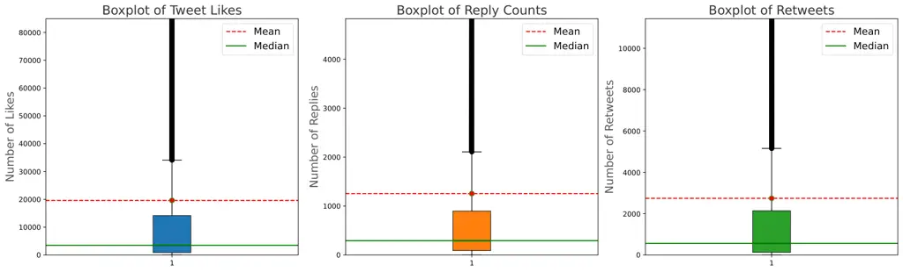
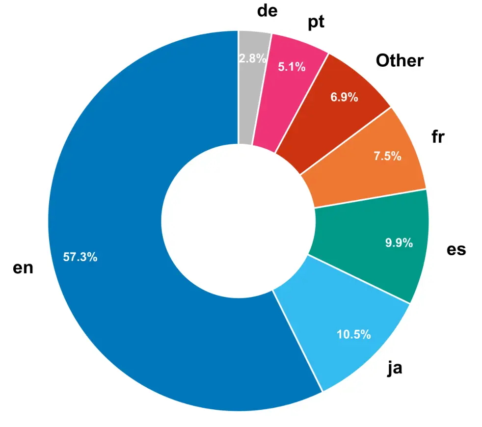

# COMMUNITYNOTES: A Dataset for Exploring the Helpfulness of Fact-Checking Explanations

Rui Xing Preslav Nakov Timothy Baldwin Jey Han Lau
Email: [ruixing@student.unimelb.edu.au,preslav.nakov@mbzuai.ac.ae](mailto:)
Email: [tb@ldwin.net, jeyhan.lau@gmail.com](mailto:) Affiliation: The
University of Melbourne Affiliation: MBZUAI

###### Abstract

Fact-checking on major platforms, such as X, Meta, and TikTok, is
shifting from expert-driven verification to a community-based setup,
where users contribute explanatory notes to clarify why a post might be
misleading. An important challenge here is determining whether an
explanation is helpful for understanding real-world claims and the
reasons why, which remains largely underexplored in prior research. In
practice, most community notes remain unpublished due to slow community
annotation, and the reasons for helpfulness lack clear definitions. To
bridge these gaps, we introduce the task of predicting both the
helpfulness of explanatory notes and the reason for this. We present
COMMUNITYNOTES, a large-scale multilingual dataset of 104k posts with
user-provided notes and helpfulness labels. We further propose a
framework that automatically generates and improves reason definitions
via automatic prompt optimization, and integrate them into prediction.
Our experiments show that the optimized definitions can improve both
helpfulness and reason prediction. Finally, we show that the helpfulness
information is beneficial for existing fact-checking systems. The code
and the data are available at
[https://github.com/ruixing76/Helpfulness-FCExp](https://github.com/ruixing76/Helpfulness-FCExp).

Figure 1: An example of X Community Notes. The potential misleading
tweet states, “mRNA Vaccines Permanently Fuse Into Human DNA”. The
user-generated note appears under _Readers added context_ and provides
an explanation for the tweet.

## 1 Introduction

Beyond simple verification, fact-checking systems should provide
explanations that clarify why a claim is misleading (Atanasova et al.,
2020; Xing et al., 2022; Russo et al., 2023; Warren et al., 2025).
Explanations not only strengthen user trust in fact-checking decisions,
but also help mitigate common pitfalls of fact-checking, e.g., backfire
effect, where exposure to corrections can paradoxically reinforce false
beliefs rather than hinder them (Lewandowsky et al., 2012; Guo et al.,
2022; Xing et al., 2025).

Typically, fact-checking explanations are produced by expert
organizations. Yet the ecosystem is currently shifting, and platforms
are increasingly experimenting with community-based fact-checking, where
contributors collaboratively provide explanatory notes on
claims (Augenstein et al., 2025). This crowd-sourcing process
distributes the labor of verification and offers diverse perspectives
from the community. A representative example is *Community Notes*¹¹ 1
[https://communitynotes.x.com/guide/](https://communitynotes.x.com/guide/)
on X (formerly Twitter), which allows users to attach notes to explain
potentially misleading posts. As illustrated in Figure 1, the
user-generated note appears under _Readers added context_ and provides
an explanation for the tweet.

Critically, for a note to become visible or formally published, it must
receive a sufficient number of ratings from a diverse set of users (De
et al., 2025). A key challenge in this process is determining whether an
explanation is helpful for understanding real-world claims, as well as
identifying why it is helpful, a question that remains largely
underexplored in prior research on fact-checking explanations (Atanasova
et al., 2020; Guo et al., 2022; Russo et al., 2023; Eldifrawi et al.,
2024). In practice, this lack of clarity makes it difficult for
contributors to write effective notes and for raters to assess them
consistently.

This process is slow on Community Notes: notes can take hours or even
days to appear, and the vast majority (over 90%) never become visible,
despite contributor efforts (De et al., 2025). Moreover, although the
platform provides reasons for judging notes as helpful or unhelpful,
these reasons lack clear definitions, leaving both contributors and
raters unclear about the underlying evaluation criteria (De et al.,
2025; Augenstein et al., 2025). This opacity hinders the efficiency,
scalability, and explainability of the crowd-sourced fact-checking.
Motivated by these challenges, we explore the idea of simplifying and
making the helpfulness annotation process more explicit. Our
contributions of this paper are as follows:

- •
  We introduce the task of predicting the helpfulness of an explanatory
  note and the reasons underlying this judgment, given the note and the
  original X post.
- •
  We present COMMUNITYNOTES, a large-scale dataset for explanation
  helpfulness, containing over 104K potentially misleading posts with
  corresponding user-provided notes.
- •
  We propose a framework that automatically generates and optimizes
  reason label definitions via prompt optimization, and integrates these
  definitions into helpfulness and reason predictors to improve their
  performance.
- •
  We apply explanation helpfulness prediction to the evidence
  sufficiency task (Atanasova et al., 2022) and further incorporate it
  as an auxiliary signal into automated fact-checking on
  CLIMATE-FEVER (Diggelmann et al., 2020), demonstrating its potential
  to enhance current existing automated fact-checking systems.

## 2 Related Work

#### Community-Based Fact-Checking

The proliferation of misinformation has become a growing societal
concern, posing significant risks to areas such as public health,
science, and politics (Borenstein et al., 2025). Misleading claims can
spread rapidly online, shaping public opinion and undermining trust in
institutions. To address this challenge, fact-checking has emerged as a
central strategy for mitigating the spread of false or misleading
information, by evaluating claims and providing corrective context to
users (Guo et al., 2022; Nakov et al., 2021; Xie et al., 2025).

Traditionally, fact-checking has been carried out by professional
third-party organizations that assess claim veracity through expert
analysis. However, as a result, recent years have seen a paradigm shift
toward more decentralized, community-based approaches (Renault et al.,
2024; Augenstein et al., 2025). Major social media platforms have
increasingly adopted this paradigm. X’s Community Notes is the most
prominent example, allowing their users to collaboratively annotate and
assess online content by attaching contextual notes to potentially
misleading posts. Following this trend, Meta ended its partnerships with
professional fact-checkers²² 2 [Meta is ending its third-party
fact-checking partnership with US partners. Here’s how that program
works.](https://www.poynter.org/fact-checking/2025/meta-ends-fact-checking-community-notes-facebook)
in favor of a similar community-driven system, while TikTok has also
introduced a comparable feature.³³ 3 [Testing a New Feature to Enhance
Content on TikTok.](https://newsroom.tiktok.com/en-us/footnotes)

Empirical evidence suggests that community-based fact-checking can be
highly effective in countering misinformation at scale. Studies have
shown that the presence of a Community Note can reduce the rate of
retweets by nearly half (Renault et al., 2024), while displaying such
notes on misleading posts has been found to decrease their spread by an
average of 61% (Chuai et al., 2024). Moreover, authors of posts flagged
by community notes are up to 80% more likely to delete their content,
and such posts generally exhibit markedly lower virality (Drolsbach and
Pröllochs, 2023; Renault et al., 2024). These findings highlight the
potential of community-based explanations in debunking online
misinformation.

Despite these benefits, _Community Notes_ often require a long time to
accumulate sufficient contributor ratings to determine helpfulness. In
addition, the absence of reason definitions further undermines the
trustworthiness of the mechanism.

#### Label Definitions

Recent work has shown that providing models with explicit definitions of
labels can lead to substantial improvements in classification. Khatuya
et al. (2025) used predefined label descriptions and trained the model
to generate these descriptions based on the input text, achieving
sizable improvements in multi-label classification. Similarly, Gao
et al. (2023) demonstrated that curating a small dictionary of terms for
label description can improve zero-shot accuracy by 17-19% absolute,
while also increasing the robustness to prompts. Peskine et al. (2023)
showed improvements when using label definitions with GPT-3 zero-shot
classification on the challenging task of fine-grained conspiracy theory
detection.

#### Automatic Prompt Optimization

Prompt engineering has become essential to many Natural Language
Processing (NLP) tasks; yet, manual trial-and-error approaches remain a
barrier to effective use. Automatic Prompt Optimization (APO) methods
address this challenge by systematically searching for high-performing
prompts (Ramnath et al., 2025). These approaches explore the large
instruction space using diverse strategies: PromptBreeder evolves
task-specific prompts across generations using optimized mutation
strategies (Fernando et al., 2024); PromptAgent applies Monte Carlo Tree
Search (MCTS) with feedback reflection to guide exploration (Wang
et al., 2024); and SCULPT represents prompts as trees, enabling targeted
refinements while preserving overall structure—especially useful for
long or complex prompts (Kumar et al., 2025).

## 3 Predicting Whether an Explanation is Helpful and Why

### 3.1 Task Definition

Given a post $`P`$ that contains potentially misleading information and
a note $`N`$ that provides an explanation about that post, the task is
to predict two types of labels: a helpfulness label
$`L_{\mathit{helpful}}`$, indicating whether the note is helpful in
explaining the misleading nature of the post, and a reason label
$`L_{\mathit{reason}}`$, specifying why the note is (un)helpful. The
helpfulness prediction is formulated as a binary classification task
with the label space $`\{\mathit{Helpful},\mathit{Unhelpful}\}`$. The
reason prediction is a multi-label classification task, where the
predefined label set includes eight reasons for helpful notes and ten
reasons for unhelpful ones (see Appendix Table 15 for detailed reason
labels).

| Language        | Train  | Dev    | Test   | Total   |
| --------------- | ------ | ------ | ------ | ------- |
| English         | 40,994 | 5,858  | 11,717 | 58,569  |
| Other languages | 32,478 | 4,638  | 9,281  | 46,397  |
| Total           | 73,472 | 10,496 | 20,998 | 104,966 |

Table 1: COMMUNITYNOTES data split statistics for English and Other
languages.

| Text Type | Mean  | Median | Min | Max   |
| --------- | ----- | ------ | --- | ----- |
| Post      | 57.44 | 42     | 0   | 5,072 |
| Note      | 87.05 | 70     | 1   | 1,402 |

Table 2: Token length statistics for claims and notes. Texts are
tokenized by OpenAI’s [tiktoken
v0.11.0](https://github.com/openai/tiktoken).

### 3.2 Data Collection and Pre-processing

We collected all our data from X’s official Community Notes platform
between January 2021 and December 2024, combining all publicly available
releases. Because ratings are provided in multiple shards, we merge them
and join them with the remaining components to obtain complete
note–rating pairs. We then apply the official note-ranking algorithm to
compute the aggregated helpfulness and reason labels. For helpfulness
prediction, we remove entries labeled NEED_MORE_RATINGS, resulting in a
binary label space–CURRENTLY_RATED_HELPFUL or
CURRENTLY_RATED_NOT_HELPFUL. The reason annotation is multi-label,
covering 18 predefined categories. Finally, we retrieve tweet content
and metadata via the X API and web crawling (Borenstein et al., 2025),
linking each post with its corresponding notes to create the final
dataset. See Section A.2 for details of the preprocessing.

Table 1 provides the data distribution. Our final dataset contains
104,966 posts, including 58,569 posts in English and 46,397 in other
languages. Note that each post may be associated with one or more notes.
We perform stratified partitioning with a ratio of 7:1:2 for training,
development, and testing sets, maintaining separate splits for English
and other language data. Henceforth we will refer to this dataset as
COMMUNITYNOTES.

| Notes per Post | Count (%)  |
| -------------- | ---------- |
| 1              | 84.74%     |
| 2              | 11.84%     |
| 3              | 02.43%     |
| 4              | 00.65%     |
| 5              | 00.18%     |
| 6              | 00.08%     |
| 7              | 00.03%     |
| 8              | 00.01%     |
| $`\geq`$9      | $`<`$0.02% |

Table 3: Distribution of the number of notes per post. The majority of
posts have only one associated note.

Figure 2: The histogram of the _Note Reason_ label distribution.
COMMUNITYNOTES contains 18 reason categories—8 corresponding to helpful
notes and 10 to not helpful notes.

### 3.3 Dataset Statistics

We inspected multiple aspects of our entire COMMUNITYNOTES dataset.
Table 2 shows the token length distribution for posts and notes
correspondingly. The median token numbers are 42 for posts and 70 for
notes, which suggests most posts and notes are short text snippets in
our dataset.

In Table 3, we observe that 84.74% of posts have only one note, 11.84%
have two notes, and the remaining posts contain three or more notes.
Table 4 shows that 64.36% of posts have notes that are all rated as
helpful, 31.30% have only unhelpful notes, and the remaining 4.34%
include notes with mixed ratings. There are eight predefined reasons for
a note being rated as helpful and ten reasons for being rated as
unhelpful. The most common helpful reasons are helpfulAddressClaim,
helpfulImportantContext, and helpfulClear, whereas
nothelpfulArgumentativeOrBiased and nothelpfulMissingKeyPoints are the
most frequent unhelpful reasons.

Figure 3: Boxplot of tweet post reactions in COMMUNITYNOTES. We measure
popularity using the number of replies, likes, and retweets. These posts
receive a median of approximately 3k likes, 300 replies, and 700
retweets, indicating that notes are frequently attached to already
popular content.

Figure 4: The language distribution of COMMUNITYNOTES: en=English,
fr=French, es=Spanish, ja=Japanese, pt=Portuguese, de=German,
Other=languages that appear less than 1,000 times.

We present the distribution of helpfulness reasons in COMMUNITYNOTES in
Figure 2. The most frequent helpful reason categories are helpfulClear,
helpfulImportantContext and helpfulAddressClaim. They account for the
majority of helpful instances in our dataset.

|                                 |        |            |
| ------------------------------- | ------ | ---------- |
| Post Type                       | Count  | Percentage |
| All helpful notes               | 67,558 | 64.36%     |
| All unhelpful notes             | 32,851 | 31.30%     |
| Mixed helpful / unhelpful notes | 04,557 | 04.34%     |

Table 4: Distribution of posts by helpfulness composition of their
associated notes.

The most frequent not helpful reasons in our dataset are
notHelpfulNoteNotNeeded, notHelpfulMissingKeyPoints, and
notHelpfulOpinionSpeculationOrBias. They form a distinct middle tier in
COMMUNITYNOTES. The remaining categories form a long tail with
substantially lower frequencies.

Beyond note level statistics, we also examine the popularity of the
posts targeted by notes in Figure 3. We measure popularity using the
number of replies, likes, and retweets. These posts receive a median of
approximately 3k likes, 300 replies, and 700 retweets, indicating that
notes are frequently attached to already popular content. As shown in
Figure 3, The mean reaction counts are substantial (e.g., $`\approx`$
1,200 replies, $`\approx`$ 2,800 retweets, and $`\approx`$ 20,000
likes), indicating that posts in the dataset receive great public
attention on average. However, the median for all three metrics is near
zero. This large gap between the mean and median confirms the existence
of a long tail of highly viral tweets. Given that such posts are flagged
as potentially misleading, this highlights the importance of providing
clear and helpful explanations at scale.

Figure 4 illustrates the language distribution of COMMUNITYNOTES.
English is the dominant language, accounting for 57.3% of all notes,
followed by Japanese (10.5%) and Spanish (9.9%). This indicates that our
final dataset effectively captures the multilingual nature of
crowd-sourced explanations.

### 3.4 Benchmarking

#### Experimental Setup

To establish a baseline for understanding the model performance in
predicting the note helpfulness on COMMUNITYNOTES, we conducted a
comprehensive set of experiments using both Small Language Models (SLMs)
(BERT-style encoder-only architectures in our paper) and decoder-only
Large Language Models (LLMs). This setup provides a clear view of how
different model architectures and capacities affect performance on our
helpfulness evaluation task.

For SLMs, we formulate the task as multi-task classification, jointly
predicting: (1) a binary helpfulness label; and (2) a multi-label reason
classification, across 18 predefined categories. Inputs are constructed
as a concatenated sequence in the format “\[CLS\] Claim: {claim} \[SEP\]
Note: {note_text}”. For LLMs, we fine-tune using LoRA fine-tuning (Hu
et al., 2022) (see Appendix Table 15 for detailed prompts).

We partitioned our experiments by model and language setting. For
English, we experimented with SLMs including BERT (Devlin et al., 2019),
ModernBERT (Warner et al., 2025), RoBERTa (Liu et al., 2019) and DeBERTa
(both base and large) (He et al., 2023), For multilingual evaluation, we
used BERT-base-multilingual (mBERT) and XLM-RoBERTa. We also evaluated
LLMs including Llama3.1-8B (Dubey et al., 2024) and Mistral-7B (Jiang
et al., 2023) for both English and multilingual settings on
COMMUNITYNOTES.

|          |                   |                |          |          |           |
| -------- | ----------------- | -------------- | -------- | -------- | --------- |
| Language | Model             | Helpfulness F1 | Reason P | Reason R | Reason F1 |
| English  | BERT-base         | 0.866          | 0.549    | 0.742    | 0.631     |
|          | BERT-large        | 0.874          | 0.553    | 0.758    | 0.640     |
|          | RoBERTa-base      | 0.876          | 0.546    | 0.783    | 0.643     |
|          | RoBERTa-large     | 0.890          | 0.581    | 0.772    | 0.663     |
|          | ModernBERT-base   | 0.871          | 0.545    | 0.755    | 0.633     |
|          | ModernBERT-large  | 0.888          | 0.576    | 0.752    | 0.652     |
|          | DeBERTa-base      | 0.886          | 0.541    | 0.810    | 0.650     |
|          | DeBERTa-large     | 0.896          | 0.589    | 0.759    | 0.665     |
|          | Llama3.1-8B       | 0.919          | 0.640    | 0.640    | 0.640     |
|          | Mistral-7B        | 0.920          | 0.620    | 0.620    | 0.620     |
| Other    | mBERT             | 0.873          | 0.562    | 0.799    | 0.659     |
|          | XLM-RoBERTa-base  | 0.882          | 0.584    | 0.798    | 0.674     |
|          | XLM-RoBERTa-large | 0.894          | 0.603    | 0.815    | 0.693     |
|          | Llama3.1-8B       | 0.928          | 0.653    | 0.652    | 0.653     |
|          | Mistral-7B        | 0.926          | 0.647    | 0.647    | 0.647     |

Table 5: Benchmark results for helpfulness and reasons prediction.
_Helpfulness_ means the binary classification of notes helpfulness.
_Reason_ means multi-label classification of helpfulness reasons. _P_ is
Precision and _R_ is Recall.

#### Results and Analysis

As shown in Table 5, models perform well on helpfulness prediction, with
most of them achieving F1 above 0.88. This suggests that this task is
relatively easy. In contrast, reason prediction is much more
challenging, as reflected by substantially lower F1 for all models,
which consistently fall below 0.70.

Comparing SLMs to LLMs: Table 5 shows that LLMs such as Llama3.1-8B and
Mistral-7B outperform smaller SLMs on helpfulness prediction. In
paticular, Mistral-7B achieves the highest F1 score (0.920),
demonstrating the advantages of larger models. However, LLMs perform
worse than SLMs in reason prediction, with F1 remaining comparable to
those of the best-performing SLMs such as DeBERTa-large.

Within the SLM families (BERT, RoBERTa, DeBERTa), larger models
consistently outperform their base-sized counterparts. For example,
RoBERTa-large achieves better scores than RoBERTa-base across all
metrics. This highlights the importance of model capacity for capturing
the nuances required for this complex task. The table also shows that
DeBERTa models generally perform at or near the top among the SLMs,
particularly for the reasons task, with the highest F1 Score of 0.665
among all SLMs.

The multilingual part show a similar trend: larger models achieve strong
performance in Helpfulness prediction while smaller models like mBert
and XLM-RoBERTa exhibit better performance on the reason prediction.
Among all models, XLM-RoBERTa-large achieves the highest Reason F1 of
0.693. This indicates that these models are effective at generalizing
across different languages.

Figure 5: Our framework for automatic reason definition generation and
optimization. (1) Seed reason definitions are generated from sampled
post-note pairs. (2) The definitions are refined via PromptAgent. (3)
The optimized definitions are embedded and fused with note
representations for joint helpfulness and reason prediction.

## 4 Enhancing Helpfulness Prediction with Reason Definitions

Preliminary analysis shows that predicting why a particular explanation
is (un)helpful is often subjective across instances, largely due to the
lack of unified or official definitions. This subjectivity poses a
barrier to model performance and limits the explainability of
community-based fact-checking platforms. Prior work has demonstrated
that providing clear label definitions can significantly improves the
classification performance (Gao et al., 2023; Peskine et al., 2023;
Khatuya et al., 2025).

Given the large number of notes with annotated reasons available, we aim
to automatically generate and optimize reason label definitions based on
data. To this end, we introduce a pipeline that leverages Automatic
Prompt Optimization (APO) to generate and improve helpfulness reason
definitions, which are then integrated with notes for reason prediction.
Since the majority of notes are written in English, we focus on English
data for the remainder of our experiments. Figure 5 illustrates the
overall pipeline of our approach.

### 4.1 Automatically Optimizing Helpfulness Reason Definition

We automatically generate and optimize reason definitions following the
first two steps in Figure 5: (1) Seed reason definition generation; and
(2) Reason definition optimization. In the first step, we follow Peskine
et al. (2023) and randomly sample 40 instances per helpfulness reason
category. We then prompt the GPT-4o model⁴⁴ 4 Detailed model version:
[gpt-4o-2024-08-06](https://platform.openai.com/docs/models/gpt-4o). to
generate an initial “seed” version of the definitions based on the
sampled candidate instances (see Appendix Table 14 for detailed prompts
to generate seed definitions).⁵⁵ 5 Since a single sample may have
multiple reason labels, we perform an additional check to ensure that
each sample appears only within the same category to encourage
diversity. In the second step, we employ PromptAgent (Wang et al.,
2024), a Monte Carlo Tree Search (MCTS)-based automatic prompt
optimization framework, to refine the initial definitions.

PromptAgent adopts an iterative refinement process that emulates how
human experts strategically craft effective prompts, using an MCTS-based
planning mechanism. Each refined prompt corresponds to a new state in
the search space, obtained by the refiner agent model through feedback
collected from the feedback agent model. PromptAgent relies on the MCTS
state–action value function to estimate the reward of each state. MCTS
iteratively performs four key operations—selection, expansion,
simulation, and backpropagation—until a predefined number of iterations
is reached. The highest-reward trajectory is then selected to produce
the final refined prompt. We initialize the process with the seed
definitions obtained from step (1) in Figure 5 and run adapted
PromptAgent using a definition-refinement feedback loop.

| Model                | Helpfulness F1 | Reason F1 |
| -------------------- | -------------- | --------- |
| Llama3.1-8B-ins      | 0.636          | 0.126     |
| Llama3.1-8B-ins-seed | 0.783          | 0.304     |
| Llama3.1-8B-ins-opt  | 0.785          | 0.344     |
| Mistral-7B-ins       | 0.761          | 0.135     |
| Mistral-7B-ins-seed  | 0.776          | 0.257     |
| Mistral-7B-ins-opt   | 0.786          | 0.324     |

Table 6: Zero-shot prediction performance for LLMs w/o adding reason
definitions on our COMMUNITYNOTES test set. _No suffix_ means the
vanilla model prediction performance. _seed_ means definitions are
generated by GPT-4o on randomly sampled cases. _opt_ means that the
definitions are further optimized by PromptAgent.

To evaluate the impact of incorporating generated definitions, we
perform zero-shot prompting with Llama3.1-8B and Mistral-7B for both
helpfulness and reason prediction. Table 6 reports results for the
vanilla setting, as well as for models integrated with seed and
optimized definitions. We observe substantial F1 improvements in both
helpfulness and reason prediction when adding seed definitions (on
average around 15%), with further gains after definition optimization,
indicating that refined definitions provide additional benefits.

For Llama3.1-8B, both seed and optimized definitions yield large
improvements. Although Mistral-7B starts stronger than Llama3.1-8B in
the vanilla setting, it still benefits notably from incorporating
definitions, particularly in reason F1. These results suggest that
incorporating reason definition information substantially enhances model
performance—not only in predicting whether a given explanation note is
helpful, but also in identifying the underlying reason with respect to
the claim. (See detailed seed definition in Table 18 and optimized
reason definition in Table 19 in the Appendix).

| Model                | Helpfulness F1 | Reason F1 |
| -------------------- | -------------- | --------- |
| RoBERTa-base         | 0.876          | 0.643     |
| RoBERTa-base-MHA     | 0.887          | 0.652     |
| RoBERTa-large        | 0.890          | 0.663     |
| RoBERTa-large-MHA    | 0.899          | 0.672     |
| ModernBERT-base      | 0.871          | 0.633     |
| ModernBERT-base-MHA  | 0.874          | 0.644     |
| ModernBERT-large     | 0.888          | 0.652     |
| ModernBERT-large-MHA | 0.898          | 0.662     |
| DeBERTa-base         | 0.886          | 0.650     |
| DeBERTa-base-MHA     | 0.887          | 0.668     |
| DeBERTa-large        | 0.896          | 0.665     |
| DeBERTa-large-MHA    | 0.896          | 0.677     |

Table 7: Reason prediction performance comparison of base SLMs versus
fusing optimized reason definition with the Multi-Head Attention module.

### 4.2 Training with Reason Definition Fusion

After obtaining the optimized helpfulness reason definitions, we proceed
to the third step in Figure 5, where we incorporate this information
into the training SLM predictors for helpfulness and reason prediction.
The core idea is that the predictor should attend more strongly to the
most relevant helpfulness reasons for a given claim–note pair.

We obtain note embeddings $`E_{note}`$ from the base predictors and
reason embeddings $`E_{reason}`$ from the optimized reason definitions
using LLM2Vec (BehnamGhader et al., 2024).⁶⁶ 6 Specifically, we use the
following model:
[LLM2Vec-Meta-Llama-31-8B-Instruct-mntp-supervised](https://huggingface.co/McGill-NLP/LLM2Vec-Meta-Llama-31-8B-Instruct-mntp-supervised).
We then apply a Multi-Head Attention (MHA) mechanism, using $`E_{note}`$
as the query (Q) and $`E_{reason}`$ as the key (K) and value (V), to
fuse the reason information into the note representation. Finally, we
adopt a multi-task learning objective that jointly optimizes helpfulness
prediction and multi-label reason classification for our experiments.

Table 7 shows that integrating optimized reason definitions via MHA
consistently improves performance across all SLMs. For example,
RoBERTa-large-MHA achieves a Helpfulness F1 of 0.899 and a Reason F1 of
0.669, outperforming its vanilla counterpart (0.890 and 0.663,
respectively). Similar trends hold for ModernBERT and DeBERTa, with
DeBERTa-large-MHA achieving the highest Reason F1 score of 0.677.

Overall, these results demonstrate that attention-based fusion of reason
definitions effectively enhances SLMs for both helpfulness and reason
prediction on COMMUNITYNOTES.

| Predictors             | NEI P | NEI R | NEI F1 |
| ---------------------- | ----- | ----- | ------ |
| RoBERTa-base-FT        | 0.869 | 0.920 | 0.894  |
| RoBERTa-base-notes     | 0.742 | 0.521 | 0.612  |
| RoBERTa-large-FT       | 0.882 | 0.935 | 0.908  |
| RoBERTa-large-notes    | 0.731 | 0.676 | 0.702  |
| ModernBERT-base-FT     | 0.845 | 0.843 | 0.844  |
| ModernBERT-base-notes  | 0.770 | 0.779 | 0.774  |
| ModernBERT-large-FT    | 0.902 | 0.906 | 0.904  |
| ModernBERT-large-notes | 0.808 | 0.807 | 0.808  |
| DeBERTa-base-FT        | 0.912 | 0.855 | 0.882  |
| DeBERTa-base-notes     | 0.746 | 0.553 | 0.635  |
| DeBERTa-large-FT       | 0.919 | 0.890 | 0.905  |
| DeBERTa-large-notes    | 0.736 | 0.774 | 0.755  |

Table 8: Predictor generalization performance on evidence sufficiency
task. notes stands for models for original communitynotes predictors. FT
means FineTuned models on evidence sufficiency task. NEI means Not
Enough Information label.

## 5 Generalization of the Explanation Helpfulness

In this section, we assess the generalization and the utility of our
helpfulness predictors beyond community notes. A key challenge is that
most existing datasets lack explicit annotations for explanation of
helpfulness. Therefore, we explore two key scenarios in automated
fact-checking. First, we evaluate whether helpfulness prediction can
generalize to evidence sufficiency prediction, which is an important
subtask in fact-checking (Atanasova et al., 2022). Second, we explore
the effect of incorporating evidence helpfulness in automated
fact-checking (Xing et al., 2025).

### 5.1 Generalization to Evidence Sufficiency

Evidence sufficiency is a task that decides whether the information in
the evidence is sufficient for predicting the veracity of a claim.
Automated fact-checking models can make veracity predictions only when
there is enough evidence (Atanasova et al., 2022). In this scenario, we
would like to explore whether our helpfulness predictors can predict the
sufficiency of an evidence (since a helpful evidence must be
“sufficient”). We adopted *Sufficient Fact* (Atanasova et al., 2022), a
diagnostic fact-checking dataset to detect when evidence with omitted
information is (in)sufficient. To adapt our prediction, we treat
sufficient evidence (EI-ENOUGH INFO) as helpful and insufficient
evidence (NEI-NOT ENOUGH INFO) as unhelpful. Table 8 shows the model
performance on the evidence sufficiency task, focusing on the NEI label.

As expected, fine-tuned (FT) models outperform the original notes
predictors, with RoBERTa-large-FT achieving the best NEI F1 of 0.908.
Nevertheless, the notes models show competitive performance: for
example, ModernBERT-large-notes achieves a NEI F1 of 0.808, only about
10% lower than its FT counterpart. Across all predictors, the top
predicted reason is notHelpfulMissingKeyPoints, which closely
corresponds to the NEI label, as both signify the absence of critical
information. This indicates that helpfulness prediction carries
transferable signal for evidence sufficiency.

Still, helpfulness and sufficiency are not the same: even sufficient
evidence could be predicted as unhelpful for other reasons such as
notHelpfulArgumentativeOrBiased, which may account for the observed
performance gap in our experiments.

### 5.2 Incorporating Evidence Helpfulness in Automated Fact Checking

In this part, we further investigate whether predicted evidence
helpfulness can enhance automated fact-checking. Helpfulness scores
provide auxiliary signals for assessing evidence quality, with the
potential to help models prioritize informative evidence during
prediction. We adopted CLIMATE-FEVER (Diggelmann et al., 2020), a
real-world dataset for verifying climate change–related claims. Each
claim is associated with multiple evidence sentences, to which we apply
our predictors to assign helpfulness scores and reasons. To perform
fact-checking, we use Llama3.1-8B to perform fact-checking (see detailed
prompt in Appendix Table 20) prompting the model with both the claim and
its associated evidence.

We compare the F1 with and without the evidence helpfulness information
and report results in Table 9. Overall, incorporating helpfulness
improves fact-checking performance, with ModernBERT-base achieving 0.537
accuracy and ModernBERT and RoBERTa-base improving performance by around
2%. While ModernBERT demonstrates major gains, DeBERTa and RoBERTa yield
smaller, non-significant improvements. Interestingly, this pattern
mirrors their performance drop in cross-domain evidence sufficiency
evaluation in Section 5.1 (despite strong in-domain results in Table 5).
One possible explanation is that models overfit COMMUNITYNOTES and
generalize less effectively to other domains.

| Predictors       | F1    | +Helpfulness F1 |
| ---------------- | ----- | --------------- |
| RoBERTa-base     | 0.517 | 0.521           |
| RoBERTa-large    | 0.519 | 0.521           |
| ModernBERT-base  | 0.521 | 0.535           |
| ModernBERT-large | 0.517 | 0.535           |
| DeBERTa-base     | 0.517 | 0.519           |
| DeBERTa-large    | 0.518 | 0.519           |

Table 9: Automated fact-checking performance of Llama3.1-8B on the
CLIMATE-FEVER dataset. _F1_ stands for Accuracy. _+Helpfulness F1_ means
accuracy incorporating helpfulness information. Numbers in bold
represents the gap between _+Helpfulness_ and basic prediction accuracy
is statistically significant (using a two-tailed t-test with
$`p<0.05`$).

## 6 Conclusion

In this paper, we introduced the novel task of predicting the
helpfulness of explanations and their underlying reasons for a given
claim. To support this task, we constructed COMMUNITYNOTES, a
large-scale post–note helpfulness dataset based on X’s Community Notes,
and established benchmarks with pretrained language models.

While existing models perform reasonably well on overall helpfulness,
they struggle to identify underlying reasons. To address this
limitation, we proposed a framework that automatically generates and
optimizes reason definitions, which, when reintegrated, greatly improves
reason prediction. We further demonstrated that helpfulness prediction
can help predict evidence sufficiency and enhance automated
fact-checking systems.

Beyond performance gains, our findings highlight the importance of
making evaluation criteria for explanation helpfulness more explicit and
structured. We hope that our dataset and framework can serve as a
foundation for building stronger helpfulness predictors capable of
assigning prior labels to real-time community notes, thereby
streamlining the community-based fact-checking process. Additionally,
the automatically generated and optimized reason definitions may enhance
the explainability and trustworthiness of automated fact-checking models
and could be extended to improve other classification tasks beyond this
domain.

In future work, we plan to extend our framework to multilingual and
multimodal settings and evaluate it in more advanced end-to-end
fact-checking systems and real-world applications.

## Limitations

While our study provides new insights into the helpfulness of
crowd-sourced fact-checking explanations, several limitations remain.

First, the inherently subjective nature of community-based annotations
introduces potential noise and inconsistency in the helpfulness and
reason labels. Despite our efforts to aggregate ratings through official
mechanisms, differences in annotator interpretation and cultural context
may still influence the results.

Second, our automated definition generation and optimization pipeline
has thus far been evaluated primarily on English. Although our dataset
includes multilingual content, we did not systematically validate the
quality or transferability of the generated definitions across
languages. Future work should explore multilingual adaptation and
cross-lingual alignment of reason definitions.

Third, while our experiments show improved model performance when
integrating optimized reason definitions, the evaluation is limited to
classification metrics. Further human-centered evaluation is necessary
to assess whether these improvements translate to greater
interpretability and practical usefulness in real-world fact-checking
workflows.

Finally, our study focuses on publicly available _Community Notes_ data,
which may reflect platform-specific norms and biases. For a broader
generalization to other fact-checking ecosystems (e.g., Meta’s or
TikTok’s community moderation systems), we need further investigation.

## Ethics and Broader Impact

Our work aims to improve the transparency, explainability, and
scalability of community-based fact-checking systems. By modeling and
predicting the helpfulness of user-generated explanations, we hope to
assist both contributors and platforms in identifying notes that are
more informative, balanced, and useful for the public discourse.

#### Bias and Fairness.

Community-based ratings may reflect social, cultural, or political
biases that influence which notes are deemed “helpful.” Our models
inevitably inherit such biases from the underlying data. We would like
to emphasize that model predictions should not be directly used to
automatically moderate or suppress user content. Instead, they should be
interpreted as auxiliary signals to guide human review.

#### Responsible Use.

While our framework can help prioritize potentially helpful notes, it is
not intended to replace human judgment. Automated systems that assign
helpfulness or credibility labels at scale may affect content
visibility, user reputation, and online discourse. We encourage
incorporating fairness-aware and interpretable mechanisms before
deployment.

#### Positive Societal Impact.

Despite these caveats, our dataset and models can help combat
misinformation by improving the quality, trustworthiness, and
accessibility of community fact-checking. Making helpfulness definitions
explicit and machine-interpretable supports more transparent and
accountable information verification.

#### Data Collection and Licenses

All data that we used in this work originated from the publicly
available X Community Notes dataset,⁷⁷ 7
[https://communitynotes.x.com/guide/en/under-the-hood/download-data](https://communitynotes.x.com/guide/en/under-the-hood/download-data)
which was released under the X platform’s open data policy. The dataset
contains user-generated notes, associated posts, and helpfulness and
reason labels, without any personally identifiable information. We
release only anonymized text and aggregated statistics in compliance
with the X platform’s terms of service. The dataset is multilingual,
with English, Japanese, and Spanish being the best represented
languages. Any future release of derived data will follow ACL data
ethics guidelines with appropriate documentation, to enable transparent,
reproducible research in NLP and computational social science.

#### Security Implication

Our study introduces no direct security risks, but models trained on
user-generated content may be vulnerable to misuse, such as large-scale
manipulation or suppression of dissent. To mitigate these risks, we
release only aggregated and anonymized data and emphasize that our
models are intended for research use, not automated moderation or
deployment without human oversight. Future work should address
adversarial attacks, bias exploitation, and model inversion risks when
integrating such models into live platforms.

## Acknowledgments

We thank our reviewers for their valuable reviews and feedback, which
greatly contributed to the improvement of our paper.

## References

- Atanasova et al. (2020) Pepa Atanasova, Jakob Grue Simonsen, Christina
  Lioma, and Isabelle Augenstein. 2020. [Generating fact checking
  explanations](https://doi.org/10.18653/v1/2020.acl-main.656). In
  _Proceedings of the 58th Annual Meeting of the Association for
  Computational Linguistics_, ACL 2020, pages 7352–7364, Online.
  Association for Computational Linguistics.
- Atanasova et al. (2022) Pepa Atanasova, Jakob Grue Simonsen, Christina
  Lioma, and Isabelle Augenstein. 2022. [Fact checking with insufficient
  evidence](https://doi.org/10.1162/tacl_a_00486). _Transactions of the
  Association for Computational Linguistics_, 10:746–763.
- Augenstein et al. (2025) Isabelle Augenstein, Michiel Bakker, Tanmoy
  Chakraborty, David Corney, Emilio Ferrara, Iryna Gurevych, Scott Hale,
  Eduard Hovy, Heng Ji, Irene Larraz, Filippo Menczer, Preslav Nakov,
  Paolo Papotti, Dhruv Sahnan, Greta Warren, and Giovanni Zagni. 2025.
  [Community moderation and the new epistemology of fact checking on
  social media](https://arxiv.org/abs/2505.20067). _ArXiv preprint_,
  abs/2505.20067.
- BehnamGhader et al. (2024) Parishad BehnamGhader, Vaibhav Adlakha,
  Marius Mosbach, Dzmitry Bahdanau, Nicolas Chapados, and Siva
  Reddy. 2024. [LLM2Vec: Large language models are secretly powerful
  text encoders](https://openreview.net/forum?id=IW1PR7vEBf). In
  _Proceedings of the First Conference on Language Modeling_, COLM 24,
  Philadelphia, PA, USA.
- Borenstein et al. (2025) Nadav Borenstein, Greta Warren, Desmond
  Elliott, and Isabelle Augenstein. 2025. [Can community notes replace
  professional
  fact-checkers?](https://doi.org/10.18653/v1/2025.acl-short.42) In
  _Proceedings of the 63rd Annual Meeting of the Association for
  Computational Linguistics_, ACL 2025, pages 535–552, Vienna, Austria.
  Association for Computational Linguistics.
- Chuai et al. (2024) Yuwei Chuai, Moritz Pilarski, Thomas Renault,
  David Restrepo-Amariles, Aurore Troussel-Clément, Gabriele Lenzini,
  and Nicolas Pröllochs. 2024. [Community-based fact-checking reduces
  the spread of misleading posts on social
  media](https://arxiv.org/abs/2409.08781). _ArXiv preprint_,
  abs/2409.08781.
- De et al. (2025) Soham De, Michiel A. Bakker, Jay Baxter, and Martin
  Saveski. 2025. [Supernotes: Driving consensus in crowd-sourced
  fact-checking](https://doi.org/10.1145/3696410.3714934). In
  _Proceedings of the ACM on Web Conference 2025_, WWW 25, page
  3751–3761, Sydney NSW, Australia. Association for Computing Machinery.
- Devlin et al. (2019) Jacob Devlin, Ming-Wei Chang, Kenton Lee, and
  Kristina Toutanova. 2019. [BERT: Pre-training of deep bidirectional
  transformers for language
  understanding](https://doi.org/10.18653/v1/N19-1423). In _Proceedings
  of the 2019 Conference of the North American Chapter of the
  Association for Computational Linguistics: Human Language
  Technologies_, NAACL 2019, pages 4171–4186, Minneapolis, Minnesota.
  Association for Computational Linguistics.
- Diggelmann et al. (2020) Thomas Diggelmann, Jordan Boyd-Graber, Jannis
  Bulian, Massimiliano Ciaramita, and Markus Leippold. 2020.
  [CLIMATE-FEVER: A dataset for verification of real-world climate
  claims](https://arxiv.org/abs/2012.00614). _ArXiv preprint_,
  abs/2012.00614.
- Drolsbach and Pröllochs (2023) Chiara Patricia Drolsbach and Nicolas
  Pröllochs. 2023. [Diffusion of community fact-checked misinformation
  on Twitter](https://doi.org/10.1145/3610058). In _Proceedings of the
  ACM on Human-Computer Interaction_, New York, USA. Association for
  Computing Machinery.
- Dubey et al. (2024) Abhimanyu Dubey, Abhinav Jauhri, Abhinav Pandey,
  Abhishek Kadian, Ahmad Al-Dahle, Aiesha Letman, Akhil Mathur, Alan
  Schelten, Amy Yang, Angela Fan, Anirudh Goyal, Anthony Hartshorn, Aobo
  Yang, Archi Mitra, Archie Sravankumar, Artem Korenev, Arthur Hinsvark,
  Arun Rao, Aston Zhang, and 8 others. 2024. [The Llama 3 herd of
  models](https://arxiv.org/abs/2407.21783). _ArXiv preprint_,
  abs/2407.21783.
- Eldifrawi et al. (2024) Islam Eldifrawi, Shengrui Wang, and Amine
  Trabelsi. 2024. [Automated justification production for claim veracity
  in fact checking: A survey on architectures and
  approaches](https://doi.org/10.18653/v1/2024.acl-long.361). In
  _Proceedings of the 62nd Annual Meeting of the Association for
  Computational Linguistics_, ACL 2024, pages 6679–6692, Bangkok,
  Thailand. Association for Computational Linguistics.
- Fernando et al. (2024) Chrisantha Fernando, Dylan Banarse, Henryk
  Michalewski, Simon Osindero, and Tim Rocktäschel. 2024.
  [PromptBreeder: Self-referential self-improvement via prompt
  evolution](https://openreview.net/forum?id=9ZxnPZGmPU). In
  _Proceedings of Forty-first International Conference on Machine
  Learning_, ICML 2024, Vienna, Austria. OpenReview.net.
- Gao et al. (2023) Lingyu Gao, Debanjan Ghosh, and Kevin Gimpel. 2023.
  [The benefits of label-description training for zero-shot text
  classification](https://doi.org/10.18653/v1/2023.emnlp-main.853). In
  _Proceedings of the 2023 Conference on Empirical Methods in Natural
  Language Processing_, EMNLP 2023, pages 13823–13844, Singapore.
  Association for Computational Linguistics.
- Guo et al. (2022) Zhijiang Guo, Michael Schlichtkrull, and Andreas
  Vlachos. 2022. [A survey on automated
  fact-checking](https://doi.org/10.1162/tacl_a_00454). _Transactions of
  the Association for Computational Linguistics_, 10:178–206.
- He et al. (2023) Pengcheng He, Jianfeng Gao, and Weizhu Chen. 2023.
  [DeBERTaV3: Improving DeBERTa using ELECTRA-style pre-training with
  gradient-disentangled embedding
  sharing](https://openreview.net/pdf?id=sE7-XhLxHA). In _Proceedings of
  The Eleventh International Conference on Learning Representations_,
  ICLR 2023, Kigali, Rwanda. OpenReview.net.
- Hu et al. (2022) Edward J. Hu, Yelong Shen, Phillip Wallis, Zeyuan
  Allen-Zhu, Yuanzhi Li, Shean Wang, Lu Wang, and Weizhu Chen. 2022.
  [LoRA: Low-rank adaptation of large language
  models](https://openreview.net/forum?id=nZeVKeeFYf9). In _Proceedings
  of the Tenth International Conference on Learning Representations_,
  ICLR 2022, Virtual Event. OpenReview.net.
- Jiang et al. (2023) Albert Q. Jiang, Alexandre Sablayrolles, Arthur
  Mensch, Chris Bamford, Devendra Singh Chaplot, Diego de Las Casas,
  Florian Bressand, Gianna Lengyel, Guillaume Lample, Lucile Saulnier,
  Lélio Renard Lavaud, Marie-Anne Lachaux, Pierre Stock, Teven Le Scao,
  Thibaut Lavril, Thomas Wang, Timothée Lacroix, and William El
  Sayed. 2023. [Mistral 7b](https://arxiv.org/abs/2310.06825). _ArXiv
  preprint_, abs/2310.06825.
- Khatuya et al. (2025) Subhendu Khatuya, Shashwat Naidu, Saptarshi
  Ghosh, Pawan Goyal, and Niloy Ganguly. 2025. [Label-semantics aware
  generative approach for domain-agnostic multilabel
  classification](https://doi.org/10.18653/v1/2025.findings-acl.1145).
  In _Findings of the Association for Computational Linguistics: ACL
  2025_, ACL 2025, pages 22286–22298, Vienna, Austria. Association for
  Computational Linguistics.
- Kumar et al. (2025) Shanu Kumar, Akhila Yesantarao Venkata, Shubhanshu
  Khandelwal, Bishal Santra, Parag Agrawal, and Manish Gupta. 2025.
  [SCULPT: Systematic tuning of long
  prompts](https://doi.org/10.18653/v1/2025.acl-long.730). In
  _Proceedings of the 63rd Annual Meeting of the Association for
  Computational Linguistics_, ACL 2025, pages 14996–15029, Vienna,
  Austria. Association for Computational Linguistics.
- Lewandowsky et al. (2012) Stephan Lewandowsky, Ullrich K. H. Ecker,
  Colleen M. Seifert, Norbert Schwarz, and John Cook. 2012.
  [Misinformation and its correction: Continued influence and successful
  debiasing](https://doi.org/10.1177/1529100612451018). _Psychological
  Science in the Public Interest_, 13(3):106–131. PMID: 26173286.
- Liu et al. (2019) Yinhan Liu, Myle Ott, Naman Goyal, Jingfei Du,
  Mandar Joshi, Danqi Chen, Omer Levy, Mike Lewis, Luke Zettlemoyer, and
  Veselin Stoyanov. 2019. [RoBERTa: A robustly optimized BERT
  pretraining approach](https://arxiv.org/abs/1907.11692). _ArXiv
  preprint_, abs/1907.11692.
- Martel and Rand (2024) Cameron Martel and David G. Rand. 2024.
  [Fact-checker warning labels are effective even for those who distrust
  fact-checkers.](https://api.semanticscholar.org/CorpusID:272334488)
  _Nature Human Behaviour_, 8:1957 – 1967.
- Nakov et al. (2021) Preslav Nakov, David P. A. Corney, Maram Hasanain,
  Firoj Alam, Tamer Elsayed, Alberto Barrón-Cedeño, Paolo Papotti,
  Shaden Shaar, and Giovanni Da San Martino. 2021. [Automated
  fact-checking for assisting human
  fact-checkers](https://doi.org/10.24963/IJCAI.2021/619). In
  _Proceedings of the Thirtieth International Joint Conference on
  Artificial Intelligence_, IJCAI 2021, pages 4551–4558, Montreal,
  Canada.
- Peskine et al. (2023) Youri Peskine, Damir Korenčić, Ivan Grubisic,
  Paolo Papotti, Raphael Troncy, and Paolo Rosso. 2023. [Definitions
  matter: Guiding GPT for multi-label
  classification](https://doi.org/10.18653/v1/2023.findings-emnlp.267).
  In _Findings of the Association for Computational Linguistics_,
  EMNLP 2023, pages 4054–4063, Singapore. Association for Computational
  Linguistics.
- Ramnath et al. (2025) Kiran Ramnath, Kang Zhou, Sheng Guan,
  Soumya Smruti Mishra, Xuan Qi, Zhengyuan Shen, Shuai Wang, Sangmin
  Woo, Sullam Jeoung, Yawei Wang, Haozhu Wang, Han Ding, Yuzhe Lu,
  Zhichao Xu, Yun Zhou, Balasubramaniam Srinivasan, Qiaojing Yan, Yueyan
  Chen, Haibo Ding, and 2 others. 2025. [A systematic survey of
  automatic prompt optimization
  techniques](https://arxiv.org/abs/2502.16923). _ArXiv preprint_,
  abs/2502.16923.
- Renault et al. (2024) Thomas Renault, David Restrepo-Amariles, and
  Aurore Troussel. 2024. [Collaboratively adding context to social media
  posts reduces the sharing of false
  news](https://doi.org/10.2139/ssrn.4800565). HEC Research Papers
  Series 1519, HEC Paris.
- Russo et al. (2023) Daniel Russo, Serra Sinem Tekiroğlu, and Marco
  Guerini. 2023. [Benchmarking the generation of fact checking
  explanations](https://doi.org/10.1162/tacl_a_00601). _Transactions of
  the Association for Computational Linguistics_, 11:1250–1264.
- Wang et al. (2024) Xinyuan Wang, Chenxi Li, Zhen Wang, Fan Bai,
  Haotian Luo, Jiayou Zhang, Nebojsa Jojic, Eric P. Xing, and Zhiting
  Hu. 2024. [PromptAgent: Strategic planning with language models
  enables expert-level prompt
  optimization](https://openreview.net/forum?id=22pyNMuIoa). In
  _Proceedings of the International Conference on Learning
  Representations_, ICLR 2024, Vienna, Austria. OpenReview.net.
- Warner et al. (2025) Benjamin Warner, Antoine Chaffin, Benjamin
  Clavié, Orion Weller, Oskar Hallström, Said Taghadouini, Alexis
  Gallagher, Raja Biswas, Faisal Ladhak, Tom Aarsen, Griffin Thomas
  Adams, Jeremy Howard, and Iacopo Poli. 2025. [Smarter, better, faster,
  longer: A modern bidirectional encoder for fast, memory efficient, and
  long context finetuning and
  inference](https://doi.org/10.18653/v1/2025.acl-long.127). In
  _Proceedings of the 63rd Annual Meeting of the Association for
  Computational Linguistics_, ACL 2025, pages 2526–2547, Vienna,
  Austria. Association for Computational Linguistics.
- Warren et al. (2025) Greta Warren, Irina Shklovski, and Isabelle
  Augenstein. 2025. [Show me the work: Fact-checkers’ requirements for
  explainable automated
  fact-checking](https://doi.org/10.1145/3706598.3713277). In
  _Proceedings of the 2025 CHI Conference on Human Factors in Computing
  Systems_, CHI 2025, Yokohama, Japan. Association for Computing
  Machinery.
- Wojcik et al. (2022) Stefan Wojcik, Sophie Hilgard, Twitter Cortex,
  Nick Judd, Delia Mocanu, Stephen Ragain, M.B. Fallin Hunzaker, Keith
  Coleman Twitter Product, and Jay Baxter. 2022. [Birdwatch: Crowd
  wisdom and bridging algorithms can inform understanding and reduce the
  spread of misinformation](https://arxiv.org/abs/2210.15723). _ArXiv
  preprint_, abs/2210.15723.
- Xie et al. (2025) Zhuohan Xie, Rui Xing, Yuxia Wang, Jiahui Geng,
  Hasan Iqbal, Dhruv Sahnan, Iryna Gurevych, and Preslav Nakov. 2025.
  [FIRE: Fact-checking with iterative retrieval and
  verification](https://doi.org/10.18653/v1/2025.findings-naacl.158). In
  _Findings of the Association for Computational Linguistics_,
  NAACL 2025, pages 2901–2914, Albuquerque, New Mexico. Association for
  Computational Linguistics.
- Xing et al. (2025) Rui Xing, Timothy Baldwin, and Jey Han Lau. 2025.
  [Evaluating evidence attribution in generated fact checking
  explanations](https://doi.org/10.18653/v1/2025.naacl-long.282). In
  _Proceedings of the 2025 Conference of the Nations of the Americas
  Chapter of the Association for Computational Linguistics: Human
  Language Technologies_, NAACL 2025, pages 5475–5496, Albuquerque, New
  Mexico. Association for Computational Linguistics.
- Xing et al. (2022) Rui Xing, Shraey Bhatia, Timothy Baldwin, and
  Jey Han Lau. 2022. [Automatic explanation generation for climate
  science claims](https://aclanthology.org/2022.alta-1.16/). In
  _Proceedings of the 20th Annual Workshop of the Australasian Language
  Technology Association_, ALTA 2022, pages 122–129, Adelaide,
  Australia.

## Appendix A Appendix

### A.1 Extended Background of X Community Notes Program

#### Origin

X Community Notes originated from the Birdwatch (Wojcik et al., 2022)
program which was launched by X (formerly Twitter) in 2021.⁸⁸ 8
[Introducing Birdwatch, a community-based approach to misinformation, By
Keith Coleman, Monday, 25 January 2021.](https://blog.x.com/en_us/topics/product/2021/introducing-birdwatch-a-community-based-approach-to-misinformation)
Participants, known as contributors, write “notes” that clarify or
contextualize claims made in posts, and other users rate these notes for
helpfulness and accuracy. Notes receiving broad agreement across diverse
raters are surfaced publicly beneath the corresponding posts. This
community-driven system aims to promote transparency and provide
multiple perspectives in addressing misinformation on social
media (Augenstein et al., 2025). Initially limited to U.S. users, the
program gained wider attention in 2022 during major misinformation
events such as the Russian invasion of Ukraine and the COVID-19
pandemic. Birdwatch was re-branded as Community Notes and expanded
globally in November 2022. As of November 2023, the program had over
133,000 contributors, with notes reportedly viewed tens of millions of
times per day, reflecting its growing role in mitigating misinformation
in online social media.

#### Advantages and Challenges

Community Notes introduces a promising new paradigm for fact-checking.
It democratizes content moderation by enabling the public to
collectively determine whether a note should be added to a post,
offering a less intrusive alternative to traditional expert-based
fact-checking systems that often rely on explicit warning labels. This
community-driven approach also accelerates the detection of
misinformation, offering better scalability. However, Community Notes
also faces several challenges. The community can still favor popularity
over truth, similar to the echo-chamber effects often seen on social
media. While its scalability and faster operation are promising, studies
show that its performance still lags behind expert-based fact-checking
in many cases (Martel and Rand, 2024). In addition, helpful notes often
appear too late—after a post has already received significant
engagement—reducing their effectiveness in correcting misinformation and
changing user beliefs (Augenstein et al., 2025; De et al., 2025;
Borenstein et al., 2025).

|            |     |                                                                                                                                              |
| ---------- | --- | -------------------------------------------------------------------------------------------------------------------------------------------- |
| Phase      | \#  | Step Description                                                                                                                             |
| Prescoring | 1\. | Pre-filter Data: Include only raters ($`\geq 10`$ ratings) & notes ($`\geq 5`$ ratings). Coalesce similar raters.                            |
|            | 2\. | Initial Model Fit: Fit matrix factorization (MF) models for each scorer. Assign intermediate note status based on intercept thresholds.      |
|            | 3\. | Calculate & Filter Helpfulness: Compute Author/Rater Helpfulness Scores from the initial MF results. Filter out low-helpfulness raters.      |
|            | 4\. | Refine Score: Fit a tag-consensus MF model on the helpfulness-filtered data and update all helpfulness scores.                               |
| Scoring    | 1\. | Load & Refresh Data: Load prescoring outputs. Re-run the pre-filtering step on the newest available data.                                    |
|            | 2\. | Re-fit Main Models: Re-fit the main MF models (for all scorers) using the helpfulness-filtered ratings.                                      |
|            | 3\. | Fit Diligence Model: Fit the note diligence MF model.                                                                                        |
|            | 4\. | Compute Confidence Bounds: Add pseudo-ratings and re-fit models to get upper/lower confidence bounds for note intercepts.                    |
|            | 5\. | Reconcile & Finalize Status: Generate a final status for each note from all scorer results. Stabilize status for notes older than two weeks. |
|            | 6\. | Assign Explanation Tags: Assign the top two matching explanation tags. If two such tags are not found, revert status to NEED_MORE_RATINGS.   |

Table 10: Overview of the X Community Notes note ranking Algorithm
pipeline.

### A.2 COMMUNITYNOTES Pre-processing Details

#### Raw Data

Community notes data are publicly available on the official website.⁹⁹ 9
[https://x.com/i/communitynotes/download-data](https://x.com/i/communitynotes/download-data)
The data is released in several following separate files:

- •
  Notes: This table contains all notes and their attributes. Core
  attributes include tweetId, which identifies the tweet the note is
  associated with, and classification, indicating whether the tweet is
  considered misleading. It also includes several attributes describing
  potential types of misinformation (e.g., misleadingFactualError);
  however, these fields are not directly related to note ratings and are
  excluded from this study.
- •
  Ratings: This table includes all user ratings of notes. Our
  helpfulness label scheme is derived from this table, where attributes
  prefixed with helpful- and notHelpful- correspond to the helpfulness
  reasons used in our COMMUNITYNOTES experiments.
- •
  Note Status History: This table contains metadata about notes,
  including their status updates and timestamps. We use the
  currentStatus attribute to determine each note’s final helpfulness
  label.
- •
  User Enrollment: This table provides metadata on each user’s
  enrollment status in the Community Notes program. Since it does not
  contain information related to note helpfulness, we exclude it from
  our experiments.
- •
  Note Requests: This table records all requests submitted by X users
  for a Community Note. It was added after our data collection period,
  so it is not used in this study.

We first construct the full dataset by joining all data files on the
noteID column. We then remove empty notes and merge the duplicated
helpfulness reasons notHelpfulOpinionSpeculation and
notHelpfulOpinionSpeculationOrBias into a single reason category which
is notHelpfulOpinionSpeculationOrBias. Finally, we exclude notes that
are labeled as notHelpfulOther, as their reasons are unclear and
uninformative.

| Language | Before Processing |        |        | After Processing |        |        |
| -------- | ----------------- | ------ | ------ | ---------------- | ------ | ------ |
|          | Train             | Dev    | Test   | Train            | Dev    | Test   |
| English  | 41,102            | 5,872  | 11,744 | 40,994           | 5,858  | 11,717 |
| Other    | 32,520            | 4,646  | 9,292  | 32,478           | 4,638  | 9,281  |
| Total    | 73,622            | 10,518 | 21,036 | 73,472           | 10,496 | 20,998 |

Table 11: Comparison of dataset sizes before and after processing for
English and other language subsets.

#### Note Ranking Algorithm

Table 10 summarizes the ranking algorithm used by Community Notes.
Contributors submit notes for potentially misleading posts, which are
rated by other users and aggregated to assign one of three statuses —
CURRENTLY_RATED_HELPFUL, CURRENTLY_RATED_NOT_HELPFUL, or
NEED_MORE_RATINGS — determining public visibility. All notes initially
receive the NEED_MORE_RATINGS and remain unpublished until they
accumulate at least five ratings.

The ranking algorithm is based on a Matrix Factorization (MF) model
trained on a sparse note–rater matrix, producing a continuous _Note
Helpfulness Score_ for each note. A note is assigned
CURRENTLY_RATED_HELPFUL if its score exceeds 0.40; currently, only notes
associated with potentially misleading posts and meeting this threshold
are shown publicly. Conversely, a note is assigned
CURRENTLY_RATED_NOT_HELPFUL if its score falls below
$`-0.05-0.8\times|\text{noteFactorScore}|`$, or if its upper confidence
bound is smaller than $`-0.04`$. Notes with scores between these
thresholds remain at NEED_MORE_RATINGS state until additional ratings
are collected. Table 11 presents data size statistics for English and
other language subsets before and after processing in COMMUNITYNOTES.

|                                 |         |       |
| ------------------------------- | ------- | ----- |
| Reason Category                 | Support | F1    |
| Top 3 Predicted Reasons         |         |       |
| helpfulAddressesClaim           | 6,630   | 0.794 |
| helpfulImportantContext         | 5,222   | 0.713 |
| notHelpfulArgumentativeOrBiased | 1,454   | 0.658 |
| Bottom 3 Predicted Reasons      |         |       |
| notHelpfulIncorrect             | 780     | 0.345 |
| notHelpfulHardToUnderstand      | 156     | 0.306 |
| notHelpfulIrrelevantSources     | 84      | 0.096 |

Table 12: DeBERTa-large F1 broken down.

### A.3 Further Analysis of SLM performance

As reason prediction is much more challenging compared with helpfulness
prediction, in order to better understand the task, we further analyze
model F1 scores across different reason categories. We chose DeBERTa,
which achieves the best reason prediction performance in the benchmark
results (Table 5). We report the top and bottom five reason categories
by F1 in Table 12. The model achieves its highest F1 scores on frequent
categories such as helpfulAddressesClaim (0.794) and
helpfulImportantContext (0.713). Conversely, it struggles with sparse
categories such as helpfulEmpathetic and helpfulInformative (both 0.00
F1), highlighting a long-tail challenge where the model fails to
generalize to infrequent reasons with limited training examples.
Notably, there is systematic confusion among helpfulClear,
helpfulImportantContext, and helpfulAddressesClaim. This suggests that
while the model can reliably identify whether a note is helpful, it
often struggles to distinguish fine-grained semantic differences between
closely related reason categories.

| Model             | Training Epoch | Batch Size |
| ----------------- | -------------- | ---------- |
| BERT-base         | 19             | 64         |
| BERT-large        | 8              | 32         |
| RoBERTa-base      | 16             | 64         |
| RoBERTa-large     | 10             | 32         |
| ModernBERT-base   | 6              | 32         |
| ModernBERT-large  | 5              | 16         |
| DeBERTa-base      | 10             | 32         |
| DeBERTa-large     | 8              | 16         |
| XLM-RoBERTa-base  | 20             | 64         |
| XLM-RoBERTa-large | 10             | 32         |
| mBERT             | 11             | 64         |

Table 13: Training Epoch and Batch Size for all SLMs used in our
experiments on COMMUNITYNOTES.

### A.4 Experimental Details

We report the best training epochs and batch sizes for SLMs in Table 13.
To reduce overfitting, we use smaller batch sizes and fewer epochs for
base models, and larger ones for their large counterparts. For LLMs, we
apply LoRA fine-tuning with a rank of 16, alpha of 32, and applied to
all linear modules. We train with a batch size of 4, gradient
accumulation of 1 step, for 3 epochs, using a cosine learning rate
scheduler with a warmup ratio of 0.1. The training takes between 32 and
46 GPU hours on 2 NVIDIA RTX6000 Ada Generation GPUs (48GB GPU RAM). All
open source models are directly adopted from the Hugging Face Hub,
including SLMs (BERT ¹⁰¹⁰ 10
[https://huggingface.co/docs/transformers/en/model_doc/bert](https://huggingface.co/docs/transformers/en/model_doc/bert),
RoBERTa ¹¹¹¹ 11
[https://huggingface.co/docs/transformers/en/model_doc/roberta](https://huggingface.co/docs/transformers/en/model_doc/roberta),
DeBERTa ¹²¹² 12
[https://huggingface.co/docs/transformers/en/model_doc/deberta](https://huggingface.co/docs/transformers/en/model_doc/deberta),
ModernBERT ¹³¹³ 13
[https://huggingface.co/docs/transformers/en/model_doc/modernbert](https://huggingface.co/docs/transformers/en/model_doc/modernbert),
mBERT ¹⁴¹⁴ 14
[https://huggingface.co/google-bert/bert-base-multilingual-cased](https://huggingface.co/google-bert/bert-base-multilingual-cased),
XLM-RoBERTa ¹⁵¹⁵ 15
[https://huggingface.co/docs/transformers/en/model_doc/xlm-roberta](https://huggingface.co/docs/transformers/en/model_doc/xlm-roberta))
and LLMs (Llama3.1-8B ¹⁶¹⁶ 16
[https://huggingface.co/meta-llama/Llama-3.1-8B-Instruct](https://huggingface.co/meta-llama/Llama-3.1-8B-Instruct),
Mistral-7B ¹⁷¹⁷ 17
[https://huggingface.co/mistralai/Mistral-7B-Instruct-v0.3](https://huggingface.co/mistralai/Mistral-7B-Instruct-v0.3)).

We reimplemented the complete ranking algorithm on a 64-core Intel(R)
Xeon(R) Gold 6448H CPU with 500 GB of RAM to recover aggregated
helpfulness labels and reason annotations for each note in Community
Notes.¹⁸¹⁸ 18
[https://github.com/twitter/communitynotes](https://github.com/twitter/communitynotes)

### A.5 Prompts

In this section, we provided detailed prompts used in our COMMUNITYNOTES
experiments. Table 14 shows the prompt for initial reason generation.
Table 15 presents the prompt for LLM to predict Helpfulness and Reasons.
Table 16 shows English prompts used for helpfulness and reason
prediction on COMMUNITYNOTES with seed definition. Table 17 shows the
same task with optimized definition for LLM predictions. Table 18
provides the seed definition generated using GPT-4o over random samples.
Table 19 is the detailed reason definition optimized using PromptAgent.
Table 20 shows the prompt we used for LLM to perform fact checking on
CLIMATE-FEVER dataset.

| Initial reason generation                                                                                                                                                                                                                                                                                                                                                                                                                             |
| ----------------------------------------------------------------------------------------------------------------------------------------------------------------------------------------------------------------------------------------------------------------------------------------------------------------------------------------------------------------------------------------------------------------------------------------------------- |
| You will be given a set of samples, each sample contains CLAIM, their corresponding NOTE to explain the CLAIM. All samples provided are \${helpful_label} in explaining the CLAIM and associated with the same REASON. Your task is to conclude the definition of the REASON. Here are samples: \${samples} The REASON for above samples being \${helpful_label} is \${reason_label}. After checking these samples, the definition of this REASON is: |
|                                                                                                                                                                                                                                                                                                                                                                                                                                                       |

Table 14: Prompt for initial reason generation.

[TABLE]

Table 15: Original English prompt for note helpfulness and reason
prediction.

[TABLE]

Table 16: English prompt with seed definition for note helpfulness and
reason prediction.

[TABLE]

Table 17: Optimized English prompt for note helpfulness and reason
prediction.

| Seed Definitions                                                                                                                                                                                                                                                                                                                                                                                                                                                                                                                                                                                                                                                                                                                                                                                                                                                                                                                                                                                                                                                                                                                                                                                                                                                                                                                                                                                                                                                                                                                                                                                                                                                                                                                                                                                                                                                                                                                                                                                                                                                                                                                                                                                                                                                                                                                                                                                                                                                                                                                                                                                                                                                                                                                                                                                                                                                                                                                                                                                                                                                                                                                                                                                                                                                                                                                                                                                                                                                                                                                                                                                                                                                                                                                                                                                                                                                                                                                                                                                                                                                                                                                                                                                                                                                                                                                                                                                                                                                                                                                                                                                                                                                                                                                                                                                                                                                                                                                                                                                                                                               |
| -------------------------------------------------------------------------------------------------------------------------------------------------------------------------------------------------------------------------------------------------------------------------------------------------------------------------------------------------------------------------------------------------------------------------------------------------------------------------------------------------------------------------------------------------------------------------------------------------------------------------------------------------------------------------------------------------------------------------------------------------------------------------------------------------------------------------------------------------------------------------------------------------------------------------------------------------------------------------------------------------------------------------------------------------------------------------------------------------------------------------------------------------------------------------------------------------------------------------------------------------------------------------------------------------------------------------------------------------------------------------------------------------------------------------------------------------------------------------------------------------------------------------------------------------------------------------------------------------------------------------------------------------------------------------------------------------------------------------------------------------------------------------------------------------------------------------------------------------------------------------------------------------------------------------------------------------------------------------------------------------------------------------------------------------------------------------------------------------------------------------------------------------------------------------------------------------------------------------------------------------------------------------------------------------------------------------------------------------------------------------------------------------------------------------------------------------------------------------------------------------------------------------------------------------------------------------------------------------------------------------------------------------------------------------------------------------------------------------------------------------------------------------------------------------------------------------------------------------------------------------------------------------------------------------------------------------------------------------------------------------------------------------------------------------------------------------------------------------------------------------------------------------------------------------------------------------------------------------------------------------------------------------------------------------------------------------------------------------------------------------------------------------------------------------------------------------------------------------------------------------------------------------------------------------------------------------------------------------------------------------------------------------------------------------------------------------------------------------------------------------------------------------------------------------------------------------------------------------------------------------------------------------------------------------------------------------------------------------------------------------------------------------------------------------------------------------------------------------------------------------------------------------------------------------------------------------------------------------------------------------------------------------------------------------------------------------------------------------------------------------------------------------------------------------------------------------------------------------------------------------------------------------------------------------------------------------------------------------------------------------------------------------------------------------------------------------------------------------------------------------------------------------------------------------------------------------------------------------------------------------------------------------------------------------------------------------------------------------------------------------------------------------------------------------------------- |
| Helpful Reasons • "helpfulClear": "\*\*HelpfulClear\*\* refers to the practice of validating and clarifying claims by providing accurate context or corrections through credible evidence and expert opinion. It involves critically examining information to dispel misinformation, address misconceptions, and ensure that communications are both accurate and informative. The aim is to enhance understanding, promote informed decision-making, and prevent the spread of false or misleading narratives.", • "helpfulGoodSources": "\*\*HelpfulGoodSources\*\* refers to reliable, fact-based information that clarifies, corrects, or disproves misleading or false claims. It encompasses various forms of authoritative references, including government reports, scientific studies, expert opinions, and credible news articles. The purpose of these sources is to provide accuracy and context to statements made in public discourse, aiding in the dissemination of factual knowledge and supporting informed decision-making.", • "helpfulAddressesClaim": "\*\*HelpfulAddressesClaim\*\* is a concept that refers to the clarification or correction of claims made in various contexts by providing accurate information, context, or details that counter or explain the original assertion. This often involves highlighting misconceptions, providing factual evidence, or referencing authoritative sources to support the revised understanding of the claim, ultimately helping to prevent misinformation and promoting informed discourse.", • "helpfulImportantContext": "The REASON, defined as ḧelpfulImportantContext,r̈efers to the provision of essential background information that clarifies or corrects claims presented in various statements. This context is crucial for understanding the accuracy, validity, or implications of the claims made, by offering factual corrections, historical context, or relevant comparisons to ensure a more informed and nuanced comprehension of the situation or assertion being discussed.", • "helpfulInformative": "The definition of the REASON ḧelpfulInformativeïs that it refers to explanations or notes provided in response to claims, which serve to clarify, correct inaccuracies, or provide essential context and background information. These notes help the reader better understand the claims by presenting factual evidence, linking to credible sources, and addressing misunderstandings, thereby enhancing the overall comprehension of the topic at hand.", • "helpfulUnbiasedLanguage": "The definition of the REASON ḧelpfulUnbiasedLanguageïs the use of clear, neutral, and factual language that provides context and clarification to claims without introducing bias or misinformation. It seeks to present information in an objective manner, ensuring that the audience receives accurate and relevant details to better understand the claims being made. This approach emphasizes transparency and factual integrity, allowing for informed discussions and assessments.", • "helpfulEmpathetic": "\*\*Helpful Empathetic\*\*: This reason reflects the intention to provide accurate and clarifying information in response to claims that are misleading or false. It embodies a commitment to enhancing understanding by offering factual corrections and context that reveal the truth, thereby enabling informed discussion. The goal is to support others in recognizing discrepancies or inaccuracies in claims, fostering a more informed perspective while acknowledging the importance of factual accuracy."                                                                                                                                                                                                                                                                                                                                                                                                                                                                                                                                                                                                                                                                                                                                                                                                                                                                                                                                                                                                                                                                                                                                                                                                                                                                                                                                                                                                                        |
| Unhelpful Reasons • "notHelpfulArgumentativeOrBiased": "The REASON "notHelpfulArgumentativeOrBiased" can be defined as follows: This classification refers to comments or notes that fail to provide constructive or relevant context to the accompanying claims. Instead, they tend to be argumentative, inflammatory, or biased, often lacking factual support or logical reasoning. Such responses may attempt to undermine the original claim without addressing its merits, focusing instead on personal attacks, irrelevant comparisons, or emotional appeals that detract from a rational discussion. In essence, they do not foster an understanding of the claim and instead perpetuate division or misinformation.", • "notHelpfulMissingKeyPoints": "The definition of the REASON n̈otHelpfulMissingKeyPointsïs: The notes provided do not adequately address or clarify the claims made. Instead, they often introduce unrelated information or misconstrue the context, leaving significant gaps in understanding the primary arguments presented in the claims.", • "notHelpfulNoteNotNeeded": "The definition of the REASON n̈otHelpfulNoteNotNeededïs that the provided notes fail to contribute meaningful or relevant information to clarify, support, or contradict the claims made. Instead, they either introduce unrelated details, emphasize inaccuracies without addressing the core of the claim, or illustrate a lack of factual backing, thus rendering them ineffective in providing substantiated context or understanding regarding the claims.", • "notHelpfulIncorrect": "The definition of the REASON n̈otHelpfulIncorrectïs as follows: This category refers to claims that are supported by notes or explanations that are factually inaccurate, misleading, or irrelevant to the initial claim. The notes do not effectively clarify, substantiate, or provide accurate context for the claims, thereby failing to contribute meaningful information to the discussion. Instead, they may promote misinformation, misunderstandings, or misinterpretations of the original assertions.", • "notHelpfulSourcesMissingOrUnreliable": "The REASON for the samples being non-helpful is defined as \*\*the presence of sources that are unreliable, lack credibility, or do not substantiate the claims made\*\*. This includes situations where evidence is anecdotal, opinion-based, or referencing non-verifiable documents, thereby failing to provide the necessary backing to support the claims.", • "notHelpfulSpamHarassmentOrAbuse": "The definition of the REASON n̈otHelpfulSpamHarassmentOrAbuseïs content that is either unconstructive, irrelevant, or disrespectful in nature, often resorting to personal attacks, derogatory language, or baseless accusations. Such comments fail to provide meaningful engagement or contribute to the discussion, instead serving to provoke or demean individuals, typically lacking in factual or supportive content.", • "notHelpfulIrrelevantSources": "The REASON n̈otHelpfulIrrelevantSourcesc̈an be defined as follows: NotHelpfulIrrelevantSources refers to a category of information where the claims being made are accompanied by explanations, notes, or sources that do not provide pertinent or factual support to validate the claims. This includes instances where the sources cited are either misleading, unrelated to the claim, or factually incorrect, resulting in a lack of credible evidence that would otherwise substantiate the assertions made. Essentially, information categorized under NotHelpfulIrrelevantSources fails to enhance understanding or clarify the claims due to its inaccuracy or irrelevance.", • "notHelpfulOther": "The definition of the REASON n̈otHelpfulOtherïs that the provided notes do not effectively contribute to or clarify the claims made. Instead, they often reference unrelated information or distract from the central claim, failing to provide direct support, context, or factual information pertinent to understanding or verifying the claim.", • "notHelpfulHardToUnderstand": "The REASON for the above samples being non-helpful is that the notes provided do not effectively clarify or support the claims made. They often lack relevant information, context, or clarity, making it difficult for readers to comprehend the claims or understand their significance. This results in a communication gap where the intended message is obscured or misunderstood.", • "notHelpfulOpinionSpeculationOrBias": "The definition of the REASON n̈otHelpfulOpinionSpeculationOrBiasïs as follows: This reason applies to statements or claims that are influenced by subjective views, personal opinions, speculation, or perceived biases rather than presenting objective facts or useful information. Such claims often lack substantiation and do not contribute constructively to the discourse, focusing instead on emotional responses or distorted interpretations of events or behaviors." |
|                                                                                                                                                                                                                                                                                                                                                                                                                                                                                                                                                                                                                                                                                                                                                                                                                                                                                                                                                                                                                                                                                                                                                                                                                                                                                                                                                                                                                                                                                                                                                                                                                                                                                                                                                                                                                                                                                                                                                                                                                                                                                                                                                                                                                                                                                                                                                                                                                                                                                                                                                                                                                                                                                                                                                                                                                                                                                                                                                                                                                                                                                                                                                                                                                                                                                                                                                                                                                                                                                                                                                                                                                                                                                                                                                                                                                                                                                                                                                                                                                                                                                                                                                                                                                                                                                                                                                                                                                                                                                                                                                                                                                                                                                                                                                                                                                                                                                                                                                                                                                                                                |

Table 18: Detailed seed definitions that explain why notes are helpful
and unhelpful.

| Optimized Definitions                                                                                                                                                                                                                                                                                                                                                                                                                                                                                                                                                                                                                                                                                                                                                                                                                                                                                                                                                                                                                                                                                                                                                                                                                                                                                                                                                                                                                                                                                                                                                                                                                                                                                                                                                                                                                                                                                                                                                                                                                                                                                                                                                                                                                                                                                                                                                                                                                                                                                                                                                                                                                                                                                                                                                                                                                                                                                                                                                                                                                                                                                                                                                                                                                                                                                                                                                                                                                                                                                                                                                                                                                                                        |
| ---------------------------------------------------------------------------------------------------------------------------------------------------------------------------------------------------------------------------------------------------------------------------------------------------------------------------------------------------------------------------------------------------------------------------------------------------------------------------------------------------------------------------------------------------------------------------------------------------------------------------------------------------------------------------------------------------------------------------------------------------------------------------------------------------------------------------------------------------------------------------------------------------------------------------------------------------------------------------------------------------------------------------------------------------------------------------------------------------------------------------------------------------------------------------------------------------------------------------------------------------------------------------------------------------------------------------------------------------------------------------------------------------------------------------------------------------------------------------------------------------------------------------------------------------------------------------------------------------------------------------------------------------------------------------------------------------------------------------------------------------------------------------------------------------------------------------------------------------------------------------------------------------------------------------------------------------------------------------------------------------------------------------------------------------------------------------------------------------------------------------------------------------------------------------------------------------------------------------------------------------------------------------------------------------------------------------------------------------------------------------------------------------------------------------------------------------------------------------------------------------------------------------------------------------------------------------------------------------------------------------------------------------------------------------------------------------------------------------------------------------------------------------------------------------------------------------------------------------------------------------------------------------------------------------------------------------------------------------------------------------------------------------------------------------------------------------------------------------------------------------------------------------------------------------------------------------------------------------------------------------------------------------------------------------------------------------------------------------------------------------------------------------------------------------------------------------------------------------------------------------------------------------------------------------------------------------------------------------------------------------------------------------------------------------- |
| Helpful Reasons • helpfulClear: The note delivers an accurate, unambiguous correction or direct clarification targeting a central claim or supporting fact/evidence. Use when the note dispels a major misconception, corrects a key number, identifies a misattributed element, or plainly states the essential fact needed to resolve or accurately interpret the claim. • helpfulAddressesClaim: The note explicitly and accurately responds to or explains the principal assertion, central factual sub-claim, or foundational evidence of the claim. Includes refuting an implied mechanism or performing a core fact check that settles the claim’s credibility. • helpfulGoodSources: The note cites sources that are authoritative, reputable, and faithfully, directly, and unambiguously support its factual correction or clarification. Pick only if sourcing is integral—don’t select if other reasons are more fundamental to helpfulness. • helpfulImportantContext: The note supplies indispensable, targeted background or context needed for the reader to assess the claim or its evidence correctly (such as revealing regulatory nuance, historical policies, deception/fraud, or other context that transforms meaning or evaluation). • helpfulInformative: The note gives essential factual explanation or contextualization directly linked to dispelling misunderstanding about the claim’s main point. Don’t use if the note merely provides general or background info. • helpfulUnbiasedLanguage: The note’s language is clear, objective, and neutral while providing a substantive correction or clarification. Use only paired with a direct factual "helpful" label. • helpfulEmpathetic: The note enhances the factual correction by presenting it in a manner that increases reader trust and comprehension through clarity and respect. • helpfulUniqueContext: The note delivers information not widely available, central to correctly interpreting the claim or core evidence. Unhelpful Reasons • notHelpfulArgumentativeOrBiased: Hostile, inflammatory, or overtly biased language dominates and no factual clarification or relevant context is given. • notHelpfulMissingKeyPoints: The note wholly fails to clarify, correct, or address the main assertion, supporting fact, or evidence, OR it focuses solely on peripheral, partial, or unrelated points. • notHelpfulNoteNotNeeded: The note adds no meaningful, fresh, or essential clarification—it is trivial, redundant, tangential, or consists of widely-known facts non-essential for comprehending the claim. • notHelpfulIncorrect: Contains factual errors, misleading/unsupported claims, or confuses main assertions or evidence. • notHelpfulSourcesMissingOrUnreliable: Sources are missing, non-credible, don’t support the note’s claim, or are misrepresented. • notHelpfulSpamHarassmentOrAbuse: Contains spam, personal attacks, or offensive/unrelated content. • notHelpfulIrrelevantSources: Sources in the note do not substantiate or clarify any main aspect of the claim or are not relevant to its core. • notHelpfulOther: Any failure to clarify or support the claim not captured by the above categories. • notHelpfulHardToUnderstand: The note is so unclear, incomplete, or poorly written that its meaning regarding the claim cannot be determined. • notHelpfulOpinionSpeculationOrBias: Personal views, speculation, or bias present to such a degree that no clarification on the main claim or evidence is possible. • notHelpfulOffTopic: The note is wholly unrelated to any claim feature or its main supporting facts/evidence. |
|                                                                                                                                                                                                                                                                                                                                                                                                                                                                                                                                                                                                                                                                                                                                                                                                                                                                                                                                                                                                                                                                                                                                                                                                                                                                                                                                                                                                                                                                                                                                                                                                                                                                                                                                                                                                                                                                                                                                                                                                                                                                                                                                                                                                                                                                                                                                                                                                                                                                                                                                                                                                                                                                                                                                                                                                                                                                                                                                                                                                                                                                                                                                                                                                                                                                                                                                                                                                                                                                                                                                                                                                                                                                              |

Table 19: Detailed optimized definitions that explain why notes are
helpful and unhelpful.

[TABLE]

Table 20: Prompt for fact-checking CLIMATE-FEVER claims.
