# PRESTO: Preimage-Informed Instruction Optimization for Prompting Black-Box LLMs

Jaewon Chu Affiliation: Korea University    Seunghun Lee ^(†)^(†)thanks:
Work done while at Korea University.
Affiliation: KAISTallonsy07@korea.ac.kr {llsshh319,
hyunwoojkim}@kaist.ac.kr    Hyunwoo J. Kim ^(†)^(†)thanks: Corresponding
author Affiliation: KAISTallonsy07@korea.ac.kr {llsshh319,
hyunwoojkim}@kaist.ac.kr

###### Abstract

Large language models (LLMs) have achieved remarkable success across
diverse domains, due to their strong instruction-following capabilities.
This has led to increasing interest in optimizing instructions for
black-box LLMs, whose internal parameters are inaccessible but widely
used due to their strong performance. To optimize instructions for
black-box LLMs, recent methods employ white-box LLMs to generate
candidate instructions from optimized soft prompts. However, white-box
LLMs often map different soft prompts to the same instruction, leading
to redundant queries. While previous studies regarded this many-to-one
mapping as a structure that hinders optimization efficiency, we
reinterpret it as a useful prior knowledge that can accelerate the
optimization. To this end, we introduce PREimage-informed inSTruction
Optimization (PRESTO), a novel framework that leverages the preimage
structure of soft prompts for efficient optimization. PRESTO consists of
three key components: (1) score sharing, which shares the evaluation
score with all soft prompts in a preimage; (2) preimage-based
initialization, which selects initial data points that maximize search
space coverage using preimage information; and (3) score consistency
regularization, which enforces prediction consistency within each
preimage. By leveraging preimages, PRESTO achieves the effect of
effectively obtaining 14 times more scored data under the same query
budget, resulting in more efficient optimization. Experimental results
on 33 instruction optimization tasks demonstrate the superior
performance of PRESTO. Code is available at
[https://github.com/mlvlab/PRESTO](https://github.com/mlvlab/PRESTO).

## 1 Introduction

Large language models (LLMs) have demonstrated strong performance across
a wide range of domains \[1, 2, 3, 4, 5\]. This success is largely
attributed to their impressive instruction-following capabilities, which
have led to growing interest in discovering effective instructions to
enhance their performance \[6, 7\]. In particular, LLMs provided through
APIs (i.e., black-box LLMs), such as GPT-4 \[2\], are widely used and
show exceptionally strong performance. However, optimizing instructions
for the black-box LLMs is a challenging problem, since their internal
parameters are inaccessible. To tackle this challenge, recent studies
have explored various strategies for optimizing instructions for
black-box LLMs, without access to internal model parameters \[8, 9, 10,
11, 12, 13\].

Recently, some studies \[14, 15, 16\] have leveraged open-source LLMs
(i.e., white-box LLMs) \[1, 17, 18\] to assist instruction optimization
for black-box LLMs, demonstrating promising results and attracting
growing interest. Specifically, these methods optimize a soft prompt,
which is taken as input to the white-box LLM. The optimization is
performed using black-box optimization algorithms such as Bayesian
Optimization \[19, 20\] or Neural Bandits \[21, 22\], guided by a score
predictor regression model, allowing the white-box LLM to generate
effective instructions for black-box LLMs. However, as shown in
Figure 1(a), white-box LLMs often generate identical instructions from
distinct soft prompts. It leads to repeatedly querying soft prompts that
yield the same outputs during the optimization process, which ultimately
hinders the optimization process by reducing query efficiency. To avoid
redundant queries, previous studies either sample soft prompts that are
well-separated in the soft prompt space \[16\] or filter soft prompts
that generate distinct instructions \[15\].

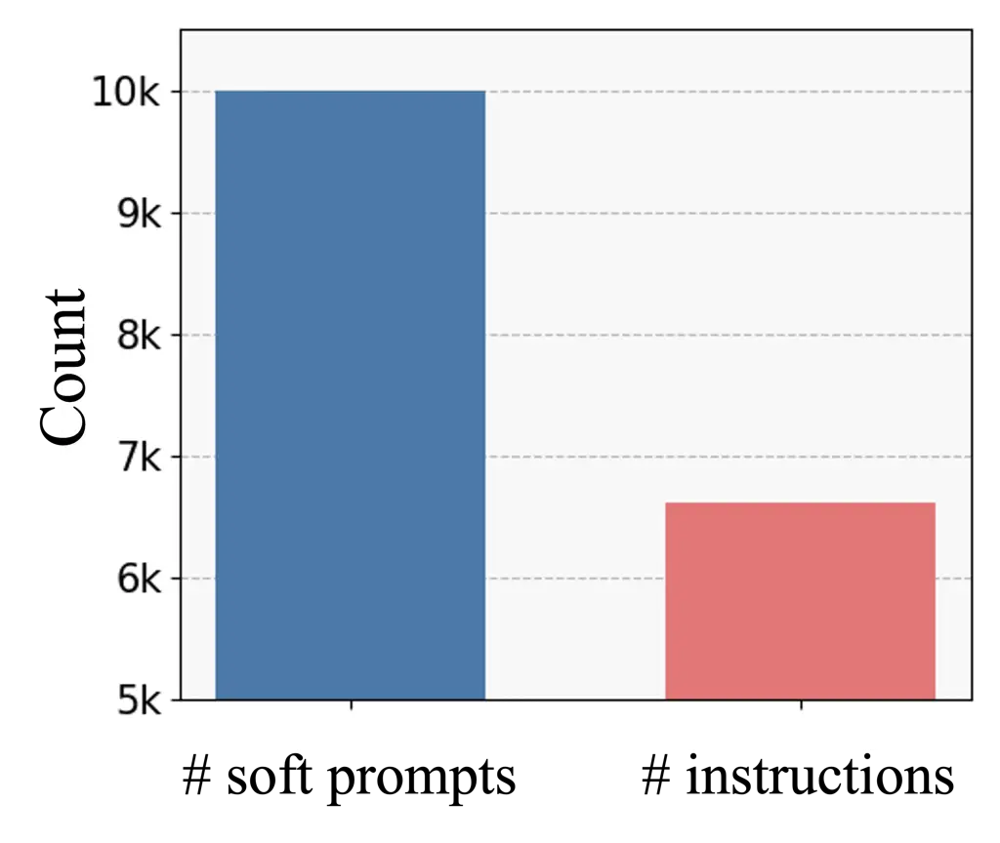

(a)

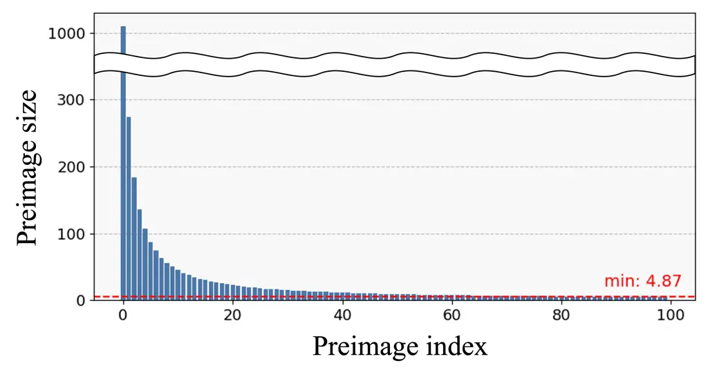

(b)

Figure 1: Motivating observations illustrating the many-to-one mapping
from soft prompts to instructions in a white-box LLM
(LLaMA3.1-8B-Instruct \[1\]). Figure 1(a) shows that the white-box LLM
produces approximately 6,500 unique instructions from 10,000 distinct
soft prompts. Figure 1(b) presents the distribution of preimage sizes,
displaying the top 100 largest preimages. The largest preimage contains
more than 1,000 soft prompts, while the 100th largest has around 5. Both
figures report the average experimental results over the instruction
induction tasks used in Table 1.

While previous studies have treated the generation of identical
instructions from different soft prompts (i.e., many-to-one structure)
as a redundancy that hinders optimization, we reinterpret this as a
valuable structure that can facilitate the optimization process.
Specifically, the set of soft prompts that generate the same instruction
forms the preimage of that instruction under the white-box LLM. This
preimage imposes a strong inductive bias over the search space: all soft
prompts within a preimage share the same objective function value. Since
we follow previous settings \[16, 15\] that sample a sufficiently large
set of $`N`$ soft prompts and search for the optimal solution within
them, we do not observe the full preimage, but only a subset of it. We
refer to such subsets as preimages throughout the paper, and provide the
size distribution of these preimages in Figure 1(b).

Building on this insight, we propose PRESTO, a novel instruction
optimization framework that explicitly leverages the many-to-one
structure to facilitate instruction optimization for black-box LLMs.
PRESTO consists of three components. First, we present the score-sharing
method, where once the score is evaluated through the black-box LLM, it
is shared with all soft prompts within a preimage. This effectively
enlarges the amount of scored data without additional calls to the
black-box LLM. Second, we introduce preimage-based initialization, where
we select the initial soft prompts regarding the preimage information so
that they cover the search space maximally. Finally, we propose score
consistency regularization, which adds a regularization term to
encourage the score predictor to predict identical scores for soft
prompts within the same preimage. We evaluate the instruction
optimization performance of PRESTO on 30 instruction induction tasks and
three arithmetic reasoning tasks, and achieve state-of-the-art
performance compared to existing baselines.

The main contributions of our work are:

- •
  We reinterpret the many-to-one structure between the soft prompts and
  instruction, previously viewed as a challenge, as a rich informative
  structure that facilitates instruction optimization for black-box
  LLMs.
- •
  Leveraging this insight, we introduce PRESTO, a novel framework that
  consists of score sharing, preimage-based initialization, and score
  consistency regularization.
- •
  PRESTO achieves state-of-the-art performance across 30 instruction
  induction and 3 arithmetic reasoning tasks.

## 2 Related Works

Instruction Optimization for Black-box LLMs Instruction optimization has
been widely explored as a way to improve the performance of large
language models (LLMs) on downstream tasks \[23, 24\]. In particular,
when using black-box LLMs such as GPT-4 \[2\], where access to model
parameters is restricted, optimization methods rely on model outputs to
guide the search for better instructions. Under this setting, various
approaches have been proposed, including evolutionary algorithms \[10,
11\], LLM-driven meta-optimization \[8, 9\], and bandit-style or
heuristic search methods \[13, 12\]. These works demonstrate that
instruction quality can be improved even without access to gradients or
internal representations by querying the black-box model efficiently.

More recently, some methods \[14, 15, 16\] incorporate open-source
white-box LLMs \[1, 18, 17, 25\] to assist the optimization process.
Rather than optimizing instruction texts directly, they optimize soft
prompts, which are continuous embeddings that the white-box model maps
into instructions. InstructZero \[14\] leveraged Bayesian
Optimization \[26, 27, 28\] to search for the optimal soft prompts for
black-box LLM. INSTINCT \[16\] leveraged NeuralUCB \[21\] with an
LLM-based score predictor, which was the first to point out the
many-to-one schema and approached it indirectly by sampling soft prompts
to be well-separated. And ZOPO \[15\] proposed a zeroth-order
optimization algorithm \[29\] for local search, which addresses this
redundancy by simply discarding all but one soft prompt that produces
the same instruction. In contrast, we retain all soft prompts by
introducing preimages and facilitate the optimization.

## 3 Preliminaries

Problem Formulation Instruction optimization aims to find an instruction
$`v`$ that guides a language model to perform a given task effectively.
To be specific, the goal is to find the instruction $`v`$ that maximizes
the task-specific score function $`h`$ by guiding a black-box LLM
$`f_{\text{b}}`$ to generate the correct answer $`y`$, which is formally
given as:

```math
v^{*}=\underset{v\in\Omega}{\arg\max}\ \mathbb{E}_{(x,y)\in{D_{\text{val}}}}\big[h(f_{\text{b}}(v,x),y)\big], \tag{1}
```

where $`\mathcal{D}_{\text{val}}=\{(x_{i},y_{i})\}_{i=1}^{M}`$ is a
validation set, and $`\Omega`$ denotes the search space of instructions,
typically a discrete sequence domain (e.g., natural language prompts or
token sequences). However, directly searching over discrete instruction
sequences is challenging, as it constitutes a combinatorial optimization
problem over the space of token configurations. To address this,
InstructZero \[14\] reformulates the discrete instruction search as a
continuous optimization problem by leveraging a white-box LLM
$`f_{\text{w}}`$. Specifically, it optimizes a soft prompt
$`z\in\mathbb{R}^{N_{z}\times d}`$, where $`N_{z}`$ is the number of
tokens and $`d`$ is the embedding dimension, to generate the optimal
instruction $`v^{\ast}`$. The soft prompt is concatenated with the token
embeddings of input-output exemplars
$`E=\{(x_{i},y_{i})\}_{i=1}^{\kappa}`$ and fed into the white-box LLM
$`f_{\text{w}}`$, which then generates an instruction
$`v=f_{\text{w}}(z,E)`$. Formally, the instruction optimization problem
is defined as:

```math
z^{*}=\underset{z\in\mathcal{Z}}{\arg\max}\ \mathbb{E}_{(x,y)\in{D}_{\text{val}}}\big[h(f_{\text{b}}(f_{\text{w}}(z,E),x),y)\big], \tag{2}
```

where $`\mathcal{Z}`$ is the soft prompt space. In this formulation, we
optimize $`z`$ to find the optimal instruction $`v^{*}`$ that maximizes
the expected value of the score function $`h`$. Once the optimal soft
prompt $`z^{*}`$ is obtained, the corresponding instruction $`v^{*}`$ is
generated by the white-box LLM $`f_{\text{w}}`$, i.e.,
$`v^{*}=f_{w}(z^{\ast},E)`$ and subsequently evaluated on a held-out
test set $`{D}_{\text{test}}`$. Since the exemplars $`E`$ are fixed for
each task, we omit them from the notation in the rest of our paper.
Following previous works \[14, 15, 16\], we assume that both the
white-box LLM $`f_{\text{w}}`$ and the black-box LLM $`f_{\text{b}}`$
are deterministic.

LLM-based Score Predictor for Instruction Optimization. Our method
builds upon INSTINCT \[16\], which employs a frozen white-box LLM as a
feature extractor to predict the score of soft prompt, and uses a
NeuralUCB \[21\] for instruction optimization. Given a soft prompt
$`z`$, the white-box LLM produces an embedding $`g(z)`$, the last token
representation of the final transformer layer. This embedding is then
passed to a score predictor $`m(g(z);\theta)`$ (e.g., an MLP), which
predicts the performance of the instruction generated from $`z`$, i.e.,
$`m(g(z);\theta)\approx\mathbb{E}_{(x,y)\in{D}}[h(f_{\text{b}}(f_{\text{w}}(z),x),y)]`$.
At each optimization step, the score predictor $`m(\cdot;\theta)`$ is
trained on previously evaluated soft prompts and their corresponding
scores, and selects the next query that maximizes the upper confidence
bound. We provide further details of NeuralUCB in the supplement. Since
computing $`g(z)`$ requires a full forward pass through the LLM,
INSTINCT mitigates this cost by precomputing the embeddings of a
candidate soft prompt set $`Z=\{z_{i}\}_{i=1}^{N}`$ at the beginning of
the optimization, which is sampled using a quasi-random method. To this
end, the instruction optimization task is reduced to searching for the
best solution within the precomputed embedding set, as the white-box LLM
is frozen during the optimization process.

## 4 Method

In this section, we propose PREimage-informed inSTruction Optimization
(PRESTO) which is a novel instruction optimization framework that
leverages the many-to-one mapping between soft prompts
$`z\in Z\subset\mathcal{Z}`$ and instructions $`v\in\Omega`$ (or the
preimages of instructions, which is defined in Section 4.1) as prior
knowledge to facilitate more efficient optimization. We first introduce
a score sharing method that shares the score value of one soft prompt
with all other soft prompts in the same preimage, effectively enlarging
the scored data without additional evaluations of black-box LLM
$`f_{\text{b}}`$. Next, we present a preimage-based initialization
method designed to maximize coverage of the search space under score
sharing. Finally, we propose a score consistency regularization that
leverages preimage information as prior knowledge to encourage the score
predictor to predict identical scores for soft prompts belonging to the
same preimage. We provide the overall framework of our PRESTO in
Figure 2.

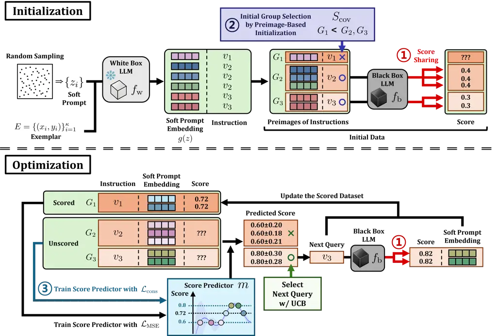

Figure 2: The overall process of our proposed PRESTO framework. It
consists of two main stages: initialization and optimization. In the
initialization stage, our method performs ① _preimage-based score
sharing_ (Section 4.1) and ② _preimage-based initialization_ to improve
search space coverage (Section 4.2). For the optimization stage, we
train the score predictor with ③ _score consistency regularization_
(Section 4.3) and we apply ① _preimage-based score sharing_ to share
scores of newly observed data within the same preimage.

### 4.1 Preimage-Based Score Sharing

During the instruction optimization, we observe that the white-box LLM
$`f_{\text{w}}`$ often generates identical instructions from distinct
soft prompts, i.e., $`f_{\text{w}}(z)=f_{\text{w}}(z^{\prime})`$,
leading to the same score value. This redundancy leads to unnecessary
queries during optimization, hindering the efficiency of instruction
optimization. While previous works treated this redundancy as an
obstacle to efficient optimization, we instead leverage this information
as prior knowledge about the objective function to facilitate
optimization. To this end, we propose a simple score sharing scheme that
associates a large number of soft prompts with a score value without the
additional evaluations of a black-box LLM $`f_{\text{b}}`$.

Our goal is to share the score of an evaluated soft prompt $`z`$ with
other soft prompts that generate the same instruction. To enable this
score sharing, we first define the preimage of each instruction which
consists of all soft prompts that map to the same instruction under the
white-box model $`f_{\text{w}}`$. Establishing this preimage structure
requires two steps. First, we sample a soft prompt set
$`Z=\{z_{i}\}_{i=1}^{N}`$ using a quasi-random method \[30, 31\], which
is a widely adopted method to sample the data points that evenly cover
the soft prompt space \[14, 16, 15\]. Assuming that the soft prompt set
size $`N`$ is large enough to represent the soft prompt space
$`\mathcal{Z}`$, the original optimization problem defined in Eq. (2)
reduces to searching for the best solution among the set of $`N`$ data
points, denoted by $`Z\subset\mathcal{Z}`$.

Next, for each soft prompts $`z_{j}\in Z`$, we generate the set of
instructions $`V=\{v_{i}\}_{i=1}^{M}`$, using the white-box LLM
$`f_{\text{w}}`$:

```math
\displaystyle{V}=\{v_{i}\}_{i=1}^{M}=\{f_{\text{w}}(z_{j})\ |\ j=1,\dots,N\}. \tag{3}
```

Since the different soft prompts often generate the identical
instruction (i.e., many-to-one mapping), the number of instructions
$`M=|V|`$ is smaller than or equal to $`N`$. The construction of $`Z`$
and $`V`$ is performed only once before the optimization process begins.

With the soft prompt set $`Z`$ and the corresponding instruction set
$`V`$, we now define the preimage of each instruction. The preimage of
an instruction $`v`$ is the set of soft prompts in $`Z`$ that generate
$`v`$ under the white-box model $`f_{\text{w}}`$:

```math
\displaystyle f^{-1}_{w}(v)=\{z\in Z\ |\ f_{\text{w}}(z)=v\}. \tag{4}
```

This preimage contains all soft prompts in $`Z`$ that generate $`v`$,
and will serve as the basis for score sharing. Once the preimages
$`f_{\text{w}}^{-1}(v)`$ for all $`v\in V`$ are established, we apply
score sharing across soft prompts that belong to the same preimage
during the optimization. Specifically, after querying the black-box
model $`f_{\text{b}}`$ with an instruction $`v\in V`$, we obtain a score
of the instruction. This score is then shared to all soft prompts in the
preimage $`f_{\text{w}}^{-1}(v)`$. By sharing scores in this manner, we
effectively enlarge the training data for the score predictor
$`m(g(z);\theta)`$ without additional calls to the black-box LLMs.
Moreover, score sharing avoids redundant evaluations of soft prompts
that lead to the same instruction and improves optimization efficiency.

### 4.2 Preimage-Based Initialization for Maximizing Search Space Coverage

Here, we introduce a preimage-based initialization method that selects
initial data points based on the preimage information defined in
Section 4.1. At the beginning of the optimization, the score predictor
$`m(g(z);\theta)`$ (Section 3) is trained on the initial dataset, and
its predictions are used to select the next data points to query the
black-box LLM $`f_{\text{b}}`$. In black-box optimization, it is well
known that broadly covering the search space at initialization is
crucial for effective optimization \[32, 33, 34, 35\]. Our score sharing
method introduced in Section 4.1 expands the initial dataset without
additional queries to the black-box LLM $`f_{\text{b}}`$, enabling a
more sample-efficient initialization. To further enhance the search
space coverage, we propose a preimage-based initialization method that
complements score sharing by promoting a broader initial data
distribution.

To this end, we design a coverage score $`S_{\text{cov}}`$ to guide the
selection of an initial preimage set $`G^{\text{init}}`$ that maximally
covers the entire set of soft prompt embeddings
$`G^{\text{total}}=\{g(z)\mid z\in Z\}`$. We conduct initialization in
the embedding space rather than the raw soft prompt space, since the
optimization operates over the soft prompt embeddings. These embeddings
are precomputed and remain fixed throughout the optimization, as
described in Section 3. For each instruction $`v_{i}`$, we define its
corresponding preimage group in the embedding space as
$`G_{i}=\{g(z)\mid z\in f^{-1}_{\text{w}}(v_{i})\}`$.

Since finding the optimal combination of $`N_{\text{init}}`$ preimages
that maximizes the coverage score $`S_{\text{cov}}`$ is a
computationally intractable combinatorial optimization problem, we adopt
a greedy algorithm to iteratively select one preimage at a time.
Specifically, the coverage score $`S_{\text{cov}}`$ consists of two
components: the representativeness score $`S_{\text{rep}}`$ and the size
score $`S_{\text{size}}`$. The representativeness score
$`S_{\text{rep}}`$ encourages the selection of a preimage group
$`G_{i}`$ that, when combined with already selected preimage groups
$`G^{\text{init}}`$, most closely matches the distribution of the
candidate set $`G^{\text{total}}`$, defined as:

```math
\displaystyle S_{\text{rep}}(G_{i};G^{\text{init}},G^{\text{total}})=1-\frac{\text{MMD}^{2}(G_{i}\cup G^{\text{init}},G^{\text{total}})}{\max_{j}\text{MMD}^{2}(G_{j}\cup G^{\text{init}},G^{\text{total}})}, \tag{5}
```

where the MMD² is the squared Maximum Mean Discrepancy. MMD² is a widely
used metric to estimate the similarity between two sets, which is
defined as:

```math
\displaystyle\text{MMD}^{2}(X,Y)=\mathbb{E}_{x,x^{\prime}\sim X}[k(x,x^{\prime})]+\mathbb{E}_{y,y^{\prime}\sim Y}[k(y,y^{\prime})]-2\mathbb{E}_{x\sim X,y\sim Y}[k(x,y)] \tag{6}
```

where $`k(\cdot,\cdot)`$ is a positive definite kernel. To densely cover
the search space, we propose the size score $`S_{\text{size}}`$, which
is defined as relative preimage size:
$`S_{\text{size}}(G_{i})=|G_{i}|\big/{\max_{j}|G_{j}|}`$. Combining the
two scores, we define the coverage score for the $`G_{i}`$:

```math
\displaystyle S_{\text{cov}}(G_{i};G^{\text{init}},G^{\text{total}})=S_{\text{size}}(G_{i})+S_{\text{rep}}(G_{i};G^{\text{init}},G^{\text{total}}). \tag{7}
```

Starting from an empty set $`G^{\text{init}}`$, we iteratively select
the preimage with the highest coverage score $`S_{\text{cov}}`$ and add
it to $`G^{\text{init}}`$ until the number of initial preimages reaches
$`N_{\text{init}}`$. This initialization maximizes the coverage of the
candidate set $`G^{\text{total}}`$. We provide the visualization to
demonstrate the effectiveness of our initialization method in
Section 6.3.

### 4.3 Score consistency regularization for score predictor

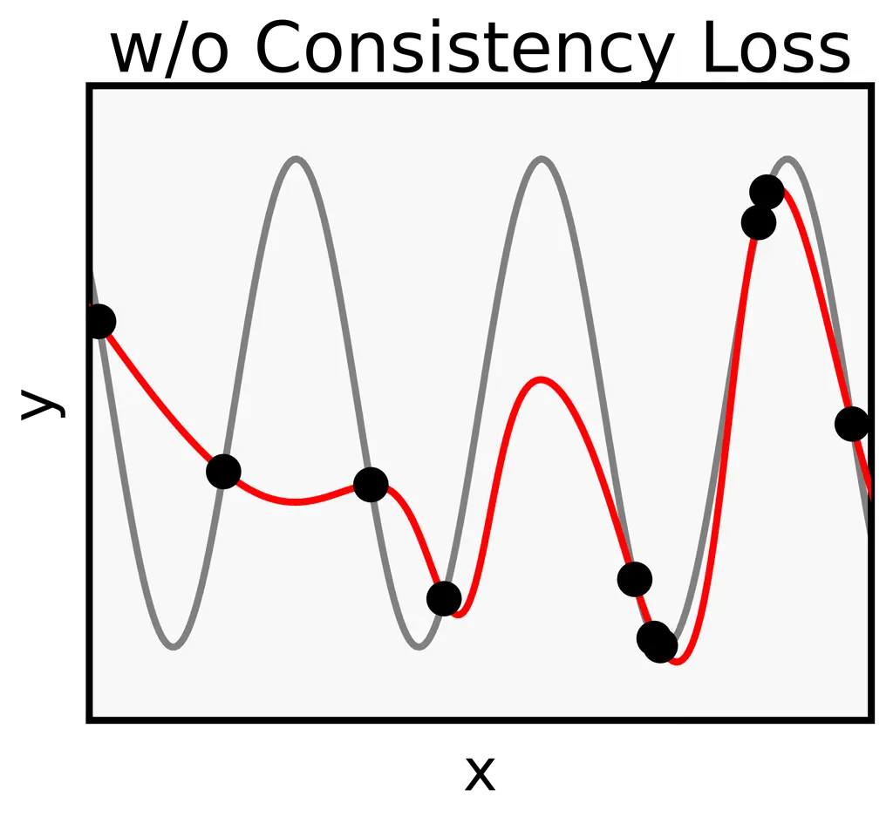

(a) Train with $`\mathcal{L}_{\text{MSE}}`$ only.

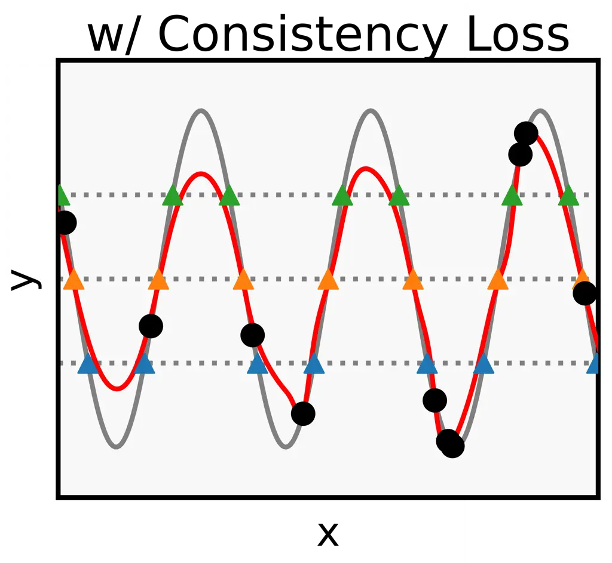

(b) Train with
$`\mathcal{L}_{\text{MSE}}+\gamma\mathcal{L}_{\text{cons}}`$.

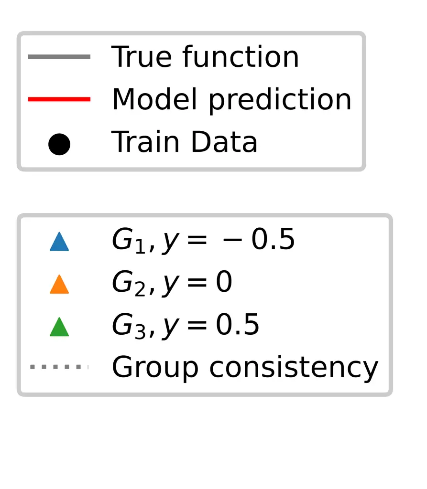

Figure 3: Toy example comparing models trained w/o and w/ our
consistency loss $`\mathcal{L}_{\text{cons}}`$ in Eq. (8).

Here, we propose a score consistency regularization that encourages the
score predictor $`m(g(z);\theta)`$ to produce the same prediction for
all soft prompts in preimages that have not been evaluated by the
black-box function. During the optimization, the score predictor is
trained with the scored data to predict the score of each soft prompt in
the candidate set $`Z`$ and estimate its uncertainty for selecting the
next query to evaluate. Leveraging the score sharing method defined in
Section 4.1 informs the score predictor that data points within the same
preimage share identical scores in a supervised manner. However, since
the score predictor lacks information about score consistency within
unscored preimages, it is unable to make consistent predictions for data
points in these unscored preimages. It often hinders the score predictor
from predicting the ground truth score and selecting high-scored data.

To ensure consistent predictions within each unscored preimage, we
propose a score consistency regularization term
$`\mathcal{L}_{\text{cons}}`$, which is defined as:

```math
\displaystyle\mathcal{L}_{\text{cons}}=\mathbb{E}_{v\in V_{\text{unseen}}}\mathbb{E}_{z,z^{\prime}\in f^{-1}_{\text{w}}(v)}\left|m(g(z);\theta)-m(g(z^{\prime});\theta)\right|^{2}, \tag{8}
```

where $`V_{\text{unseen}}\subset V`$ denotes the set of instructions
that has not been evaluated by the black-box LLM $`f_{b}`$. We note that
$`\mathcal{L}_{\text{cons}}`$ is an unsupervised loss. While the
consistency regularization includes pairwise terms per preimage group,
each unscored preimage size is not excessively large in practice, so the
computation remains tractable. The final loss for training the score
predictor model is given by:

```math
\displaystyle\mathcal{L}=\mathcal{L}_{\text{MSE}}+\gamma\mathcal{L}_{\text{cons}}, \tag{9}
```

where $`\mathcal{L}_{\text{MSE}}`$ is the mean squared error loss
computed over the scored preimages, and $`\gamma`$ is a hyperparameter
controlling the strength of the regularization. To avoid premature
convergence to incorrect predictions, we employ a simple linear
scheduling strategy as
$`\gamma(t)=\gamma_{\text{max}}\cdot\min\big(1,{t}/{T}\big)`$, where
$`t`$ represents the current epoch and $`T`$ is a warm-up duration. This
schedule allows the score predictor $`m(g(z);\theta)`$ to learn accurate
patterns from the scored data and gradually incorporate the score
equality constraint of unscored data.

Figure 3 shows a toy example illustrating the effect of the proposed
consistency loss. We use a simple model with two linear layers. In
Figure 3(a), the model is trained only with the
$`\mathcal{L}_{\text{MSE}}`$ on the scored data, while in Figure 3(b),
$`\mathcal{L}_{\text{cons}}`$ is additionally applied to unscored data.
We assume there are three unscored preimages, each represented by a
different marker shape. Although the model is only given the information
that data points within each preimage share the same score, the
$`\mathcal{L}_{\text{cons}}`$ allows it to make more accurate
predictions on the unscored data.

## 5 Experiments

### 5.1 Experimental settings

We evaluate our proposed method, PRESTO, on 30 instruction induction
tasks \[36\], a benchmark widely used to assess instruction optimization
performance, and 3 arithmetic reasoning tasks \[37, 38, 39\]. We compare
PRESTO with six competitive instruction optimization baselines:
APE \[8\], InstructZero \[14\], INSTINCT \[16\], EvoPrompt \[10\],
ZOPO \[15\], and OPRO \[9\]. We use LLaMA3.1-8B-Instruct \[1\] as the
white-box LLM $`f_{\text{w}}`$ to generate candidate instructions, and
GPT-4.1 as the black-box model $`f_{\text{b}}`$. Following previous
works \[14, 15, 16\], we set the total query budget to 165, initialize
with 40 soft prompts, and evaluate all methods over three different
random seeds. To ensure a fair comparison, we follow the hyperparameter
tuning procedure in \[16\]. Detailed hyperparameter configurations and
experimental settings are provided in the supplement.

### 5.2 Instruction induction results

Tasks APE InstructZero INSTINCT EvoPrompt ZOPO OPRO PRESTO antonyms
80.67 ± 0.72 75.33 ± 3.21 83.33 ± 0.54 82.00 ± 0.47 82.67 ± 1.66 80.33 ±
2.33 83.33 ± 1.19 auto_categorization 26.00 ± 6.13 27.67 ± 2.60 18.67 ±
0.72 29.33 ± 2.18 31.67 ± 3.41 30.33 ± 0.72 31.67 ± 3.41 auto_debugging
8.33 ± 6.80 12.50 ± 5.89 10.00 ± 4.71 16.67 ± 6.80 13.33 ± 7.20 8.33 ±
6.80 20.83 ± 3.40 cause_and_effect 92.00 ± 1.89 74.67 ± 4.75 76.00 ±
9.98 72.00 ± 6.80 93.33 ± 2.88 38.67 ± 4.35 94.67 ± 2.88 common_concept
22.36 ± 2.34 15.53 ± 5.11 20.21 ± 1.19 17.99 ± 6.72 21.86 ± 7.16 20.08 ±
6.70 22.86 ± 3.27 diff 18.33 ± 6.87 53.00 ± 20.37 81.67 ± 13.76 7.00 ±
5.72 88.33 ± 5.93 64.33 ± 23.91 98.00 ± 0.82 informal_to_formal 57.59 ±
2.40 51.53 ± 4.62 48.93 ± 3.46 42.87 ± 2.03 58.93 ± 4.83 50.02 ± 2.63
52.77 ± 5.46 letters_list 99.00 ± 0.82 99.00 ± 0.47 97.67 ± 1.52 73.67 ±
9.69 98.67 ± 1.09 99.00 ± 0.47 99.33 ± 0.54 negation 83.33 ± 1.19 81.67
± 3.95 76.67 ± 4.77 71.67 ± 1.19 77.33 ± 4.63 73.33 ± 4.23 84.00 ± 2.16
object_counting 37.33 ± 5.50 46.00 ± 5.72 48.67 ± 3.21 28.67 ± 2.23
34.00 ± 4.08 31.00 ± 3.86 45.67 ± 4.38 odd_one_out 51.33 ± 14.43 46.67 ±
5.76 60.00 ± 7.12 68.00 ± 1.89 58.67 ± 7.14 47.33 ± 10.39 70.00 ± 0.94
orthography_starts_with 46.00 ± 8.18 35.00 ± 3.56 54.67 ± 8.20 42.00 ±
15.28 54.67 ± 3.66 22.33 ± 10.18 57.33 ± 6.08 rhymes 69.33 ± 16.41 81.67
± 10.69 98.67 ± 0.72 93.67 ± 1.96 83.33 ± 6.87 77.00 ± 15.25 85.00 ±
7.41 second_word_letter 72.67 ± 10.88 40.67 ± 5.99 48.00 ± 22.38 33.00 ±
7.93 68.00 ± 17.75 22.00 ± 14.73 77.00 ± 12.57 sentence_similarity 29.00
± 5.44 17.33 ± 4.75 11.33 ± 5.42 29.00 ± 0.47 4.33 ± 3.54 6.67 ± 5.44
21.67 ± 8.49 sum 24.00 ± 14.61 55.00 ± 23.92 99.33 ± 0.54 66.67 ± 27.22
100.00 ± 0.00 91.33 ± 3.78 94.67 ± 4.35 synonyms 10.00 ± 4.50 22.67 ±
5.62 25.00 ± 8.83 25.33 ± 7.98 24.33 ± 2.76 12.67 ± 0.72 18.33 ± 1.91
taxonomy_animal 43.67 ± 15.96 44.33 ± 17.72 92.00 ± 3.77 34.00 ± 15.08
69.00 ± 24.10 73.67 ± 8.09 99.67 ± 0.27 word_sorting 54.00 ± 15.41 39.67
± 12.11 27.33 ± 7.37 71.00 ± 4.50 54.00 ± 15.06 36.33 ± 11.49 53.33 ±
8.38 word_unscrambling 28.00 ± 4.78 38.00 ± 3.74 42.33 ± 8.59 23.00 ±
9.57 52.00 ± 7.79 43.00 ± 1.25 48.00 ± 7.59 \# best-performing tasks 1 0
3 3 4 0 12 Average Rank 4.25 4.80 3.70 4.70 3.05 5.20 1.90

Table 1: Performance on instruction induction tasks. Bolded numbers
(blue) indicate the best methods for each task. Scores show the average
accuracy with standard error over three runs.

Here we provide the results of our proposed method, PRESTO, compared
with six strong baselines on instruction induction tasks. To enhance
readability, we report results on a subset of 20 following previous
works \[16, 15\]. The full results for all 30 tasks are provided in the
appendix. Table 1 shows that PRESTO achieves the highest accuracy on 12
out of the 20 tasks, which is three times more than the second-best
method, ZOPO. In addition, PRESTO attains the best average rank of 1.90,
outperforming all baselines by a clear margin; the next best, ZOPO, has
an average rank of 3.05, followed by INSTINCT at 3.70. These results
highlight the strong performance of PRESTO on individual tasks and its
robustness across a wide range of instruction induction tasks. In the
full set of 30 tasks, PRESTO also consistently outperforms other
baselines with a large margin in the number of best-performing tasks and
average rank.

### 5.3 Chain-of-Thought Prompting Results

Method Dataset Best instruction Accuracy Hand-crafted GSM8K Let’s think
step by step 0.9121 InstructZero GSM8K Let’s think step by step to solve
the math problem 0.9083 INSTINCT GSM8K Let’s break down and solve the
problem 0.9098 ZOPO GSM8K Let’s break it down and find the solution
0.9143 PRESTO (Ours) GSM8K Let’s break it down together 0.9128
Hand-crafted AQUA-RAT Let’s think step by step. 0.7402 InstructZero
AQUA-RAT Let’s break it down and find the solution 0.7480 INSTINCT
AQUA-RAT Let’s break it down step by step. I am ready to solve the
problem. 0.7480 ZOPO AQUA-RAT Let’s break it down mathematically. 0.7520
PRESTO (Ours) AQUA-RAT Let’s solve it together. 0.7756 Hand-crafted
SVAMP Let’s think step by step. 0.9375 InstructZero SVAMP Let’s crack
the code! 0.9400 INSTINCT SVAMP Let’s break it down step by step 0.9375
ZOPO SVAMP I see what you’re doing there 0.9400 PRESTO (Ours) SVAMP
Let’s use the formula 0.9400

Table 2: Performance of different CoT prompts on three math reasoning
datasets. The best result for each dataset is in bold, and the second
best is underlined.

We evaluate the quality of the optimized instructions by measuring their
effectiveness as chain-of-thought (CoT) \[40\] prompts on three math
reasoning benchmarks: GSM8K \[37\], AQUA-RAT \[38\], and SVAMP \[39\].
We compare our method with three baselines that use soft prompts
(InstructZero \[14\], INSTINCT \[16\], and ZOPO \[15\]), as well as a
standard hand-crafted prompt \[41\]. Table 2 demonstrates that our
PRESTO outperforms or matches the best-performing baselines across all
datasets. In particular, it achieves the highest accuracy on AQUA-RAT
(0.7756) and ties for the best result on SVAMP (0.9400), while remaining
competitive on GSM8K. These results indicate that the instructions
optimized by our method are also effective when used as CoT prompts.

## 6 Analysis

### 6.1 Ablation Study

Model SS Reg Init \# Wins Avg. Rank Avg. acc. Vanilla ✗ ✗ ✗ 0 4.55 51.91

- SS ✓ ✗ ✗ 3 3.10 59.57 + SS + Reg ✓ ✓ ✗ 4 2.65 61.77 + SS + Init ✓ ✗
  ✓ 4 2.30 61.82 + SS + Init + Reg (Ours) ✓ ✓ ✓ 9 2.20 62.91

Table 3: Ablation study of PRESTO. We incrementally add score sharing
(SS, Sec. 4.1), preimage-based initialization (Init, Sec. 4.2), and
consistency regularization (Reg, Sec. 4.3) to a vanilla baseline.

We perform an ablation study to analyze the contribution of each
component in our method over the 20 instruction induction tasks used in
Table 1 over 3 random seeds. Starting from a vanilla baseline without
our techniques, we incrementally add: (1) score sharing method
(Section 4.1), (2) preimage-based initialization (Section 4.2), and (3)
score consistency regularization (Section 4.3). The full model with all
components combined corresponds to our proposed method, PRESTO. As shown
in Table 3, each component contributes to performance improvement. In
particular, introducing score sharing significantly boosts accuracy from
51.91 to 59.57 (+7.66) and improves average rank from 4.55 to 3.10
(-1.45), indicating its strong impact. Our PRESTO achieves the best
results overall, with the highest number of wins and the lowest average
rank across tasks.

### 6.2 Impact of score sharing method

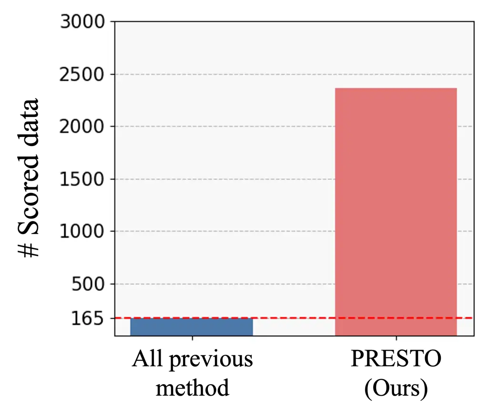

Figure 4: Average number of scored soft prompts after optimization
across all tasks.

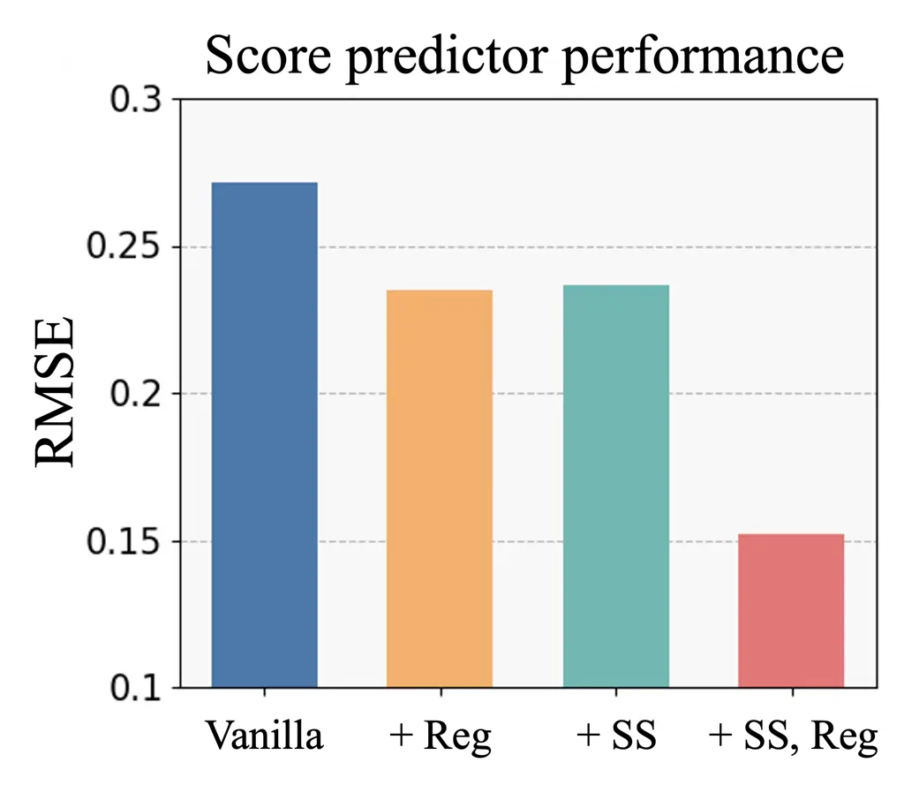

Figure 5: Performance of score predictor trained with diverse methods.

We report the average number of soft prompts with assigned scores after
the optimization process, comparing our method with baselines across all
30 tasks. The reported count includes soft prompts that were scored
either directly through black-box evaluation or indirectly via score
sharing. As shown in Figure 4, our method assigns scores to over 2,300
soft prompts on average, 14× more than previous methods, which yield
only 165 scored data points, equal to the query budget in our setting.
The large amount of scored data enables the score predictor to learn the
objective function more effectively, which in turn facilitates more
successful optimization. This analysis demonstrates that our
score-sharing method can significantly increase the amount of scored
data without requiring additional black-box queries.

### 6.3 Visualization of Preimage-Based Initialization

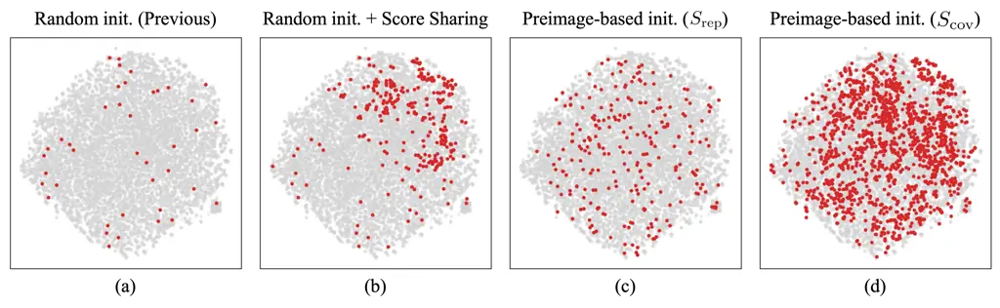

Figure 6: Visualization of the initial data distribution under different
initialization. We plot the entire soft prompt embedding candidate set
$`G^{\text{total}}`$ using t-SNE, and highlight the selected initial
data in red.

We present a qualitative analysis of how score sharing and
preimage-based initialization influence the distribution of initial soft
prompts. Figure 6 visualizes the distribution of initial soft prompts
under four settings: (1) random initialization, (2) random
initialization with score sharing (Section 4.1), (3) preimage-based
initialization using $`S_{\text{rep}}`$ only, and (4)
$`S_{\text{cov}}=S_{\text{rep}}+S_{\text{size}}`$ (Section 4.2) in
"objective counting" task. To visualize the spatial distribution of soft
prompt embeddings, we employ t-SNE. Compared to random initialization in
prior works, score sharing enlarges the size of the initial dataset
without additional black-box queries. Furthermore, selecting initial
data using $`S_{\text{rep}}`$ leads to better coverage of the soft
prompt space than naive score sharing. Finally, our proposed
preimage-based initialization method that utilizes $`S_{\text{cov}}`$
achieves the densest and comprehensive coverage of the search space. It
shows that our preimage-based initialization method effectively selects
the initial data points that densely and evenly cover the search space.

### 6.4 Score Predictor Performance Enhancement

To analyze how score sharing (Section 4.1) and score consistency
regularization (Section 4.3) influence the quality of the score
predictor, we evaluate its prediction performance under different
training configurations. Figure 5 reports the root mean squared error
(RMSE), where lower values indicate higher prediction accuracy. We use
100 randomly selected soft prompts as training data and another 100 as
test data for the objective counting task. As shown in Figure 5,
applying either score sharing or score consistency regularization
improves the score predictor’s performance, reducing the RMSE from
approximately 0.27 (vanilla) to around 0.23. When both techniques are
applied together, the RMSE further decreases to approximately 0.15,
indicating a strong complementary effect. The results demonstrate that
expanding the training set without requiring additional black-box
queries through score sharing and incorporating the preimage structure
as a prior via score consistency regularization are both crucial for
enhancing the score predictor’s performance.

## 7 Conclusion

We propose PRESTO, a preimage-informed instruction optimization
framework that explicitly leverages this many-to-one structure via
preimage. PRESTO consists of three components that leverage the preimage
structure: score sharing to propagate labels within each preimage,
preimage-based initialization to improve search space coverage, and
consistency regularization to align predictions within unscored
preimages. PRESTO achieves state-of-the-art performance on 33
instruction optimization tasks, and our comprehensive analysis supports
its effectiveness and robustness.

Limitations and broader impacts

Our method introduces preimage-based score sharing to enlarge the number
of data, which incurs mild computational overhead compared to simpler
baselines. Moreover, its benefits are more pronounced when applied to a
large candidate set, as score sharing is most effective when many soft
prompts map to the same instruction.

In terms of broader impact, this work aims to make black-box LLM
optimization more data-efficient, which can reduce the cost of
experimentation and improve accessibility for researchers with limited
resources. However, as with any optimization technique for LLMs, there
is a risk that improved performance could be applied in ways that
reinforce biases or generate harmful content. Careful deployment and
alignment with responsible AI principles are necessary.

#### Acknowledgement

This research was supported by the ASTRA Project through the National
Research Foundation (NRF) funded by the Ministry of Science and ICT (No.
RS-2024-00439619).

## References

- \[1\] Aaron Grattafiori, Abhimanyu Dubey, Abhinav Jauhri, Abhinav
  Pandey, Abhishek Kadian, Ahmad Al-Dahle, Aiesha Letman, Akhil Mathur,
  Alan Schelten, Alex Vaughan, et al. The llama 3 herd of models.
  arXiv, 2024.
- \[2\] Josh Achiam, Steven Adler, Sandhini Agarwal, Lama Ahmad, Ilge
  Akkaya, Florencia Leoni Aleman, Diogo Almeida, Janko Altenschmidt, Sam
  Altman, Shyamal Anadkat, et al. Gpt-4 technical report. arXiv, 2023.
- \[3\] Daya Guo, Dejian Yang, Haowei Zhang, Junxiao Song, Ruoyu Zhang,
  Runxin Xu, Qihao Zhu, Shirong Ma, Peiyi Wang, Xiao Bi, et al.
  Deepseek-r1: Incentivizing reasoning capability in llms via
  reinforcement learning. arXiv preprint arXiv:2501.12948, 2025.
- \[4\] Arun James Thirunavukarasu, Darren Shu Jeng Ting, Kabilan
  Elangovan, Laura Gutierrez, Ting Fang Tan, and Daniel Shu Wei Ting.
  Large language models in medicine. Nature medicine, 2023.
- \[5\] Humza Naveed, Asad Ullah Khan, Shi Qiu, Muhammad Saqib, Saeed
  Anwar, Muhammad Usman, Naveed Akhtar, Nick Barnes, and Ajmal Mian. A
  comprehensive overview of large language models. arXiv preprint
  arXiv:2307.06435, 2023.
- \[6\] Long Ouyang, Jeffrey Wu, Xu Jiang, Diogo Almeida, Carroll
  Wainwright, Pamela Mishkin, Chong Zhang, Sandhini Agarwal, Katarina
  Slama, Alex Ray, et al. Training language models to follow
  instructions with human feedback. Advances in neural information
  processing systems, 35:27730–27744, 2022.
- \[7\] Pengfei Liu, Weizhe Yuan, Jinlan Fu, Zhengbao Jiang, Hiroaki
  Hayashi, and Graham Neubig. Pre-train, prompt, and predict: A
  systematic survey of prompting methods in natural language processing.
  ACM computing surveys, 2023.
- \[8\] Yongchao Zhou, Andrei Ioan Muresanu, Ziwen Han, Keiran Paster,
  Silviu Pitis, Harris Chan, and Jimmy Ba. Large language models are
  human-level prompt engineers. In ICLR, 2022.
- \[9\] Chengrun Yang, Xuezhi Wang, Yifeng Lu, Hanxiao Liu, Quoc V Le,
  Denny Zhou, and Xinyun Chen. Large language models as optimizers. In
  ICLR, 2024.
- \[10\] Qingyan Guo, Rui Wang, Junliang Guo, Bei Li, Kaitao Song,
  Xu Tan, Guoqing Liu, Jiang Bian, and Yujiu Yang. Connecting large
  language models with evolutionary algorithms yields powerful prompt
  optimizers. In ICLR, 2024.
- \[11\] Chrisantha Fernando, Dylan Sunil Banarse, Henryk Michalewski,
  Simon Osindero, and Tim Rocktäschel. Promptbreeder: Self-referential
  self-improvement via prompt evolution. In International Conference on
  Machine Learning, 2024.
- \[12\] Reid Pryzant, Dan Iter, Jerry Li, Yin Tat Lee, Chenguang Zhu,
  and Michael Zeng. Automatic prompt optimization with" gradient
  descent" and beam search. In EMNLP, 2023.
- \[13\] Chengshuai Shi, Kun Yang, Zihan Chen, Jundong Li, Jing Yang,
  and Cong Shen. Efficient prompt optimization through the lens of best
  arm identification. arXiv preprint arXiv:2402.09723, 2024.
- \[14\] Lichang Chen, Jiuhai Chen, Tom Goldstein, Heng Huang, and
  Tianyi Zhou. Instructzero: Efficient instruction optimization for
  black-box large language models. In ICML, 2024.
- \[15\] Wenyang Hu, Yao Shu, Zongmin Yu, Zhaoxuan Wu, Xiaoqiang Lin,
  Zhongxiang Dai, See-Kiong Ng, and Bryan Kian Hsiang Low. Localized
  zeroth-order prompt optimization. NeurIPS, 2024.
- \[16\] Xiaoqiang Lin, Zhaoxuan Wu, Zhongxiang Dai, Wenyang Hu, Yao
  Shu, See-Kiong Ng, Patrick Jaillet, and Bryan Kian Hsiang Low. Use
  your instinct: Instruction optimization for llms using neural bandits
  coupled with transformers. In ICML, 2024.
- \[17\] Albert Q Jiang, Alexandre Sablayrolles, Antoine Roux, Arthur
  Mensch, Blanche Savary, Chris Bamford, Devendra Singh Chaplot, Diego
  de las Casas, Emma Bou Hanna, Florian Bressand, et al. Mixtral of
  experts. arXiv preprint arXiv:2401.04088, 2024.
- \[18\] An Yang, Baosong Yang, Beichen Zhang, Binyuan Hui, Bo Zheng,
  Bowen Yu, Chengyuan Li, Dayiheng Liu, Fei Huang, Haoran Wei, et al.
  Qwen2. 5 technical report. arXiv preprint arXiv:2412.15115, 2024.
- \[19\] Peter I Frazier. A tutorial on bayesian optimization. arXiv
  preprint arXiv:1807.02811, 2018.
- \[20\] Bobak Shahriari, Kevin Swersky, Ziyu Wang, Ryan P Adams, and
  Nando De Freitas. Taking the human out of the loop: A review of
  bayesian optimization. Proceedings of the IEEE, 2015.
- \[21\] Dongruo Zhou, Lihong Li, and Quanquan Gu. Neural contextual
  bandits with ucb-based exploration. In ICML, 2020.
- \[22\] Weitong Zhang, Dongruo Zhou, Lihong Li, and Quanquan Gu. Neural
  thompson sampling. arXiv preprint arXiv:2010.00827, 2020.
- \[23\] Krista Opsahl-Ong, Michael Ryan, Josh Purtell, David Broman,
  Christopher Potts, Matei Zaharia, and Omar Khattab. Optimizing
  instructions and demonstrations for multi-stage language model
  programs. In EMNLP, 2024.
- \[24\] Xiaoqiang Lin, Zhongxiang Dai, Arun Verma, See-Kiong Ng,
  Patrick Jaillet, and Bryan Kian Hsiang Low. Prompt optimization with
  human feedback. arXiv preprint arXiv:2405.17346, 2024.
- \[25\] Albert Q. Jiang, Alexandre Sablayrolles, Arthur Mensch, Chris
  Bamford, Devendra Singh Chaplot, Diego de las Casas, Florian Bressand,
  Gianna Lengyel, Guillaume Lample, Lucile Saulnier, Lélio Renard
  Lavaud, Marie-Anne Lachaux, Pierre Stock, Teven Le Scao, Thibaut
  Lavril, Thomas Wang, Timothée Lacroix, and William El Sayed. Mistral
  7b. arXiv, 2023.
- \[26\] Seunghun Lee, Jaewon Chu, Sihyeon Kim, Juyeon Ko, and Hyunwoo J
  Kim. Advancing bayesian optimization via learning correlated latent
  space. Advances in Neural Information Processing Systems, 2023.
- \[27\] Jaewon Chu, Jinyoung Park, Seunghun Lee, and Hyunwoo J Kim.
  Inversion-based latent bayesian optimization. In The Thirty-eighth
  Annual Conference on Neural Information Processing Systems, 2024.
- \[28\] Seunghun Lee, Jinyoung Park, Jaewon Chu, Minseo Yoon, and
  Hyunwoo J Kim. Latent bayesian optimization via autoregressive
  normalizing flows. In The Thirteenth International Conference on
  Learning Representations, 2025.
- \[29\] Pin-Yu Chen, Huan Zhang, Yash Sharma, Jinfeng Yi, and Cho-Jui
  Hsieh. Zoo: Zeroth order optimization based black-box attacks to deep
  neural networks without training substitute models. In Proceedings of
  the 10th ACM workshop on artificial intelligence and security, pages
  15–26, 2017.
- \[30\] William J Morokoff and Russel E Caflisch. Quasi-random
  sequences and their discrepancies. SIAM Journal on Scientific
  Computing, 15(6):1251–1279, 1994.
- \[31\] Marissa Renardy, Louis R Joslyn, Jess A Millar, and Denise E
  Kirschner. To sobol or not to sobol? the effects of sampling schemes
  in systems biology applications. Mathematical biosciences,
  337:108593, 2021.
- \[32\] Donald R Jones, Matthias Schonlau, and William J Welch.
  Efficient global optimization of expensive black-box functions.
  Journal of Global optimization, 13:455–492, 1998.
- \[33\] David Eriksson, Michael Pearce, Jacob Gardner, Ryan D Turner,
  and Matthias Poloczek. Scalable global optimization via local bayesian
  optimization. Advances in neural information processing systems,
  32, 2019.
- \[34\] Samuel Daulton, Maximilian Balandat, and Eytan Bakshy.
  Differentiable expected hypervolume improvement for parallel
  multi-objective bayesian optimization. Advances in Neural Information
  Processing Systems, 33:9851–9864, 2020.
- \[35\] Samuel Daulton, Maximilian Balandat, and Eytan Bakshy. Parallel
  bayesian optimization of multiple noisy objectives with expected
  hypervolume improvement. Advances in Neural Information Processing
  Systems, 34:2187–2200, 2021.
- \[36\] Or Honovich, Uri Shaham, Samuel R Bowman, and Omer Levy.
  Instruction induction: From few examples to natural language task
  descriptions. In 61st Annual Meeting of the Association for
  Computational Linguistics, ACL 2023, pages 1935–1952, 2023.
- \[37\] Karl Cobbe, Vineet Kosaraju, Mohammad Bavarian, Mark Chen,
  Heewoo Jun, Lukasz Kaiser, Matthias Plappert, Jerry Tworek, Jacob
  Hilton, Reiichiro Nakano, et al. Training verifiers to solve math word
  problems. arXiv preprint arXiv:2110.14168, 2021.
- \[38\] Wang Ling, Dani Yogatama, Chris Dyer, and Phil Blunsom. Program
  induction by rationale generation: Learning to solve and explain
  algebraic word problems. arXiv preprint arXiv:1705.04146, 2017.
- \[39\] Arkil Patel, Satwik Bhattamishra, and Navin Goyal. Are nlp
  models really able to solve simple math word problems? arXiv preprint
  arXiv:2103.07191, 2021.
- \[40\] Jason Wei, Xuezhi Wang, Dale Schuurmans, Maarten Bosma, Fei
  Xia, Ed Chi, Quoc V Le, Denny Zhou, et al. Chain-of-thought prompting
  elicits reasoning in large language models. Advances in neural
  information processing systems, 35:24824–24837, 2022.
- \[41\] Takeshi Kojima, Shixiang Shane Gu, Machel Reid, Yutaka Matsuo,
  and Yusuke Iwasawa. Large language models are zero-shot reasoners.
  Advances in neural information processing systems,
  35:22199–22213, 2022.
- \[42\] Arthur Gretton, Karsten M Borgwardt, Malte J Rasch, Bernhard
  Schölkopf, and Alexander Smola. A kernel two-sample test. The Journal
  of Machine Learning Research, 2012.
- \[43\] Michael Arbel, Anna Korba, Adil Salim, and Arthur Gretton.
  Maximum mean discrepancy gradient flow. Advances in Neural Information
  Processing Systems, 2019.
- \[44\] Gintare Karolina Dziugaite, Daniel M Roy, and Zoubin
  Ghahramani. Training generative neural networks via maximum mean
  discrepancy optimization. arXiv, 2015.
- \[45\] Damien Garreau, Wittawat Jitkrittum, and Motonobu Kanagawa.
  Large sample analysis of the median heuristic. arXiv, 2017.

## 8 Experimental Details and Additional Results

Experimental Settings Following previous works \[14, 16, 15\], we select
$`N`$ soft prompts by first sampling $`N`$ vectors from a scrambled
Sobol sequence in a low-dimensional space, and then mapping them to the
soft prompt space using a fixed random projection matrix. Since the
dimensionality of this low-dimensional space—i.e., the intrinsic
dimension—has been shown to play a critical role in optimization
performance, we follow previous studies and perform a grid search over
both the intrinsic dimension and the number of soft prompt tokens.
Specifically, we search over intrinsic dimensions of 10, 50, 100 and
soft prompt token counts of 3, 5, 10 for the instruction induction
tasks, and we fix the intrinsic dimension to 1000 in Chain-of-Thought
tasks following previous works. We select the hyperparameters based on
validation performance from the first random seed and apply the same
hyperparameters to the remaining two seeds. As in prior work, we fix
$`N`$=10,000. For dataset split, we follow previous works \[16\]. All
experiments were conducted on an NVIDIA A6000 GPU. Our implementation is
built upon the codebase of INSTINCT \[16\].

Evaluation Metrics We use the F1 score for common_concept,
informal_to_formal. For orthography_starts_with and taxonomy_animal, we
use exact set matching. For synonyms, we evaluate whether the output
label is contained in the model’s prediction. For all remaining
instruction induction tasks, we adopt the exact match metric. For
Chain-of-Thought tasks, we extract the final answer using the GPT-4.1
and use exact matching to measure the accuracy.

Details of Baselines In the instruction induction tasks, we compare our
PRESTO with six strong instruction optimization methods. APE \[12\]
generates instructions by leveraging predefined templates and augmented
exemplars, and selects high-performing instructions from LLM-proposed
candidates. InstructZero \[14\] takes a Bayesian Optimization, aiming to
generate optimal instructions for black-box LLM by optimizing the soft
prompt, which is taken as input for the white-box LLM. INSTINCT \[16\]
leverages NeuralUCB to optimize the soft prompts, while taking the
white-box LLM as a feature extractor for score prediction.
EvoPrompt \[10\] explores a population of prompt candidates using
evolutionary algorithms to identify high-performing prompts. ZOPO \[15\]
employs a Neural Tangent Kernel-guided Gaussian process to efficiently
search for locally optimal soft prompts. Finally, OPRO \[9\] iteratively
updates the optimization trajectory and exemplars within the meta-prompt
during the optimization, enabling the LLM to progressively refine its
search.

Experimental results for all 30 tasks

Tasks APE InstructZero INSTINCT EvoPrompt ZOPO OPRO PRESTO
active_to_passive 98.67 ± 1.09 99.67 ± 0.27 92.00 ± 6.53 100.00 ± 0.00
100.00 ± 0.00 100.00 ± 0.00 100.00 ± 0.00 antonyms 80.67 ± 0.72 75.33 ±
3.21 83.33 ± 0.54 82.00 ± 0.47 82.67 ± 1.66 80.33 ± 2.33 83.33 ± 1.19
auto_categorization 26.00 ± 6.13 27.67 ± 2.60 18.67 ± 0.72 29.33 ± 2.18
31.67 ± 3.41 30.33 ± 0.72 31.67 ± 3.41 auto_debugging 8.33 ± 6.80 12.50
± 5.89 10.00 ± 4.71 16.67 ± 6.80 13.33 ± 7.20 8.33 ± 6.80 20.83 ± 3.40
cause_and_effect 92.00 ± 1.89 74.67 ± 4.75 76.00 ± 9.98 72.00 ± 6.80
93.33 ± 2.88 38.67 ± 4.35 94.67 ± 2.88 common_concept 22.36 ± 2.34 15.53
± 5.11 20.21 ± 1.19 17.99 ± 6.72 21.86 ± 7.16 20.08 ± 6.70 22.86 ± 3.27
diff 18.33 ± 6.87 53.00 ± 20.37 81.67 ± 13.76 7.00 ± 5.72 88.33 ± 5.93
64.33 ± 23.91 98.00 ± 0.82 first_word_letter 99.33 ± 0.54 100.00 ± 0.00
100.00 ± 0.00 100.00 ± 0.00 95.33 ± 1.96 100.00 ± 0.00 100.00 ± 0.00
informal_to_formal 57.59 ± 2.40 51.53 ± 4.62 48.93 ± 3.46 42.87 ± 2.03
58.93 ± 4.83 50.02 ± 2.63 52.77 ± 5.46 larger_animal 93.33 ± 0.98 73.33
± 11.06 76.00 ± 6.94 49.33 ± 2.84 79.33 ± 9.27 84.67 ± 0.72 79.67 ± 9.30
letters_list 99.00 ± 0.82 99.00 ± 0.47 97.67 ± 1.52 73.67 ± 9.69 98.67 ±
1.09 99.00 ± 0.47 99.33 ± 0.54 negation 83.33 ± 1.19 81.67 ± 3.95 76.67
± 4.77 71.67 ± 1.19 77.33 ± 4.63 73.33 ± 4.23 84.00 ± 2.16 num_to_verbal
96.33 ± 2.60 99.33 ± 0.27 100.00 ± 0.00 100.00 ± 0.00 100.00 ± 0.00
99.67 ± 0.27 100.00 ± 0.00 object_counting 37.33 ± 5.50 46.00 ± 5.72
48.67 ± 3.21 28.67 ± 2.23 34.00 ± 4.08 31.00 ± 3.86 45.67 ± 4.38
odd_one_out 51.33 ± 14.43 46.67 ± 5.76 60.00 ± 7.12 68.00 ± 1.89 58.67 ±
7.14 47.33 ± 10.39 70.00 ± 0.94 orthography_starts_with 46.00 ± 8.18
35.00 ± 3.56 54.67 ± 8.20 42.00 ± 15.28 54.67 ± 3.66 22.33 ± 10.18 57.33
± 6.08 periodic_elements 99.33 ± 0.54 93.33 ± 3.03 98.67 ± 1.09 70.67 ±
19.14 100.00 ± 0.00 99.33 ± 0.54 99.33 ± 0.54 rhymes 69.33 ± 16.41 81.67
± 10.69 98.67 ± 0.72 93.67 ± 1.96 83.33 ± 6.87 77.00 ± 15.25 85.00 ±
7.41 second_word_letter 72.67 ± 10.88 40.67 ± 5.99 48.00 ± 22.38 33.00 ±
7.93 68.00 ± 17.75 22.00 ± 14.73 77.00 ± 12.57 sentence_similarity 29.00
± 5.44 17.33 ± 4.75 11.33 ± 5.42 29.00 ± 0.47 4.33 ± 3.54 6.67 ± 5.44
21.67 ± 8.49 sentiment 88.00 ± 0.47 90.67 ± 0.98 90.33 ± 1.36 87.67 ±
0.72 91.00 ± 0.47 89.33 ± 2.18 91.00 ± 0.00 singular_to_plural 99.33 ±
0.54 96.67 ± 1.91 98.33 ± 0.72 100.00 ± 0.00 99.33 ± 0.27 91.67 ± 4.01
100.00 ± 0.00 sum 24.00 ± 14.61 55.00 ± 23.92 99.33 ± 0.54 66.67 ± 27.22
100.00 ± 0.00 91.33 ± 3.78 94.67 ± 4.35 synonyms 10.00 ± 4.50 22.67 ±
5.62 25.00 ± 8.83 25.33 ± 7.98 24.33 ± 2.76 12.67 ± 0.72 18.33 ± 1.91
taxonomy_animal 43.67 ± 15.96 44.33 ± 17.72 92.00 ± 3.77 34.00 ± 15.08
69.00 ± 24.10 73.67 ± 8.09 99.67 ± 0.27 translation_en-de 84.67 ± 1.19
74.00 ± 3.30 85.33 ± 0.72 77.33 ± 2.60 83.67 ± 1.19 57.00 ± 20.82 85.67
± 0.54 translation_en-es 90.67 ± 0.98 83.33 ± 3.07 88.33 ± 1.78 83.67 ±
2.76 89.00 ± 0.47 85.33 ± 0.27 86.00 ± 2.05 translation_en-fr 87.33 ±
0.72 82.00 ± 0.94 88.00 ± 1.63 84.00 ± 2.05 87.67 ± 1.91 84.67 ± 3.14
83.00 ± 2.36 word_sorting 54.00 ± 15.41 39.67 ± 12.11 27.33 ± 7.37 71.00
± 4.50 54.00 ± 15.06 36.33 ± 11.49 53.33 ± 8.38 word_unscrambling 28.00
± 4.78 38.00 ± 3.74 42.33 ± 8.59 23.00 ± 9.57 52.00 ± 7.79 43.00 ± 1.25
48.00 ± 7.59 \# best-performing tasks 3 1 6 7 8 2 18 Average Rank 4.10
4.97 3.60 4.50 2.90 4.77 1.97

Table 4: Performance on 30 instruction induction tasks. Bolded numbers
with blue colors indicate the best algorithm for each task. Scores show
the average accuracy with standard error over three runs.

We present experimental results on 30 instruction induction tasks in
Table 4. All methods are evaluated under the same settings using three
different random seeds, and we report the average performance along with
the standard error. Our proposed method, PRESTO, achieves the best
performance on 18 out of 30 tasks, with an average rank of 1.97. This is
more than twice the number of first-place finishes compared to the
second-best method, ZOPO \[15\], which ranks first on 8 tasks and has an
average rank of 2.90. These results indicate that PRESTO is not only
effective on a few specific tasks but also demonstrates strong
generalization across a wide range of tasks.

## 9 NeuralUCB

Here, we introduce the details about the NeuralUCB \[21\]. We follow the
overall architecture and hyperparameters used in \[16\]. At each
optimization step, the score predictor $`m(g(z);\theta)`$ is trained on
previously evaluated soft prompts and their corresponding scores. The
model’s predicted score $`\mu(z)`$ and its associated uncertainty
$`\sigma(z)`$ are computed as:

```math
\displaystyle\mu(z) \displaystyle=m(g(z);\theta), \tag{10}
```

```math
\displaystyle\sigma(z) \displaystyle=\sqrt{\nabla_{\theta}m(g(z);\theta)^{\top}V^{-1}\nabla_{\theta}m(g(z);\theta)}, \tag{11}
```

```math
\displaystyle\text{where}\quad V \displaystyle=\sum_{\tau=1}^{t}\nabla_{\theta}m(g(z_{\tau});\theta)\nabla_{\theta}m(g(z_{\tau});\theta)^{\top}+\lambda I, \tag{12}
```

where $`\lambda`$ is a regularization coefficient and $`t`$ is the
number of observed data. The next prompt to evaluate is selected by
maximizing an Upper Confidence Bound (UCB):

```math
z_{\text{next}}=\underset{z\in Z}{\arg\max}\ \mu(z)+\beta^{1/2}\sigma(z), \tag{13}
```

where $`\beta`$ is a weighting parameter that balances exploration and
exploitation. Following \[16\], $`\lambda`$ is set to 0.1 and $`\beta`$
is set to 1. The score predictor $`m(\cdot;\theta)`$ is a simple MLP
with a hidden layer size is 100 and an output dimension is 1. We use the
Adam optimizer to train the MLP, and the learning rate is set to 0.001.

## 10 Full Experimental Results of the Ablation Study

In this section, we provide the full experimental results of the
ablation study in Table 5. The ablation study was performed over 20
instruction induction tasks, which are used in Table 1 of the main
paper. Starting from the vanilla method, we incrementally add the score
sharing method, score consistency regularization method, and
preimage-based initialization method. Our proposed method, PRESTO, is
the full model with all these components. As shown in the Table, the
performance consistently improves as each component is added
sequentially. Notably, the model that incorporates all proposed modules
achieves the best overall performance. These results demonstrate that
each of the three modules we propose contributes meaningfully to the
overall performance gain.

Tasks Vanilla + SS + SS, Reg + SS, Init + SS, Init, Reg antonyms 80.00 ±
0.82 81.33 ± 2.37 82.67 ± 0.54 79.67 ± 2.88 83.33 ± 1.19
auto_categorization 17.00 ± 1.63 24.67 ± 4.72 28.67 ± 3.03 31.00 ± 0.82
31.67 ± 3.41 auto_debugging 10.00 ± 4.71 12.50 ± 5.89 8.33 ± 6.80 20.00
± 0.00 20.83 ± 3.40 cause_and_effect 74.67 ± 14.28 87.00 ± 0.47 93.33 ±
3.93 93.33 ± 2.88 94.67 ± 2.88 common_concept 19.44 ± 2.21 18.24 ± 1.79
24.39 ± 1.16 21.40 ± 0.33 22.86 ± 3.27 diff 81.00 ± 2.16 87.00 ± 4.24
97.00 ± 0.82 93.67 ± 4.01 98.00 ± 0.82 informal_to_formal 50.67 ± 3.11
51.96 ± 5.16 58.06 ± 3.24 54.25 ± 2.20 52.77 ± 5.46 letters_list 98.33 ±
1.36 99.67 ± 0.27 99.67 ± 0.27 100.00 ± 0.00 99.33 ± 0.54 negation 76.33
± 1.91 85.33 ± 1.66 84.33 ± 3.03 86.33 ± 0.27 84.00 ± 2.16
object_counting 40.67 ± 10.14 39.67 ± 3.47 44.33 ± 3.78 43.67 ± 0.98
45.67 ± 4.38 odd_one_out 52.67 ± 10.89 61.33 ± 6.28 66.67 ± 0.54 68.67 ±
1.96 70.00 ± 0.94 orthography_starts_with 49.33 ± 3.54 54.33 ± 2.84
47.67 ± 3.81 55.67 ± 3.54 57.33 ± 6.08 rhymes 73.67 ± 9.16 87.33 ± 8.30
96.00 ± 1.70 86.00 ± 5.91 85.00 ± 7.41 second_word_letter 49.67 ± 18.16
81.67 ± 9.10 76.98 ± 16.74 53.33 ± 16.15 77.00 ± 12.57
sentence_similarity 17.33 ± 3.54 22.67 ± 3.57 17.33 ± 4.46 21.33 ± 5.30
21.67 ± 8.49 sum 80.00 ± 15.92 95.33 ± 1.91 96.67 ± 2.72 95.67 ± 3.54
94.67 ± 4.35 synonyms 16.33 ± 2.37 19.00 ± 0.47 15.67 ± 3.57 18.33 ±
2.13 18.33 ± 1.91 taxonomy_animal 77.67 ± 17.83 82.00 ± 1.63 98.00 ±
1.63 98.67 ± 0.72 99.67 ± 0.27 word_sorting 24.00 ± 0.47 53.67 ± 15.78
46.00 ± 11.09 54.67 ± 4.84 53.33 ± 8.38 word_unscrambling 49.33 ± 6.42
46.67 ± 5.97 53.67 ± 4.48 60.67 ± 0.72 48.00 ± 7.59 \# best-performing
tasks 0 3 4 4 9 Average Rank 4.55 3.10 2.65 2.30 2.20

Table 5: Ablation study of each component in 20 tasks. All experimental
results are the mean and standard error of 3 different seeds.

## 11 Efficiency Analysis

Table 6 summarizes the computation time required for each stage of our
method. We provide the means and standard errors over 30 tasks. The
preimage-based initialization step, computed only at the beginning of
the optimization process, is notably efficient, taking only 27.67 ± 3.75
seconds on average. Training the MLP model is also efficient, with the
non-regularized version requiring just 1.52 ± 0.18 seconds to train the
MLP at each iteration and the regularized variant taking 2.17 ± 0.20
seconds. These results indicate that incorporating score consistency
regularization introduces only a marginal overhead while potentially
improving optimization performance, as shown in Table 5. The overall
total optimization process completes in 637.51 ± 81.66 seconds.
Considering the complexity of the task, this runtime demonstrates that
our method is computationally efficient and practical for real-world
applications.

| Stage                          | Time (sec)           |
| ------------------------------ | -------------------- |
| Preimage-based initialization  | 27.67 $`\pm`$ 3.75   |
| MLP train (w/o Regularization) | 1.52 $`\pm`$ 0.18    |
| MLP train (w/ Regularization)  | 2.17 $`\pm`$ 0.20    |
| Total optimization             | 637.51 $`\pm`$ 81.66 |

Table 6: Computation Time Summary

## 12 Computational Analysis of MMD

| Candidate Set Size | MMD Computation Time (sec) |
| ------------------ | -------------------------- |
| 1k                 | 7.18 $`\pm`$ 1.39          |
| 5k                 | 11.13 $`\pm`$ 1.77         |
| 10k (Current)      | 27.67 $`\pm`$ 3.75         |
| 20k                | 79.92 $`\pm`$ 5.32         |
| 30k                | 94.31 $`\pm`$ 8.83         |

Table 7: MMD Computation Time for Different Candidate Set Sizes

In table 7, we conducted a computational analysis of the MMD with
respect to the size of the candidate set (1k, 5k, 10k, 20k, 30k). As
expected, the computation time increases with the size of the candidate
set. Notably, even the largest setting (30k) remains computationally
feasible, taking approximately 1 minute and 30 seconds. In practice, we
set the size of the candidate set as 10k accross all the tasks, which
takes only 27.67 seconds.

## 13 Effect of preimage size

|                   |                  |
| ----------------- | ---------------- |
| Preimage Size (%) | Average Accuracy |
| 0 (Vanilla)       | 51.91            |
| 1                 | 59.95            |
| 10                | 60.67            |
| 50                | 61.89            |
| 100 (Current)     | 62.91            |

Table 8: Average Accuracy for Different Preimage Sizes

In table 8, we analyzed the effect of preimage size by varying the
proportion of soft prompts included in each preimage (0%, 1%, 10%, 50%,
and 100%). The 0% denotes the vanilla model, which does not leverage the
preimage structure. The results show that larger preimage sizes lead to
higher average accuracy, indicating that richer information in the
preimage facilitates more successful optimization. This highlights the
critical role of the preimage structure in instruction optimization.

## 14 Computational Analysis of Preimage Construction

| Candidate Set Size | Preimage Construction Time (min.) | Memory (MB) |
| ------------------ | --------------------------------- | ----------- |
| 1k                 | 0.66 $`\pm`$ 0.04                 | 47.47       |
| 5k                 | 3.31 $`\pm`$ 0.20                 | 237.46      |
| 10k (Current)      | 6.72 $`\pm`$ 0.39                 | 474.96      |
| 20k                | 13.36 $`\pm`$ 0.80                | 950.10      |
| 30k                | 19.82 $`\pm`$ 1.02                | 1425.63     |

Table 9: Preimage Construction Time and Memory Usage for Different
Candidate Set Sizes

In table 9, we provide the computational cost analysis of preimage
construction. The preimage construction time and memory usage for
different candidate set sizes are as follows: for 1k candidates, 0.66 ±
0.04 minutes and 47.47 MB; for 5k candidates, 3.31 ± 0.20 minutes and
237.46 MB; for 10k candidates (current setting), 6.72 ± 0.39 minutes and
474.96 MB; for 20k candidates, 13.36 ± 0.80 minutes and 950.10 MB; and
for 30k candidates, 19.82 ± 1.02 minutes and 1425.63 MB. The results
show that construction time and total memory usage increase
approximately linearly with the size of the candidate set, while the
overall cost remains modest.

| \# Soft Prompt Tokens | Preimage Construction Time (min.) |
| --------------------- | --------------------------------- |
| 3                     | 6.72 $`\pm`$ 0.39                 |
| 5                     | 6.87 $`\pm`$ 0.44                 |
| 10                    | 7.08 $`\pm`$ 0.45                 |
| 50                    | 8.66 $`\pm`$ 0.62                 |
| 100                   | 10.52 $`\pm`$ 0.70                |

Table 10: Preimage Construction Time for Different Numbers of Soft
Prompt Tokens

We provide a scalability analysis of preimage construction with respect
to the size of the soft prompt space, which is defined as (number of
tokens $`\times`$ dimension) in table 10. Since the dimension is fixed
(it depends on the white-box LLM), we focus on the number of soft prompt
tokens: 3, 5, 10, 50, and 100. The table above shows that the proposed
method has good scalability. With a large number of soft prompts (50 and
100), the preimage construction remains computationally feasible. In our
experiments, we used 3 to 10 soft prompt tokens.

## 15 Wall-clock time comparison

|                     | InstructZero \[14\] | INSTINCT \[16\]    | ZOPO \[15\]       | PRESTO (Ours)      |
| ------------------- | ------------------- | ------------------ | ----------------- | ------------------ |
| Preprocess (min.)   | \-                  | 2.02 $`\pm`$ 0.38  | 5.07 $`\pm`$ 0.48 | 6.81 $`\pm`$ 0.51  |
| Optimization (min.) | 11.17 $`\pm`$ 1.04  | 13.21 $`\pm`$ 1.79 | 9.53 $`\pm`$ 1.19 | 10.63 $`\pm`$ 1.36 |
| Average Accuracy    | 61.67               | 67.92              | 69.79             | 72.76              |

Table 11: Comparison of Different Methods

We conducted a wall-clock time comparison with baselines as provided in
table 11. During preprocessing, which is performed before the
optimization process begins, PRESTO generates both LLM embeddings and
instructions, whereas INSTINCT generates only the embeddings. Despite
involving more components, PRESTO achieves a lower overall optimization
time than INSTINCT. This is because PRESTO pre-generates instructions in
batch during preprocessing, while INSTINCT queries the LLM at every
optimization step. As shown above, PRESTO incurs only marginal
preprocessing overhead, yet achieves superior optimization performance.

## 16 Impact of Hyperparameters on Preimage Structure

Here, we present the impact of hyperparameters on preimage structure. As
demonstrated in prior work \[16\], the intrinsic dimension has a direct
impact on the distance between sampled soft prompts, significantly
affecting the diversity of generated instructions. In this study, we
analyze the structure of the preimage with respect to the intrinsic
dimension and the number of soft prompt tokens, both of which are key
factors influencing performance. As shown in Figure 7, increasing the
intrinsic dimension from 10 to 100 leads to a larger number of unique
instructions. However, even at an intrinsic dimension of 100, a
considerable number of duplicate instructions remain.

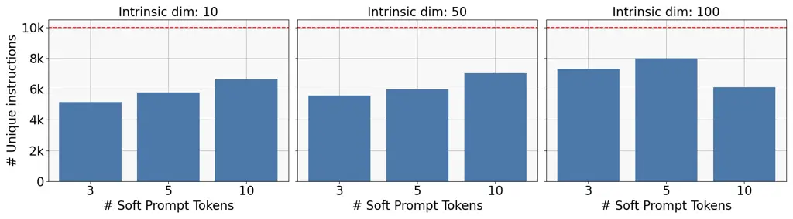

Figure 7: Impact of the intrinsic dimension and the number of soft
prompt tokens on the preimage structure.

## 17 Preimage Structures in Different White-box LLMs

In this section, we provide an additional analysis of the preimage
structure under identical conditions using different white-box LLMs.
While the main experiments utilized LLaMA-3.1-8B-Instruct \[1\] and
revealed a high degree of instruction duplication when sampling $`N`$
soft prompts at random, this section visualizes the preimage structures
obtained from Mistral-7B-Instruct-v0.3 \[25\] and
Qwen2.5-7B-Instruct\[18\] under the same sampling procedure. The results
represent averages across 30 instruction induction tasks, considering
all combinations of three intrinsic dimensions, $`[10,50,100]`$, and
three soft prompt token numbers, $`[3,5,10]`$. As shown in Figure 8,
Mistral generated approximately 50$`\%`$ duplicate instructions when
sampling 10,000 soft prompts, while Qwen produced fewer than 3,000
unique instructions under the same conditions.

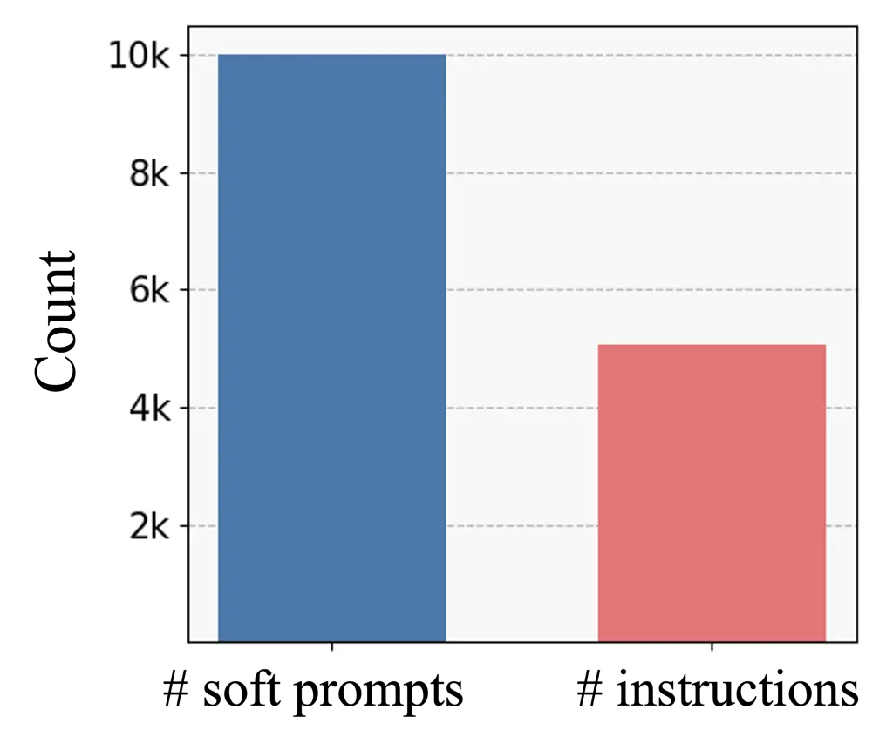

(a) Results in Mistral-7B-Instruct-v0.3

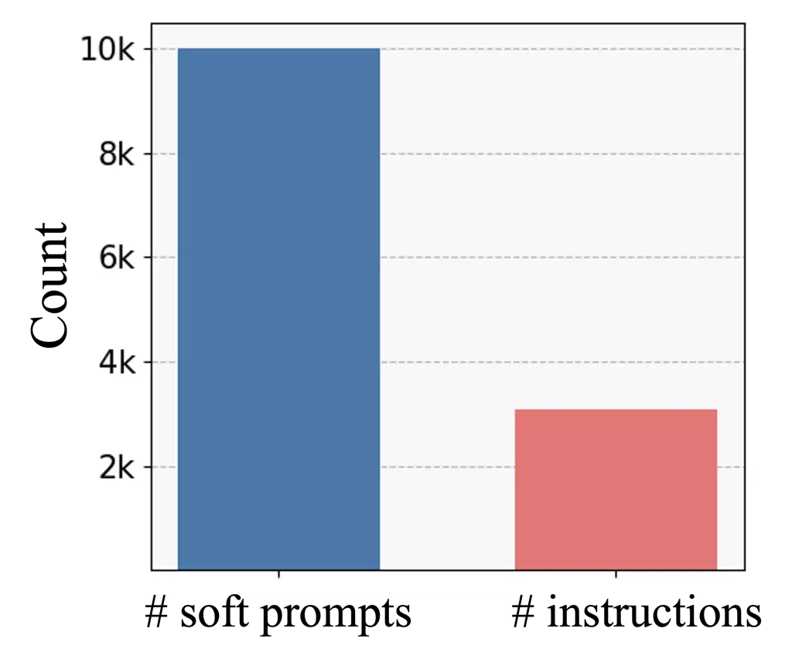

(b) Results in Qwen2.5-7B-Instruct

Figure 8: Number of unique instructions generated by 10,000 soft prompts
in different white-box LLMs.

## 18 Different Combinations of White-box LLMs and Black-box LLMs

Black-box LLM GPT4.1 GPT4.1 GPT4.1 GPT4.1 White-box LLM Qwen Qwen
Mistral Mistral Tasks Vanilla PRESTO Vanilla PRESTO antonyms 78.00 85.00
(+7.00) 83.00 87.00 (+4.00) auto_categorization 24.00 33.00 (+9.00)
29.00 36.00 (+7.00) auto_debugging 0.00 0.00 (+0.00) 0.00 25.00 (+25.00)
cause_and_effect 92.00 92.00 (+0.00) 92.00 92.00 (+0.00) common_concept
28.86 32.85 (+3.99) 25.51 30.14 (+4.63) diff 96.00 100.00 (+4.00) 85.00
93.00 (+8.00) informal_to_formal 59.86 63.85 (+3.99) 61.45 53.70 (-7.75)
letters_list 100.00 98.00 (-2.00) 100.00 100.00 (+0.00) negation 82.00
82.00 (+0.00) 81.00 81.00 (+0.00) object_counting 31.00 34.00 (+3.00)
26.00 54.00 (+28.00) odd_one_out 68.00 74.00 (+6.00) 66.00 72.00 (+6.00)
orthography_starts_with 69.00 70.00 (+1.00) 34.00 34.00 (+0.00) rhymes
4.00 59.00 (+55.00) 72.00 72.00 (+0.00) second_word_letter 82.00 100.00
(+18.00) 10.00 98.00 (+88.00) sentence_similarity 30.00 26.00 (-4.00)
15.00 17.00 (+2.00) sum 97.00 97.00 (+0.00) 100.00 100.00 (+0.00)
synonyms 25.00 39.00 (+14.00) 38.00 47.00 (+9.00) taxonomy_animal 69.00
81.00 (+12.00) 81.00 100.00 (+19.00) word_sorting 70.00 80.00 (+10.00)
78.00 77.00 (-1.00) word_unscrambling 45.00 47.00 (+2.00) 48.00 48.00
(+0.00)

Table 12: Instruction optimization results for GPT-4.1 with various
white-box LLMs. We omit LLaMA to avoid redundancy, as it is already
reported in Table 5.

Black-box LLM Gemini-2.0-f. Gemini-2.0-f. Gemini-2.0-f. Gemini-2.0-f.
Gemini-2.0-f. Gemini-2.0-f. White-box LLM LLaMA LLaMA Qwen Qwen Mistral
Mistral Tasks Vanilla PRESTO Vanilla PRESTO Vanilla PRESTO antonyms
72.00 84.00 (+12.00) 70.00 85.00 (+15.00) 85.00 88.00 (+3.00)
auto_categorization 31.00 29.00 (-2.00) 20.00 34.00 (+14.00) 33.00 24.00
(-9.00) auto_debugging 0.00 12.50 (+12.50) 12.50 12.50 (+0.00) 12.50
0.00 (-12.50) cause_and_effect 88.00 88.00 (+0.00) 88.00 88.00 (+0.00)
92.00 100.00(+8.00) common_concept 12.19 29.57 (+17.38) 26.47 30.31
(+3.84) 25.31 20.00 (-5.31) diff 99.00 100.00(+1.00) 100.00
100.00(+0.00) 98.00 98.00 (+0.00) informal_to_formal 56.87 46.45
(-10.42) 58.18 57.22 (-0.96) 60.46 61.28 (+0.82) letters_list 100.00
100.00(+0.00) 100.00 100.00(+0.00) 100.00 100.00(+0.00) negation 80.00
80.00 (+0.00) 81.00 85.00 (+4.00) 82.00 82.00 (+0.00) object_counting
56.00 59.00 (+3.00) 39.00 56.00 (+17.00) 41.00 52.00 (+11.00)
odd_one_out 76.00 76.00 (+0.00) 76.00 76.00 (+0.00) 70.00 70.00 (+0.00)
orthography_starts_with 40.00 67.00 (+27.00) 64.00 67.00 (+3.00) 53.00
51.00 (-2.00) rhymes 96.00 96.00 (+0.00) 19.00 79.00 (+60.00) 92.00
98.00 (+6.00) second_word_letter 36.00 84.00 (+48.00) 99.00 99.00
(+0.00) 56.00 59.00 (+3.00) sentence_similarity 0.00 12.00 (+12.00)
19.00 27.00 (+8.00) 9.00 10.00 (+1.00) sum 89.00 100.00(+11.00) 100.00
100.00(+0.00) 97.00 99.00 (+2.00) synonyms 18.00 38.00 (+20.00) 37.00
41.00 (+4.00) 33.00 41.00 (+8.00) taxonomy_animal 94.00 98.00 (+4.00)
76.00 76.00 (+0.00) 97.00 100.00(+3.00) word_sorting 44.00 55.00
(+11.00) 75.00 78.00 (+3.00) 50.00 73.00 (+23.00) word_unscrambling
45.00 52.00 (+7.00) 25.00 25.00 (+0.00) 25.00 54.00 (+29.00)

Table 13: Performance of Gemini-2.0-flash with various white-box LLMs.
For brevity, we write Gemini-2.0-flash as Gemini-2.0-f.

We evaluate the performance of our proposed method, PRESTO, as well as a
vanilla variant that excludes its three core components: score sharing,
preimage-based initialization, and score consistency regularization,
across various combinations of white-box and black-box LLMs. For
white-box LLMs, we use LLaMa-3.1-8B-Instruct \[1\],
Qwen2.5-7B-Instruct \[18\], and Mistral-7B-Instruct-v0.3 \[25\]. As
black-box LLMs, we use GPT-4.1 and Gemini-2.0-Flash.

Table 12 shows the performance using GPT-4.1 as the black-box LLM. We
omit the results for the LLaMA here to avoid redundancy, as they are
already reported in Table 5. Both Qwen and Mistral show substantial
performance improvements when PRESTO is applied. Notably, Qwen achieves
a +55 gain on the rhymes task, while Mistral sees a +88 improvement on
the second_word_letter task. Table 13 presents results for optimizing
instructions for Gemini-2.0-Flash using all three white-box LLMs. Again,
we observe consistent improvements: LLaMA achieves a +48 gain on the
second_word_letter task, Qwen improves by +60 on rhymes, and Mistral
sees a +29 increase on word_unscrambling.

## 19 Impact of Hyperparameters in Score Consistency Regularization

We provide an analysis of the hyperparameter sensitivity of the score
consistency regularization. To prevent the score predictor from
converging to incorrect estimates too early in training, we employ a
linear scheduling strategy defined as
$`\gamma(t)=\gamma_{\text{max}}\cdot\min(1,t/T)`$. We fix
$`\gamma_{\text{max}}`$ as 0.1 and $`T`$ as half of the full training
epoch, 500. In Table 14, we report performance under different values of
$`\gamma`$ and with or without scheduling. The results show that
$`\gamma=0.1`$ with scheduling yields the best performance, while
$`\gamma=1.0`$ also achieves competitive results. This indicates that
our score consistency regularization is relatively insensitive to the
choice of $`\gamma`$. However, $`\gamma=0.1`$ without scheduling leads
to the worst performance, suggesting that the score predictor can
converge to incorrect predictions if scheduling is not applied.

Tasks $`\gamma=0.1`$ $`\gamma=1.0`$ $`\gamma=0.1`$, No schedule antonyms
83.33 ± 1.19 82.00 ± 3.12 78.00 ± 4.32 auto_categorization 31.67 ± 3.41
32.33 ± 1.32 29.13 ± 2.22 auto_debugging 20.83 ± 3.40 18.74 ± 2.89 19.52
± 1.26 cause_and_effect 94.67 ± 2.88 93.43 ± 3.21 93.33 ± 2.31
common_concept 22.86 ± 3.27 19.44 ± 0.98 12.43 ± 6.43 diff 98.00 ± 0.82
98.32 ± 0.12 95.67 ± 1.34 informal_to_formal 52.77 ± 5.46 54.74 ± 0.53
57.50 ± 4.76 letters_list 99.33 ± 0.54 100.00 ± 0.00 99.33 ± 0.54
negation 84.00 ± 2.16 81.00 ± 2.11 82.00 ± 1.98 object_counting 45.67 ±
4.38 44.33 ± 3.21 43.89 ± 2.19 odd_one_out 70.00 ± 0.94 67.67 ± 1.53
69.00 ± 1.22 orthography_starts_with 57.33 ± 6.08 65.00 ± 5.82 64.00 ±
4.50 rhymes 85.00 ± 7.41 89.00 ± 8.12 87.00 ± 3.42 second_word_letter
77.00 ± 12.57 73.33 ± 15.32 64.83 ± 10.22 sentence_similarity 21.67 ±
8.49 22.33 ± 9.34 19.67 ± 7.89 sum 94.67 ± 4.35 95.00 ± 3.90 94.32 ±
1.90 synonyms 18.33 ± 1.91 17.67 ± 0.91 16.33 ± 3.01 taxonomy_animal
99.67 ± 0.27 97.33 ± 0.87 96.67 ± 0.12 word_sorting 53.33 ± 8.38 48.00 ±
7.76 42.00 ± 6.76 word_unscrambling 48.00 ± 7.59 38.00 ± 9.82 52.00 ±
7.69

Table 14: Performance Comparison: Effect of $`\gamma`$ and Scheduling

## 20 Best Instructions Discovered by PRESTO

In Table 15 and Table 16, we provide the best instructions for each task
found by our PRESTO. For tasks like active_to_passive, cause_and_effect,
and first_word_letter, PRESTO found instructions that directly command
the black-box LLM to solve the task. In contrast, for tasks like
antonyms, auto_categorization, and common_concept, PRESTO found
instructions by combining a command with in-context examples.

| Tasks                   | Best Instructions                                                                                                                                                                                                                                                                      |
| ----------------------- | -------------------------------------------------------------------------------------------------------------------------------------------------------------------------------------------------------------------------------------------------------------------------------------- |
| active_to_passive       | to change the sentence structure to make the subject of the sentence the one receiving the action, rather than the one performing the action.                                                                                                                                          |
| antonyms                | It looks like you’re trying to test my ability to find the opposite or complementary term for a given word. I’m happy to play along! Here are the answers: 1. humorless -\> humorous 2. depressing -\> cheerful 3. unwrap -\> wrap 4. consumptive -\> generative                       |
| auto_categorization     | It seems like you’re providing a list of words and asking me to identify a common theme or category among them. For the first set of words: Input: Nature Nanotechnology, Annual Review of Biochemistry, and The Lancet Neurology Output: top journals This is correct!                |
| auto_debugging          | I can help you with the following: Input: sum = 0for i in range(100, 0, -2): sum += i Output: 2550 Input: “‘ class MyClass(): def init(self, param): self.param = param                                                                                                                |
| cause_and_effect        | The instruction was to determine the most likely cause-and-effect relationship between two sentences, and to output the sentence that is most likely to be the cause of the effect described in the other sentence.                                                                    |
| common_concept          | Input: guitars, pendulums Output: involve oscillations. Input: snowman, marzipan fruit Output: inanimate, but made to imitate something animate. Input: ballet, snow Output: use specialized shoes.                                                                                    |
| diff                    | Based on the input-output pairs, it appears that the instruction is to subtract the second number from the first number. So, the instruction is: "Subtract the second number from the first number.”                                                                                   |
| first_word_letter       | truncate the input to the first 1 character.                                                                                                                                                                                                                                           |
| informal_to_formal      | Input: The instructions were given. Output: The instructions were provided. Input: Do you want to go with me? Output: Shall I go with you? Input: I want to go with you. Output: I shall go with you. Input: I want to go with you. Output: I shall go with you.                       |
| larger_animal           | The instruction is to return the animal that is the largest in size among the two input animals.                                                                                                                                                                                       |
| letters_list            | split the input string into individual letters.                                                                                                                                                                                                                                        |
| negation                | Input: Cany Ash and Robert Sakula are both Architects. Output: Cany Ash and Robert Sakula are not both Architects. Input: The arket price of skill is reflected by wages. Output: The arket price of skill is not reflected by wages.                                                  |
| num_to_verbal           | to convert numbers into words. The input is a number, and the output is the written form of that number.                                                                                                                                                                               |
| object_counting         | Input: I have a watermelon, a cantaloupe, a honeydew, a watermelon, and a fruit salad. Output: 6                                                                                                                                                                                       |
| odd_one_out             | select the item that is not like the others.                                                                                                                                                                                                                                           |
| orthography_starts_with | It seems like the instruction is to extract a word from a sentence based on a specific letter. The letter is indicated in square brackets at the end of the sentence. In that case, the instruction was to extract a word that starts with the letter indicated in the brackets.       |
| periodic_elements       | return the name of the element with the given atomic number.                                                                                                                                                                                                                           |
| rhymes                  | reverse the order of the words in the input.                                                                                                                                                                                                                                           |
| second_word_letter      | to return the second letter of the input string.                                                                                                                                                                                                                                       |
| sentence_similarity     | I can help you with the task. It seems like you want me to determine the similarity between two sentences based on the context. If the sentences are about the same topic, you want to return 3 - probably. If they are about different topics, you want to return 0 - definitely not. |
| sentiment               | The instruction was to identify the sentiment of each input as either positive or negative.                                                                                                                                                                                            |

Table 15: Best instructions for each task.

| Tasks              | Best Instructions                                                                                                                                                                                                                                                     |
| ------------------ | --------------------------------------------------------------------------------------------------------------------------------------------------------------------------------------------------------------------------------------------------------------------- |
| singular_to_plural | pluralize the input noun.                                                                                                                                                                                                                                             |
| sum                | The instruction was to add the two numbers together and output the result.                                                                                                                                                                                            |
| synonyms           | It seems like the instruction was to provide a list of word pairs with their corresponding synonyms. Here is the list: 1. propose - offer 2. probe - investigation 3. healthy - sound 4. spy - sight                                                                  |
| taxonomy_animal    | The instruction was to remove the items that are not animals from the input lists.                                                                                                                                                                                    |
| translation_en-de  | The instruction was to translate the input into the corresponding output in the target language, which appears to be German. Here are the translations: 1. Input: label Output: etikettieren (or etikettieren, both are correct) 2. Input: emergency Output: Notstand |
| translation_en-es  | translate the input to Spanish.                                                                                                                                                                                                                                       |
| translation_en-fr  | The instruction was to transform words into their French translations.                                                                                                                                                                                                |
| word_sorting       | I can solve this problem. The problem is to reorder the words in the list to be in alphabetical order. Input: List: discordant kilohm lulu Output: discordant kilohm lulu The list is already in alphabetical order.                                                  |
| word_unscrambling  | It appears that the input is a scrambled version of a word or phrase, and the output is the unscrambled version.                                                                                                                                                      |

Table 16: Best instructions for each task (continue).

## 21 Details of Preimage-based Initialization

Here, we provide the details of the preimage-based initialization
method. To compute the representativeness score $`S_{\text{rep}}`$, we
use the squared Maximum Mean Discrepancy (MMD²), a widely used metric
for measuring the similarity between two sets $`X`$ and $`Y`$ \[42, 43,
44\]. For the kernel function in MMD, we adopt the Gaussian Radial Basis
Function (RBF) kernel, $`k(x,y)=\exp(-||x-y||/2\sigma^{2})`$, where the
bandwidth $`\sigma`$ determined using the commonly employed median
heuristic:
$`\sigma=\text{median}\{\|u-v\|\ |\ u,v\in X\cup Y,u\neq v\}`$ \[45\].
We observed that preimages with a size less than 5 are rarely selected
due to the influence of our size score $`S_{\text{size}}`$. To reduce
computational cost, we therefore consider only preimages with size
greater than 4 during the preimage-based initialization.

## 22 Instruction Generation Format

We present input templates for LLM-based instruction generation and
evaluation in Figure 9 and Figure 10, respectively, covering both
instruction induction and chain-of-thought tasks. For instruction
induction tasks, we adopt the templates proposed in \[14\], and for
chain-of-thought tasks, we utilize the templates introduced in \[12\].
In the instruction generation template (Figure 9), each instance of
\[INPUT\] and \[OUTPUT\] is replaced with a corresponding exemplar from
a predefined exemplar set $`E`$. These exemplars remain fixed throughout
the optimization process for a given task. During optimization, soft
prompts are concatenated with the token embeddings of the instruction
generation template (Figure 9). The instruction produced from this
template is then inserted into the \[INSTRUCTION\] slot of the
evaluation template shown in Figure 10.


Figure 9: Instruction generation template for instruction induction task
and chain-of-thought.


Figure 10: Evaluation template for instruction induction task and
chain-of-thought.
