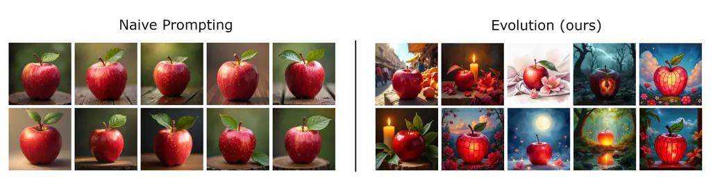
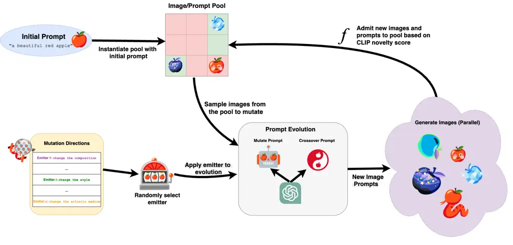
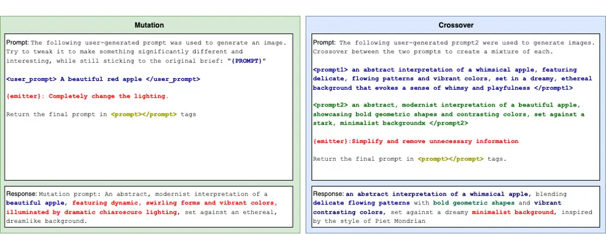
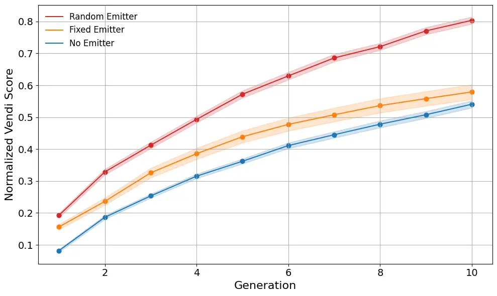
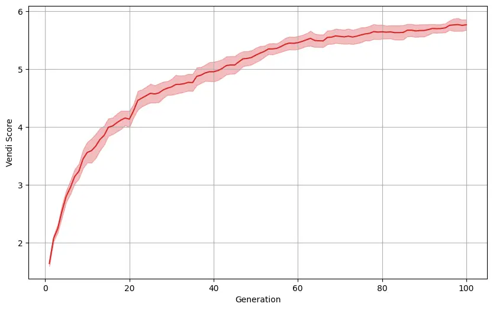
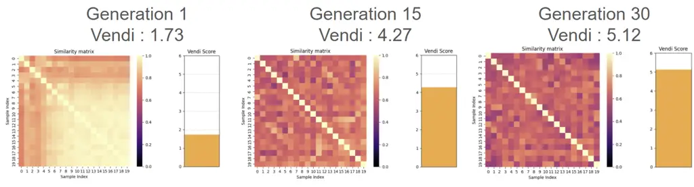
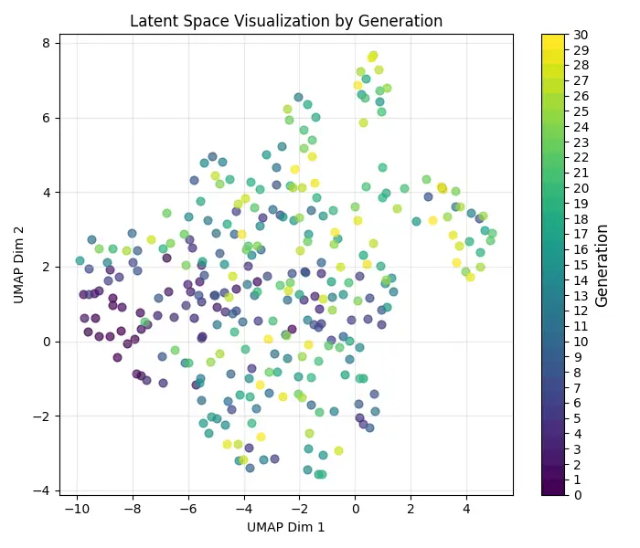
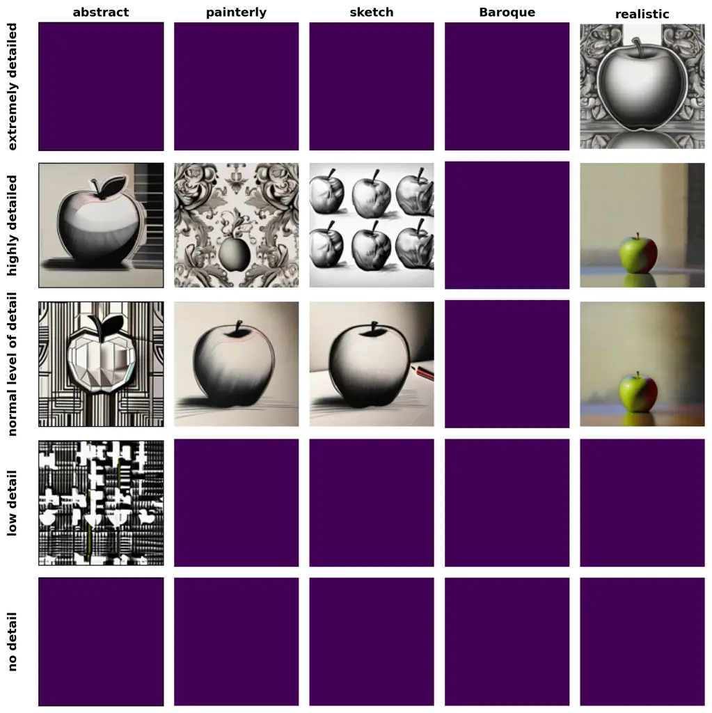
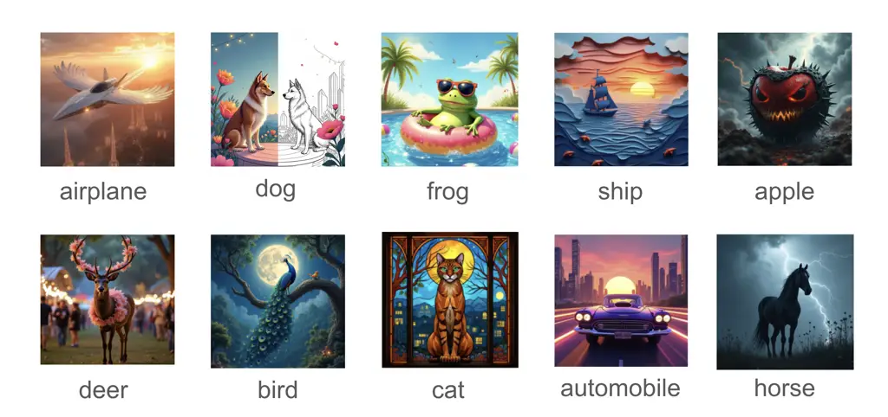
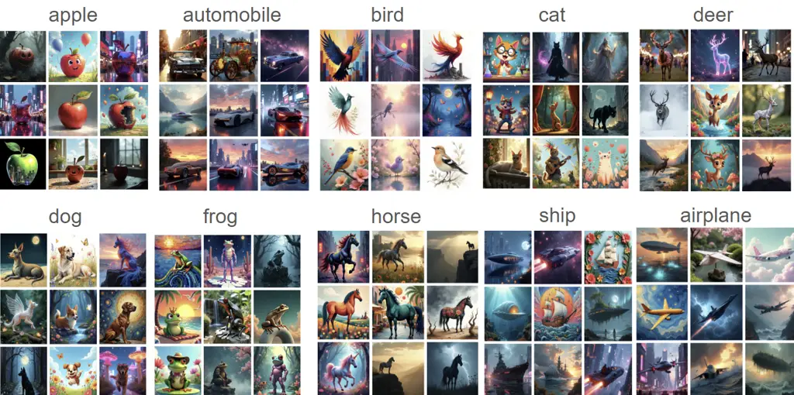

\workshoptitle

The First Workshop on Generative and Protective AI for Content Creation

# Evolve to Inspire: Novelty Search for Diverse Image GenerationThanks: Now at the University of OxfordThanks: Now at Tesco TechnologyThanks: Now at Microsoft Research

Alex Inch Affiliation: University College London
Email: [alex.inch@eng.ox.ac.uk](mailto:)    Passawis Chaiyapattanaporn
Affiliation: University College London
Email: [official.passawis@gmail.com](mailto:)    Yuchen Zhu
Affiliation: University College London
Email: [yuchen.zhu.24@ucl.ac.uk](mailto:)    Yuan Lu
Affiliation: University College London
Email: [yuan.lu.20@ucl.ac.uk](mailto:)    Ting-Wen Ko
Affiliation: University College London
Email: [ting-wen.ko.24@ucl.ac.uk](mailto:)    Davide Paglieri
Affiliation: University College London
Email: [davide.paglieri.22@ucl.ac.uk](mailto:)

###### Abstract

Text-to-image diffusion models, while proficient at generating
high-fidelity images, often suffer from limited output diversity,
hindering their application in exploratory and ideation tasks. Existing
prompt optimization techniques typically target aesthetic fitness or are
ill-suited to the creative visual domain. To address this shortcoming,
we introduce Wander, a novelty search-based approach to generating
diverse sets of images from a single input prompt. Wander operates
directly on natural language prompts, employing a Large Language Model
(LLM) for semantic evolution of diverse sets of images, and using CLIP
embeddings to quantify novelty. We additionally apply emitters to guide
the search into distinct regions of the prompt space, and demonstrate
that they boost the diversity of the generated images. Empirical
evaluations using FLUX-DEV for generation and GPT-4o-mini for mutation
demonstrate that Wander significantly outperforms existing evolutionary
prompt optimization baselines in diversity metrics. Ablation studies
confirm the efficacy of emitters.

## 1 Introduction

Text-to-image diffusion models like Stable Diffusion, FLUX and GLIDE
excel at generating visually appealing images from text prompts Rombach
et al. (2022); Black Forest Labs (2024); Nichol et al. (2022). However,
a significant limitation of these models is that it can be difficiult to
use them to generate diverse sets of images (Marwood et al., 2023)
unless specifically directed by a user actively writing specific,
diverse prompts. This lack of diversity hinders their utility in
applications like ideation or exploration, where quickly generating
novel ideas is crucial. Simply repeating the prompt yields similar
results, and manually tweaking prompts can lead to unpredictable
changes, making systematic exploration difficult.

Large Language Models (LLMs) have shown promise in generating diverse
prompts for text-based tasks via mutation (Bradley et al., 2023;
Samvelyan et al., 2024; Faldor et al., 2025), but their application to
image generation has primarily focused on optimizing prompts for certain
fitness objective such as aesthetic or Natural Language Processing (NLP)
task performance (Meyerson et al., 2024; Hao et al., 2023; Wu et al.,
2024; Brade et al., 2023; Chen et al., 2024). This contrasts with
open-ended exploration, which prioritizes novelty and exploration
instead of convergence to a single ‘best’ image, motivating the need for
a dedicated approach to systematically enhance image diversity.



Figure 1: Our method generates significantly more diverse images than
reusing a prompt multiple times.

One prominent diversity-seeking method is Quality Diversity through AI
Feedback (QDAIF) (Bradley et al., 2023). QDAIF uses an LLM to rate text
and assign it to cells on a MAP-Elites grid (Mouret and Clune, 2015),
evolving it using an LLM to produce a set of diverse texts while
maintaining quality. However, adapting these approaches to images is
difficult. Our preliminary experiments (Appendix A) show that using
Vision-Language Models (VLMs) within a QDAIF framework fails; VLM fail
to consistently identify qualitatively novel images or accurately
categorize images within a MAP-Elites grid based on visual
characteristics.

Instead, we propose a novelty search-based approach designed to generate
diverse image sets from a single starting point (Lehman and Stanley,
2011b). We quantify image novelty using the cosine distance between CLIP
image embeddings (Radford et al., 2021a). As a mutation operator to
generate new individuals, we use an LLM.

Inspired by (Fontaine et al., 2020), we additionally introduce emitters
to this problem setting. Emitters are specialized mutation strategies
that guide evolution into distinct areas of the behavior space. In our
case, emitters are prompts that instruct the LLM to mutate a text prompt
in specific manners (a full list can be found in appendix C).

Our experimental methodology involved comparing Wander against other
methods by running each algorithm 10 times on identical prompts. To
assess the impact of our design choices, we performed an ablation study
over different emitter strategies, conducting 10 runs for each of the 10
initial prompts. Additionally, we evaluated the long-horizon performance
of random versus bandit-driven selection by running both methods for 30
generations. Results show that Wander achieves superior image diversity
while maintaining reasonable relevance and token efficiency compared to
existing prompt optimization baselines. In all, we demonstrate that:

- •
  Novelty search using image CLIP embeddings is capable of generating
  highly-diverse sets of images given a simple text prompt as a starting
  point.
- •
  Introducing human-designed mutation strategies (emitters) enhances the
  diversity of generated images.
- •
  We introduce Wander, a framework for prompt optimization that
  leverages an LLM as a mutation engine, where randomly sampling from a
  predefined set of semantic instructions (emitters) proves to be a
  powerful mechanism for diverse exploration.

## 2 Related Work

### 2.1 Fine-Tuning for Diversity

Recent works have investigated fine-tuning language models for more
diverse generation, using reinforcement learning or distillation
approaches (Hao et al., 2023; Zhang et al., 2024; Cideron et al., 2024;
Miao et al., 2024).

However, fine-tuning approaches have significant limitations; they
require access to model parameters, can have high up-front costs, and
need to be re-run from scratch for different models. For this work,
therefore, we focus on more flexible black-box approaches that can be
evaluated via APIs.

### 2.2 Evolutionary Strategies

The use of evolutionary strategies (ES) has a long history in black-box
optimization, where iterative mutation and selection mechanisms drive
exploration over complex, high-dimensional spaces.

A critical advancement in the evolution literature was the development
of novelty search. Unlike traditional objective-driven optimization,
novelty search explicitly rewards behavioral diversity, thereby avoiding
premature convergence to local optima. The seminal work by Lehman and
Stanley (2011b) demonstrated that novelty-guided evolution can
outperform objective-based search by encouraging exploration away from
deceptive regions of the search space. This was later extended (Lehman
and Stanley, 2011a) to introduce local competition to balance
exploration (novelty) with exploitation (performance).

### 2.3 Discrete Prompt Optimization

Another line of work explores discrete prompt optimization. Methods like
APE (Zhou et al., 2022) adopt a Monte Carlo sampling strategy to
iteratively sample and optimize the prompts. APE focuses on exploration
while APO focuses more on exploitation by computing gradient with regard
to a given sample. Recent advancements better explore the discrete
prompt space by incorporating evolutionary strategies, such as genetic
differential algorithms and multi-phase mutation (Guo et al., 2024; Cui
et al., 2024). However, existing methods for discrete prompt
optimization focus on maximizing a fitness function, such as quality or
NLP task performance on a development set, as opposed to our problem
setting of diverse image generation.

### 2.4 Open-Ended Prompt Evolution

Prior work on evolutionary prompt optimization with LLMs has laid a
strong foundation for evolving high-quality prompts. PromptBreeder and
Rainbow Teaming (Fernando et al., 2023; Samvelyan et al., 2024) use
self-referential evolution, in which an LLM simultaneously mutates a
population of task- and mutation-prompts. These methods have been shown
to find novel solutions to problems including arithmetic, common-sense
reasoning and jailbreaking LLMs. Unfortunately, owing to a lack of
open-source implementations we were unable to evaluate these methods for
our use case.

Additionally, for creative purposes, QDAIF (Bradley et al., 2023) uses a
MAP-Elites-based approach to generate diverse, high-quality text. In
this work we assess an extension of QDAIF to image generation using a
vision-language model (VLM) for image feedback, but find it is
poorly-suited to the task (see Appendix A.)

### 2.5 Prompt Rewriting

A related problem is prompt-rewriting or caption-upsampling; training
ancillary models which rewrite prompts for more aesthetic or diverse
image generation (Betker et al., 2023; Hao et al., 2023). The closest
work to ours is Datta et al. (2024), which trains a “prompt expander"
model to rewrite user prompts. This is a powerful method, but requires
compute-heavy dataset generation and training stages. Additionally,
since dataset creation requires access to a given image model, prompt
expanders must be retrained for each new image model.

### 2.6 Concurrent Work

During the development of this report, concurrent work was released
addressing diverse image generation using a similar approach. Lluminate
(Simon, 2025) also uses novelty search to generate diverse results over
images. However, rather than task-specific emitters, Lluminate employs
generic "creative strategies" drawn from sources such as Oblique
Strategies. Lluminate also uses an unbounded genetic pool, while Wander
uses a fixed-size pool, which leads to significantly more
token-efficient evolution.

In a benchmark comparison, we find that Wander achieves more diverse
image pools (as measured by Vendi Score) than Lluminate, while using
seven times fewer tokens.

## 3 The Wander Framework



Figure 2: An overview of the Wander workflow.

| Method        | Initial Prompt | Objective         | Evolutionary Approach           |
| ------------- | -------------- | ----------------- | ------------------------------- |
| APE           | Multiple       | Fitness           | Crossover                       |
| EvoPrompt-GA  | Multiple       | Fitness           | Mutation, crossover             |
| EvoPrompt-DE  | Multiple       | Fitness           | Mutation, crossover             |
| PhaseEvo      | Multiple       | Fitness           | Directed mutation, crossover    |
| QDAIF         | One            | Quality-Diversity | Directed mutation               |
| Lluminate     | One            | Novelty           | Mutation w/ creative strategies |
| Wander (ours) | One            | Novelty           | Directed mutation, crossover    |

Table 1: Comparison of LLM evolution approaches

Inspired by related work, our approach evolves discrete, interpretable
prompts through a mutation-selection loop. We specify a small number of
simple emitters which significantly enhance image diversity. This
enables transferability across downstream models regardless of their
black-box nature or internal training objectives, providing a scalable,
model-agnostic method for improving generation diversity.

The evolutionary cycle of Wander consists of three key components
repeated over multiple generations: Emitter Selection, Prompt Evolution,
and Pool Update. Each generation begins with a shared initial prompt
population and evolves via LLM-generated transformations guided by
emitters. Emitter effectiveness is continually reassessed based on
diversity-driven feedback computed using image embeddings.

### 3.1 Problem Formulation

Given a pool $`\mathbf{P}`$ which contains up to $`N`$ prompt-image
pairs $`x_{i}=(p_{i},I_{i})`$, we define a novelty score
$`f(x_{i},\mathbf{{P}})\in[0,1]`$ for each individual $`x_{i}`$ relative
to the pool. The novelty score is typically a k-nearest neighbors mean
embedding distance. Our algorithm’s objective is then to generate new
images and prune low-novelty images to produce a highly diverse final
pool. We can frame this as maximizing the lowest novelty score in the
pool,

```math
\mathbf{P}^{*}=\max_{\mathbf{P}}\left(\min_{i}(f(x_{i},\mathbf{P}))\right).
```

### 3.2 Proposed Method

wander (Figure 2) begins with a pool of $`n\leq N`$ prompt-image pairs,
and proceeds over $`\mathcal{T}`$ generations. In each generation, we
perform a fixed number of mutations, each consisting of 3 steps; Emitter
Selection, Prompt Evolution, and a Pool Update.

#### Initial Pool

We instantiate the pool with $`n\leq N`$ copies of the input prompt. We
then generate images for each prompt, creating $`n`$ starting
individuals $`x_{1},\dots,x_{n}`$.

#### Emitter Selection

Emitters are predefined mutation strategies (e.g., “change the
composition”, “adjust the lighting”, “add elements”) which are included
in the mutation prompt to direct evolution. A full list of emitters can
be found in Table 4.



Figure 3: Examples of LLM prompt mutation and crossover

#### Prompt Evolution

Once a mutation direction is selected, the framework applies one of two
transformation techniques with a configurable probability (default 50%):
mutation or crossover (Guo et al., 2024; Cui et al., 2024). Directed by
the chosen emitter, mutation modifies a single prompt, whereas crossover
combines elements from two existing prompts to create a novel variation.
This approach leverages large language models (LLMs) to generate
high-quality variations, maintaining semantic coherence while fostering
diversity. An example of this process is illustrated in Figure 3.

#### Pool Update

For each newly evolved prompt $`p_{i}`$ we sample an image from the
diffusion model to create candidate individuals $`x_{i}`$. For each
image we then compute a CLIP embedding (Radford et al., 2021a).
Following Lehman and Stanley (2011b), we introduce an explicit novelty
objective, measuring the average distance between an image embedding and
its $`k`$-nearest neighbors in the pool. Formally, we define the novelty
score for individual $`x_{i}=(p_{i},I_{i})`$ as:

```math
f(x_{i},\textbf{P})=\frac{1}{k}\sum_{j=1}^{k}d(I_{i},I_{j}),
```

where $`I_{j(i)}`$ are the images of the $`k`$ nearest neighbors of
$`I_{i}`$ in pool P, and $`d(I_{i},I_{j})`$ is the cosine distance. If
the candidate has a higher novelty score than the current lowest in the
pool, it then replaces the current lowest-scorer, ensuring that each
generation progressively improves in diversity.

This iterative refinement allows Wander to continuously explore and
exploit the most effective mutation directions, leading to increasingly
diverse and high-quality image generations.

## 4 Experimental Setup

#### Implementation Details

We use GPT-4o-mini (Menick et al., 2024) to perform prompt evolution,
and FLUX-DEV (Black Forest Labs, 2024) for image generation. For image
and text embeddings we use OpenAI’s CLIP-ViT-B-32 model (Radford et al.,
2021b).

#### Baselines

In our experiments, we compare Wander to several representative
baselines in automatic prompt optimization, namely APE, EvoPrompt-GA,
EvoPrompt-DE, PhaseEvo, QDAIF and Lluminate. For a comprehensive
discussion of their underlying mechanisms and operational details, we
refer readers to the Related Work section.

#### Tasks

To compare Wander to other methods, we run all algorithms 10 times on
the same prompt. To identify the impact of emitters, we conduct an
ablation over emitter strategies to identify the impact of our design
choices, which are run 10 times, for 10 prompts. Lastly, to compare
random to bandit-driven selection, we run both methods for 30
generations to assess long-horizon performance.

We report LPIPS (Zhang et al., 2018), Vendi score (Friedman and Dieng,
2023), and a ‘Relevance’ metric to evaluate image diversity and textual
consistency. LPIPS is computed as the average pairwise perceptual
distance between images based on deep feature representations. The Vendi
score is defined as

```math
\mathrm{VS}(K)=\exp\left(-\sum_{i=1}^{n}\lambda_{i}\log\lambda_{i}\right),
```

where $`\lambda_{i}`$ are the eigenvalues of the normalized diversity
matrix $`K/n`$, constructed using pairwise cosine similarities between
image embeddings. This score reflects the effective number of diverse
samples in the pool. The Relevance metric is calculated as the average
cosine distance between the text embeddings of the original and evolved
prompts (Radford et al., 2021a; Hao et al., 2023; Frans et al., 2021;
Tian and Ha, 2022). For all three metrics, a higher score indicates
better performance.

|              |                    |      |                    |      |                        |          |                            |       |
| ------------ | ------------------ | ---- | ------------------ | ---- | ---------------------- | -------- | -------------------------- | ----- |
| Method       | Vendi $`\uparrow`$ |      | LPIPS $`\uparrow`$ |      | Relevance $`\uparrow`$ |          | Token Usage $`\downarrow`$ |       |
| EvoPrompt-DE | 1.42 $`{}\pm{}`$   | 0.04 | 0.51 $`{}\pm{}`$   | 0.01 | 0.292 $`{}\pm{}`$      | 0.001    | 38,243 $`{}\pm{}`$         | 4,514 |
| PhaseEvo     | 1.44 $`{}\pm{}`$   | 0.05 | 0.47 $`{}\pm{}`$   | 0.02 | 0.289 $`{}\pm{}`$      | 0.002    | 39,706 $`{}\pm{}`$         | 862   |
| APE          | 1.47 $`{}\pm{}`$   | 0.03 | 0.60 $`{}\pm{}`$   | 0.02 | 0.285 $`{}\pm{}`$      | 0.001    | 51,620 $`{}\pm{}`$         | 1,345 |
| EvoPrompt-GA | 1.49 $`{}\pm{}`$   | 0.02 | 0.56 $`{}\pm{}`$   | 0.01 | 0.295 $`{}\pm{}`$      | 0.001    | 1,828 $`{}\pm{}`$          | 19    |
| QDAIF        | 1.80 $`{}\pm{}`$   | 0.02 | 0.51 $`{}\pm{}`$   | 0.02 | 0.297 $`{}\pm{}`$      | \< 0.001 | 43,464 $`{}\pm{}`$         | 45    |
| Lluminate    | 3.29 $`{}\pm{}`$   | 0.02 | 0.75 $`{}\pm{}`$   | 0.01 | 0.210 $`{}\pm{}`$      | 0.070    | 175,902 $`{}\pm{}`$        | 9,390 |
| Wander-NE    | 2.61 $`{}\pm{}`$   | 0.10 | 0.79 $`{}\pm{}`$   | 0.01 | 0.279 $`{}\pm{}`$      | 0.004    | 23,884 $`{}\pm{}`$         | 493   |
| Wander-FE    | 2.95 $`{}\pm{}`$   | 0.25 | 0.76 $`{}\pm{}`$   | 0.02 | 0.271 $`{}\pm{}`$      | 0.006    | 23,492 $`{}\pm{}`$         | 1,958 |
| Wander       | 3.60 $`{}\pm{}`$   | 0.09 | 0.80 $`{}\pm{}`$   | 0.01 | 0.272 $`{}\pm{}`$      | 0.003    | 24,347 $`{}\pm{}`$         | 649   |

Table 2: Results comparison of our method and existing baselines, 10
runs for each of 10 starting prompts for 100 total runs per method. The
variants Wander-NE and -FE refer to Wander with no emitters, and with a
single fixed emitter per-run.

## 5 Results



Figure 4: Ablation over emitter selection strategies. The results
presented are averaged over 10 runs for each of 10 prompts (n=100
samples per method). For comparability, the Vendi score was min-max
normalized per prompt.



Figure 5: Over longer runs, the Vendi score consistently rises,
plateauing around the $`100^{\text{th}}`$ generation. Averaged over 10
runs, shaded area indicates the standard error.

#### Wander Achieves Superior Diversity and Efficiency.

Table 2 presents a comprehensive comparison of our method with existing
baseline approaches. Wander achieves higher diversity than baselines
with a Vendi score of $`3.60\pm 0.09`$ and an LPIPS score of
$`0.80\pm 0.01`$, while requiring only $`24,363\pm 485`$ tokens on
average. In contrast, baseline methods such as Lluminate produced less
diverse outputs (Vendi: $`3.29\pm 0.02`$, LPIPS: $`0.75\pm 0.01`$) while
using significantly more tokens ($`175,902\pm 9,390`$). Variants of
Wander with no emitters ($`2.61\pm 0.10`$ Vendi) and a single fixed
emitter ($`2.95\pm 0.25`$ Vendi) outperform QDAIF, demonstrating the
efficacy of novelty search for diverse generation. Although the
relevance score of Wander ($`0.272\pm 0.003`$) is slightly lower than
that of QDAIF ($`0.297`$), our qualitative analysis (examples in
Appendix B) indicates that generated images remain strongly aligned with
the intended class, with rare exceptions discussed in section 6. This
suggests that the marginal reduction in relevance score does not
compromise the practical usability of the final image pool.

#### Multiple Emitters Significantly Enhance Evolutionary Diversity.

In order to assess the impact of different emitter selection strategies,
we conduct an ablation study involving a short evolutionary task
spanning 10 generations. We evaluated several approaches, including a
bandit-driven strategy, random selection, the use of a single fixed
emitter per run, and a condition with no emitters. The results in Fig. 5
indicate that employing multiple emitters leads to a substantial
increase in the diversity of the final evolved pool compared to using a
single, fixed emitter or no emitter at all. Image samples for different
prompts are displayed in Appendix B.



Figure 6: Similarity matrices of Wander image embeddings and Vendi
scores at generations 1, 15, and 30.

#### Increased Diversity in Image Latent Space Through Evolution.

To understand the evolutionary dynamics within the image latent space,
we visualized the image embeddings using Uniform Manifold Approximation
and Projection (UMAP) (McInnes et al., 2020). As shown in Fig. 7, a
clear trend of increasing diversity emerges across generations,
demonstrating the impact of the evolutionary process on the latent
space. Furthermore, the distinct spatial clustering of image samples
from different generations in the UMAP visualization suggests a
consistent evolution of their underlying latent representations. This
observation is further supported by the similarity matrices and Vendi
scores for generations 1, 15, and 30 in Fig. 6. These results illustrate
a decrease in pairwise image similarity and a corresponding increase in
Vendi score as generations progress, quantitatively confirming the
improved diversity of the generated image set over time.

#### More Capable LLMs Generate More Diverse Pools

For most results we use GPT-4o-mini as a cheap, fast prompt-mutation
operator. To assess the impact of more capable LLMs for mutation, we
compare different models from OpenAI over 10 runs, each of 20
generations. We find that more generally capable models are more
effective prompt mutators, with OpenAI’s o3 model achieving a 23% higher
Vendi Score than GPT-4o-mini. However, we also observe that reasoning
models use around three times as many tokens as non-reasoning models.
Results with the standard error are shown in Table 3.



Figure 7: UMAP visualization of Wander image latents over 30
generations, each containing 10 generated images.

| Model       | Vendi Score $`\uparrow`$ | Token Usage $`\downarrow`$   |
| ----------- | ------------------------ | ---------------------------- |
| GPT-4o-mini | $`4.2\pm 0.1`$           | $`\mathbf{61,402\pm 1,309}`$ |
| o4-mini     | $`4.5\pm 0.1`$           | $`227,655\pm 7,114`$         |
| GPT-4o      | $`4.8\pm 0.1`$           | $`78,067\pm 2,031`$          |
| o3          | $`\mathbf{5.2\pm 0.1}`$  | $`236,081\pm 8,300`$         |

Table 3: Model comparison by Vendi score and token usage after 20
generations, averaged over 10 runs each, with the standard error. Token
usage is higher than that shown in Table 2 as Wander was run for 20
generations rather than the 10 used for the main comparisons.

## 6 Limitations

- •
  Relevance Drift: The novelty objective can occasionally lead generated
  images to diverge from the initial prompt’s core concept, roughly once
  per 5 runs, or 100 images. Mitigating this may require additional
  prompt tuning or an explicit relevance penalty during selection.
- •
  Human-Designed Emitters: Emitters must be manually specified, which
  could bias or limit asymptotic diversity. The use of an LLM to
  generate emitters could uncover more effective mutation strategies
  without requiring any explicit human input beyond the initial prompt.
- •
  Aesthetic Evaluation: Our evaluation focused on diversity (Vendi score
  and LPIPS) and prompt similarity. In early experiments, the Stable
  Diffusion 1.0 diffusion model was prone to generating low-quality
  images during evolution. However, as we did not observe this issue
  using FLUX-DEV, we did not assess it for generated images. However,
  evaluating the aesthetic quality of the generated images could provide
  a more complete picture of the efficacy of Wander.

## 7 Conclusion

This paper introduces Wander, a novel evolutionary framework designed to
address the lack of diversity in text-to-image generation. Moving beyond
simple aesthetic optimization, our method employs novelty search, using
an LLM to mutate prompts guided by diverse emitters. Experiments confirm
that CLIP embeddings serve as a useful component in novelty metric and
that our bandit-driven emitter selection significantly enhances image
diversity compared to baseline methods, particularly over extended runs.
Wander provides an effective, adaptive strategy for generating varied
image sets, supporting open-ended creative exploration with diffusion
models.

#### Future Work

While this work demonstrates the effectiveness of Wander for image
generation, several avenues remain for future research. This approach
can be extended to any domains where meaningful distance metrics can be
defined on latent representations, such as text and audio. For example,
we used a text-based version of Wander to inspire the title of this
paper (see Appendix D). We also hope to further investigate steerability
of Wander; in this work we begin from simple prompts, but it may be
desirable to constrain the direction of exploration more strongly.
Finally, there are potential downstream applications which warrant
further investigation, such as generating image model jailbreaks, or
data augmentation for computer vision tasks.

## References

- Betker et al. (2023) James Betker, Gabriel Goh, Li Jing, Tim Brooks,
  Jianfeng Wang, Linjie Li, Long Ouyang, Juntang Zhuang, Joyce Lee,
  Yufei Guo, Wesam Manassra, Prafulla Dhariwal, Casey Chu, Yunxin Jiao,
  and Aditya Ramesh. Improving image generation with better captions.
  Technical report, OpenAI, October 2023. URL
  [https://cdn.openai.com/papers/dall-e-3.pdf](https://cdn.openai.com/papers/dall-e-3.pdf).
- Black Forest Labs (2024) Black Forest Labs. Flux.
  [https://github.com/black-forest-labs/flux](https://github.com/black-forest-labs/flux), 2024.
- Brade et al. (2023) Stephen Brade, Bryan Wang, Mauricio Sousa, Sageev
  Oore, and Tovi Grossman. Promptify: Text-to-image generation through
  interactive prompt exploration with large language models. In
  _Proceedings of the 36th Annual ACM Symposium on User Interface
  Software and Technology_, UIST ’23, New York, NY, USA, 2023.
  Association for Computing Machinery. ISBN 9798400701320. doi:
  10.1145/3586183.3606725. URL
  [https://doi.org/10.1145/3586183.3606725](https://doi.org/10.1145/3586183.3606725).
- Bradley et al. (2023) Herbie Bradley, Andrew Dai, Hannah Teufel, Jenny
  Zhang, Koen Oostermeijer, Marco Bellagente, Jeff Clune, Kenneth
  Stanley, Grégory Schott, and Joel Lehman. Quality-diversity through ai
  feedback, 2023. URL
  [https://arxiv.org/abs/2310.13032](https://arxiv.org/abs/2310.13032).
- Chen et al. (2024) Zijie Chen, Lichao Zhang, Fangsheng Weng, Lili Pan,
  and Zhenzhong Lan. Tailored visions: Enhancing text-to-image
  generation with personalized prompt rewriting, 2024. URL
  [https://arxiv.org/abs/2310.08129](https://arxiv.org/abs/2310.08129).
- Cideron et al. (2024) Geoffrey Cideron, Andrea Agostinelli, Johan
  Ferret, Sertan Girgin, Romuald Élie, Olivier Bachem, Sarah Perrin, and
  Alexandre Ram’e. Diversity-rewarded cfg distillation. _ArXiv_,
  abs/2410.06084, 2024. URL
  [https://api.semanticscholar.org/CorpusID:273228630](https://api.semanticscholar.org/CorpusID:273228630).
- Cui et al. (2024) Wendi Cui, Jiaxin Zhang, Zhuohang Li, Hao Sun,
  Damien Lopez, Kamalika Das, Bradley Malin, and Sricharan Kumar.
  Phaseevo: Towards unified in-context prompt optimization for large
  language models, 2024. URL
  [https://arxiv.org/abs/2402.11347](https://arxiv.org/abs/2402.11347).
- Datta et al. (2024) Siddhartha Datta, Alexander Ku, Deepak
  Ramachandran, and Peter Anderson. Prompt expansion for adaptive
  text-to-image generation. In Lun-Wei Ku, Andre Martins, and Vivek
  Srikumar, editors, _Proceedings of the 62nd Annual Meeting of the
  Association for Computational Linguistics (Volume 1: Long Papers)_,
  pages 3449–3476, Bangkok, Thailand, August 2024. Association for
  Computational Linguistics. doi: 10.18653/v1/2024.acl-long.189. URL
  [https://aclanthology.org/2024.acl-long.189/](https://aclanthology.org/2024.acl-long.189/).
- Faldor et al. (2025) Maxence Faldor, Jenny Zhang, Antoine Cully, and
  Jeff Clune. Omni-epic: Open-endedness via models of human notions of
  interestingness with environments programmed in code, 2025. URL
  [https://arxiv.org/abs/2405.15568](https://arxiv.org/abs/2405.15568).
- Fernando et al. (2023) Chrisantha Fernando, Dylan Banarse, Henryk
  Michalewski, Simon Osindero, and Tim Rocktäschel. Promptbreeder:
  Self-referential self-improvement via prompt evolution, 2023. URL
  [https://arxiv.org/abs/2309.16797](https://arxiv.org/abs/2309.16797).
- Fontaine et al. (2020) Matthew C. Fontaine, Julian Togelius, Stefanos
  Nikolaidis, and Amy K. Hoover. Covariance matrix adaptation for the
  rapid illumination of behavior space. In _Proceedings of the 2020
  Genetic and Evolutionary Computation Conference_, GECCO ’20. ACM,
  June 2020. doi: 10.1145/3377930.3390232. URL
  [http://dx.doi.org/10.1145/3377930.3390232](http://dx.doi.org/10.1145/3377930.3390232).
- Frans et al. (2021) Kevin Frans, L. B. Soros, and Olaf Witkowski.
  Clipdraw: Exploring text-to-drawing synthesis through language-image
  encoders, 2021. URL
  [https://arxiv.org/abs/2106.14843](https://arxiv.org/abs/2106.14843).
- Friedman and Dieng (2023) Dan Friedman and Adji Bousso Dieng. The
  vendi score: A diversity evaluation metric for machine learning.
  _Transactions on Machine Learning Research_, 2023. ISSN 2835-8856. URL
  [https://openreview.net/forum?id=g97OHbQyk1](https://openreview.net/forum?id=g97OHbQyk1).
- Guo et al. (2024) Qingyan Guo, Rui Wang, Junliang Guo, Bei Li, Kaitao
  Song, Xu Tan, Guoqing Liu, Jiang Bian, and Yujiu Yang. Connecting
  large language models with evolutionary algorithms yields powerful
  prompt optimizers, 2024. URL
  [https://arxiv.org/abs/2309.08532](https://arxiv.org/abs/2309.08532).
- Hao et al. (2023) Yaru Hao, Zewen Chi, Li Dong, and Furu Wei.
  Optimizing prompts for text-to-image generation. In _Thirty-seventh
  Conference on Neural Information Processing Systems_, 2023. URL
  [https://openreview.net/forum?id=BsZNWXD3a1](https://openreview.net/forum?id=BsZNWXD3a1).
- Lehman and Stanley (2011a) Joel Lehman and Kenneth O. Stanley.
  Evolving a diversity of virtual creatures through novelty search and
  local competition. In _Proceedings of the 13th Annual Conference on
  Genetic and Evolutionary Computation_, GECCO ’11, page 211–218, New
  York, NY, USA, 2011a. Association for Computing Machinery.
  ISBN 9781450305570. doi: 10.1145/2001576.2001606. URL
  [https://doi.org/10.1145/2001576.2001606](https://doi.org/10.1145/2001576.2001606).
- Lehman and Stanley (2011b) Joel Lehman and Kenneth O. Stanley.
  Abandoning objectives: Evolution through the search for novelty alone.
  _Evolutionary Computation_, 19(2):189–223, 2011b. doi:
  10.1162/EVCO_a_00025.
- Marwood et al. (2023) David Marwood, Shumeet Baluja, and Yair Alon.
  Diversity and diffusion: Observations on synthetic image distributions
  with stable diffusion, 2023. URL
  [https://arxiv.org/abs/2311.00056](https://arxiv.org/abs/2311.00056).
- McInnes et al. (2020) Leland McInnes, John Healy, and James Melville.
  Umap: Uniform manifold approximation and projection for dimension
  reduction, 2020. URL
  [https://arxiv.org/abs/1802.03426](https://arxiv.org/abs/1802.03426).
- Menick et al. (2024) Jacob Menick, Kevin Lu, Shengjia Zhao, Eric
  Wallace, Hongyu Ren, Haitang Hu, Nick Stathas, Felipe Petroski Such,
  and Mianna Chen. Gpt-4o mini: Advancing cost-efficient intelligence.
  July 2024. URL
  [https://openai.com/index/gpt-4o-mini-advancing-cost-efficient-intelligence/](https://openai.com/index/gpt-4o-mini-advancing-cost-efficient-intelligence/).
- Meyerson et al. (2024) Elliot Meyerson, Mark J. Nelson, Herbie
  Bradley, Adam Gaier, Arash Moradi, Amy K. Hoover, and Joel Lehman.
  Language model crossover: Variation through few-shot prompting. _ACM
  Trans. Evol. Learn. Optim._, 4(4), November 2024. doi:
  10.1145/3694791. URL
  [https://doi.org/10.1145/3694791](https://doi.org/10.1145/3694791).
- Miao et al. (2024) Zichen Miao, Jiang Wang, Ze Wang, Zhengyuan Yang,
  Lijuan Wang, Qiang Qiu, and Zicheng Liu. Training diffusion models
  towards diverse image generation with reinforcement learning. In
  _Proceedings of the IEEE/CVF Conference on Computer Vision and Pattern
  Recognition (CVPR)_, pages 10844–10853, June 2024.
- Mouret and Clune (2015) Jean-Baptiste Mouret and Jeff Clune.
  Illuminating search spaces by mapping elites, 2015. URL
  [https://arxiv.org/abs/1504.04909](https://arxiv.org/abs/1504.04909).
- Nichol et al. (2022) Alex Nichol, Prafulla Dhariwal, Aditya Ramesh,
  Pranav Shyam, Pamela Mishkin, Bob McGrew, Ilya Sutskever, and Mark
  Chen. Glide: Towards photorealistic image generation and editing with
  text-guided diffusion models, 2022. URL
  [https://arxiv.org/abs/2112.10741](https://arxiv.org/abs/2112.10741).
- Radford et al. (2021a) Alec Radford, Jong Wook Kim, Chris Hallacy,
  Aditya Ramesh, Gabriel Goh, Sandhini Agarwal, Girish Sastry, Amanda
  Askell, Pamela Mishkin, Jack Clark, Gretchen Krueger, and Ilya
  Sutskever. Learning transferable visual models from natural language
  supervision, 2021a. URL
  [https://arxiv.org/abs/2103.00020](https://arxiv.org/abs/2103.00020).
- Radford et al. (2021b) Alec Radford, Jong Wook Kim, Chris Hallacy,
  Aditya Ramesh, Gabriel Goh, Sandhini Agarwal, Girish Sastry, Amanda
  Askell, Pamela Mishkin, Jack Clark, et al. Learning transferable
  visual models from natural language supervision. In _International
  conference on machine learning_, pages 8748–8763. PmLR, 2021b.
- Rombach et al. (2022) Robin Rombach, Andreas Blattmann, Dominik
  Lorenz, Patrick Esser, and Björn Ommer. High-resolution image
  synthesis with latent diffusion models, 2022. URL
  [https://arxiv.org/abs/2112.10752](https://arxiv.org/abs/2112.10752).
- Samvelyan et al. (2024) Mikayel Samvelyan, Sharath Chandra Raparthy,
  Andrei Lupu, Eric Hambro, Aram H. Markosyan, Manish Bhatt, Yuning Mao,
  Minqi Jiang, Jack Parker-Holder, Jakob Foerster, Tim Rocktäschel, and
  Roberta Raileanu. Rainbow teaming: Open-ended generation of diverse
  adversarial prompts, 2024. URL
  [https://arxiv.org/abs/2402.16822](https://arxiv.org/abs/2402.16822).
- Simon (2025) Joel Simon. Creative Exploration with Reasoning
  LLMs, 2025. URL
  [https://www.joelsimon.net/lluminate](https://www.joelsimon.net/lluminate).
- Tian and Ha (2022) Yingtao Tian and David Ha. Modern evolution
  strategies for creativity: Fitting concrete images and abstract
  concepts, 2022. URL
  [https://arxiv.org/abs/2109.08857](https://arxiv.org/abs/2109.08857).
- Wu et al. (2024) Zongyu Wu, Hongcheng Gao, Yueze Wang, Xiang Zhang,
  and Suhang Wang. Universal prompt optimizer for safe text-to-image
  generation, 2024. URL
  [https://arxiv.org/abs/2402.10882](https://arxiv.org/abs/2402.10882).
- Zhang et al. (2018) Richard Zhang, Phillip Isola, Alexei A Efros, Eli
  Shechtman, and Oliver Wang. The unreasonable effectiveness of deep
  features as a perceptual metric. In _CVPR_, 2018.
- Zhang et al. (2024) Yiming Zhang, Avi Schwarzschild, Nicholas Carlini,
  Zico Kolter, and Daphne Ippolito. Forcing diffuse distributions out of
  language models. _ArXiv_, abs/2404.10859, 2024. URL
  [https://api.semanticscholar.org/CorpusID:269187955](https://api.semanticscholar.org/CorpusID:269187955).
- Zhou et al. (2022) Yongchao Zhou, Andrei Ioan Muresanu, Ziwen Han,
  Keiran Paster, Silviu Pitis, Harris Chan, and Jimmy Ba. Large language
  models are human-level prompt engineers. In _The Eleventh
  International Conference on Learning Representations_, 2022.

## Appendix A QDAIF Implementation

In early QDAIF testing, we evaluated GPT-4o-mini and Qwen-2.5-VL as
Vision-Language Models (VLMs) for image rating. The implementation
includes a MAP-Elites grid defined by two image axes, for example detail
and image style. To populate this archive, we prompted the mutation LLM
to mutate a prompt towards a specified cell in the grid. We then
prompted the VLM to evaluate generated images based on three criteria:
quality, axis 1, and axis 2. Images were then assigned to specific cells
within the grid according to the VLM’s assessment. When multiple images
were categorized into the same grid cell, the image with the highest
quality score, as determined by the VLM, was retained to represent that
cell.

Our findings indicated that the feedback provided by the VLM regarding
image quality and MAP-Elites axes was not sufficiently nuanced or
consistent to effectively guide the quality-diversity search. As
illustrated in Fig. 8, some images are incorrectly categorized, or
similar images are placed in different cells. These observations suggest
that a key challenge we encountered stems from the inherent difficulties
in using VLMs to effectively assess the complex characteristics of
images for quality-diversity algorithms. Separately, we observed that
defining suitable axes for such open-ended diversity tasks places an
additional nontrivial requirement on a human user. For a comparison of
QDAIF to our Wander approach, see Table 2.



Figure 8: An example MAP-Elites grid after 20 generations of QDAIF using
a VLM for feedback. The VLM allocates similar images to quite different
quadrants, and gave aesthetic ratings for images inconsistent with
qualitative evaluation.

## Appendix B Example Images

Figures  9 and 10 show final pools of images generated by Wander. We use
initial prompts inspired by CIFAR-10.



Figure 9: 10 examples of novel images generated by Wander. Text
indicates the input prompt.



Figure 10: A selection of pools generated for different prompts

## Appendix C List of Emitters

See Table 4 for a list of emitters used in all experiments.

| Emitter                                                         |
| --------------------------------------------------------------- |
| 1\. Completely change the composition.                          |
| 2\. Completely change the style.                                |
| 3\. Completely change the mood.                                 |
| 4\. Completely change the lighting.                             |
| 5\. Completely change the atmosphere.                           |
| 6\. Completely change the artistic medium.                      |
| 7\. Add additional elements, while retaining the primary focus. |
| 8\. Simplify and remove unnecessary information. Be concise.    |
| 9\. Come up with an artist to make it similar to.               |
| 10\. Suggest a novel color scheme.                              |
|                                                                 |

Table 4: List of Emitters

## Appendix D Wander for Text Generation

We briefly experimented with the use of Wander for other modalities
including text generation. We present results from a run creating ideas
for paper titles for this work.

Initial Prompt: The title for an academic research paper which uses
evolutionary algorithms with LLMs for creative text and image
generation. Include only the title, no other information, less than 10
words.

Text Results:

- •
  “Evolve & Inspire: Algorithms Crafting Creative AI Journeys”
- •
  “Evolutionary Synergies: LLMs Ignite Creative Algorithmic Horizons”
- •
  “Algorithmic Brushstrokes: The Language Model Canvas”
- •
  “Imagining Pixels: Darwin Meets GPT in Artistry”
- •
  Darwin’s Brush: Evolutionary Artistry in AI
- •
  “Algorithmic Muse: LLMs Shaping Tomorrow’s Artistic Landscapes”
- •
  “Evolving Algorithms: Creative Text and Image Synthesis”
- •
  “Artistry Evolution: LLMs Transforming Creative Frontiers”
- •
  “From Nature to Nurture: AI’s Evolutionary Creative Leap”
- •
  Enhanced Evolutionary Design: Text–Image Innovation with LLMs
- •
  “Crossing Codes: Merging AI Minds & Genetic Blueprints”
- •
  “Revolutionizing Imagination: AI Marriages of Biology and Language”
- •
  “Pixels and Prose: Evolutionary Algorithms Meet Creative Machines”
- •
  “AI Artistry: Evolution’s Algorithms in Creative Harmony”
- •
  “Evolutionary Synergy: LLMs in Creative Text–Image Generation”
- •
  LLMs Unleashed: Evolving Art through Algorithms
- •
  “Evolving Creativity: Harnessing LLMs for Dynamic Content Generation”
- •
  Evolutionary AI: Harmonizing Nature and Imagination
- •
  “Evolutionary LLMs: Innovative Creative Geneation with Algorithms”
- •
  “Co-Evolutionary Creativity: LLMs Transforming Media”
