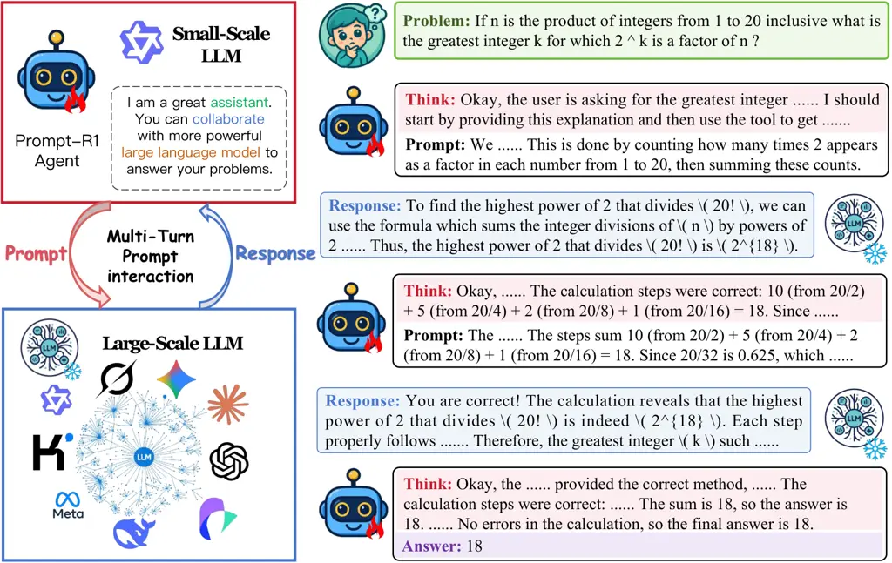
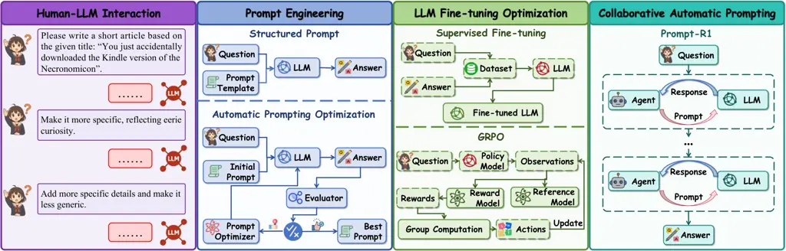
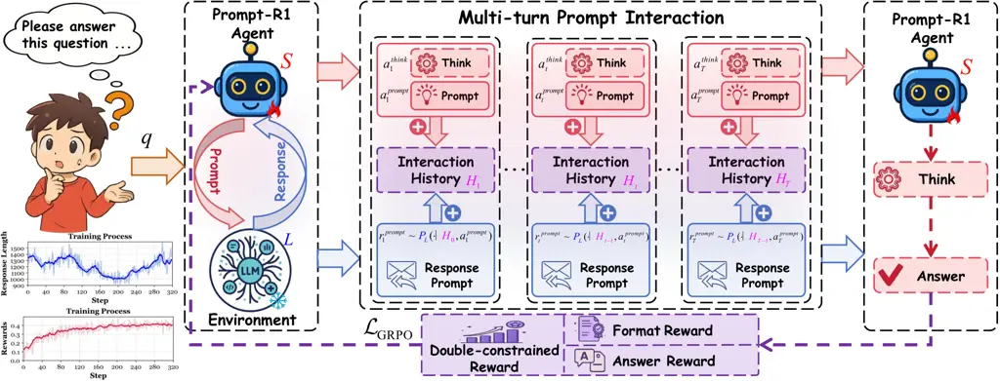
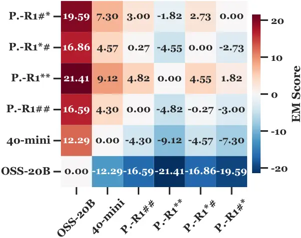
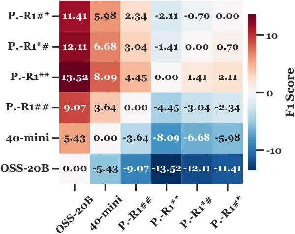
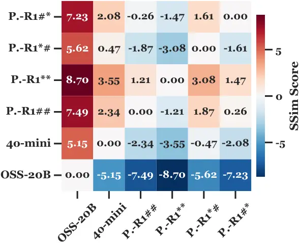

# Prompt-R1: Collaborative Automatic Prompting Framework via End-to-end Reinforcement Learning

Wenjin Liu Affiliation: Hainan University Affiliation: Nanyang
Technological University Affiliation: Hithink Research    Haoran Luo
Affiliation: Nanyang Technological University    Xueyuan Lin
Affiliation: Hithink Research Affiliation: HKUST (Guangzhou)
Affiliation: IDEA Research    Haoming Liu Affiliation: Tsinghua
University    Tiesunlong Shen Affiliation: National University of
Singapore    Jiapu Wang Affiliation: Nanjing University of Science and
Technology    Rui Mao Affiliation: Nanyang Technological University   
Erik Cambria Email: [wenjinliu23@outlook.com,
haoran.luo@ieee.org[![[Uncaptioned
image]](arxiv-2511-01016v9--9847d4393ad9.figures/figure-1.webp) Homepage](https://qwenqking.github.io/Prompt-R1/)[![[Uncaptioned
image]](arxiv-2511-01016v9--9847d4393ad9.figures/figure-2.webp) GitHub](https://github.com/QwenQKing/Prompt-R1)[![[Uncaptioned
image]](arxiv-2511-01016v9--9847d4393ad9.figures/figure-3.webp) Dataset](https://huggingface.co/datasets/QwenQKing/Prompt-R1)[![[Uncaptioned
image]](arxiv-2511-01016v9--9847d4393ad9.figures/figure-4.webp) HF
Models](https://huggingface.co/QwenQKing/Prompt-R1)](mailto:)
Affiliation: Nanyang Technological University

###### Abstract

Recently, various excellent and powerful large language models (LLMs)
have been utilized to solve a wide range of human problems. However,
when faced with complex problems, most users are often unable to provide
accurate and effective prompts to interact with LLMs, thus limiting
their performance. To address this challenge, we propose Prompt-R1, an
end-to-end reinforcement learning framework that utilizes a small-scale
LLM (as agent) to collaborate with large-scale LLMs (as environment),
replacing users to interact better. This collaboration is presented as a
multi-turn interaction, where the small-scale LLM thinks and generates
prompts, and the large-scale LLM performs complex reasoning. A
double-constrained reward is designed to optimize correctness and
quality of generation. Prompt-R1 provides a plug-and-play framework that
supports both inference and training with various large-scale LLMs.
Experimental results on twelve datasets show that Prompt-R1
significantly outperforms baseline LLMs across various tasks. Our code
is available at
[https://github.com/QwenQKing/Prompt-R1](https://github.com/QwenQKing/Prompt-R1).

⁰⁰footnotetext: $`\dagger`$ Corresponding authors.

## 1 Introduction

In recent years, large language models have been widely applied to
assist humans in completing various complex real-world tasks (Wei et
al., 2025; Feng et al., 2025). Despite their abilities in understanding,
reasoning, calculation, and generation, most users fail to fully utilize
LLMs, especially in deep reasoning (Zhang et al., 2025b), adaptive
responses (Yao et al., 2024), and multi-turn interaction tasks (Luo et
al., 2025b; Zhang et al., 2025c). This is mainly due to users’
ineffective construction and adjustment of prompts, limiting LLMs’
performance in complex reasoning and dynamic tasks (Do et al., 2024; Wen
et al., 2023; Prakash et al., 2025). Further, the applicability of LLMs
to tasks restricts their performance (Ong et al., 2025). Enhancing LLM’s
prompt understanding and adaptability is therefore crucial (Zhang et
al., 2025a).



Figure 1: An example of a Prompt-R1 agent working with a large-scale
LLM. The agent obtains the correct answer by interacting with the LLM
step by step.



Figure 2: Comparison of different methods for improving LLMs’
performance: human-LLM interaction, prompt engineering, fine-tuning
optimization, and our collaborative automatic prompting interaction
framework Prompt-R1.

To address these issues, methods based on prompt engineering and
fine-tuning have emerged. For prompt engineering-based methods,
structured prompting, including chain-of-thought (CoT) (Wei et al., 2022) and least-to-most prompting (Zhou et al., 2022), and automatic
prompt optimization, such as dynamic prompt corruption (Fan et al., 2025) and TRPrompt (Nica et al., 2025), enhance LLMs’ reasoning,
generalization, and adaptation without fine-tuning. In addition,
fine-tuning optimization methods such as Low-Rank Adaptation (LoRA) (Hu
et al., 2022), adapter tuning (Huang et al., 2024b), and instruction
tuning (Liao et al., 2024) improve LLMs’ adaptability to task-specific
instructions. Furthermore, reinforcement learning-based methods (Luo et
al., 2025a) enhance LLMs through continuous feedback, particularly in
complex reasoning and multi-turn interaction tasks (Cao et al., 2024).
These methods significantly improve the prompt understanding and task
adaptability for LLMs.

However, these methods still face several challenges: (i) Ability
limitations of small-scale LLMs. Small-scale LLMs have limited
understanding and generation capabilities and struggle with long-range
dependencies and complex reasoning, limiting their effectiveness in deep
comprehension and multi-turn tasks (Luo et al., 2025c). (ii) High
optimization cost for large-scale LLMs. Fine-tuning large-scale LLMs
requires significant computational and storage resources, while official
API-based approaches require a large amount of prompt engineering, lack
adaptive dynamic optimization, and incur high costs (Wang et al., 2025).
(iii) Complexity and limited adaptability of large-small-scale LLM
collaboration. Current methods rely on APIs, redundant layers, and
cumbersome prompt engineering, increasing costs and reducing
collaboration efficiency of small-scale LLMs and large-scale LLMs in
dynamic, multi-task environments (Zhang et al., 2025e).

To address these challenges, we propose Prompt-R1 (see Figure 1), a
collaborative automatic prompting framework for the small-scale LLM and
large-scale LLM enhanced by end-to-end reinforcement learning (RL) (Guo
et al., 2025), supporting plug-and-play for diverse large-scale LLMs. In
this proposed framework, the small-scale LLM acts as an agent through
multi-turn prompts interacting with the large-scale LLM as the
environment, optimizing prompts and accomplishing tasks better. A
double-constrained reward is designed to boost the generation quality
and accuracy for the small-scale LLM, while a plug-and-play architecture
simplifies coordination and removes API dependency. Prompt-R1 provides a
resource-efficient, adaptable, portable, and scalable collaborative
paradigm for the small-scale LLM and the large-scale LLM.

We evaluate Prompt-R1 on four tasks: multi-hop reasoning, standard
question-answering (QA), mathematical computation, and text generation.
Experimental results show Prompt-R1 enhances generation quality and
reasoning accuracy through this reinforcement learning-driven multi-turn
prompt interaction framework, surpassing baselines and current methods
(see Figure 2). While strengthening the large-scale LLM’s reasoning
abilities, Prompt-R1 also improves the abilities of small-scale LLMs.
Further, it can adapt across tasks without task-specific fine-tuning,
demonstrating broad adaptability and strong practical potential.

## 2 Related Work

In this section, we review the current approaches for enhancing the
performance of LLMs, including:



Figure 3: An overview of the Prompt-R1 framework. A small-scale LLM (as
agent) interacts with a large-scale LLM (as environment) to answer
questions through multi-turn prompts. The large-scale LLM is
plug-and-play.

Automatic Prompting Optimization. Automatic prompt optimization (APO)
enhances LLM accuracy and generalization (Liu et al., 2025; Zhang et
al., 2025d; Asawa et al., 2025). Prompt Optimization with Textual
Gradients (Pryzant et al., 2023) utilizes natural-language gradients
with beam search and bandits to optimize prompts; TextGrad (Yuksekgonul
et al., 2024) applies textual gradients, allowing small LLMs to leverage
larger-LLM feedback. Optimization by PROmpting (OPRO) (Yang et al., 2023) treats LLM as an optimizer to refine prompts; Genetic-Pareto
(GEPA) (Agrawal et al., 2025) mutates candidates and Pareto-selects
prompts without weight updates. Residual Optimization Tree (Zhou et al., 2025) adds residual connections to diversify prompts and curb drift,
improving its performance. These data- and feedback-driven methods
enable exploration without fine-tuning and improve accuracy and
scalability (Sun et al., 2023; Xiao et al., 2025).

Reinforcement Learning for LLMs. Reinforcement learning (Zhang et al.,
2026; Tang et al., 2025) is crucial for improving LLMs in terms of
alignment and reasoning (Chaudhari et al., 2025; Gu et al., 2024).
Reinforcement Learning with Human Feedback, exemplified by InstructGPT,
is foundational (Christiano et al., 2017; Ouyang et al., 2022). Direct
Preference Optimization (Rafailov et al., 2023), Odds Ratio Preference
Optimization (Hong et al., 2024), and Rank Responses with Human
Feedback (Yuan et al., 2023) are single-stage preference optimizers.
Reinforcement Learning from artificial intelligence (AI) Feedback (Lee
et al., 2024) and Constitutional AI (Bai et al., 2022) lessen reliance
on human annotation and improve scalability. Group Relative Policy
Optimization (GRPO) (Guo et al., 2025) boosts stability and efficiency,
while Agentic RL extends RL to multi-turn and tool-use scenarios,
enabling advanced planning and self-correction, as in DeepSeek-R1 (Guo
et al., 2025).

## 3 Method: Prompt-R1

In this section, we introduce Prompt-R1 (see Figure 3). It includes
Multi-Turn prompt interaction of agent and LLM, double-constrained RL
optimization reward, and efficient training and inference.

### 3.1 Multi-Turn Interaction of Agent and LLM

In Prompt-R1, the small-scale and large-scale LLMs collaborate to solve
problems through multi-turn interactions. The entire process is as
follows:

Agent Initialization. Prompt-R1 adopts a ReAct-based  (Yao et al., 2022)
prompt approach. The initialization of the agent is as follows:

(i) Environment $`L`$. The large-scale LLM $`L`$ is utilized as the
environment in Prompt-R1. The environment $`L`$ generates a response
message $`r_{t}^{\mathrm{prompt}}`$ based on the current history
$`H_{t-1}`$ and the collaborative interaction prompt
$`a_{t}^{\mathrm{prompt}}`$ from the agent:

```math
r_{t}^{\mathrm{prompt}}\sim\mathbf{{\color[rgb]{0,0,1}L}}\big(\cdot\mid H_{t-1},a_{t}^{\mathrm{prompt}}\big). \tag{1}
```

The response $`r_{t}^{\mathrm{prompt}}`$ from the environment $`L`$ and
the prompt $`a_{t}^{\mathrm{prompt}}`$ from the agent are added to
update the multi-turn interaction history $`H_{t}`$:

```math
H_{t}=H_{t-1}\oplus\big(a_{t}^{\mathrm{prompt}},r_{t}^{\mathrm{prompt}}\big). \tag{2}
```

where $`\oplus`$ denotes appending the new prompt-response pair to the
history. Initially, the history is $`H_{0}=[\,]`$ and the response is
$`r_{0}^{\mathrm{prompt}}=\varnothing`$.

(ii) Agent $`S`$. The small-scale LLM $`S`$ acts as the agent.
Initially, $`S`$ thinks about the question $`q`$ and the initial prompt
template $`a^{\mathrm{tmpl}}`$ (see Table 1), generating the first round
of the reasoning process $`a_{1}^{\mathrm{think}}`$ and interaction
prompt $`a_{1}^{\mathrm{prompt}}`$ for $`L`$:

```math
\big(a_{1}^{\mathrm{think}},a_{1}^{\mathrm{prompt}}\big)\sim\mathbf{{\color[rgb]{1,0,0}S}}\big(\cdot\mid q,a^{\mathrm{tmpl}}\big). \tag{3}
```

Then, the prompt $`a_{1}^{\mathrm{prompt}}`$ is sent to $`L`$ by $`S`$,
and the response $`r_{1}^{\mathrm{prompt}}`$ is combined to form the
first round history $`H_{1}`$ for the next round of interaction.

 

First, provide a simple explanation of the question and give it to the
large language model for a more accurate answer. Focus on explaining the
question without deep reasoning in the first step. After receiving the
response, think about the large language model’s response, and by
interacting with the large language model again and again, arrive at the
final answer. Proceed step by step with the following rules: \<think\>
(don’t think deeply and no more than 50 words) \</think\>
\<interaction_prompt\> (give the question and its explanation to the
large language model) \</interaction_prompt\> After the first step, in
each interaction with the large language model, write: \<think\> (your
reasoning for the receiving response and question) \</think\>
\<interaction_prompt\> (new request to refine or validate the answer)
\</interaction_prompt\> Each \<interaction_prompt\> must build on what
came before. Do not just repeat the same content. Let the content of the
\<interaction_prompt\>…\</interaction_prompt\> evolve naturally (for
example: outline → add details → refine → check). Continue producing
think within \<think\>…\</think\> and call tool within
\<interaction_prompt\>…\</interaction_prompt\> until the answer is
ready. Once the answer is complete, write: \<think\> (final reasoning
with the \<interaction_response\> and question) \</think\> \<answer\>
(final answer for the question) \</answer\> Question: question.

 

Table 1: The initial prompt template is utilized by the agent $`S`$ to
interact with the environment $`L`$ (large-scale LLM).

The Agent State Space $`\mathcal{H}`$. The agent state $`h_{t}`$ is
defined by the multi-turn interaction history of $`S`$.

(i) Initial State ($`h_{0}`$). The initial state of $`S`$ is $`h_{0}`$,
$`h_{0}=[\,]`$. The state of the first round $`h_{1}`$ is based on $`q`$
and $`a^{\mathrm{tmpl}}`$, as well as composed of
$`a_{1}^{\mathrm{think}}`$, $`a_{1}^{\mathrm{prompt}}`$, and
$`r_{1}^{\mathrm{prompt}}`$. The first round state $`h_{1}`$ is as
follows:

```math
h_{1}=[q\oplus a^{\mathrm{tmpl}}\oplus a_{1}^{\mathrm{think}}\oplus a_{1}^{\mathrm{prompt}}\oplus r_{1}^{\mathrm{prompt}}] \tag{4}
```

(ii) State Update ($`h_{t}`$). From round 2 onward, the state update of
$`S`$ depends on $`h_{t-1}`$, as well as consists of
$`a_{t}^{\mathrm{think}}`$, $`a_{t}^{\mathrm{prompt}}`$ of $`S`$, and
$`r_{t}^{\mathrm{prompt}}`$:

```math
h_{t}=[h_{t-1}\oplus a_{t}^{\mathrm{think}}\oplus a_{t}^{\mathrm{prompt}}\oplus r_{t}^{\mathrm{prompt}}]. \tag{5}
```

(iii) State Representation ($`F_{h_{t}}`$). The state representation
$`F_{h_{t}}`$ accumulates the complete interaction history up to round
$`t`$, reflecting all the $`a^{\mathrm{think}}`$,
$`a^{\mathrm{prompt}}`$, and $`r^{\mathrm{prompt}}`$. At round $`t`$,
the state $`F_{h_{t}}`$ is updated by combining the previous state
$`F_{h_{t-1}}`$, with the current round’s reasoning process
$`a_{t}^{\text{think}}`$, interaction prompt $`a_{t}^{\text{prompt}}`$,
and the response $`r_{t}^{\text{prompt}}`$:

```math
F_{h_{t}}={\color[rgb]{1,0,0}\mathbf{S}_{t}}(F_{h_{t-1}},a_{t}^{\text{think}},a_{t}^{\text{prompt}},r_{t}^{\text{prompt}}), \tag{6}
```

The Agent Action Space. The agent $`S`$ decides whether to continue
reasoning and interacting with $`L`$ until the stopping condition is
met:

```math
\displaystyle\log\mathbf{{\color[rgb]{1,0,0}\pi_{\theta}}}\big(a_{t}\mid F_{h_{t-1}}\big) \displaystyle=\log\mathbf{{\color[rgb]{1,0,0}\pi_{\theta}}}\big(a_{t}^{\mathrm{think}}\mid F_{h_{t-1}}\big) \tag{7}
```

```math
\displaystyle+\log\mathbf{{\color[rgb]{1,0,0}\pi_{\theta}}}\big(a_{t}^{\mathrm{prompt}}\mid F_{h_{t-1}},a_{t}^{\mathrm{think}}\big).
```

During this process, the agent $`S`$ evaluates its strategy and action
probabilities under a stochastic policy, guiding the trajectory toward
the final answer.

The Agent Target $`(h_{\ell},F_{h_{\ell}},A_{h_{\ell}})`$. After
multi-turn interactions with the environment $`L`$, the agent $`S`$ will
provide the final answer to the question $`q`$.

(i) Final State: The interaction ends at round $`T`$, with the final
state $`F_{h_{T}}`$ based on the last history $`H_{T}`$, which includes
the final response $`r_{T}^{\mathrm{prompt}}`$, provided to $`S`$ to
generate the final answer $`A_{h_{\ell}}`$:

```math
y=\arg\max_{y\in V^{\ast}}\mathbf{{\color[rgb]{1,0,0}\pi_{\theta}}}\big(y\mid q,a^{\mathrm{tmpl}},H_{T}\big), \tag{8}
```

where $`y`$ is the answer $`A_{h_{\ell}}`$ output by the agent $`S`$.

(ii) Final Distribution: The joint distribution of the multi-turn prompt
interaction process for the agent $`S`$ and the environment $`L`$ is as
follows:

```math
\displaystyle P_{\theta}(\tau,y\mid q,a^{\mathrm{tmpl}})= \tag{9}
```

```math
\displaystyle\underbrace{\mathbf{{\color[rgb]{1,0,0}\pi_{\theta}}}(a^{\mathrm{think}}_{1},a^{\mathrm{prompt}}_{1}\mid q,a^{\mathrm{tmpl}})}_{\text{First round: Prompt generation}}\,\underbrace{\mathbf{{\color[rgb]{0,0,1}L}}(r^{\mathrm{prompt}}_{1}\mid H_{0},a^{\mathrm{prompt}}_{1})}_{\text{First round: Response generation}}
```

```math
\displaystyle\times\prod_{t=2}^{T}\big(\underbrace{\mathbf{{\color[rgb]{1,0,0}\pi_{\theta}}}(a^{\mathrm{think}}_{t},a^{\mathrm{prompt}}_{t}\mid q,a^{\mathrm{tmpl}},H_{t-1})}_{\text{Subsequent rounds: Prompt generation}}\big)
```

```math
\displaystyle\times\big(\underbrace{\mathbf{{\color[rgb]{0,0,1}L}}(r^{\mathrm{prompt}}_{t}\mid H_{t-1},a^{\mathrm{prompt}}_{t})}_{\text{Subsequent rounds: Response generation}}\big)
```

```math
\displaystyle\times\underbrace{\mathbf{{\color[rgb]{1,0,0}\pi_{\theta}^{\mathrm{ans}}}}(a^{\mathrm{think}}_{\mathrm{final}},y\mid q,a^{\mathrm{tmpl}},H_{T})}_{\text{Final answer}}.
```

where
$`\tau=\big\{(q,a^{\mathrm{tmpl}},a^{\mathrm{prompt}}_{t},r^{\mathrm{prompt}}_{t})\big\}_{t=1}^{T}`$
is the trajectory for the interactions of the $`S`$ and $`L`$;
$`\pi_{\theta}`$ is the prompt policy of the agent $`S`$; and $`P_{L}`$
is the conditional distribution of the environment $`L`$.

Proposition 1. Multi-turn interactions of the small-scale LLM and
large-scale LLM can better solve problems.

###### Proof.

We provide experimental results in sections 4.2 and 4.3, the case study
in Appendix H, as well as theoretical proofs in Appendix B.1. ∎

### 3.2 Double-constrained RL Optimization

We optimize the agent’s policy $`\pi_{\theta}`$ using a dual-constraint
reward based on format and correctness, with end-to-end reinforcement
learning. The reward $`R`$ captures both the format compliance and the
answer accuracy at the trajectory level.

Double-constrained Reward. To enforce valid reasoning steps and correct
answers, we define two components for the output of the agent $`S`$: the
_format reward_ $`R_{\text{fmt}}`$ and the _answer reward_
$`R_{\text{ans}}`$.

(i) Format Reward. At round $`t`$, both reasoning and prompting must be
non-empty:
$`M_{t}=\mathbb{I}[a_{t}^{\mathrm{think}}\neq\varnothing\wedge a_{t}^{\mathrm{prompt}}\neq\varnothing]`$.
At the final turn, we also require a parseable, non-empty answer via
$`A_{p},A_{n},C_{f}`$ to ensure completeness and validity:

```math
R_{\mathrm{fmt}}=\min\!\big(k,\;\alpha\!\sum_{t=1}^{T-1}\!M_{t}+\beta A_{p}+\gamma A_{n}+\delta C_{f}\big) \tag{10}
```

where $`M_{t}`$ is an indicator ensuring reasoning and prompting are
non-empty, preventing incomplete responses; $`A_{p}`$ ensures answer
parseability, meaning the output matches the format; $`A_{n}`$
guarantees the non-emptiness of the final answer; $`C_{f}`$ enforces
final completeness, ensuring all required components are included; The
coefficients $`(\alpha,\beta,\gamma,\delta)`$ balance intermediate steps
with the goal of a complete answer; and the $`k`$ is the upper limit of
the format reward, preventing inflation, stabilizing training.

_(ii) Answer Reward._ Let $`\hat{a}=\mathrm{Norm}(\mathrm{Ans}(y))`$ be
the normalized predicted answer by the agent $`S`$, and
$`\mathcal{G}(q)=\{g_{i}\}`$ the reference set. Normalization
$`\mathrm{Norm}(\cdot)`$ removes case, punctuation, and articles, while
$`\mathrm{Tok}(\cdot)`$ maps text to a multiset of tokens. The
token-level F1 with a reference $`g`$ is defined as:

```math
\mathrm{F1}(\hat{a},g)=\frac{2\,n_{\cap}}{\,|\mathrm{Tok}(\hat{a})|+|\mathrm{Tok}(\mathrm{Norm}(g))|\,}. \tag{11}
```

where $`n_{\cap}`$ is the token overlap count between the predicted
answer and ground truth. The correctness of the predicted answer (answer
reward) is:

```math
R_{\text{ans}}=\max_{g\in\mathcal{G}(q)}\mathrm{F1}(\hat{a},g). \tag{12}
```

_(iii) Gated Composition for Double-constrained Reward._ The overall
reward $`R`$ includes the format reward $`R_{\text{fmt}}`$ and the
answer correctness reward $`R_{\text{ans}}`$. The calculation of the
overall reward $`R`$ is:

```math
R=\begin{cases}-k+R_{\text{fmt}}+R_{\text{ans}},&R_{\text{fmt}}=k,\\
-k+R_{\text{fmt}},&\text{otherwise}.\end{cases} \tag{13}
```

so that the correctness for the output answer $`\pi_{\theta}`$ of the
agent is only credited when the format conditions are fully and
correctly satisfied.

End-to-End Reinforcement Learning. We adopt a GRPO-based objective,
standardizing rewards in a batch of $`M`$ trajectories. Let $`R^{(i)}`$
be the reward of trajectory $`i`$, with the mean reward $`\bar{R}`$:

```math
\hat{A}^{(i)}=\frac{R^{(i)}-\bar{R}}{\sqrt{\tfrac{1}{M}\sum_{j=1}^{M}(R^{(j)}-\bar{R})^{2}+\varepsilon}}, \tag{14}
```

where $`\hat{A}^{(i)}`$ is the standardized advantage, and
$`\varepsilon`$ is a stability constant. The GRPO-based objective is:

```math
\displaystyle J_{\text{GRPO}}(\theta) \displaystyle=\mathbb{E}_{\tau\sim p_{{\color[rgb]{1,0,0}\theta_{S}},{\color[rgb]{0,0,1}\theta_{L}}}(\tau)}\big[\frac{1}{M}\sum_{i=1}^{M}\big(\frac{1}{|\tau^{(i)}|}\sum_{t=1}^{|\tau^{(i)}|}\min\big( \tag{15}
```

```math
\displaystyle\frac{{\color[rgb]{1,0,0}\pi_{\theta}}(w_{t}^{(i)}\mid\tau_{<t}^{(i)})}{{\pi_{\theta_{\text{old}}}}(w_{t}^{(i)}\mid\tau_{<t}^{(i)})}\hat{A}(\tau^{(i)}),\text{clip}\!\big(\frac{{\color[rgb]{1,0,0}\pi_{\theta}}(w_{t}^{(i)}\mid\tau_{<t}^{(i)})}{\pi_{\theta_{\text{old}}}(w_{t}^{(i)}\mid\tau_{<t}^{(i)})},1\pm\epsilon\big)
```

```math
\displaystyle\times\hat{A}(\tau^{(i)})\big)-\beta_{kl}\mathbb{D}_{\text{KL}}({\color[rgb]{1,0,0}\pi_{\theta}}\parallel\pi_{\text{ref}})\big)\big],
```

where $`p_{\theta_{S},\theta_{L}}(\tau)`$ is the joint distribution of
$`S`$ and $`L`$; $`w_{t}^{(i)}`$ is the $`t`$-th token of
$`\tau^{(i)}`$; and $`\pi_{\theta_{\text{old}}}`$ and
$`\pi_{\text{ref}}`$ are the pre-update and reference policies,
respectively. The $`\text{clip}(\cdot)`$ limits policy ratios to
$`1\pm\epsilon`$ to stabilize updates. A KL term
$`\mathbb{D}_{\text{KL}}({\pi_{\theta}}\parallel\pi_{\text{ref}})`$
regularizes $`\pi_{\text{ref}}`$, with $`\beta_{kl}`$ controlling its
strength.

Proposition 2. Reinforcement learning can make small-scale LLMs better
guide large-scale LLMs to complete tasks.

###### Proof.

We provide experimental results in Section 4.5 and Section 4.6 and
theoretical proofs in Appendix B.2. ∎

|         |        |          |             |          |               |             |          |                   |          |       |                                |
| ------- | ------ | -------- | ----------- | -------- | ------------- | ----------- | -------- | ----------------- | -------- | ----- | ------------------------------ |
| Dataset | Metric | Baseline |             | SFT      | CoT Reasoning |             | GRPO     | APO (GPT-4o-mini) |          |       | Ours                           |
|         |        | Qwen3-4B | GPT-4o-mini | Qwen3-4B | Qwen3-4B      | GPT-4o-mini | Qwen3-4B | OPRO              | TextGrad | GEPA  | Prompt-R1 ($`\Delta\uparrow`$) |
| 2Wiki   | EM     | 28.13    | 33.59       | 41.41    | 21.88         | 43.75       | 34.38    | 25.00             | 18.75    | 41.41 | 48.44 (+14.85)                 |
|         | F1     | 29.32    | 36.57       | 42.62    | 24.17         | 49.13       | 35.05    | 35.96             | 27.50    | 46.27 | 54.41 (+17.84)                 |
| Hotpot  | EM     | 21.09    | 33.59       | 23.44    | 18.75         | 42.97       | 27.34    | 34.38             | 27.34    | 38.28 | 44.53 (+10.94)                 |
|         | F1     | 24.25    | 40.07       | 31.09    | 22.98         | 49.70       | 32.27    | 46.83             | 37.10    | 47.03 | 52.31 (+12.24)                 |
| GSM8K   | EM     | 84.38    | 83.59       | 32.03    | 82.81         | 84.38       | 92.97    | 63.28             | 70.31    | 87.50 | 97.66 (+14.07)                 |
|         | F1     | 84.38    | 86.72       | 32.03    | 82.81         | 88.02       | 92.97    | 83.65             | 85.99    | 90.10 | 97.66 (+10.94)                 |
| DAPO    | EM     | 0.00     | 18.75       | 3.13     | 0.00          | 20.31       | 3.91     | 6.25              | 10.16    | 13.28 | 26.56 (+7.81)                  |
|         | F1     | 0.00     | 18.76       | 3.13     | 0.00          | 20.32       | 3.91     | 6.39              | 10.27    | 14.06 | 26.56 (+7.80)                  |
| MusiQue | EM     | 1.56     | 14.06       | 7.81     | 3.13          | 17.97       | 8.59     | 14.06             | 14.84    | 15.63 | 18.75 (+4.69)                  |
|         | F1     | 5.44     | 22.06       | 16.78    | 6.95          | 25.39       | 13.90    | 26.18             | 24.06    | 24.91 | 26.31 (+4.25)                  |
| PopQA   | EM     | 7.03     | 25.78       | 7.81     | 7.03          | 28.13       | 7.81     | 23.44             | 19.53    | 27.34 | 28.13 (+2.35)                  |
|         | F1     | 9.97     | 30.75       | 9.53     | 9.58          | 32.66       | 12.27    | 30.14             | 28.28    | 31.18 | 33.77 (+3.02)                  |
| BookSum | F1     | 19.99    | 20.45       | 25.47    | 16.68         | 11.58       | 25.88    | 16.18             | 25.79    | 0.00  | 26.50 (+6.05)                  |
|         | SSim   | 45.19    | 57.01       | 54.55    | 35.02         | 56.51       | 54.21    | 23.22             | 34.95    | 0.00  | 60.87 (+3.86)                  |
| W.P.    | F1     | 13.06    | 19.48       | 15.12    | 10.20         | 9.93        | 8.40     | 7.81              | 22.07    | 0.21  | 22.11 (+2.63)                  |
|         | SSim   | 20.59    | 35.31       | 30.86    | 12.15         | 30.86       | 10.41    | 13.73             | 20.28    | 0.34  | 38.54 (+3.23)                  |
| Average | EM     | 23.70    | 34.89       | 19.27    | 22.27         | 39.59       | 29.17    | 27.74             | 26.82    | 37.24 | 44.01 (+9.12)                  |
|         | F1     | 23.30    | 34.36       | 21.97    | 21.67         | 35.84       | 28.08    | 31.64             | 32.63    | 31.72 | 42.45 (+8.09)                  |
|         | SSim   | 32.89    | 46.16       | 42.71    | 23.59         | 43.69       | 32.31    | 18.48             | 27.62    | 0.17  | 49.71 (+3.55)                  |

Table 2: Comparison of the selected state-of-the-art baselines and the
proposed Prompt-R1 on four tasks, which consists of multi-hop reasoning
(2Wiki: 2WikiMultihopQA, Hotpot: HotpotQA), mathematical computation
(GSM8K, DAPO: DAPO Math), standard QA (MusiQue, PopQA), and text
generation (BookSum, W.P.: WritingPrompts). $`\Delta\uparrow`$ is the
gap between the Prompt-R1 and the baseline large language model
(GPT-4o-mini), where the higher values indicating better performance.
Bold values are the best performance. All values are in %.

### 3.3 Efficient Training and Inference

Let the set of available large-scale LLMs (environment) be
$`\mathcal{M}=\{m_{1},\dots,m_{K}\}`$, and let $`\mathcal{V}^{*}`$
represent the space of finite-length token sequences. The user question
$`q\in\mathcal{V}^{*}`$, the agent $`S`$ adopts the policy
$`\pi_{\theta}(p_{t}|q,a^{\mathrm{tmpl}},H_{t-1})`$ to produce the
turn-$`t`$ collaborative prompt $`p_{t}`$, where $`H_{t-1}`$ is the
previous interaction history. The multi-turn prompt interaction history
$`H_{t}=\{(p_{1},r_{1}),\dots,(p_{t-1},r_{t-1})\}`$ is updated as
$`H_{t}=H_{t-1}\oplus(p_{t},r_{t})`$, with
$`p_{t},r_{t}\in\mathcal{V}^{*}`$ as the current prompt-response pair,
and the interaction history of the agent $`S`$ and the environment $`L`$
is updated accordingly, progressively adapting.

Training. Choose an environment $`m_{\text{train}}\in\mathcal{M}`$. The
interaction and history update are as follows:

```math
\begin{gathered}p_{t}\sim{\color[rgb]{1,0,0}\pi_{\theta}}(\cdot\mid q,a^{\mathrm{tmpl}},H_{t-1}),\\
r_{t}\sim{\color[rgb]{0,0,1}P_{L}^{(m_{\text{train}})}}(\cdot\mid H_{t-1},p_{t}),\\
H_{t}=H_{t-1}\oplus(p_{t},r_{t}),\\
\end{gathered} \tag{16}
```

where $`T`$ is the number of interaction turns; after $`T`$-turns, the
agent $`S`$ generates the final answer $`y`$.

Inference. Choose an environment $`m_{\text{test}}\in\mathcal{M}`$;
optionally define a session-level routing function
$`\rho:\mathcal{V}^{*}\times(\mathcal{V}^{*})^{*}\to\Delta(\mathcal{M})`$
and set:

```math
\begin{gathered}p_{t}\sim{\color[rgb]{1,0,0}\pi_{\theta}}(\cdot\mid q,a^{\mathrm{tmpl}},H_{t-1}),\\
r_{t}\sim{\color[rgb]{0,0,1}P_{L}^{(m_{\text{test}})}}(\cdot\mid H_{t-1},p_{t}),\\
H_{t}=H_{t-1}\oplus(p_{t},r_{t}),\\
\end{gathered} \tag{17}
```

where $`\Delta(\mathcal{M})`$ is the probability simplex over
$`\mathcal{M}`$, and $`\rho(m|q)`$ is the probability of selecting a
testing LLM based on the user’s question $`q`$. Therefore, Prompt-R1
unifies heterogeneous LLMs by training with $`m_{\text{train}}`$ to
learn the policy $`\pi_{\theta}`$ and performing inference with
$`m_{\text{test}}`$, ensuring compatibility with a variety of LLMs
without altering $`\pi_{\theta}`$.

Proposition 3. The agent can enhance not only the LLM used for its
training but also other LLMs.

###### Proof.

We provide experimental results in Section 4.4 and theoretical proofs in
Appendix B.3. ∎

## 4 Experiments

In this section, we present the experimental setup and results. We
address the following research questions (RQs): RQ1: Does Prompt-R1
outperform other methods? RQ2: How is the generalization ability of
Prompt-R1? RQ3: How is the transferability of Prompt-R1? RQ4: Does the
main component of Prompt-R1 work effectively? RQ5: How do the different
environments (zero-cost and overhead-cost) impact Prompt-R1’s
performance?

### 4.1 Experimental Setup

Datasets. To assess the performance of Prompt-R1, we conducted training
and evaluation on eight datasets and generalized testing on four
out-of-distribution (OOD) datasets. The twelve datasets include
2WikiMultihopQA (Ho et al., 2020), HotpotQA (Yang et al., 2018),
GSM8K (Cobbe et al., 2021), DAPO Math 17K (Yu et al., 2025),
MusiQue (Trivedi et al., 2022), PopQA (Mallen et al., 2023),
BookSum (Kryściński et al., 2022), and WritingPrompts (Huang et al.,
2024a). For generalization evaluation, we used MathQA (Amini et al.,
2019), SQuAD v2 (Rajpurkar et al., 2018), TriviaQA (Joshi et al., 2017),
and XSum (Narayan et al., 2018). More details of the datasets are
illustrated in Appendix D.

Baselines. We compare the Prompt-R1 with several baselines and
state-of-the-art (SOTA) methods, including SFT (Qwen3-4B), CoT Reasoning
(Qwen3-4B and GPT-4o-mini), GRPO (Qwen3-4B), and APO methods (e.g.,
OPRO, TextGrad, and GEPA). More details are in Appendix E.

Evaluation Metrics. In the experiments, we employed three evaluation
metrics for Prompt-R1, including Exact Match (EM), F1 score (F1), and
Semantic Similarity (SSim). More details of the three metrics are shown
in Appendix F.

Implementation Details. We trained the Prompt-R1 agent using two
large-scale LLMs as the environments: one with an overhead cost
(GPT-4o-mini) and the other with zero cost (GPT-OSS-20B). More details
are illustrated in Appendix G.

|          |        |          |             |          |               |             |          |                   |          |       |                                |
| -------- | ------ | -------- | ----------- | -------- | ------------- | ----------- | -------- | ----------------- | -------- | ----- | ------------------------------ |
| Dataset  | Metric | Baseline |             | SFT      | CoT Reasoning |             | GRPO     | APO (GPT-4o-mini) |          |       | Ours                           |
|          |        | Qwen3-4B | GPT-4o-mini | Qwen3-4B | Qwen3-4B      | GPT-4o-mini | Qwen3-4B | OPRO              | TextGrad | GEPA  | Prompt-R1 ($`\Delta\uparrow`$) |
| TriviaQA | EM     | 45.31    | 63.28       | 29.69    | 46.88         | 67.19       | 51.56    | 60.94             | 54.69    | 65.63 | 70.31 (+7.03)                  |
|          | F1     | 48.52    | 71.34       | 34.21    | 50.26         | 75.81       | 55.98    | 72.14             | 67.59    | 74.91 | 76.91 (+5.57)                  |
| MathQA   | EM     | 28.91    | 46.09       | 17.97    | 27.34         | 49.22       | 46.88    | 43.75             | 44.53    | 40.63 | 52.34 (+6.25)                  |
|          | F1     | 32.29    | 54.04       | 22.66    | 30.60         | 57.03       | 54.43    | 60.08             | 61.46    | 61.59 | 61.59 (+7.55)                  |
| SQuAD v2 | EM     | 6.25     | 13.28       | 5.47     | 6.25          | 14.06       | 10.16    | 10.94             | 6.25     | 13.28 | 19.53 (+6.25)                  |
|          | F1     | 16.09    | 25.61       | 16.18    | 16.25         | 25.73       | 23.10    | 26.67             | 22.04    | 25.52 | 29.28 (+3.67)                  |
| XSum     | F1     | 16.75    | 24.35       | 21.13    | 8.33          | 8.92        | 21.98    | 17.87             | 24.88    | 0.21  | 25.76 (+1.41)                  |
|          | SSim   | 31.73    | 60.56       | 55.65    | 6.81          | 53.94       | 52.09    | 29.47             | 28.45    | 0.37  | 63.02 (+2.46)                  |
| Average  | EM     | 26.82    | 40.88       | 17.71    | 26.82         | 43.49       | 36.20    | 38.54             | 35.16    | 39.85 | 47.39 (+6.51)                  |
|          | F1     | 28.41    | 43.84       | 23.55    | 26.36         | 41.87       | 38.87    | 44.19             | 43.99    | 40.56 | 48.39 (+4.55)                  |
|          | SSim   | 31.73    | 60.56       | 55.65    | 6.81          | 53.94       | 52.09    | 29.47             | 28.45    | 0.37  | 63.02 (+2.46)                  |

Table 3: Comparison of the baselines and Prompt-R1 on four OOD datasets,
including TriviaQA (multi-hop reasoning), MathQA (mathematical
computation), SQuAD v2 (standard QA), and XSum (text generation).

### 4.2 Main Results (RQ1)

As illustrated in Table 2, our proposed Prompt-R1 significantly improves
the performance of the baseline (GPT-4o-mini) across eight datasets and
outperforms other baselines, including SFT, CoT, GRPO, and APO methods.
It excels in the four tasks, including multi-hop reasoning, mathematical
reasoning, QA, and text generation. It achieves the largest gains in
multi-hop reasoning, enhances stability in mathematical reasoning, and
performs exceptionally well in knowledge retrieval tasks such as PopQA.
In text generation, it consistently improves quality, demonstrating
strong robustness. Overall, these results demonstrate that Prompt-R1 has
three major advantages: (i) consistent improvement across tasks,
confirming its broad applicability; (ii) significantly enhances the
performance of baseline LLMs in complex reasoning tasks; and (iii)
superior stability compared to other baseline methods, preventing
performance collapse.

Figure 4: The performance of six LLMs without Prompt-R1 agent is
compared to that with Prompt-R1 on eight datasets, using appropriate
metrics. F1: multi-hop reasoning (2Wiki, Hotpot) and standard QA
(MusiQue, PopQA); EM: mathematical computation (GSM8K, DAPO); and SSim:
text generation (BookSum, W.P.).

### 4.3 Generalization Results (RQ2)

As shown in Table 3, Prompt-R1 consistently outperforms the baseline
methods across the four public out-of-distribution datasets, with
significant improvements in multi-hop reasoning and mathematical
computation tasks, particularly in EM and F1 metrics. While standard QA
tasks show some improvement, they are limited by baseline performance,
and text generation shows moderate gains in structural similarity. Among
the baselines, large-scale LLMs exhibit stronger zero-shot reasoning,
while supervised fine-tuning faces overfitting and distribution shift
issues. CoT reasoning shows inconsistent results, and automatic
prompting optimization methods vary across tasks, reflecting the
complexity of the strategy. Overall, Prompt-R1 demonstrates
task-independent effectiveness, especially in reasoning-intensive tasks,
and offers competitive performance without the need for LLM fine-tuning
or a large-scale annotated dataset.

Figure 5: Comparison of the average values of the three EM, F1, and SSim
scores for the selected six LLM baselines on OOD datasets, as well as
the average of these scores for these LLMs using the Prompt-R1 agent.

### 4.4 Work with Other LLMs (RQ3)

The comparisons of six LLMs (e.g., Deepseek-V3, Grok-4-fast,
LLaMA-4-Maverick, GPT-5, Gemini-2.5-flash, and Qwen-Plus) and their
collaboration with the Prompt-R1 agent across 8 in-distribution and 4
OOD datasets are shown in Figures 4 and 5. As shown in Figure 4, on
in-distribution datasets, the Prompt-R1 agent boosts performance in
multi-hop reasoning tasks, with limited gains in mathematical reasoning,
reflecting the baseline LLM’s strengths. The agent’s impact varies
across LLMs, with greater improvements in low-baseline tasks and
diminishing returns in high-baseline tasks. As shown in Figure 5, on OOD
datasets, incorporating the Prompt-R1 agent leads to substantial
improvements in EM, F1, and SSim, especially in SSim, enhancing semantic
coherence. LLMs with weaker baselines benefit most, confirming the
Prompt-R1 agent’s ability to address reasoning weaknesses and maintain
consistent performance across LLMs.

|                  |         |       |        |       |        |       |          |       |          |       |       |       |
| ---------------- | ------- | ----- | ------ | ----- | ------ | ----- | -------- | ----- | -------- | ----- | ----- | ----- |
| Dataset          | 2Wiki   |       | Hotpot |       | GSM8K  |       | DAPO     |       | MusiQue  |       | PopQA |       |
|                  | EM      | F1    | EM     | F1    | EM     | F1    | EM       | F1    | EM       | F1    | EM    | F1    |
| w/o Env.         | 41.41   | 43.48 | 21.88  | 25.96 | 95.31  | 95.31 | 25.00    | 25.00 | 2.34     | 11.63 | 8.59  | 10.85 |
| w/o R.L.         | 1.56    | 8.86  | 20.31  | 27.42 | 84.38  | 89.41 | 21.09    | 22.22 | 5.47     | 10.90 | 3.91  | 9.28  |
| w/o Agent        | 33.59   | 36.57 | 33.59  | 40.07 | 83.59  | 86.72 | 18.75    | 18.76 | 14.06    | 22.06 | 25.78 | 30.75 |
| Prompt-R1 (Full) | 48.44   | 54.41 | 44.53  | 52.31 | 97.66  | 97.66 | 26.56    | 26.56 | 18.75    | 26.31 | 28.13 | 33.77 |
| Dataset          | BookSum |       | W.P.   |       | MathQA |       | SQuAD v2 |       | TriviaQA |       | XSum  |       |
|                  | F1      | SSim  | F1     | SSim  | EM     | F1    | EM       | F1    | EM       | F1    | F1    | SSim  |
| w/o Env.         | 23.34   | 56.84 | 18.67  | 37.83 | 49.22  | 57.94 | 10.16    | 18.12 | 39.84    | 43.54 | 21.41 | 59.87 |
| w/o R.L.         | 19.38   | 58.80 | 17.11  | 36.65 | 48.44  | 58.07 | 5.47     | 12.89 | 49.22    | 56.23 | 23.61 | 61.83 |
| w/o Agent        | 20.45   | 57.01 | 19.48  | 35.31 | 46.09  | 54.04 | 13.28    | 25.61 | 63.28    | 71.34 | 24.35 | 60.56 |
| Prompt-R1 (Full) | 26.50   | 60.87 | 22.11  | 38.54 | 52.34  | 61.59 | 19.53    | 29.28 | 70.31    | 76.91 | 25.76 | 63.02 |

Table 4: Ablation study of Prompt-R1 (GPT-4o-mini as environment) on
twelve datasets, including Prompt-R1 (Full), without LLM-as-Environment
(w/o Env.), without RL (w/o R.L.), and without Prompt-R1 agent (w/o
Agent).







\(a\) Training process

\(b\) Interaction Turns

\(c\) Average EM

\(d\) Average F1

\(e\) Average SSim

Figure 6: (a-b) Training process and interaction turns of Prompt-R1
agent with different environments. (c-e) Comparison of different
Prompt-R1 agents with environments on average EM, average F1, and
average SSim.

|                  |        |       |          |       |          |       |       |       |
| ---------------- | ------ | ----- | -------- | ----- | -------- | ----- | ----- | ----- |
| Dataset          | MathQA |       | SQuAD v2 |       | TriviaQA |       | XSum  |       |
|                  | EM     | F1    | EM       | F1    | EM       | F1    | F1    | SSim  |
| OSS              | 51.56  | 59.48 | 7.81     | 18.75 | 50.78    | 59.37 | 22.77 | 59.48 |
| 4o-mini          | 46.09  | 54.04 | 13.28    | 25.61 | 63.28    | 71.34 | 24.35 | 60.56 |
| Prompt-R1^(\##)  | 51.56  | 61.07 | 10.16    | 21.28 | 50.78    | 59.60 | 24.14 | 61.83 |
| Prompt-R1^(\*\*) | 52.34  | 61.59 | 19.53    | 29.28 | 70.31    | 76.91 | 25.76 | 63.02 |
| Prompt-R1^(\*#)  | 53.91  | 62.63 | 8.59     | 20.13 | 51.56    | 60.05 | 22.95 | 60.84 |
| Prompt-R1^(\#\*) | 52.34  | 60.29 | 17.97    | 27.96 | 67.19    | 73.11 | 25.82 | 61.83 |

Table 5: Comparison of different Prompt-R1 agents with environments and
two baseline LLMs (GPT-OSS-20B: OSS and GPT-4o-mini: 4o-mini) on four
OOD datasets. Prompt-R1^(\*\*) (P.-R1^(\*\*)) means both agent and
environment are GPT-4o-mini; Prompt-R1^(\##) (P.-R1^(\##)) means both
agent and environment are GPT-OSS-20B; Prompt-R1^(\*#) (P.-R1^(\*#))
means the agent is GPT-4o-mini trained and the environment is
GPT-OSS-20B; Prompt-R1^(\#\*) (P.-R1^(\#\*)) means the agent is
GPT-OSS-20B trained and the environment is GPT-4o-mini. Underlined
values indicate better performance between the two baselines.

### 4.5 Ablation Study (RQ4)

As shown in Table 4, Prompt-R1 (Full) performs optimally across all
datasets, highlighting the strong synergy of environment, reinforcement
learning, and the agent. Removing any single component significantly
reduces performance, with reinforcement learning most affected by
complex reasoning tasks. The environment has notably less impact on
mathematical computation, showing clear task-dependent dependencies. In
addition, Prompt-R1 (Full) exhibits more stable and consistent
performance on the four OOD datasets, reflecting strong cross-task
generalization ability. Ablation experiments show that the performance
effectiveness of Prompt-R1 stems from the close coupling of environment
interaction, the learning mechanisms, and agent decision-making, with
varying component dependencies across tasks, and the agent-environment
configuration should be carefully selected based on the task and
requirement.

### 4.6 Different Environment Training (RQ5)

We trained the Prompt-R1 agent in two environments: GPT-4o-mini (via
official API) and GPT-OSS-20B (locally deployed). Results in Table 5 and
Figure 6 reveal five insights: (i) The zero-cost LLM (GPT-OSS-20B) as
training environment achieves performance close to the overhead-cost LLM
(GPT-4o-mini) alternative; (ii) With GPT-4o-mini, Prompt-R1 improves
faster but is less stable, while GPT-OSS-20B shows steadier convergence
and more efficient feedback; (iii) The agent-environment interaction
framework significantly enhances reasoning, especially for weaker LLMs;
(iv) The environment, as both reasoning generator and feedback verifier,
has a decisive impact on performance; (v) Collaboration with the
training environment enhances performance, indicating that RL can
strengthen agent and LLMs’ cooperation.

## 5 Conclusion

In this work, we propose Prompt-R1 to replace humans in interacting more
effectively with LLMs. We find 3 key similarities between Prompt-R1
agent and humans: (i) learning from others’ knowledge through
communication, (ii) improving communication efficiency with continuous
interactions, and (iii) communication skills can be transferred to
engage effectively with others. We hope Prompt-R1 offers a new approach
to human-LLM interaction.

## Limitations

In Appendix I, we discuss the limitations of the proposed Prompt-R1.
Furthermore, we also provide the case study in Appendix H.

## Ethical Considerations

This research utilizes publicly available datasets without involving
sensitive or personally identifiable data. We believe it does not
violate any ethics.

## Acknowledgments

This work was supported by the National Key Research and Development
Program of China \[grant number 2023YFF0905404\].

## References

- Agrawal et al. (2025) L. A. Agrawal, S. Tan, D. Soylu, N. Ziems, R.
  Khare, K. Opsahl-Ong, A. Singhvi, H. Shandilya, M. J. Ryan, M. Jiang,
  et al. Gepa: reflective prompt evolution can outperform reinforcement
  learning. arXiv preprint arXiv:2507.19457. Cited by: §E.1, §2.
- Amini et al. (2019) A. Amini, S. Gabriel, S. Lin, R.
  Koncel-Kedziorski, Y. Choi, and H. Hajishirzi MathQA: towards
  interpretable math word problem solving with operation-based
  formalisms. In Proceedings of the 2019 Conference of the North
  American Chapter of the Association for Computational Linguistics:
  Human Language Technologies, Volume 1 (Long and Short Papers),
  pp. 2357–2367. Cited by: §4.1.
- Asawa et al. (2025) P. Asawa, A. Zhu, M. Zaharia, A. G. Dimakis,
  and J. E. Gonzalez How to train your advisor: steering black-box llms
  with advisor models. arXiv preprint arXiv:2510.02453. Cited by: §2.
- Bai et al. (2022) Y. Bai, S. Kadavath, S. Kundu, A. Askell, J.
  Kernion, A. Jones, A. Chen, A. Goldie, A. Mirhoseini, C. McKinnon, et
  al. Constitutional ai: harmlessness from ai feedback. arXiv preprint
  arXiv:2212.08073. Cited by: §2.
- Cao et al. (2024) Y. Cao, H. Zhao, Y. Cheng, T. Shu, Y. Chen, G.
  Liu, G. Liang, J. Zhao, J. Yan, and Y. Li Survey on large language
  model-enhanced reinforcement learning: concept, taxonomy, and methods.
  IEEE Transactions on Neural Networks and Learning Systems. Cited by:
  §1.
- Chaudhari et al. (2025) S. Chaudhari, P. Aggarwal, V. Murahari, T.
  Rajpurohit, A. Kalyan, K. Narasimhan, A. Deshpande, and B. Castro da
  Silva Rlhf deciphered: a critical analysis of reinforcement learning
  from human feedback for llms. ACM Computing Surveys 58 (2), pp. 1–37.
  Cited by: §2.
- Christiano et al. (2017) P. F. Christiano, J. Leike, T. Brown, M.
  Martic, S. Legg, and D. Amodei Deep reinforcement learning from human
  preferences. Advances in neural information processing systems 30.
  Cited by: §2.
- Cobbe et al. (2021) K. Cobbe, V. Kosaraju, M. Bavarian, M. Chen, H.
  Jun, L. Kaiser, M. Plappert, J. Tworek, J. Hilton, R. Nakano, et al.
  Training verifiers to solve math word problems. arXiv preprint
  arXiv:2110.14168. Cited by: §4.1.
- Do et al. (2024) X. L. Do, Y. Zhao, H. Brown, Y. Xie, J. X. Zhao, N.
  Chen, K. Kawaguchi, M. Shieh, and J. He Prompt optimization via
  adversarial in-context learning. In Proceedings of the 62nd Annual
  Meeting of the Association for Computational Linguistics (Volume 1:
  Long Papers), pp. 7308–7327. Cited by: §1.
- Fan et al. (2025) S. Fan, L. Xie, C. Shen, G. Teng, X. Yuan, X.
  Zhang, C. Huang, W. Wang, X. He, and J. Ye Improving complex reasoning
  with dynamic prompt corruption: a soft prompt optimization approach.
  arXiv preprint arXiv:2503.13208. Cited by: §1.
- Feng et al. (2025) Y. Feng, H. Luo, L. Feng, S. Zhao, and A. T. Luu
  From stimuli to minds: enhancing psychological reasoning in llms via
  bilateral reinforcement learning. arXiv e-prints, pp. arXiv–2508.
  Cited by: §1.
- Gu et al. (2024) S. Gu, L. Yang, Y. Du, G. Chen, F. Walter, J. Wang,
  and A. Knoll A review of safe reinforcement learning: methods,
  theories and applications. IEEE Transactions on Pattern Analysis and
  Machine Intelligence. Cited by: §2.
- Guo et al. (2025) D. Guo, D. Yang, H. Zhang, J. Song, P. Wang, Q.
  Zhu, R. Xu, R. Zhang, S. Ma, X. Bi, et al. DeepSeek-r1 incentivizes
  reasoning in llms through reinforcement learning. Nature 645 (8081),
  pp. 633–638. Cited by: §E.2, §1, §2.
- Ho et al. (2020) X. Ho, A. D. Nguyen, S. Sugawara, and A. Aizawa
  Constructing a multi-hop qa dataset for comprehensive evaluation of
  reasoning steps. In Proceedings of the 28th International Conference
  on Computational Linguistics, pp. 6609–6625. Cited by: §4.1.
- Hong et al. (2024) J. Hong, N. Lee, and J. Thorne ORPO: monolithic
  preference optimization without reference model. In 2024 Conference on
  Empirical Methods in Natural Language Processing, Cited by: §2.
- Hu et al. (2022) E. J. Hu, Y. Shen, P. Wallis, Z. Allen-Zhu, Y. Li, S.
  Wang, L. Wang, W. Chen, et al. Lora: low-rank adaptation of large
  language models.. ICLR 1 (2), pp. 3. Cited by: §1.
- Huang et al. (2024a) X. Y. Huang, K. Vishnubhotla, and F. Rudzicz The
  gpt-writingprompts dataset: a comparative analysis of character
  portrayal in short stories. arXiv preprint arXiv:2406.16767. Cited by:
  §4.1.
- Huang et al. (2024b) X. Huang, K. Han, Y. Yang, D. Bao, Q. Tao, Z.
  Chai, and Q. Zhu Can gnn be good adapter for llms?. In Proceedings of
  the ACM Web Conference 2024, pp. 893–904. Cited by: §1.
- Hurst et al. (2024) A. Hurst, A. Lerer, A. P. Goucher, A. Perelman, A.
  Ramesh, A. Clark, A. Ostrow, A. Welihinda, A. Hayes, A. Radford, et
  al. Gpt-4o system card. arXiv preprint arXiv:2410.21276. Cited by:
  §E.1, §E.1.
- Joshi et al. (2017) M. Joshi, E. Choi, D. S. Weld, and L. Zettlemoyer
  TriviaQA: a large scale distantly supervised challenge dataset for
  reading comprehension. In Proceedings of the 55th Annual Meeting of
  the Association for Computational Linguistics (Volume 1: Long Papers),
  pp. 1601–1611. Cited by: §4.1.
- Kryściński et al. (2022) W. Kryściński, N. Rajani, D. Agarwal, C.
  Xiong, and D. Radev BOOKSUM: a collection of datasets for long-form
  narrative summarization. In Findings of the Association for
  Computational Linguistics: EMNLP 2022, pp. 6536–6558. Cited by: §4.1.
- Lee et al. (2024) H. Lee, S. Phatale, H. Mansoor, T. Mesnard, J.
  Ferret, K. R. Lu, C. Bishop, E. Hall, V. Carbune, A. Rastogi, et al.
  RLAIF vs. rlhf: scaling reinforcement learning from human feedback
  with ai feedback. In International Conference on Machine Learning,
  pp. 26874–26901. Cited by: §2.
- Liao et al. (2024) H. Liao, S. He, Y. Xu, Y. Zhang, Y. Hao, S. Liu, K.
  Liu, and J. Zhao From instance training to instruction learning: task
  adapters generation from instructions. Advances in Neural Information
  Processing Systems 37, pp. 45552–45577. Cited by: §1.
- Liu et al. (2025) Y. Liu, Z. Li, Z. Fang, N. Xu, R. He, and T. Tan
  Rethinking the role of prompting strategies in llm test-time scaling:
  a perspective of probability theory. arXiv preprint arXiv:2505.10981.
  Cited by: §2.
- Luo et al. (2025a) H. Luo, G. Chen, Q. Lin, Y. Guo, F. Xu, Z.
  Kuang, M. Song, X. Wu, Y. Zhu, L. A. Tuan, et al. Graph-r1: towards
  agentic graphrag framework via end-to-end reinforcement learning.
  arXiv preprint arXiv:2507.21892. Cited by: §1.
- Luo et al. (2025b) H. Luo, G. Chen, Y. Zheng, X. Wu, Y. Guo, Q.
  Lin, Y. Feng, Z. Kuang, M. Song, Y. Zhu, et al. HyperGraphRAG:
  retrieval-augmented generation via hypergraph-structured knowledge
  representation. arXiv preprint arXiv:2503.21322. Cited by: §1.
- Luo et al. (2025c) H. Luo, H. E, Y. Guo, Q. Lin, X. Wu, X. Mu, W.
  Liu, M. Song, Y. Zhu, and L. A. Tuan KBQA-o1: agentic knowledge base
  question answering with monte carlo tree search. External Links:
  2501.18922, [Link](https://arxiv.org/abs/2501.18922) Cited by: §1.
- Mallen et al. (2023) A. Mallen, A. Asai, V. Zhong, R. Das, D.
  Khashabi, and H. Hajishirzi When not to trust language models:
  investigating effectiveness of parametric and non-parametric memories.
  In Proceedings of the 61st Annual Meeting of the Association for
  Computational Linguistics (Volume 1: Long Papers), pp. 9802–9822.
  Cited by: §4.1.
- Narayan et al. (2018) S. Narayan, S. B. Cohen, and M. Lapata Don’t
  give me the details, just the summary! topic-aware convolutional
  neural networks for extreme summarization. In Proceedings of the 2018
  Conference on Empirical Methods in Natural Language Processing,
  pp. 1797–1807. Cited by: §4.1.
- Nica et al. (2025) A. Nica, I. Zakazov, N. M. Baldwin, S. Geng, and R.
  West TRPrompt: bootstrapping query-aware prompt optimization from
  textual rewards. arXiv preprint arXiv:2507.18618. Cited by: §1.
- Ong et al. (2025) K. Ong, R. Mao, D. Varshney, P. P. Liang, E.
  Cambria, and G. Mengaldo Deriving strategic market insights with large
  language models: a benchmark for forward counterfactual generation.
  External Links: 2505.19430, [Link](https://arxiv.org/abs/2505.19430)
  Cited by: §1.
- Ouyang et al. (2022) L. Ouyang, J. Wu, X. Jiang, D. Almeida, C.
  Wainwright, P. Mishkin, C. Zhang, S. Agarwal, K. Slama, A. Ray, et al.
  Training language models to follow instructions with human feedback.
  Advances in neural information processing systems 35, pp. 27730–27744.
  Cited by: §E.2, §2.
- Prakash et al. (2025) N. Prakash, Y. W. Jie, A. Abdullah, R.
  Satapathy, E. Cambria, and R. K. W. Lee Beyond I’m sorry, I can’t:
  dissecting large language model refusal. External Links: 2509.09708,
  [Link](https://arxiv.org/abs/2509.09708) Cited by: §1.
- Pryzant et al. (2023) R. Pryzant, D. Iter, J. Li, Y. Lee, C. Zhu,
  and M. Zeng Automatic prompt optimization with “gradient descent” and
  beam search. In Proceedings of the 2023 Conference on Empirical
  Methods in Natural Language Processing, pp. 7957–7968. Cited by: §2.
- Rafailov et al. (2023) R. Rafailov, A. Sharma, E. Mitchell, C. D.
  Manning, S. Ermon, and C. Finn Direct preference optimization: your
  language model is secretly a reward model. Advances in neural
  information processing systems 36, pp. 53728–53741. Cited by: §2.
- Rajpurkar et al. (2018) P. Rajpurkar, R. Jia, and P. Liang Know what
  you don’t know: unanswerable questions for squad. In Proceedings of
  the 56th Annual Meeting of the Association for Computational
  Linguistics (Volume 2: Short Papers), pp. 784–789. Cited by: §4.1.
- Sun et al. (2023) H. Sun, A. Hüyük, and M. van der Schaar
  Query-dependent prompt evaluation and optimization with offline
  inverse rl. Cited by: §2.
- Tang et al. (2025) C. Tang, B. Abbatematteo, J. Hu, R. Chandra, R.
  Martín-Martín, and P. Stone Deep reinforcement learning for robotics:
  a survey of real-world successes. In Proceedings of the AAAI
  Conference on Artificial Intelligence, Vol. 39, pp. 28694–28698. Cited
  by: §2.
- Trivedi et al. (2022) H. Trivedi, N. Balasubramanian, T. Khot, and A.
  Sabharwal MuSiQue: multihop questions via single-hop question
  composition. Transactions of the Association for Computational
  Linguistics 10, pp. 539–554. Cited by: §4.1.
- Wang et al. (2025) W. Wang, Z. Ma, Z. Wang, C. Wu, J. Ji, W. Chen, X.
  Li, and Y. Yuan A survey of llm-based agents in medicine: how far are
  we from baymax?. arXiv preprint arXiv:2502.11211. Cited by: §1.
- Wei et al. (2025) H. Wei, Z. Zhang, S. He, T. Xia, S. Pan, and F. Liu
  PlanGenLLMs: a modern survey of llm planning capabilities. Cited by:
  §1.
- Wei et al. (2022) J. Wei, X. Wang, D. Schuurmans, M. Bosma, F. Xia, E.
  Chi, Q. V. Le, D. Zhou, et al. Chain-of-thought prompting elicits
  reasoning in large language models. Advances in neural information
  processing systems 35, pp. 24824–24837. Cited by: §E.1, §E.2, §1.
- Wen et al. (2023) Y. Wen, N. Jain, J. Kirchenbauer, M. Goldblum, J.
  Geiping, and T. Goldstein Hard prompts made easy: gradient-based
  discrete optimization for prompt tuning and discovery. Advances in
  Neural Information Processing Systems 36, pp. 51008–51025. Cited by:
  §1.
- Xiao et al. (2025) E. Xiao, Y. Zeng, A. Chen, C. Li, A. Bertsch,
  and G. Neubig Prompt-mii: meta-learning instruction induction for
  llms. arXiv preprint arXiv:2510.16932. Cited by: §2.
- Yang et al. (2025) A. Yang, A. Li, B. Yang, B. Zhang, B. Hui, B.
  Zheng, B. Yu, C. Gao, C. Huang, C. Lv, et al. Qwen3 technical report.
  arXiv preprint arXiv:2505.09388. Cited by: §E.2, §E.2.
- Yang et al. (2023) C. Yang, X. Wang, Y. Lu, H. Liu, Q. V. Le, D. Zhou,
  and X. Chen Large language models as optimizers. In The Twelfth
  International Conference on Learning Representations, Cited by: §E.1,
  §2.
- Yang et al. (2018) Z. Yang, P. Qi, S. Zhang, Y. Bengio, W. Cohen, R.
  Salakhutdinov, and C. D. Manning HotpotQA: a dataset for diverse,
  explainable multi-hop question answering. In Proceedings of the 2018
  Conference on Empirical Methods in Natural Language Processing,
  pp. 2369–2380. Cited by: §4.1.
- Yao et al. (2024) J. Yao, X. Yi, and X. Xie Clave: an adaptive
  framework for evaluating values of llm generated responses. Advances
  in Neural Information Processing Systems 37, pp. 58868–58900. Cited
  by: §1.
- Yao et al. (2022) S. Yao, J. Zhao, D. Yu, N. Du, I. Shafran, K. R.
  Narasimhan, and Y. Cao React: synergizing reasoning and acting in
  language models. In The eleventh international conference on learning
  representations, Cited by: §3.1.
- Yu et al. (2025) Q. Yu, Z. Zhang, R. Zhu, Y. Yuan, X. Zuo, Y. Yue, W.
  Dai, T. Fan, G. Liu, L. Liu, et al. Dapo: an open-source llm
  reinforcement learning system at scale. arXiv preprint
  arXiv:2503.14476. Cited by: §4.1.
- Yuan et al. (2023) H. Yuan, Z. Yuan, C. Tan, W. Wang, S. Huang, and F.
  Huang Rrhf: rank responses to align language models with human
  feedback. Advances in Neural Information Processing Systems 36,
  pp. 10935–10950. Cited by: §2.
- Yuksekgonul et al. (2024) M. Yuksekgonul, F. Bianchi, J. Boen, S.
  Liu, Z. Huang, C. Guestrin, and J. Zou Textgrad: automatic"
  differentiation" via text. arXiv preprint arXiv:2406.07496. Cited by:
  §E.1, §2.
- Zhang et al. (2025a) H. Zhang, T. Feng, and J. You Router-r1: teaching
  llms multi-round routing and aggregation via reinforcement learning.
  In The Thirty-ninth Annual Conference on Neural Information Processing
  Systems, Cited by: §1.
- Zhang et al. (2025b) J. Zhang, Z. Wang, H. Zhu, K. Cheng, K. He, B.
  Li, Q. Lin, J. Liu, and E. Cambria MARS: multi-agent adaptive
  reasoning with socratic guidance for automated prompt optimization.
  External Links: 2503.16874, [Link](https://arxiv.org/abs/2503.16874)
  Cited by: §1.
- Zhang et al. (2026) J. Zhang, Z. Wang, Z. Wang, F. Xu, Q. Lin, L.
  Zhang, R. Mao, E. Cambria, and J. Liu MAPS: multi-agent personality
  shaping for collaborative reasoning. Proceedings of the AAAI
  Conference on Artificial Intelligence 40 (19), pp. 16316–16324.
  External Links:
  [Link](https://ojs.aaai.org/index.php/AAAI/article/view/38669),
  [Document](https://dx.doi.org/10.1609/aaai.v40i19.38669) Cited by: §2.
- Zhang et al. (2025c) J. Zhang, X. Wang, W. Ren, L. Jiang, D. Wang,
  and K. Liu Ratt: a thought structure for coherent and correct llm
  reasoning. In Proceedings of the AAAI Conference on Artificial
  Intelligence, Vol. 39, pp. 26733–26741. Cited by: §1.
- Zhang et al. (2025d) Q. Zhang, C. Hu, S. Upasani, B. Ma, F. Hong, V.
  Kamanuru, J. Rainton, C. Wu, M. Ji, H. Li, et al. Agentic context
  engineering: evolving contexts for self-improving language models.
  arXiv preprint arXiv:2510.04618. Cited by: §2.
- Zhang et al. (2025e) Y. Zhang, F. Feng, J. Zhang, K. Bao, Q. Wang,
  and X. He Collm: integrating collaborative embeddings into large
  language models for recommendation. IEEE Transactions on Knowledge and
  Data Engineering. Cited by: §1.
- Zhou et al. (2025) C. Zhou, Z. Shi, Y. Yao, L. Liang, H. Chen, and Q.
  Zhang RiOT: efficient prompt refinement with residual optimization
  tree. arXiv preprint arXiv:2506.16389. Cited by: §2.
- Zhou et al. (2022) D. Zhou, N. Schärli, L. Hou, J. Wei, N. Scales, X.
  Wang, D. Schuurmans, C. Cui, O. Bousquet, Q. V. Le, et al.
  Least-to-most prompting enables complex reasoning in large language
  models. In The Eleventh International Conference on Learning
  Representations, Cited by: §1.

Figure 7: The initial prompt template is utilized for the agent
(small-scale LLM) to communicate with the environment (Large-scale LLM).

Figure 8: An illustration of the multi-turn interactions of agent
(small-scale LLM) and environment (large-scale LLM), showing how the
agent alternates between reflection and communication, through
verification and targeted evaluation, progressively refining the
reasoning process until the answer is obtained.

## Appendix

## Appendix A Prompts Used in Prompt-R1

### A.1 Initial Prompt

As shown in Figure 7, we adopt the initial prompt template for the agent
(small-scale LLM), where the agent alternates between internal reasoning
in \<think\> and communicates with the large-scale LLM by
\<interaction_prompt\>. The prompts evolve step by step until the
solution is finalized with a concluding \<think\> and \<answer\>.

### A.2 Multi-turn Prompt Interaction Process

A complete multi-turn interaction between the agent (small-scale LLM)
and the environment (large-scale LLM) is illustrated in Figure 8. The
process begins with an initial interpretation of the user’s question,
which establishes the context for subsequent reasoning and guides the
trajectory of analysis. The agent then engages in iterative exchanges:
after each response, it reflects on the output, generates prompts for
answering questions, and verifies essential aspects of the information
received. Through successive rounds of clarification, the reasoning
gradually converges, and the agent produces a coherent, grounded final
answer.

## Appendix B Theoretical Proof

### B.1 Proof of Proposition 1

Proposition 1. Multi-turn interactions of the small-scale LLM and
large-scale LLM can better solve problems.

###### Proof.

Let the answer set be $`\mathcal{A}=\{1,\ldots,M\}`$, and assume the
true label $`Y\in\mathcal{A}`$. At the interaction round $`t`$, the
agent $`S`$ (small-scale LLM) chooses an action $`a_{t}`$ based on the
previous prompt interaction history with the environment $`L`$:

```math
H_{t-1}=\{(a_{1},o_{1}),\ldots,(a_{t-1},o_{t-1})\}, \tag{18}
```

where $`H_{t-1}`$ is the interaction history up to round $`t-1`$,
$`a_{s}`$ is the prompt at round $`s`$, and $`o_{s}`$ is the
corresponding observation.

The environment (large-scale LLM) $`L`$ produces an observation
conditioned on $`Y`$ as:

```math
o_{t}\sim K_{a_{t}}(\cdot\mid Y), \tag{19}
```

where $`K_{a_{t}}(\cdot\mid Y)`$ is the class-conditional observation
law indexed by action $`a_{t}`$. The history is then updated:

```math
H_{t}=H_{t-1}\oplus(a_{t},o_{t}), \tag{20}
```

where $`\oplus`$ is appending the ordered pair $`(a_{t},o_{t})`$ to the
history. Define the posterior vector and the Bayes accuracy function as:

```math
\bm{\pi}_{t}(y)\triangleq\mathbb{P}(Y=y\mid H_{t}),A(H_{t})\triangleq\max_{y\in\mathcal{A}}\bm{\pi}_{t}(y), \tag{21}
```

where $`\bm{\pi}_{t}(y)`$ is the posterior probability of class $`y`$
given $`H_{t}`$, and $`A(H_{t})`$ is the Bayes accuracy under
$`0`$-$`1`$ loss. Introduce the Bayes risk potential function to measure
uncertainty, which is calculated as:

```math
V(H_{t})\triangleq 1-A(H_{t})=1-\max_{y\in\mathcal{A}}\bm{\pi}_{t}(y), \tag{22}
```

where $`V(H_{t})`$ is the Bayes risk potential, smaller values indicate
lower uncertainty.

(i) Posterior martingale and expectation contraction. By Bayes’ rule,
the posterior vector satisfies the martingale property:

```math
\mathbb{E}\!\left[\bm{\pi}_{t}(y)\mid\mathscr{F}_{t-1}\right]=\bm{\pi}_{t-1}(y), \tag{23}
```

where $`\mathscr{F}_{t-1}=\sigma(H_{t-1})`$ is the natural filtration
generated by the prompt interaction history. Consider the concave
potential function over the probability simplex, which is calculated as
follows:

```math
\phi(\bm{p})\triangleq 1-\max_{y}p_{y},\qquad\bm{p}\in\Delta^{M-1}, \tag{24}
```

where $`\bm{p}`$ is a probability vector on $`\mathcal{A}`$, and
$`\Delta^{M-1}`$ is the $`(M-1)`$-simplex of such vectors. Applying
Jensen’s inequality gives the contraction of expected risk:

```math
\mathbb{E}[V(H_{t})\mid\mathscr{F}_{t-1}]\leq V(H_{t-1}), \tag{25}
```

where the inequality is strict whenever $`K_{a_{t}}(\cdot\mid Y)`$ is
information-bearing.

(ii) Monotone improvement over multiple turns. Taking the unconditional
expectation and iterating the relation yields:

```math
\mathbb{E}[V(H_{t})]\leq\mathbb{E}[V(H_{t-1})]\leq\cdots\leq\mathbb{E}[V(H_{0})]. \tag{26}
```

Define the accuracy gain at round $`t`$ by:

```math
\Delta_{t}\triangleq\mathbb{E}[V(H_{t-1})-\mathbb{E}[V(H_{t})\mid\mathscr{F}_{t-1}]]\geq 0, \tag{27}
```

where $`\Delta_{t}`$ is the expected one-step reduction of the Bayes
risk potential. Hence, the expectation of Bayes risk after $`t`$ rounds
satisfies:

```math
\mathbb{E}[V(H_{t})]=\mathbb{E}[V(H_{0})]-\sum_{s=1}^{t}\Delta_{s}, \tag{28}
```

where each $`\Delta_{s}`$ accumulates the expected risk decrease at
round $`s`$. Substituting into the definition of accuracy, we obtain

```math
\mathbb{E}[A(H_{t})]=1-\mathbb{E}[V(H_{0})]+\sum_{s=1}^{t}\Delta_{s}, \tag{29}
```

where $`\mathbb{E}[A(H_{t})]`$ is the expected Bayes accuracy after
$`t`$ rounds.

(iii) Asymptotic correctness under identifiability. Suppose the family
$`\{K_{a_{t}}(\cdot\mid y):y\in\mathcal{A}\}`$ is identifiable
infinitely often. Then, by Doob’s martingale convergence theorem, we
obtain:

```math
V(H_{t})\xrightarrow[t\to\infty]{\text{a.s.}}0,\qquad A(H_{t})\xrightarrow[t\to\infty]{\text{a.s.}}1, \tag{30}
```

where $`a.s.`$ abbreviates almost sure convergence with respect to the
data law. Taking the expectation over the convergence yields:

```math
\lim_{t\to\infty}\mathbb{E}[A(H_{t})]=1 \tag{31}
```

where the limit is taken under the assumed identifiability condition.

In conclusion, multi-turn small-large LLM interactions strictly decrease
the Bayes risk whenever observations are informative, and consequently
increase the expected accuracy. With repeated informative interactions,
the expected accuracy approaches one. Therefore, multi-turn interaction
ensures higher accuracy and superiority in solving problems. ∎

### B.2 Proof of Proposition 2

Proposition 2. Reinforcement learning can make small-scale LLMs better
guide large-scale LLMs to complete tasks.

###### Proof.

Let the question $`q`$ be the input, and the true answer $`Y`$ be a
random variable, $`Y\in\mathcal{A}`$, with the policy of the small-scale
LLM $`\pi_{\tau}`$ and the prompt sequence generated by the small-scale
LLM $`\tau=(a_{1},a_{2},\dots,a_{T})`$. The joint distribution between
the small-scale LLM-generated prompt sequence and the large-scale LLM
output $`Y`$ is represented as:

```math
P(\tau,Y|q)=\pi_{\tau}(\tau|q)P_{L}(Y|\tau,q) \tag{32}
```

where $`\pi_{\tau}(\tau|q)`$ represents the probability of generating
the prompt sequence $`\tau`$ given the task $`q`$, and
$`P_{L}(Y|\tau,q)`$ is the conditional distribution of the large-scale
LLM generating the answer $`Y`$ given the prompt sequence $`\tau`$. To
optimize the policy of the small-scale LLM, we use reinforcement
learning to maximize the expected reward and minimize the KL divergence
for regularization, with the optimization objective:

```math
J(\pi_{\tau})=\mathbb{E}_{q}[R]-\beta D_{\mathrm{KL}}(\pi_{\tau}\|\pi_{\mathrm{ref}}) \tag{33}
```

where $`\mathbb{E}_{q}[R]`$ represents the expected reward based on the
reward signal, $`D_{\mathrm{KL}}`$ is the KL divergence used for
regularizing the policy update, and $`\beta`$ is the regularization
coefficient controlling the impact of the KL divergence. By maximizing
the expected reward and minimizing the KL divergence, reinforcement
learning optimization allows the small-scale LLM’s policy to generate
effective prompt sequences, thereby improving task accuracy.

To prove that reinforcement learning optimization can improve the
accuracy of the small-scale LLM, we utilize negative log-likelihood to
measure the accuracy of the current policy. Let $`U(\pi_{\tau})`$ be the
energy term under the current policy:

```math
U(\pi_{\tau})=\mathbb{E}_{q,Y}\left[-\log P_{L}(Y|q,\tau)\right]. \tag{34}
```

According to the policy gradient theorem, we know that maximizing the
expected reward and minimizing the KL divergence through RL can optimize
the policy, thereby improving accuracy. Using the policy gradient
theorem, we have:

```math
\nabla_{\pi}J(\pi)=\mathbb{E}_{q}\left[\nabla_{\pi}\log\pi_{\tau}\cdot R\right]-\beta\mathbb{E}_{q}\left[\nabla_{\pi}D_{\mathrm{KL}}\right]. \tag{35}
```

This provides the mathematical framework for optimizing the small-scale
LLM’s policy. By adjusting the policy $`\pi_{\tau}`$, the small-scale
LLM can better guide the large-scale LLM to generate accurate results.
By combining the reinforcement learning optimization objective and the
policy gradient theorem, we can derive the relationship between the
accuracy of the small-scale LLM’s policy and the energy term. Using the
log-sum inequality, we have:

```math
\text{Acc}(\pi_{\tau})\geq\exp(-U(\pi_{\tau})). \tag{36}
```

This shows that through reinforcement learning optimization, the optimal
policy will maximize accuracy and minimize the energy term
$`U(\pi_{\tau})`$, thereby improving task accuracy. Through
reinforcement learning optimization, we obtain an optimal policy
$`\pi^{*}`$ that significantly improves the task accuracy of the
small-scale LLM-generated prompt sequence:

```math
\text{Acc}(\pi^{*})\geq\text{Acc}(\pi_{\tau}). \tag{37}
```

This proves that the optimal policy obtained through reinforcement
learning optimization can significantly improve task accuracy, thereby
helping the small-scale LLM better guide the large-scale LLM to complete
the task. ∎

### B.3 Proof of Proposition 3

Proposition 3. The agent can enhance not only the LLM used for its
training but also other LLMs.

###### Proof.

Let the answer set be $`\mathcal{A}=\{1,\ldots,M\}`$, and the true label
be $`Y\in\mathcal{A}`$. At interaction round $`t`$, the agent
(small-scale LLM) chooses an action (prompt) $`a_{t}`$; the environment
(large-scale LLM) $`L`$ produces an observation conditioned on $`Y`$ as:

```math
o_{t}\sim K^{L}_{a_{t}}(\cdot\mid Y), \tag{38}
```

where $`K^{L}_{a}(\cdot\mid Y)`$ is the class-conditional observation
kernel indexed by action $`a`$ under environment $`L`$. The history then
updates as

```math
H_{t}=H_{t-1}\oplus(a_{t},o_{t}),\qquad H_{0}=\varnothing, \tag{39}
```

where $`\oplus`$ denotes appending the ordered pair $`(a_{t},o_{t})`$ to
the multi-turn prompt interaction history. In another environment
$`L^{\prime}`$, the observation kernel is denoted by
$`K^{L^{\prime}}_{a}(\cdot\mid Y)`$. The policy of the agent is denoted
by $`\pi`$, which selects $`a_{t}`$ at round $`t`$ based on the past
history $`H_{t-1}`$. A trajectory of length $`T`$ is denoted by
$`\tau=(a_{1},o_{1},\ldots,a_{T},o_{T})`$. Given task $`q`$ and
ground-truth $`Y`$, the joint distribution under environment
$`E\in\{L,L^{\prime}\}`$ with policy $`\pi`$ is

```math
\begin{split}P^{\pi}_{E}(\tau,Y\mid q)&=\big(\prod_{t=1}^{T}\pi(a_{t}\mid H_{t-1},q)\big)\\
&\hskip-20.00003pt\big(\prod_{t=1}^{T}K^{E}_{a_{t}}(o_{t}\mid Y)\big)\times P(Y\mid q).\end{split} \tag{40}
```

The utility function of a trajectory is denoted by $`U(\tau,Y)\in[0,1]`$
(e.g., 0-1 correctness). The expected performance of policy $`\pi`$ in
environment $`E`$ is defined as

```math
V_{E}(\pi)\triangleq\mathbb{E}_{(\tau,Y)\sim P^{\pi}_{E}}[\,U(\tau,Y)\,]. \tag{41}
```

The policy trained in environment $`L`$ is denoted by $`\pi^{\star}`$,
satisfying

```math
V_{L}(\pi^{\star})\;\geq\;V_{L}(\pi),\qquad\text{for any feasible policy }\pi. \tag{42}
```

The aim is to show that in environment $`L^{\prime}`$, the performance
$`V_{L^{\prime}}(\pi^{\star})`$ is not worse than other policies, and
under common conditions strictly better. To establish this, first
consider the relation between the distributional divergence of
environments and performance difference. Since $`U\in[0,1]`$, by the
definition of total variation distance,

```math
\begin{split}\big|V_{L^{\prime}}(\pi)-V_{L}(\pi)\big|&=\Big|\,\mathbb{E}_{P^{\pi}_{L^{\prime}}}[U]-\mathbb{E}_{P^{\pi}_{L}}[U]\,\Big|\\
&\leq\mathrm{TV}\!\big(P^{\pi}_{L^{\prime}},P^{\pi}_{L}\big).\end{split} \tag{43}
```

Assume there exists $`\varepsilon\in[0,1)`$ such that for all classes
$`y`$ and actions $`a`$,

```math
\mathrm{TV}\!\big(K^{L^{\prime}}_{a}(\cdot\mid y),\,K^{L}_{a}(\cdot\mid y)\big)\;\leq\;\varepsilon. \tag{44}
```

Then, for any policy $`\pi`$ and horizon $`T`$, by the chain inequality
of product measures and the union bound, the trajectory distribution
satisfies

```math
\mathrm{TV}\!\big(P^{\pi}_{L^{\prime}},P^{\pi}_{L}\big)\;\leq\;1-(1-\varepsilon)^{T}\;\leq\;T\,\varepsilon. \tag{45}
```

Hence, the performance deviation is uniformly bounded as

```math
\big|V_{L^{\prime}}(\pi)-V_{L}(\pi)\big|\;\leq\;T\,\varepsilon. \tag{46}
```

Applying this to $`\pi^{\star}`$ and any comparison policy $`\pi`$ gives

```math
V_{L^{\prime}}(\pi^{\star})\;\geq\;V_{L}(\pi^{\star})-T\varepsilon,V_{L^{\prime}}(\pi)\;\leq\;V_{L}(\pi)+T\varepsilon. \tag{47}
```

Subtracting the two inequalities and using the optimality of
$`\pi^{\star}`$ in environment $`L`$ yields

```math
V_{L^{\prime}}(\pi^{\star})-V_{L^{\prime}}(\pi)\;\geq\;\big(V_{L}(\pi^{\star})-V_{L}(\pi)\big)\;-\;2T\varepsilon. \tag{48}
```

Whenever the performance gap in environment $`L`$ satisfies

```math
V_{L}(\pi^{\star})-V_{L}(\pi)\;>\;2T\varepsilon, \tag{49}
```

it follows that

```math
V_{L^{\prime}}(\pi^{\star})\;>\;V_{L^{\prime}}(\pi). \tag{50}
```

This demonstrates that if the alternative environment $`L^{\prime}`$ is
sufficiently close to the training environment $`L`$ in terms of
class-conditional observation kernels, and the margin in environment
$`L`$ exceeds the maximal penalty $`2T\varepsilon`$, then the
superiority of the trained agent transfers to the new environment.

The result can also be expressed as a robust generalization inequality:
for any family of environments

```math
\mathcal{E}=\{E:\sup_{a,y}\mathrm{TV}(K^{E}_{a}(\cdot\mid y),K^{L}_{a}(\cdot\mid y))\leq\varepsilon\}, \tag{51}
```

it holds that

```math
\begin{split}\inf_{E\in\mathcal{E}}\big(V_{E}(\pi^{\star})-V_{E}(\pi)\big)\geq{}\\
\quad\big(V_{L}(\pi^{\star})-V_{L}(\pi)\big)-2T\varepsilon.\end{split} \tag{52}
```

The right-hand side equals the training-environment margin minus the
worst-case shift penalty. For sufficiently small $`\varepsilon`$ (or a
large margin), the bound remains positive.

Thus, when observation kernels differ only by small perturbations, the
policy $`\pi^{\star}`$ trained in $`L`$ remains superior in any
$`L^{\prime}`$ with at most a linear penalty $`T\varepsilon`$, so an
agent trained with one LLM environment also performs better with others.
∎

Require : Question $`q`$, small-scale LLM $`S`$, large-scale LLM $`L`$,
policy $`\pi_{\theta}`$, reward function $`R(\cdot)`$, initial prompt
template $`a_{\text{tmpl}}`$, maximum interaction turns $`T`$

Ensure : Final answer $`y`$

1: // Stage A: Collaborative Prompt Initialization

2: Initialize: interaction history $`H_{0}=[\,]`$, response
$`r_{\text{prompt}}^{0}=\emptyset`$

3: Joint input: provide $`(q,a_{\text{tmpl}})`$ to $`S`$

4: First think and prompt:
$`(a_{\text{think}}^{1},a_{\text{prompt}}^{1})\leftarrow S_{\pi_{\theta}}(q,a_{\text{tmpl}})`$

5: First response:
$`r_{\text{prompt}}^{1}\sim L(\cdot\mid H_{0},a_{\text{prompt}}^{1})`$

6: First update history:
$`H_{1}\leftarrow\{(a_{\text{prompt}}^{1},r_{\text{prompt}}^{1})\}`$

7: // Stage B: Multi-turn Collaborative Prompt Interaction

8: for $`t=2`$ to $`T`$ do

9:  Plan think:
$`a_{\text{think}}^{t}\leftarrow S_{\pi_{\theta}}(q,a_{\text{tmpl}},H_{t-1})`$

10:  Generate prompt:
$`a_{\text{prompt}}^{t}\leftarrow S_{\pi_{\theta}}(q,a_{\text{tmpl}},H_{t-1})`$

11:  LLM response:
$`r_{\text{prompt}}^{t}\sim L(\cdot\mid H_{t-1},a_{\text{prompt}}^{t})`$

12:  Update history:
$`H_{t}\leftarrow H_{t-1}\cup\{(a_{\text{prompt}}^{t},r_{\text{prompt}}^{t})\}`$

13: end for

14: Final think & answer:
$`(a_{\text{think}}^{T},y)\leftarrow S_{\pi_{\theta}}(q,a_{\text{tmpl}},H_{T})`$

15: Answer:
$`y=\arg\max_{y\in\mathcal{Y}^{*}}S_{\pi_{\theta}}(y\mid q,H_{T})`$

16: // Stage C: End-to-End Reinforcement Learning Optimization

17: Sample trajectories: $`\{\tau_{i}\}_{i=1}^{N}\sim\pi_{\theta}`$

18: for each $`\tau_{i}`$ do

19:  Compute reward:
$`R(\tau_{i})=-k+R_{\text{format}}(\tau_{i})+\mathbb{I}\{R_{\text{format}}(\tau_{i})=k\}\cdot R_{\text{answer}}(\tau_{i})`$

20:  Compute advantage:
$`\hat{A}^{(\tau_{i})}=\frac{R^{(\tau_{i})}-\bar{R}}{\sqrt{\tfrac{1}{M}\sum_{j=1}^{M}(R^{(j)}-\bar{R})^{2}+\varepsilon}}`$

21: end for

22: GRPO-based update policy:

23:
$`\displaystyle\mathcal{J}_{\text{GRPO}}\propto\sum_{i=1}^{N}\sum_{t=1}^{|\tau_{i}|}\min\left(\rho_{\theta}(w_{t}^{(i)}),\text{clip}(\rho_{\theta}(w_{t}^{(i)}),1\pm\epsilon)\right)\hat{A}(\tau_{i})`$

24:  where
$`\displaystyle\rho_{\theta}(w_{t}^{(i)})=\frac{\pi_{\theta}(w_{t}^{(i)}\mid\tau_{<t}^{(i)})}{\pi_{\theta_{\text{old}}}(w_{t}^{(i)}\mid\tau_{<t}^{(i)})}`$

25: Parameter update:
$`\theta\leftarrow\theta-\eta\nabla_{\theta}(-\mathcal{J}_{\text{GRPO}})`$

Algorithm 1 Prompt-R1: Collaborative Automatic Prompting Framework via
End-to-end Reinforcement Learning

## Appendix C Prompt-R1 Algorithm Details

Prompt-R1 is a multi-turn prompt interaction framework built on
collaboration between a small-scale LLM and a large-scale LLM: the
small-scale LLM handles planning, prompt generation, and answer output,
while the large-scale LLM provides the corresponding responses for the
prompts. The process is divided into three connected stages: first,
given a question explanation, the small-scale LLM constructs a
collaborative template with structural guidance and produces the first
prompt, and the large-scale LLM returns an initial response to form
first interaction history; then, during multi-turn interaction, the
small-scale LLM continuously generates reasoning and the next prompt
from the accumulated history, the large-scale LLM provides new responses
and extends the history until the termination condition is reached, and
the accumulated trajectory is utilized to generate the final answer;
finally, end-to-end reinforcement learning is applied to update the
prompt policy of the small-scale LLM. The reward function jointly
evaluates format compliance and answer correctness, enabling the
small-scale LLM to gradually learn how to effectively drive the
large-scale LLM within a limited budget. This coordination reduces
prompting waste and stabilizes interaction dynamics. This design enables
progressive and adaptive reasoning, resulting in improved accuracy and
stability on complex tasks.

Training and Inference Flow. During training, the algorithm proceeds in
three stages (A→B→C): the small-scale LLM initializes the template and
triggers the large-scale LLM for an initial response, then enters
multi-turn interaction to generate prompts, receive responses, and
terminate with an answer in a sequential manner, and finally updates the
policy in stage C using rewards and advantages. During testing, it runs
only two stages (A→B) in a simplified form: initialization and
multi-turn interaction, after which the final reasoning and answer are
produced directly without parameter updates.

Complexity Analysis. The computational complexity of Prompt-R1 mainly
comes from initialization, multi-turn interaction, and reinforcement
learning optimization. The initialization stage involves one call to the
small-scale LLM and a call to the large-scale LLM, which is a constant
overhead. The multi-turn interaction stage requires up to $`T`$ rounds
in the worst case, where each round includes one planning step by the
small-scale LLM and one call to the large-scale LLM, yielding time
complexity $`O(T)`$. The memory consumption grows linearly with the
history length, which can be controlled through windowing or
summarization. The reinforcement learning stage requires sampling $`N`$
trajectories per update, each trajectory containing up to $`T`$
prompt-response steps, leading to complexity $`O(NT)`$. It also requires
storing trajectory information for reward and advantage computation. In
total, the complexity of Prompt-R1 is $`O(NT+T)`$, scaling linearly with
the number of rounds and sampled trajectories during training, while
inference requires $`O(T)`$. Since the small-scale LLM is responsible
for planning and refining prompts, the large-scale LLM is more focused,
ensuring stability on complex reasoning tasks.

## Appendix D Dataset Details

We selected 12 public datasets (including multi-hop reasoning,
mathematical calculation, common sense question answering, and text
generation) for training and testing. Eight of these datasets were used
for training and testing. Four datasets were used for
out-of-distribution testing to verify the generalization of the proposed
Prompt-R1. These datasets are as follows:

$`\bullet`$ 2WikiMultihopQA: A multi-hop QA dataset requiring reasoning
across two Wikipedia articles, designed to test information integration
across documents.

$`\bullet`$ HotpotQA: A large-scale multi-hop QA corpus with questions
covering diverse topics, where answers typically demand linking multiple
paragraphs.

$`\bullet`$ GSM8K: A collection of grade school math word problems with
concise statements, emphasizing step-by-step calculation and accurate
numeric results.

$`\bullet`$ DAPO Math: A dataset of algebraic and multi-step
mathematical problems, often involving complex formula derivations and
logical process reasoning.

$`\bullet`$ MusiQue: A composite QA dataset built from multiple
sub-questions, where answers require progressive reasoning across
factual and thematic domains.

$`\bullet`$ PopQA: A large-scale corpus of common knowledge and popular
culture questions, featuring short queries, clear answers, and broad
topical coverage.

$`\bullet`$ BookSum: A long-text summarization dataset derived from
novels and book chapters, providing multi-level alignments between
extended texts and summaries. Since the input content of this dataset is
too long, we used a LLM to construct structured data that is easy to
train using the chapter field of the dataset. More details are in our
training dataset.

$`\bullet`$ WritingPrompts: A creative writing corpus collected from
community prompts and corresponding stories, encompassing diverse
narrative styles and genres.

$`\bullet`$ MathQA: A math QA dataset curated from multi-domain exam
problems, covering arithmetic, algebra, geometry, probability, and other
sub-disciplines.

$`\bullet`$ TriviaQA: A knowledge-intensive dataset with questions from
trivia websites and Wikipedia, containing a wide range of facts and
lesser-known topics.

$`\bullet`$ XSum: A dataset of BBC news articles paired with
one-sentence extreme summaries, emphasizing highly concise abstraction
of essential information.

$`\bullet`$ SQuAD v2: A Wikipedia-based QA dataset combining answerable
and unanswerable questions, constructed to evaluate comprehension under
mixed conditions.

To ensure consistency and fairness for training and testing, 5,120
instances were randomly sampled from each of the eight selected datasets
for training, resulting in a total of 40,960 training instances. To
evaluate the generalization performance of Prompt-R1, 128 instances were
randomly sampled from each of the four out-of-distribution and eight
trained datasets.

## Appendix E Baseline Details

To accurately evaluate the performance of Prompt-R1, we conducted
comparative experiments against multiple baselines. These baselines can
be broadly divided into two categories: those based on GPT-4o-mini and
those based on Qwen3-4B.

### E.1 Baselines with GPT-4o-mini

$`\bullet`$ GPT-4o-mini (Hurst et al., 2024): A lightweight variant of
GPT-4o optimized for cost and latency, while retaining strong language
and reasoning abilities. As a baseline, it is tested with standard
instruction prompting without retrieval or tool use, measuring the
model’s inherent generation capacity under constrained resources.

$`\bullet`$ CoT (GPT-4o-mini)(Wei et al., 2022; Hurst et al., 2024):
Chain-of-thought prompting applied to GPT-4o-mini, leveraging its
stronger reasoning capacity to generate intermediate steps. It serves as
a higher-capacity baseline for reasoning comparison against smaller
backbones.

$`\bullet`$ GEPA(Agrawal et al., 2025): A prompt optimizer that combines
genetic search and Pareto frontier exploration with natural language
reflection. It diagnoses trajectories (e.g., reasoning, tool calls) in
natural language and proposes updates, achieving large quality gains
with fewer rollouts compared to traditional RL-based methods.

$`\bullet`$ TextGrad(Yuksekgonul et al., 2024): A gradient-inspired
optimization framework that treats natural language feedback as
approximate gradients. It iteratively improves prompts or variables in
computation graphs, enabling general-purpose adaptation across tasks
such as QA, code, and molecule optimization without direct gradient
access.

$`\bullet`$ OPRO (Yang et al., 2023): An optimization-by-prompting
approach that leverages LLMs themselves as optimizers. At each step, the
LLM generates and evaluates new candidate solutions described in natural
language, iteratively refining prompts. It has been shown to outperform
human-designed prompts on reasoning benchmarks.

### E.2 Baselines with Qwen3-4B

$`\bullet`$ Qwen3-4B (Yang et al., 2025): A 4B-parameter language model
from Alibaba Cloud, serving as a compact backbone for generation tasks.
It provides strong efficiency in low-resource settings while maintaining
competitive performance on reasoning benchmarks.

$`\bullet`$ SFT (Qwen3-4B) (Ouyang et al., 2022): A supervised
fine-tuning baseline built on Qwen3, trained with human-annotated data
to improve instruction following and response accuracy. It evaluates how
standard supervised adaptation enhances the raw backbone’s capabilities.

$`\bullet`$ CoT (Qwen3-4B) (Wei et al., 2022; Yang et al., 2025):
Chain-of-thought prompting applied to Qwen3, encouraging the model to
generate step-by-step reasoning before producing the final answer. This
improves logical consistency and performance on reasoning-intensive
tasks.

$`\bullet`$ GRPO (Qwen3-4B)(Guo et al., 2025): Group Relative Policy
Optimization, a reinforcement learning algorithm that normalizes rewards
within sampled groups of trajectories. This reduces variance in policy
updates, stabilizes training, and improves convergence efficiency
compared to standard (Proximal Policy Optimization) PPO.

### E.3 Other LLM Baselines

$`\bullet`$ Deepseek-V3: Deepseek-V3 adopts advanced context
understanding algorithms, optimized specifically for real-time
conversation systems, supporting efficient multi-turn interactions. The
model dynamically adjusts response strategies based on conversation
history, providing a more intelligent user experience. It excels at
maintaining context over extended interactions, ensuring the
conversation flows naturally and remains coherent.

$`\bullet`$ Grok-4-Fast: Grok-4-Fast incorporates an efficient inference
optimization mechanism, capable of handling complex natural language
tasks with minimal latency. By combining knowledge distillation and
optimization algorithms, the model significantly improves inference
speed while maintaining high accuracy, making it suitable for real-time
applications. Its speed makes it highly effective in time-sensitive
scenarios, such as live customer support or real-time data processing.

$`\bullet`$ Llama-4-Maverick: Llama-4-Maverick leverages the latest
multimodal learning techniques, integrating different data sources such
as text and vision to handle more complex tasks. With its hierarchical
semantic understanding framework, the model shows greater adaptability
and accuracy across various domain-specific tasks. This allows it to be
applied in a variety of fields, from healthcare to autonomous systems,
where cross-modal understanding is crucial.

$`\bullet`$ GPT-5: GPT-5 achieves breakthroughs in natural language
understanding and generation, particularly in long-text reasoning and
cross-domain knowledge integration. The model utilizes a deep learning
architecture and reinforcement learning optimization algorithms,
enabling it to handle complex reasoning and generation tasks with
greater precision. Its ability to integrate knowledge from different
domains allows it to excel at complex problem-solving tasks, making it
versatile across industries.

$`\bullet`$ Gemini-2.5-Flash: Gemini-2.5-Flash combines a fast inference
engine and distributed computing technology, demonstrating exceptional
efficiency in processing large-scale data. The optimized memory
management and computational architecture ensure low latency and high
throughput when handling massive datasets. This makes it an ideal choice
for applications that require rapid data analysis, such as financial
modeling or real-time sensor data processing.

$`\bullet`$ Qwen-Plus: Qwen-Plus incorporates an adaptive learning
mechanism, allowing the model to continuously optimize its performance
in dynamic environments. Combining multi-task learning and
self-supervised learning, it provides efficient solutions across a wide
range of complex applications. Its ability to adapt to evolving data
patterns makes it highly effective in dynamic environments, such as
personalized recommendation systems or real-time analytics.

$`\bullet`$ GPT-OSS-20B: GPT-OSS-20B is an open-source 20B-parameter LLM
optimized for high-performance inference. By integrating knowledge
graphs and cross-modal reasoning, it excels across a range of tasks. Its
flexibility enables seamless customization for diverse applications,
ranging from research to enterprise solutions.

|                             |                                               |                               |
| --------------------------- | --------------------------------------------- | ----------------------------- |
|      Method                 |      Hyperparameter                           |      Value                    |
|      Prompt-R1 (Agent)      |      Batch size                               |      128                      |
|                             |      Learning Rate                            |      $`1\times 10^{-6}`$      |
|                             |      PPO Mini-batch Size                      |      64                       |
|                             |      Micro-batch Size per GPU                 |      2                        |
|                             |      Policy Repeat Count                      |      5                        |
|                             |      Maximum Context Length                   |      8192                     |
|                             |      Maximum Response Length                  |      8192                     |
|                             |      Maximum Single-turn Response Length      |      1024                     |
|                             |      Maximum Turns                            |      5                        |
|                             |      Training Epochs                          |      1                        |

Table 6: Training hyperparameter settings for Prompt-R1 agent
(Qwen3-4B).

|                          |                                        |                               |
| ------------------------ | -------------------------------------- | ----------------------------- |
|      Method              |      Hyperparameter                    |      Value                    |
|      Qwen3-4B (SFT)      |      Finetuning Type                   |      Lora                     |
|                          |      Lora Rank                         |      8                        |
|                          |      Batch Size                        |      4                        |
|                          |      Gradient Accumulation Steps       |      8                        |
|                          |      Learning Rate                     |      $`1\times 10^{-4}`$      |
|                          |      Epochs                            |      3.0                      |
|                          |      Learning Rate Scheduler Type      |      Cosine                   |
|                          |      Warmup Ratio                      |      0.1                      |
|                          |      BF16                              |      True                     |

Table 7: Training hyperparameter settings of SFT for Qwen3-4B.

## Appendix F Evaluation Details

Exact Match. The Exact Match (EM) metric measures whether the model’s
predicted answer exactly matches the ground truth. If the predicted
answer matches the ground truth exactly, the EM value for that sample is
1; otherwise, it is 0. The formula for EM is as follows:

```math
\text{EM}=\frac{1}{N}\sum_{i=1}^{N}\mathbb{I}(\text{norm}(y_{i})=\text{norm}(y_{i}^{*})) \tag{53}
```

where $`y_{i}`$ is the predicted answer, $`y_{i}^{*}`$ is the ground
truth, $`\mathbb{I}`$ is the indicator function, $`\text{norm}(\cdot)`$
is the normalization function, and $`N`$ is the total number of samples.

F1-score. The F1-score (F1) metric measures the overlap between the
predicted answer and the ground truth answer, considering both Precision
and Recall. The formula for F1-score is as follows:

```math
\text{F1}=\frac{2\cdot\text{Precision}\cdot\text{Recall}}{\text{Precision}+\text{Recall}} \tag{54}
```

where:

```math
\text{Precision}=\frac{|\text{tokens}(y_{i})\cap\text{tokens}(y_{i}^{*})|}{|\text{tokens}(y_{i})|} \tag{55}
```

and

```math
\text{Recall}=\frac{|\text{tokens}(y_{i})\cap\text{tokens}(y_{i}^{*})|}{|\text{tokens}(y_{i}^{*})|}. \tag{56}
```

Semantic Similarity. The Semantic Similarity (SSim) metric measures the
semantic similarity between the predicted answer and the ground truth
answer, typically computed using cosine similarity. The formula for SSim
is as follows:

```math
\text{SSim}=\frac{1}{N}\sum_{i=1}^{N}\cos(\text{Enc}(k_{i}^{\text{pred}}),\text{Enc}(k_{i}^{\text{gold}})) \tag{57}
```

where $`\text{Enc}(\cdot)`$ represents the semantic encoding function,
$`k_{i}^{\text{pred}}`$ and $`k_{i}^{\text{gold}}`$ represent the
semantic representations of the predicted answer and the ground truth,
respectively, and the cosine similarity between them is computed.

Figure 9: Case studies of prompt optimization methods, including
Baseline (GPT-4o-mini), Chain-of-Thoughts (GPT-4o-mini), automatic
prompting optimization methods (OPRO, TextGrad, and GEPA), and
Prompt-R1.

## Appendix G Implementation Details

To ensure reproducibility and fair comparison, we summarize the
hyperparameter configurations for Prompt-R1 in Table 6. This table
reports hyperparameters of the Prompt-R1 agent, including batch size,
learning rate, PPO mini-batch size, micro-batch size per GPU, policy
repeat count, maximum context length, maximum response length, maximum
single-turn response length, maximum turns, and training epochs. For
training the Prompt-R1 agent, all our experiments are conducted on a GPU
server with eight NVIDIA A100 GPUs. Each GPU has a memory capacity of 40
GB. For the GPT-OSS-20B as the environment, we adopted a local
deployment method, deploying it on another server equipped with eight
Nvidia A100 GPUs for Prompt-R1 agent training, to achieve zero-cost
training of the Prompt-R1 agent. In the double-constrained reward, the
$`\alpha`$ is 0.4; the $`\beta`$ is 0.25; the $`\gamma`$ is 0.25; the
$`\delta`$ is 0.1; and the $`k`$ is 1.0.

For the experiments based on Qwen3-4B, we used the same prompt to
constrain the answer format and LLaMA-Factory for training and
evaluation on the same GPU server as Prompt-R1. The hyperparameter
settings of the GRPO for Qwen3-4B are the same as Prompt-R1. We
conducted multiple experiments and selected the optimal parameters of
the SFT for Qwen3-4B. The hyperparameters of the SFT for Qwen3-4B are
illustrated in Table 7.

For the automatic prompting optimization (including OPRO, TextGrad, and
GEPA), which is based on GPT-4o-mini, and the LLM baselines (e.g.,
Deepseek-V3, Grok-4-fast, LLaMA-4-Maverick, GPT-5, Gemini-2.5-flash, and
Qwen-Plus), we also used the same prompt to format the answers and call
the official APIs for evaluation. For a fair comparison, we conducted
three independent runs under identical settings for both Prompt-R1 and
all baselines and reported the averaged results. Regarding the extremely
poor performance of Gemini-2.5-flash on the DAPO Math dataset, as shown
in Figure 4, we examined the content returned after calling the API and
identified two main reasons for this. First, it faces a performance
bottleneck in mathematical computational capabilities; second, it fails
to follow prompt instructions as accurately as other LLMs in providing
correctly formatted answers.

## Appendix H Case Study

As shown in Figure 9, a concrete case study is presented to evaluate
various baselines and the Prompt-R1 in a realistic reasoning scenario.
The task requires determining whether the directors of The Carter and
Alibi for Murder share the same nationality, with the ground-truth
answer being “Yes”. Results indicate that all baseline models, including
GPT-4o-mini, Chain-of-Thoughts, OPRO, TextGrad, and GEPA, failed to
produce the correct response. They incorrectly associated The Carter
with unrelated directors (e.g., Christian Faure, M. J. Bassett, Adam
Bhala Lough) and linked Alibi for Murder to directors of mismatched
nationalities, reflecting entity-linking drift and instability in
factual recall. In contrast, Prompt-R1 correctly identified the
directors of both films and determined their shared nationality,
yielding the accurate answer. Its reasoning trajectory exhibits a
stronger structural pattern: the model first decomposes the query into
two atomic subtasks (identifying each director) and then aggregates
their nationality attributes for logical comparison, thereby achieving
consistent cross-entity factual verification. This case clearly
demonstrates that the multi-turn, prompt-interactive reasoning mechanism
of Prompt-R1 substantially enhances the LLM’s stability in recognizing
cross-entity relations (e.g., nationality, profession, affiliation) and
achieves superior factual alignment and reasoning robustness.

## Appendix I Limitations

Despite its strong empirical performance across various tasks, Prompt-R1
has several limitations. First, its heavy reliance on historical context
is a key structural constraint. As multi-turn interactions progress, the
quality of initial prompts and responses becomes critical for sustaining
accurate and coherent reasoning. Even subtle errors or ambiguities
introduced at early stages may accumulate rapidly via error propagation,
affecting the reliability and accuracy of the final output.
Consequently, when the historical context is incomplete or noisy, its
reasoning ability can be compromised. Additionally, the method depends
heavily on continuous and dynamic updates to the historical context. If
these updates fail to capture new, relevant information promptly, it can
lead to substantial information loss or incorrect decisions, thereby
limiting the model’s practical flexibility and effectiveness.

## Appendix J Future Work

To further enhance the overall performance and robustness of Prompt-R1,
future work should focus on comprehensively improving both scalability
and efficiency. Specifically, optimizing the complex multi-turn prompt
interaction process through techniques such as context compression or
selective summarization could significantly reduce computational
overhead while improving inference speed and accuracy. Additionally,
refining the reinforcement learning component, particularly the design
of the reward mechanism, can further boost learning efficiency and
dynamic adaptability. To expand applicability across diverse domains,
incorporating domain adaptation and transfer learning strategies could
strengthen its ability to handle heterogeneous cross-domain tasks and
generalize effectively to unseen scenarios. Addressing long-range
dependencies in multi-turn reasoning may be achieved by exploring
advanced memory mechanisms, ensuring contextual coherence over extended
interaction histories. Lastly, optimizing reward functions and
incorporating diverse feedback would enhance performance on increasingly
complex tasks.

## Appendix K Applicability Analysis

Prompt-R1, with its advanced multi-turn reasoning and dynamic context
updating capabilities, demonstrates significant potential for
application in highly knowledge-intensive domains that require rigorous
logical deduction. Particularly in critical fields such as law,
healthcare, and finance, Prompt-R1 can leverage powerful large language
models to handle increasingly complex reasoning tasks efficiently while
ensuring data privacy even in resource-constrained environments.
Moreover, by integrating reinforcement learning techniques, Prompt-R1 is
not only capable of handling traditional supervised tasks but also
adapts seamlessly to complex dynamic environments by continuously
optimizing its reasoning strategies via intrinsic self-correction
mechanisms, thus greatly enhancing the system’s adaptive intelligence
and long-term planning proficiency. Overall, Prompt-R1 provides strong
support for trustworthy, transparent, and intelligent decision-making in
knowledge-intensive fields, offering promising applications in a wide
range of challenging real-world domains with its robust reasoning
capabilities and adaptability.
