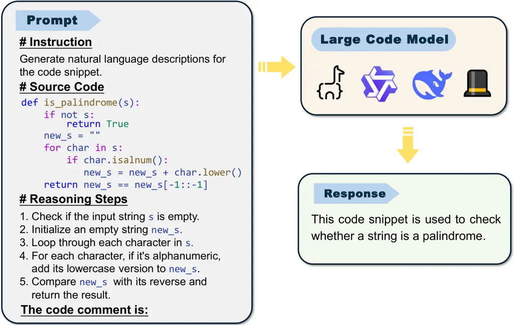
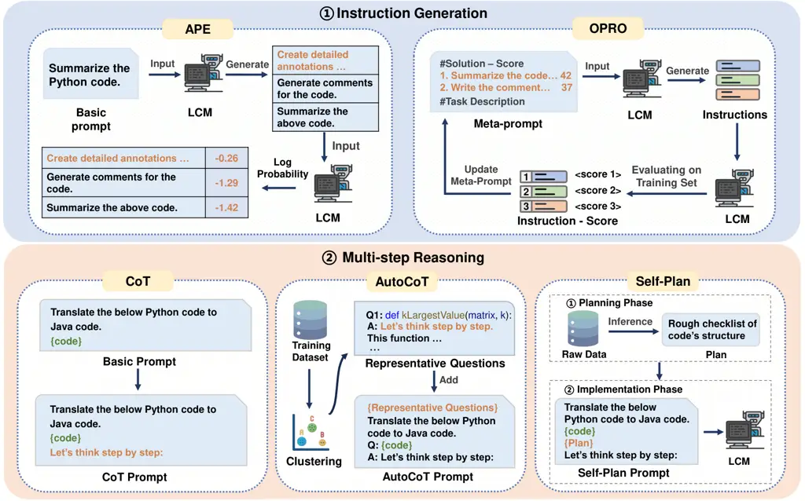
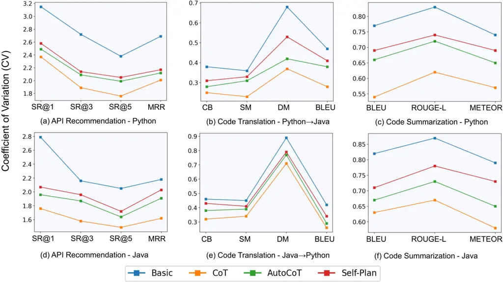
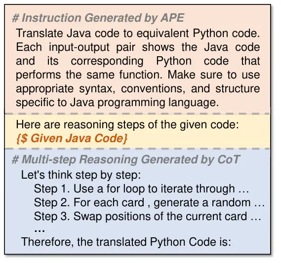
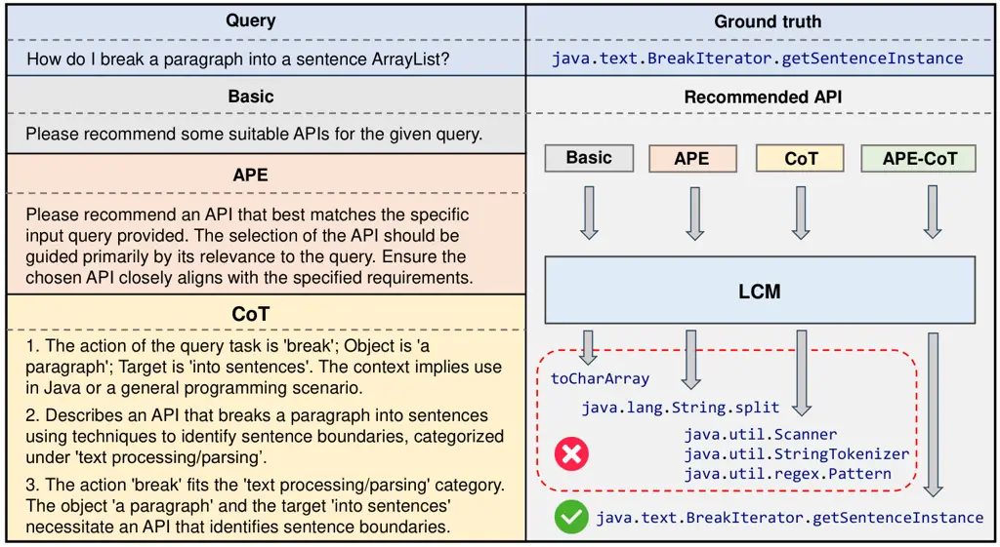

# Automated Prompt Generation for Code Intelligence: An Empirical study and Experience in WeChat Thanks: ^(∗)Cuiyun Gao is the corresponding author.

Kexing Ji Affiliation: The Chinese University of Hong Kong, Hong Kong,
China Email: <kexing1208@gmail.com>    Shiyun Fu Affiliation: The
Chinese University of Hong Kong, Hong Kong, China
Email: <FuShiyun1@outlook.com>    Cuiyun Gao
Email: <cuiyungao@outlook.com>    Yujia Chen Affiliation: The Chinese
University of Hong Kong, Hong Kong, China
Email: <yujiachenhit@gmail.com>    Zezhou Yang Affiliation: WeChat
Group, Tencent Inc., Guangzhou, China Email: <zezhouyang@tencent.com>   
Chaozheng Wang Affiliation: WeChat Group, Tencent Inc., Guangzhou, China
Email: <adf111178@gmail.com>    Yuetang Deng Affiliation: WeChat Group,
Tencent Inc., Guangzhou, China Email: <yuetangdeng@tencent.com>

###### Abstract

Large Code Models (LCMs) have demonstrated potential in advancing
various code intelligence tasks. However, their effectiveness can be
greatly influenced by the quality of the prompts. Current prompt design
strategies in code intelligence studies are mostly manually generated,
which could be time-consuming and extremely rely on the base LCMs and
tasks. Although automated prompt generation (APG) has been investigated
in the natural language processing field, it has not attracted
sufficient attention and been well explored in the code intelligence
tasks. Considering the various tasks and black-box nature of LCMs faced
by developers in practice, it is essential to automate the prompt
generation process.

To mitigate the gap, we empirically investigate the two important parts
in APG, including Instruction Generation (IG) and Muti-Step Reasoning
(MSR). The instruction generation part aims at providing a task-related
description for instructing LCMs to effectively accomplish specific
tasks; while the multi-step reasoning part aims at guiding LCMs to
produce a series of logical steps before arriving at the final answer.
For each part, we evaluate the widely-used APG methods on four
open-source LCMs and three code intelligence tasks, i.e., code
translation (PL-PL), code summarization (PL-NL) and API recommendation
(NL-PL). Experimental results indicate that the two parts in APG can
dramatically enhance the performance of the code intelligence tasks
compared with the basic prompts. Based on the results, we further
propose a novel APG approach by combining the best methods of the two
studied parts of APG. Experiments show that the proposed APG approach
achieves an average improvement of 28.38% with respect to CodeBLEU for
the code translation, 58.11% in terms of ROUGE-L for the code
summarization and 84.53% in SuccessRate@1 for the API recommendation
over the basic prompts, respectively. To validate the effectiveness in
industrial scenario, we further evaluate our approach on WeChat-Bench, a
proprietary dataset from the WeChat Group in Tencent for API
recommendation, achieving an average improvement of 148.89% in MRR.

###### Index Terms: 

Automated prompting generation, Code intelligence, Large Code Models,
Empirical study

## I Introduction

Recently, the advent of large-scale code corpora combined with advances
in deep learning technologies has facilitated the development of Large
Code Models (LCMs), e.g., Code
Llama \[DBLP:journals/corr/abs-2308-12950\],
DeepSeek-Coder \[DBLP:journals/corr/abs-2401-14196\], and
Qwen2.5-Coder \[DBLP:journals/corr/abs-2409-12186\]. These LCMs
demonstrate great potential in advancing various code intelligence
tasks, including code summarization \[DBLP:conf/acl/AhmadCRC20,
DBLP:journals/corr/abs-2308-13775\], API
recommendation \[DBLP:conf/emnlp/KangW00Y21,
DBLP:journals/tosem/LiLTHGLNWHZ24\] and code
translation \[DBLP:conf/nips/RoziereLCL20, DBLP:conf/emnlp/YangHHHJ20\].
To effectively employ LCMs in these tasks, users generally provide
task-specific prompts that include both instructions and contextual
information. Figure 1 provides an example of this interactive process.
The user formulates a prompt containing the task description, source
code, and reasoning steps for the code summarization task. Subsequently,
the LCM receives the prompt as input and generates a response.

Fig. 1: An example of designed prompt for LCM to generate the summary of
given code snippet.

Current prompt design strategies \[DBLP:conf/sigsoft/WangYGP0L22,
DBLP:conf/icse/PanIKSWMSPSJ24, DBLP:conf/icse/GengWD00JML24\] in code
intelligence are generally manually written. For instance, Sun et al.
 \[DBLP:journals/corr/abs-2305-12865\] manually design 11 different
prompts and conduct experiments to decide which prompt is more suitable
for specific LCMs to generate code comments. White et al.
 \[DBLP:journals/corr/abs-2303-07839\] manually craft 13 types of
prompts for four task categories, including code quality improvement,
refactoring, requirements acquisition, and software design. Although the
human-written prompts achieve superior performance in code intelligence
tasks, they bring several challenges. First, different human-written
prompts can lead to dramatically different performance. For example,
Sun et al.  \[DBLP:journals/corr/abs-2305-12865\] report that the least
effective prompt results in a 119.87% reduction in BLEU scores compared
to the most effective prompt. Second, in industrial development
scenarios, different projects often require task-specific and
model-specific prompts tailored to their unique codebases, APIs, and
development requirements, making manually-generated prompts hard to be
reused across projects \[DBLP:journals/corr/abs-2304-11938\]. Moreover,
the manual process is time-consuming and may bring much labor cost,
particularly when scaling across various code intelligence tasks and
LCMs. Therefore, how to automatically generate effective prompts for
different tasks and LCMs becomes an important research question.

Recent studies in the natural language processing (NLP) field have
proposed various Automated Prompting Generation (APG)
methods \[DBLP:journals/corr/abs-2303-09014,
DBLP:conf/iclr/ZhouMHPPCB23, DBLP:conf/iclr/YaoZYDSN023,
DBLP:conf/acl/0010LLWWBCH22, DBLP:conf/emnlp/ShinRLWS20\] and have
achieved promising results in NLP tasks. The APG methods leverage the
task definitions and input data to automatically generate prompts for
LCMs, enabling adaptability across different models and tasks. However,
while APG methods have proven effective in the NLP field, the
application of these methods to code intelligent tasks is still
unexplored. Considering the importance of prompt design in code
intelligence tasks, it is necessary to explore the APG methods for code
intelligence tasks.

To this end, we conduct a comprehensive empirical study on the impact of
APG for code intelligence tasks and evaluate its effectiveness in
industrial scenario. Based on the constituent parts of a prompt, i.e.,
instruction and reasoning steps as illustrated in Fig. 1, we focus on
two important parts in APG, including Instruction Generation (IG) and
Multi-Step Reasoning (MSR) in this paper. Specifically, instruction
generation aims at providing a task-related description for instructing
LCMs to effectively accomplish specific tasks, while multi-step
reasoning aims at guiding LCMs to produce a series of intermediate
logical steps before arriving at the final answer.

For each aspect, we evaluate the widely-used APG methods on four
open-source LCMs. We choose three popular code intelligence tasks,
including API recommendation (NL-PL), code translation (PL-PL), and code
summarization (PL-NL) for evaluation. We focus on investigating the
following four research questions (RQs):

1.  1.  What is the impact of instruction generation on the effectiveness of
        APG?
2.  2.  How effective is multi-step reasoning in enhancing the performance
        of APG?
3.  3.  Can we further improve the performance of current APG methods?
4.  4.  How does the improved APG method perform in the industrial scenario?

To explore the impact of instruction generation on the effectiveness of
APG methods (RQ1), we evaluate two representative automated instruction
generation methods: Automatic Prompt
Engineer \[DBLP:conf/iclr/ZhouMHPPCB23\] and Optimization by PROmpt
(OPRO) \[DBLP:journals/corr/abs-2309-03409\], and compare them against
manually crafted prompts \[DBLP:conf/icse/PanIKSWMSPSJ24,
DBLP:conf/kbse/GaoWGWZL23\] across four open-source LCMs. To investigate
the effectiveness of multi-step reasoning in enhancing the performance
of LCMs (RQ2), we evaluate the three widely adopted multi-step reasoning
methods—Chain-of-Thought (CoT) \[DBLP:conf/nips/Wei0SBIXCLZ22\],
AutoCoT \[DBLP:conf/iclr/0001Z0S23\], and
Self-Plan \[DBLP:journals/corr/abs-2303-06689\] and compare their
performance with that of manually designed prompts. To further explore
whether the performance of current APG methods can be improved (RQ3), we
combine the best-performing instruction generation and multi-step
reasoning methods identified in RQ1 and RQ2, and evaluate them on four
open-source LCMs for code intelligence tasks. Building upon the findings
of RQ3, we further investigate whether the observed improvements in APG
methods can generalize to the industrial scenario (RQ4), thereby
evaluating the practical applicability of the proposed technique.

Based on the experimental results, we find that APG methods greatly
improve LCM performance across three code intelligence tasks. Among the
evaluated APG methods, APE proves to be the most effective instruction
generation method, while CoT achieves the best results among multi-step
reasoning methods. Furthermore, the novel approach APE-CoT achieve
non-trivial performance improvements over basic prompts, with an average
increase of 28.38% in CodeBLEU for code translation, 58.11% in ROUGE-L
for code summarization and 84.53% in SucessRate@1 for API
recommendation. Additionally, evaluation on WeChat-Bench, a proprietary
dataset of 1000 C++ samples from the WeChat Group in Tencent for API
recommendation, demonstrates an average improvement of 148.89% in MRR,
confirming the effectiveness of our approach in the industrial scenario.

The main contributions of our work are summarized below:

1.  1.  To the best of our knowledge, this paper presents the first in-depth
        investigation into how to effectively utilize APG to generate
        prompts for code intelligence tasks.
2.  2.  Based on our findings, we propose a novel APG method that greatly
        improves the performance of LCMs in code intelligence tasks compared
        to the basic prompts.
3.  3.  We validate our approach in industrial scenario through evaluation
        in WeChat and offer practical implications for developers and
        potential directions for researchers.

## II Background

Fig. 2: The overview of APG Methods: Instruction Generation and
Multi-step Reasoning.

As shown in Fig. 1, APG contains two key parts: instruction generation,
which creates a tailored task description based on the input, and
multi-step reasoning, which produces structured steps to solve the task.
We elaborate on the details of the two parts in the following.

### II-A Instruction Generation

For instruction generation, we consider two widely acknowledged and
effective techniques, namely APE \[DBLP:conf/iclr/ZhouMHPPCB23\] and
OPRO \[DBLP:journals/corr/abs-2309-03409\], as detailed below.

- •
  Automatic Prompt Engineer (APE) \[DBLP:conf/iclr/ZhouMHPPCB23\] treats
  instruction generation as a natural language synthesis task. As shown
  in Figure 2, LCMs first automatically generate a pool of candidate
  instructions through comprehending the task requirements underneath
  basic prompt, and then select the best instruction through log
  probability. The log probability reflects the likelihood of producing
  the desired result given the instruction and the LCM.
- •
  Optimization by PROmpting (OPRO) \[DBLP:journals/corr/abs-2309-03409\]
  uses LCMs to refine task execution through dynamic optimization.
  Figure 2 illustrates the OPRO process. A meta-prompt guides LCMs to
  generate and evaluate candidate instructions, and the top-performing
  pairs are used to update the meta-prompt iteratively until convergence
  on an optimal instruction.

### II-B Multi-step Reasoning

For multi-step reasoning, we select three representative methods—CoT,
AutoCoT, and Self-Plan—based on their remarkable performance in prior
work \[DBLP:conf/icse/LiW0L0WG024\], as detailed below.

- •
  Chain-of-Thought (CoT) \[DBLP:conf/nips/Wei0SBIXCLZ22\] enhances the
  reasoning capabilities of LCMs by guiding them through a sequence of
  intermediate steps, thereby reducing the difficulty of generating the
  desired output. For example, as shown in Figure 2, by simply adding
  “Let’s think step by step”, CoT prompt encourages LCMs to produce more
  considered responses by focusing on intermediary reasoning steps.
- •
  AutoCoT \[DBLP:conf/iclr/0001Z0S23\] serves as an automated multi-step
  reasoning method that optimizes CoT in terms of efficiency. As shown
  in Figure 2, AutoCoT clusters the given training dataset and selects
  representative problems from each cluster. These representative
  questions, along with their reasoning steps, are then incorporated
  into the AutoCoT prompt to better guide LCMs in generating accurate
  outputs.
- •
  Self-Plan \[DBLP:journals/corr/abs-2303-06689\] decomposes complex
  tasks into a structured subtasks, outlining the overall program
  structure without delving into implementation details. It provides
  clear and concise high-level actions through a two-stage generation
  process, as illustrated in Figure 2. In the first stage, the LCM
  generates a “plan” that serves as an outline for the code structure.
  In the second stage, the LCM leverages both the plan and code to
  generate outputs for downstream tasks.

## III EXPERIMENTAL SETUP

### III-A Research Questions

In this paper, we conduct experiments with the aim of answering the
following research questions:

- •
  RQ1: What is the impact of instruction generation on the effectiveness
  of APG?
- •
  RQ2: How effective is multi-step reasoning in enhancing the
  performance of APG?
- •
  RQ3: Can we further improve the performance of current APG methods?
- •
  RQ4: How does the improved APG method perform in an industrial
  scenario?

### III-B Evaluation Tasks

We evaluate the APG approaches on three representative code intelligence
tasks: code summarization, code translation and API recommendation.

#### III-B1 Code Summarization

Code summarization, also known as code comment generation, targets to
automatically generate concise natural language descriptions for source
code snippets \[DBLP:journals/tosem/GaoGHZNXL23, geng2023empirical\]. We
use the prompt template from \[DBLP:conf/sigsoft/WangYGP0L22\] as our
basic prompt:

“Generate comments for \[LANG\] code.”

where \[LANG\] denotes the slot of programming language.

Datasets. We use the CodeXGLUE code summarization
benchmark \[DBLP:journals/corr/abs-2102-04664\]. It contains code
snippets and corresponding natural language comments extracted from
GitHub repositories. The detailed data statistics are shown in Table I.

Metrics. Following previous work \[DBLP:conf/kbse/GaoWGWZL23\], we use
three widely adopted metrics for evaluating code summarization:
BLEU-4 \[DBLP:conf/acl/PapineniRWZ02\], ROUGE-L \[lin-2004-rouge\], and
METEOR \[DBLP:conf/acl/BanerjeeL05\]. These metrics evaluate the
similarity between generated and ground-truth summaries and are widely
used in code summarization.

|                |                   |         |        |        |
| -------------- | ----------------- | ------- | ------ | ------ |
| Task           | Dataset           | Train   | Valid  | Test   |
| Code           | CodeXGLUE-Java    | 164,923 | 5,183  | 10,955 |
| Summarization  | CodeXGLUE-Python  | 251,820 | 13,914 | 14,918 |
| Code           | AVATAR-Java       | 60,138  | 476    | 1,906  |
| Translation    | AVATAR-Python     | 60,138  | 476    | 1,906  |
| API            | APIBENCH-Q-Java   | 4,769   | 594    | 600    |
| Recommendation | APIBENCH-Q-Python | 3,118   | 391    | 400    |

TABLE I: Statistics of the datasets.

#### III-B2 Code Translation

Code translation aims to convert code written in one programming
language to another \[DBLP:conf/iui/WeiszMHRRMAT21\]. This involves
interpreting the logic and functionality of the original code and
reproducing it accurately in the target language. We utilize the
template described in \[DBLP:conf/icse/PanIKSWMSPSJ24\] as the basic
prompt:

“Translate the above \[SOURCE\] code to \[TARGET\].”

where \[SOURCE\] and \[TARGET\] specify the source and target
programming languages for translation, respectively.

Datasets. The dataset for the code translation task is
Avatar \[DBLP:conf/acl/AhmadTCC23\]. We use parallel functions in Java
and Python to evaluate the task. The detailed data statistics are in
shown Table I.

Metrics. To evaluate the code translation task, we adopt three
additional metrics besides BLEU: Syntax Match (SM), Dataflow Match (DM),
and CodeBLEU (CB) \[DBLP:journals/corr/abs-2009-10297\]. SM measures the
proportion of matching subtrees in Abstract Syntax Trees (AST), while DM
calculates the proportion of matching data flow edges. CB extends BLEU
by incorporating syntactic and semantic features such as AST and data
flow.

#### III-B3 API Recommendation

API recommendation aims to suggest appropriate Application Programming
Interface (API) calls for specific programming tasks. In this work, we
focus on natural-language-based API recommendation, where the goal is to
retrieve suitable APIs according to user’ textual queries. We use the
template described in  \[DBLP:conf/wcre/ChenGZ0WX24\] as the basic
prompt.

“Please recommend some suitable APIs for the given query.”

Datasets. In API recommendation task, we adopt the widely used
APIBENCH-Q \[DBLP:journals/tse/PengLGLWGL23\] dataset. Following an
8:1:1 train/validation/test split, we randomly select 400 Python and 600
Java questions as the test set, with the rest queries grouped into the
training and validation set. The detailed data statistics are shown in
Table I.

Metrics. Following prior work \[DBLP:conf/wcre/ChenGZ0WX24\], we utilize
the widely used metrics in recommendation tasks to
evaluate \[DBLP:journals/tse/PengLGLWGL23, DBLP:conf/sigsoft/GuZZK16,
DBLP:conf/icse/WeiHH0022\]: Success Rate (SR) and Mean Reciprocal Rank
(MRR). SR@k evaluates a method’s ability to suggest relevant APIs within
the top-k recommendations, with k values of 1, 3, and 5 used for our
evaluation. Meanwhile, MRR computes the average reciprocal rank of the
first relevant API across all queries.

### III-C Large Code Models

To evaluate the effectiveness of APG methods, we utilize four
open-source LCMs:

- •
  CodeLlama \[DBLP:journals/corr/abs-2308-12950\] is a family of large
  language models for code based on Llama
  2 \[DBLP:journals/corr/abs-2307-09288\] with state-of-the-art code
  generation, and blank infilling capabilities.
- •
  Qwen2.5-Coder \[DBLP:journals/corr/abs-2409-12186\] is a LCM from
  Qwen2.5 series with 128K context length. It is trained on 5.5T tokens
  over source code and text-code alignment data, achieving strong
  performance in code generation and reasoning.
- •
  Deepseek-Coder \[DBLP:journals/corr/abs-2401-14196\] is a series of
  LCMs trained on 2T tokens across over 80 programming languages. It
  achieves state-of-the-art performance among open-source code LLMs.
- •
  Magicoder \[DBLP:journals/corr/abs-2312-02120\] is an
  instruction-tuned LCM, which first trains Deepseek-Coder on 75K
  OSS-INSTRUCT data and further trains the model on 110K Evol-Instruct
  data.

### III-D Implementation Details

In our study, We employ the following four open-source LCMs:
Deepseek-Coder (Deepseek-Coder-6.7B-Instruct), Magicoder
(Magicoder-S-DS-6.7B), CodeLlama (CodeLlama-13b-Instruct) and
Qwen2.5-Coder (Qwen2.5-Coder-14B-Instruct). We download these models
from HuggingFace¹¹ 1 https://huggingface.co/models and deploy them
locally. For the implementation of instruction generation (APE and OPRO)
and multi-step reasoning methods (CoT, AutoCoT and Self-Plan), we
directly use the replication packages released by the authors and adapt
them to our tasks. As for the hyperparameters for the generation of
LCMs, we adopt nuclear sampling with a top-p value of 0.95 and a
temperature value of 0.2. The maximum generation token length is set to
256 for code translation, 512 for code summarization, and 128 for API
recommendation.

All the experiments are conducted on an Ubuntu-20.04 server equipped
with 4 \* Nvidia A100 GPUs and each one has 40GB graphics memory. The
source code is publicly accessible at
https://anonymous.4open.science/r/Towards-Prompt-is-All-You-Need-5D66.

|                |          |                            |       |       |       |                             |       |       |       |                            |         |        |
| -------------- | -------- | -------------------------- | ----- | ----- | ----- | --------------------------- | ----- | ----- | ----- | -------------------------- | ------- | ------ |
| Model          | Approach | API Recommendation (NL-PL) |       |       |       | Code Translation (PL-PL)    |       |       |       | Code Summarization (PL-NL) |         |        |
|                |          | Python                     |       |       |       | Python $`\rightarrow`$ Java |       |       |       | Python                     |         |        |
|                |          | SR@1                       | SR@3  | SR@5  | MRR   | CB                          | SM    | DM    | BLEU  | BLEU                       | ROUGE-L | METEOR |
| Deepseek-Coder | Basic    | 12.75                      | 15.50 | 17.00 | 14.38 | 51.43                       | 74.29 | 50.79 | 39.45 | 15.68                      | 18.82   | 7.06   |
|                | APE      | 15.25                      | 17.75 | 18.75 | 16.56 | 65.36                       | 76.05 | 68.00 | 58.92 | 15.87                      | 20.60   | 8.66   |
|                | OPRO     | 13.50                      | 18.00 | 18.75 | 15.69 | 60.19                       | 75.42 | 60.86 | 51.44 | 15.85                      | 20.30   | 8.24   |
| Magicoder      | Basic    | 11.75                      | 14.25 | 16.00 | 13.22 | 52.51                       | 68.85 | 33.10 | 48.58 | 14.77                      | 18.56   | 7.09   |
|                | APE      | 14.50                      | 17.00 | 19.75 | 16.23 | 63.02                       | 76.57 | 68.35 | 52.98 | 15.83                      | 20.44   | 8.54   |
|                | OPRO     | 14.25                      | 16.00 | 17.75 | 15.36 | 60.51                       | 76.04 | 61.35 | 51.75 | 15.78                      | 19.75   | 7.73   |
| CodeLlama      | Basic    | 10.50                      | 13.75 | 14.75 | 12.00 | 56.29                       | 70.05 | 57.48 | 48.20 | 9.24                       | 10.78   | 4.75   |
|                | APE      | 17.50                      | 19.50 | 22.00 | 18.99 | 62.94                       | 74.15 | 65.08 | 56.27 | 15.82                      | 20.44   | 7.52   |
|                | OPRO     | 15.25                      | 17.25 | 18.25 | 16.39 | 58.60                       | 72.24 | 61.61 | 50.00 | 15.82                      | 19.96   | 6.56   |
| Qwen2.5-Coder  | Basic    | 10.25                      | 13.25 | 14.50 | 12.31 | 56.18                       | 70.29 | 57.52 | 48.73 | 12.47                      | 14.36   | 5.82   |
|                | APE      | 18.75                      | 20.50 | 21.75 | 19.12 | 64.95                       | 75.16 | 66.91 | 56.48 | 15.91                      | 20.18   | 8.63   |
|                | OPRO     | 15.50                      | 17.25 | 18.50 | 16.08 | 59.44                       | 72.68 | 63.84 | 50.36 | 14.76                      | 18.68   | 7.58   |
| Model          | Approach | API Recommendation (NL-PL) |       |       |       | Code Translation (PL-PL)    |       |       |       | Code Summarization (PL-NL) |         |        |
|                |          | Java                       |       |       |       | Java $`\rightarrow`$ Python |       |       |       | Java                       |         |        |
|                |          | SR@1                       | SR@3  | SR@5  | MRR   | CB                          | SM    | DM    | BLEU  | BLEU                       | ROUGE-L | METEOR |
| Deepseek-Coder | Basic    | 19.67                      | 22.83 | 24.33 | 21.39 | 49.88                       | 59.39 | 37.11 | 50.75 | 14.15                      | 15.57   | 6.12   |
|                | APE      | 21.67                      | 26.50 | 28.00 | 24.22 | 58.61                       | 61.98 | 41.94 | 64.92 | 15.02                      | 18.60   | 7.24   |
|                | OPRO     | 20.17                      | 23.50 | 24.17 | 21.76 | 55.96                       | 60.65 | 40.78 | 60.83 | 15.02                      | 18.69   | 5.41   |
| Magicoder      | Basic    | 14.00                      | 18.33 | 19.33 | 16.07 | 48.85                       | 59.34 | 39.11 | 47.55 | 11.11                      | 13.28   | 4.93   |
|                | APE      | 17.83                      | 22.33 | 23.50 | 20.08 | 54.52                       | 63.01 | 42.75 | 52.64 | 14.65                      | 17.83   | 6.30   |
|                | OPRO     | 15.17                      | 19.50 | 21.00 | 17.38 | 52.18                       | 62.82 | 42.58 | 50.88 | 13.81                      | 16.95   | 6.48   |
| CodeLlama      | Basic    | 18.67                      | 24.00 | 26.50 | 21.63 | 50.57                       | 59.02 | 38.55 | 51.54 | 4.71                       | 5.37    | 2.41   |
|                | APE      | 28.83                      | 33.67 | 36.00 | 31.51 | 59.05                       | 56.57 | 53.58 | 59.88 | 15.01                      | 18.49   | 7.08   |
|                | OPRO     | 25.17                      | 29.33 | 31.67 | 27.54 | 55.46                       | 63.43 | 43.11 | 50.53 | 15.01                      | 18.46   | 6.91   |
| Qwen2.5-Coder  | Basic    | 19.83                      | 24.17 | 26.33 | 21.29 | 51.23                       | 59.67 | 39.41 | 52.36 | 10.64                      | 11.18   | 6.53   |
|                | APE      | 29.33                      | 33.67 | 35.67 | 34.22 | 60.74                       | 64.38 | 55.13 | 62.87 | 15.13                      | 18.62   | 9.27   |
|                | OPRO     | 26.50                      | 30.17 | 31.83 | 27.18 | 56.52                       | 61.33 | 45.77 | 54.09 | 14.92                      | 17.14   | 8.03   |

TABLE II: Experiment results of instruction generation methods in code
intelligence tasks.

|        |                |               |                |
| ------ | -------------- | ------------- | -------------- |
| Method | API            | Code          | Code           |
|        | Recommendation | Translation   | Summarization  |
| OPRO   | 41.92          | 36.78         | 68.54          |
| APE    | 35.16 (-6.76)  | 34.27 (-2.51) | 56.16 (-12.38) |

TABLE III: Average instruction tokens for API recommendation, code
translation and code summarization tasks.

Fig. 3: An example of APE and OPRO generated instructions for the code
translation task using Deepseek-Coder.

Fig. 4: Results of multi-step reasoning on three code intelligence
tasks. The vertical axis means the average CV of each metric.

|                |           |                            |       |       |       |                             |       |       |       |                            |         |        |
| -------------- | --------- | -------------------------- | ----- | ----- | ----- | --------------------------- | ----- | ----- | ----- | -------------------------- | ------- | ------ |
| Model          | Approach  | API Recommendation (NL-PL) |       |       |       | Code Translation (PL-PL)    |       |       |       | Code Summarization (PL-NL) |         |        |
|                |           | Python                     |       |       |       | Python $`\rightarrow`$ Java |       |       |       | Python                     |         |        |
|                |           | SR@1                       | SR@3  | SR@5  | MRR   | CB                          | SM    | DM    | BLEU  | BLEU                       | ROUGE-L | METEOR |
| Deepseek-Coder | Basic     | 12.75                      | 15.50 | 17.00 | 14.38 | 51.43                       | 74.29 | 50.79 | 39.45 | 15.68                      | 18.82   | 7.06   |
|                | CoT       | 14.75                      | 19.25 | 21.00 | 17.05 | 66.22                       | 76.65 | 69.19 | 59.83 | 15.89                      | 20.57   | 9.16   |
|                | AutoCoT   | 14.25                      | 18.50 | 19.00 | 16.28 | 58.09                       | 75.03 | 68.19 | 44.16 | 15.73                      | 19.45   | 6.11   |
|                | Self-Plan | 13.75                      | 17.00 | 19.00 | 15.70 | 55.45                       | 72.29 | 52.96 | 43.12 | 15.53                      | 19.01   | 8.94   |
| Magicoder      | Basic     | 11.75                      | 14.25 | 16.00 | 13.22 | 52.51                       | 68.85 | 33.10 | 48.58 | 14.77                      | 18.56   | 7.09   |
|                | CoT       | 13.75                      | 16.50 | 18.50 | 15.52 | 66.55                       | 75.48 | 69.42 | 60.90 | 15.79                      | 19.27   | 8.72   |
|                | AutoCoT   | 12.50                      | 15.75 | 17.50 | 14.37 | 65.68                       | 76.02 | 68.65 | 58.93 | 15.71                      | 19.14   | 8.09   |
|                | Self-Plan | 10.75                      | 15.25 | 17.25 | 13.34 | 56.41                       | 73.13 | 34.75 | 50.46 | 15.76                      | 19.26   | 8.38   |
| CodeLlama      | Basic     | 10.50                      | 13.75 | 14.75 | 12.00 | 56.29                       | 70.05 | 57.48 | 48.20 | 9.24                       | 10.78   | 4.75   |
|                | CoT       | 22.75                      | 30.75 | 33.00 | 26.67 | 61.71                       | 73.78 | 66.41 | 53.10 | 15.90                      | 20.32   | 8.81   |
|                | AutoCoT   | 21.75                      | 26.75 | 29.00 | 24.36 | 61.20                       | 73.90 | 64.83 | 52.68 | 15.87                      | 20.21   | 5.60   |
|                | Self-Plan | 19.50                      | 25.00 | 26.75 | 22.30 | 58.43                       | 70.83 | 58.06 | 50.10 | 13.40                      | 16.20   | 7.24   |
| Qwen2.5-Coder  | Basic     | 10.25                      | 13.25 | 14.50 | 12.31 | 56.18                       | 70.29 | 57.52 | 48.73 | 12.47                      | 14.36   | 5.82   |
|                | CoT       | 22.25                      | 31.50 | 32.75 | 28.52 | 61.92                       | 73.93 | 66.53 | 58.69 | 16.21                      | 21.33   | 8.84   |
|                | AutoCoT   | 21.50                      | 26.25 | 28.25 | 26.73 | 61.47                       | 72.85 | 64.87 | 55.91 | 15.87                      | 20.26   | 5.53   |
|                | Self-Plan | 19.25                      | 25.50 | 26.25 | 22.18 | 58.46                       | 71.17 | 58.26 | 49.78 | 13.32                      | 16.14   | 7.23   |
| Model          | Approach  | API Recommendation (NL-PL) |       |       |       | Code Translation (PL-PL)    |       |       |       | Code Summarization (PL-NL) |         |        |
|                |           | Java                       |       |       |       | Java $`\rightarrow`$ Python |       |       |       | Java                       |         |        |
|                |           | SR@1                       | SR@3  | SR@5  | MRR   | CB                          | SM    | DM    | BLEU  | BLEU                       | ROUGE-L | METEOR |
| Deepseek-Coder | Basic     | 19.67                      | 22.83 | 24.33 | 21.39 | 49.88                       | 59.39 | 37.11 | 50.75 | 14.15                      | 15.57   | 6.12   |
|                | CoT       | 25.00                      | 28.33 | 29.83 | 26.73 | 61.22                       | 62.81 | 42.38 | 69.60 | 15.07                      | 18.65   | 7.69   |
|                | AutoCoT   | 23.17                      | 27.00 | 28.50 | 25.25 | 56.15                       | 61.94 | 40.44 | 56.51 | 14.94                      | 18.00   | 5.30   |
|                | Self-Plan | 22.17                      | 25.33 | 26.67 | 23.84 | 51.71                       | 60.77 | 39.77 | 52.63 | 14.96                      | 17.65   | 7.50   |
| Magicoder      | Basic     | 14.00                      | 18.33 | 19.33 | 16.07 | 48.85                       | 59.34 | 39.11 | 47.55 | 11.11                      | 13.28   | 4.93   |
|                | CoT       | 20.50                      | 25.67 | 28.00 | 23.31 | 61.13                       | 62.22 | 40.88 | 70.48 | 14.96                      | 17.64   | 7.60   |
|                | AutoCoT   | 20.33                      | 23.83 | 26.17 | 22.40 | 57.76                       | 61.44 | 40.42 | 64.26 | 14.94                      | 17.83   | 5.25   |
|                | Self-Plan | 15.50                      | 21.33 | 24.67 | 18.91 | 55.95                       | 60.01 | 40.46 | 61.08 | 14.93                      | 17.57   | 7.39   |
| CodeLlama      | Basic     | 18.67                      | 24.00 | 26.50 | 21.63 | 50.57                       | 59.02 | 38.55 | 51.54 | 4.71                       | 5.37    | 2.41   |
|                | CoT       | 24.83                      | 32.50 | 34.50 | 28.66 | 63.06                       | 63.51 | 43.22 | 72.60 | 15.07                      | 18.63   | 7.51   |
|                | AutoCoT   | 24.17                      | 31.83 | 35.00 | 28.31 | 60.08                       | 60.83 | 40.30 | 67.97 | 15.03                      | 18.44   | 6.48   |
|                | Self-Plan | 23.17                      | 26.17 | 27.50 | 24.80 | 53.75                       | 62.53 | 42.73 | 53.17 | 13.57                      | 15.96   | 6.83   |
| Qwen2.5-Coder  | Basic     | 19.83                      | 24.17 | 26.33 | 21.29 | 51.23                       | 59.67 | 39.41 | 52.36 | 10.64                      | 11.18   | 6.53   |
|                | CoT       | 24.50                      | 33.33 | 34.67 | 29.58 | 64.41                       | 65.87 | 45.58 | 73.76 | 15.12                      | 19.63   | 7.95   |
|                | AutoCoT   | 23.33                      | 30.83 | 34.17 | 28.25 | 61.38                       | 61.14 | 42.62 | 68.23 | 15.03                      | 18.44   | 6.48   |
|                | Self-Plan | 22.33                      | 26.17 | 27.50 | 26.52 | 54.97                       | 61.91 | 41.84 | 56.35 | 13.54                      | 15.92   | 6.82   |

TABLE IV: Experiment results of multi-step reasoning methods in code
intelligence tasks.

## IV Experimental Results

### IV-A RQ1: Impact of automated instruction generation

Experimental Design. To answer this research question, we evaluate APE
and OPRO against basic prompts (Section III-B) on API recommendation,
code translation, and summarization tasks. All experiments are repeated
five times, with the best performing instructions selected for the final
evaluation.

Analysis. Table II shows the results of instruction generation methods.
Observations are as follows:

Automatic instruction generation methods consistently outperform basic
prompts across all tasks and models. Both APE and OPRO demonstrate
substantial improvements over basic prompts. In code summarization, APE
and OPRO achieve average BLEU improvements of 50.80% and 48.40%
respectively across all models and languages. For API recommendation,
APE shows consistent gains across all metrics (41.56% for SR@1, 30.98%
for SR@3, 30.11% for SR@5, and 37.01% for MRR), while OPRO also exhibits
improvements (25.37% for SR@1, 17.55% for SR@3, 15.12% for SR@5, and
19.67% for MRR), though with smaller margins than APE. We also conduct
t-test between APE/OPRO and the basic prompt among all tasks, and the
results confirm statistically significant improvements ($`p<0.05`$).

APE achieves better performance than OPRO despite using fewer
instruction tokens, demonstrating its effectiveness and token
efficiency. As shown in Table III, under the same experimental setup,
APE consistently generates more concise instructions across all tasks:
API recommendation (35.16 vs. 41.92 tokens), code translation (34.27 vs.
36.78 tokens), and code summarization (56.16 vs. 68.54 tokens), while
maintaining better task performance.

To better understand this advantage, we compared the selection
strategies and instruction content of APE and OPRO. Specifically, APE
ranks candidate instructions using log probability scores from the
target model, whereas OPRO relies on scores generated directly by the
LCMs. This difference in scoring may influence the alignment between the
selected instruction and the underlying model’s behavior. For example,
as illustrated in Figure 3, although both instructions specify the
source and target programming languages and emphasize translation
quality, OPRO often includes redundant or less focused content, while
APE produces more task-specific instructions that emphasize critical
aspects such as appropriate syntax, naming conventions and structural
consistency. This precise and concise guidance enables the LCM to
perform better with fewer tokens.

### IV-B RQ2: Effectiveness of multi-step reasoning methods

Experimental Design. To investigate this RQ, we select three widely-used
methods, including CoT, AutoCoT and Self-Plan. Templates and details of
these methods are provided in our GitHub repository. To further assess
robustness, we repeat each experiment five times and report the average
performance. Additionally, we compute the Coefficient of Variation (CV =
$`\frac{\sigma}{\mu}`$) across runs. A lower CV indicates more stable
performance and stronger robustness.

Analysis. Results are shown in Table IV, and the corresponding CV values
are illustrated in Figure 4 for method stability comparison. We can get
the following insights through the results:

Multi-step reasoning methods can improve the performance of LCMs, with
task-specific and detailed intermediate reasoning steps yielding the
most notable gains. For example, in both code translation directions,
CoT achieves improvements over the basic prompt of 21.70% in CB, 6.49%
in SM, 27.96% in DM, and 34.34% in BLEU. In comparison, AutoCoT shows
corresponding improvements of 15.70%, 4.24%, 24.03%, and 20.74%, while
Self-Plan yields more modest gains of 6.86%, 2.38%, 4.90%, and 7.78%,
respectively. Overall, CoT achieves the highest performance in almost
all metrics (84/88) across all tasks. Statistical significance is
confirmed by t-test ($`p<0.05`$), demonstrating its superiority over
other multi-step reasoning approaches. These results suggest that
providing detailed intermediate steps (as in CoT) is more effective than
decomposing the task into structured subtasks (as in Self-Plan) or
relying on representative examples (as in AutoCoT), particularly in code
intelligence tasks requiring task-specific understanding and logical
reasoning.

CoT produces results that are more stable and less sensitive to code
intelligence tasks. As shown in Figure 4, CoT consistently achieves the
lowest CV values across all evaluation metrics and programming
languages. In code summarization, CoT exhibits an average CV of 0.60,
outperforming AutoCoT (0.68), Self-Plan (0.72), and basic prompts
(0.80). For code translation, CoT demonstrates superior stability with
BLEU score CVs of 0.26 (Java-to-Python) and 0.28 (Python-to-Java),
compared to AutoCoT (0.29 and 0.38) and Self-Plan (0.34 and 0.41). In
API recommendation, CoT achieves the lowest average CV values across all
metrics: 2.07 for SR@1, 1.74 for SR@3, 1.63 for SR@5, and 1.82 for MRR.
The consistent lowest CV across all three tasks highlights that CoT
delivers more stable performance through multi-step reasoning, enabling
it to mitigate task performance inconsistency caused by prompt
variations.

|                |          |                            |       |       |       |                             |       |       |       |                            |         |        |
| -------------- | -------- | -------------------------- | ----- | ----- | ----- | --------------------------- | ----- | ----- | ----- | -------------------------- | ------- | ------ |
| Model          | Approach | API Recommendation (NL-PL) |       |       |       | Code Translation (PL-PL)    |       |       |       | Code Summarization (PL-NL) |         |        |
|                |          | Python                     |       |       |       | Python $`\rightarrow`$ Java |       |       |       | Python                     |         |        |
|                |          | SR@1                       | SR@3  | SR@5  | MRR   | CB                          | SM    | DM    | BLEU  | BLEU                       | ROUGE-L | METEOR |
| Deepseek-Coder | APE      | 15.25                      | 17.75 | 18.75 | 16.56 | 65.36                       | 76.05 | 68.00 | 58.92 | 15.64                      | 19.09   | 9.29   |
|                | CoT      | 14.75                      | 19.25 | 21.00 | 17.05 | 66.22                       | 76.65 | 69.19 | 59.83 | 16.04                      | 19.67   | 9.47   |
|                | APE-CoT  | 17.25                      | 21.00 | 21.75 | 19.16 | 70.78                       | 88.47 | 75.71 | 58.77 | 16.06                      | 19.60   | 9.50   |
| Magicoder      | APE      | 14.25                      | 17.00 | 19.75 | 16.23 | 63.02                       | 76.57 | 68.35 | 52.98 | 15.99                      | 19.51   | 9.18   |
|                | CoT      | 13.75                      | 16.50 | 18.50 | 15.52 | 66.55                       | 75.48 | 69.42 | 60.90 | 15.57                      | 19.02   | 8.56   |
|                | APE-CoT  | 14.50                      | 18.75 | 20.00 | 16.61 | 75.46                       | 76.45 | 69.71 | 77.13 | 16.04                      | 19.61   | 8.97   |
| CodeLlama      | APE      | 17.50                      | 19.50 | 22.00 | 18.99 | 62.94                       | 74.15 | 65.08 | 56.27 | 13.03                      | 15.72   | 7.83   |
|                | CoT      | 22.75                      | 30.75 | 33.00 | 26.67 | 61.71                       | 73.78 | 66.41 | 53.10 | 16.00                      | 19.60   | 9.00   |
|                | APE-CoT  | 29.00                      | 32.75 | 34.75 | 31.18 | 64.53                       | 74.57 | 66.44 | 58.50 | 16.06                      | 19.65   | 9.58   |
| Qwen2.5-Coder  | APE      | 18.75                      | 20.50 | 21.75 | 19.12 | 64.95                       | 75.16 | 66.91 | 56.48 | 15.93                      | 19.41   | 8.69   |
|                | CoT      | 22.25                      | 31.50 | 32.75 | 28.52 | 61.92                       | 73.93 | 66.53 | 58.69 | 15.99                      | 19.36   | 8.74   |
|                | APE-CoT  | 31.75                      | 34.25 | 37.25 | 31.62 | 69.02                       | 76.37 | 69.81 | 61.02 | 17.24                      | 20.52   | 9.35   |
| Model          | Approach | API Recommendation (NL-PL) |       |       |       | Code Translation (PL-PL)    |       |       |       | Code Summarization (PL-NL) |         |        |
|                |          | Java                       |       |       |       | Java $`\rightarrow`$ Python |       |       |       | Java                       |         |        |
|                |          | SR@1                       | SR@3  | SR@5  | MRR   | CB                          | SM    | DM    | BLEU  | BLEU                       | ROUGE-L | METEOR |
| Deepseek-Coder | APE      | 21.67                      | 26.50 | 28.00 | 24.22 | 58.61                       | 61.98 | 41.94 | 64.92 | 15.01                      | 17.85   | 7.58   |
|                | CoT      | 25.00                      | 28.33 | 29.83 | 26.73 | 61.22                       | 62.81 | 42.38 | 69.60 | 14.96                      | 17.94   | 7.80   |
|                | APE-CoT  | 26.17                      | 29.17 | 30.17 | 27.67 | 62.13                       | 63.46 | 43.52 | 70.54 | 15.09                      | 18.15   | 8.01   |
| Magicoder      | APE      | 17.83                      | 22.33 | 23.50 | 20.08 | 54.52                       | 63.01 | 42.75 | 52.64 | 14.63                      | 17.31   | 7.41   |
|                | CoT      | 20.50                      | 25.67 | 28.00 | 23.31 | 61.13                       | 62.22 | 40.88 | 70.48 | 15.03                      | 17.85   | 7.53   |
|                | APE-CoT  | 21.50                      | 26.17 | 27.67 | 23.84 | 62.69                       | 63.92 | 42.63 | 71.89 | 15.07                      | 18.16   | 7.84   |
| CodeLlama      | APE      | 28.83                      | 33.67 | 36.00 | 31.51 | 59.05                       | 56.57 | 53.58 | 59.88 | 13.37                      | 15.96   | 7.13   |
|                | CoT      | 24.83                      | 32.50 | 34.50 | 28.66 | 63.06                       | 63.51 | 43.22 | 72.60 | 15.03                      | 17.86   | 7.62   |
|                | APE-CoT  | 32.17                      | 40.83 | 43.17 | 36.76 | 63.44                       | 64.00 | 42.33 | 73.57 | 15.09                      | 18.12   | 8.00   |
| Qwen2.5-Coder  | APE      | 29.33                      | 33.67 | 35.67 | 34.22 | 60.74                       | 64.38 | 55.13 | 62.87 | 14.96                      | 17.88   | 7.58   |
|                | CoT      | 24.50                      | 33.33 | 34.67 | 29.58 | 64.41                       | 65.87 | 45.58 | 73.76 | 15.02                      | 17.81   | 7.49   |
|                | APE-CoT  | 34.67                      | 42.83 | 45.17 | 38.46 | 66.54                       | 67.61 | 56.47 | 74.59 | 15.11                      | 18.14   | 8.97   |

TABLE V: Experiment results of the combined methods in code intelligence
tasks.

### IV-C RQ3: Can we further improve the performance of current APG methods?

Experimental Design. While previous results indicate the individual
effectiveness of IG and MSR methods, it remains unclear whether their
combination can yield further improvements. Therefore, in RQ3, we
investigate whether combining APE (for IG) and CoT (for MSR) into a
unified APE-CoT framework can achieve better performance than individual
method. As shown in Figure 5, the APE-CoT selects the top-ranked
instruction through iterative APE generation and then incorporates CoT
reasoning steps to construct the final prompt. Due to time constraints,
we sample 10% of the code summarization test set (1,095 Java and 1,491
Python examples) while using full datasets for code translation and API
recommendation given their smaller sizes.

Fig. 5: An example of APE-CoT prompt in code translation.

Analysis. The evaluation results are presented in Table V, and we
summarize the main findings as follows:

Combining generated instruction and reasoning steps improves the
performance of APG methods across code intelligence tasks. According to
Table V, APE-CoT consistently outperforms both individual APE and CoT
methods across all evaluated models and tasks. The combined approach
achieves optimal performance in 93.18% (41/44) of Python task metrics
and 95.45% (42/44) of Java task metrics, suggesting the complementary
benefits of both components. For instance, in Python API recommendation,
APE-CoT with Qwen2.5-Coder achieves 31.75% SR@1, substantially
outperforming individual APE (18.75%) and CoT (22.25%) methods.
Similarly, in Python to Java translation, APE-CoT consistently delivers
the highest performance across different models, such as achieving
75.46% CodeBLEU with Magicoder compared to 63.02% for APE and 66.55% for
CoT. These results demonstrate that combining APG techniques enhances
code intelligence performance, with t-tests confirming that APE-CoT
significantly outperforms each individual method ($`p<0.05`$).

APE-CoT exhibits different improvements across code intelligence tasks,
with particularly notable gains in NL-PL scenarios. The combined
approach achieves the most substantial improvements in NL-PL tasks (API
recommendation), with an average improvement of 22.35% over individual
APE and CoT methods across all models and metrics. For PL-PL tasks (code
translation), APE-CoT shows moderate gains with an average improvement
of 8.75% compared to individual methods. In contrast, PL-NL tasks (code
summarization) exhibit the modest improvements, with APE-CoT achieving
an average gain of 7.28% over APE and CoT approaches. These results
indicate that APE-CoT is particularly effective for tasks with
programming language outputs, showing substantial improvements in both
API recommendation and code translation , while exhibiting relatively
smaller gains in code summarization that requires natural language
generation.

Fig. 6: A case study on the API recommendation task with four prompts.
The LCM is Codellama.

### IV-D RQ4: Performance of APE-CoT in Industrial Scenario

Experimental Design. To evaluate the effectiveness of APE-CoT in
real-world industrial settings, we conduct experiments on an internal
dataset from Tencent. Specifically, we construct an API query dataset of
1,000 samples collected from the C++ codebase of WeChat, referred to as
WeChat-Bench. We choose C++ for this evaluation as it is the primary
language used in large-scale projects at Tencent, and thus the dataset
better reflects the practical challenges encountered by developers in
industrial scenarios. Given the scale and complexity of WeChat,
WeChat-Bench provides a representative and challenging production-level
enterprise environment for validating the effectiveness of APE-CoT in
industrial scenario.

|                |          |              |       |       |       |
| -------------- | -------- | ------------ | ----- | ----- | ----- |
| Models         | Approach | WeChat-Bench |       |       |       |
|                |          | SR@1         | SR@3  | SR@5  | MRR   |
| Deepseek-Coder | Basic    | 3.90         | 5.10  | 6.00  | 3.90  |
|                | APE-CoT  | 7.80         | 9.80  | 10.30 | 7.70  |
| Magicoder      | Basic    | 0.80         | 1.20  | 1.70  | 0.70  |
|                | APE-CoT  | 4.00         | 5.90  | 6.70  | 4.00  |
| CodeLlama      | Basic    | 12.80        | 14.00 | 14.80 | 12.80 |
|                | APE-CoT  | 13.60        | 15.80 | 16.70 | 13.50 |
| Qwen2.5-Coder  | Basic    | 10.80        | 12.00 | 12.60 | 9.90  |
|                | APE-CoT  | 13.00        | 13.60 | 14.20 | 12.00 |

TABLE VI: Experimental results on the WeChat-Bench dataset for API
recommendation in the industry scenario.

Analysis. The experimental results in Table VI show that the APE-CoT
framework consistently outperforms the basic prompt across all evaluated
LCMs on the industrial WeChat-Bench dataset. For example, Deepseek-Coder
achieves an SR@1 of 7.80% with APE-CoT, doubling the performance of the
basic prompt (3.90%). Similar improvements are observed for Magicoder,
CodeLlama, and Qwen2.5-Coder, with APE-CoT yielding higher scores in all
metrics (SR@1, SR@3, SR@5, and MRR). Notably, although the metric scores
on WeChat-Bench are lower than those on public benchmarks, this is
likely due to the increased difficulty and domain specificity of
internal industrial data. Despite these challenging conditions, APE-CoT
still surpasses the basic prompt, demonstrating both its effectiveness
and generalizability for API recommendation in the real-world industrial
scenario.

## V Discussion

### V-A Why does APE-CoT work?

The effectiveness of APE-CoT lies in the combination of task-specific
instruction and multi-step reasoning. The instruction provides
task-specific guidance, and the multi-step reasoning enables the model
to enhance the understanding of task. Together, they guide the LCM to
generate more accurate and contextually aligned code intelligence task
results. The following sections illustrate these two aspects in detail
through an API recommendation example.

#### V-A1 Instruction Generation for Task-Specific Guidance

When prompted with only the basic query, the LCM recommends the API
“toCharArray”, which is driven by a narrow focus on keywords like
“Array”, leading to a less relevant recommendation. In contrast, the APE
method introduces task-specific instructions, offering the model clearer
guidance and helping it better understand the user’s intent. As a
result, the model suggests “java.lang.String.split”, a much more
appropriate API for string segmentation. This highlights how instruction
generation can guide the model toward more contextually aligned
recommendations.

#### V-A2 Multi-Step Reasoning for Enhanced understanding of Task Instructions

While multi-step reasoning can guide the LCM through a sequence of
logical steps, it may still fall short when task instructions are
underspecified. In the case, the CoT prompt guides the LCM to generate
APIs such as “java.util.Scanner, java.util.StringTokenizer,
java.util.regex.Pattern”. These recommendations suggest an attempt to
segment a paragraph by first identifying sentence boundaries through
tokenization and pattern matching. While this reflects a certain level
of structured reasoning, the model still fails to capture the core
intent of sentence-level splitting, resulting in suboptimal API choices.
By integrating multi-step reasoning with task-specific instructions, the
APE-CoT method enables the model to better understand the instruction
and progressively refine its decisions. As a result, the LCM identifies
the correct API: “java.text.BreakIterator.getSentenceInstance”,
demonstrating the combination of instruction and multi-step reasoning
leads to more contextually appropriate results.

### V-B Implications of Findings

This study conducts an empirical evaluation of automated prompt
generation methods in code intelligence tasks. In this section, we
discuss the implications of our study from the perspective of
researchers and developers.

Researchers: Our study indicates that APG methods can create effective
prompts that improve LCMs performance in code intelligence tasks. Our
findings provide potential research directions for researchers in the
code intelligence community:

- •
  The integration of APG methods shows superior performance, with the
  APE-CoT approach surpassing individual APG strategies. This suggests
  the potential of exploring alternative APG combinations for further
  improvements in code intelligence tasks.

- •
  APG methods are more effective for code output tasks (NL-PL and PL-PL)
  but show limited gains in natural language generation (PL-NL). Future
  work should explore enhancing APG performance in PL-NL scenarios.

Developers: Automated crafting effective prompts is critical for
developers working with LCMs. Based on our findings, we offer the
following practical recommendations:

- •
  Consider adopting automated prompt generation to reduce reliance on
  manual prompts and enhance both stability and effectiveness in code
  intelligence tasks.

- •
  Combine instruction generation and reasoning methods to enhance LCMs
  performance, particularly for code output tasks such as API
  recommendation and code translation.

### V-C Threats to Validity

We identify the following threats to validity of our study:

The selection of evaluation datasets. The quality and scale of datasets
can affect the results of the experiment. Although we choose the
widely-used datasets, the diversity of the dataset is still limited. In
future work, we will evaluate the effectiveness of APG methods on more
datasets.

The selection of LCMs. Due to computational resource constraints, the
maximum parameters of the chosen LCMs is 14B, which may not fully
reflect the performance of APG methods on larger LCMs. To further
validate the generalizability of our findings, we intend to extend our
experiments to a broader range of LCMs.

The selection of evaluation metrics. The current evaluation focuses on
accuracy-based and generation-quality metrics. While these provide a
solid basis for comparison, they may not fully capture model robustness
or efficiency. Future work will explore broader evaluation metrics for
more comprehensive assessment of APG methods.

## VI Related work

### VI-A Automatic Prompt Generation (APG)

APG has emerged as a promising direction to improve the adaptability and
performance of LCMs \[DBLP:conf/iclr/ZhouMHPPCB23,
DBLP:conf/iclr/Guo0GLS0L0Y24, DBLP:conf/emnlp/PryzantI0L0023\],
especially in tasks where manually crafting effective prompts is
challenging. Recent studies have proposed various APG methods aimed at
designing more effective prompts with minimal human effort. One aspect
of studies focuses on generating clearer and more effective task
descriptions. For instance, Automatic Prompt Engineering
(APE) \[DBLP:conf/iclr/ZhouMHPPCB23\] automatically optimizes or selects
prompts that better align with task objectives. Another aspect of work
enhances the reasoning capability of models through structured prompting
methods, such as Chain-of-Thought (CoT)
prompting \[DBLP:conf/nips/Wei0SBIXCLZ22\], which guide models through
intermediate reasoning steps to improve final output quality. Our work
builds upon these foundations by focusing on empirical strategies for
automating prompt construction, with the goal of efficiently
automatically generating prompts that maximize LCM performance on code
intelligence tasks.

### VI-B In-Context Learning (ICL)

In-Context Learning is an alternative training-free paradigm to improve
LCMs performance on downstream tasks \[DBLP:conf/icml/Ni0RSYWL23,
DBLP:conf/iclr/PatelLRCRC23, DBLP:conf/icse/GengWD00JML24,
DBLP:conf/kbse/Khan022, DBLP:conf/sigsoft/0003X023\]. Instead of relying
on fine-tuning with the large-scale supervised dataset, ICL utilizes a
small set of labeled samples from the training data to create task
prompts. These prompts guide the model’s responses during
inference \[DBLP:conf/nips/BrownMRSKDNSSAA20\]. This method is typically
classified by the number of examples provided, ranging from zero-shot
(no examples) to few-shot learning (a limited number of examples).
Recent studies in ICL have explored the impact of the order of examples
on performance \[DBLP:conf/acl/LuBM0S22\] and the enhancement of
diversity among these examples for improved compositional
generalization \[DBLP:conf/acl/LevyBB23\]. Moreover, there is a growing
interest in applying ICL to code intelligence
tasks \[DBLP:conf/kbse/AhmedD22, DBLP:conf/icse/XiaWZ23,
DBLP:conf/icse/NashidSM23\], including techniques like using BM-25
retrieval for constructing relevant
demonstrations \[DBLP:conf/icse/NashidSM23\]. In contrast, our work
adapts automated prompting generation methods to enhance LCMs
performance in code intelligence tasks, rather than repeatedly selecting
exemplary examples to facilitate models’ understanding of context and
tasks.

## VII Conclusion

In this paper, we empirically investigate two important parts in
automated prompting generation (APG) for code intelligence tasks,
including Instruction Generation (IG) and Multi-Step Reasoning (MSR).
For each part, we evaluate widely-used APG methods on four open-source
LCMs and three popular code intelligence tasks. Our study indicates that
the two parts in APG can greatly enhance the performance of code
intelligence tasks compared to basic prompts. Based on these findings,
we propose APE-CoT, a novel approach that combines the most effective
methods from each part. Experiments on public benchmarks and in the
industrial scenario of WeChat demonstrate that our approach achieves
non-trivial improvements and confirms its practical applicability.

## Acknowledgment

This research is supported by the National Natural Science Foundation of
China under project (No. 62472126, 62276075), Natural Science Foundation
of Guangdong Province (Project No. 2023A1515011959), Shenzhen-Hong Kong
Jointly Funded Project (Category A, No. SGDX20230116 091246007).

## References
