# HideAndSeg: an AI-based tool with automated prompting for octopus segmentation in natural habitats

Alan de Aguiar ^(†)^(†)thanks:
[aln.deaguiar@gmail.com](mailto:aln.deaguiar@gmail.com) Affiliation:
Universidade Federal do ABC (UFABC), Santo André, SP, Brazil   
Michaella Pereira Andrade ^(†)^(†)thanks:
[michapereirandrade@gmail.com](mailto:michapereirandrade@gmail.com)
Affiliation: Universidade Federal do ABC (UFABC), Santo André, SP,
Brazil    Charles Morphy D. Santos ^(†)^(†)thanks:
[charlesmorphy@gmail.com](mailto:charlesmorphy@gmail.com) Affiliation:
Universidade Federal do ABC (UFABC), Santo André, SP, Brazil    João
Paulo Gois ^(†)^(†)thanks:
[joao.gois@ufabc.edu.br](mailto:joao.gois@ufabc.edu.br) Affiliation:
Universidade Federal do ABC (UFABC), Santo André, SP, Brazil

###### Abstract

Analyzing octopuses in their natural habitats is challenging due to
their camouflage capability, rapid changes in skin texture and color,
non-rigid body deformations, and frequent occlusions, all of which are
compounded by variable underwater lighting and turbidity. Addressing the
lack of large-scale annotated datasets, this paper introduces
HideAndSeg, a novel, minimally supervised AI-based tool for segmenting
videos of octopuses. It establishes a quantitative baseline for this
task. HideAndSeg integrates SAM2 with a custom-trained YOLOv11 object
detector. First, the user provides point coordinates to generate the
initial segmentation masks with SAM2. These masks serve as training data
for the YOLO model. After that, our approach fully automates the
pipeline by providing a bounding box prompt to SAM2, eliminating the
need for further manual intervention. We introduce two unsupervised
metrics – temporal consistency ($`DICE_{t}`$) and new component count
($`NC_{t}`$) – to quantitatively evaluate segmentation quality and guide
mask refinement in the absence of ground-truth data, i.e., real-world
information that serves to train, validate, and test AI models. Results
show that HideAndSeg achieves satisfactory performance, reducing
segmentation noise compared to the manually prompted approach. Our
method can re-identify and segment the octopus even after periods of
complete occlusion in natural environments, a scenario in which the
manually prompted model fails. By reducing the need for manual analysis
in real-world scenarios, this work provides a practical tool that paves
the way for more efficient behavioral studies of wild cephalopods.

## 1 Introduction

To study wildlife, biologists often must manually analyze massive
amounts of video footage, a process complicated by data collected over
long periods with varying equipment, climate, geographical, and
environmental conditions (Andrade et al., 2023; Lalgudi et al., 2025).
The challenge amplifies in complex marine environments, particularly for
studying cephalopods, whose camouflage skills, swift changes in skin
color and texture, and highly deformable bodies present unique
analytical hurdles (Ikeda, 2021; Schnell et al., 2021).

Cephalopods exhibit the most rapid and varied skin color changes in the
animal kingdom Ikeda (2021). These bodily changes are referred to as
body patterns and are based on the alteration of chromatophores,
texture, posture, and locomotion (Messenger, 2001; Ikeda, 2021).

Given the idiosyncrasies of cephalopods, automating key steps of
cephalopod analysis in natural habitats is fundamental for advancing
studies in animal ethology, welfare, and conservation. Initially, a
solution to the task of reliable video segmentation is required.

In recent years, Artificial Intelligence (AI) systems like _You Only
Look Once_ (YOLO) and segmentation models like the _Segment Anything
Model_ (SAM) and its video-based successor, SAM2, have been adapted for
wildlife detection (Chen et al., 2024; Roy et al., 2023; Ravi et al.,
2024; Lalgudi et al., 2025). Their ability to generate high-quality
masks with minimal prompting makes them promising for marine biology,
especially given the often inconsistent quality of their imagery data.
However, these models can be brittle when applied directly to
unconstrained videos of octopuses in natural environments. YOLO models
struggle with the specific visual challenges of the underwater domain
(Fig. 1-A). Likewise, SAM2 can track an octopus across several frames
but may fail under challenging conditions such as camouflage,
occlusions, or poor visibility (Fig. 1).

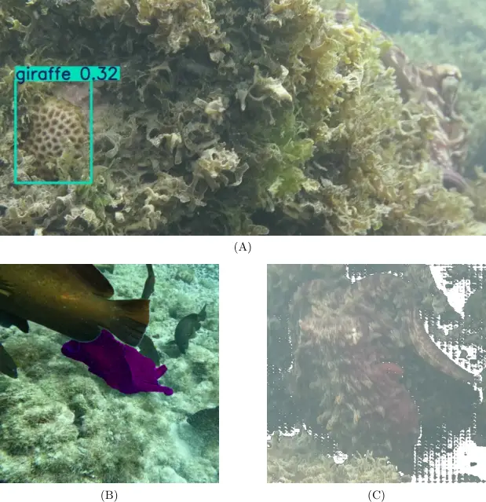

Figure 1: Failure cases for models when applied to octopus videos. (A)
YOLO incorrectly labels the coral reef as a “giraffe” and fails to
detect the octopus on the right side of the frame; (B) In SAM2, a fish
crossing in front of the octopus causes the segmentation mask (a purple
tint) to leak into the fish; (C) Also in SAM2, camouflage and water
conditions cause the surrounding environment to leak into the
segmentation mask.

These generalist object-detection and image segmentation AI-based models
are not explicitly trained to handle the common issues of non-stationary
appearance, non-rigid deformation, and environmental degradation that
occur in natural environments. Specifically concerning cephalopods,
another critical barrier is the absence of large-scale, publicly
available, annotated video datasets for octopus segmentation, which
prevents standard supervised fine-tuning and evaluation.

Processing videos of octopuses recorded in natural environments is a
core requirement for advancing behavioral research. Minimally invasive
video recordings capture key behavioral states not previously reported
in captive observations (Andrade et al., 2023). Nevertheless, underwater
videos are challenging to interpret due to the complex optical
properties of aquatic environments, including color distortion, low
contrast, blurring, noise, scattering, inconsistent lighting, and
turbidity (Vijayalakshmi Mohankumar, 2024). These factors degrade image
quality and hinder accurate object detection and segmentation. To
address these issues, deep learning and image processing techniques have
been proposed, including convolutional neural network (CNN) and
generative adversarial network (GAN) based image enhancement models,
image formation models that account for underwater light propagation,
generation of synthetic data to supplement limited real-world datasets,
and domain adaptation via transfer learning (Vijayalakshmi Mohankumar,
2024).

This study addresses the complexities of automated segmentation applied
to octopuses observed within their natural, uncontrolled habitats.
Overcoming the obstacles inherent in these tasks requires considering
factors like: (1) Dynamic appearance: octopuses rapidly change skin
color, pattern, and texture (Ikeda, 2021; Shook et al., 2024). For a
computer vision model, the target’s visual features are never stable,
violating the assumption of appearance consistency that many tracking
and segmentation algorithms rely on; (2) Articulated body: lacking a
skeletal structure, an octopus can deform and contort its body into a
vast range of shapes (Flash and Zullo, 2023). Tracking such a non-rigid
object is more difficult than monitoring organisms with predictable
skeletons; (3) Degraded underwater visuals: the underwater environment
introduces visual distortions that degrade video quality (Vijayalakshmi
Mohankumar, 2024). These include turbidity, which obscures object
boundaries; depth-induced color filtering that washes out key visual
information; highly variable illumination, which creates shadows and
reflections; and (4) the presence of other organisms: natural habitats
are uncontrollable environments where other life forms, such as fish and
seaweed, can obscure the octopus in video recordings and hamper
automated tracking.

We introduce HideAndSeg, a novel AI-based methodology for segmenting
octopus videos in unconstrained underwater environments, built on the
SAM2 and YOLO architectures and designed explicitly for segmenting
octopuses in videos recorded in natural habitats. HideAndSeg works even
without readily available ground truth data, i.e., with no objective
standard of correctness, which makes it possible to both train and
evaluate the performance of the video-segmentation model. To address the
"no ground truth" challenge, we propose a workflow that minimizes manual
intervention by leveraging unsupervised tracking and segmentation
metrics for quantitative evaluation. Furthermore, the study identifies
the limitations of current state-of-the-art models through comprehensive
analysis, providing a clear roadmap for future research. This work
distinguishes itself from prior studies by offering an image
segmentation pipeline tailored to octopus videos in natural settings,
which significantly reduces manual labeling efforts. It introduces
unsupervised metrics to assess the quality of the generated
segmentations.

## 2 Material and Methods

### 2.1 Subjects, study area, and field data collection

_Octopus insularis_ is a medium-sized benthic octopus that inhabits
shallow waters from Brazil to the Caribbean, including oceanic islands
(O’brien et al., 2021; Côrtes et al., 2025). Our observations and
filming of juvenile O. insularis were conducted off the northeastern
coast of Brazil, in three locations with rich ecosystems: Atol das Rocas
Biological Reserve, Búzios Beach, and Fernando de Noronha Marine
National Park. These environments, composed of rocks, coral reefs, and
algae, enable us to study the behavioral patterns of octopuses in
shallow, clear waters. We used a GoPro 10 and a Canon G16 camera for
filming, following the octopuses as they foraged on the substrate. We
maintained a distance of approximately two meters from the observed
individuals, prioritizing non-interference with their behavior, as the
research was minimally invasive and non-lethal. The second author of the
work collected the data in seven expeditions from 2022 to 2024 within
the project *Investigating sentience and emotional states in wild
octopuses*¹¹ 1
[https://www.wildanimalinitiative.org/blog/grantee-octopus](https://www.wildanimalinitiative.org/blog/grantee-octopus).

### 2.2 YOLO and SAM

YOLO (Redmon et al., 2016) is an object detection model that uses a
single convolutional neural network (CNN) to simultaneously predict
multiple bounding boxes and their corresponding class probabilities in a
single pass over the image. YOLOv11 extends beyond object detection to
include pose estimation and instance segmentation. It also achieves an
improved mean average precision (mAP) while using 22% fewer parameters
than YOLOv8 in the COCO dataset (Khanam and Hussain, 2024).

Researchers have successfully used models from the YOLO family in
wildlife identification tasks (Thomas et al., 2025). The innovations
introduced by this architecture have led to a reduction in inference
time, which, combined with high accuracy, enables the use of these
models in real-time scenarios. This results in a better trade-off
between performance and speed when compared to other CNN-based object
detection architectures (Thomas et al., 2025). However, there are
limitations regarding model generalization, as they may not perform well
for species and environmental conditions that were not present in the
training dataset, thus requiring properly labeled data (Thomas et al.,
2025). This requirement limits the use of pre-trained models in the
context of octopus identification.

Additionally, the complexity of images captured in underwater
environments presents challenges, including distortions caused by light
refraction in water and turbulence (Yu et al., 2025) (Yu et al., 2025).
For such cases, it is possible to extend the architecture’s capability,
as seen in TMAE-YOLO (Yu et al., 2025), which introduces the TMAE
(Temporally Multi-scale Attention Enhancement) and TD-AFPN (Temporal
Decoupled Attention Feature Pyramid Network) modules to improve the
detection of mud crabs underwater. TMAE leverages reference frames to
integrate temporal information through a cross-frame attention
mechanism, enabling the model to enhance feature representations by
selectively focusing on informative regions across multiple frames, thus
recovering details lost due to occlusion or poor visibility. TD-AFPN
improves the feature extraction process, particularly for small and
medium-scale objects, by decoupling spatial and temporal feature
aggregation. The use of these modules resulted in improved performance
in mud crab detection underwater, achieving an AP50 of 84.3%, which
represents an improvement over YOLOv8n’s performance of 80.7%. However,
TMAE relies on reference frames for feature enhancement. In cases of
rapid target motion or sudden appearance changes—such as abrupt
viewpoint shifts or significant deformation—the cross-frame attention
mechanism may struggle to align features accurately, thereby reducing
its effectiveness. This challenge is crucial in the context of octopus
identification, where camouflage and dynamic body movement are essential
characteristics.

Combining object segmentation with detection methods like YOLO (Redmon
et al., 2016; Zheng et al., 2024) involves three steps: using video
object segmentation to focus on the target organism and reduce
background noise; retraining recognition networks with these segmented
images to enhance individual identification; and developing a system
capable of real-time detection, segmentation, and recognition.

SAM is a general-purpose image segmentation framework that operates
across various domains without requiring task-specific training or
massive annotated datasets (Kirillov et al., 2023). Given a simple input
prompt, such as a bounding box or a point indicating the object of
interest, SAM can generate high-quality segmentation masks, even for
objects or image types not encountered during training. This flexibility
makes SAM particularly useful in settings like ecological monitoring,
where labeled data is limited. SAM2 (Ravi et al., 2024) extends the
original framework to support video segmentation, accepting point, box,
or mask prompts on individual frames. It propagates segmentation across
time, employing a lightweight, promptable mask decoder that combines
image embeddings with user-provided prompts to produce segmentation
masks frame by frame. The user can iteratively refine the prompts to
enhance accuracy, making SAM2 a practical tool for image and video
segmentation.

Given the enormous volume of data and the difficulty of manually
segmenting octopuses due to their complex body shapes, ability to
camouflage, and environmental conditions, creating a fully annotated
dataset for training specialized models is expensive. In this context, a
generalist model such as SAM2 becomes valuable.

Despite the generalization capability of SAM2, manual prompting remains
a necessary step, which can be costly when processing large volumes of
video data. To address this limitation, the FLAIR method (Lalgudi et
al., 2025) was developed as an alternative, leveraging the CLIP
(Contrastive Language–Image Pretraining) model, which learns joint
representations between natural language and images. By constructing a
specialized textual prompt, we used CLIP to identify which of the
segmentation masks generated by SAM2 corresponded to the target
object—specifically, sharks. The masks identified by CLIP were then used
as input prompts to SAM2, enabling the tracking of the object throughout
the entire video sequence. A significant advantage of this approach is
that it does not require any annotated data; only the textual prompt
used for mask classification needs to be adapted. However, the quality
of the segmentation produced is entirely dependent on the performance of
the CLIP model, which may struggle to identify specific species that are
underrepresented in its pretraining dataset. To validate the method, in
addition to frame-by-frame manual annotations, FLAIR was compared
against object detection models (Lalgudi et al., 2025) (YOLOv8, DETR
(Carion et al., 2020)) used for frame annotation, as well as a
Human-in-the-Loop approach, in which a human operator provided manual
prompts whenever segmentation was lost. The detection-based methods
performed poorly on the test set, which negatively impacted the
resulting segmentation quality—particularly because object detection
outputs were used to prompt every frame, thereby propagating any noise
introduced by the detector. In contrast, the Human-in-the-Loop strategy
exhibited performance closely aligned with that of FLAIR, suggesting
that targeted interventions at points of segmentation
failure—potentially automated by a more robust object detector and mask
quality metrics—may be sufficient to achieve high-quality results.

HideAndSeg relies on using SAM2 to generate segmentation masks from
manual annotations on a small number of frames, and then leveraging
these results to train a YOLO object detection model, thereby
eliminating the need for human intervention (Fig. 2). To ensure the
results are accurate and reliable, we compute unsupervised segmentation
metrics throughout the pipeline. These metrics guide the refinement of
the initial prompts used with SAM2 and assess the quality of the final
segmentations.

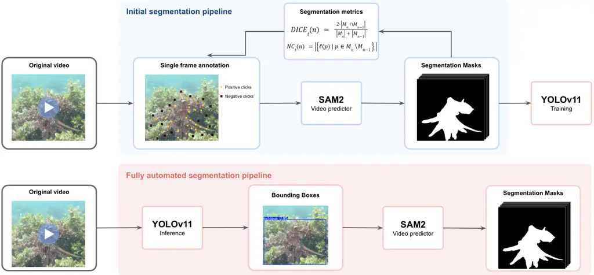

Figure 2: HideAndSeg pipeline. The input video is first processed
through frame extraction. The first clear frame is manually annotated to
provide an initial prompt for SAM2, which then generates segmentation
masks that are evaluated using our proposed unsupervised metrics. For
additional manual annotation, one can select the frame with the lowest
metric score. Once the process is complete, the resulting masks are used
to train a YOLO-based object segmentation model that ultimately replaces
manual prompt annotation for SAM2, resulting in a fully automated
segmentation process.

### 2.3 Video segmentation

The initial dataset consisted of 148 octopus videos of varying lengths
and frame rates, totaling 564,755 frames. We discarded all the initial
frame sequences in which the octopus was not visible, resulting in empty
segmentation masks, and then applied the segmentation process to the
remaining 366,514 frames. We adopted the small and large variants of the
SAM2 model, containing 46 million and 224 million parameters,
respectively. For both models, we used the video predictor module
provided by the SAM2 library, which propagates segmentations across the
entire video based on annotation prompts. These prompts can be
associated with any frame in the sequence. We enabled asynchronous frame
loading to prevent memory overflow during processing.

### 2.4 Unsupervised evaluation metrics

Standard video segmentation evaluation relies on comparing model outputs
with ground-truth annotations, often using metrics such as the DICE
coefficient. As our dataset is unlabeled, we employ two unsupervised
metrics to assess different facets of segmentation quality from the raw
model output.

In high-frame-rate videos, the change in an object’s position and shape
between consecutive frames is expected to be minimal. Leveraging this
assumption, we use the $`DICE_{t}`$ coefficient to measure the temporal
consistency of the segmentation by comparing the mask of the current
frame, $`M_{n}`$, with the mask of the previous frame $`M_{n-1}`$ .
Formally, the metric is:

```math
DICE_{t}(n)=\frac{2\left|M_{n}\right|\cap\left|M_{n-1}\right|}{\left|M_{n}\right|+\left|M_{n-1}\right|}. \tag{1}
```

A higher $`DICE_{t}`$ score indicates smooth and consistent
segmentation, while a lower score suggests abrupt changes, potentially
due to tracking loss or erratic mask generation. It is worth mentioning
that to differentiate the unsupervised metric from the standard usage,
we will use the notation $`DICE_{t}`$ to refer to the computation of the
metric between the segmentation of two consecutive frames, and $`DICE`$
to denote the comparison of the segmentation with the ground truth.

A qualitative analysis of the segmentation results revealed that when
the model fails to accurately identify the octopus, the output mask
often becomes noisy and fragmented, characterized by numerous small,
disconnected components (speckling), particularly at the edges (Fig.
1-C). While some disconnected components are expected due to natural
occlusions from vegetation or rocks, a sudden increase in their number
signals a drop in segmentation quality.

To quantify this phenomenon, we employ a metric for measuring the
deterioration of segmentation quality by counting the number of new
connected components that appear in the current frame’s mask relative to
the previous one. Let $`\ell(p)`$ be the label of the connected
component to which the pixel p belongs. The metric reads:

```math
NC_{t}(n)=\left|\ell(p)\penalty\ |\penalty\ p\in M_{n}\setminus M_{n-1}\right|. \tag{2}
```

To evaluate video segmentation stability, we determined the number of
connected components $`NC_{t}`$. These components were identified using
a full connectivity (8-connected) algorithm, as implemented in the
scikit-image package (van der Walt et al., 2014). A low $`NC_{t}`$ value
indicates a stable segmentation, while a high value points to the
emergence of noise and potential tracking failure.

### 2.5 Manual frame annotation

We tested three manual annotation strategies to assess their impact on
segmentation performance. In the first run, a manual annotation was
performed on the initial frame, supplying the coordinates corresponding
to the octopus in the image. In the second run, negative annotations
were also included, i.e., coordinates that should not be considered part
of the target object. Then, $`NC_{t}`$ metric was used to select an
additional annotation frame. For each video, the frame that exhibited
the most significant increase in the metric relative to the previous
frame was selected. The goal was to identify the exact moment when the
segmentation became more unstable and provide additional information to
help the model sustain its performance. We use both positive and
negative annotations for this additional frame. Although SAM2 does not
require a large number of annotated points to perform segmentation,
challenges such as partial occlusion and camouflage can lead to
fragmented masks with multiple disconnected components. To mitigate
this, the selected coordinates were distributed as uniformly as possible
along the contour of the octopus, rather than using a fixed number of
keypoints, ensuring more complete and coherent segmentation results.

Finally, we performed manual segmentation on the initial frame of all
videos to enable evaluation of the method using traditional segmentation
metrics and to ensure the effectiveness of the proposed unsupervised
segmentation metrics, which directly depend on the quality of the
segmentation in the first frame.

### 2.6 Object Detection

While SAM2 significantly reduces the manual effort required for video
segmentation, the annotation and validation process remains
time-consuming when working with large-scale video datasets. We trained
a YOLO-based model specialized in octopus detection to eliminate human
intervention. Given the complexity and scale of our dataset, we selected
YOLOv11-l, a model with 25.3 million parameters, pre-trained on the COCO
dataset.

For training, we used the results from the segmentation experiment that
achieved the lowest NCt metric. From the segmentation masks, we
extracted bounding boxes around the octopus in each frame to serve as
ground truth. Frames with empty segmentation masks were excluded,
resulting in a reduction of the total number of frames from 366,514 to
305,291.

We divided the remaining frames into training (212,924 frames),
validation (56,288 frames), and test (36,079 frames) subsets. To prevent
data leakage, we ensured that no video in the test set appeared in the
training or validation sets. We evaluate the model performance on the
test set using Precision, Recall, and Mean Average Precision (mAP) at
two Intersection over Union (IoU) thresholds: 0.5 (mAP@0.5) and 0.95
(mAP@95).

### 2.7 Combining segmentation and detection

Using the trained YOLO model, we automatically generated annotations for
each frame in the videos, which can be used as prompts for SAM2, as
shown in Fig. 3. However, initial tests revealed that increasing the
number of annotated frames led to a rise in SAM2’s computational
demands, making the method impractical for longer videos. To address
this limitation, we limited the number of YOLO-annotated frames to 5,
10, or 20, depending on the experiment. These frames were uniformly
sampled across the entire video, beginning with the first frame. For
example, in a 100-frame video with five annotations, the selected frames
would be 1, 21, 41, 61, and 81.

(A) SAM2 output

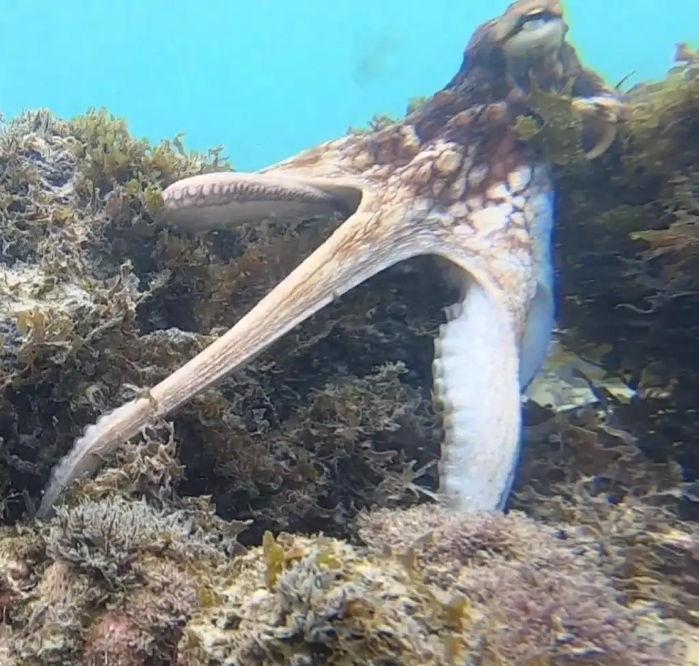

i Frame $`t`$

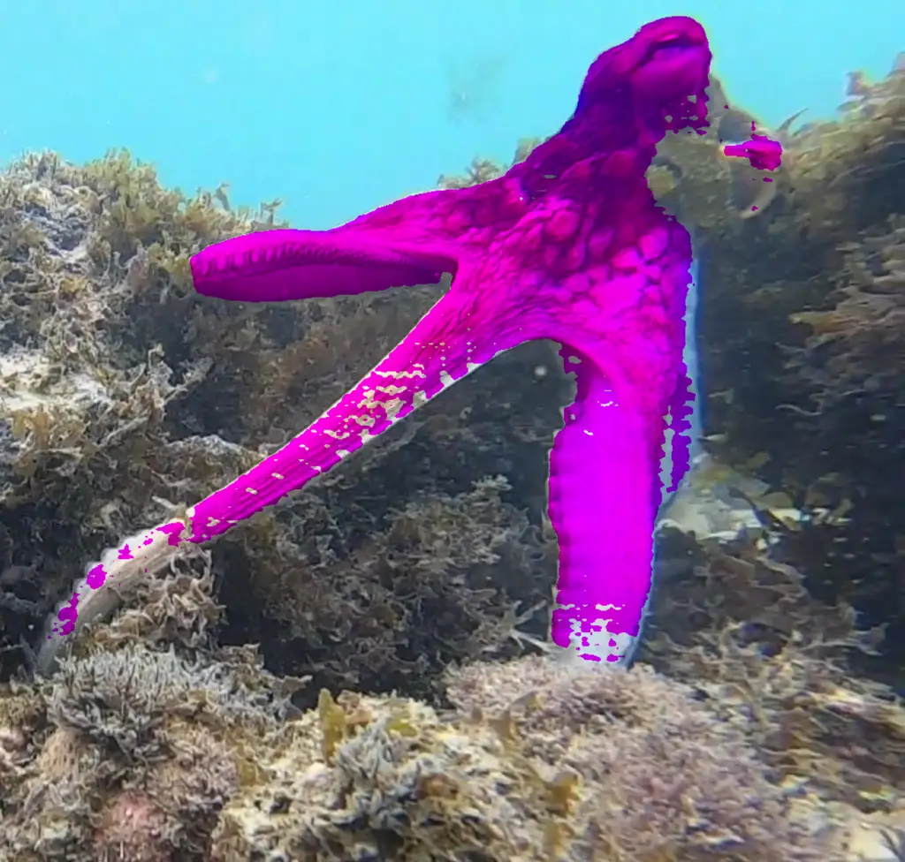

ii Frame $`t+1`$

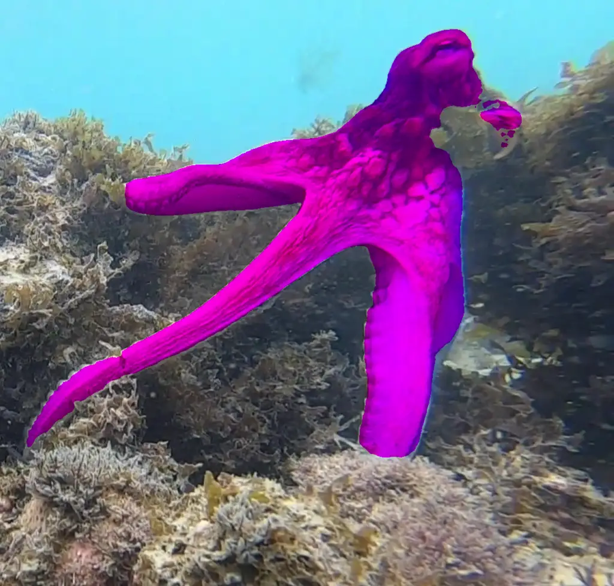

iii Frame $`t+2`$

(B) YOLO output

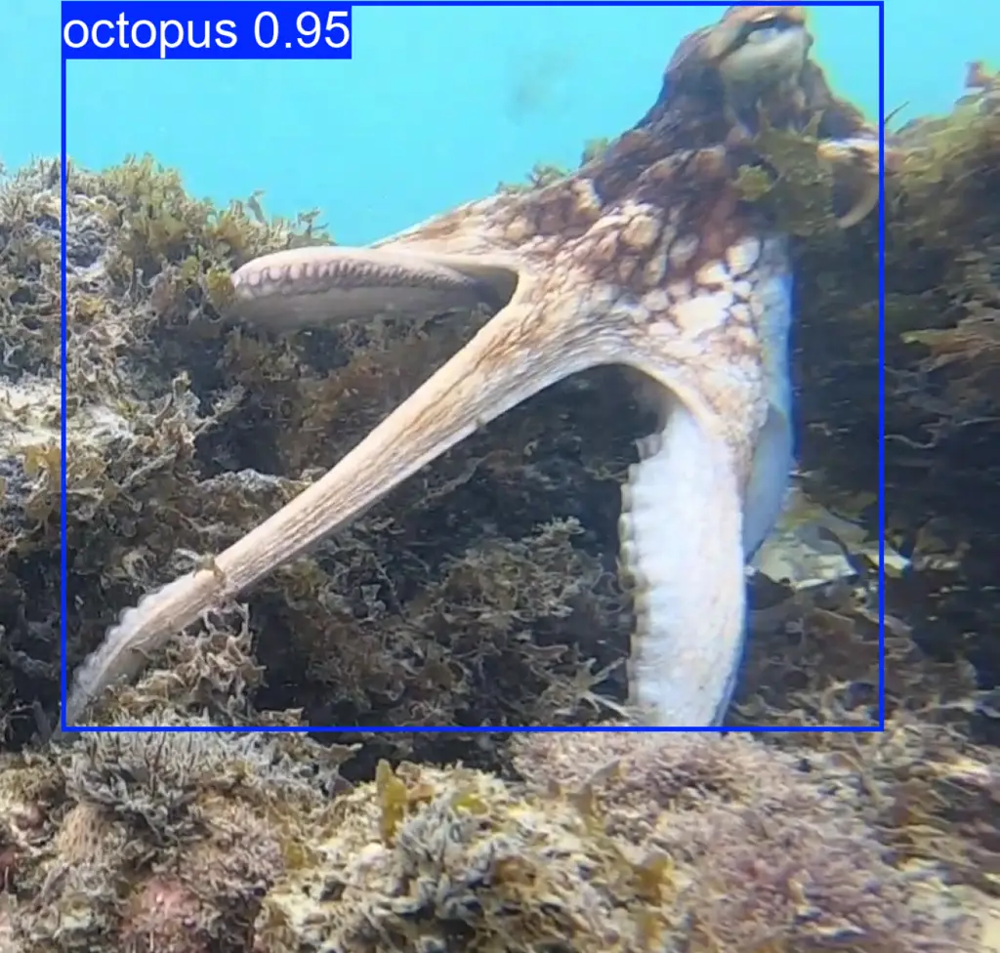

i Frame $`t`$

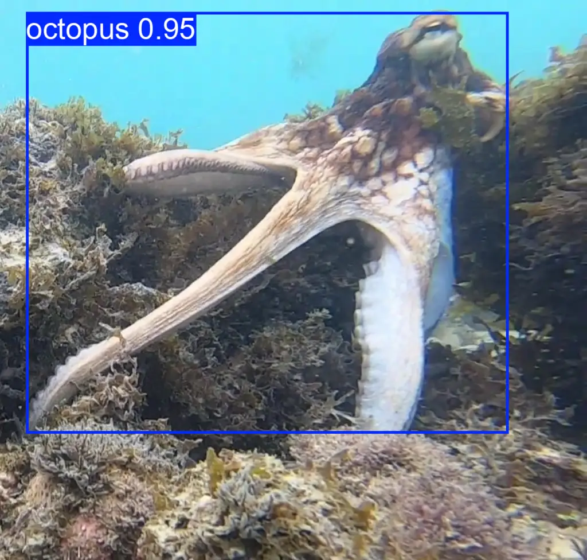

ii Frame $`t+1`$

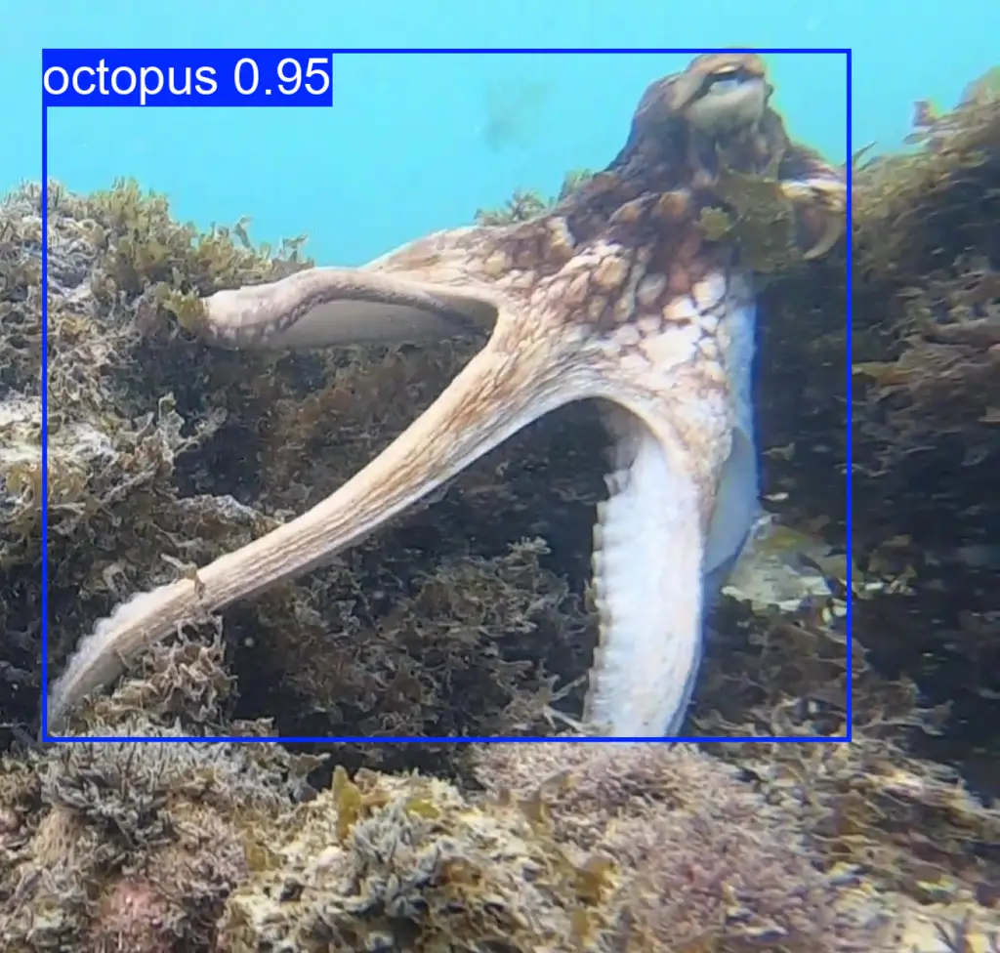

iii Frame $`t+2`$

(C) YOLO + SAM2 output

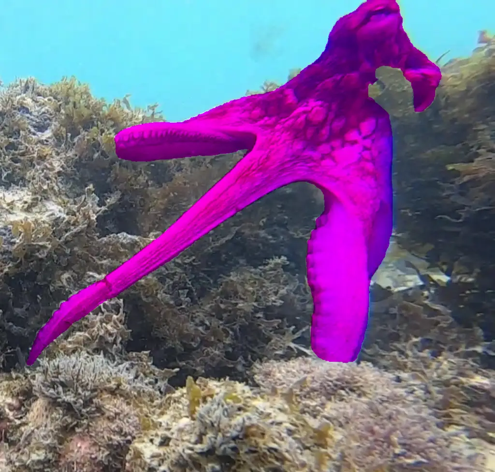

i Frame $`t`$

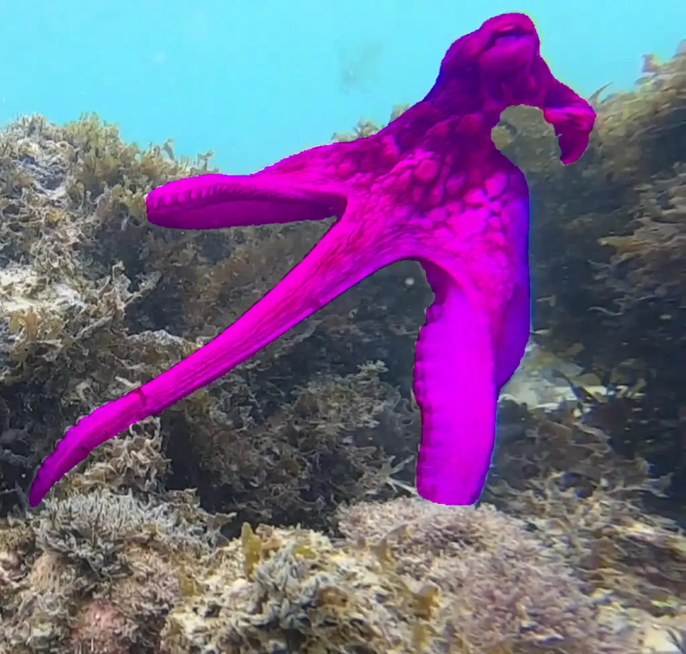

ii Frame $`t+1`$

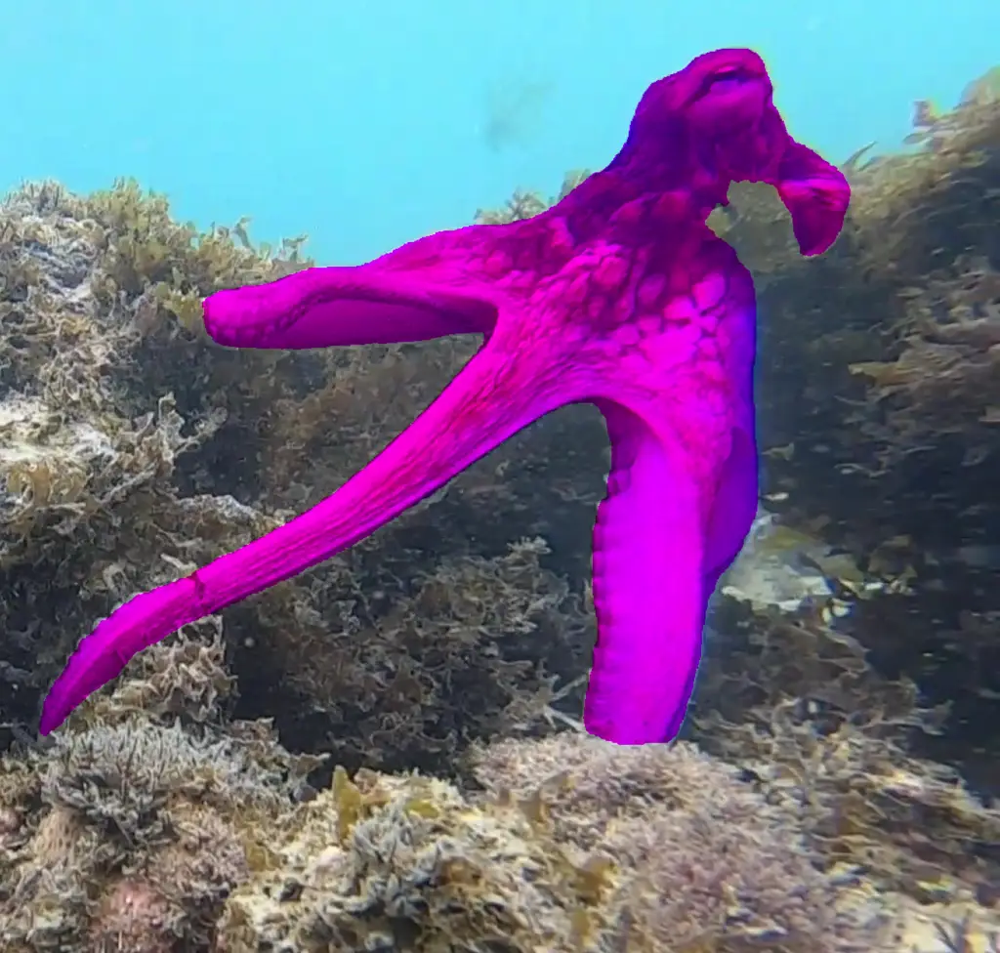

iii Frame $`t+2`$

Figure 3: Example of three consecutive frames on how to use YOLO in
conjunction with SAM2. (A) SAM2 initially fails to recognize the
octopus, producing a noisy, speckled segmentation mask before eventually
generating a coherent result; (B) The specialized YOLO model
successfully detects the octopus from the very first frame; (C) When the
YOLO detections are used as prompts for SAM2, accurate segmentation
masks are produced from the beginning of the sequence. Thus, we infer
that the target object was not abruptly lost during processing; any
degradation likely occurred gradually or along the segmentation
boundaries.

## 3 Results

### 3.1 Initial segmentation results

Table 1 presents the results of HideAndSeg, varying the type of
annotation provided. For the small SAM2 model (SAM2.1*hiera_small), the
best $`NC*{t}`$ metric was achieved when both positive and negative
annotations were given only on the first frame. This configuration
resulted in an average of 4.05 connected components in the regions that
changed between consecutive frames. A lower number reflects a lower
degree of speckling in the segmentation. However, this setup also
produced a high standard deviation of 16.77, indicating significant
instability across the video, with some sections exhibiting sharp spikes
in speckling. When we added annotations to an additional frame, we
observed a deterioration in the average $`NC\_{t}`$ and its standard
deviation, suggesting a limitation of the model in handling increased
volume or complexity of input prompts.

|       |                               | Unsupervised Metrics |                    | Supervised Metrics (first frame) |                      |
| ----- | ----------------------------- | -------------------- | ------------------ | -------------------------------- | -------------------- |
| Model | Input Type                    | Avg $`DICE_{t}`$     | Avg $`NC_{t}`$     | Avg $`DICE`$                     | Avg $`IoU`$          |
| Small | 1st frame, pos. clicks        | $`0.9747\pm 0.0367`$ | $`10.65\pm 30.87`$ | $`0.6057\pm 0.3730`$             | $`0.5330\pm 0.3737`$ |
|       | 1st frame, pos. & neg. clicks | $`0.9671\pm 0.0418`$ | $`4.05\pm 16.77`$  | $`0.7990\pm 0.2615`$             | $`0.7266\pm 0.2862`$ |
|       | \+ additional frame           | $`0.9667\pm 0.0458`$ | $`5.86\pm 52.55`$  | $`0.7990\pm 0.2615`$             | $`0.7266\pm 0.2862`$ |
| Large | 1st frame, pos. clicks        | $`0.9688\pm 0.0418`$ | $`2.97\pm 10.94`$  | $`0.9129\pm 0.1344`$             | $`0.8592\pm 0.1615`$ |
|       | 1st frame, pos. & neg. clicks | $`0.9664\pm 0.0459`$ | $`2.30\pm 3.58`$   | $`0.9405\pm 0.0902`$             | $`0.8965\pm 0.1055`$ |
|       | \+ additional frame           | $`0.9672\pm 0.0402`$ | $`2.17\pm 3.32`$   | $`0.9405\pm 0.0902`$             | $`0.8965\pm 0.1055`$ |

Table 1: Performance of two SAM2 models: small (SAM2.1_hiera_small) and
large (SAM2.1_hiera_large) on Different Input Types.

By switching to the large SAM2 model (SAM2.1*hiera_large), the
segmentation quality increased. Notably, the worst-performing
configuration (only positive annotations in the first frame) already
outperformed the best configuration of the small model. The best
performance for the large model was achieved by including annotations on
one additional frame beyond the first, resulting in an average
$`NC*{t}`$ of 2.17 with a standard deviation of 3.32, indicating both
high segmentation quality and greater temporal stability.

Regarding the $`DICE_{t}`$ metric, all configurations consistently
yielded high scores, averaging 96% to 97%, which suggests that the
segmentation mask area remained stable over time, regardless of the
segmentation method used.

The results obtained for the supervised metrics were consistent with
those observed in the unsupervised ones. Similarly, switching to the
large model led to a notable improvement in segmentation consistency on
the first frame. The high metric values observed in the first frame,
especially with the large model, support the conclusion that SAM2 is
capable of generating stable and high-quality masks throughout the
entire video duration.

### 3.2 Object detection results

The YOLO object detection model, trained using segmentations generated
by the best-performing configuration — SAM2 large with annotations on
two frames, as described in Sec. 3.1 — achieved strong results on the
test set. The model demonstrated excellent performance, with a precision
of 0.958, a recall of 0.968, an mAP@50 of 0.971, and an mAP@50–95 of
0.872. These results demonstrate that the model can effectively handle
the challenging conditions present in the test set, including
camouflage, visual obstructions, and poor water visibility. Figure 4
illustrates one such scenario in which YOLO successfully detects the
octopus despite the surrounding environment obscuring a significant
portion of its body.

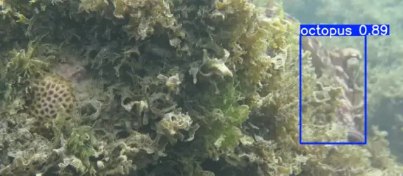

Figure 4: YOLO successfully detects the octopus on the right side of the
image after being trained on a specialized dataset.

### 3.3 Fully automated segmentation results

Table 2 presents the segmentation results on the test set using both
annotation methods from the proposed pipeline. Although the overall
metrics were similar, using YOLO to prompt SAM2 improved the average
$`NC_{t}`$ value. The best performance was observed when using five
annotated frames. As with the results from the initial segmentation, a
saturation point appears to exist when increasing the number of
annotated frames, as a slight decline in performance was observed when
using 10 or 20 frames. The use of YOLO also improved the supervised
segmentation metrics calculated for the first frame of each video,
suggesting that potential errors introduced during the manual annotation
process may have been corrected by the automatic prompting method.

|                 |                     |                      |                  |                                  |                      |
| --------------- | ------------------- | -------------------- | ---------------- | -------------------------------- | -------------------- |
|                 |                     | Unsupervised Metrics |                  | Supervised Metrics (first frame) |                      |
| Annotation Type | Number of annotated |                      |                  |                                  |                      |
| frames          | Avg $`DICE_{t}`$    | Avg $`NC_{t}`$       | Avg $`DICE`$     | Avg $`IoU`$                      |                      |
| Manual          | 2 frames            | $`0.9695\pm 0.0320`$ | $`2.75\pm 3.74`$ | $`0.8997\pm 0.2203`$             | $`0.8582\pm 0.2159`$ |
| YOLO            | 5 frames            | $`0.9709\pm 0.0302`$ | $`2.16\pm 2.23`$ | $`0.9677\pm 0.0191`$             | $`0.9383\pm 0.0349`$ |
|                 | 10 frames           | $`0.9709\pm 0.0289`$ | $`2.23\pm 2.39`$ | $`0.9677\pm 0.0191`$             | $`0.9383\pm 0.0349`$ |
|                 | 20 frames           | $`0.9706\pm 0.0286`$ | $`2.21\pm 2.45`$ | $`0.9677\pm 0.0191`$             | $`0.9383\pm 0.0349`$ |

Table 2: Performance of the proposed pipeline on the test set.

In addition to improving the segmentation metric, incorporating YOLO
offers a significant advantage in the context of octopus segmentation.
The object detection step operates independently on each frame without
relying on temporal consistency. As a result, the octopus can be
detected even if its shape, coloration, or texture differs significantly
from previous appearances. Moreover, since the videos are recorded in
natural underwater environments, occlusions, such as the octopus hiding
behind rocks or other marine animals passing in front of the camera,
frequently occur. In such cases, the octopus may remain out of sight for
extended periods, and upon reappearing, it can look markedly different
from before. This behavior was observed in one of the test set videos,
with detailed results shown in Fig. 5. Using YOLO in this scenario
enabled the segmentation masks to be correctly generated once the
octopus re-emerged. In contrast, SAM2, relying solely on manual
annotations of previous frames, failed to recover, producing empty masks
even after the octopus became visible again.

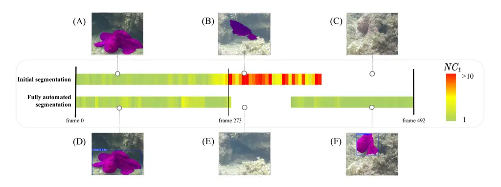

Figure 5: Variation in the $`NC_{t}`$ metric across a test video using
both methods of the proposed pipeline. Initial segmentation: (A)
Initially, the model produces a coherent mask, resulting in a low
$`NC_{t}`$ value; (B) In the central section of the video, the octopus
hides behind rocks. This behavior degrades mask quality as parts of the
surrounding environment begin to be erroneously included; (C) Although
the octopus becomes visible again, the noise introduced earlier prevents
successful recognition, leading to an empty mask. Fully automated
segmentation; (D) Initially, the method produces a coherent mask with
low $`NC_{t}`$; (E) When the octopus hides, YOLO fails to detect it,
resulting in an empty mask; (F) Once the octopus reappears, YOLO
successfully detects it and prompts SAM2 to generate accurate masks
again.

## 4 Discussion

Understanding how animals behave is crucial to conservation biology, and
identifying the behaviors of wild animals has become an essential task
for ecologists and conservation projects. However, quantifying the
behavior of wild animals is quite challenging. This challenge arises
from the substantial amount of work required to analyze the data
collected in non-controlled environments (Schindler et al., 2024). Deep
neural networks have been increasingly used in animal behavior and
ecology studies, as they can automatically analyze images and videos to
track animals’ positions, gazes, and activities, such as hunting or
resting, allowing for the investigation of social behavior, interactions
between individuals, and even the collective behavior of entire species
(Christin et al., 2019). Machine learning (ML) specifically for
investigating marine science issues enables the solution of complex
problems, processing large datasets in less time, and sometimes
achieving better performance than human experts (Beyan and Browman,
2020). In marine environments, ML has already been used to distinguish
and count focal organisms and detect movement of sea turtles, seals,
gannets, and sharks (Dujon et al., 2021; Lalgudi et al., 2025). Since at
least 80% of animal phyla are aquatic (Hickman et al., 2014), there is
ample room for the development and refinement of computational tools
that address the challenges of data analysis in marine environments.

For any automatic classification of wild octopus body patterns or
behaviors, it is necessary, initially, to understand where the octopus
is located in images or video frames and the surrounding environment.
Reiter et al. (Reiter et al., 2018) studied cuttlefish in a laboratory
setting, where the animals swam around the tank. The researchers
recorded the individuals and segmented the chromatophores from the
images, identifying two distinct clusters: ’dark’ and ’light’, which
enabled the development of a tool to track chromatophores in
cephalopods, allowing for studies at cellular resolution. For octopuses,
two studies have already developed tools using ML, one that tracks the
direction of gaze in O. bimaculoides (Taylor, 2020) and another that
quantifies the number of O. tetricus, classifying and extracting them in
images (Schneider, 2020).

The present work represents the first step towards automating the
detection of animal behavior in pre-recorded videos captured in natural
environments. The aim was to develop a tool that would eliminate the
need for lengthy manual labeling and coding, which are prone to errors
and biases. While previous studies have aimed to segment octopuses in
laboratories (Taylor, 2020), we addressed the challenge of segmenting
octopuses in their natural, uncontrolled environments. Another
contribution of this work is the use of unsupervised segmentation
metrics to assess the quality of the results, since there is no large
publicly available ground-truth dataset for octopuses in their natural
habitat. This strategy allows the methodology to be applied to new
datasets without the need for extensive and costly manual annotation.
HideAndSeg is more robust than the YOLO or SAM2 models alone, as it can
address the specific visual challenges of underwater environments: the
octopuses’ ability to camouflage themselves and their non-rigid body
deformations, as well as environmental issues such as turbidity and
occlusion by other organisms or rocks. Using YOLO enables the model to
recover from octopus detection even after prolonged periods of
occlusion.

Although HideAndSeg has achieved notable results, we plan to address
several limitations in future work. For example, we noted some metric
limitations. The $`NC_{t}`$ metric does not account for the completeness
of the segmentation. Consequently, a conservative segmentation model
consistently produces well-defined but partial masks that may still
yield high $`NC_{t}`$ scores, which could hide the true quality of the
segmentation, particularly in cases where significant portions of the
object are omitted. Another challenge will be handling the simultaneous
segmentation of multiple octopuses. Since the identification model does
not perform individual instance association, one option would be to
annotate all octopuses and produce a union of their respective
segmentation masks. Alternatively, the pipeline would require an
additional step to distinguish and label individual instances, ensuring
that annotations target distinct objects.

Qualitative analysis revealed challenges in using bounding box prompts
in SAM2, particularly in identifying regions of the octopus with
markedly different coloration. The funnel, for example, often appears in
a distinct color compared to the rest of the body, and is frequently
excluded from the resulting segmentation mask. This finding suggests
that bounding box prompts may be less effective in capturing the
object’s fine-grained or chromatically diverse regions.

## 5 Conclusion

This work presents HideAndSeg, an AI-based tool for video segmentation
in real-life scenarios where no labeled data is available, requiring
minimal manual annotation effort. To support this, we introduce
unsupervised segmentation metrics that can provide meaningful insights
into mask quality without relying on ground-truth annotations.

We demonstrate the applicability of HideAndSeg to the challenging task
of segmenting octopuses in underwater videos recorded in natural
environments. Our approach successfully handles obstacles such as
dynamic changes in position, visual obstruction, and camouflage. The
results show that the annotation-free pipeline based on YOLO and SAM2
achieves segmentation performance comparable to, or in some cases,
better than that of the method dependent on manual annotations. Notably,
HideAndSeg performs well even in complex scenarios where the target
object remains occluded or absent for a significant portion of the
video.

Future work includes applying the proposed methodology to other datasets
and further specializing the octopus detector to capture specific
behaviors and body patterns. Additionally, there is room for advancing
the unsupervised metrics, particularly by benchmarking them against
traditional segmentation metrics in datasets where ground-truth labels
are available, and also for handling more than a single octopus
simultaneously. As Santos & Gois (Santos and Gois, 2025) note, AI tools
like HideAndSeg can be catalysts for understanding biodiversity. We can
use AI to manage the vast amount of data in biology. Embracing these
technological advancements is crucial for addressing the enormous scope
of questions biologists pose about nature and the future of our
environment.

### Acknowledgment

This work was supported by the Wild Animal Initiative (Grant Number
W-8BEN and SG24-015; MPA), Conselho Nacional de Desenvolvimento
Científico e Tecnológico (CNPq), Brazil (403280/2025 and 304027/2022-7,
CMDS), and Coordenação de Aperfeiçoamento de Pessoal de Nível Superior
(CAPES), Brazil Finance Code 001 (MPA, AG).

## References

- Andrade et al. (2023) M. P. Andrade, C. M. D. Santos, M. M. M. De
  Paiva, S. L. S. Medeiros, C. E. O’Brien, F. D. Lima, J. F. Machado,
  and T. S. Leite Assessing Negative Welfare Measures for Wild
  Invertebrates: The Case for Octopuses. Animals 13 (19), pp. 3021.
  External Links: [Link](https://www.mdpi.com/2076-2615/13/19/3021),
  ISSN 2076-2615, [Document](https://dx.doi.org/10.3390/ani13193021)
  Cited by: §1, §1.
- Beyan and Browman (2020) C. Beyan and H. I. Browman Setting the stage
  for the machine intelligence era in marine science. ICES Journal of
  Marine Science 77 (4), pp. 1267–1273. External Links: ISSN 1054-3139,
  [Document](https://dx.doi.org/10.1093/icesjms/fsaa084),
  [Link](https://doi.org/10.1093/icesjms/fsaa084),
  https://academic.oup.com/icesjms/article-pdf/77/4/1267/33513046/fsaa084.pdf
  Cited by: §4.
- Carion et al. (2020) N. Carion, F. Massa, G. Synnaeve, N. Usunier, A.
  Kirillov, and S. Zagoruyko End-to-End Object Detection with
  Transformers. In Computer Vision – ECCV 2020, A. Vedaldi, H.
  Bischof, T. Brox, and J. Frahm (Eds.), Cham, pp. 213–229. External
  Links: [Document](https://dx.doi.org/10.1007/978-3-030-58452-8%5F13),
  ISBN 978-3-030-58452-8 Cited by: §2.2.
- Chen et al. (2024) L. Chen, G. Li, S. Zhang, W. Mao, and M. Zhang
  YOLO-SAG: An improved wildlife object detection algorithm based on
  YOLOv8n. Ecological Informatics 83, pp. 102791. External Links: ISSN
  1574-9541,
  [Document](https://dx.doi.org/https%3A//doi.org/10.1016/j.ecoinf.2024.102791),
  [Link](https://www.sciencedirect.com/science/article/pii/S1574954124003339)
  Cited by: §1.
- Christin et al. (2019) S. Christin, É. Hervet, and N. Lecomte
  Applications for deep learning in ecology. Methods in Ecology and
  Evolution 10 (10), pp. 1632–1644. External Links:
  [Document](https://dx.doi.org/https%3A//doi.org/10.1111/2041-210X.13256),
  [Link](https://besjournals.onlinelibrary.wiley.com/doi/abs/10.1111/2041-210X.13256),
  https://besjournals.onlinelibrary.wiley.com/doi/pdf/10.1111/2041-210X.13256
  Cited by: §4.
- Côrtes et al. (2025) M. O. Côrtes, B. B. d. Santos, R. H. A. d.
  Freitas, C. E. O’Brien, and T. S. Leite Review of the ecological
  aspects of sympatric species Octopus americanus and Octopus insularis
  (Cephalopoda: Octopodidae) in the Western Atlantic. Current Zoology,
  pp. zoaf023. External Links: ISSN 2396-9814,
  [Document](https://dx.doi.org/10.1093/cz/zoaf023),
  [Link](https://doi.org/10.1093/cz/zoaf023),
  https://academic.oup.com/cz/advance-article-pdf/doi/10.1093/cz/zoaf023/63215720/zoaf023.pdf
  Cited by: §2.1.
- Dujon et al. (2021) A. M. Dujon, D. Ierodiaconou, J. J.
  Geeson, J. P. Y. Arnould, B. M. Allan, K. A. Katselidis, and G.
  Schofield Machine learning to detect marine animals in UAV imagery:
  effect of morphology, spacing, behaviour and habitat. Remote Sensing
  in Ecology and Conservation 7 (3), pp. 341–354. External Links:
  [Document](https://dx.doi.org/https%3A//doi.org/10.1002/rse2.205),
  [Link](https://zslpublications.onlinelibrary.wiley.com/doi/abs/10.1002/rse2.205),
  https://zslpublications.onlinelibrary.wiley.com/doi/pdf/10.1002/rse2.205
  Cited by: §4.
- Flash and Zullo (2023) T. Flash and L. Zullo Biomechanics, motor
  control and dynamic models of the soft limbs of the octopus and other
  cephalopods. Journal of Experimental Biology 226 (Suppl_1),
  pp. jeb245295. External Links: ISSN 0022-0949,
  [Document](https://dx.doi.org/10.1242/jeb.245295),
  [Link](https://doi.org/10.1242/jeb.245295),
  https://journals.biologists.com/jeb/article-pdf/226/Suppl_1/jeb245295/2793398/jeb245295.pdf
  Cited by: §1.
- Hickman et al. (2014) C. Hickman, L. Roberts, S. Keen, A. Larson,
  and D. Eisenhour Animal Diversity. 7th edition, McGraw-Hill, NY. Cited
  by: §4.
- Ikeda (2021) Y. Ikeda Color Change in Cephalopods. In Pigments,
  Pigment Cells and Pigment Patterns, H. Hashimoto, M. Goda, R.
  Futahashi, R. Kelsh, and T. Akiyama (Eds.), pp. 425–449. External
  Links: ISBN 978-981-16-1490-3,
  [Document](https://dx.doi.org/10.1007/978-981-16-1490-3%5F14),
  [Link](https://doi.org/10.1007/978-981-16-1490-3%5C_14) Cited by: §1,
  §1, §1.
- Khanam and Hussain (2024) R. Khanam and M. Hussain YOLOv11: An
  Overview of the Key Architectural Enhancements. External Links:
  2410.17725, [Link](https://arxiv.org/abs/2410.17725) Cited by: §2.2.
- Kirillov et al. (2023) A. Kirillov, E. Mintun, N. Ravi, H. Mao, C.
  Rolland, L. Gustafson, T. Xiao, S. Whitehead, A. C. Berg, W. Lo, P.
  Dollár, and R. Girshick Segment Anything. External Links: 2304.02643,
  [Link](https://arxiv.org/abs/2304.02643) Cited by: §2.2.
- Lalgudi et al. (2025) C. K. Lalgudi, M. E. Leone, J. V. Clark, S.
  Madrigal-Mora, and M. Espinoza Zero-shot shark tracking and biometrics
  from aerial imagery. Methods in Ecology and Evolution 16 (9),
  pp. 2023–2035. External Links:
  [Document](https://dx.doi.org/https%3A//doi.org/10.1111/2041-210X.70116),
  [Link](https://besjournals.onlinelibrary.wiley.com/doi/abs/10.1111/2041-210X.70116),
  https://besjournals.onlinelibrary.wiley.com/doi/pdf/10.1111/2041-210X.70116
  Cited by: §1, §1, §2.2, §4.
- Messenger (2001) John. B. Messenger Cephalopod chromatophores:
  neurobiology and natural history. Biological Reviews 76 (4),
  pp. 473–528. External Links:
  [Document](https://dx.doi.org/https%3A//doi.org/10.1017/S1464793101005772),
  [Link](https://onlinelibrary.wiley.com/doi/abs/10.1017/S1464793101005772),
  https://onlinelibrary.wiley.com/doi/pdf/10.1017/S1464793101005772
  Cited by: §1.
- O’brien et al. (2021) C. E. O’brien, C. O. Bennice, and T. Leite A
  field guide to distinguishing Octopus insularis and Octopus americanus
  (Octopoda: Octopodidae). Zootaxa 5060 (4), pp. 589–594. External
  Links: [Link](https://mapress.com/zt/article/view/zootaxa.5060.4.8),
  [Document](https://dx.doi.org/10.11646/zootaxa.5060.4.8) Cited by:
  §2.1.
- Ravi et al. (2024) N. Ravi, V. Gabeur, Y. Hu, R. Hu, C. Ryali, T.
  Ma, H. Khedr, R. Rädle, C. Rolland, L. Gustafson, E. Mintun, J.
  Pan, K. V. Alwala, N. Carion, C. Wu, R. Girshick, P. Dollár, and C.
  Feichtenhofer SAM 2: Segment Anything in Images and Videos. External
  Links: 2408.00714, [Link](https://arxiv.org/abs/2408.00714) Cited by:
  §1, §2.2.
- Redmon et al. (2016) J. Redmon, S. Divvala, R. Girshick, and A.
  Farhadi You Only Look Once: Unified, Real-Time Object Detection. In
  2016 IEEE Conference on Computer Vision and Pattern Recognition
  (CVPR), Vol. , Los Alamitos, CA, USA, pp. 779–788. External Links:
  ISSN 1063-6919, [Document](https://dx.doi.org/10.1109/CVPR.2016.91),
  [Link](https://doi.ieeecomputersociety.org/10.1109/CVPR.2016.91) Cited
  by: §2.2, §2.2.
- Reiter et al. (2018) S. Reiter, P. Hülsdunk, T. Woo, M. A.
  Lauterbach, J. S. Eberle, L. A. Akay, A. Longo, J. Meier-Credo, F.
  Kretschmer, J. D. Langer, M. Kaschube, and G. Laurent Elucidating the
  control and development of skin patterning in cuttlefish. Nature 562
  (7727), pp. 361–366. External Links:
  [Document](https://dx.doi.org/10.1038/s41586-018-0591-3) Cited by: §4.
- Roy et al. (2023) A. M. Roy, J. Bhaduri, T. Kumar, and K. Raj
  WilDect-YOLO: An efficient and robust computer vision-based accurate
  object localization model for automated endangered wildlife detection.
  Ecological Informatics 75, pp. 101919. External Links: ISSN 1574-9541,
  [Document](https://dx.doi.org/https%3A//doi.org/10.1016/j.ecoinf.2022.101919),
  [Link](https://www.sciencedirect.com/science/article/pii/S1574954122003697)
  Cited by: §1.
- Santos and Gois (2025) C. M. D. Santos and J. P. Gois Artificial
  Intelligence as catalyst for biodiversity understanding.
  Communications of the ACM 68 (3), pp. 27–29. External Links:
  [Document](https://dx.doi.org/10.1145/3701570) Cited by: §5.
- Schindler et al. (2024) F. Schindler, V. Steinhage, S. T. S. van Beeck
  Calkoen, and M. Heurich Action Detection for Wildlife Monitoring with
  Camera Traps Based on Segmentation with Filtering of Tracklets (SWIFT)
  and Mask-Guided Action Recognition (MAROON). Applied Sciences 14 (2).
  External Links: [Link](https://www.mdpi.com/2076-3417/14/2/514), ISSN
  2076-3417, [Document](https://dx.doi.org/10.3390/app14020514) Cited
  by: §4.
- Schneider (2020) S. Schneider Deep Learning Based Computer Vision for
  Animal Re-Identification. Ph.D. Thesis, University of Guelph. External
  Links:
  [Link](https://atrium.lib.uoguelph.ca/items/814db23b-c6a0-48c7-91fb-1ec578c09bd8)
  Cited by: §4.
- Schnell et al. (2021) A. K. Schnell, P. Amodio, M. Boeckle, and N. S.
  Clayton How intelligent is a cephalopod? Lessons from comparative
  cognition. Biological Reviews 96 (1), pp. 162–178. External Links:
  [Document](https://dx.doi.org/https%3A//doi.org/10.1111/brv.12651),
  [Link](https://onlinelibrary.wiley.com/doi/abs/10.1111/brv.12651),
  https://onlinelibrary.wiley.com/doi/pdf/10.1111/brv.12651 Cited by:
  §1.
- Shook et al. (2024) E. N. Shook, G. T. Barlow, D.
  Garcia-Rosales, C. J. Gibbons, and T. G. Montague Dynamic skin
  behaviors in cephalopods. Current Opinion in Neurobiology 86,
  pp. 102876. External Links: ISSN 0959-4388,
  [Document](https://dx.doi.org/https%3A//doi.org/10.1016/j.conb.2024.102876),
  [Link](https://www.sciencedirect.com/science/article/pii/S0959438824000382)
  Cited by: §1.
- Taylor (2020) M. A. Taylor Autonomous eye tracking in Octopus
  bimaculoides. Note: Senior Thesis, Dartmouth College External Links:
  [Link](https://digitalcommons.dartmouth.edu/senior%5C_theses/151/)
  Cited by: §4, §4.
- Thomas et al. (2025) S. Thomas, E. George, A. Francis, A. Job,
  and A. M. James Wildlife detection and recognition using YOLO V8.
  International Journal on Emerging Research Areas 4 (2), pp. 81–87.
  External Links: [Document](https://dx.doi.org/10.5281/zenodo.14714518)
  Cited by: §2.2.
- van der Walt et al. (2014) S. van der Walt, J. L. Schönberger, J.
  Nunez-Iglesias, F. Boulogne, J. D. Warner, N. Yager, E. Gouillart, T.
  Yu, and the scikit-image contributors scikit-image: image processing
  in Python. PeerJ 2, pp. e453. External Links:
  [Document](https://dx.doi.org/10.7717/peerj.453) Cited by: §2.4.
- Vijayalakshmi Mohankumar (2024) S. A. Vijayalakshmi Mohankumar A
  comprehensive review on deep learning architecture for pre-processing
  of underwater images. SN Computer Science 5 (472). External Links:
  [Document](https://dx.doi.org/10.1007/s42979-024-02847-9) Cited by:
  §1, §1.
- Yu et al. (2025) M. Yu, Z. Xie, Y. Ye, and C. Shi TMAE-YOLO: precision
  detection of mud crabs in underwater environments. Aquaculture
  International 33 (6), pp. 462. External Links: ISSN 1573-143X,
  [Link](https://doi.org/10.1007/s10499-025-02149-8),
  [Document](https://dx.doi.org/10.1007/s10499-025-02149-8) Cited by:
  §2.2.
- Zheng et al. (2024) T. Zheng, J. Wu, H. Kong, H. Zhao, B. Qu, L.
  Liu, H. Yu, and C. Zhou A video object segmentation-based fish
  individual recognition method for underwater complex environments.
  Ecological Informatics 82, pp. 102689. External Links: ISSN 1574-9541,
  [Document](https://dx.doi.org/https%3A//doi.org/10.1016/j.ecoinf.2024.102689),
  [Link](https://www.sciencedirect.com/science/article/pii/S1574954124002310)
  Cited by: §2.2.
