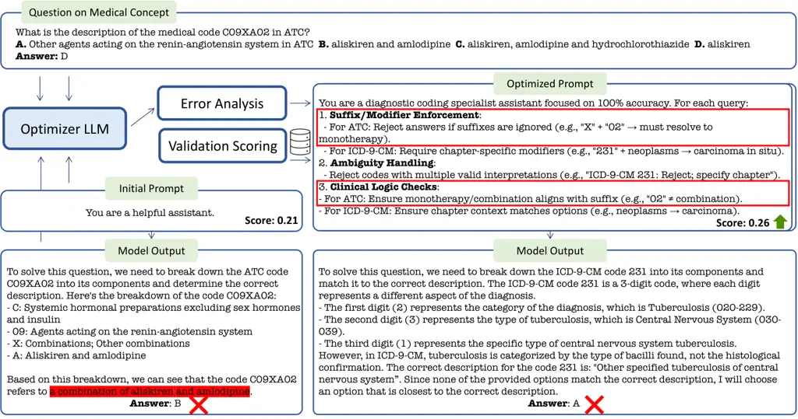
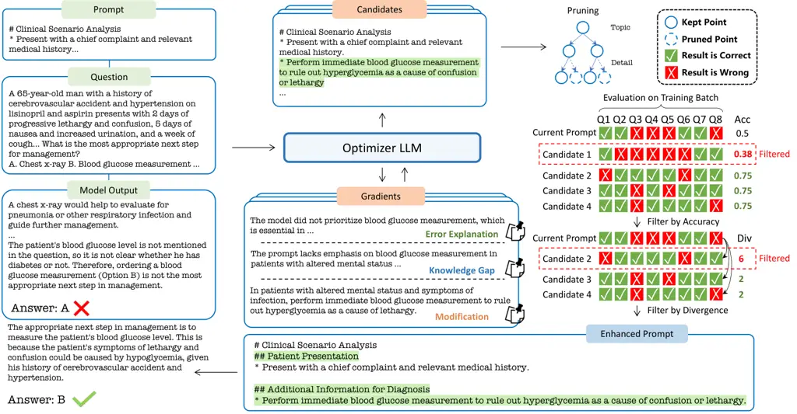
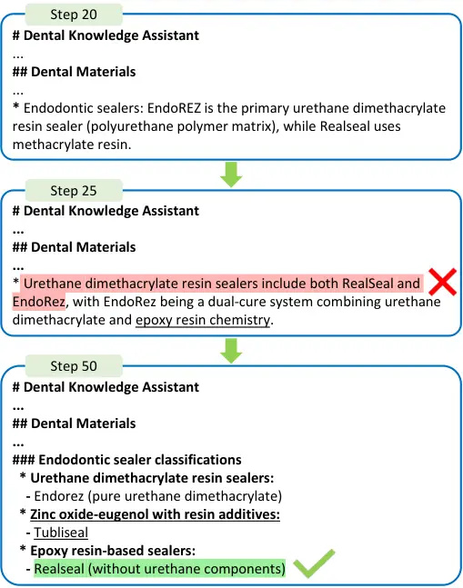
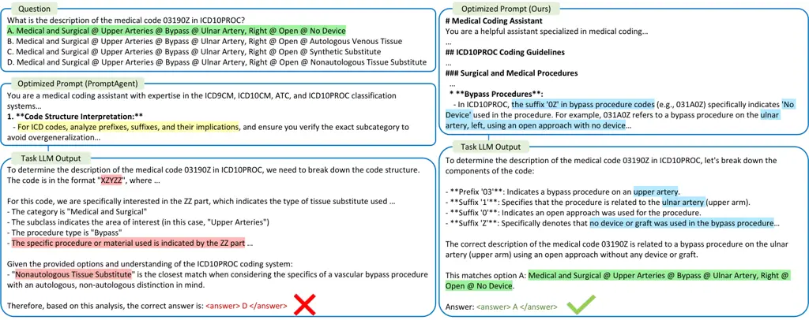

# Beyond Elicitation: Provision-based Prompt Optimization for Knowledge-Intensive Tasks

Yunzhe Xu    Zhuosheng Zhang    Zhe Liu ^(†)^(†)thanks: This paper was
supported by the National Natural Science Foundation of China under
Grant 62303307, and in part by the National Key Laboratory of Human
Machine Hybrid Augmented Intelligence, Xi’an Jiaotong University (No.
HMHAI-202408). (Corresponding author: Zhe Liu.)^(†)^(†)thanks: Yunzhe Xu
is with the School of Computer Science, Shanghai Jiao Tong University,
Shanghai 200240, China (e-mail: xyz9911@sjtu.edu.cn). Zhuosheng Zhang is
with the School of Computer Science, Shanghai Jiao Tong University,
Shanghai 200240, China (e-mail: zhangzs@sjtu.edu.cn). Zhe Liu is with
the School of Automation and Intelligent Sensing, Shanghai Jiao Tong
University, Shanghai 200240, China. Zhe Liu is also with the National
Key Laboratory of Human-Machine Hybrid Augmented Intelligence, Institute
of Artificial Intelligence and Robotics, Xi’an Jiaotong University,
Xi’an 710049, China. (e-mail: liuzhesjtu@sjtu.edu.cn).^(†)^(†)thanks:
Code is available at
[https://github.com/xyz9911/KPPO](https://github.com/xyz9911/KPPO).

###### Abstract

While prompt optimization has emerged as a critical technique for
enhancing language model performance, existing approaches primarily
focus on elicitation-based strategies that search for optimal prompts to
activate models’ capabilities. These methods exhibit fundamental
limitations when addressing knowledge-intensive tasks, as they operate
within static knowledge capacity rather than providing the factual
knowledge, terminology precision, and reasoning patterns required in
specialized domains. To address these limitations, we propose
Knowledge-Provision-based Prompt Optimization (KPPO), a framework that
reformulates prompt optimization as systematic knowledge integration
rather than potential elicitation. KPPO introduces three key
innovations: 1) a knowledge gap filling mechanism for knowledge gap
identification and targeted remediation; 2) a batch-wise candidate
evaluation approach that considers both performance improvement and
distributional stability; 3) an adaptive knowledge pruning strategy that
balances performance and token efficiency, reducing up to 29% of
inference token usage. Evaluation on 15 knowledge-intensive benchmarks
from various domains demonstrates KPPO’s superiority over
elicitation-based methods, with an average improvement of ~6% over
baselines while achieving comparable or lower token consumption.

###### Index Terms: 

Prompt optimization, large language models, natural language processing

## I Introduction

Large Language Models (LLMs) have achieved unprecedented performance
\[1\] across diverse natural language processing tasks through
sophisticated prompt engineering techniques \[2\]. The field has evolved
from manual prompt design approaches \[3, 4\] to automated optimization
frameworks \[5, 6, 7, 8\], where optimizer LLMs iteratively refine
prompts to maximize task performance. These automated approaches,
collectively termed elicitation-based optimization, operate under the
fundamental assumption that optimal prompts can unlock latent
capabilities within pre-trained model parameters through strategic
reformulation of instructions, exemplars, or reasoning templates.
However, elicitation-based optimization encounters fundamental
limitations when applied to knowledge-intensive domains that require
specialized expertise beyond the model’s parametric knowledge. Consider
tasks in specialized scientific domains, emerging technologies, or
domain-specific applications where factual accuracy, terminology
precision, and specialized reasoning patterns are paramount, the
assumption that optimal prompts can elicit non-existent knowledge
becomes untenable.

Fig. 1: Analysis of prompt optimization on 15 knowledge-intensive tasks
from various domains. Traditional elicitation-based methods achieve
marginal or even negative improvements, while KPPO demonstrates
substantial improvements (average +6%) while achieving comparable or
enhanced efficiency.



Fig. 2: Visualization of the failure of elicitation-based prompt
optimization to fill LLM’s knowledge gap in specific domains. Despite
achieving improved accuracy on the validation split, the optimized
prompt fails to provide sufficient domain knowledge, resulting in
continued errors on the original failure cases. The optimized prompts
capture surface-level patterns rather than providing the substantive
domain knowledge required to resolve the failure cases.

We analyze the performance of traditional methods across 15
knowledge-intensive question-answering benchmarks spanning multiple
domains. As demonstrated in Figure 1, traditional methods achieve
marginal or even negative improvements when a clear task instruction is
provided. Figure 2 reveals that elicitation-based optimization fails to
address underlying knowledge gaps, instead producing shallow
improvements that do not resolve the fundamental knowledge deficiencies.
Our systematic analysis of this phenomenon reveals two critical
deficiencies: 1) Knowledge Poverty: optimized prompts lack sufficient
domain-specific information to address knowledge gaps, instead focusing
on superficial reformulations that fail to provide substantive content. 2) Optimization Ineffectiveness: even when prompts incorporate relevant
information, the optimization process lacks effective validation
mechanisms to ensure the knowledge gap is mitigated.

To address these fundamental deficiencies, we must shift from
elicitation to provision by directly integrating domain-specific
knowledge rather than attempting to activate non-existent parametric
knowledge. However, this introduces three challenges: How can we
identify missing domain knowledge and generate targeted prompts to fill
these gaps? How can we ensure selected prompts reliably address
knowledge gaps rather than achieving spurious validation scores? How can
we balance comprehensive knowledge provision with token efficiency
constraints as knowledge accumulates iteratively?

We propose Knowledge-Provision-based Prompt Optimization (KPPO), a
principled framework that addresses these challenges through three
corresponding innovations. Rather than attempting to elicit non-existent
knowledge through linguistic manipulation, KPPO explicitly provides the
factual content, terminology, and reasoning patterns required for task
success. First, an analysis framework examines failure cases to identify
specific knowledge deficiencies and generates candidate prompts
incorporating targeted domain content. Second, we introduce batch-wise
dual-objective evaluation that jointly optimizes for performance
improvement on recent failures and distributional stability, inspired by
trust region methods \[9\]. Third, we design an adaptive pruning
mechanism that identifies structural inefficiencies through local degree
and global balance constraints, maintaining essential domain information
while reducing inference token consumption.

Evaluation across 15 knowledge-intensive benchmarks demonstrates KPPO’s
effectiveness. Our method achieves average improvements of 6.1% and 6.0%
on Llama 3.1 \[10\] and Qwen 2.5 \[11\] respectively. Notably, the
pruning variant significantly reduces token usage by up to 29% while
outperforming baselines. These results establish a new direction for
prompt optimization research, extending beyond the knowledge capacity of
pre-trained models to systematically incorporate external knowledge.
This innovation has significant implications for deploying LLMs in
specialized domains where tuning approaches are computationally
prohibitive or data-limited. The contributions of this work are
threefold:

- •
  We propose KPPO, a framework that systematically integrates
  domain-specific knowledge into prompts, achieving significant
  improvements across knowledge-intensive tasks spanning various
  domains.
- •
  The technical innovations include: knowledge gap filling with targeted
  gap identification, dual-objective batch-wise evaluation ensuring both
  performance gains and optimization robustness, and adaptive pruning
  that maintains effectiveness while reducing inference token
  consumption.
- •
  We establish provision-based optimization as a viable paradigm for
  knowledge-intensive applications, addressing knowledge poverty and
  optimization ineffectiveness and providing an alternative for
  domain-specific tasks.

## II Related Work

### II-A Prompt Optimization

Prompt engineering has emerged as a critical technique for enhancing LLM
performance, with research spanning multiple optimization dimensions
including prompt design \[3, 4\], exemplar selection \[12, 13\], and
exemplar ordering \[14\]. Early approaches relied on manual prompt
crafting \[15\], but recent work has shifted toward automated
optimization to reduce engineering effort. One direction focuses on
test-time prompt modification \[16, 17, 18, 19\], which refines user
inputs to improve task understanding, either through auxiliary
models \[20, 21, 22\] trained for prompt rewriting or through direct
optimization. In contrast, automatic prompt optimization operates
without auxiliary models during inference, employing only an optimizer
LLM \[23, 6, 24, 25\] for iterative prompt refinement, offering greater
practical efficiency. Current approaches primarily focus on
comprehensive search algorithms, employing beam search \[5, 25\], Monte
Carlo tree search \[7\], and evolutionary algorithms \[26, 27\] to
generate diverse mutations \[28, 29\] with bandit-based selection on
validation sets \[30\]. These methods collectively constitute
elicitation-based optimization, seeking optimal prompts to unlock latent
model capabilities. Recent extensions have broadened the scope to
multi-turn scenarios \[31\], label-free optimization \[32\],
exemplar-focused refinement \[33, 34, 35\], and advanced techniques
incorporating multi-agent learning \[36\], meta-learning \[37\], and
probabilistic optimization \[38\]. While these approaches effectively
improve prompt quality through strategic reformulation, they
fundamentally operate within static knowledge capacity by seeking to
elicit latent capabilities rather than augmenting the model’s knowledge
base with external domain expertise. Our work diverges from this
elicitation paradigm by systematically integrating domain-specific
knowledge.

### II-B Self-Evolution in Large Language Models

LLMs have demonstrated potential for self-improvement through mechanisms
that identify and rectify errors without external supervision \[39,
40\]. Initial approaches focus on single-turn refinement through
self-reflection techniques \[41, 42\], where models analyze their own
reasoning traces to detect inconsistencies and improve response quality.
This verification process can be augmented by invoking external
tools \[43, 44\] to ensure factual consistency and logical coherence.
More recent work extends self-evolution to multi-turn scenarios,
learning from direct environmental feedback \[45, 46\] to iteratively
improve task performance through experience accumulation and reflection
in sequential decision-making contexts for language agents.
TextGrad \[8\] bridges self-evolution with prompt optimization by
enabling textual gradients derived from self-reflection to backpropagate
through prompts. However, when models lack domain-specific knowledge,
self-reflection mechanisms cannot bridge this gap. In contrast, our
approach directly addresses knowledge gaps by systematically integrating
external domain content into prompts, transcending the knowledge
boundaries that constrain self-evolution methods. While self-evolution
improves how models use existing knowledge, KPPO expands what knowledge
is available to the model during inference.

## III Pilot Experiments

This section provides diagnoses for elicitation-based prompt
optimization that motivates our approach.

Fig. 3: Analysis of key points within the optimized prompt and learning
gain across knowledge-intensive tasks.

### III-A Problem Formulation

Given a dataset $`\mathcal{D}=\{(x_{i},y_{i})\}_{i=1}^{N}`$ where each
instance $`(x_{i},y_{i})`$ represents an input-output pair requiring
specialized domain knowledge, we define a system prompt $`p`$ as a
structured natural language construct containing both domain-specific
knowledge and procedural guidance for task execution. The inference
process combines the prompt $`p`$, task input $`x`$, and standardized
task instruction $`\ell`$ to produce a prediction
$`\hat{y}=\text{LLM}_{\text{task}}(p,x,\ell)`$ from the target language
model. The optimization objective seeks to identify the optimal prompt
$`p^{*}`$ that maximizes expected task performance:

```math
\displaystyle p^{*} \displaystyle=\argmax_{p}\mathbb{E}_{(x,y)\sim\mathcal{D}}[f(p,x,y)], \tag{1}
```

```math
\displaystyle f(p,x,y) \displaystyle=\begin{cases}1,&\text{if}\ \text{LLM}_{task}(p,x,\ell)=y\\
0,&\text{otherwise},\end{cases}
```

where $`f(\cdot)`$ evaluates prediction correctness.

### III-B Analysis of Elicitation-based Methods

We evaluate three representative prompt optimization methods: OPRO
\[6\], APO \[5\], and PromptAgent \[7\] on Llama 3.1 and Qwen 2.5. For
each optimized prompt, we employ DeepSeek-V3 \[47\] as an evaluator to
identify and quantify domain-specific key points through prompt
analysis. We introduce the learning gain metric to quantify optimization
effectiveness, capturing the model’s ability to resolve previously
failed cases through knowledge acquisition:

```math
\frac{1}{|P|}\sum_{i=1}^{|P|}\frac{1}{|\mathcal{B}_{i}|}\sum_{(x,y)\in\mathcal{B}_{i}}[f(p_{i},x,y)-f(p_{i-1},x,y)], \tag{2}
```

where $`P`$ represents the optimization trajectory and
$`\mathcal{B}_{i}`$ is the training batch for step $`i`$. Figure 3
presents our empirical findings, revealing two critical deficiencies in
current approaches:

1. Knowledge Poverty: All evaluated methods demonstrate remarkably low
   key points counts (\<15), indicating optimization is not focusing on
   substantive knowledge integration.

2. Optimization Ineffectiveness: Learning gains remain substantially low
   (\<20%) across all methods, revealing that existing methods lack
   effective mechanisms to ensure that knowledge gaps have been effectively
   addressed. Prompts may achieve improved validation accuracy through
   pattern matching while failing to resolve underlying knowledge
   deficiencies.

These findings motivate our approach, which transcends elicitation-based
limitations through systematic knowledge integration that directly fills
knowledge gaps and improves optimization effectiveness.



Fig. 4: Overview of KPPO. Given task mistakes, the optimizer LLM
generates “gradients” by analyzing the original prompt’s limitations,
producing explanations of failures, identifying knowledge gaps, and
suggesting targeted modifications. The framework then integrates these
gradients to generate candidate prompts, which undergo an alternative
pruning procedure to avoid over-lengthened prompts. Prompt candidates
are filtered with a batch-wise dual-objective evaluation that jointly
considers performance improvement on recent training instances and
distribution stability to ensure robust knowledge integration.

## IV Method

### Overview

KPPO addresses the limitations of elicitation-based approaches by
integrating domain-specific knowledge into prompt structures. As
illustrated in Figure 4, KPPO employs an optimizer LLM
($`\text{LLM}_{opt}`$) to iteratively enhance prompts through targeted
knowledge provision. The framework maintains a beam of optimized prompts
$`\mathcal{C}`$ that are refined based on failure case analysis. At each
iteration $`t`$, the system samples a batch $`\mathcal{B}_{t}`$ from the
dataset, identifies failure cases $`\mathcal{E}_{t}`$, and generates
improved prompts through analysis and candidate filtering. The
optimization process is detailed in Algorithm 1.

Input :  Initial prompt $`p_{0}`$, Training set $`\mathcal{D}_{train}`$,
Window size $`K`$, Iteration limit $`T`$, Validation set
$`\mathcal{D}_{val}`$, New prompts per step $`M`$

Output : Optimized knowledge prompt $`p^{*}`$

1 Initialize beam $`C\leftarrow\{p_{0}\}`$ and bank
$`\mathcal{Q}\leftarrow\emptyset`$

2 for _step $`t=1`$ to $`T`$_ do

     3 Initialize candidate set $`cand\leftarrow\emptyset`$

     4 Sample batch $`\mathcal{B}_{t}\subset\mathcal{D}_{train}`$

     5 Update instance bank:
$`\mathcal{Q}\leftarrow\mathcal{Q}\cup\mathcal{B}_{t}`$

     6 Get $`K`$ recent instances:
$`\mathcal{Q}_{K}\leftarrow\{q_{i}\in\mathcal{Q}:i>|\mathcal{Q}|-K\}`$

     7 Get failure cases:
$`\mathcal{E}\leftarrow\{(x,y)\in\mathcal{B}_{t}:f(p,x,y)=0\}`$

     8 for _$`p\in C`$_ do

         9 $`cand\leftarrow cand\cup\{(p,p)\}`$

         10 $`issues\leftarrow\emptyset`$

         11 if _pruning_ then

             12 $`issues\leftarrow\text{ViolationDetect}(p)`$
$`\triangleright`$ Algorithm 3

         13 for _$`i=1`$ to $`M`$_ do

             14 Generate gradients:
$`g_{i}\leftarrow\text{LLM}_{opt}(p,\mathcal{E})`$

             15 Generate candidate:
$`p^{\prime}_{i}\leftarrow\text{LLM}_{opt}(p,\mathcal{E},g_{i},issues)`$

             16 $`cand\leftarrow cand\cup\{(p^{\prime}_{i},p)\}`$

     17 $`C\leftarrow\text{CandidateEvaluate}(cand,\mathcal{Q}_{K})`$
$`\triangleright`$ Algorithm 2

18 return
$`\argmax_{p\in C}\mathbb{E}_{(x,y)\sim\mathcal{D}_{val}}[f(p,x,y)]`$

Algorithm 1 KPPO

### IV-A Knowledge Gap Filling

Our approach identifies knowledge deficiencies that cause prediction
errors, moving beyond surface-level pattern recognition to address
knowledge gaps. Given a current prompt $`p`$ and failure cases
$`\mathcal{E}=\{(x,y)\in\mathcal{B}_{t}:\text{LLM}_{task}(p,x,\ell)\neq y\}`$,
we employ $`\text{LLM}_{opt}`$ to analyze each failure from three
perspectives: 1) Error Explanation: Analyzes the underlying reasons why
the current prompt fails, examining flaws in LLM’s response. 2)
Knowledge Gap Analysis: Identifies specific domain knowledge missing
from the current prompt that is required to resolve the failure cases. 3) Modification: Suggests targeted improvements and specific knowledge
pieces that should be integrated into the prompt structure. This
analysis represents the “gradients” $`g`$ that provide guidance for
prompt improvement. Based on these gradients $`g`$, $`\text{LLM}_{opt}`$
generates $`M`$ candidate prompts per iteration, each incorporating
targeted knowledge to address identified deficiencies. To ensure
systematic knowledge integration, KPPO organizes the incorporated domain
information within each prompt using a structured knowledge hierarchy
represented as a directed acyclic graph $`\mathcal{T}=(V,E)`$. The
vertex set $`V`$ is partitioned into two disjoint subsets: topic nodes
$`V_{t}`$, representing non-terminal conceptual categories, and note
nodes $`V_{n}`$, representing strictly terminal leaf nodes containing
atomic domain facts.

Input :  Candidate pairs $`cand`$, Recent examples $`\mathcal{Q}_{K}`$,
Beam width $`W`$

Output : Selected prompts $`B`$

1 Initialize $`ranking\leftarrow\emptyset`$

2 for _$`(p^{\prime},p)\in\text{cand}`$_ do

     3 Calculate $`\Delta s\leftarrow\Delta S(p^{\prime},p)`$ using
Equation 4

     4 if _$`\Delta s>0`$_ then

         5 Calculate $`d\leftarrow D(p^{\prime},p)`$ using Equation 5

         6 $`ranking\leftarrow ranking\cup\{(\Delta s,d)\}`$

7 Sort $`ranking`$ by $`(\Delta s,-d)`$

8 return Top $`W`$ prompts from $`ranking`$

Algorithm 2 Candidate Evaluation

### IV-B Batch-Wise Candidate Evaluation

The newly generated prompt candidates require systematic evaluation to
filter out ineffective variants and ensure optimization robustness.
Traditional prompt optimization relies on full validation set
evaluation, which is computationally expensive and may not effectively
validate knowledge integration quality. We introduce a batch-wise
evaluation mechanism that operates on recent training instances
$`\mathcal{Q}_{K}`$ to improve efficiency and robustness. However,
accuracy-based batch-wise validation may lead to instability as the
evaluation instances are limited to a fixed window $`K`$, and we cannot
fully ensure that prompt changes will generalize well to other
instances.

To address this challenge, we propose a principled filtering mechanism
inspired by trust region policy optimization \[9\] that considers both
learning gains and output stability. Let $`p(y|x)`$ and
$`p^{\prime}(y|x)`$ denote output distributions under the current and
candidate prompt respectively. We formulate the prompt update objective
as:

```math
\displaystyle\argmax_{p^{\prime}}\mathbb{E}_{(x,y)\sim\mathcal{Q}_{K}}\left[\frac{p^{\prime}(y|x)}{p(y|x)}A(p^{\prime},p,x,y)\right], \tag{3}
```

where the ratio $`\frac{p^{\prime}(y|x)}{p(y|x)}`$ measures distribution
change and $`A(p^{\prime},p,x,y)=f(p^{\prime},x,y)-f(p,x,y)`$ represents
the advantage of the new prompt over the current one. We approximate
this objective through discrete metrics that can be efficiently
computed. The performance improvement on recent instances
$`\mathcal{Q}_{K}`$ is formulated as:

```math
\small\Delta S(p^{\prime},p)=\sum_{(x,y)\in\mathcal{Q}_{K}}A(p^{\prime},p,x,y). \tag{4}
```

The distribution ratio is approximated through correctness divergence:

```math
\small D(p^{\prime},p)=\sum_{(x,y)\in\mathcal{Q}_{K}}\mathbb{I}[f(p^{\prime},x,y)\neq f(p,x,y)], \tag{5}
```

where $`\mathbb{I}[\cdot]`$ is the indicator function. We implement this
objective by selecting candidates with positive $`\Delta s`$ and ranking
them by performance improvement and divergence $`(\Delta s,-d)`$, as
detailed in Algorithm 2. This lexicographic ranking considers
distribution stability, ensuring prompt updates maintain consistency
with existing knowledge while incorporating targeted improvements. The
approach provides two key benefits: reduced computational cost compared
to full validation set evaluation, and conservative prompt updates that
limit the risk of degradation on unseen instances.

### IV-C Adaptive Knowledge Pruning

Input :  Prompt $`p`$, Max children $`C`$, Max factor $`F`$

Output : $`issues_{local}`$: Nodes with local degree violations,
$`issues_{global}`$: Nodes with global balance violations

1 Parse prompt: $`\mathcal{T}=(V,E)\leftarrow\text{Parse}(p)`$

2 Initialize
$`issues_{local}\leftarrow\emptyset,issues_{global}\leftarrow\emptyset`$

3 for _$`v\in V`$ in pre-order traversal_ do

     4 $`\mathcal{T}_{v}\leftarrow`$ subtree rooted at $`v`$

     5 Calculate $`\text{bf}(\mathcal{T}_{v})`$ using Equation 8

     6 if _$`\text{outdeg}(v)>C`$_ then

         7 $`issues_{local}\leftarrow issues_{local}\cup\{v\}`$

     8 if _$`v\in V_{t}\land\beta(v)>F`$_ then

         9 $`issues_{global}\leftarrow issues_{global}\cup\{v\}`$

10 return $`(issues_{local},issues_{global})`$

Algorithm 3 Violation Detection

While knowledge integration improves performance, the iterative
knowledge provision can lead to excessively long prompts that exceed
practical token limits. We introduce a pruning mechanism by detecting
structural inefficiencies in the hierarchy and providing guidance to
$`\text{LLM}_{opt}`$ for targeted knowledge reduction. We define two
types of structural constraints to identify pruning opportunities:

Local Degree Constraint: Limits the immediate breadth of any single
category, effectively controlling the information density within a
topic:

```math
\small\forall v\in V_{t}:\text{outdeg}(v)\leq C, \tag{6}
```

where $`\text{outdeg}(v)`$ accounts for both topic and note child nodes.
This constraint forces the optimizer to consolidate or prune nodes to
restore local manageability.

Global Balance Constraint: Ensures hierarchical efficiency by detecting
structural anomalies where a topic node is too broad relative to its
sub-topics. The constraint is defined as:

```math
\small\forall v\in V_{t}:\beta(v)=\frac{\text{outdeg}(v)}{\text{bf}(\mathcal{T}_{v})}\leq F, \tag{7}
```

where the branching factor of subtree $`\mathcal{T}_{v}`$ is defined as:

```math
\small\text{bf}(\mathcal{T}_{v})=\frac{\sum_{u\in V_{t}(\mathcal{T}_{v})}\text{outdeg}(u)}{|V_{t}(\mathcal{T}_{v})|}, \tag{8}
```

and $`F`$ controls the maximum allowed deviation. A violation indicates
that a parent topic is excessively flat compared to the depth of its
children, requiring hierarchical reorganization. The detected nodes with
violations provide explicit instructions to $`\text{LLM}_{opt}`$ in
candidate prompt generation for performing targeted pruning. The
violation detection procedure is detailed in Algorithm 3. This
constraint-guided approach ensures that pruning maintains essential
domain information while resolving organizational inefficiencies.

## V Experiments

### V-A Datasets

To comprehensively evaluate KPPO’s effectiveness on knowledge-intensive
tasks, we curate a diverse benchmark suite of 15 tasks spanning multiple
specialized domains where domain expertise and terminology precision are
critical. Our selection criteria prioritize tasks that require
substantial domain-specific knowledge beyond general language
understanding. The selected benchmarks are organized into three domain
categories:

Financial Domain. We employ FiQA \[48\], a challenging sentiment
analysis task requiring models to identify specific financial entities
and classify sentiments toward multiple hierarchical aspects.

Legal Domain. From the LexGLUE benchmark \[49\], we select the Case Hold
task evaluating models’ ability to identify correct legal holdings from
court decisions. Each instance presents an excerpt from a court decision
with a masked holding statement.

Medical Domain. We incorporate three medical benchmarks that
collectively assess different facets of medical knowledge: MedQA \[50\]
(USMLE-style clinical vignettes), MedConceptsQA \[51\] (medical coding
and terminology), and MedMCQA \[52\] (medical entrance exams). To assess
fine-grained knowledge provision, we select 11 distinct tasks from
MedMCQA: Anatomy, Dental, Gynecology & Obstetrics, Medicine,
Microbiology, Pathology, Pediatrics, Pharmacology, Physiology, Social &
Preventive Medicine, and Surgery.

### V-B Baselines

We evaluate our proposed framework against several well-established
prompt optimization methods:

Base Prompt: We establish a minimal baseline using the system prompt
“You are a helpful assistant” without any domain-specific content or
task-specific instructions.

Base Prompt (w/ cheat sheet): We employ the optimizer LLM to generate a
concise summary of key concepts and rules derived from the first 10
training instances. This summary is prepended to the system prompt as a
reference.

RAG (w/ training set): we construct a local vector index of the entire
training dataset. For each test query, we retrieve the top-k most
similar training instances. These retrieved examples are prepended to
the prompt as few-shot demonstrations.

RAG (w/ web search): We implement a baseline where the task model is
augmented with a search engine. The system performs a live web search,
retrieves relevant documents, and appends the top-k snippets to the
context window.

Verify-and-Edit \[44\] (w/ web search): We implement a multi-stage
pipeline where the model first generates a preliminary rationale, then
generates search queries to verify and finally edits its response based
on the retrieved evidence.

OPRO \[6\]: An algorithm that maintains a trajectory of historical
prompts with their corresponding validation scores, using this
meta-information to guide the generation of improved prompt candidates
to maximize validation performance.

APO \[5\]: An approach that analyzes errors to generate “gradients”
describing prompt deficiencies, guiding iterative prompt refinement. We
evaluate two variants: the original implementation and an
iteration-aligned variant matching our optimization budget for fair
comparison.

AMPO \[25\]: A multi-branched prompt optimization method that
iteratively develops prompts with multiple branches to handle diverse
patterns in complex tasks. This multi-branched design is particularly
relevant for knowledge-intensive domains where tasks exhibit
heterogeneous question types requiring different knowledge components.

PromptAgent \[7\]: A planning-based framework that formulates prompt
optimization as sequential decision-making, employing Monte Carlo Tree
Search (MCTS) to systematically explore the prompt space. We evaluate
two variants: the original implementation and an iteration-aligned
variant matching our optimization budget for fair comparison.

### V-C Implementation Details

We employ Llama 3.1-8B \[10\] and Qwen 2.5-7B \[11\] as target language
models with a sampling temperature of $`0.8`$, using vLLM with a
specified seed for high-throughput inference. For the optimizer, we
employ DeepSeek-V3 with a temperature of $`1.0`$ to encourage diverse
candidate generation. To automatically map the prompt into the graph
structure, we enforce a strict Markdown syntax in the optimizer’s
output, which is later parsed by the abstract syntax tree (AST).
Training instances are selected via sentence embedding similarity \[53\]
to evaluation samples, ensuring semantic relevance for knowledge
provision. Each task employs approximately 150 training samples, 50
validation samples, and 100 test samples; datasets lacking standard
splits use validation sets as test sets. We utilize a batch size
$`B=5`$, a recent instance window $`K=10`$, and a training budget of
$`T=60`$ iterations. For the pruning variant, we set the maximum
children per topic $`C=8`$ and the maximum balance factor $`F=4.0`$.
Iteration-aligned baselines (APO\*, PromptAgent\*) are restricted to the
same 60-iteration budget to ensure fair comparison.

|                           |     |      |      |      |      |      |      |      |      |      |      |      |      |      |      |      |      |
| ------------------------- | --- | ---- | ---- | ---- | ---- | ---- | ---- | ---- | ---- | ---- | ---- | ---- | ---- | ---- | ---- | ---- | ---- |
| Method                    |     | FiQA | Case | Med  | MedC | Anat | Dent | G&O  | Medn | Mic  | Path | Ped  | Phar | Phys | S&P  | Surg | AVG  |
| Results on Llama 3.1      |     |      |      |      |      |      |      |      |      |      |      |      |      |      |      |      |      |
| Base                      |     | 73.2 | 49.0 | 69.0 | 28.3 | 61.3 | 47.0 | 65.1 | 63.4 | 61.0 | 71.3 | 62.1 | 76.9 | 66.7 | 53.9 | 53.0 | 60.1 |
| Base (w/ Cheat Sheet)     |     | 78.4 | 47.0 | 61.0 | 21.7 | 67.7 | 49.7 | 57.4 | 61.8 | 53.2 | 74.7 | 53.8 | 73.8 | 64.6 | 60.3 | 51.5 | 58.4 |
| RAG (w/ Training Set)     |     | 66.0 | 32.0 | 57.0 | 46.7 | 63.7 | 47.5 | 64.3 | 65.6 | 67.5 | 65.5 | 59.8 | 70.8 | 60.4 | 52.6 | 58.3 | 58.5 |
| RAG (w/ Web Search)       |     | 72.2 | 50.0 | 69.0 | 46.7 | 62.9 | 48.1 | 57.4 | 62.6 | 55.8 | 73.6 | 59.8 | 77.7 | 65.6 | 67.9 | 59.8 | 61.9 |
| VE \[44\] (w/ Web Search) |     | 66.0 | 60.0 | 65.0 | 43.3 | 75.8 | 50.8 | 66.7 | 62.6 | 64.9 | 67.8 | 63.6 | 70.0 | 65.6 | 62.8 | 54.5 | 62.6 |
| OPRO \[6\]                |     | 73.2 | 55.0 | 70.0 | 30.0 | 63.7 | 50.3 | 58.9 | 64.9 | 53.3 | 72.4 | 69.7 | 76.9 | 62.5 | 64.1 | 57.6 | 61.5 |
| APO \[5\]                 |     | 73.2 | 52.0 | 65.0 | 35.0 | 61.3 | 45.9 | 61.2 | 63.4 | 59.7 | 71.3 | 65.2 | 74.6 | 66.7 | 61.5 | 60.6 | 61.1 |
| APO\* \[5\]               |     | 73.2 | 55.0 | 63.0 | 33.3 | 66.1 | 51.4 | 57.4 | 63.4 | 58.4 | 71.3 | 57.6 | 73.1 | 62.5 | 53.9 | 56.8 | 59.8 |
| AMPO \[25\]               |     | 73.2 | 49.0 | 65.0 | 28.3 | 60.5 | 45.3 | 62.8 | 63.4 | 61.0 | 72.4 | 66.7 | 76.2 | 60.4 | 53.9 | 62.1 | 60.0 |
| PromptAgent \[7\]         |     | 73.2 | 51.0 | 65.0 | 28.3 | 55.7 | 39.8 | 62.8 | 64.1 | 67.5 | 74.7 | 65.2 | 76.2 | 69.8 | 64.1 | 54.6 | 60.8 |
| PromptAgent\* \[7\]       |     | 73.2 | 45.0 | 65.0 | 28.3 | 65.3 | 45.3 | 54.3 | 61.8 | 59.7 | 71.3 | 64.4 | 74.6 | 61.5 | 60.3 | 59.9 | 59.3 |
| KPPO (Ours)               |     | 77.3 | 55.0 | 70.0 | 51.7 | 71.0 | 58.6 | 69.0 | 68.7 | 61.0 | 75.9 | 69.7 | 80.8 | 71.9 | 69.2 | 63.6 | 67.6 |
| Results on Qwen 2.5       |     |      |      |      |      |      |      |      |      |      |      |      |      |      |      |      |      |
| Base                      |     | 74.2 | 61.0 | 60.0 | 35.0 | 54.0 | 44.8 | 53.5 | 56.5 | 57.1 | 69.0 | 56.8 | 68.5 | 61.5 | 62.8 | 47.7 | 57.5 |
| Base (w/ Cheat Sheet)     |     | 76.3 | 57.0 | 62.0 | 30.0 | 58.0 | 43.6 | 51.2 | 53.4 | 54.5 | 69.0 | 59.8 | 66.9 | 63.5 | 61.5 | 49.2 | 57.0 |
| RAG (w/ Training Set)     |     | 74.2 | 47.0 | 57.0 | 41.7 | 50.0 | 45.9 | 45.0 | 48.1 | 65.0 | 52.9 | 51.5 | 64.6 | 60.4 | 53.9 | 38.6 | 53.0 |
| RAG (w/ Web Search)       |     | 74.2 | 61.0 | 64.0 | 53.3 | 66.1 | 47.0 | 50.4 | 61.1 | 58.4 | 70.1 | 60.6 | 72.3 | 61.5 | 56.4 | 43.2 | 60.0 |
| VE \[44\] (w/ Web Search) |     | 76.3 | 61.0 | 65.0 | 43.3 | 62.1 | 52.5 | 52.7 | 56.5 | 57.1 | 72.4 | 52.3 | 76.2 | 63.5 | 61.5 | 48.5 | 60.1 |
| OPRO \[6\]                |     | 73.2 | 54.0 | 59.0 | 35.0 | 52.4 | 47.0 | 54.3 | 58.0 | 66.2 | 74.7 | 57.8 | 72.3 | 67.7 | 52.6 | 51.5 | 58.4 |
| APO \[5\]                 |     | 75.3 | 62.0 | 55.0 | 30.0 | 54.8 | 45.9 | 50.4 | 53.4 | 57.1 | 64.4 | 53.0 | 71.5 | 63.5 | 55.1 | 47.7 | 55.9 |
| APO\* \[5\]               |     | 76.3 | 57.0 | 64.0 | 35.0 | 55.7 | 45.3 | 58.1 | 53.4 | 53.3 | 63.2 | 53.8 | 66.2 | 61.5 | 59.0 | 46.2 | 56.5 |
| AMPO \[25\]               |     | 75.3 | 61.0 | 64.0 | 20.0 | 58.1 | 44.8 | 53.5 | 54.2 | 57.1 | 65.5 | 53.0 | 69.2 | 65.6 | 55.1 | 52.3 | 56.6 |
| PromptAgent \[7\]         |     | 76.3 | 60.0 | 61.0 | 31.7 | 53.2 | 40.9 | 56.6 | 61.1 | 57.1 | 77.0 | 52.3 | 73.1 | 64.6 | 61.5 | 49.2 | 58.4 |
| PromptAgent\* \[7\]       |     | 76.3 | 60.0 | 58.0 | 50.0 | 52.4 | 48.6 | 51.2 | 58.8 | 64.9 | 66.7 | 55.3 | 68.5 | 61.5 | 52.6 | 58.3 | 58.9 |
| KPPO (Ours)               |     | 77.3 | 61.0 | 65.0 | 53.3 | 60.5 | 56.4 | 58.9 | 66.4 | 66.2 | 80.5 | 59.8 | 80.8 | 66.7 | 62.8 | 57.6 | 64.9 |

- Abbreviations: Case = Case Hold, Med = MedQA, MedC = MedConceptsQA,
  Anat = Anatomy, Dent = Dental, G&O = Gynaecology & Obstetrics, Medn =
  Medicine, Mic = Microbiology, Path = Pathology, Ped = Pediatrics, Phar
  = Pharmacology, Phys = Physiology, S&P = Social & Preventive Medicine,
  Surg = Surgery. ‘\*’ denotes methods with optimization iterations
  aligned to our framework.

TABLE I: Performance comparison (accuracy %) of prompt optimization
methods across 15 tasks from various domains.

### V-D Quantitative Results

Table I presents comprehensive performance comparisons across all 15
knowledge-intensive benchmarks. KPPO achieves average accuracy of 67.6%
on Llama 3.1 and 64.9% on Qwen 2.5, significantly surpassing not only
traditional elicitation baselines where methods like OPRO achieve only
marginal gains (+1.4%) and others like APO frequently underperform the
baseline, but also strong retrieval-augmented competitors, outperforming
the tool-enhanced Verify-and-Edit (VE) method by +5.0%. The superiority
over retrieval-based methods validates that effective optimization
requires not just accessing external knowledge, but synthesizing it into
conflict-free logic. Traditional elicitation-based methods exhibit even
smaller performance gain, confirming that elicitation-based methods
struggle in knowledge-intensive tasks when clear task instructions are
provided. The iteration-aligned variants yield suboptimal results and
reveal architecture-dependent dynamics: extended iterations modestly
improve baselines on Qwen 2.5 (APO\*: +0.4%, PromptAgent\*: +1.4%) but
degrade performance on Llama 3.1 (APO\*: -0.2%, PromptAgent\*: -1.5%),
suggesting overfitting to superficial patterns without genuine knowledge
acquisition. These results validate our hypothesis that provision-based
optimization transcends knowledge boundaries by directly augmenting
models’ effective knowledge bases, while elicitation-based approaches
cannot overcome fundamental knowledge deficiencies.

Discussion. We specifically highlight performance on MedConceptsQA as a
proxy for emerging domains where parametric knowledge is non-existent.
While the base Llama 3.1 model achieves only 28.3% accuracy due to these
knowledge voids, KPPO improves performance to 51.7%. Notably, this
outperforms the RAG baseline, demonstrating that in specialized domains
where external documentation may be sparse or complex, KPPO’s ability to
synthesize domain rules directly from failure cases offers superior
adaptability.

### V-E Ablation Studies

Fig. 5: Inference token efficiency vs. performance trade-off of adaptive
knowledge pruning on 15 tasks.

Effect of Adaptive Knowledge Pruning. Figure 5 illustrates the
efficiency-performance trade-off of adaptive pruning across all
benchmarks. The pruning mechanism substantially reduces inference token
consumption by 21.7% for Llama 3.1 and 29.0% for Qwen 2.5, decreasing
average usage from 9.26M to 6.89M tokens. The corresponding accuracy
drops are modest: 2.9% for Llama 3.1 and 2.1% for Qwen 2.5,
demonstrating that our constraint-guided mechanism effectively
identifies and removes organizational redundancy while preserving
essential domain knowledge. Notably, Qwen 2.5 exhibits greater token
reduction with smaller performance degradation, revealing
architecture-dependent sensitivity to prompt structure and knowledge
organization. Critically, the pruned variant maintains substantial
superiority over all baseline methods, with margins of 3.2% over the
strongest competitor for Llama 3.1 and 3.9% for Qwen 2.5. This validates
our pruning strategy’s ability to balance knowledge provision with
inference token efficiency for target LLM, a critical consideration for
practical deployment where token costs directly impact expenses.

Token Efficiency Analysis. Figure 6 compares inference token utilization
for target LLMs. Full validation evaluation that evaluates all
candidates on the complete validation set (Val Acc) consumes
substantially more tokens than elicitation-based methods due to
provision-based prompts creating longer inputs and conducting
comprehensive validation, with maximum disparity reaching 157M versus
20M tokens on Anatomy with Qwen2.5. KPPO with batch-wise validation
demonstrates significantly lower consumption compared to full
evaluation, establishing batch-wise evaluation as both effective and
efficient. Compared to baselines, batch-wise KPPO exhibits competitive
efficiency with PromptAgent and better efficiency than APO, despite the
substantial improvement. The adaptive pruning mechanism further reduces
token consumption across all tasks, achieving approximately 2M
additional savings per task beyond batch-wise evaluation, demonstrating
that our constraint-guided approach successfully balances knowledge
provision with efficiency, a requirement for practical deployment where
token costs scale with prompt length.

Fig. 6: Token consumption analysis across optimization methods and KPPO
variants. The ‘Val Acc’ variant represents full validation set
evaluation. ‘\*’ denotes baselines with optimization iterations aligned
to our framework.

|                       |               |              |             |
| --------------------- | ------------- | ------------ | ----------- |
| Method                | Promp. Tokens | Comp. Tokens | Latency (s) |
| RAG (w/ Training Set) | 701           | 404          | 4.73        |
| RAG (w/ Web Search)   | 1172          | 385          | 36.16       |
| VE (w/ Web Search)    | 2803          | 770          | 37.98       |
| KPPO (Ours)           | 2782          | 377          | 3.88        |

TABLE II: Test-Time Computational Cost on Llama 3.1.

|                      |      |      |      |      |      |      |
| -------------------- | ---- | ---- | ---- | ---- | ---- | ---- |
| Filtering            | Case | Med  | MedC | Anat | Dent | Medn |
| Results on Llama 3.1 |      |      |      |      |      |      |
| Val Acc              | 50.0 | 70.0 | 36.7 | 71.8 | 49.2 | 59.5 |
| Batch Acc            | 53.0 | 69.0 | 40.0 | 66.1 | 54.7 | 61.8 |
| Batch Acc + Div      | 55.0 | 70.0 | 51.7 | 71.0 | 58.6 | 68.7 |
| Results on Qwen 2.5  |      |      |      |      |      |      |
| Val Acc              | 63.0 | 59.0 | 45.0 | 54.0 | 49.2 | 59.5 |
| Batch Acc            | 54.0 | 56.0 | 51.7 | 58.9 | 48.6 | 61.8 |
| Batch Acc + Div      | 61.0 | 65.0 | 53.3 | 60.5 | 56.4 | 66.2 |

- Abbreviations: Case = Case Hold, Med=MedQA, MedC = MedConceptsQA, Anat
  = Anatomy, Dent = Dental. Medn=Medicine.

TABLE III: Ablation on candidate evaluation.

Test-Time Inference Cost. To assess deployability, we quantified the
averaged latency and token consumption of KPPO against
retrieval-augmented baselines in Table II. As shown, KPPO demonstrates a
decisive efficiency advantage, achieving an average latency of 3.88s per
query on Llama 3.1. In contrast, web-search-augmented methods suffer
from severe latency bottlenecks due to network overhead and multi-stage
processing: RAG (w/ Web Search) requires 36.16s (9.3× slower), while
Verify-and-Edit extends this to 37.98s (9.8× slower). Furthermore, KPPO
significantly reduces costs, requiring only 377 completion tokens on
average compared to 770 for Verify-and-Edit. This efficiency stems from
KPPO’s fundamental design: by bootstrapping complex reasoning and domain
knowledge into a static prompt offline, the model can generate direct,
accurate answers during inference.

Candidate Evaluation Analysis. Table III evaluates our dual-objective
batch-wise evaluation mechanism against two alternatives: simple
accuracy-based batch evaluation without divergence consideration (Batch
Acc) and full validation evaluation (Val Acc). Our dual-objective
approach (Batch Acc + Div) consistently outperforms simple batch-wise
evaluation, achieving average improvements of 5.1% on Llama 3.1 and 5.2%
on Qwen 2.5, demonstrating that maintaining distributional stability
during prompt updates is critical for robust knowledge integration.
Notably, full validation evaluation, despite its computational expense,
often underperforms batch-wise methods. On MedConceptsQA, it falls 15.0%
and 8.3% below dual-objective batch-wise evaluation for Llama 3.1 and
Qwen 2.5 respectively. This substantial gap reveals that full validation
optimization can encourage superficial pattern matching that improves
global validation metrics without genuinely addressing knowledge gaps,
whereas batch-wise evaluation better validates knowledge integration by
focusing on resolving recent failure cases. The dual-objective criterion
effectively prevents overfitting to spurious patterns by penalizing
excessive distributional changes, ensuring that selected prompts provide
generalizable domain knowledge rather than instance-specific
adjustments. These results validate our design choice to prioritize
targeted knowledge gap remediation over global validation performance
maximization.

Fig. 7: Quantitative analysis of knowledge content in optimized prompts
across six tasks on Llama 3.1, categorized into domain knowledge,
reasoning instructions, and output specifications.

Fig. 8: Learning gain comparison across optimization methods with Llama.

Prompt Knowledge Analysis. Figure 7 presents quantitative analysis of
knowledge content across three categories: domain knowledge, reasoning
instructions, and output specifications. To assess knowledge quality, we
conducted a faithfulness audit using a superior online LLM (Gemini 3
Pro) coupled with human verification. KPPO integrates substantially more
domain knowledge than elicitation-based methods, averaging 56.8 points
on Llama 3.1 (26.2$`\times`$ more than OPRO and 7.4$`\times`$ more than
PromptAgent), directly addressing the knowledge poverty limitation of
elicitation approaches. Notably, KPPO maintains high fidelity, with an
average faithfulness rate of 92.5% across evaluated tasks. The adaptive
pruning mechanism effectively reduces knowledge points by 30-50% across
tasks while maintaining essential information. Critically, full
validation evaluation consistently yields lower domain knowledge content
than even the pruned variant, with particularly differences on
MedConceptsQA (19 vs. 38 points), revealing that optimizing for global
validation metrics does not encourage substantive knowledge integration
and leads to lower faithfulness (83.4%). This disparity reveals that
optimizing solely for global validation metrics can encourage the
generation of spurious correlations that fit the validation set but lack
factual grounding. These findings validate our batch-wise evaluation
design, which prioritizes failure case resolution over validation
accuracy maximization, ensuring that optimization genuinely expands the
model’s effective knowledge base.

Optimization Effectiveness Analysis. Figure 8 presents optimization
effectiveness across methods through the learning gain metric, which
measure the proportion of previous failure cases successfully resolved
during optimization. KPPO achieves 28.3% learning gain, substantially
outperforming elicitation-based baselines: 3.8$`\times`$ higher than APO
(7.5%) and 2.7$`\times`$ higher than PromptAgent (10.5%). The pruning
variant maintains 21.6% learning gain, still exceeding all baselines by
substantial margins. These results demonstrate KPPO’s superior
capability in addressing knowledge gaps through targeted knowledge
provision rather than superficial pattern adjustments. KPPO also
exhibits lower initial batch accuracy compared to baselines, which we
attribute to the introduction of provisional knowledge that may
initially introduce noise; however, through rigorous iterative
refinement and batch-wise validation, this provisional knowledge
converges to reliable domain expertise that systematically resolves
failure cases.

Fig. 9: Progressive knowledge accumulation in periodontal surgical
procedures across six optimization steps. Each panel shows incremental
additions (marked with underline) to the knowledge base. This pattern
exemplifies monotonic knowledge growth typical of well-structured domain
ontologies.



Fig. 10: Self-correction trajectory demonstrating non-monotonic accuracy
evolution. Step 25 introduces a taxonomic error (red). Step 50
implements correction through structured taxonomy and negative
specifications (green).



Fig. 11: Qualitative comparison between PromptAgent and KPPO on medical
code interpretation task. PromptAgent provides generic analytical
guidance (yellow highlighting) that fails to address the specific
knowledge gap, resulting in incorrect code interpretation (red answer).
KPPO integrates domain knowledge about ICD10PROC conventions (blue
highlighting), enabling accurate identification that suffix ‘0Z’
indicates ‘No Device’, leading to the correct answer (green).

### V-F Qualitative Results

To understand how prompts evolve through iterative refinement, we trace
the longitudinal development of specific knowledge components across
optimization steps.

Knowledge Provision. Figure 10 illustrates monotonic knowledge expansion
through the evolution of periodontal surgical procedures across six
optimization checkpoints. The trajectory demonstrates three key
characteristics of effective knowledge provision: hierarchical expansion
from isolated procedural descriptions to comprehensive
taxonomically-organized collections encompassing multiple surgical
modalities; dimensional augmentation that introduces orthogonal clinical
aspects such as procedural mechanisms (Step 20), flap type
classifications (Step 25), and structured taxonomies with
contraindications (Step 35-55); and specificity refinement evident in
evolution from general statements (“indicated for edematous pockets”) to
precise clinical specifications (“indicated exclusively for edematous
pockets”). This accumulation pattern is particularly valuable for
protocol-driven domains where systematic knowledge expansion occurs
through iterative gap-filling based on failure case feedback, enabling
comprehensive coverage without disrupting previously validated content.

Self-Correction. In contrast to monotonic accumulation, Figure 10
reveals KPPO’s capacity for self-diagnosis and rectification of
domain-specific misconceptions through endodontic sealer classification
evolution. The trajectory exhibits non-monotonic accuracy dynamics: Step
20 correctly identifies EndoREZ as urethane dimethacrylate-based, Step
25 paradoxically introduces taxonomic error by incorrectly grouping
RealSeal with urethane-based sealers despite RealSeal being epoxy
resin-based, and Step 50 implements systematic correction through
structured taxonomy with explicit negative specifications (“RealSeal:
epoxy resin-based, without urethane components”). This self-correction
pattern demonstrates two critical insights: iterative knowledge
provision can temporarily degrade accuracy when integrating unfaithful
content, as the optimizer explores knowledge space based on limited
failure cases; however, through continued refinement across diverse
training batches, contradictions surface and the framework converges to
faithful representations that resolve both original and
newly-encountered failure cases.

Baseline Comparison. Figure 11 provides qualitative comparison between
PromptAgent and KPPO on a medical code interpretation task from
MedConceptsQA. The baseline prompt offers generic guidance (“analyze
prefixes, suffixes, and their implications”) that fails to address
specific knowledge gaps, resulting in incorrect interpretation of
ICD10PROC code 03190Z. In contrast, KPPO integrates precise domain
knowledge about ICD10PROC coding conventions, specifically that “the
suffix ‘0Z’ indicates ‘No Device’ used in the procedure.” This case
exemplifies how KPPO addresses deficiencies through knowledge provision
rather than superficial instruction reformulation. The qualitative
analysis demonstrates KPPO’s fundamental advantage: rather than hoping
that better instructions can elicit non-existent knowledge, our
framework directly provides the domain-specific information required for
accurate task performance.

## VI Conclusion

This paper addresses a fundamental limitation in automated prompt
optimization: the inability of elicitation-based methods to transcend
knowledge boundaries in knowledge-intensive domains. We introduce KPPO,
a principled framework that reformulates prompt optimization as
systematic knowledge integration through three technical innovations:
knowledge gap filling via gradient-based failure analysis, batch-wise
dual-objective evaluation ensuring robust integration over superficial
pattern matching, and adaptive pruning optimizing computational cost
through structural constraint guidance. Extensive evaluation across 15
benchmarks in financial, legal, and medical domains demonstrates KPPO’s
substantial improvements of approximately 6% over strongest
elicitation-based baselines, with the pruning variant achieving
21.7-29.0% token reduction. These results establish provision-based
optimization as a viable paradigm for deploying LLMs in specialized
domains where task success fundamentally depends on domain expertise
beyond knowledge capacity, providing an efficient alternative when
traditional fine-tuning is computationally prohibitive or data-limited.

## References

- \[1\] Z. Zhang, Y. Yao, A. Zhang, X. Tang, X. Ma, Z. He, Y. Wang, M.
  Gerstein, R. Wang, G. Liu, et al. (2025) Igniting language
  intelligence: the hitchhiker’s guide from chain-of-thought reasoning
  to language agents. ACM Computing Surveys 57 (8), pp. 1–39. Cited by:
  §I.
- \[2\] T. Brown, B. Mann, N. Ryder, M. Subbiah, J. D. Kaplan, P.
  Dhariwal, A. Neelakantan, P. Shyam, G. Sastry, A. Askell, et
  al. (2020) Language models are few-shot learners. In NeurIPS, Vol. 33,
  pp. 1877–1901. Cited by: §I.
- \[3\] J. Wei, X. Wang, D. Schuurmans, M. Bosma, F. Xia, E. Chi, Q. V.
  Le, D. Zhou, et al. (2022) Chain-of-thought prompting elicits
  reasoning in large language models. In NeurIPS, Vol. 35,
  pp. 24824–24837. Cited by: §I, §II-A.
- \[4\] D. Zhou, N. Schärli, L. Hou, J. Wei, N. Scales, X. Wang, D.
  Schuurmans, C. Cui, O. Bousquet, Q. V. Le, and E. H. Chi (2023)
  Least-to-most prompting enables complex reasoning in large language
  models. In ICLR, Cited by: §I, §II-A.
- \[5\] R. Pryzant, D. Iter, J. Li, Y. Lee, C. Zhu, and M. Zeng (2023)
  Automatic prompt optimization with “gradient descent” and beam search.
  In EMNLP, pp. 7957–7968. Cited by: §I, §II-A, §III-B, §V-B, TABLE I,
  TABLE I, TABLE I, TABLE I.
- \[6\] C. Yang, X. Wang, Y. Lu, H. Liu, Q. V. Le, D. Zhou, and X.
  Chen (2024) Large language models as optimizers. In ICLR, Cited by:
  §I, §II-A, §III-B, §V-B, TABLE I, TABLE I.
- \[7\] X. Wang, C. Li, Z. Wang, F. Bai, H. Luo, J. Zhang, N. Jojic, E.
  Xing, and Z. Hu (2024) Promptagent: strategic planning with language
  models enables expert-level prompt optimization. In ICLR, Cited by:
  §I, §II-A, §III-B, §V-B, TABLE I, TABLE I, TABLE I, TABLE I.
- \[8\] M. Yuksekgonul, F. Bianchi, J. Boen, S. Liu, P. Lu, Z. Huang, C.
  Guestrin, and J. Zou (2025) Optimizing generative ai by
  backpropagating language model feedback. Nature 639 (8055),
  pp. 609–616. Cited by: §I, §II-B.
- \[9\] J. Schulman, S. Levine, P. Abbeel, M. Jordan, and P.
  Moritz (2015) Trust region policy optimization. In ICML, Vol. 37,
  pp. 1889–1897. Cited by: §I, §IV-B.
- \[10\] A. Dubey, A. Jauhri, A. Pandey, A. Kadian, A. Al-Dahle, A.
  Letman, A. Mathur, A. Schelten, A. Yang, A. Fan, et al. (2024) The
  llama 3 herd of models. arXiv preprint arXiv:2407.21783. Cited by: §I,
  §V-C.
- \[11\] A. Yang, A. Li, B. Yang, B. Zhang, B. Hui, B. Zheng, B. Yu, C.
  Gao, C. Huang, C. Lv, et al. (2025) Qwen2.5 technical report. arXiv
  preprint arXiv:2412.15115. Cited by: §I, §V-C.
- \[12\] Z. Zhang, A. Zhang, M. Li, and A. Smola (2023) Automatic chain
  of thought prompting in large language models. In ICLR, Cited by:
  §II-A.
- \[13\] T. Sorensen, J. Robinson, C. Rytting, A. Shaw, K. Rogers, A.
  Delorey, M. Khalil, N. Fulda, and D. Wingate (2022) An
  information-theoretic approach to prompt engineering without ground
  truth labels. In ACL, pp. 819–862. Cited by: §II-A.
- \[14\] Y. Lu, M. Bartolo, A. Moore, S. Riedel, and P. Stenetorp (2022)
  Fantastically ordered prompts and where to find them: overcoming
  few-shot prompt order sensitivity. In ACL, pp. 8086–8098. Cited by:
  §II-A.
- \[15\] Z. Zhao, E. Wallace, S. Feng, D. Klein, and S. Singh (2021)
  Calibrate before use: improving few-shot performance of language
  models. In ICML, pp. 12697–12706. Cited by: §II-A.
- \[16\] J. Cheng, X. Liu, K. Zheng, P. Ke, H. Wang, Y. Dong, J. Tang,
  and M. Huang (2024) Black-box prompt optimization: aligning large
  language models without model training. In ACL, pp. 3201–3219. Cited
  by: §II-A.
- \[17\] T. Zhang, X. Wang, D. Zhou, D. Schuurmans, and J. E.
  Gonzalez (2023) Tempera: test-time prompt editing via reinforcement
  learning. In ICLR, Cited by: §II-A.
- \[18\] W. Kong, S. Hombaiah, M. Zhang, Q. Mei, and M. Bendersky (2024)
  Prewrite: prompt rewriting with reinforcement learning. In ACL,
  pp. 594–601. Cited by: §II-A.
- \[19\] H. Sun, A. Hüyük, and M. van der Schaar (2024) Query-dependent
  prompt evaluation and optimization with offline inverse rl. In ICLR,
  Cited by: §II-A.
- \[20\] X. Lin, Z. Wu, Z. Dai, W. Hu, Y. Shu, S. Ng, P. Jaillet,
  and B. K. H. Low (2023) Use your instinct: instruction optimization
  using neural bandits coupled with transformers. In NeurIPS Workshop on
  Instruction Tuning and Instruction Following, Cited by: §II-A.
- \[21\] M. Kwon, G. Kim, J. Kim, H. Lee, and J. Kim (2024)
  Stableprompt: automatic prompt tuning using reinforcement learning for
  large language model. In EMNLP, pp. 9868–9884. Cited by: §II-A.
- \[22\] L. Chen, J. Chen, T. Goldstein, H. Huang, and T. Zhou (2024)
  Instructzero: efficient instruction optimization for black-box large
  language models. In ICML, Cited by: §II-A.
- \[23\] Y. Zhou, A. I. Muresanu, Z. Han, K. Paster, S. Pitis, H. Chan,
  and J. Ba (2023) Large language models are human-level prompt
  engineers. In ICLR, Cited by: §II-A.
- \[24\] Q. Ye, M. Ahmed, R. Pryzant, and F. Khani (2024) Prompt
  engineering a prompt engineer. In ACL Findings, pp. 355–385. Cited by:
  §II-A.
- \[25\] S. Yang, Y. Wu, Y. Gao, Z. Zhou, B. Zhu, X. Sun, J. Lou, Z.
  Ding, A. Hu, Y. Fang, et al. (2024) Ampo: automatic multi-branched
  prompt optimization. In EMNLP, pp. 20267–20279. Cited by: §II-A, §V-B,
  TABLE I, TABLE I.
- \[26\] Q. Guo, R. Wang, J. Guo, B. Li, K. Song, X. Tan, G. Liu, J.
  Bian, and Y. Yang (2024) Connecting large language models with
  evolutionary algorithms yields powerful prompt optimizers. In ICLR,
  Cited by: §II-A.
- \[27\] M. Hazman, M. Pham, S. Soundararajan, G. Mordido, L.
  Custode, D. Lynch, G. Cruciata, Y. Shi, H. Song, W. Chao, et
  al. (2025) Grammar-guided evolutionary search for discrete prompt
  optimisation. arXiv preprint arXiv:2507.10326. Cited by: §II-A.
- \[28\] A. Prasad, P. Hase, X. Zhou, and M. Bansal (2023) Grips:
  gradient-free, edit-based instruction search for prompting large
  language models. In EACL, pp. 3845–3864. Cited by: §II-A.
- \[29\] C. Fernando, D. S. Banarse, H. Michalewski, S. Osindero, and T.
  Rocktäschel (2024) Promptbreeder: self-referential self-improvement
  via prompt evolution. In ICML, Cited by: §II-A.
- \[30\] C. Shi, K. Yang, Z. Chen, J. Li, J. Yang, and C. Shen (2024)
  Efficient prompt optimization through the lens of best arm
  identification. In NeurIPS, Cited by: §II-A.
- \[31\] Y. Chen, J. Arkin, Y. Hao, Y. Zhang, N. Roy, and C. Fan (2024)
  Prompt optimization in multi-step tasks (promst): integrating human
  feedback and heuristic-based sampling. In EMNLP, pp. 3859–3920. Cited
  by: §II-A.
- \[32\] X. Zhang, Z. Zhang, and H. Zhao (2024) Glape: gold
  label-agnostic prompt evaluation for large language models. In EMNLP,
  pp. 2027–2039. Cited by: §II-A.
- \[33\] D. Long, Y. Zhao, H. Brown, Y. Xie, J. Zhao, N. Chen, K.
  Kawaguchi, M. Shieh, and J. He (2024) Prompt optimization via
  adversarial in-context learning. In ACL, pp. 7308–7327. Cited by:
  §II-A.
- \[34\] E. Agarwal, J. Singh, V. Dani, R. Magazine, T. Ganu, and A.
  Nambi (2024) Promptwizard: task-aware prompt optimization framework.
  arXiv preprint arXiv:2405.18369. Cited by: §II-A.
- \[35\] W. Cui, J. Zhang, Z. Li, H. Sun, D. Lopez, K. Das, B. A. Malin,
  and S. Kumar (2025) See: strategic exploration and exploitation for
  cohesive in-context prompt optimization. In ACL, pp. 29575–29627.
  Cited by: §II-A.
- \[36\] J. Zhang, Z. Wang, H. Zhu, J. Liu, Q. Lin, and E.
  Cambria (2025) Mars: a multi-agent framework incorporating socratic
  guidance for automated prompt optimization. arXiv preprint
  arXiv:2503.16874. Cited by: §II-A.
- \[37\] Y. Choi, J. Baek, and S. J. Hwang (2025) System prompt
  optimization with meta-learning. In NeurIPS, Cited by: §II-A.
- \[38\] C. Zhao, Z. Liu, X. Wang, J. Lu, and C. Ruan (2025) Pmpo:
  probabilistic metric prompt optimization for small and large language
  models. arXiv preprint arXiv:2505.16307. Cited by: §II-A.
- \[39\] L. Pan, M. Saxon, W. Xu, D. Nathani, X. Wang, and W. Y.
  Wang (2024) Automatically correcting large language models: surveying
  the landscape of diverse automated correction strategies. TACL 12,
  pp. 484–506. Cited by: §II-B.
- \[40\] S. Welleck, X. Lu, P. West, F. Brahman, T. Shen, D. Khashabi,
  and Y. Choi (2023) Generating sequences by learning to self-correct.
  In ICLR, Cited by: §II-B.
- \[41\] A. Madaan, N. Tandon, P. Gupta, S. Hallinan, L. Gao, S.
  Wiegreffe, U. Alon, N. Dziri, S. Prabhumoye, Y. Yang, et al. (2024)
  Self-refine: iterative refinement with self-feedback. In NeurIPS, Vol. 36. Cited by: §II-B.
- \[42\] Z. Ling, Y. Fang, X. Li, Z. Huang, M. Lee, R. Memisevic, and H.
  Su (2024) Deductive verification of chain-of-thought reasoning. In
  NeurIPS, Vol. 36. Cited by: §II-B.
- \[43\] Z. Gou, Z. Shao, Y. Gong, yelong shen, Y. Yang, N. Duan, and W.
  Chen (2024) Critic: large language models can self-correct with
  tool-interactive critiquing. In ICLR, Cited by: §II-B.
- \[44\] R. Zhao, X. Li, S. Joty, C. Qin, and L. Bing (2023)
  Verify-and-edit: a knowledge-enhanced chain-of-thought framework. In
  ACL, pp. 5823–5840. Cited by: §II-B, §V-B, TABLE I, TABLE I.
- \[45\] N. Shinn, F. Cassano, A. Gopinath, K. Narasimhan, and S.
  Yao (2024) Reflexion: language agents with verbal reinforcement
  learning. In NeurIPS, Vol. 36. Cited by: §II-B.
- \[46\] W. Zhang, K. Tang, H. Wu, M. Wang, Y. Shen, G. Hou, Z. Tan, P.
  Li, Y. Zhuang, and W. Lu (2024) Agent-pro: learning to evolve via
  policy-level reflection and optimization. In ACL, pp. 5348–5375. Cited
  by: §II-B.
- \[47\] A. Liu, B. Feng, B. Xue, B. Wang, B. Wu, C. Lu, C. Zhao, C.
  Deng, C. Zhang, C. Ruan, et al. (2024) Deepseek-v3 technical report.
  arXiv preprint arXiv:2412.19437. Cited by: §III-B.
- \[48\] M. Maia, S. Handschuh, A. Freitas, B. Davis, R. McDermott, M.
  Zarrouk, and A. Balahur (2018) WWW’18 open challenge: financial
  opinion mining and question answering. In WWW, pp. 1941–1942. Cited
  by: §V-A.
- \[49\] I. Chalkidis, A. Jana, D. Hartung, M. Bommarito, I.
  Androutsopoulos, D. Katz, and N. Aletras (2022) Lexglue: a benchmark
  dataset for legal language understanding in english. In ACL,
  pp. 4310–4330. Cited by: §V-A.
- \[50\] D. Jin, E. Pan, N. Oufattole, W. Weng, H. Fang, and P.
  Szolovits (2021) What disease does this patient have? a large-scale
  open domain question answering dataset from medical exams. Appl. Sci.
  11 (14), pp. 6421. Cited by: §V-A.
- \[51\] O. B. Shoham and N. Rappoport (2024) Medconceptsqa: open source
  medical concepts qa benchmark. CIBM 182, pp. 109089. Cited by: §V-A.
- \[52\] A. Pal, L. K. Umapathi, and M. Sankarasubbu (2022) Medmcqa: a
  large-scale multi-subject multi-choice dataset for medical domain
  question answering. In CHIL, pp. 248–260. Cited by: §V-A.
- \[53\] N. Reimers and I. Gurevych (2019) Sentence-bert: sentence
  embeddings using siamese bert-networks. In EMNLP, pp. 3982–3992. Cited
  by: §V-C.

## VII Biography Section

|                                                                                |                                                                                                                                                                                                                                                                                                                                             |
| ------------------------------------------------------------------------------ | ------------------------------------------------------------------------------------------------------------------------------------------------------------------------------------------------------------------------------------------------------------------------------------------------------------------------------------------- |
| ![[Uncaptioned image]](arxiv-2511-10465v2--0f6e1a7644a8.figures/figure-5.webp) | Yunzhe Xu received the bachelor’s degree in software engineering from Harbin Institute of Technology in 2022. He is currently pursuing the Ph.D. degree in computer science and technology with Shanghai Jiao Tong University. His research interests include embodied navigation system, robotic learning and large language model agents. |

|                                                                                |                                                                                                                                                                                                                                                                                                                                                                                                                                                                                                                                                                                                                                                                                                                                                                                                                                                                                                                                                                                                                                                                              |
| ------------------------------------------------------------------------------ | ---------------------------------------------------------------------------------------------------------------------------------------------------------------------------------------------------------------------------------------------------------------------------------------------------------------------------------------------------------------------------------------------------------------------------------------------------------------------------------------------------------------------------------------------------------------------------------------------------------------------------------------------------------------------------------------------------------------------------------------------------------------------------------------------------------------------------------------------------------------------------------------------------------------------------------------------------------------------------------------------------------------------------------------------------------------------------- |
| ![[Uncaptioned image]](arxiv-2511-10465v2--0f6e1a7644a8.figures/figure-6.webp) | Zhuosheng Zhang is currently a tenure-track assistant professor at School of Computer Science, Shanghai Jiao Tong University. He received his Bachelor’s degree from Wuhan University in 2016, and his M.S. and Ph.D. degrees from Shanghai Jiao Tong University in 2020 and 2023, respectively. He was a research intern at Amazon AWS, Microsoft Research, Langboat Technology, NICT (Japan), and IBM. His research interests include natural language processing, large language models, and language agents. He has published about 80 research papers in leading journals and conferences, such as TPAMI, TNNLS, TASLP, ICLR, ICML, ACL, AAAI, EMNLP, and COLING. He was the recipient of the WAIC 2024 Youth Outstanding Paper Award, WAIC 2024 YunFan Award, and the Global Top 100 Chinese Rising Stars in Artificial Intelligence. He serves as an action editor for ACL Rolling Review and standing reviewer for TACL. He served as the area chair or senior program committee for international conferences such as NeurIPS, AAAI, IJCAI, ACL, EMNLP, and COLING. |

|                                                                                |                                                                                                                                                                                                                                                                                                                                                                                                                                                                                                                                                                                                                                                                                                                                                        |
| ------------------------------------------------------------------------------ | ------------------------------------------------------------------------------------------------------------------------------------------------------------------------------------------------------------------------------------------------------------------------------------------------------------------------------------------------------------------------------------------------------------------------------------------------------------------------------------------------------------------------------------------------------------------------------------------------------------------------------------------------------------------------------------------------------------------------------------------------------ |
| ![[Uncaptioned image]](arxiv-2511-10465v2--0f6e1a7644a8.figures/figure-7.webp) | Zhe Liu received the Ph.D. degree in control technology and control engineering from Shanghai Jiao Tong University, Shanghai, China, in 2016. From 2017 to 2020, he was a Post-Doctoral Fellow with the Department of Mechanical and Automation Engineering, The Chinese University of Hong Kong, Hong Kong. From 2020 to 2022, he was a Research Associate with the Department of Computer Science and Technology, University of Cambridge, Cambridge, U.K. From 2022 to 2025, he has been an Associate Professor with the AI institute, Shanghai Jiao Tong University, where he is currently an Associate Professor with the Department of Automation. His current research interests include multi-robot cooperation and autonomous driving system. |
