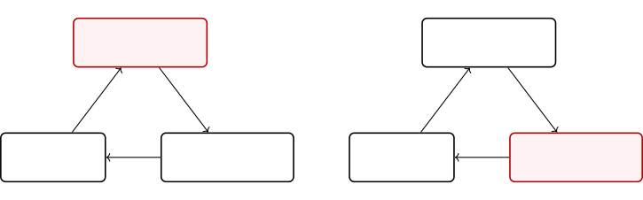
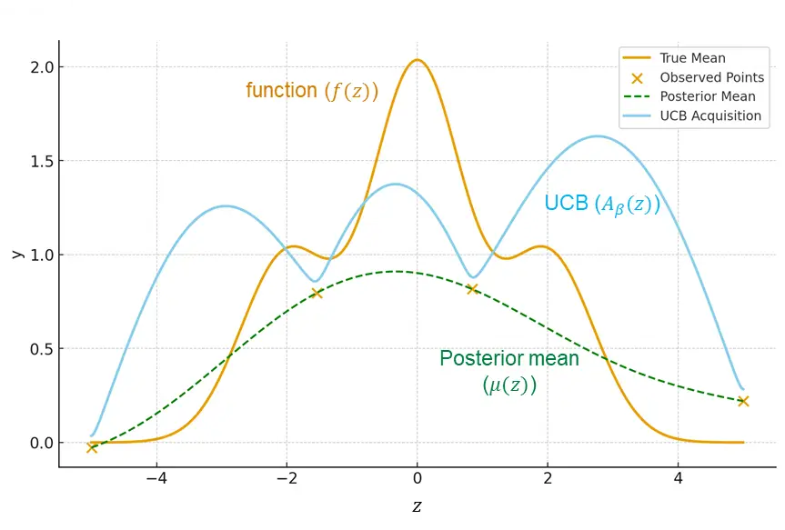
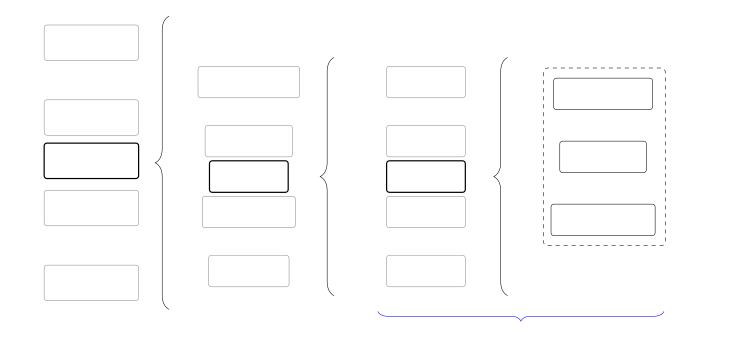
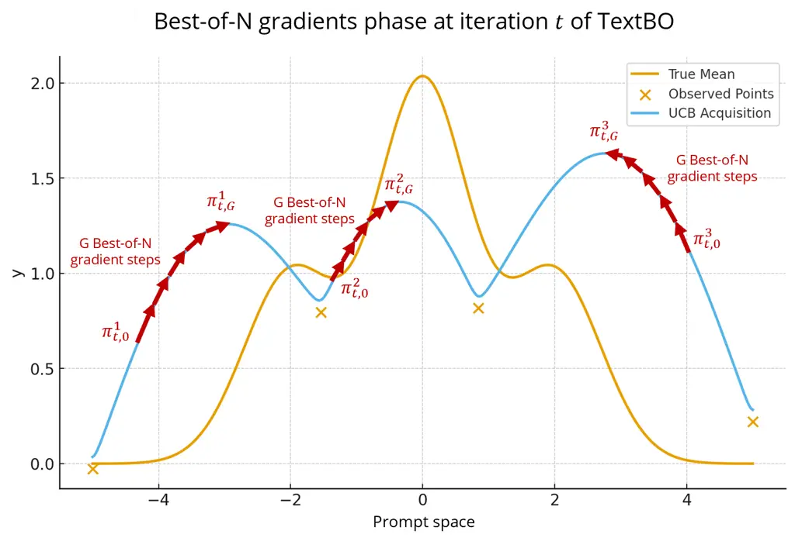
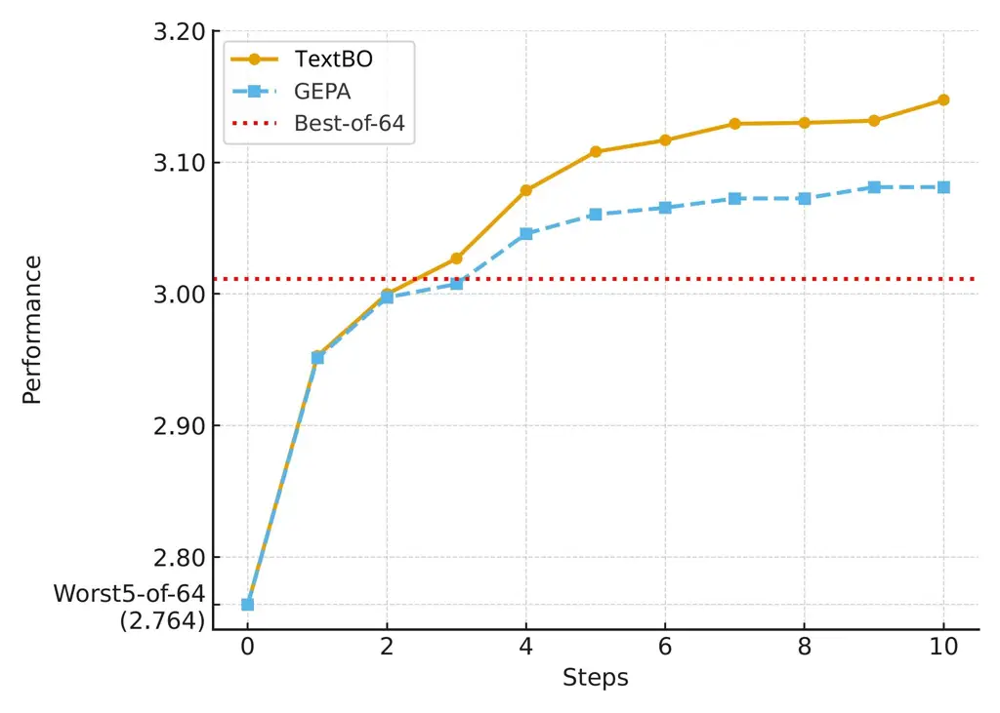
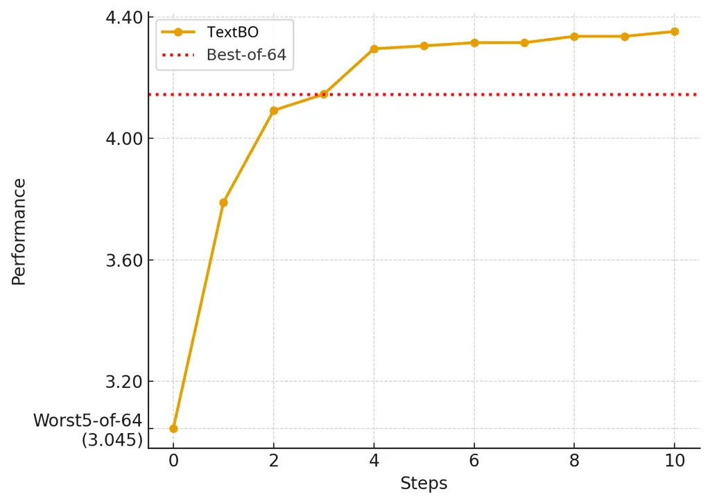

# TextBO: Bayesian Optimization in Language Space for Eval-Efficient Self-Improving AI

Enoch Hyunwook Kang ^(†)^(†)thanks: We thank Khaled Boughanmi for
detailed comments that have improved this work. Thanks are also due to
the participants of the 2025 Stanford AI-ML conference and the 2025
Columbia AIML conference. Please address all correspondance to:
ehwkang@uw.edu and hemay@uw.edu. Affiliation: University of Washington
   Hema Yoganarasimhan Affiliation: University of Washington

###### Abstract

Large Language Models (LLMs) have enabled self-improving AI systems that
iteratively generate, evaluate, and refine their outcomes. Recent
studies show that prompt-optimization-based self-improvement can
outperform state-of-the-art reinforcement-learning fine-tuning of LLMs,
but performance is typically measured by _generation_ efficiency.
However, in many applications, the constraint is _evaluation_
efficiency: obtaining reliable feedback is far more costly than
generating candidates. To optimize for evaluation efficiency, we extend
Upper Confidence Bound–Bayesian Optimization (UCB-BO), a framework known
for optimal evaluation-efficiency guarantees, to the language domain.
Doing so is challenging for two reasons: (i) gradients needed for UCB-BO
are ill-defined in discrete prompt space; and (ii) UCB-style exploration
relies on a surrogate model and acquisition function, which only live
implicitly in the LLM. We overcome these challenges by proving that
combining simple textual gradients (LLM-proposed local edits) with the
Best-of-N selection strategy statistically emulates ascent along the
gradient of the canonical UCB acquisition function. Based on this
result, we propose TextBO, a simple, evaluation-efficient self-improving
algorithm that operates purely in language space without explicit
surrogates or calibrated uncertainty models. We empirically validate
TextBO on automated ad-alignment tasks using a persona-induced
preference distribution, demonstrating superior performance per
evaluation compared to strong baselines such as Best-of-N and GEPA. We
also evaluate TextBO’s Best-of-N multi-step textual-gradient mechanism
on agentic AI benchmarks by augmenting GEPA with it and show that it
performs better than standard GEPA. In sum, TextBO is a simple and
principled framework for AI self-improving system design that bridges
prompt optimization with classical Bayesian optimization.

Keywords: Self-improving AI, Evaluation efficiency, Bayesian
optimization, Context Engineering, Ad optimization, LLMs, Marketing.

## 1 Introduction

### 1.1 Self-improving AI for Data-driven Decision-making

Data-centric decision making has long relied on an iterative,
human-driven cycle of proposing solutions, testing them, and learning
from the results. This paradigm underlies many business applications,
ranging from website design (Hauser et al. 2009) to product
recommendations (Nandy et al. 2021). We illustrate the cycle using ad
optimization (left panel of Figure 1). An ad agency or marketer first
generates a slate of creatives from a brief, drawing on product
knowledge, theories of consumer behavior, market conditions, and
feedback from prior campaigns. This generation step often takes weeks.
The candidates are then evaluated (e.g., on advertising platforms or via
consumer surveys) to identify the best performers, typically over days
to weeks. Finally, the manager analyzes campaign outcomes and uses the
insights to guide the next round of creative generation.

This workflow is effective, but it is also constrained by two
longstanding limitations. First, iteration speed depends heavily on how
quickly humans can generate new candidate solutions, which has
historically been the main bottleneck. Second, while evaluation has been
studied extensively—with tools such as A/B testing and Multi-Armed
Bandits (MAB) (Kohavi et al. 2020; Fiez et al. 2024)—there is no
comparable formal framework for how practitioners should systematically
analyze results and translate them into improved candidates; in
practice, this step is often driven by managerial intuition.



Figure 1: Comparison of human-driven and AI-driven ad self-improvement
cycles in digital advertising.

Recent advances in generative AI have begun to transform this
human-driven paradigm by addressing the issues discussed above.
Candidate generation is now fast and scalable: in digital advertising,
AI models can produce high-quality ad copy, images, and campaign
concepts that adhere to brand guidelines in minutes (Jansen et al. 2024;
Hartmann et al. 2025).¹¹ 1 A large share of ad creatives is now
AI-generated, reflecting improvements in both quality and speed (Coffee
2025; Majic 2025). In parallel, LLM-based systems can autonomously
conduct analyses by summarizing performance patterns and hypothesizing
drivers of success (Ferber et al. 2024; Guo et al. 2024b; Ghosh et al.
2024; Wiedemer et al. 2025). Together, these capabilities make it
feasible to automate the full generation–evaluation–analysis loop at
scale, allowing systems to update themselves continuously in response to
new data (right panel of Figure 1). We refer to such automated,
continuously updating systems as self-improving or self-evolving AI
(Mantia et al. 2025; Chen et al. 2025; Silver and Sutton 2025). While
there can be many types of self-improving AI systems, a central line of
progress has been on iterative prompt optimization, where the AI agent
repeatedly refines its own prompts based on performance feedback.
Indeed, recent papers show that such approaches can often outperform
reinforcement-learning based fine-tuning (Agrawal et al. 2025); see
$`\lx@sectionsign`$2 for a detailed discussion. The key performance
objective that this stream of work focuses on is generation
efficiency—the number of LLM calls (or candidate solution generations)
needed to reach a target performance level.

However, in most business settings, the key bottleneck is a limited
evaluation budget rather than a generation budget. For instance, in
digital advertising, generating ad creatives is now cheap and fast with
modern LLMs/AI models, but ad evaluation, i.e., measuring whether the ad
is effective or not, still requires significant human feedback in the
form of field deployment (e.g., A/B tests or bandits in ad platforms) or
consumer surveys. This is also true for other marketing decisions such
as package design, product descriptions, and promotions – in all these
cases, generating new candidate solutions is now easy, but evaluating
the performance of each solution can take significant time, effort, and
human feedback. Beyond business applications, this pattern is also
common in many social and scientific domains: AI models like AlphaFold
can propose protein structures quickly (Jumper et al. 2021), but their
functional properties must still be tested through slow and noisy
wet-lab experiment; similarly, AlphaChip can generate chip layouts in
silico (Goldie et al. 2024), but performance ultimately depends on
fabrication and benchmarking. In sum, the primary goal for
self-improving AI systems in business and social settings should be
evaluation efficiency. However, as discussed earlier, the existing work
has largely focused on generation efficiency as the main objective.

### 1.2 Research Agenda and Challenges

In this paper, we seek to design an evaluation-efficient, theoretically
grounded, and empirically effective framework for
prompt-optimization-based self-improving AI. We define evaluation
efficiency as: reaching high-performing solutions using as few costly
evaluations as possible.

Our key and novel insight is that iterative prompt-optimization-based
self-improving AI can be cast as Bayesian Optimization (BO) in the
language space. This recasting then allows us to inherit the key
properties of classical BO, in particular, it’s evaluation efficiency.
While intuitive and appealing, we nevertheless need to overcome
technical challenges in order to translate BO to the language space.

We now briefly summarize canonical BO and discuss the parallels between
our problem and canonical BO and provide some intuition for why
iterative prompt optimization can be viewed as BO in language space, and
the describe the challenges that we need to address to fully leverage
the BO framework for our problem.

##### Bayesian Optimization (BO).

Classical BO is a principled framework for tackling black-box
optimization problems with two defining features: (1) There is no
closed-form or analytical expression for the objective function or its
derivative. In such cases, optimization has to rely on evaluating the
function by sampling different points and getting a noisy response. (2)
Function evaluation is costly. If evaluation is cheap, then this problem
can be solved easily using methods such as grid search or numerical
gradient estimation. However, if function evaluation is expensive, then
it is important to minimize the number of samples drawn from the black
box function. This is the regime in which BO is particularly effective
(Frazier 2018). In BO, we maintain two models: (1) a surrogate model,
that is used for approximating the objective function (given a history
of prior evaluations). This model produces a posterior mean and an
uncertainty estimate at each point in the space. (2) Acquisition model,
that helps guide which point should be chosen for evaluation in the next
iteration; this model trades-off predicted value and uncertainty
(exploration-exploitation). Among many variants of BO, Upper Confidence
Bound (UCB)-BO (Srinivas et al. 2012) is known to be
evaluation-efficient, i.e., no algorithm can achieve better in terms of
both simple regret and expected cumulative regret (Whitehouse et al.
2023; Wang et al. 2023). In practice, the UCB acquisition function is
often non-concave, so practitioners usually use parallel gradient-based
UCB-BO (Wilson et al. 2018): start from multiple initial points, take
gradient steps to reach several local optima, and evaluate those optima.
Parallel gradient-based BO can be especially effective in
high-dimensional settings (Papenmeier et al. 2025).

##### Iterative prompt optimization as BO.

The iterative-prompt optimization problem can be summarized as follows:
in each iteration, the agent repeatedly selects a prompt, observes a
noisy performance score, and decides what to try next. The overarching
goal is to reach a high-performing prompt (or candidate solution) in as
few evaluations as possible. We note that this problem shares some key
features of the black-box optimization where BO typically performs well:
the prompt-space is high-dimensional and there is no closed-form
prompt-to-score model, exploration must be balanced with exploitation
when we choose the next prompt to evaluate, and the goal is to maximize
progress per costly evaluation. Building on this insight, we propose to
cast iterative prompt optimization as _parallel gradient-based UCB
Bayesian optimization in language space_: prompts from prior rounds
serve as initializations, gradient-style updates move toward local
optima of an implicit UCB acquisition, and in-context learning plays the
role of posterior updating.

##### Challenges.

However, realizing this idea requires overcoming two key challenges.
First, in prompt space, gradients are ill-defined because text lacks the
inner product structure of a Hilbert space required to measure the
directions and magnitudes of change (Young 1988). Second, even if we can
define a meaningful “textual gradient,” we do not have direct access to
the UCB acquisition function (or its derivatives). The surrogate
posterior over prompt quality that induces the UCB lives implicitly in
the LLM, rather than as an explicit Gaussian-process-style model that
exposes closed-form posterior means, variances, and their derivatives.
Consequently, standard gradient-based BO techniques that differentiate
the UCB constructed from a known surrogate cannot be applied naively: we
must design a mechanism that elicits UCB-like,
optimism-in-the-face-of-uncertainty behavior using only black-box text
interactions and critic feedback, without ever computing the UCB
function or its gradient in closed form.

### 1.3 TextBO: Algorithm, Theory, and Numerical Experiments

We propose TextBO, a simple evaluation-efficient prompt-optimization
based self-improving AI framework that adapts parallel gradient-based
UCB-BO to language space by addressing the above challenges.

To address the first challenge, TextBO builds on TextGrad (Yuksekgonul
et al. 2025), which adapts gradient descent to discrete text by using an
auxiliary LLM _critic_ to propose targeted edits; applying these edits
induces a local, directional update (a “textual gradient”) in language
space. For example, starting from _“A simple photo of a plant-based
burger on a white plate,”_ A critic LLM might suggest: _“Make the burger
appear delicious, and show it being enjoyed at a barbecue.”_
Incorporating this edit yields: _“A photorealistic image of a juicy
plant-based burger with grill marks, served at a vibrant summer barbecue
with friends.”_ Such edits serve as language-native analogues of
gradient steps. To address the second challenge, TextBO selects gradient
updates via the Best-of-N principle (Snell et al. 2024), producing what
we call the Best-of-N gradient. A single textual gradient step exploits
expected improvements implied by past results but does not account for
uncertainty. Best-of-N gradient injects exploration into the acquisition
by sampling multiple local edits and moving in the direction judged most
promising by the critic—an optimism-based rule designed to emulate
ascent on an implicit UCB acquisition gradient in language space.

##### Algorithm.

We now briefly describe our TextBO algorithm. Each iteration in the
algorithm consists of three steps. In Step 1 (meta-reflection phase), we
use the critic model to analyze the history of previously evaluated
solutions and their scores, and update a meta-reflection that summarizes
what has tended to work well or poorly. In Step 2 (Best-of-N
textual-gradient phase), we perform a sequence of Best-of-N gradient
updates from the current prompt. That is, for each gradient step, (i) we
propose $`N`$ textual-gradient edits that transform the current prompt
into $`N`$ candidate prompts, (ii) each candidate prompt is passed to a
solution-generation model to produce a corresponding candidate solution,
(iii) conditioned on the meta-reflections, the critic model predicts
which candidate solution is most likely to perform best, and (iv) we set
the prompt associated with this predicted-best solution as the new
current prompt. After Step 2, we obtain a refined prompt and its
associated solution to evaluate. In Step 3 (evaluation phase), we
evaluate this solution to get a scalar score, which TextBO then uses to
update its history and meta-reflection for subsequent optimization
steps.

##### Theory.

We provide theoretical guarantees on the performance of our approach.
Under mild regularity conditions, we prove that the Best-of-N gradient
computed from locally sampled textual edits induces (in probability) an
ascent direction of the UCB acquisition function with exploration
parameter $`\beta_{N}=\Theta(\sqrt{\ln N})`$ (Theorem 1). Consequently,
TextBO effectively implements parallel, gradient-based UCB Bayesian
Optimization in the implicit embedding space induced by the LLM, despite
operating purely in language space and without constructing an explicit
surrogate or uncertainty model. It therefore inherits the
sublinear-regret and evaluation-efficiency guarantees established for
UCB-BO, up to constant factors and approximation error due to textual
gradients.

##### Numerical experiments.

We consider two sets of numerical experiments to empirically demonstrate
the performance of TextBO – (1) a advertising setting where the goal is
to optimize ad creatives, and (2) a series of agentic AI benchmarks from
the recent self-improving AI literature.

In the ad optimization experiments, the goal is to iteratively refine
image-generation prompts for ad creatives to maximize responsiveness for
a population of customers. We test and measure how well and how fast a
method optimizes for (i.e., aligns with) the preference distribution
induced by LLM-based simulation of personas in the Digital Twins persona
dataset called Twin-2k-500 (Toubia et al. 2025). We consider eight
advertising scenarios and compare the performance of TextBO to two
strong baselines – (1) Best-of-N (Snell et al. 2024), a popular and
well-performing test-time alignment method, and (2) GEPA (Agrawal et al.
2025), a state-of-the-art prompt optimization based self-improving AI
algorithm, which has been shown to outperform reinforcement learning
fine-tuning algorithms such as GRPO (Liu et al. 2024a).

We show that TextBO significantly outperforms both these baselines,
across all eight scenarios. Further, in an ablation study, we show that
these gains are not simply due to the persona data – even when we
simulate preferences without any persona information, i.e., when the
evaluator is a single LLM judge with no auxiliary context – TextBO
outperforms baseline approaches. Our numerical experiments show that
TextBO can reach good performance both in settings where there is
significant heterogeneity in the preferences of the target population as
well as in settings with homogeneous preferences.

Next, we consider a series of agentic AI benchmark experiments in order
to assess whether the same Best-of-N multi-step update principle
improves evaluation efficienc. Specifically, we consider the experiments
used to evaluate GEPA in Agrawal et al. (2025) – HotpotQA, HoVer, and
Pupa. We then compare the performance of TextBO-GEPA (GEPA augmented
with Best-of-N gradient sampling and multiple gradient steps) to GEPA.
Across all experiments, we show that TextBO-GEPA consistently
outperforms GEPA.

Together, these experiments establish TextBO as an effective and general
purpose self-improving AI algorithm that can be used for data driven
decision-making for both business decisions such as ad creatives,
product descriptions, as well as agentic tasks.

### 1.4 Contributions

In sum, our paper makes four main contributions to the literature on AI,
optimization, and data-driven decision making. First, from a conceptual
perspective, we identify evaluation efficiency as the key objective to
optimize in self-improving AI design in societal and business systems.
Second, we propose TextBO, a purely text-based self-improving AI
framework that combines textual-gradient search with Best-of-N selection
to automate and optimize business and marketing decisions (e.g., ad
creatives, product descriptions). TextBO is simple and easy to
implement: it requires no explicit uncertainty modeling, embeddings, or
Gaussian process surrogates. Third, we provide theory showing that
Best-of-N over locally sampled textual edits selects, in probability,
ascent directions of the UCB acquisition with exploration weight
$`\beta=\Theta(\sqrt{\ln N})`$; thus, we prove that TextBO emulates
gradient-based UCB and inherits evaluation-efficiency guarantees.
Finally, we demonstrate empirical gains using a wide variety of
numerical experiments, including automated ad-alignment across eight
scenarios as well as the standard agentic AI benchmarks used in the
self-improving AI literature – throughout, TextBO improves faster and
attains higher final scores compared to strong baselines, and remains
effective both in settings with and without contextual information.

## 2 Related Literature

Our paper relates and contributes to multiple streams of literature,
including the literature on AI and LLMs in computer science, the
operations literature on optimization, and the marketing literature on
ad optimization. We now discuss each one below.

The literature on self-improving AI has often been motivated by an
important observation: the progress in AI based only on human data is
hitting limits, so AI must create and learn from its own data. In other
words, powerful AI “should have their own stream of experience that
progresses, like humans, over a long time-scale” (Silver and Sutton
2025). That is, we need to design the self-improving AI that
iteratively 1) generate data of outcomes, evaluate outcomes with
grounded signals, and 2) self-tune the three knobs – models, tools, and
prompts – in the system to achieve long-term objectives under real-world
feedback (Wang et al. 2025). Here, tuning models is about altering
language models’ input-output correspondences (Huang et al. 2023; Lee et
al. 2023; Acikgoz et al. 2025); tuning tools is about specifying the
tools the AI has access to, including memory tools (Hou et al. 2025;
Ouyang et al. 2025; Qiu et al. 2025); tuning prompts is about
engineering prompts in the model’s context window, including system
messages, task instructions, constraints, schema, and few-shot exemplars
(Zhou et al. 2022; Khattab et al. 2023; Pryzant et al. 2023; Yang et al.
2024; Yuksekgonul et al. 2025; Agrawal et al. 2025; Zhang et al. 2025;
Wang et al. 2025).

In particular, iterative prompt-optimization based self-improving AI
have become increasingly popular. In a recent paper, Agrawal et al.
(2025) demonstrate their method, GEPA (Genetic-Pareto) is able to
outperform state-of-the-art model fine-tuning techniques such as GRPO
(Liu et al. 2024a) under a fixed budget of LLM generation calls across a
range of challenging tasks including multi-document QA, constrained
instruction following, retrieval-augmented fact verification, and
privacy-related objectives. At a high-level, both GEPA and other
prompt-based self-improvement (Agrawal et al. 2025; Zhang et al. 2025;
Wang et al. 2025) is specified as procedural heuristic search: maintain
a pool of prompts, generate variants via LLM-driven
mutation/crossover/reflection, score candidates on held-out data or
rollouts, retain top performers, and iterate (Fernando et al. 2024; Guo
et al. 2024a; Agrawal et al. 2025; Soylu et al. 2024). This mirrors
classical heuristic and evolutionary optimization, where performance is
assessed as a function of generation efficiency rather than evaluation
efficiency (Nguyen et al. 2016; Ding et al. 2023; Hu et al. 2024; Liu et
al. 2024b). Yet, as discussed earlier, in many real-world deployments,
the scarce resource is not candidate generation but evaluation. Thus, in
this paper, we focus on developing an iterative prompt-optimization
framework that treat evaluation calls as the budget to allocate and
optimize.

Our paper also relates to the literature on relating LLMs to Bayesian
Optimization (BO). A series of papers focuses on applying LLMs to
enhance BO for numerical optimization problems. Liu et al. (2024c) and
Cissé et al. (2025) focus on leveraging LLMs’ contextual understanding
and few-shot learning capabilities to improve BO’s efficiency, enabling
better warm-starting and surrogate modeling; Aglietti et al. (2025) uses
an LLM to discover new acquisition functions for Bayesian optimization.
The LLM writes candidate acquisition function formulas as code, which
are evaluated on various optimization problems. Singh et al. (2025)
applies BO to enhance LLM’s internal behavior to boost the model’s
zero-shot and few-shot performance. In contrast to these papers, we
focus on the prompt optimization problem that arises when formulating
LLM-based self-improving AI system design as a Bayesian Optimization
problem. In line with this focus, Schneider et al. (2025) and Kong et
al. (2025) formulate prompt optimization among the fixed set of
candidate prompts as Bayesian optimization. While Schneider et al.
(2025) utilizes ideas from adversarial bandits, Kong et al. (2025) feeds
each prompt text into an embedding model, and the GP surrogate operates
on those fixed embedding features to guide selection. However, unlike
these papers, we actively generate new candidate prompts as the process
proceeds, rather than pre-specifying a fixed set of candidate prompts.

Next, our paper relates to the literature on efficient ad evaluation in
digital marketing using bandit methods. Here, the goal is to iteratively
improving the ads served given a fixed set of candidate ads. Schwartz et
al. (2017) adopts Thompson Sampling with a hierarchical general linear
model for a real display advertising campaign for a financial-services
firm. Geng et al. (2020) partitions JD.com’s platform users into
disjoint sub-populations and applies a contextual Thompson sampling
algorithm to maximize the expected advertiser payoff. Aramayo et al.
(2023) developed a contextual Thompson sampling algorithm to dynamically
determine the list of house ads to display on the homepage of an
electronic retailer to maximize the accumulated click-through rate of
the ads. Ba et al. (2022) used parametric Thompson Sampling, where a
parametric structure links features (media, audience attributes) to
conversion likelihood to optimally allocate ad-media and target-audience
combinations in high-dimensional settings with low success rates. The
main difference between these bandit-based papers and ours is the
existence of a pre-defined set of candidate arms. Our paper focuses on
creating new solutions by analyzing previous results. On the other hand,
bandit methods aim to balance exploration of a pre-defined set of
candidate ads optimally. The scope of our problem is also quite
different. Our self-improving AI iterates over three steps–generation,
evaluation, and analysis–whereas, bandits focus on efficiently executing
the evaluation step. Indeed, one could employ a bandit method, such as
best-arm-identification, in our evaluation step (instead of using A/B
tests).

Finally, our paper relates to the literature on ad content. Researchers
have studied many different features of ad creatives and their effect on
consumer response, e.g., creativity (Rosengren et al. 2020), discount
information (Biswas 2025), emotionality of content (MacInnis et al.
2002), and specific text phrases (Rutz et al. 2017). However, a
limitation of this literature is that each study is designed to test one
specific ad feature in one specific advertising format/context (e.g., TV
ads, search ads), and there is not much consensus on how various
features and estimated effects should be combined to optimize the ad
creative and whether these effects can be ported to other formats and
audiences. In this paper, we move away from manually manipulating
individual ad features and instead treat the ad-creative optimization
problem as a high-dimensional optimization problem in the prompt-space;
and our self-improving AI framework can be used to automate and optimize
ad-creative generation at scale for any given combination product,
ad-format, and audience.

## 3 Problem Definition

Let $`\Phi`$ denote a generative AI model (or more generally, an AI
system) that, given a prompt $`\pi\in\Pi`$, produces a candidate
solution $`\Phi(\pi)`$.²² 2 LLM-based AI systems can also be modified by
tuning the LLM’s internal parameters using LLM fine-tuning methods such
as GRPO (Liu et al. 2024a). In this paper, we focus on prompt
optimization, which fixes those internal parameters throughout. This
candidate solution $`\Phi(\pi)`$, in conjunction with some environmental
variables $`x\in\mathcal{X}`$ produces an output $`y(\Phi(\pi),x)`$,
where $`y`$ is drawn from a distribution over an output space
$`\mathcal{Y}`$. For example, in the ad creative optimization example
from $`\lx@sectionsign`$1, $`\Phi`$ denotes an image generation AI model
(e.g., Gemini Flash), $`\pi`$ is an image generation prompt that
reflects what the marketer wants the ad to depict, $`\Phi(\pi)`$ is the
ad creative generated by prompt $`\pi`$, $`x\in\mathcal{X}`$ denotes a
user on the ad platform and/orother contextual features that affect the
ad’s effectiveness (e.g., seasonality or time of day), and a realization
of $`y(\Phi(\pi),x)`$ represents that user/context $`x`$’s reaction
(e.g., clicks, conversions, spend) to the ad $`\Phi(\pi)`$.

Throughout, we allow for the distribution over $`\mathcal{X}`$ to depend
on the prompt $`\pi`$. This is important for practical applications
where such dependencies are common; for example, in digital advertising
platforms, recommendation systems often determine which users are shown
the ad $`\Phi(\pi)`$ based on the ad content, which depends on $`\pi`$.
To capture such dependencies, we denote the input distribution over
$`\mathcal{X}`$ by $`\mathcal{D}_{\mathcal{X}}(\pi)`$. In a fully
randomized test, the distribution over $`\mathcal{X}`$ is independent of
$`\pi`$, and we can denote the distribution of $`\mathcal{X}`$ as
$`\mathcal{D}_{\mathcal{X}}`$.

To evaluate the output, we use a scoring rule: a function
$`r:\mathcal{Y}\to[0,1]`$ that assigns a scalar effectiveness score to
each $`y\in\mathcal{Y}`$. In the digital marketing example, $`r`$ is a
marketer-defined function that maps observed user responses (clicks,
conversions, spend) to a normalized scalar effectiveness score. Then,
our optimization objective is to discover the prompt $`\pi^{*}`$ that
maximizes the objective function:

```math
J(\pi):=\mathbb{E}[r(y(\Phi(\pi),x))]. \tag{1}
```

$`J`$ cannot be optimized by directly computing gradients, because the
input distribution $`\mathcal{D}_{\mathcal{X}}(\pi)`$ can shift with
$`\pi`$; even when $`J(\pi)`$ is differentiable with respect to $`\pi`$
and $`y`$’s randomness is not dependent on $`\pi`$, we have:

```math
\displaystyle\nabla_{\pi}J(\pi)=\underbrace{\mathbb{E}\big[\nabla_{\pi}r(y(\Phi(\pi),x))\big]}_{\text{model term}}\;+\;\underbrace{\mathbb{E}\big[r(y(\Phi(\pi),x))\,\nabla_{\pi}\log d_{\pi}(x)\big]}_{\text{distribution term}}, \tag{2}
```

where $`d_{\pi}`$ is the density of $`\mathcal{D}_{\mathcal{X}}(\pi)`$
(Williams 1992). Since $`d_{\pi}`$ and $`\nabla_{\pi}\log d_{\pi}(x)`$
are unobservable, we cannot compute gradients from observed rewards.
This motivates the use of an external LLM that can analyze prior data
and propose directions for improvement without explicitly computing
gradients, leading to self-improving AI algorithms we describe below
that iteratively optimize for $`J`$.³³ 3 In fully randomized
experiments, the distribution term drops out and only the model term
remains.

##### Self-improving AI algorithm:

Given a scoring rule $`r`$, a self-improving AI algorithm
$`\mathcal{A}`$ optimizes $`J(\pi):=\mathbb{E}[r(y(\Phi(\pi),x))]`$ by
iteratively analyzing the previous history, proposing a new prompt, and
observing its noisy score. Formally, starting from the initial prompt
$`\pi_{0}`$, a self-improving AI algorithm proceeds in discrete
optimization iterations, indexed by $`t=1,2,\ldots`$; at the beginning
of iteration $`t`$, the algorithm has access to the history of past
prompts and their observed scores, then selects a new prompt
$`\pi_{t}`$, deploys the corresponding candidate solution
$`\Phi(\pi_{t})`$, and receives a score feedback on its performance. We
define the score $`s_{t}`$ of the prompt $`\pi_{t}`$ as the empirical
average reward at $`t`$, i.e.,

```math
s_{t}:=\frac{1}{L}\sum_{l=1}^{L}r\left(y\left(\Phi\left(\pi_{t}\right),x_{t}^{(l)}\right)\right),\quad x_{t}^{(l)}\sim\mathcal{D}_{\mathcal{X}}\left(\pi_{t}\right), \tag{3}
```

where $`L`$ denotes the number of input samples $`x_{t}^{(l)}`$ we
evaluate for each $`t`$. Note that we compare the performance of
self-improving algorithms in terms of the progress of $`s_{t}`$ across
iterations $`t`$.

###### Definition 1 (Self-improving AI algorithm).

Fix a generative model $`\Phi`$ and a scoring rule $`r`$. For each
iteration $`t\geq 1`$, let the history of past evaluations be
$`H_{t-1}\;:=\;\{(\pi_{\tau},\Phi(\pi_{\tau}),s_{\tau})\}_{\tau=0}^{t-1}`$,
where $`s_{\tau}`$ is the empirically evaluated score of $`\pi_{\tau}`$,
defined as

```math
\displaystyle s_{t}=\frac{1}{L}\sum_{l=1}^{L}r\bigl(y(\Phi(\pi_{t}),x_{t}^{(l)})\bigr),\quad x_{t}^{(l)}\sim\mathcal{D}_{\mathcal{X}}(\pi_{t}). \tag{4}
```

Then, a self-improving AI algorithm is defined as function
$`\mathcal{A}`$ that, at each iteration $`t`$, maps the history
$`H_{t-1}`$ to a new prompt $`\pi_{t}`$, i.e.,

```math
\pi_{t}=\mathcal{A}_{t}(H_{t-1}).
```

Operationally, given access to the history $`H_{t-1}`$, a self-improving
AI algorithm $`\mathcal{A}`$ goes through following three steps each
iteration $`t`$:

1.  1.  Analysis: Analyze the previous history $`H_{t-1}`$.
2.  2.  Generation: Propose the next prompts $`\pi_{t}`$ based on the
        analysis.
3.  3.  Evaluation: The system outcome $`\Phi(\pi_{t})`$ is deployed, and
        its performance is measured, yielding a score $`s_{t}`$. The new
        observation is added to the history:
        $`H_{t}=H_{t-1}\cup\{(\pi_{t},\Phi\left(\pi_{t}\right),s_{t})\}`$.

We will be more precise about how Steps 1 and 2 (analysis and
generation) are implemented in our self-improving AI framework in
$`\lx@sectionsign`$5 and $`\lx@sectionsign`$6.

##### Optimization objective:

In this paper, we formulate the goal of self-improving AI algorithms
$`\mathcal{A}`$ as improving prompts $`\left(\pi_{t}\right)_{t=1}^{T}`$
over the evaluation budget $`T`$ to efficiently optimize the objective
$`J(\pi)`$. Specifically, we discuss evaluation efficiency using two
standard regret criteria. Let
$`\pi^{\star}\in\arg\max_{\pi\in\Pi}J(\pi)`$. Then,

- $`\bullet`$
  The (expected) cumulative regret is
  $`\mathbb{E}\left[\sum_{t=1}^{T}\left(J\left(\pi^{\star}\right)-J\left(\pi_{t}\right)\right)\right]`$.
- $`\bullet`$
  The (expected) simple regret is
  $`\mathbb{E}\left[J\left(\pi^{\star}\right)-\max_{1\leq t\leq T}J\left(\pi_{t}\right)\right]`$.

In the next section, we show how a self-improving AI algorithm can be
viewed as UCB-based Bayesian Optimization, which is optimal under both
regret criteria (Whitehouse et al. 2023; Wang et al. 2023).

## 4 Our Approach: Recasting Iterative Prompt Optimization as Bayesian Optimization in Language Space

As discussed in $`\lx@sectionsign`$1, our key idea is to model
prompt-based self-improving AI as a Bayesian Optimization (BO) problem
in language space. At a high level, we want a self-improving AI
algorithm that repeatedly chooses a prompt, observes a noisy scalar
performance signal (e.g., ad effectiveness), and decides which prompt to
try next under a limited evaluation budget. We note that our
optimization problem has no closed-form expression mapping the prompt to
a performance score and a key constraint is that evaluating the function
is costly. This is precisely the regime where BO has been shown to be
effective, i.e., black-box objective functions where function evaluation
is costly (Frazier 2018; Srinivas et al. 2012; Papenmeier et al. 2025).

##### Canonical UCB Bayesian Optimization.

To fix ideas, we start with a quick overview of BO. Classical BO
considers a black-box function $`f:\mathcal{Z}\to\mathbb{R}`$ defined
over a continuous input space $`\mathcal{Z}`$. The algorithm maintains a
surrogate model—typically a Gaussian Process or related probabilistic
regressor—that, given a history of evaluations
$`H_{t-1}=\{(z_{\tau},y_{\tau})\}_{\tau=1}^{t-1}`$, produces for each
$`z\in\mathcal{Z}`$ a posterior mean $`\mu_{t-1}(z)`$ and an uncertainty
estimate $`\sigma_{t-1}(z)`$. Rather than maximizing $`\mu_{t-1}(z)`$
directly, BO selects the next query by maximizing an _acquisition
function_ that trades off exploitation (high predicted value) and
exploration (high uncertainty). A widely used acquisition is the Upper
Confidence Bound (UCB)

```math
A_{\beta_{t}}(z)\;=\;\mu_{t-1}(z)\;+\;\beta_{t}\,\sigma_{t-1}(z), \tag{5}
```

where $`\beta_{t}>0`$ controls the strength of exploration (Srinivas et
al. 2012). Figure 2 illustrates how $`A_{\beta_{t}}`$ combines the
surrogate mean and uncertainty. Intuitively, $`A_{\beta_{t}}(z)`$
implements an “optimism in the face of uncertainty” rule: points with
large uncertainty receive a positive bonus even if their current mean is
modest.



Figure 2: Illustration of the upper confidence bound (UCB) acquisition
function in Bayesian optimization. The unknown objective $`f(z)`$
(orange) is evaluated at a set of observed points ($`\times`$). A
surrogate model yields the posterior mean $`\mu(z)`$ (green dashed) and
$`\sigma(z)`$. The UCB acquisition
$`A_{\beta}(z)=\mu(z)+\beta\sigma(z)`$ (blue) trades off exploitation
and exploration by favoring locations with high predicted value and high
uncertainty.

Input: Evaluation budget $`T`$, exploration parameter schedule
$`\beta`$, initial history $`H_{0}=\emptyset`$

Output: Sequence of evaluation points $`\{z_{t}\}_{t=1}^{T}`$ and
observations $`\{y_{t}\}_{t=1}^{T}`$

1 for _$`t=1,\dots,T`$_ do

    2 Update surrogate model $`p(f\mid H_{t-1})`$ on past data

    3 Construct the UCB acquisition

```math
A_{\beta}(z)\;=\;\mu_{t-1}(z)\;+\;\beta\,\sigma_{t-1}(z).
```

4 Select the next evaluation point

```math
z_{t}\;\in\;\operatorname{argmax}_{z}A_{\beta}(z).
```

5 Evaluate $`f`$ at $`z_{t}`$ to obtain a noisy observation

```math
y_{t}=f(z_{t})+\text{noise}.
```

6 Augment the data: $`H_{t}\leftarrow H_{t-1}\cup\{(z_{t},y_{t})\}`$

Algorithm 1 Canonical UCB Bayesian Optimization

Algorithm 1 summarizes the resulting UCB-BO loop. At each iteration
$`t`$, the surrogate is updated on $`H_{t-1}`$, the acquisition
$`A_{\beta_{t}}`$ is constructed, the next point $`z_{t}`$ is chosen by
maximizing $`A_{\beta_{t}}`$, the black-box function $`f`$ is evaluated
at $`z_{t}`$ to obtain $`y_{t}`$, and the history is augmented. Under
mild conditions, UCB-BO achieves sublinear regret and enjoys strong
evaluation-efficiency guarantees: no algorithm can perform uniformly
better in terms of regret scaling (Srinivas et al. 2012; Whitehouse et
al. 2023; Wang et al. 2023).

In many practical settings, the global maximizer of $`A_{\beta_{t}}`$ is
not available in closed form, and the acquisition is highly non-convex.
A standard remedy is _parallel gradient-based BO_ (Wilson et al. 2018;
Papenmeier et al. 2025): one starts from multiple initial points,
performs gradient ascent on $`A_{\beta_{t}}`$ from each initialization
to find local maxima, and then evaluates $`f`$ at these local optima in
parallel. This procedure has shown surprising empirical effectiveness in
high-dimensional numerical optimization (Papenmeier et al. 2025).

##### Mapping self-improving AI to UCB-BO.

We now conceptually align our iterative prompt-optimization problem with
the BO template above. The correspondence is:

- $`\bullet`$
  The BO input space $`\mathcal{Z}`$ corresponds to the prompt space
  $`\Pi`$.
- $`\bullet`$
  The black-box function $`f(z)`$ corresponds to the system-level
  objective $`f(\pi)\equiv J(\pi):=\mathbb{E}[r(y(\Phi(\pi),x))]`$,
  where $`x\sim\mathcal{D}_{\mathcal{X}}(\pi)`$ and $`r`$ is the scoring
  rule defined in § 3.
- $`\bullet`$
  The evaluation of $`f(\pi)`$ is the costly step: it requires deploying
  $`\Phi(\pi)`$, interacting with the environment (e.g., ad platform
  users), and computing $`s_{t}`$ as an empirical estimate of
  $`J(\pi)`$.
- $`\bullet`$
  The cheap computation is everything the LLM-based system can do
  _without_ new evaluations: analyzing past history, proposing textual
  edits, or internally comparing candidate ads.

If we had an explicit surrogate model over prompts, providing
$`\mu_{t}(\pi)`$ and $`\sigma_{t}(\pi)`$ for each $`\pi\in\Pi`$, we
could in principle construct a UCB acquisition

```math
A_{\beta_{t}}(\pi)\;=\;\mu_{t}(\pi)\;+\;\beta_{t}\,\sigma_{t}(\pi), \tag{6}
```

and then run parallel gradient-based BO over $`\Pi`$: start from
multiple initial prompts, ascend the gradient
$`\nabla_{\pi}A_{\beta_{t}}(\pi)`$ to obtain local optima, and evaluate
$`J(\pi)`$ only at those local optima. This would give us a
self-improving AI algorithm that is, by construction,
evaluation-efficient. However, directly instantiating this plan in
language space runs into two central challenges (originally discussed in
$`\lx@sectionsign`$1).

##### Challenge 1: No native gradients in prompt space.

Prompts are discrete sequences of tokens, not elements of a Euclidean
vector space. As such, prompt space lacks the inner-product structure of
a Hilbert space that underlies standard notions of directions, norms,
and gradients (Young 1988). Expressions such as
$`\nabla_{\pi}A_{\beta_{t}}(\pi)`$ are therefore not well-defined in the
usual calculus sense.

A seemingly natural workaround is to embed prompts into a continuous
space, take gradients there, and then “project back” to text:

```math
\pi\;\xrightarrow{\text{embed}}\;e=\mathsf{E}(\pi)\in\mathbb{R}^{d}\;\xrightarrow{\text{gradient step}}\;e^{\prime}\;\xrightarrow{\text{decode}}\;\pi^{\prime}=\mathsf{E}^{-1}(e^{\prime}). \tag{7}
```

where $`\mathsf{E}`$ is the prompt embedding. Such a strategy is indeed
theoretically plausible thanks to the invertibility of prompt embedding
(Nikolaou et al. 2025). However, in practice, it encounters the
well-known soft-to-discrete projection problem: learning the inverse
prompt embedding ($`\mathsf{E}^{-1}`$), i.e., learning to decode an
embedding into a prompt, is highly challenging (Cui et al. 2025). As a
result, we cannot reliably implement gradient ascent in prompt space by
differentiating through embeddings.

##### Challenge 2: No explicit UCB or uncertainty model.

Even if we had a notion of gradient in language space, we would still
face a second obstacle: the UCB acquisition function itself is not
explicitly available. In standard BO, the surrogate model exposes both a
posterior mean $`\mu_{t}(\cdot)`$ and an uncertainty estimate
$`\sigma_{t}(\cdot)`$, from which we build $`A_{\beta_{t}}(\cdot)`$ and
compute its gradient.

In our setting, by contrast, there is no explicit Gaussian process or
parametric surrogate over prompts. The relevant beliefs about prompt
quality and uncertainty live _implicitly_ inside the LLM and its critic:
they are encoded in how the model generalizes from past evaluations, not
in an externally accessible $`\mu_{t}`$ or $`\sigma_{t}`$. Consequently,
we cannot simply write down $`A_{\beta_{t}}(\pi)`$, evaluate it at
arbitrary prompts, or compute $`\nabla_{\pi}A_{\beta_{t}}(\pi)`$ in
closed form. Naive proxies for uncertainty (e.g., self-consistency
variance, embedding distances) tend to be poorly calibrated or brittle,
and training a separate Gaussian Process over high-dimensional text
embeddings is often expensive, data-hungry, and empirically unstable.

##### Textual gradients as a partial solution.

Recent work on _textual gradients_ offers a way to tackle the first
challenge. The TextGrad framework (Yuksekgonul et al. 2025) shows that
one can approximate gradient ascent on an implicit objective by asking
an auxiliary LLM _critic_ to propose local natural-language edits that
are predicted to improve a scalar score. Applying these edits to the
current prompt yields a sequence of locally improving prompts, which
empirically and theoretically behaves as gradient ascent on the
posterior mean $`\mu(\pi)`$ in an implicit embedding space thanks to
bi-Lipschitzness of LLM’s prompt embedding (Nikolaou et al. 2025; Tang
et al. 2025).

However, textual gradients as in Yuksekgonul et al. (2025) are
inherently _exploitative_: they aim to climb the posterior mean
$`\mu(\pi)`$, ignoring epistemic uncertainty $`\sigma(\pi)`$. They,
therefore, correspond to gradient ascent on $`\mu(\pi)`$, not on the UCB
acquisition $`A_{\beta_{t}}(\pi)=\mu(\pi)+\beta_{t}\sigma(\pi)`$. To
recover the evaluation-efficiency guarantees of UCB-BO, we need an
update rule whose effective search direction behaves like
$`\nabla_{\pi}A_{\beta_{t}}(\pi)`$, even though we never observe
$`\sigma(\pi)`$ or $`\nabla_{\pi}\sigma(\pi)`$ explicitly.

##### Our approach.

The central technical idea of this paper is to address Challenge 1 and
Challenge 2 _jointly_ by combining textual gradients with a Best-of-N
selection mechanism. Rather than differentiating an explicit acquisition
function, we (i) use a critic LLM to generate multiple stochastic
textual edits around the current prompt, (ii) apply these edits to
obtain nearby candidate prompts and system outcomes, and (iii) ask the
critic, conditioned on past history, to pick the most promising
candidate in a Best-of-N fashion.

In $`\lx@sectionsign`$5, we formalize this procedure as a *Best-of-N
gradient* and show that, under mild regularity conditions, the direction
selected by this mechanism converges (in probability) to the ascent
direction of a UCB-style acquisition function in the LLM’s implicit
embedding space, with exploration parameter
$`\beta_{N}=\Theta(\sqrt{\ln N})`$ (Theorem 1). This theoretical result
gives us a principled way to emulate parallel gradient-based UCB-BO
entirely in language space using only black-box text interactions. We
then leverage this equivalence to design a concrete self-improving AI
algorithm in $`\lx@sectionsign`$6, TextBO, that is evaluation-efficient,
simple to implement, and readily deployable in real-world applications
such as digital advertising.

## 5 Best-of-N gradient and Theory

As discussed in $`\lx@sectionsign`$4, our aim is to implement UCB-style
Bayesian Optimization in prompt space using only black-box access to an
LLM critic. The theoretical challenge is to show that the combination of
(i) _textual gradients_ and (ii) _Best-of-N_ selection actually induces
gradient ascent on a UCB acquisition function in the LLM’s implicit
embedding space. This section formalizes that idea and proves our main
result.

We proceed in three steps. In $`\lx@sectionsign`$5.1, we formalize the
role of the *critic LLM*, which provides the primitive
operations—pairwise judgments, textual gradients, and
meta-reflections—that enable search in language space.
$`\lx@sectionsign`$5.2 then introduces the _Best-of-N gradient_, our key
mechanism for turning these critic capabilities into a stochastic,
locally improving update rule. Finally, in $`\lx@sectionsign`$5.3, we
prove that Best-of-N gradients asymptotically emulate gradient ascent on
a UCB acquisition function in the LLM’s implicit embedding space. This
establishes the theoretical justification for the TextBO framework
developed in the next section.

### 5.1 Critic LLM

The use of a separate LLM as a _critic_ is now a standard pattern in the
prompt-optimization and self-improving AI literature: critic models are
routinely used to provide structured feedback, propose improvements, or
act as reward models and judges that guide search over prompts and
outputs (Zhou et al. 2022; Yuksekgonul et al. 2025; Agrawal et al. 2025;
Zhang et al. 2025; Wang et al. 2025; Shi et al. 2024). We therefore
treat the critic LLM as a natural and practically realistic component
that supplies the basic operations needed to implement
Bayesian-optimization-style updates in language space.

Recall that we denote a prompt as $`\pi`$ and the corresponding
candidate solution (e.g., an ad creative) as $`\Phi(\pi)`$, the
optimization history up to iteration $`t`$ as
$`H_{t}=\{(\pi_{\tau},\Phi(\pi_{\tau}),s_{\tau})\}_{\tau\leq t}`$, where
$`s_{\tau}`$ is the evaluated score of $`\pi_{\tau}`$. Then, let
$`M_{\text{critic}}`$ denote the critic LLM, which can perform the
following four operations:

1.  1.  Pairwise Judge Operator. Given two prompts $`\pi^{(1)}`$ and
        $`\pi^{(2)}`$, and their corresponding outcomes $`\Phi(\pi^{(1)})`$
        and $`\Phi(\pi^{(2)})`$, predict which is better given reflection
        $`R`$:

    ```math
    \textsc{PairwiseJudge}(\Phi(\pi^{(1)}),\Phi(\pi^{(2)});R,M_{\text{critic}})\in\{\Phi(\pi^{(1)}),\Phi(\pi^{(2)})\}. \tag{8}
    ```

2.  2.  Meta-reflection Operator. Compress the entire history into a small
        set of natural-language rules or guidelines:

    ```math
    R_{t}=\textsc{MetaReflect}(H_{t};M_{\text{critic}}). \tag{9}
    ```

3.  3.  Textual Gradient Operator. Stochastically generate a local edit
        $`\delta`$ intended to improve $`\pi`$ under reflection $`R`$:

    ```math
    \delta\sim\nabla_{\text{text}}(\pi;R,M_{\text{critic}}). \tag{10}
    ```

4.  4.  Apply Operator. Apply an edit $`\delta`$ to obtain a new prompt:

    ```math
    \pi^{\prime}=\operatorname{Apply}(\pi,\delta;M_{\text{critic}}). \tag{11}
    ```

These four operators map directly onto well-documented LLM capabilities
in the prompt-optimization and evaluative-feedback literature. The
PairwiseJudge operator aligns with the growing use of LLMs as reliable
comparison judges for creative and reasoning tasks (Shi et al. 2024;
Calderon et al. 2025). The MetaReflect operator captures
reflection-based prompt-improvement methods that distill past outcomes
into actionable guidelines (e.g., in the ad optimization case, it could
suggest that “social settings outperform isolated product shots") (Jiang
et al. 2024; Ferber et al. 2024; Wang et al. 2025). The TextualGradient
operator corresponds to LLM-driven proposals for targeted, locally
improving edits (e.g., “make the lighting warmer and emphasize people
enjoying the product”), as formalized in Yuksekgonul et al. (2025) and
applied across domains such as scientific reasoning and code refinement
(Li et al. 2025c). Finally, the Apply operator reflects standard
LLM-based prompt editing widely used in prompt engineering (Zhou et al.
2022; Khattab et al. 2023). Together, these capabilities make an LLM
critic a natural, practically grounded component for enabling BO-style
search over prompt space.

### 5.2 Best-of-N gradient

The notion of a Best-of-N gradient builds on the widely used Best-of-N
strategy for test-time alignment, where an LLM trades additional
inference-time compute for higher-quality outputs by sampling multiple
candidates and then selecting the one that appears most aligned with a
downstream objective (Snell et al. 2024; Beirami et al. 2024). In
standard Best-of-N prompting, an LLM generates $`N`$ candidate prompts,
a generation model produces $`N`$ candidate outcomes, and a reward model
selects the highest-scoring one. While effective for choosing a single
output, our goal here is to improve the _prompt_ itself. To accomplish
this, we introduce the concept of _Best-of-N gradient_. Rather than
sampling $`N`$ full prompts, we sample $`N`$ distinct _textual
gradients_, apply them to the current prompt, and then select the
candidate whose predicted outcome is judged most promising. This
selection defines a localized “direction of improvement” in prompt
space, and can be viewed as an acquisition function.

Formally, given a current prompt $`\pi`$ and reflection $`R`$, a single
Best-of-N gradient step proceeds as follows:

1.  1.  Textual gradient generation. Use $`M_{\text{critic}}`$ to generate
        $`N`$ independent textual edits:

    ```math
    \delta^{(i)}\sim\nabla_{\text{text}}(\pi;R,M_{\text{critic}}),\qquad i=1,\dots,N. \tag{12}
    ```

2.  2.  Candidate prompt generation. Apply each edit to produce $`N`$
        candidate prompts:

    ```math
    \pi^{(i)}=\operatorname{Apply}(\pi,\delta^{(i)};M_{\text{critic}}). \tag{13}
    ```

3.  3.  Candidate system outcome generation. Produce the associated system
        outcomes:

    ```math
    \Phi(\pi^{(i)}),\qquad i=1,\dots,N. \tag{14}
    ```

4.  4.  Best-of-N selection. Identify the most promising candidate using the
        critic:

    ```math
    i^{\star}=\textsc{Best-of-N}\big(\{(\pi^{(i)},\Phi(\pi^{(i)})\}_{i=1}^{N};R,M_{\text{critic}}\big). \tag{15}
    ```

    For the Best-of-N selection, we employ a pairwise tournament (Liu et
    al. 2025). The $`N`$ candidates are first randomly permuted into
    tournament buckets. Each match compares two outcomes using the
    PairwiseJudge operator, with the comparison repeated $`K`$ times and
    the order of presentation swapped to mitigate positional bias (Shi
    et al. 2024) (see the prompt template in Figure A3 in Web
    Appendix C.3 for the ad-optimization case). Ties are broken at
    random. Winners advance round by round until a single final winner
    remains; its associated prompt and outcome are then carried forward
    to the next gradient step.

The resulting prompt $`\pi^{(i^{\star})}`$ defines the update made by
the Best-of-N gradient for a given step. Intuitively, each textual edit
represents a noisy proposal for a local improvement direction; Best-of-N
filters these proposals through an optimism-based rule, selecting the
direction most likely to improve performance under the critic LLM’s
current understanding.

### 5.3 Theory: Best-of-N gradient’s Asymptotic Equivalence to UCB gradient

We now prove that the Best-of-N over textual gradients selects, in
probability, the ascent direction of the UCB acquisition with
exploration weight $`\beta`$ scaling as $`\Theta(\sqrt{\ln N})`$
(Theorem 1). What allows us to do rigorous theoretical analysis is that
LLM prompt embeddings are invertible and bi-Lipschitz: LLM’s prompt
embeddings are known to be injective, and therefore invertible (Nikolaou
et al. 2025); LLM embeddings are Lipschitz (Tang et al. 2025), implying
they are bi-Lipschitz. Hence, small textual edits can be represented as
small changes in the embedding space and vice versa. Consequently, small
textual edits correspond to small perturbations in the embedding space,
allowing us to analyze Best-of-N gradient steps in $`\mathbb{R}^{d}`$
and then translate the theoretical guarantees back to the prompt space.

#### 5.3.1 Intuitive Explanation

Denote $`e`$ to be an embedding of a prompt. Pick a small radius
$`\varepsilon>0`$ around $`e`$ and sample $`N`$ nearby edits
$`e_{i}=e+\varepsilon u_{i}`$ with $`u_{i}`$ on the unit sphere. Next,
denote the critic LLM’s ($`M_{critic}`$ from $`\lx@sectionsign`$5.1)
internal scoring of each edit, $`Y_{i}`$, as follows:

```math
Y_{i}=\mu(e_{i})+\xi_{i}\,\sigma(e_{i}), \tag{16}
```

where $`\mu`$ is the (implicit) posterior mean, $`\sigma`$ is the
(implicit) epistemic uncertainty, and $`\xi_{i}`$ is an i.i.d.
sub-Gaussian noise variable independent of $`u_{i}`$. We note that
$`Y_{i}`$ is in line with the BO scoring function from
$`\lx@sectionsign`$4.

Let $`M_{N}=\max_{i}\xi_{i}`$ and let $`q_{N}=F^{-1}(1-1/N)`$ be the
$`(1-1/N)`$-quantile of the noise distribution. For Gaussian noise,
classical extreme-value theory implies that $`M_{N}`$ concentrates
around $`q_{N}`$ and that $`q_{N}=\Theta(\sqrt{\ln N})`$. In other
words, as $`N`$ grows large, the largest noise term among
$`\{\xi_{i}\}_{i=1}^{N}`$ behaves like $`q_{N}`$ up to lower-order
fluctuations. Consequently, the index $`i^{\star}`$ selected by
Best-of-N approximately maximizes

```math
\mu(e_{i})+q_{N}\,\sigma(e_{i}). \tag{17}
```

Consequently, for large $`N`$, selecting the Best-of-N index
$`i^{\star}`$ is asymptotically equivalent to selecting the maximizer of
UCB-style scores with exploration weight $`q_{N}`$.

Now consider a small sphere around $`e`$ in embedding space and the UCB
acquisition
$`A_{\beta}(e^{\prime})=\mu(e^{\prime})+\beta\,\sigma(e^{\prime})`$. On
this sphere, there is a single dominant ascent direction for
$`A_{\beta}`$, which we denote by $`v_{\beta}`$ (the direction in which
$`A_{\beta}`$ increases the fastest to first order). Draw a narrow cone
around $`v_{\beta}`$. For sufficiently large $`N`$, at least one of the
sampled directions $`u_{i}`$ falls inside this cone with high
probability, and the Best-of-N winner $`e_{i^{\star}}`$ comes from this
cone. Thus, among the locally sampled perturbations
$`e_{i}=e+\varepsilon u_{i}`$, the Best-of-N rule selects a candidate
whose direction is (with high probability, for large enough $`N`$) very
close to the ascent direction of the UCB acquisition function with
$`\beta_{N}:=q_{N}`$.

#### 5.3.2 Rigorous Derivation

Let $`\Pi`$ be the set of syntactically valid prompts. Suppose that
there exists a text embedding $`\mathsf{E}:\Pi\to\mathbb{R}^{d}`$, where
$`e\;:=\;\mathsf{E}(\pi)\in\mathbb{R}^{d}`$ is the embedding of a prompt
$`\pi\in\Pi`$. We first state the assumptions motivated by how language
model embeddings behave in practice, and then state the main theorem,
Theorem 1.

At each gradient step of TextBO, we sample edits that correspond to
$`u_{1},\ldots,u_{N}\stackrel{{\scriptstyle\text{i.i.d.}}}{{\sim}}\rho`$
on the embedding space $`\subset\mathbb{R}^{d}`$, where $`\rho`$ is
assumed to have a density bounded below by a positive constant with
respect to surface measure. Assumption 1 implies that small textual
edits induce near-linear moves in $`\mathbb{R}^{d}`$, consistent with
the recent findings that prompt embeddings preserve phrase similarity
under small changes (Reimers and Gurevych 2019; He et al. 2025; Tang et
al. 2025; Nikolaou et al. 2025).

###### Assumption 1 (Embedding map and edit realization).

For the current prompt $`\pi`$ with $`e=\mathsf{E}(\pi)`$, constants
$`C<\infty`$ and $`\varepsilon_{0}>0`$ such that for every unit vector
$`u\in\mathbb{R}^{d}`$ and every $`\varepsilon\in(0,\varepsilon_{0}]`$
the edit operator $`\mathrm{Apply}`$ realizes a first–order move:

```math
\displaystyle\mathsf{E}\!\big(\mathrm{Apply}(\pi,\varepsilon u)\big)=e+\varepsilon u+r(\varepsilon,u),\qquad\sup_{\|u\|=1}\|r(\varepsilon,u)\|\leq C\,\varepsilon^{2}. \tag{18}
```

Next, Assumption 2 is a standard regularity condition: function
$`f:\mathbb{R}^{d}\to\mathbb{R}`$ is of $`C^{1,1}`$ if it is
continuously differentiable and its gradient is Lipschitz:
$`\exists L<\infty`$ such that
$`\|\nabla f(y)-\nabla f(z)\|\leq L\|y-z\|`$ for all $`y,z`$.

###### Assumption 2 ($`\mu,\sigma`$ are of $`C^{1,1}`$).

Let $`\mu(e)`$ and $`\sigma(e)`$ denote the mean and standard deviation
of the critic LLM’s internal score of embedding $`e`$. We assume
$`\mu,\sigma`$ are $`C^{1,1}`$ locally. We use $`g=\nabla\mu(e)`$ and
$`h=\nabla\sigma(e)`$.

Assumption 3 specifies a heteroskedastic sub-Gaussian model for
candidate scores (with i.i.d. mean-zero, unit-variance,
unbounded-support noise independent of the sampled directions) and an
ideal Best-of-N choice oracle.

###### Assumption 3 (Noise model and choice oracle).

Let $`\{\xi_{i}\}_{i=1}^{N}`$ be i.i.d. mean-zero, unit-variance,
Gaussian random variables with unbounded support, independent of
$`\{u_{i}\}`$. For candidates $`e_{i}:=x+\varepsilon u_{i}`$, the critic
LLM observes its internal scoring

```math
Y_{i}\;=\;\mu(e_{i})\;+\;\sigma(e_{i})\,\xi_{i}, \tag{19}
```

and the Best-of-N selection oracle (often built using pairwise
tournaments in practice; see $`\lx@sectionsign`$5.2) returns
corresponding $`i^{\star}\in\arg\max_{i\in[N]}Y_{i}`$.

###### Assumption 4 (Small-step regime and limit order).

We take limits with $`N\to\infty`$ first, then
$`\varepsilon\downarrow 0`$.

###### Lemma 1 (Gaussian maxima and spacing (Vershynin 2018)).

Let $`\xi_{1},\dots,\xi_{N}`$ be i.i.d. mean-zero, unit-variance
Gaussian, $`M_{N}=\max_{i\leq N}\xi_{i}`$, $`S_{N}`$ the second largest,
and $`q_{N}:=F^{-1}(1-1/N)`$ the $`(1-1/N)`$-quantile of $`\xi_{1}`$.
Then $`q_{N}=\Theta(\sqrt{\ln N})`$, $`M_{N}-q_{N}\to 0`$ in
probability, and $`M_{N}-S_{N}=O_{p}(1/q_{N})`$.

###### Theorem 1 (Best-of-N asymptotically induces a UCB gradient direction).

Under Assumptions 1-4, define $`\beta_{N}:=q_{N}`$ from Lemma 1. Let
$`i^{\star}\in\arg\max_{i}Y_{i}`$ and set
$`\widehat{u}_{N}:=u_{i^{\star}}`$. Define the step

```math
\displaystyle\Delta e^{(N)}\;:=\;\mathsf{E}\!\big(\mathrm{Apply}(\pi,\varepsilon\widehat{u}_{N})\big)-e\;=\;\varepsilon\widehat{u}_{N}+r(\varepsilon,\widehat{u}_{N}). \tag{20}
```

Then, with the limit order $`N\to\infty`$ first and
$`\varepsilon\downarrow 0`$ second,

```math
\displaystyle\frac{\Delta e^{(N)}}{\|\Delta e^{(N)}\|}\;=\;\widehat{u}_{N}\;\xrightarrow{p}\;\frac{\nabla A_{\beta_{N}}(e)}{\|\nabla A_{\beta_{N}}(e)\|}\;=\;\frac{g+\beta_{N}h}{\|g+\beta_{N}h\|}. \tag{21}
```

Moreover,

```math
\displaystyle A_{\beta_{N}}(e+\Delta e^{(N)})\;\geq\;A_{\beta_{N}}(e)\;+\;\varepsilon\,\|\nabla A_{\beta_{N}}(e)\|\;-\;o_{p}(\varepsilon). \tag{22}
```

Thus, each Best-of-N gradient step asymptotically performs a first-order
improvement on an implicit UCB acquisition function, with exploration
strength $`\beta_{N}`$ controlled entirely by $`N`$. The full proof is
given in Web Appendix B.

Theorem 1 provides the central conceptual and technical contribution of
this paper: it shows that a procedure that looks like a purely heuristic
rule in language space _implicitly implements_ the same optimism-driven
search direction as UCB BO in the model’s embedding space. This is novel
and important because it removes the main obstacle to bringing UCB BO’s
evaluation-efficiency guarantees into prompt optimization: we never
construct an explicit surrogate model, never compute $`\sigma(\cdot)`$,
and never differentiate a closed-form acquisition function, yet the
effective update direction converges to the UCB gradient direction.
Moreover, the result establishes a new use case for the ubiquitous
Best-of-N principle as an _interpretable exploration mechanism_, where
$`N`$ becomes a principled “exploration knob” for the exploration weight
$`\beta_{N}=\Theta(\sqrt{\ln N})`$. In short, Theorem 1 is what turns
Best-of-N gradient from an empirical recipe into a principled BO-style
optimizer: it justifies viewing our language-space self-improvement loop
as parallel gradient-based UCB-BO and is the reason TextBO can inherit
BO’s evaluation-efficiency benefits.

## 6 TextBO Algorithm

We now describe the self-improving AI algorithm proposed in this paper:
TextBO. TextBO is designed to implement parallel gradient-based UCB-BO
in the space of natural language prompts. Concretely, TextBO adopts the
parallel gradient-based UCB-BO scheme that reuses the final gradient
point from one iteration as the initialization for the next. Thus, each
initial prompt gives rise to a _trajectory_: a sequence of candidate
prompts and outcomes generated by repeatedly taking gradient-ascent
steps and then evaluating the resulting system outcome.

The overview of the TextBO algorithm is shown in Figure 3. For each
iteration $`t\in[1,T]`$ and each trajectory $`j\in[1,J]`$, we evaluate
one prompt; to determine the one prompt to evaluate, we take $`G`$ steps
of Best-of-N gradients beforehand, without any evaluation. We present
the pseudocode of the TextBO algorithm (Algorithm 2) and provide the
line-by-line description of the details of the procedure below.



Figure 3: A pictorial overview of TextBO (Algorithm 2) with $`T`$
iterations, $`J`$ trajectories, and $`G`$ Best-of-N gradient steps per
iteration and trajectory.

Algorithm 2 TextBO Input: System $`\Phi`$;
$`\{\pi_{0}^{j}\}_{j=1}^{J}`$; critic $`M_{\text{critic}}`$; candidates
per step $`N`$; gradient steps $`G`$; iterations $`T`$; $`J`$
trajectories Output: Optimized triples
$`\{(\pi^{j}_{T},c^{j}_{T},s^{j}_{T})\}_{j=1}^{J}`$ 1 for _$`j=1`$ to
$`J`$_ do     2 $`c_{0}^{j}\leftarrow\Phi(\pi_{0}^{j})`$     3
$`s_{0}^{j}\leftarrow\text{Eval}(c_{0}^{j},\mathcal{D}_{\mathcal{X}}(\pi_{0}))`$
    4 $`H_{0}\leftarrow\{(\pi_{0}^{j},c_{0}^{j},s_{0}^{j})\}`$,
$`R\leftarrow\emptyset`$ 5 for _$`t=1`$ to $`T`$_ do     6 for _$`j=1`$
to $`J`$_ do        7 $`\pi^{j}_{t,0}\leftarrow\pi^{j}_{t-1}`$        8
for _$`g=1`$ to $`G`$_ do           9 for _$`i=1`$ to $`N`$_ do
             10
$`\delta_{t,g}^{j,(i)}\leftarrow\nabla_{\text{text}}(\pi_{t,g-1}^{j};R,M_{\text{critic}})`$
             11
$`\pi_{t,g}^{j,(i)}\leftarrow\operatorname{Apply}(\pi_{t,g-1}^{j},\delta_{t,g}^{j,(i)})`$
             12 $`c_{t,g}^{j,(i)}\leftarrow\Phi(\pi_{t,g}^{j,(i)})`$
          13
$`(\pi_{t,g}^{j},c_{t,g}^{j})\leftarrow\textsc{Best-of-N}(\{(\pi_{t,g}^{j,(i)},c_{t,g}^{j,(i)})\},R_{t-1},M_{\text{critic}})`$
       14 $`c_{t}^{j}\leftarrow c^{j}_{t,G}`$,
$`\pi_{t}^{j}\leftarrow\pi_{t,G}^{j}`$        15
$`s_{t}^{j}\leftarrow\text{Eval}(c_{t}^{j},\mathcal{D}_{\mathcal{X}}(\pi_{t}))`$
       16
$`H_{t}\leftarrow H_{t-1}\cup\{(\pi_{t}^{j},c_{t}^{j},s_{t}^{j})\}`$
       17 if _$`s_{t}^{j}<s_{t-1}^{j}`$_ then           18
$`\pi_{t}^{j}\leftarrow\pi_{t-1}^{j}`$,
$`c_{t}^{j}\leftarrow c_{t-1}^{j}`$, $`s_{t}^{j}\leftarrow s_{t-1}^{j}`$
    19 $`R_{t}\leftarrow\textsc{MetaReflect}(H_{t})`$ 20 return
_$`\{c*{t}^{j*{t}^{_}}\}_{t=1}^{T}`$, where
$`j_{t}^{_}:=\operatorname{argmax}*{j}s*{t}^{j}`$_

##### Initialization ($`t=0`$).

At iteration $`t=0`$, we first evaluate all initial prompts. For each
trajectory $`j=1,\dots,J`$, we first generate the initial system outcome
$`\Phi(\pi_{0}^{j})`$. Next, we evaluate it on the corresponding input
distribution $`\mathcal{D}_{\mathcal{X}}(\pi_{0}^{j})`$ to obtain a
scalar score $`s_{0}^{j}`$. The shared history is then initialized as
$`H_{0}\;=\;\bigcup_{j=1}^{J}\{(\pi_{0}^{j},\Phi(\pi_{0}^{j}),s_{0}^{j})\}`$,
and and the shared reflection is initialized as $`R_{0}=\emptyset`$.

##### Per-iteration update ($`t\geq 1`$).

At each optimization iteration $`t\in\{1,\dots,T\}`$, the algorithm
updates all trajectories in parallel. For each trajectory
$`j\in\{1,\dots,J\}`$, we set the starting prompt for this iteration to
be the final prompt from the previous iteration, i.e.,
$`\pi_{t,0}^{j}\leftarrow\pi_{t-1}^{j}`$. We then perform the following
three steps.

- 1.  Best-of-N gradients phase. (Detailed in $`\lx@sectionsign`$5.2.) For
  each trajectory $`j`$, we take $`G`$ successive Best-of-N
      textual-gradient steps, which do not involve any evaluation. That is,
      for $`j=1,\ldots J`$, for $`g=1,\dots,G`$:

  1.  1.  _Textual gradient generation._ From the current prompt
          $`\pi_{t,g-1}^{j}`$, query the textual-gradient operator

      ```math
      \delta_{t,g}^{j,(i)}\sim\nabla_{\text{text}}(\pi_{t,g-1}^{j};R_{t-1},M_{\text{critic}})
      ```

      independently $`N`$ times to obtain textual gradients
      $`\{\delta_{t,g}^{j,(i)}\}_{i=1}^{N}`$.

  1.  2.  _Candidate prompt generation._ Apply each textual gradient to the
          current prompt $`\pi_{t,g-1}^{j}`$ to obtain candidate prompts
          $`\{\pi_{t,g}^{j,(i)}\}_{i=1}^{N}`$:

      ```math
      \pi_{t,g}^{j,(i)}\leftarrow\operatorname{Apply}(\pi_{t,g-1}^{j},\delta_{t,g}^{j,(i)}),\qquad i=1,\dots,N.
      ```

  1.  3.  _Candidate system outcome generation._ For each candidate prompt
          $`\pi_{t,g}^{j,(i)}`$, generate the corresponding system outcome:

      ```math
      \Phi(\pi_{t,g}^{j,(i)}),\qquad i=1,\dots,N.
      ```

  1.  4.  _Best-of-N selection._ Using the critic model and the shared
          reflection $`R_{t-1}`$, select the candidate that is predicted to
          be the most promising by the critic model among
          $`\{(\pi_{t,g}^{j,(i)},\Phi(\pi_{t,g}^{j,(i)})\}_{i=1}^{N}`$, and
          set the winner as $`(\pi_{t,g}^{j},\Phi(\pi_{t,g}^{j}))`$.

  After $`G`$ gradient steps, trajectory $`j`$ has an updated
  prompt-outcome pair $`(\pi_{t,G}^{j},\Phi(\pi_{t,G}^{j}))`$ for this
  iteration.

  Geometrically, as illustrated in Figure 4, at iteration $`t`$ the
  prompts $`\{\pi_{t-1}^{j}\}_{j=1}^{J}`$ (equivalently, the initial
  points $`\{\pi_{t,0}^{j}\}_{j=1}^{J}`$) act as starting locations in
  the implicit UCB landscape over prompt space. For each trajectory
  $`j`$, the $`G`$ Best-of-N gradient steps climb this landscape,
  producing the updated prompts $`\{\pi_{t,G}^{j}\}_{j=1}^{J}`$ that
  approximate local maxima of the UCB acquisition function.⁴⁴ 4 For
  $`\{\pi_{t,G}^{j}\}_{j=1}^{J}`$ to be considered local optima in the
  usual gradient-based BO sense, $`G`$ should be large enough. These
  local optima are then passed to the evaluation phase (Phase 2).

  
  Figure 4: Illustration of how TextBO (Algorithm 2) implements
  Best-of-N gradients phase at iteration $`t`$. The prompts identified
  as local optima in this phase are evaluated in the later evaluation
  phase.

- 2.  Evaluation phase. For each trajectory $`j`$:

  1.  1.  Set the trajectory’s candidate for evaluation to the final output
          of the Best-of-N gradient phase:

      ```math
      \pi_{t}^{j}:=\pi_{t,G}^{j}
      ```

  1.  2.  Evaluate $`c_{t}^{j}`$ to obtain the scalar score

      ```math
      \displaystyle s_{t}^{j} \displaystyle:=\mathrm{Eval}(\Phi(\pi_{t}^{j}),\mathcal{D}_{\mathcal{X}}(\pi_{t}^{j}))=\frac{1}{L}\sum_{l=1}^{L}r\!\left(y\!\left(\Phi(\pi_{t}^{j}),x_{t}^{j,(l)}\right)\right),\;\;\textrm{where}\;\;x_{t}^{j,(l)}\sim\mathcal{D}_{\mathcal{X}}(\pi_{t}^{j}). \tag{23}
      ```

      Note that this is the step where the evaluation happens; and in
      each iteration, we conduct $`J`$ evaluations – one for each
      trajectory.

  1.  3.  Append the new triple
          $`(\pi_{t}^{j},\Phi(\pi_{t}^{j}),s_{t}^{j})`$ to the shared
          history:

      ```math
      H_{t}\leftarrow H_{t-1}\cup\{(\pi_{t}^{j},\Phi(\pi_{t}^{j}),s_{t}^{j})\}.
      ```

  1.  4.  _Acceptance rule._ If the new score does not improve, revert this
          trajectory to its previous state:

      ```math
      \text{if }s_{t}^{j}\leq s_{t-1}^{j}\text{ then }(\pi_{t}^{j},\Phi(\pi_{t}^{j}),s_{t}^{j})\leftarrow(\pi_{t-1}^{j},\Phi(\pi_{t-1}^{j}),s_{t-1}^{j}).
      ```

  This acceptance rule follows Yuksekgonul et al. (2025): it enforces
  monotone non-decreasing scores along each trajectory by rolling back
  any non-improving update.

- 3.  Shared meta-reflection update.

  At the end of iteration $`t`$, after all $`J`$ trajectories have been
  evaluated and the history updated, we recompute the global reflection:

  ```math
  R_{t}\leftarrow\textsc{MetaReflect}(H_{t};M_{\text{critic}}).
  ```

  The operator $`\textsc{MetaReflect}(H_{t};M_{\text{critic}})`$
  compresses the full history $`H_{t}`$—prompts, system outcomes, and
  scores—into a concise natural-language reflection $`R_{t}`$. The
  reflection consists of a small set of actionable rules summarizing
  cross-trajectory patterns. In the ad-generation setting, such rules
  might take the form “emphasize social context,” “avoid cluttered
  backgrounds,” or “prefer warm lighting.” This reflection serves as a
  global memory: in subsequent iterations, the critic LLM conditions on
  $`R_{t}`$ when producing textual gradients and performing Best-of-N
  judgments.

  There are many ways to construct such reflections. In our experiments,
  following Li et al. (2025c), we instruct $`M_{\text{critic}}`$ to
  compare the five lowest- and five highest-performing outcomes from
  previous iterations (or all available outcomes if fewer than ten
  exist)⁵⁵ 5 Limiting the number of outcomes in the critic model’s
  context window helps mitigate context rotting (Hong et al. 2025).,
  identify recurring visual and textual patterns, and distill these
  patterns into a small number of generalizable rules.

After $`T`$ optimization iterations, we report as the algorithm’s output
the sequence of best-performing outcomes

```math
\{\Phi(\pi_{t}^{j_{t}^{*}})\}_{t=1}^{T},\qquad j_{t}^{\ast}:=\operatorname{argmax}_{j}s_{t}^{j},
```

i.e., the best trajectory at each iteration, according to the evaluation
scores.

Note that, in each iteration, TextBO generates $`N\times G`$
prompt/outcome candidates for each trajectory before conducting one
evaluation. This deliberate trade-off is the key to its evaluation
efficiency: the algorithm uses inexpensive generation and critic-based
comparisons to identify promising directions, so that each actual
evaluation is performed on a small set of carefully selected,
high-potential candidates.

## 7 Case Study: Digital Ad Optimization

We now instantiate our framework in a digital advertising setting,
showing how an advertiser (or ad platform acting on behalf of an
advertiser) can use TextBO to automate the ad
generation–analysis–evaluation loop. Here, the goal is to refine the
ad-generation prompts so that the resulting creatives are better aligned
with a target population’s preference distribution, under a limited
budget of costly ad evaluations. We specialize the general setup from
$`\lx@sectionsign`$3 to ad optimization as follows:

- $`\bullet`$
  $`\Phi`$ is an ad-generation AI system that can generate ads given a
  prompt $`\pi`$.⁶⁶ 6 In practice, this image-generation model can be
  fine-tuned for a particular brand and/or customized to the platform.
  Our approach takes any pre-training as given.
- $`\bullet`$
  For a prompt $`\pi`$, $`\Phi(\pi)`$ is the resulting ad creative
  deployed on the platform.
- $`\bullet`$
  $`\mathcal{X}`$ is the population of platform users, and
  $`\mathcal{D}_{\mathcal{X}}(\pi)`$ is the (unknown) distribution of
  users who are exposed to $`\Phi(\pi)`$ when this ad is run.
- $`\bullet`$
  $`\mathcal{Y}`$ is the space of observed ad responses (clicks,
  conversions, spend). For each user $`x\in\mathcal{X}`$,
  $`y(\Phi(\pi),x)`$ is the random ad response when $`x`$ is shown ad
  $`\Phi(\pi)`$.
- $`\bullet`$
  $`r:\mathcal{Y}\to[0,1]`$ is a scoring rule that maps responses to a
  normalized effectiveness score (e.g., a weighted function of click,
  conversion, and spend).

The campaign objective is the same as the general objective introduced
in $`\lx@sectionsign`$3:
$`J(\pi)=\mathbb{E}\big[\,r\big(y(\Phi(\pi),x)\big)\big]`$, where the
expectation taken over $`x\sim\mathcal{D}_{\mathcal{X}}(\pi)`$ and the
stochasticity in $`y(\Phi(\pi),x)`$.

### 7.1 Ad Campaign Scenarios

We consider eight synthetic ad campaign scenarios that cover a diverse
range of products across distinct categories, each defined by a creative
brief that outlines the strategic and creative direction (see Web
Appendix C.1 for the full creative briefs):

- •
  Scenario 1: “GreenBite,” a new plant-based burger patty.
- •
  Scenario 2: “AuraSonics X1,” high-end, noise-canceling wireless
  earbuds.
- •
  Scenario 3: “Odyssey E-SUV,” a new all-electric family SUV.
- •
  Scenario 4: “Oasis Eco-Lodge,” a secluded, luxury resort with
  beautiful natural surroundings.
- •
  Scenario 5: “Momentum,” a mobile-first banking app for freelancers and
  the gig economy.
- •
  Scenario 6: “MindGarden,” a subscription-based meditation and
  mindfulness app.
- •
  Scenario 7: “Aeterno,” a classic, automatic Swiss-made wristwatch with
  a heritage design.
- •
  Scenario 8: “SyncFlow,” a project management and collaboration
  software platform for remote teams.

### 7.2 Implementation Details

There are five main components of the algorithm: (1) initial prompt
($`\pi_{0}`$), and (2) Ad-generation module ($`\Phi`$), (3) Critic LLM
and its four operators defined in $`\lx@sectionsign`$5.1, (4) the
population distribution $`\mathcal{D}_{\mathcal{X}}(\pi)`$ and the
evaluation operator $`\mathrm{Eval}()`$, as defined in Equation (23). We
now describe how each of these components is implemented in our
experiments.

##### Initial prompts ($`\pi_{0}^{j}`$).

For each scenario, we first created 64 high-quality prompts from its
creative brief using a meta-prompt. In Web Appendix C.2, see Figure A1
for the details of the meta-prompt and Figure A2 for an example of two
prompts in scenario 1. Among those 64 ads, we chose five as initial
prompts; we will describe the details of the choice rule in
$`\lx@sectionsign`$7.3.

##### Ad-generation module ($`\Phi`$).

We utilize a state-of-the-art image generation model, Google Imagen 4,⁷⁷
7 See Vertex AI’s description
([https://console.cloud.google.com/vertex-ai/publishers/google/model-garden/imagen-4.0-generate-preview-06-06](https://console.cloud.google.com/vertex-ai/publishers/google/model-garden/imagen-4.0-generate-preview-06-06))
for details. Imagen 4 delivers high-fidelity, photorealistic
text-to-image generation at up to 2K resolution, and excels in rendering
intricate details such as realistic textures, lighting, and camera
effects. Its features include typography accuracy for legible in-image
text and precise adherence to complex prompts.

##### Critic LLM and its Operators.

Unless otherwise noted, we use Gemini 2.5 Flash ⁸⁸ 8 See Vertex AI’s
description
([https://docs.cloud.google.com/vertex-ai/generative-ai/docs/models/gemini/2-5-flash](https://docs.cloud.google.com/vertex-ai/generative-ai/docs/models/gemini/2-5-flash))
for details. as the multimodal critic model $`M_{\text{critic}}`$ and
implement the four operators discussed in $`\lx@sectionsign`$5.1 using
the meta-prompts described in Web Appendix C.3: (1) PairwiseJudge
operation; see meta-prompt in Figure A3, (2) MetaReflect operation; see
meta-prompt in Figure A4, (3) Textual gradient operation
$`\nabla_{\text{text}}`$; see meta-prompt in Figure A5, and (4) Rewrite
operation Apply; see meta-prompt in Figure A6.

##### Evaluation module using persona data and LLM-based simulation.

We now describe how we implement the evaluation operator
$`\mathrm{Eval}`$ in this case study. To evaluate how well an ad
performs on the target population and to update prompts, we need (i) a
target population ($`\mathcal{D}_{\mathcal{X}}(\pi)`$.) and (ii) a way
to measure that population’s preferences for a given ad
($`\mathrm{Eval}(\cdot)`$). In principle, there are three ways define
the evaluation operator – (1) field experiments/deployment in a real ad
platform, (2) consumer surveys, and (3) simulated responses from a
pre-defined target population. The former two options (field deployment
and consumer surveys) are costly in time and resources, and can require
large samples to identify effective differences across ads given low
CTRs in digital ad settings; see (Lewis and Rao 2015; Johnson 2023).
Thus, using these approaches for algorithm evaluation is not ideal.

Therefore, in our experiments, we use the Twin-2k-500 persona
distribution of Toubia et al. (2025) as the target population and
LLM-generated preferences over this distribution as the evaluation
module. The Twin-2K-500 dataset consists of “digital twins" or “digital
persona" of $`2,058`$ representative people from the United States. The
dataset was assembled by giving a comprehensive multi-wave survey
(consisting of a total of 500 questions) to each person in the sample,
spanning demographics, personality, cognitive ability, economic
preferences, classic heuristics-and-biases tasks, and a pricing study.
Thus, the resulting personas are quite rich and detailed. This persona
distribution forms our target population
$`\mathcal{D}_{\mathcal{X}}(\pi)`$. Further, consistent with a
randomized experiment design, we assume that the ad does not influence
the personas who are shown the ad, i.e.,
$`\mathcal{D}_{\mathcal{X}}(\pi)`$ is the same for all $`\pi`$s. For
each persona, we pass their survey answers to a multi-modal LLM (Gemini
2.5 Flash) as context, and then ask the LLM to assess the effectiveness
of a given ad for that persona. Concretely, for a given persona and ad,
we ask the LLM (see Figure A7 for the detailed prompt in Web Appendix
C.4) to rate the ad’s “effectiveness” on a scale of $`1`$–$`5`$, where
$`1`$ is least effective and $`5`$ is most effective. Because the LLM
returns token-level log probabilities over the discrete scores,⁹⁹ 9 See
Vertex AI’s logprobs description
([https://cloud.google.com/vertex-ai/generative-ai/docs/model-reference/inference#logprobs](https://cloud.google.com/vertex-ai/generative-ai/docs/model-reference/inference#logprobs))
for details. we convert these into a mean score and treat this mean (a
real number such as $`3.41`$) as the ad’s evaluation score for that
persona. Averaging over personas then yields the final evaluation score
used by $`\mathrm{Eval}()`$.

We split the Twin-2k-500 personas into 80% (1,647 personas) for training
and 20% (411 personas) for testing. During algorithm training, each
evaluation of an ad $`\Phi(\pi)`$ proceeds as follows: we randomly
sample 200 personas from the training set and simulate ad effectiveness
for each persona via the LLM. When we test a final ad (e.g., after
running TextBO), we simulate its effectiveness for all personas in the
test set.

We note that important advantage of our approach: using this persona
distribution with LLM-generated preferences enables fast and controlled
comparisons of different algorithms without large-scale field
experiments or expensive surveys.¹⁰¹⁰ 10 Naive field deployment cannot
be used to test the relative performance of algorithms, since an
algorithm’s measured advantage would then mix its own effect with
distributional effects induced by the ad platform’s targeting systems.
Indeed, our approach can serve as a template for algorithm comparisons
in many other settings where researchers require evaluations that
reflect the variance/heterogeneity of human preferences. Further, we
note that while LLM-based preference simulation may not reflect true
human preferences (Li et al. 2025a; Peng et al. 2025), it still induces
a well-defined preference distribution on which we can benchmark
optimization methods and algorithms. Specifically, Kang (2025) proves
that swapping humans for personas is equivalent to changing the
evaluation population (e.g., from the New York population to the Jakarta
population), under two benchmark hygiene conditions: (i) methods observe
only the aggregate outcome (called aggregate-only observation condition)
and (ii) evaluation depends only on the submitted artifact and not on
the algorithm’s identity or provenance (called algorithm-blind
evaluation condition). Furthermore, they show that simply increasing the
size of the persona dataset is sufficient to guarantee that persona
simulation becomes as useful a benchmark as field experimentation.
Nevertheless, we also provide evaluations of our approach that do not
leverage persona datasets; see $`\lx@sectionsign`$8.4 for details.

### 7.3 Application of TextBO

We now describe how the TextBO algorithm is instantiated for the
ad-optimization problem. Here, we choose the hyperparameters as:
iterations $`T=10`$; trajectories $`J=5`$; gradient steps $`G=5`$; and
candidates per gradient step $`N=5`$.

##### Initialization.

As described in $`\lx@sectionsign`$7.2, for each scenario, we first
generate 64 high-quality prompts from its creative brief using a
meta-prompt. Among the 64 ads for each scenario, we identify the best
initial ad, Best-of-64 (which will be used as one of the baselines but
is not directly used in our algorithm; see $`\lx@sectionsign`$8.1 for
details), and the worst five, Worst5-of-64, by running a best-arm
identification bandit algorithm (Russo 2016). Specifically, we alternate
between a best-arm identification objective and a worst 5-arm
identification objective over 5,000 sequential random samples from the
training persona set. These Worst5-of-64 ads serve as starting points
$`\{\pi_{0}^{j}\}_{j=1}^{5}`$ for TextBO procedure. This starting point
allows us to attribute observed gains to the algorithms rather than to
favorable starting prompts.¹¹¹¹ 11 To maintain a rigorous baseline, we
make these 64 prompts detailed enough to yield strong creatives. This
ensures that subsequent improvements are not merely due to trivial gains
from starting with an under-specified prompts; instead, improvements
reflect better alignment with the underlying target audience
distribution. Let $`\{s_{0}^{j}\}_{j=1}^{J}`$ denote the evaluation
scores for these five ads. Then, the tuples
$`\{(\pi_{0}^{j},\Phi(\pi_{0}^{j}),s_{0}^{j})\}_{j=1}^{J}`$ form the
initial history $`H_{0}`$ for the algorithm.

##### Best-of-N textual-gradient steps.

Within each optimization iteration $`t`$, TextBO refines each
trajectory’s prompt $`\pi_{t-1}^{j}`$ through five steps of Best-of-N
textual-gradients before evaluation (see Figure 3). We follow the
generic procedure from $`\lx@sectionsign`$6, but here specialize the
critic’s context and edits to the ad domain.

For a given trajectory $`j`$ and inner step $`g`$, the critic model
$`M_{\text{critic}}`$ (Gemini 2.5 Flash) receives as context: (1) the
current prompt $`\pi_{t,g-1}^{j}`$ and (2) the current meta-reflection
$`R_{t-1}`$. Conditioned on this context, using operation
$`\nabla_{\text{text }}`$, it independently samples $`N`$ textual
gradients $`\{\delta_{t,g}^{j,(i)}\}_{i=1}^{N}`$, applies them using
operation Apply to obtain candidate prompts
$`\{\pi_{t,g}^{j,(i)}\}_{i=1}^{N}`$. These candidate prompts are then
fed to the ad generation module $`\Phi`$ to generate the corresponding 5
ads
$`\{c_{t,g}^{j,(i)}\}_{i=1}^{N}=\{\Phi(\pi_{t,g}^{j,(i)})\}_{i=1}^{N}`$.
For example, suppose that the current prompt $`\pi_{t,g-1}^{j}`$ is “A
simple, photorealistic image of a plant-based burger patty.”, if
$`R_{t-1}`$ emphasizes that “social occasions and visible grill marks
tend to perform better than plain pack shots,” then we may query the
operation $`\nabla_{\text{text }}`$ (see Figure A5 in Web Appendix C.3
for the meta-prompt) to propose textual-gradient edits such as:

- $`\bullet`$
  _Emphasize social context and enjoyment:_ “Show the burger being
  enjoyed at an outdoor barbecue with friends, not alone on a plate.”
- $`\bullet`$
  _Highlight sensory appeal and indulgence:_ “Make the patty look extra
  juicy with clear grill marks, a toasted bun, and melty toppings.”
- $`\bullet`$
  _Make sustainability salient but secondary:_ “Subtly include
  eco-friendly cues (like a small ‘plant-based’ tag or greenery in the
  background) without overpowering the food.”

We then query these edits for the operation Apply operation to an
initial prompt (see Figure A6 in Web Appendix C.3 for the meta-prompt)
may yield candidates such as:

> ‘‘A photorealistic image of a juicy plant-based burger with grill
> marks, served at a vibrant summer barbecue with friends, everyone
> smiling and reaching for food.’’

> ‘‘A close-up, photorealistic shot of a plant-based burger with deep
> grill marks, a toasted brioche bun, melty vegan cheese, fresh
> toppings, and steam rising to suggest warmth and juiciness.’’

> ‘‘A photorealistic image of a sizzling plant-based burger with rich
> grill marks, served on a rustic wooden table with subtle greenery in
> the background and a small plant-based tag, conveying indulgence
> without sacrificing sustainability.’’

To select which candidate to keep for the next gradient step, TextBO
applies the Best-of-N rule from $`\lx@sectionsign`$5.2 to the ads
$`\{\Phi(\pi_{t,g}^{j,(i)})\}_{i=1}^{N}`$. Specifically, following Liu
et al. (2025), we implement Best-of-N via a pairwise tournament: in each
match, the critic compares two creatives side by side and predicts which
will perform better using operator PairwiseJudge, given the campaign
goals and the current reflection $`R_{t-1}`$ (see Figure A3 in Web
Appendix C.3 for the meta-prompt). The tournament winner prompt and its
corresponding ad,
$`\left(\pi_{t,g}^{j},\Phi\left(\pi_{t,g}^{j}\right)\right)`$, are
carried forward to the next gradient step. Repeating this for
$`g=1,\dots,G`$ yields the final refined prompt $`\pi_{t}^{j}`$ and ad
$`\Phi(\pi_{t}^{j})`$ for trajectory $`j`$ at iteration $`t`$.

##### Evaluation as the costly step.

After the $`G`$ gradient steps, TextBO performs a single expensive
evaluation per trajectory (each of which consists of assessing the ad
for 200 randomly sampled personas from the training persona set) by
deploying $`\Phi(\pi_{t}^{j})`$ to get the evaluation result
$`s_{t}^{j}`$ using the evaluation operator $`\mathrm{Eval}`$ from
Equation (23) (instantiated using the evaluation module discussed in
$`\lx@sectionsign`$7.2). The new triple
$`(\pi_{t}^{j},\Phi(\pi_{t}^{j}),s_{t}^{j})`$ is appended to $`H_{t}`$,
and the usual acceptance rule is applied: if
$`s_{t}^{j}\leq s_{t-1}^{j}`$, the trajectory reverts to
$`(\pi_{t-1}^{j},\Phi(\pi_{t-1}^{j}),s_{t-1}^{j})`$, ensuring
non-decreasing scores along each trajectory.

##### Meta-reflection shared across trajectories.

After all $`J`$ trajectories have been evaluated at iteration $`t`$, the
algorithm updates the global meta-reflection
$`R_{t}=\textsc{MetaReflect}(H_{t};M_{\text{critic}})`$. Concretely,
$`M_{\text{critic}}`$ is prompted to review a subset of the best- and
worst-performing ads and prompts in $`H_{t}`$ and to summarize the key
patterns that distinguish successful creatives from unsuccessful ones
(see Figure A4 in Web Appendix C.3 for the meta-prompt). For example, it
may infer that scenes with social eating and visible grill marks
outperform isolated pack shots, or that emphasizing “satisfying” and
“juicy” tends to improve effectiveness. This reflection is then injected
into the context of subsequent textual-gradient generation and Best-of-N
comparisons, allowing trajectories to share accumulated knowledge even
as they explore different regions of the prompt space.

##### Reported outcome.

After $`T=10`$ iterations, the system reports the sequence of
best-performing ads
$`\{\Phi\left(\pi_{t}^{j_{t}^{*}}\right)\}_{t=1}^{T}`$, where
$`j_{t}^{\ast}=\arg\max_{j}s_{t}^{j}`$ is the trajectory that achieved
the highest score at iteration $`t`$.

## 8 Experiments for the Digital Ad optimization

In this section, we discuss the numerical performance of TextBO for the
ad-optimization case (discussed in §7). In $`\lx@sectionsign`$8.1, we
first discuss the baseline algorithms we compare against, and then in
$`\lx@sectionsign`$8.2, we describe the experiment design. We present
the main results in $`\lx@sectionsign`$8.3 and then finally end with an
ablation study in $`\lx@sectionsign`$8.4.

### 8.1 Baselines

We consider two state-of-the-art algorithms in the AI literature as
baselines – (1) Best-of-N (Snell et al. 2024) and (2) GEPA (Agrawal et
al. 2025).

Best-of-N is one of the most popular and well-performing test-time
alignment methods that has been reported to outperform reinforcement
learning fine-tuning methods under large enough $`N`$ (Gao et al. 2023;
Mudgal et al. 2023; Eisenstein et al. 2023; Beirami et al. 2024). For
any given scenario, this algorithm samples $`N`$ candidate outputs from
a fixed generator and returns the single candidate with the highest
predicted score under a judge/reward model, trading extra inference-time
compute for higher expected quality (Snell et al. 2024; Beirami et al.
2024). In our setting, recall that we generate a set of 64 initial ads
(see $`\lx@sectionsign`$7.2 on the details of the initial ad set
generation). Then, we use the training dataset of personas and the
Eval() operator in conjunction witha best-arm identification algorithm
to identify the Best-of-64 ad (as described in $`\lx@sectionsign`$7.3).
Finally, we evaluate Best-of-64’s performance on the testing persona
dataset; this score serves as our Best-of-64 baseline for that scenario.

GEPA is a reflective and evolutionary prompt optimization algorithm that
has demonstrated superior performance compared to state-of-the-art
reinforcement fine-tuning techniques such as GRPO (Liu et al. 2024a). In
our implementation of GEPA, we use the same set of initial prompts,
critic models, ad generation modules, and evaluation operators we use
for TextBO (see $`\lx@sectionsign`$7.2 for details). Further, for each
of the eight scenarios, we start GEPA with the same Worst5-of-64 prompts
as TextBO, i.e., the worst five initial prompts we identified in
$`\lx@sectionsign`$7.2. We also run GEPA for the same number of
iterations ($`T=10`$). Here, keeping the components of the algorithms
and the starting points the same across both algorithms ensures a fair
comparison. Notably, when we adapt GEPA to the digital ad optimization
problem setup (where we cannot store and retrieve problem instances
(e.g., personas) freely anytime we want as in agentic AI benchmarks of
Agrawal et al. (2025)), it effectively reduces to TextBO with $`G=1`$
and $`N=1`$¹²¹² 12 In $`\lx@sectionsign`$9, we adapt the principles of
Best-of-N gradient multiple gradient steps of TextB for GEPA and test it
for agentic AI benchmark experiments (Agrawal et al. 2025) for which
GEPA was tested.; see Web Appendix D.1 for the implementation details of
the adapted GEPA.

### 8.2 Experiment Design

Our experiment is designed to test whether we can start from ex-post
least-aligned ads (Worst5-of-64) and apply TextBO to outperform the
ex-post best-aligned ad (Best-of-64). Here, “alignment” is measured by
the evaluation score induced by our persona-based evaluation environment
(see $`\lx@sectionsign`$7.2). This design choice matters because the
Best-of-64 baseline is already a strong, ex-post selection benchmark: it
is the best-performing ad within a reasonably rich, human-like initial
pool of 64 creatives generated from the same creative brief (Snell et
al. 2024; Beirami et al. 2024). By initializing optimization from the
opposite end of the same pool (Worst5-of-64), we attribute improvements
to the algorithm’s performance rather than to a favorable starting
prompt. Relatedly, we are also interested in comparing the performance
of TextBO with GEPA. To do so, we also need to ensure that the
comparison between GEPA and TextBO is fair and both use similar starting
points and algorithm components. Therefore, for each scenario, we
proceed as follows:

- $`\bullet`$
  Construct a common initial candidate pool. Using the scenario’s
  creative brief, we generate 64 detailed prompts and their
  corresponding ad images. All algorithms start with this initial pool
  of prompts and ads.
- $`\bullet`$
  Define ex-post baselines and initializations within the pool. Using
  the training persona set and the fixed evaluation operator
  $`\mathrm{Eval}(\cdot)`$, we identify (i) the single best ad in the
  pool (Best-of-64) and (ii) the five worst ads (Worst5-of-64) via
  best-arm identification (see $`\lx@sectionsign`$7.3). We use
  Worst5-of-64 as the starting set $`\{\pi_{0}^{j}\}_{j=1}^{5}`$ for
  both TextBO and GEPA, while Best-of-64 serves as the ex-post
  “best-aligned” benchmark.
- $`\bullet`$
  Hold the algorithm components and evaluation environment fixed across
  methods. All methods use the same (i) scenarios and initial pool, (ii)
  ad generator $`\Phi`$, (iii) critic model $`M_{\text{critic}}`$,
  and (iv) persona-based evaluation operator. This ensures that
  differences in outcomes are attributable to the optimization
  procedure, rather than the evaluation environment.
- $`\bullet`$
  Evaluate under a common budget and report out-of-sample performance.
  During optimization steps in GEPA and TextBO, each costly evaluation
  uses the same protocol (randomly sampled 200 personas from the
  training set; see $`\lx@sectionsign`$7.2). For reporting, we evaluate
  the resulting ads on the held-out 411 test persona set and compare
  progress trajectories and final performance across methods.

### 8.3 Results and Analysis

We now present the main results from the experiments. Note that while
the algorithm is designed to minimize regret, we cannot directly plot
regret here since we don’t have true $`\pi^{\star}`$ (or the the prompt
that maximizes the score), a priori, for any of the scenarios.
Therefore, throughout, we report experiment results in terms of
empirical performance scores.



Figure 5: Progress comparison of TextBO and GEPA with Best-of-64
baseline. TextBO implements parallel TextBO with $`J=5`$. The
performance score (the $`y`$-axis) is the average of eight scenarios’
mean evaluation score for the testing persona set.

##### Main results and trend analysis:

Figure 5 shows the results of our numerical experiments over 10
iterations: it plots how much TextBO and GEPA improved their performance
from the initial Worst5-of-N score across eight scenarios. (For the
detailed data used to generate this plot, see Tables A1 and A2 in Web
Appendix D.2.) At each step (the $`x`$-axis), the performance score (the
$`y`$-axis) is the average of eight scenarios’ mean evaluation score for
the test persona dataset.¹³¹³ 13 Best-of-N remains constant because, as
discussed earlier, it is simply the best among the initial pool of ads
and this baseline does not involve generation of new ads. For example,
the step 2 score is the average of the eight step 2 mean evaluation
scores. Both TextBO and GEPA improve consistently across steps, with
TextBO demonstrating faster early gains and achieving a significantly
better final performance than GEPA. Notably, by the third step on
average, which is equivalent to 600 persona evaluations, both TextBO and
GEPA outperform the Best-of-64 baseline. Further, by step 8, both
algorithms have reached stable performance.

|                                                                     |              |          |        |
| ------------------------------------------------------------------- | ------------ | -------- | ------ |
| Effect                                                              | Estimate     | Std. err | T-stat |
| $`\beta_{1}`$: GEPA gain $`(t=10)`$ from Worst5-of-64               | 0.3168\*\*\* | 0.0325   | 9.752  |
| $`\beta_{2}`$: TextBO gain - GEPA gain $`(t=10)`$ from Worst5-of-64 | 0.0743\*\*\* | 0.0248   | 2.991  |
| $`\beta_{1}+\beta_{2}`$: TextBO gain $`(t=10)`$ from Worst5-of-64   | 0.3911\*\*\* | 0.0355   | 11.011 |
| Summary statistics                                                  |              |          |        |
| Observations                                                        | 13,152       |          |        |
| Personas                                                            | 411          |          |        |
| Scenarios                                                           | 8            |          |        |

- •
  Notes: Two-way cluster-robust standard errors.
- • \* $`p<0.10`$, \*\* $`p<0.05`$, \*\*\* $`p<0.01`$.

Table 1: Two-way fixed effect (TWFE) analysis result with persona and
scenario fixed effects with two-way clustered SEs. Standard error of
$`\beta_{1}+\beta_{2}`$ is computed using the Delta method.

##### Statistical analysis:

Figure 5 shows the mean of means (i.e., scores are averaged over
personas in test dataset and then over the eight scenarios). Since both
the set of personas and scenarios are common across all algorithms, we
cannot directly plot standard errors. Therefore, we now present a
statistical analysis using the raw scores at the persona-scenario level
and examine whether the performance of TextBO is statistically
significant different from that of GEPA. We consider the Two-way Fixed
Effect (TWFE) model:

```math
\text{score(persona, scenario, t)}=\alpha+\beta_{1}\mathbf{1}\{t=10\}+\beta_{2}\mathbf{1}\{\mathrm{TextBO}\}\,\mathbf{1}\{t=10\}+\text{persona FE}+\text{scenario FE}+\varepsilon,
```

where $`\mathbf{1}\{t=10\}`$ is the indicator variable of whether it is
$`t=0`$ (GEPA and TextBO’s initial starting point, i.e., Worst5-of-64
score) or $`t=10`$ (GEPA and TextBO’s final score), $`\beta_{1}`$ is the
GEPA’s gain from Worst5-of-64 after $`t=10`$, $`\beta_{2}`$ is the
TextBO’s advantage over GEPA after $`t=10`$, and $`\beta_{1}+\beta_{2}`$
is the TextBO’s gain from Worst5-of-64 after $`t=10`$. Further, we
control for persona and scenario fixed effects to account for persistent
differences in personas and scenarios (across both algorithms). The
standard errors are two-way clustered (Cameron et al. 2011; Cameron and
Miller 2015).

The results from this TWFE model are shown in Table 1. We see that both
TextBO’s and GEPA show statistically significant gains from the starting
point (Worst5-of-64) after ten iterations. In addition, at $`T=10`$,
TextBO shows a 23.5% more gain in score compared to GEPA. Together,
these findings provide two key takeaways: (1) both GEPA and TextBO are
able to self-improve and generate ads better aligned with the target
population, and (2) the performance of TextBO is significantly better
than that of GEPA for the same number of evaluations, and this
difference is both statistically significant and meaningful in
magnitude.

##### Qualitative analysis:

So far, we have shown that TextBO is able to self-improve and generate
ads that align well with the persona distribution within a few
iterations. However, one could argue that this can be simply due to a
weak set of initial prompts, i.e., a poor set of Worst5-of-N prompts and
corresponding ad images. We examine this alternative explanation by
examining the prompts and ad creatives/images.

First, one natural way to rule out this explanation is to compare the
quality of the prompts at the starting point and end point of the
algorithm, and show that the prompts at the starting point are
grammatically correct, meaningful, and sensible and that the differences
in the prompts at $`t=0`$ and $`t=10`$ stem from differences in the
message and focus of the prompt rather than grammar/structure. We
confirm that this in indeed the case by comparing the prompts at the
starting and end points of the algorithm for all the scenarios and
trajectories. For example, see the prompt for the Worst-of-64 prompt for
Scenario 1 in Figure A2 in Web Appendix C.2 and the prompt for TextBO at
the last step in Figure A9 in Web Appendix D.3.

A second way to rule this out this alternative explanation is to compare
the generated ad images and verify that the differences among ads across
algorithms and (over the iterations, within a algorithm) stem from the
message and representation, and not from the image quality. To that end,
in Figure 6, we show the ad images at the start and end points for both
GEPA and TextBO, as well the Best-of-N baseline (for three scenarios).
There is no clear visual quality differences among these ad images; the
differences are mainly in the ads’ message and how it is represented.
This further suggests that the improvements from TextBO (and GEPA) over
the Worst5-of-N starting point can be attributed to alignment, and are
not due to trivial quality gains from correcting poor or under-specified
initial prompts.

|                               |                                                                           |                                                                           |                                                                           |
| ----------------------------- | ------------------------------------------------------------------------- | ------------------------------------------------------------------------- | ------------------------------------------------------------------------- |
|                               | GreenBite (Plant-based patty)                                             | MindGarden (Meditation app)                                               | AuraSonics X1 (Noise-canceling earbuds)                                   |
| Worst5-of-64 (starting point) |  Score: 2.672  |  Score: 2.670  |  Score: 2.765  |
| Best-of-64                    |  Score: 2.898  |  Score: 2.930  |  Score: 2.934  |
| GEPA (after T=10)             |  Score: 3.046 |  Score: 3.068 |  Score: 3.028 |
| TextBO (after T=10)           |  Score: 3.168 |  Score: 3.132 |  Score: 3.104 |

Figure 6: TextBO and baselines’ generated ad images for three fictional
brands: GreenBite burger patty (Scenario 1), MindGarden meditation app
(Scenario 6), and AuraSonics noise-canceling earbuds (Scenario 2). For
the ad images of the other five scenarios, see Figure A8 in Web Appendix
D.2.



Figure 7: Ablation study with TextBO with $`J=5`$ and Best-of-64 for
Gemini 2.5 Flash as the evaluator, with temperature 0. The performance
score is the average of eight scenarios’ mean evaluation score at that
step.

### 8.4 Ablation Study

So far, in all our experiments, we used the persona dataset for
evaluation and the goal was to optimize the ads serve to the target
population captured by the persona dataset (Toubia et al. 2025).
However, a natural question here is whether TextBO can still perform
well if we simply use a different target population/evaluator without
access to extensive persona information during training. (Recall that
each persona consists of a large amount of information, with 500 survey
questions accounting for around $`50{,}000`$ tokens.) Therefore, we run
a no-persona ablation experiment in which the evaluator is a single LLM
(Gemini 2.5 Flash) with no auxiliary persona context. Concretely, at
each iteration, we present only the ad image candidate to a LLM judge
(Gemini 2.5 Flash) together with the same 1–5 effectiveness rubric, set
the temperature to 0, and compute the same scalar score as the
log-probability–weighted expectation over $`\{1,\dots,5\}`$ as
before.¹⁴¹⁴ 14 With temperature $`=0`$, the judge’s output is
deterministic for a fixed image and rubric; the logprob vector is still
available, so the expected score is stable across repeated calls. This
collapses the evaluation to a deterministic mapping between ads and
scores; it removes heterogeneity from personas and stochasticity from
sampling, allowing us to test whether TextBO’s performance depends on
specific persona information-related setup. To ensure that there is no
leakage of preferences, we used GPT-5 instead of Gemini 2.5 Flash for
critic model $`M_{critic}`$ (i.e., the operators used for generating
meta-reflection, generating textual gradients, and making the Best-of-N
choices.).

We again compare TextBO ($`J{=}5`$ trajectories) against the Best-of-64
initial baseline. The results from this exercise are shown in Figure 7
plots TextBO across 10 optimization steps starting from the Worst5-of-64
prompts under the ablation setup.¹⁵¹⁵ 15 Here, Worst5-of-64 and
Best-of-64 are different from those of the main experiments, as the
preference distribution is different. As before, we see that TextBO
outperforms Best-of-64 baseline from optimization step 3 onwards, and
the overall trend in Figure 7 is similar to that in Figure 5. The main
difference is that the evaluation scores without persona information are
more optimistic than scores with persona information for both TextBO and
Best-of-64. This is understandable, since Peng et al. (2025) find that
persona information does not significantly improve LLMs’ overall ability
to predict preferences and mainly adds variance to the predictions.
Since variance makes the learning problem harder, it is natural that the
main experiment, which uses personas, shows slower improvement than the
pure-LLM case here. Overall, these findings suggest that when learning
the target population’s preferences is difficult, the method may require
more iterations and larger training samples to optimize effectively.

## 9 Experiments for Agentic AI Benchmarks

In $`\lx@sectionsign`$8, we saw that TextBO significantly outperforms
GEPA for ad optimization experiments. Recall that the adapted version of
GEPA in the ads settings effectively reduced to TextBO with $`N=1`$ and
$`G=1`$. As such, one of the main takeaways from those experiments is
that Best-of-N gradient sampling and multiple gradient steps can
effectively improve the performance of self-improving AI under limited
evaluation budget.

The natural follow-up question is whether Best-of-N gradient sampling
and multiple gradient steps will also improve the performance of
standard GEPA used in the agentic AI benchmarks considered in Agrawal et
al. (2025). Therefore, we now present a series of experiments, where we
augment GEPA with the key theoretical and algorithmic innovations from
our approach – Best-of-N gradient sampling and multiple gradient steps
(as described in $`\lx@sectionsign`$5) . In our augmented version of
GEPA, denoted as TextBO-GEPA, at each iteration, we take $`G=5`$
gradient steps, and at each step, we employ Best-of-N textual gradients
with $`N=5`$. (In standard GEPA, each time we improve a prompt, we only
take a single textual gradient step.) See Web Appendix
$`\lx@sectionsign`$E.1 for details.

### 9.1 Experiment Design

To rigorously evaluate GEPA and TextBO-GEPA, we closely replicate three
agentic AI benchmarks and their corresponding experimental setups from
Agrawal et al. (2025).¹⁶¹⁶ 16 Agrawal et al. (2025) also included
IFBench Pyatkin et al. (2025), for which they report that none of the
algorithm show improvement. Therefore we exclude it in our analysis. In
all the experiments, we used Qwen3-8B (Yang et al. 2025), the same model
and setup used in Agrawal et al. (2025) (decoding temperature of 0.6,
top-p of 0.95, and top-k of 20 for training as well as inference). As
reported in Agrawal et al. (2025), GEPA saturates after $`7,500`$
evaluations (rollouts), so we conduct experiments up to $`7,500`$
evaluations.

We now briefly describe the three benchmark tasks:  
HotpotQA  Yang et al. (2018) provides HotpotQA, a set of diverse,
explainable multi-hop question answering tasks comprising approximately
113k Wikipedia-based examples. This task requires reasoning over
multiple supporting documents and providing sentence-level supporting
facts to enable intense supervision. We follow the implementation
details described in Agrawal et al. (2025), except for the retriever
module, which was not specified in the paper. So we conservatively set
it to BM25 (Robertson et al. 2009), one of the most widely used
retrievers. We use 150 examples for training, 300 for validation, and
300 for testing.

HoVer  Jiang et al. (2020) provides HoVer, a set of many-hop
fact-extraction and claim-verification tasks, constructed from the same
113k Wikipedia-based examples used in HotpotQA. It tests complex
reasoning that requires aggregating evidence from multiple sentences
across disparate documents, often involving diverse reasoning graphs and
long-range dependencies. Again, we follow the implementation details
described in Agrawal et al. (2025), except for the retriever module,
which was again not specified in the paper, and was set to BM25
(Robertson et al. 2009). Again, we use 150 examples for training, 300
for validation, and 300 for testing.

PUPA  Li et al. (2025b) provides PUPA, a set of privacy-conscious
delegation tasks which address real-world user queries by orchestrating
an ensemble of trusted and untrusted models. The primary objective is to
maintain a high response quality, comparable to that of proprietary
models, while minimizing exposure of personally identifiable information
(PII) to the untrusted backend. Again, we follow the implementation
details described in Agrawal et al. (2025), except that we use
case-insensitive substring matching instead of LLM-as-a-judge to check
whether each PII exists in the output. We use 111 training examples, 111
for validation, and 221 for testing.

### 9.2 Results and Analysis

(a) HotpotQA, Qwen3 8B

(b) HoVer, Qwen3 8B

(c) PUPA, Qwen3 8B

Figure 8: Experiment results for three agentic AI benchmarks considered
in Agrawal et al. (2025). As more evaluations are conducted, TextBO-GEPA
(GEPA with Best-of-N gradient sampling and multiple gradient steps)
consistently outperform vanilla GEPA.

Figure 8 and Table 2 present the results of agentic AI benchmark
experiments. We plot the improvement from their initial scores for both
TextBO-GPEA and GEPA. Relative to the baseline, TextBO-GEPA delivers
larger gains than GEPA across all datasets. On HotpotQA, the improvement
rises from +1.00 to +3.00 points, which is a $`200\%`$ increase in the
baseline-relative gain. On Hover, the gain increases from +5.00 to +7.67
points $`(+53.4\%)`$. On PUPA, it grows from +10.28 to +15.95 points
$`(+55.2\%)`$. Overall, the aggregate improvement increases from +5.43
to +8.87 points, corresponding to a $`63.4\%`$ increase in
baseline-relative improvement. Considering that language model
evaluation benchmarks often have standard deviations well below 1 point,
and 95% CI sizes often around 1–2 points (Madaan et al. 2024),these
results illustrate that TextBO-GEPA consistently significantly
outperforms GEPA across the agentic AI benchmarks.

| Model       | HotpotQA | Hover | PUPA  | Aggregate | Improvement |
| ----------- | -------- | ----- | ----- | --------- | ----------- |
| Qwen3-8B    |          |       |       |           |             |
| Baseline    | 56.67    | 41.33 | 66.58 | 54.86     | —           |
| GEPA        | 57.67    | 46.33 | 76.86 | 60.29     | +5.43       |
| TextBO-GEPA | 59.67    | 49.00 | 82.53 | 63.73     | +8.87       |

Table 2: Results on HotpotQA, Hover, and PUPA for Qwen3-8B after  7,500
evaluations. Aggregate is the mean across the three datasets;
Improvement is vs. Baseline aggregate.

## 10 Conclusion

Evaluation-efficient self-improving AI is increasingly important in
societal and business settings where real-world feedback (e.g., human
responses, field experiments) is slow and costly, even as candidate
generation and analysis have become cheap. In this paper, we address
this gap by proposing TextBO, a simple evaluation-efficient
prompt-optimization framework that combines TextGrad-style local textual
updates with Best-of-N gradient selection. Our main theoretical result
shows that Best-of-N over locally sampled textual edits induces, in
probability, ascent directions of a UCB-style acquisition function. This
provides a principled bridge between language-space self-improvement and
classical UCB Bayesian optimization: TextBO emulates parallel
gradient-based UCB-BO in the implicit embedding space induced by the
LLM, while operating purely in language space and without constructing
an explicit surrogate or calibrated uncertainty model. Empirically, we
find that TextBO improves evaluation efficiency in ad-creative prompt
optimization, and our ablations indicate that the gains are not driven
by a particular persona dataset or by starting from unusually weak
prompts. We additionally find that the same Best-of-N multi-step
mechanism strengthens GEPA in agentic benchmark settings: TextBO-GEPA
exhibits larger improvements than GEPA across evaluation steps on
agentic AI benchmarks.

Overall, this work makes four contributions to literature on AI,
optimization, and marketing. First, we elevate _evaluation efficiency_
as a first-order design objective for self-improving AI deployed in
real-world decisions. Second, we introduce TextBO, a simple and
practical language-space optimization procedure that combines textual
gradients with Best-of-N selection. Third, we provide theory showing
that Best-of-N textual-gradient steps implement optimism-driven
UCB-style exploration in an implicit embedding space, yielding
evaluation-efficiency guarantees. Fourth, we demonstrate empirical gains
relative to strong baselines in both the digital advertising case study
and the agentic AI benchmarks.

From a managerial perspective, evaluation-efficient self-improving AI
can sharply reduce the marginal cost of iteration in data-driven
decision making and enable even small businesses and resource
constrained organizations to adopt AI tools (in ad optimization,
promotion design, and other marketing activities). As generation and
analysis become automated, our framework offers firms the tools and
ability to sustain continuous optimization loops that adapt campaigns to
evolving market conditions and consumer responses.

## References

- Acikgoz et al. (2025) E. C. Acikgoz, C. Qian, H. Ji, D. Hakkani-Tür,
  and G. Tur Self-improving llm agents at test-time. arXiv preprint
  arXiv:2510.07841. Cited by: §2.
- Aglietti et al. (2025) V. Aglietti, I. Ktena, J. Schrouff, E.
  Sgouritsa, F. Ruiz, A. Malek, A. Bellot, and S. Chiappa FunBO:
  discovering acquisition functions for bayesian optimization with
  funsearch. In Forty-second International Conference on Machine
  Learning, Cited by: §2.
- Agrawal et al. (2025) L. A. Agrawal, S. Tan, D. Soylu, N. Ziems, R.
  Khare, K. Opsahl-Ong, A. Singhvi, H. Shandilya, M. J. Ryan, M. Jiang,
  et al. GEPA: reflective prompt evolution can outperform reinforcement
  learning. arXiv preprint arXiv:2507.19457. Cited by: §D.1, §D.1, §D.1,
  §D.1, §E.1, §1.1, §1.3, §1.3, §2, §2, §5.1, §8.1, §8.1, Figure 8,
  Figure 8, §9.1, §9.1, §9.1, §9.1, §9, footnote 12, footnote 16.
- Aramayo et al. (2023) N. Aramayo, M. Schiappacasse, and M. Goic A
  multiarmed bandit approach for house ads recommendations. Marketing
  Science 42 (2), pp. 271–292. Cited by: §2.
- Ba et al. (2022) W. Ba, J. M. Harrison, and H. S. Nair Advertising
  media and target audience optimization via high-dimensional bandits.
  arXiv preprint arXiv:2209.08403. Cited by: §2.
- Beirami et al. (2024) A. Beirami, A. Agarwal, J. Berant, A.
  D’Amour, J. Eisenstein, C. Nagpal, and A. T. Suresh Theoretical
  guarantees on the best-of-n alignment policy. arXiv preprint
  arXiv:2401.01879. Cited by: §5.2, §8.1, §8.2.
- Biswas (2025) S. Biswas Investigating the effects of including
  discount information in advertising. Note: Working Paper Cited by: §2.
- Calderon et al. (2025) N. Calderon, R. Reichart, and R. Dror The
  alternative annotator test for llm-as-a-judge: how to statistically
  justify replacing human annotators with llms. arXiv preprint
  arXiv:2501.10970. Cited by: §5.1.
- Cameron et al. (2011) A. C. Cameron, J. B. Gelbach, and D. L. Miller
  Robust inference with multiway clustering. Journal of Business &
  Economic Statistics 29 (2), pp. 238–249. Cited by: §8.3.
- Cameron and Miller (2015) A. C. Cameron and D. L. Miller A
  practitioner’s guide to cluster-robust inference. Journal of human
  resources 50 (2), pp. 317–372. Cited by: §8.3.
- Chen et al. (2025) K. Chen, Y. Ren, Y. Liu, X. Hu, H. Tian, T. Xie, F.
  Liu, H. Zhang, H. Liu, Y. Gong, et al. Xbench: tracking agents
  productivity scaling with profession-aligned real-world evaluations.
  arXiv preprint arXiv:2506.13651. Cited by: §1.1.
- Cissé et al. (2025) A. Cissé, X. Evangelopoulos, V. V. Gusev,
  and A. I. Cooper Language-based bayesian optimization research
  assistant (bora). arXiv preprint arXiv:2501.16224. Cited by: §2.
- Coffee (2025) P. Coffee AI will soon dominate ad buying, whether
  marketers like it or not. The Wall Street Journal. External Links:
  [Link](https://www.wsj.com/articles/ai-will-soon-dominate-ad-buying-whether-marketers-like-it-or-not-3d62b754)
  Cited by: footnote 1.
- Cui et al. (2025) W. Cui, J. Zhang, Z. Li, H. Sun, D. Lopez, K.
  Das, B. A. Malin, and S. Kumar Automatic prompt optimization via
  heuristic search: a survey. arXiv preprint arXiv:2502.18746. Cited by:
  §4.
- Ding et al. (2023) L. Ding, J. Zhang, J. Clune, L. Spector, and J.
  Lehman Quality diversity through human feedback: towards open-ended
  diversity-driven optimization. arXiv preprint arXiv:2310.12103. Cited
  by: §2.
- Eisenstein et al. (2023) J. Eisenstein, C. Nagpal, A. Agarwal, A.
  Beirami, A. D’Amour, D. Dvijotham, A. Fisch, K. Heller, S. Pfohl, D.
  Ramachandran, et al. Helping or herding? reward model ensembles
  mitigate but do not eliminate reward hacking. arXiv preprint
  arXiv:2312.09244. Cited by: §8.1.
- Ferber et al. (2024) D. Ferber, G. Wölflein, I. C. Wiest, M.
  Ligero, S. Sainath, N. Ghaffari Laleh, O. S. El Nahhas, G.
  Müller-Franzes, D. Jäger, D. Truhn, et al. In-context learning enables
  multimodal large language models to classify cancer pathology images.
  Nature Communications 15 (1), pp. 10104. Cited by: §1.1, §5.1.
- Fernando et al. (2024) C. Fernando, D. Banarse, H. Michalewski, S.
  Osindero, and T. Rockt""aschel Promptbreeder: self-referential
  self-improvement via prompt evolution. In Proceedings of the 41st
  International Conference on Machine Learning, ICML’24. Cited by: §2.
- Fiez et al. (2024) T. Fiez, H. Nassif, Y. Chen, S. Gamez, and L. Jain
  Best of three worlds: adaptive experimentation for digital marketing
  in practice. In Proceedings of the ACM Web Conference 2024,
  pp. 3586–3597. Cited by: §1.1.
- Frazier (2018) P. I. Frazier A tutorial on bayesian optimization.
  arXiv preprint arXiv:1807.02811. Cited by: §1.2, §4.
- Gao et al. (2023) L. Gao, J. Schulman, and J. Hilton Scaling laws for
  reward model overoptimization. In International Conference on Machine
  Learning, pp. 10835–10866. Cited by: §8.1.
- Geng et al. (2020) T. Geng, X. Lin, and H. S. Nair Online evaluation
  of audiences for targeted advertising via bandit experiments. In
  Proceedings of the AAAI Conference on Artificial Intelligence, Cited
  by: §2.
- Ghosh et al. (2024) A. Ghosh, A. Acharya, S. Saha, V. Jain, and A.
  Chadha Exploring the frontier of vision-language models: a survey of
  current methodologies and future directions. arXiv preprint
  arXiv:2404.07214. Cited by: §1.1.
- Goldie et al. (2024) A. Goldie, A. Mirhoseini, and J. Dean That chip
  has sailed: a critique of unfounded skepticism around ai for chip
  design. arXiv preprint arXiv:2411.10053. Cited by: §1.1.
- Guo et al. (2024a) Q. Guo, R. Wang, J. Guo, B. Li, K. Song, X. Tan, G.
  Liu, J. Bian, and Y. Yang Connecting large language models with
  evolutionary algorithms yields powerful prompt optimizers. In The
  Twelfth International Conference on Learning Representations, External
  Links: [Link](https://openreview.net/forum?id=ZG3RaNIsO8) Cited by:
  §2.
- Guo et al. (2024b) S. Guo, C. Deng, Y. Wen, H. Chen, Y. Chang, and J.
  Wang Ds-agent: automated data science by empowering large language
  models with case-based reasoning. arXiv preprint arXiv:2402.17453.
  Cited by: §1.1.
- Hartmann et al. (2025) J. Hartmann, Y. Exner, and S. Domdey The power
  of generative marketing: can generative ai create superhuman visual
  marketing content?. International Journal of Research in Marketing 42
  (1), pp. 13–31. Cited by: §1.1.
- Hauser et al. (2009) J. R. Hauser, G. L. Urban, G. Liberali, and M.
  Braun Website morphing. Marketing Science 28 (2), pp. 202–223. Cited
  by: §1.1.
- He et al. (2025) N. He, J. Liu, B. Zhang, N. Bui, A. Maatouk, M.
  Yang, I. King, M. Weber, and R. Ying Position: beyond
  euclidean–foundation models should embrace non-euclidean geometries.
  arXiv preprint arXiv:2504.08896. Cited by: §5.3.2.
- Hong et al. (2025) K. Hong, A. Troynikov, and J. Huber Context rot:
  how increasing input tokens impacts llm performance. Technical report
  Chroma. External Links:
  [Link](https://research.trychroma.com/context-rot) Cited by: footnote 5.
- Hou et al. (2025) X. Hou, Y. Zhao, S. Wang, and H. Wang Model context
  protocol (mcp): landscape, security threats, and future research
  directions. arXiv preprint arXiv:2503.23278. Cited by: §2.
- Hu et al. (2024) S. Hu, C. Lu, and J. Clune Automated design of
  agentic systems. arXiv preprint arXiv:2408.08435. Cited by: §2.
- Huang et al. (2023) J. Huang, S. Gu, L. Hou, Y. Wu, X. Wang, H. Yu,
  and J. Han Large language models can self-improve. In Proceedings of
  the 2023 Conference on Empirical Methods in Natural Language
  Processing, H. Bouamor, J. Pino, and K. Bali (Eds.), Singapore,
  pp. 1051–1068. External Links:
  [Link](https://aclanthology.org/2023.emnlp-main.67/),
  [Document](https://dx.doi.org/10.18653/v1/2023.emnlp-main.67) Cited
  by: §2.
- Jansen et al. (2024) T. Jansen, M. Heitmann, M. Reisenbichler,
  and D. A. Schweidel Automated alignment: engaging customers with
  visual generative ai. Available at SSRN 4656622. Cited by: §1.1.
- Jiang et al. (2020) Y. Jiang, S. Bordia, Z. Zhong, C. Dognin, M.
  Singh, and M. Bansal HoVer: a dataset for many-hop fact extraction and
  claim verification. In Findings of the Association for Computational
  Linguistics: EMNLP 2020, T. Cohn, Y. He, and Y. Liu (Eds.), Online,
  pp. 3441–3460. External Links:
  [Link](https://aclanthology.org/2020.findings-emnlp.309/),
  [Document](https://dx.doi.org/10.18653/v1/2020.findings-emnlp.309)
  Cited by: §9.1.
- Jiang et al. (2024) Y. Jiang, J. Irvin, J. H. Wang, M. A.
  Chaudhry, J. H. Chen, and A. Y. Ng Many-shot in-context learning in
  multimodal foundation models. arXiv preprint arXiv:2405.09798. Cited
  by: §5.1.
- Johnson (2023) G. A. Johnson Inferno: a guide to field experiments in
  online display advertising. Journal of economics & management strategy
  32 (3), pp. 469–490. Cited by: §7.2.
- Jumper et al. (2021) J. Jumper, R. Evans, A. Pritzel, T. Green, M.
  Figurnov, O. Ronneberger, K. Tunyasuvunakool, R. Bates, A. Žídek, A.
  Potapenko, et al. Highly accurate protein structure prediction with
  alphafold. nature 596 (7873), pp. 583–589. Cited by: §1.1.
- Kang (2025) E. H. Kang LLM personas as a substitute for field
  experiments in method benchmarking. External Links: 2512.21080,
  [Link](https://arxiv.org/abs/2512.21080) Cited by: §7.2.
- Khattab et al. (2023) O. Khattab, A. Singhvi, P. Maheshwari, Z.
  Zhang, K. Santhanam, S. Vardhamanan, S. Haq, A. Sharma, T. T.
  Joshi, H. Moazam, et al. Dspy: compiling declarative language model
  calls into self-improving pipelines. arXiv preprint arXiv:2310.03714.
  Cited by: §2, §5.1.
- Kohavi et al. (2020) R. Kohavi, D. Tang, and Y. Xu Trustworthy online
  controlled experiments: a practical guide to a/b testing. Cambridge
  University Press. Cited by: §1.1.
- Kong et al. (2025) M. Kong, Z. Wang, Y. Shu, and Z. Dai Meta-prompt
  optimization for llm-based sequential decision making. External Links:
  2502.00728, [Link](https://arxiv.org/abs/2502.00728) Cited by: §2.
- Lee et al. (2023) H. Lee, S. Phatale, H. Mansoor, T. Mesnard, J.
  Ferret, K. Lu, C. Bishop, E. Hall, V. Carbune, A. Rastogi, et al.
  Rlaif vs. rlhf: scaling reinforcement learning from human feedback
  with ai feedback. arXiv preprint arXiv:2309.00267. Cited by: §2.
- Lewis and Rao (2015) R. A. Lewis and J. M. Rao The unfavorable
  economics of measuring the returns to advertising. The Quarterly
  Journal of Economics 130 (4), pp. 1941–1973. Cited by: §7.2.
- Li et al. (2025a) A. Li, H. Chen, H. Namkoong, and T. Peng LLM
  generated persona is a promise with a catch. arXiv preprint
  arXiv:2503.16527. Cited by: §7.2.
- Li et al. (2025b) S. Li, V. C. Raghuram, O. Khattab, J. Hirschberg,
  and Z. Yu PAPILLON: privacy preservation from Internet-based and local
  language model ensembles. In Proceedings of the 2025 Conference of the
  Nations of the Americas Chapter of the Association for Computational
  Linguistics: Human Language Technologies (Volume 1: Long Papers), L.
  Chiruzzo, A. Ritter, and L. Wang (Eds.), Albuquerque, New Mexico,
  pp. 3371–3390. External Links:
  [Link](https://aclanthology.org/2025.naacl-long.173/),
  [Document](https://dx.doi.org/10.18653/v1/2025.naacl-long.173), ISBN
  979-8-89176-189-6 Cited by: §9.1.
- Li et al. (2025c) Y. Li, X. Hu, X. Qu, L. Li, and Y. Cheng Test-time
  preference optimization: on-the-fly alignment via iterative textual
  feedback. arXiv preprint arXiv:2501.12895. Cited by: §5.1, item 3..
- Liu et al. (2024a) A. Liu, B. Feng, B. Xue, B. Wang, B. Wu, C. Lu, C.
  Zhao, C. Deng, C. Zhang, C. Ruan, et al. Deepseek-v3 technical report.
  arXiv preprint arXiv:2412.19437. Cited by: §1.3, §2, §8.1, footnote 2.
- Liu et al. (2024b) F. Liu, X. Tong, M. Yuan, X. Lin, F. Luo, Z.
  Wang, Z. Lu, and Q. Zhang Evolution of heuristics: towards efficient
  automatic algorithm design using large language model. arXiv preprint
  arXiv:2401.02051. Cited by: §2.
- Liu et al. (2024c) T. Liu, N. Astorga, N. Seedat, and M. van der
  Schaar Large language models to enhance bayesian optimization. In The
  Twelfth International Conference on Learning Representations, Cited
  by: §2.
- Liu et al. (2025) Y. Liu, Z. Yao, R. Min, Y. Cao, L. Hou, and J. Li
  PairJudge rm: perform best-of-n sampling with knockout tournament.
  External Links: 2501.13007, [Link](https://arxiv.org/abs/2501.13007)
  Cited by: item 4), §7.3.
- MacInnis et al. (2002) D. J. MacInnis, A. G. Rao, and A. M. Weiss
  Assessing when increased media weight of real-world advertisements
  helps sales. Journal of Marketing Research 39 (4), pp. 391–407. Cited
  by: §2.
- Madaan et al. (2024) L. Madaan, A. K. Singh, R. Schaeffer, A.
  Poulton, S. Koyejo, P. Stenetorp, S. Narang, and D. Hupkes Quantifying
  variance in evaluation benchmarks. arXiv preprint arXiv:2406.10229.
  Cited by: §9.2.
- Majic (2025) J. Majic VCs wake up to vibe marketing: ai reshaping the
  \$250 billion industry. The Wall Street Journal. External Links:
  [Link](https://www.forbes.com/sites/josipamajic/2025/03/24/vcs-wake-up-to-vibe-marketing-ai-reshaping-the-250-billion-industry/)
  Cited by: footnote 1.
- Mantia et al. (2025) L. Mantia, S. Chatterjee, and V. S. Lee Designing
  a successful agentic ai system. Harvard Business Review. Note:
  Accessed: 2025-11-01 External Links:
  [Link](https://hbr.org/2025/10/designing-a-successful-agentic-ai-system)
  Cited by: §1.1.
- Mudgal et al. (2023) S. Mudgal, J. Lee, H. Ganapathy, Y. Li, T.
  Wang, Y. Huang, Z. Chen, H. Cheng, M. Collins, T. Strohman, et al.
  Controlled decoding from language models. arXiv preprint
  arXiv:2310.17022. Cited by: §8.1.
- Nandy et al. (2021) P. Nandy, D. Venugopalan, C. Lo, and S. Chatterjee
  A/b testing for recommender systems in a two-sided marketplace.
  Advances in Neural Information Processing Systems 34, pp. 6466–6477.
  Cited by: §1.1.
- Nguyen et al. (2016) A. Nguyen, J. Yosinski, and J. Clune
  Understanding innovation engines: automated creativity and improved
  stochastic optimization via deep learning. Evolutionary computation 24
  (3), pp. 545–572. Cited by: §2.
- Nikolaou et al. (2025) G. Nikolaou, T. Mencattini, D. Crisostomi, A.
  Santilli, Y. Panagakis, and E. Rodola Language models are injective
  and hence invertible. arXiv preprint arXiv:2510.15511. Cited by: §4,
  §4, §5.3.2, §5.3.
- Ouyang et al. (2025) S. Ouyang, J. Yan, I. Hsu, Y. Chen, K. Jiang, Z.
  Wang, R. Han, L. T. Le, S. Daruki, X. Tang, et al. ReasoningBank:
  scaling agent self-evolving with reasoning memory. arXiv preprint
  arXiv:2509.25140. Cited by: §2.
- Papenmeier et al. (2025) L. Papenmeier, M. Poloczek, and L. Nardi
  Understanding high-dimensional bayesian optimization. arXiv preprint
  arXiv:2502.09198. Cited by: §1.2, §4, §4.
- Peng et al. (2025) T. Peng, G. Gui, D. J. Merlau, G. J. Fan, M. B.
  Sliman, M. Brucks, E. J. Johnson, V. Morwitz, A. Althenayyan, S.
  Bellezza, et al. A mega-study of digital twins reveals strengths,
  weaknesses and opportunities for further improvement. arXiv preprint
  arXiv:2509.19088. Cited by: §7.2, §8.4.
- Pryzant et al. (2023) R. Pryzant, D. Iter, J. Li, Y. T. Lee, C. Zhu,
  and M. Zeng Automatic prompt optimization with" gradient descent" and
  beam search. arXiv preprint arXiv:2305.03495. Cited by: §2.
- Pyatkin et al. (2025) V. Pyatkin, S. Malik, V. Graf, H. Ivison, S.
  Huang, P. Dasigi, N. Lambert, and H. Hajishirzi Generalizing
  verifiable instruction following. External Links: 2507.02833,
  [Link](https://arxiv.org/abs/2507.02833) Cited by: footnote 16.
- Qiu et al. (2025) J. Qiu, X. Qi, H. Wang, X. Juan, Y. Wang, Z.
  Zhao, J. Geng, J. Guo, P. Li, J. Shi, et al. Alita-g: self-evolving
  generative agent for agent generation. arXiv preprint
  arXiv:2510.23601. Cited by: §2.
- Reimers and Gurevych (2019) N. Reimers and I. Gurevych Sentence-bert:
  sentence embeddings using siamese bert-networks. arXiv preprint
  arXiv:1908.10084. Cited by: §5.3.2.
- Robertson et al. (2009) S. Robertson H. Zaragoza et al. The
  probabilistic relevance framework: bm25 and beyond. Foundations and
  Trends® in Information Retrieval 3 (4), pp. 333–389. Cited by: §9.1,
  §9.1.
- Rosengren et al. (2020) S. Rosengren, M. Eisend, S. Koslow, and M.
  Dahlen A meta-analysis of when and how advertising creativity works.
  Journal of Marketing 84 (6), pp. 39–56. Cited by: §2.
- Russo (2016) D. Russo Simple bayesian algorithms for best arm
  identification. In Conference on learning theory, pp. 1417–1418. Cited
  by: §7.3.
- Rutz et al. (2017) O. J. Rutz, G. P. Sonnier, and M. Trusov A new
  method to aid copy testing of paid search text advertisements. Journal
  of Marketing Research 54 (6), pp. 885–900. Cited by: §2.
- Scarlett et al. (2017) J. Scarlett, I. Bogunovic, and V. Cevher Lower
  bounds on regret for noisy gaussian process bandit optimization. In
  Conference on Learning Theory, pp. 1723–1742. Cited by: Appendix A,
  Appendix A.
- Schneider et al. (2025) L. Schneider, M. Wistuba, A. Klein, J.
  Golebiowski, G. Zappella, and F. A. Merra Hyperband-based bayesian
  optimization for black-box prompt selection. In Forty-second
  International Conference on Machine Learning, External Links:
  [Link](https://openreview.net/forum?id=Lm9DXFrcHD) Cited by: §2.
- Schwartz et al. (2017) E. M. Schwartz, E. T. Bradlow, and P. S. Fader
  Customer acquisition via display advertising using multi-armed bandit
  experiments. Marketing Science 36 (4), pp. 500–522. Cited by: §2.
- Shi et al. (2024) L. Shi, C. Ma, W. Liang, W. Ma, and S. Vosoughi
  Judging the judges: a systematic investigation of position bias in
  pairwise comparative assessments by llms. arXiv. Note:
  arXiv:2406.07791 \[cs.CL\] External Links:
  [Link](https://arxiv.org/abs/2406.07791) Cited by: item 4), §5.1,
  §5.1.
- Silver and Sutton (2025) D. Silver and R. S. Sutton Welcome to the era
  of experience. Google AI 1. Cited by: §1.1, §2.
- Singh et al. (2025) J. Singh, S. Dutta, and T. Chakraborty Mechanistic
  behavior editing of language models. Cited by: §2.
- Snell et al. (2024) C. Snell, J. Lee, K. Xu, and A. Kumar Scaling llm
  test-time compute optimally can be more effective than scaling model
  parameters. arXiv preprint arXiv:2408.03314. Cited by: §1.3, §1.3,
  §5.2, §8.1, §8.1, §8.2.
- Soylu et al. (2024) D. Soylu, C. Potts, and O. Khattab Fine-tuning and
  prompt optimization: two great steps that work better together.
  External Links: 2407.10930, [Link](https://arxiv.org/abs/2407.10930)
  Cited by: §2.
- Srinivas et al. (2012) N. Srinivas, A. Krause, S. M. Kakade, and M. W.
  Seeger Information-theoretic regret bounds for gaussian process
  optimization in the bandit setting. IEEE transactions on information
  theory 58 (5), pp. 3250–3265. Cited by: Appendix A, Appendix A, §1.2,
  §4, §4, §4.
- Tang et al. (2025) E. Tang, B. Yang, and X. Song Understanding LLM
  embeddings for regression. Transactions on Machine Learning Research.
  Note: External Links: ISSN 2835-8856,
  [Link](https://openreview.net/forum?id=Wt6Iz5XNIO) Cited by: §4,
  §5.3.2, §5.3.
- Toubia et al. (2025) O. Toubia, G. Z. Gui, T. Peng, D. J. Merlau, A.
  Li, and H. Chen Twin-2k-500: a dataset for building digital twins of
  over 2,000 people based on their answers to over 500 questions. arXiv
  preprint arXiv:2505.17479. Cited by: §1.3, §7.2, §8.4.
- Vershynin (2018) R. Vershynin High-dimensional probability: an
  introduction with applications in data science. Vol. 47, Cambridge
  university press. Cited by: Lemma 1.
- Wang et al. (2023) W. Wang, X. Zhang, and L. Zou Regret optimality of
  gp-ucb. arXiv preprint arXiv:2312.01386. Cited by: Appendix A,
  Appendix A, §1.2, §3, §4.
- Wang et al. (2025) W. Wang, P. Kattakinda, and S. Feizi Maestro: joint
  graph & config optimization for reliable ai agents. arXiv preprint
  arXiv:2509.04642. Cited by: §2, §2, §5.1, §5.1.
- Whitehouse et al. (2023) J. Whitehouse, A. Ramdas, and S. Z. Wu On the
  sublinear regret of gp-ucb. Advances in Neural Information Processing
  Systems 36, pp. 35266–35276. Cited by: Appendix A, §1.2, §3, §4.
- Wiedemer et al. (2025) T. Wiedemer, Y. Li, P. Vicol, S. S. Gu, N.
  Matarese, K. Swersky, B. Kim, P. Jaini, and R. Geirhos Video models
  are zero-shot learners and reasoners. External Links: 2509.20328,
  [Link](https://arxiv.org/abs/2509.20328) Cited by: §1.1.
- Williams (1992) R. J. Williams Simple statistical gradient-following
  algorithms for connectionist reinforcement learning. Machine learning
  8 (3), pp. 229–256. Cited by: §3.
- Wilson et al. (2018) J. Wilson, F. Hutter, and M. Deisenroth
  Maximizing acquisition functions for bayesian optimization. Advances
  in neural information processing systems 31. Cited by: §1.2, §4.
- Yang et al. (2025) A. Yang, A. Li, B. Yang, B. Zhang, B. Hui, B.
  Zheng, B. Yu, C. Gao, C. Huang, C. Lv, C. Zheng, D. Liu, F. Zhou, F.
  Huang, F. Hu, H. Ge, H. Wei, H. Lin, J. Tang, J. Yang, J. Tu, J.
  Zhang, J. Yang, J. Yang, J. Zhou, J. Zhou, J. Lin, K. Dang, K. Bao, K.
  Yang, L. Yu, L. Deng, M. Li, M. Xue, M. Li, P. Zhang, P. Wang, Q.
  Zhu, R. Men, R. Gao, S. Liu, S. Luo, T. Li, T. Tang, W. Yin, X.
  Ren, X. Wang, X. Zhang, X. Ren, Y. Fan, Y. Su, Y. Zhang, Y. Zhang, Y.
  Wan, Y. Liu, Z. Wang, Z. Cui, Z. Zhang, Z. Zhou, and Z. Qiu Qwen3
  technical report. External Links: 2505.09388,
  [Link](https://arxiv.org/abs/2505.09388) Cited by: §9.1.
- Yang et al. (2024) C. Yang, X. Wang, Y. Lu, H. Liu, Q. V. Le, D. Zhou,
  and X. Chen Large language models as optimizers. External Links:
  2309.03409, [Link](https://arxiv.org/abs/2309.03409) Cited by: §2.
- Yang et al. (2018) Z. Yang, P. Qi, S. Zhang, Y. Bengio, W. W.
  Cohen, R. Salakhutdinov, and C. D. Manning HotpotQA: a dataset for
  diverse, explainable multi-hop question answering. In Conference on
  Empirical Methods in Natural Language Processing (EMNLP), Cited by:
  §9.1.
- Young (1988) N. Young An introduction to hilbert space. Cambridge
  university press. Cited by: §1.2, §4.
- Yuksekgonul et al. (2025) M. Yuksekgonul, F. Bianchi, J. Boen, S.
  Liu, P. Lu, Z. Huang, C. Guestrin, and J. Zou Optimizing generative ai
  by backpropagating language model feedback. Nature 639, pp. 609–616.
  Cited by: §D.1, §D.1, §E.1, §1.3, §2, §4, §4, §5.1, §5.1, item 2..
- Zhang et al. (2025) Q. Zhang, C. Hu, S. Upasani, B. Ma, F. Hong, V.
  Kamanuru, J. Rainton, C. Wu, M. Ji, H. Li, et al. Agentic context
  engineering: evolving contexts for self-improving language models.
  arXiv preprint arXiv:2510.04618. Cited by: §2, §2, §5.1.
- Zhou et al. (2022) Y. Zhou, A. I. Muresanu, Z. Han, K. Paster, S.
  Pitis, H. Chan, and J. Ba Large language models are human-level prompt
  engineers. In The eleventh international conference on learning
  representations, Cited by: §2, §5.1, §5.1.

## Appendix A GP-UCB and Its Evaluation Efficiency

##### Setup.

Let $`f`$ be a unknown, black-box function that maps a compact and
convex feasible region $`\mathcal{D}\subset\mathbb{R}^{d}`$ to
$`\mathbb{R}`$. At each time $`t`$, a sampling algorithm $`\mathcal{A}`$
selects a point $`x_{t}\in\mathcal{D}`$ to evaluate. This selection is
adaptive, based on the history of previously chosen points and their
observed outcomes. The evaluation at $`x_{t}`$ yields a noisy
observation $`y_{t}=f\left(x_{t}\right)+\epsilon_{t}`$, where
$`\epsilon_{t}`$ is a random noise term, where
$`\left\{\epsilon_{t}:t=1,2,\ldots\right\}`$ are independent,
sub-Gaussian random variables. The unknown function $`f`$ is assumed to
be an element of a Reproducing Kernel Hilbert Space (RKHS),
$`\mathcal{N}_{\Psi}(\mathcal{D})`$, induced by a stationary kernel
$`\Psi`$. Functions within this RKHS possess a specific smoothness
property, the nature of which is determined by the kernel used. The
space $`\mathcal{N}_{\Psi}(\mathcal{D})`$ is endowed with an inner
product and is formally defined as the set of functions

```math
\mathcal{N}_{\Psi}(\mathcal{D}):=\left\{g:\mathcal{D}\mapsto\mathbb{R}\mid g(\mathbf{x})=\sum_{j=1}^{\infty}c_{j}\Psi\left(\mathbf{x}-\mathbf{x}_{j}\right),\text{ for }\left\{c_{j}\right\}\subset\mathbb{R}\text{ and }\left\{\mathbf{x}_{j}\right\}\subset\mathcal{D}\text{ such that }\|g\|_{\mathcal{N}_{\Psi}(\mathcal{D})}<\infty\right\}
```

where the norm is given by:
$`\|g\|_{\mathcal{N}_{\Psi}(\mathcal{D})}:=\left(\sum_{j,l=1}^{\infty}c_{j}c_{l}\Psi\left(\mathbf{x}_{j}-\mathbf{x}_{l}\right)\right)^{\frac{1}{2}}`$.
For any two functions
$`g_{1}(\mathbf{x})=\sum_{j=1}^{\infty}a_{j}\Psi\left(\mathbf{x}-\mathbf{x}_{j}\right)`$
and
$`g_{2}(\mathbf{x})=\sum_{l=1}^{\infty}b_{l}\Psi\left(\mathbf{x}-\mathbf{x}_{l}\right)`$
in the space, their inner product is
$`\left\langle g_{1},g_{2}\right\rangle_{\mathcal{N}_{\Psi}(\mathcal{D})}:=\sum_{j,l=1}^{\infty}a_{j}b_{l}\Psi\left(\mathbf{x}_{j}-\mathbf{x}_{l}\right)`$.
A key feature of RKHS space is the reproducing property,
$`\langle g,\Psi(\mathbf{x}-\cdot)\rangle_{\mathcal{N}_{\Psi}(\mathcal{D})}=g(\mathbf{x})`$,
which holds for all $`\mathbf{x}\in\mathcal{D}`$. The norm of the
function $`f`$ in this space is assumed to be bounded such that
$`\|f\|_{\mathcal{N}_{\Psi}(\mathcal{D})}\leq B`$ for some constant
$`B>0`$.

##### The objectives.

The performance of $`\mathcal{A}`$ is often evaluated through two types
of regret over a time horizon $`T`$. One is cumulative regret, defined
as

```math
\displaystyle\mathcal{R}_{C}(T;f,\mathcal{A}):=\sum_{t=1}^{T}\left[\max_{\mathbf{x}\in\mathcal{D}}f(\mathbf{x})-f\left(\mathbf{x}_{t}\right)\right] \tag{A1}
```

The other is simple regret, defined as

```math
\displaystyle\mathcal{R}_{S}(T;f,\mathcal{A}):=\max_{\mathbf{x}\in\mathcal{D}}f(\mathbf{x})-f\left(\mathbf{x}^{(T)}\right) \tag{A2}
```

where $`\mathbf{x}^{(T)}`$ is the output of the algorithm
$`\mathcal{A}`$ after taking $`T`$ function evaluations.

##### The lower bound.

Scarlett et al. \[2017\] showed that a lower bound exists on the regret
of any algorithm for $`f\in\mathcal{N}_{\Psi}(\mathcal{D})`$.
Specifically, for any constant $`B>0`$,

```math
\displaystyle\inf_{\mathcal{A}}\sup_{\|f\|_{\mathcal{N}_{\Psi}(\mathcal{D})}\leq B}\mathbb{E}\left[\mathcal{R}_{C}(T;f,\mathcal{A})\right]=\begin{cases}\Omega(T^{\frac{\nu+d}{2\nu+d}}),&\text{ for Mat\'{e}rn kernels, }\\
\Omega(T^{\frac{1}{2}}\ln^{\frac{d}{2}}(T)),&\text{ for SE kernels. }\end{cases} \tag{A3}
```

```math
\displaystyle\inf_{\mathcal{A}}\sup_{\|f\|_{\mathcal{N}_{\Psi}(\mathcal{D})}\leq B}T\left(\epsilon,f,\mathcal{A}\right)=\begin{cases}\Omega\left(\left(\frac{1}{\epsilon}\right)^{2+d/\nu}\right),&\text{ for Mat\'{e}rn kernels, }\\
\Omega\left(\frac{1}{\epsilon^{2}}\left(\log\frac{1}{\epsilon}\right)^{d/2}\right),&\text{ for SE kernels. }\end{cases} \tag{A4}
```

where Matérn kernels are defined as

```math
\displaystyle\Psi_{\mathrm{M}}\left(\mathbf{x}-\mathbf{x}^{\prime}\right):=\frac{1}{\Gamma(\nu)2^{\nu-1}}\left(\frac{2\sqrt{\nu}\left\|\mathbf{x}-\mathbf{x}^{\prime}\right\|_{2}}{\ell}\right)^{\nu}K_{\nu}\left(\frac{2\sqrt{\nu}\left\|\mathbf{x}-\mathbf{x}^{\prime}\right\|_{2}}{\ell}\right),\quad\mathbf{x},\mathbf{x}^{\prime}\in\mathcal{D} \tag{A5}
```

and SE kernels are defined as

```math
\displaystyle\Psi_{\mathrm{SE}}\left(\mathbf{x}-\mathbf{x}^{\prime}\right)=\exp\left(-\frac{\left\|\mathbf{x}-\mathbf{x}^{\prime}\right\|_{2}^{2}}{2\ell^{2}}\right),\quad\mathbf{x},\mathbf{x}^{\prime}\in\mathcal{D} \tag{A6}
```

where $`\nu>0`$ is the smoothness parameter, $`\ell>0`$ is the
length-scale parameter, $`\Gamma(\cdot)`$ is the gamma function,
$`K_{\nu}(\cdot)`$ is the modified Bessel function of the second kind of
order $`\nu`$, and $`\|\cdot\|_{2}`$ denotes the Euclidean norm.

##### GP-UCB algorithm.

The Gaussian Process Upper Confidence Bound (GP-UCB) algorithm,
introduced in the seminal work of Srinivas et al. \[2012\], operates
from a Bayesian perspective by placing a Gaussian Process (GP) prior on
the unknown objective function $`f`$. This GP is characterized by a
zero-mean function and a symmetric, positive-definite covariance
function, or kernel,
$`k:\mathcal{D}\times\mathcal{D}\mapsto\mathbb{R}`$, where
$`k\left(\mathbf{x},\mathbf{x}^{\prime}\right)=\Psi\left(\mathbf{x}-\mathbf{x}^{\prime}\right)`$
for all $`\mathbf{x},\mathbf{x}^{\prime}\in\mathcal{D}`$. For any finite
set of points
$`\{\mathbf{x}_{1},\ldots,\mathbf{x}_{t}\}\subset\mathcal{D}`$, the
corresponding function values
$`(f(\mathbf{x}_{1}),\ldots,f(\mathbf{x}_{t}))^{\top}`$ are assumed to
follow a multivariate normal distribution with a zero mean vector and a
covariance matrix with entries
$`[\mathbf{K}_{t}]_{jl}=k(\mathbf{x}_{j},\mathbf{x}_{l})`$. Under the
assumption of independent, zero-mean Gaussian observation noise with
variance $`\sigma^{2}`$, conditioning the GP prior on a set of
observations $`\mathbf{D}_{t}:=\{(\mathbf{x}_{j},y_{j}):j=1,\ldots,t\}`$
yields a closed-form posterior distribution. The posterior mean and
variance at any point $`\mathbf{x}\in\mathcal{D}`$ are given by:

```math
\displaystyle\mathbb{E}\left[f(\mathbf{x})\mid\mathbf{D}_{t}\right]=\mathbf{k}_{t}^{\top}(\mathbf{x})\left(\mathbf{K}_{t}+\sigma^{2}\mathbf{I}_{t}\right)^{-1}\mathbf{y}_{t},\operatorname{Var}\left[f(\mathbf{x})\mid\mathbf{D}_{t}\right]=k(\mathbf{x},\mathbf{x})-\mathbf{k}_{t}(\mathbf{x})^{\top}\left(\mathbf{K}_{t}+\sigma^{2}\mathbf{I}_{t}\right)^{-1}\mathbf{k}_{t}(\mathbf{x}), \tag{A7}
```

where $`\mathbf{k}_{t}(\mathbf{x})`$ is the vector of covariances
between $`\mathbf{x}`$ and the observed points, $`\mathbf{K}_{t}`$ is
the covariance matrix of the observed points, $`\mathbf{y}_{t}`$ is the
vector of observed values, and $`\mathbf{I}_{t}`$ is the identity
matrix. Inspired by upper confidence bound methods in the multi-armed
bandit literature (Auer et al., 2002), GP-UCB employs an optimistic
acquisition strategy to select subsequent evaluation points. At each
step $`t`$, the next point $`\mathbf{x}_{t+1}`$ is chosen by maximizing
an upper confidence bound on the function’s value
$`\mathbf{x}_{t+1}=\underset{\mathbf{x}\in\mathcal{D}}{\arg\max}\left(\mathbb{E}\left[f(\mathbf{x})\mid\mathbf{D}_{t}\right]+\sqrt{\beta_{t}\operatorname{Var}\left[f(\mathbf{x})\mid\mathbf{D}_{t}\right]}\right).`$
This acquisition function naturally balances exploitation, driven by the
posterior mean
$`\mathbb{E}\left[f(\mathbf{x})\mid\mathbf{D}_{t}\right]`$, with
exploration, driven by the posterior standard deviation
$`\sqrt{\operatorname{Var}\left[f(\mathbf{x})\mid\mathbf{D}_{t}\right]}`$.
The tunable parameter $`\beta_{t}>0`$ explicitly governs this trade-off,
making its specification critical to the algorithm’s performance.

##### The evaluation efficiency of GP-UCB.

Whitehouse et al. \[2023\], Wang et al. \[2023\] showed that GP-UCB
Srinivas et al. \[2012\] regret upper bound for both expected cumulative
regret and simple regret almost tightly matches the lower bound provided
by Scarlett et al. \[2017\]. Specifically, for any constant $`B>0`$, the
GP-UCB algorithm $`\mathcal{A}_{\text{GPUCB}}`$ achieves

```math
\displaystyle\sup_{\|f\|_{\mathcal{N}_{\Psi}(\mathcal{D})}\leq B}\mathbb{E}\left[\mathcal{R}_{C}(T;f,\mathcal{A}_{\text{GPUCB}})\right]=\begin{cases}O(T^{\frac{\nu+d}{2\nu+d}}),&\text{ for Mat\'{e}rn kernels, }\\
O(T^{\frac{1}{2}}\ln^{\frac{d}{2}}(T))&\text{ for SE kernels. }\end{cases} \tag{A8}
```

```math
\displaystyle\sup_{\|f\|_{\mathcal{N}_{\Psi}(\mathcal{D})}\leq B}T(\epsilon,f,\mathcal{A}_{\mathrm{GPUCB}})=\begin{cases}O\left(\left(\frac{1}{\epsilon}\right)^{2+d/\nu}\right),&\text{for Mat\'{e}rn kernels,}\\
O\left(\frac{1}{\epsilon^{2}}\cdot\left(\log\frac{1}{\epsilon}\right)^{d+3}\right),&\text{for SE kernels.}\end{cases} \tag{A9}
```

Wang et al. \[2023\]’s approach to proving the regret optimality of
GP-UCB follows the two-step framework. The first critical component is
to construct a high-probability uniform error bound that quantifies the
difference between the true objective function $`f(x)`$ and its
posterior mean estimate $`\mu_{t}(x)`$ at any given step $`t`$. This
bound takes the form
$`|f(x)-\mu_{t}(x)|\leq\sqrt{\beta_{t}}\sigma_{t}(x)`$ for all
$`x\in\mathcal{D}`$, where $`\sigma_{t}(x)`$ is the posterior standard
deviation and $`\beta_{t}`$ is a carefully chosen exploration parameter.
The second component involves bounding the cumulative sum of the
instantaneous regrets, which, under the uniform error bound, can be
related to the sum of the posterior variances
$`\sum_{t=1}^{T}\sigma_{t-1}^{2}(x_{t})`$. This sum is, in turn, bounded
by the maximal information gain, $`\gamma_{T}`$. The final regret bound
is thus a function of $`T`$, $`\beta_{T}`$, and an upper bound on
$`\gamma_{T}`$. Wang et al. \[2023\] employs tools from empirical
process theory and decomposes the estimation error, $`f(x)-\mu_{t}(x)`$,
into a bias term and a random error term. By leveraging the connection
between Gaussian process regression and kernel ridge regression, along
with properties of the Fourier transform for stationary kernels, they
show that the bias term is bounded by
$`||f||_{\mathcal{N}_{\Psi}(\mathcal{D})}\sigma_{t}(x)`$. The more
challenging random error term is handled by viewing it as an empirical
process indexed by a class of functions and bounding its supremum. They
bound the $`\epsilon`$-entropy of this function class, which allows for
a high-probability bound on the random error. With the new uniform error
bound, we can select a much smaller, dimension-independent exploration
parameter $`\beta_{t}`$ that grows only logarithmically with $`T`$.
Combining this sharper $`\beta_{t}`$ with the tightest known bounds on
the maximal information gain $`\gamma_{T}`$ for Matérn and SE kernels,
we can achieve the tight cumulative regret of GP-UCB.

## Appendix B Proofs

### B.1 Auxiliary lemmas

###### Lemma 2 (Uniform first-order expansion).

Let $`g=\nabla\mu(e)`$ and $`h=\nabla\sigma(e)`$. There exist $`C>0`$
and $`\varepsilon_{0}>0`$ such that for all
$`\varepsilon\in(0,\varepsilon_{0}]`$ and all $`u\in\mathbb{R}^{d}`$,

```math
\displaystyle\mu(e+\varepsilon u) \displaystyle=\mu(e)+\varepsilon\,g^{\top}u\;+\;r_{\mu}(\varepsilon,u), \displaystyle|r_{\mu}(\varepsilon,u)| \displaystyle\leq C\varepsilon^{2}, \tag{A10}
```

```math
\displaystyle\sigma(e+\varepsilon u) \displaystyle=\sigma(e)+\varepsilon\,h^{\top}u\;+\;r_{\sigma}(\varepsilon,u), \displaystyle|r_{\sigma}(\varepsilon,u)| \displaystyle\leq C\varepsilon^{2}. \tag{A11}
```

###### Proof.

By the mean-value theorem with Lipschitz gradients, for some $`\xi`$
between $`e`$ and $`e+\varepsilon u`$,
$`\mu(e+\varepsilon u)=\mu(e)+\nabla\mu(\xi)^{\top}(\varepsilon u).`$
Hence
$`\mu(e+\varepsilon u)=\mu(e)+\varepsilon g^{\top}u+\varepsilon(\nabla\mu(\xi)-\nabla\mu(e))^{\top}u,`$
and
$`|\nabla\mu(\xi)-\nabla\mu(e)|\leq L_{\mu}\|\xi-e\|\leq L_{\mu}\varepsilon`$,
giving $`|r_{\mu}|\leq L_{\mu}\varepsilon^{2}`$. The proof for
$`\sigma`$ is identical with $`L_{\sigma}`$. Taking
$`C:=\max\{L_{\mu},L_{\sigma}\}`$ yields the stated bounds with the same
$`C`$. ∎

###### Lemma 3 (Max-stability under bounded perturbations).

Let $`(f_{i})_{i\leq N}`$ and $`(g_{i})_{i\leq N}`$ be real arrays. Let
$`i_{f}\in\arg\max_{i}f_{i}`$ and $`i_{g}\in\arg\max_{i}g_{i}`$. If for
some $`\Delta\geq 0`$,

```math
\displaystyle g_{i_{f}}\geq f_{i_{f}}-\Delta\quad\text{and}\quad f_{i_{g}}\geq g_{i_{g}}-\Delta, \tag{A12}
```

then $`g_{i_{f}}\geq\max_{i}g_{i}-\Delta`$ and
$`f_{i_{g}}\geq\max_{i}f_{i}-\Delta`$. In particular,
$`g_{i_{f}}\geq\max_{i}g_{i}-\Delta`$ implies that any maximizer of
$`f`$ is a $`\Delta`$-approximate maximizer of $`g`$.

###### Proof.

Since
$`g_{i_{f}}\geq f_{i_{f}}-\Delta=\max_{i}f_{i}-\Delta\geq g_{i_{g}}-\Delta=\max_{i}g_{i}-\Delta`$,
the first claim holds. The second is symmetric. ∎

###### Lemma 4 (Spherical cap coverage).

For $`v\in\mathbb{S}^{d-1}`$ and $`\eta\in(0,1)`$, define
$`C(v,\eta):=\{u\in\mathbb{S}^{d-1}:v^{\top}u\geq 1-\eta\}`$. Let
$`U_{1},\ldots,U_{N}\stackrel{{\scriptstyle\text{i.i.d.}}}{{\sim}}\rho`$
as above. Then $`\max_{i\leq N}v^{\top}U_{i}\to 1`$ almost surely as
$`N\to\infty`$. Moreover, for any deterministic sequence
$`\eta_{N}\downarrow 0`$ with
$`N\cdot\rho\{u:v^{\top}u\geq 1-\eta_{N}\}\to\infty`$, we have

```math
\displaystyle\mathbb{P}\!\left(\max_{i\leq N}v^{\top}U_{i}\geq 1-\eta_{N}\right)\to 1. \tag{A13}
```

###### Proof.

Let $`C(\eta)=\{u\in\mathbb{S}^{d-1}:v^{\top}u\geq 1-\eta\}`$ be a
spherical cap. Since $`\rho`$ has a density bounded below,
$`\rho(C(\eta))\asymp\eta^{\frac{d-1}{2}}`$ as $`\eta\downarrow 0`$.
Then
$`\mathbb{P}(\max_{i}v^{\top}U_{i}<1-\eta)=(1-\rho(C(\eta)))^{N}\leq\exp(-N\rho(C(\eta))).`$
For any fixed $`\eta\in(0,1)`$,
$`\sum_{N\geq 1}\mathbb{P}(\max_{i}v^{\top}U_{i}<1-\eta)\leq\sum_{N\geq 1}e^{-N\rho(C(\eta))}<\infty`$,
so by Borel–Cantelli,
$`\mathbb{P}(\max_{i}v^{\top}U_{i}<1-\eta\ \text{i.o.})=0`$.
Intersecting over a countable sequence $`\eta_{m}\downarrow 0`$ yields
$`\max_{i\leq N}v^{\top}U_{i}\to 1`$ almost surely. Choosing
$`\eta_{N}\downarrow 0`$ so that $`N\rho(C(\eta_{N}))\to\infty`$ yields
the result, and taking $`\eta=\eta_{N}\to 0`$ proves the first
statement. ∎

###### Lemma 5 (Near-maximum coupling in a thin band).

Let $`M_{N}=\max_{i}\xi_{i}`$ and define
$`v_{N}:=(g+M_{N}h)/\|g+M_{N}h\|`$. Also, $`S_{i}:=a_{i}+b_{i}M_{N}`$,
$`Y_{i}^{(0)}:=a_{i}+b_{i}\xi_{i}`$,
$`b_{i}:=\sigma(e)+\varepsilon h^{\top}U_{i}`$. Fix any sequence
$`c_{N}\uparrow\infty`$ with $`c_{N}/q_{N}\to 0`$ and set
$`\delta_{N}:=c_{N}/q_{N}`$. Then with probability $`\to 1`$ there
exists an index $`j`$ such that

```math
\displaystyle\xi_{j}\geq M_{N}-\delta_{N}\quad\text{and}\quad v_{N}^{\top}U_{j}\geq 1-\eta_{N}, \tag{A14}
```

whenever $`\eta_{N}\downarrow 0`$ satisfies

```math
\displaystyle N\,\mathbb{P}(\xi\geq M_{N}-\delta_{N})\,\rho\{u:v_{N}^{\top}u\geq 1-\eta_{N}\}\to\infty. \tag{A15}
```

Moreover, for this $`j`$,

```math
\displaystyle S_{j}-Y_{j}^{(0)}=b_{j}(M_{N}-\xi_{j})\leq b_{\max}\,\delta_{N}. \tag{A16}
```

###### Proof.

Define $`p_{\mathrm{cap},N}:=\rho\{u:v_{N}^{\top}u\geq 1-\eta_{N}\}`$
and the event

```math
\displaystyle E_{N}:=\{M_{N}\geq q_{N}-\delta_{N}\}. \tag{A17}
```

By Lemma 1, $`M_{N}-q_{N}\to 0`$ in probability and $`\delta_{N}\to 0`$,
hence $`\mathbb{P}(E_{N})\to 1`$.

Set the deterministic threshold $`t_{N}:=q_{N}-2\delta_{N}`$. On
$`E_{N}`$ we have $`M_{N}-\delta_{N}\geq q_{N}-2\delta_{N}=t_{N}`$,
hence by monotonicity of the tail,

```math
\mathbb{P}(\xi\geq t_{N})\;\geq\;\mathbb{P}(\xi\geq M_{N}-\delta_{N})\quad\text{on }E_{N}. \tag{A18}
```

Let

```math
\displaystyle K_{N}:=\sum_{i=1}^{N}\mathbf{1}\{\xi_{i}\geq t_{N}\}\sim\mathrm{Binomial}\!\big(N,\,p_{N}\big),\qquad p_{N}:=\mathbb{P}(\xi\geq t_{N}). \tag{A19}
```

A Chernoff bound gives

```math
\mathbb{P}\!\left(K_{N}<\tfrac{1}{2}Np_{N}\right)\;\leq\;\exp\!\left(-\tfrac{1}{8}Np_{N}\right). \tag{A20}
```

Consider

```math
\displaystyle L_{N}\;:=\;\sum_{i=1}^{N}\mathbf{1}\{\xi_{i}\geq t_{N}\}\,\mathbf{1}\{v_{N}^{\top}U_{i}\geq 1-\eta_{N}\}. \tag{A21}
```

Conditional on $`\{\xi_{i}\}_{i=1}^{N}`$ (and hence on $`K_{N}`$ and
$`v_{N}`$), the variables
$`\{\mathbf{1}\{v_{N}^{\top}U_{i}\geq 1-\eta_{N}\}\}_{i=1}^{N}`$ are
i.i.d. Bernoulli$`(p_{\mathrm{cap},N})`$ and independent of
$`\{\xi_{i}\}`$. Therefore,

```math
L_{N}\,\big|\,\{\xi_{i}\}\;\sim\;\mathrm{Binomial}\!\big(K_{N},\,p_{\mathrm{cap},N}\big),\qquad\mathbb{P}\big(L_{N}=0\,\big|\,\{\xi_{i}\}\big)\;=\;(1-p_{\mathrm{cap},N})^{K_{N}}\;\leq\;\exp\!\big(-K_{N}p_{\mathrm{cap},N}\big). \tag{A22}
```

We now bound $`\mathbb{P}(L_{N}=0)`$ by splitting on
$`\{K_{N}\geq\tfrac{1}{2}Np_{N}\}`$ and $`E_{N}`$:

```math
\displaystyle\mathbb{P}(L_{N}=0) \displaystyle\leq\mathbb{E}\!\left[\exp\!\big(-K_{N}p_{\mathrm{cap},N}\big)\,\mathbf{1}_{\{K_{N}\geq\frac{1}{2}Np_{N}\}\cap E_{N}}\right]\;+\;\mathbb{P}\!\left(K_{N}<\tfrac{1}{2}Np_{N}\right)\;+\;\mathbb{P}(E_{N}^{c})
```

```math
\displaystyle\leq\mathbb{E}\!\left[\exp\!\big(-\tfrac{1}{2}Np_{N}\,p_{\mathrm{cap},N}\big)\,\mathbf{1}_{E_{N}}\right]\;+\;\exp\!\big(-\tfrac{1}{8}Np_{N}\big)\;+\;o(1)
```

```math
\displaystyle\leq\mathbb{E}\!\left[\exp\!\big(-\tfrac{1}{2}Np_{N}\,p_{\mathrm{cap},N}\big)\right]\;+\;\exp\!\big(-\tfrac{1}{8}Np_{N}\big)\;+\;o(1). \tag{A23}
```

On $`E_{N}`$, (A18) yields
$`p_{N}\geq\mathbb{P}(\xi\geq M_{N}-\delta_{N})`$. By the lemma’s
hypothesis,

```math
Z_{N}:=Np_{N}\,p_{\mathrm{cap},N}\;\geq\;N\,\mathbb{P}(\xi\geq M_{N}-\delta_{N})\,p_{\mathrm{cap},N}\;\xrightarrow{p}\;\infty.
```

Since $`0\leq e^{-\frac{1}{2}Z_{N}}\leq 1`$, for any fixed $`T>0`$,

```math
\mathbb{E}\!\left[e^{-\frac{1}{2}Z_{N}}\right]\leq e^{-\frac{1}{2}T}+\mathbb{P}(Z_{N}\leq T)\;\longrightarrow\;e^{-\frac{1}{2}T}.
```

Letting $`T\to\infty`$ gives $`\mathbb{E}[e^{-\frac{1}{2}Z_{N}}]\to 0`$.
Moreover, $`Z_{N}\leq Np_{N}`$ since $`p_{\mathrm{cap},N}\leq 1`$. If
$`Np_{N}`$ were bounded along a subsequence, then $`Z_{N}`$ would be
bounded along that subsequence, contradicting
$`Z_{N}\xrightarrow{p}\infty`$. Hence $`Np_{N}\to\infty`$, so
$`\exp(-\tfrac{1}{8}Np_{N})\to 0`$. Therefore the second term in (A23)
vanishes, and $`\mathbb{P}(L_{N}=0)\to 0`$.

Therefore, with probability tending to one there exists $`j`$ such that
$`\xi_{j}\geq t_{N}`$ and $`v_{N}^{\top}U_{j}\geq 1-\eta_{N}`$. Since
$`t_{N}\leq M_{N}-\delta_{N}`$ on $`E_{N}`$, this $`j`$ also satisfies
$`\xi_{j}\geq M_{N}-\delta_{N}`$. Finally,
$`S_{j}-Y_{j}^{(0)}=b_{j}(M_{N}-\xi_{j})\leq b_{\max}\delta_{N}`$ holds
deterministically by $`M_{N}-\xi_{j}\leq\delta_{N}`$ and the definition
of $`b_{\max}`$. ∎

### B.2 Proof of Theorem 1

###### Proof.

By Lemma 2,

```math
\displaystyle Y_{i} \displaystyle=\mu(e)+\varepsilon g^{\top}u_{i}+r_{\mu}(\varepsilon,u_{i})+\big(\sigma(e)+\varepsilon h^{\top}u_{i}+r_{\sigma}(\varepsilon,u_{i})\big)\xi_{i}
```

```math
\displaystyle=a_{i}+b_{i}\xi_{i}+R_{i}, \tag{A24}
```

where $`a_{i}:=\mu(e)+\varepsilon g^{\top}u_{i}`$,
$`b_{i}:=\sigma(e)+\varepsilon h^{\top}u_{i}`$, and
$`R_{i}:=r_{\mu}(\varepsilon,u_{i})+\xi_{i}r_{\sigma}(\varepsilon,u_{i}).`$
Then $`|R_{i}|\leq C\varepsilon^{2}(1+|\xi_{i}|)`$ for all $`i`$. Define
$`S_{i}:=a_{i}+b_{i}M_{N}`$, $`b_{\max}:=\max_{1\leq i\leq N}|b_{i}|`$,
and $`U_{i}:=u_{i}`$.

Now let $`Y_{i}^{(0)}:=a_{i}+b_{i}\xi_{i}`$ and
$`i_{0}\in\arg\max_{i}Y_{i}^{(0)}`$. From (A24),

```math
Y_{i^{\star}}\geq Y_{i_{0}}\implies Y_{i^{\star}}^{(0)}\geq Y_{i_{0}}^{(0)}-|R_{i^{\star}}|-|R_{i_{0}}|.
```

By the bound on $`R_{i}`$ and $`|\xi_{i}|\leq M_{N}:=\max_{j}\xi_{j}`$,

```math
Y_{i^{\star}}^{(0)}\geq\max_{i}Y_{i}^{(0)}-2C\varepsilon^{2}(1+M_{N}). \tag{A25}
```

Symmetrically,
$`\max_{i}Y_{i}^{(0)}\geq Y_{i^{\star}}^{(0)}\geq\max_{i}Y_{i}^{(0)}-2C\varepsilon^{2}(1+M_{N})`$.
By Lemma 3, $`i^{\star}`$ is a
$`2C\varepsilon^{2}(1+M_{N})`$-approximate maximizer of $`Y^{(0)}`$.

Now let $`j`$ be the index from Lemma 5 so that
$`\xi_{j}\geq M_{N}-\delta_{N}`$ and
$`v_{N}^{\top}U_{j}\geq 1-\eta_{N}`$. By Lemma 2,

```math
\max_{i\leq N}S_{i}-S_{j}\;\leq\;\varepsilon\|g+M_{N}h\|\,(1-v_{N}^{\top}U_{j})\;+\;2C\varepsilon^{2}(1+M_{N})\;\leq\;\varepsilon\|g+M_{N}h\|\,\eta_{N}\;+\;2C\varepsilon^{2}(1+M_{N}).
```

Also,

```math
S_{j}-S_{i^{\star}}=(S_{j}-Y_{j}^{(0)})+(Y_{j}^{(0)}-Y_{i^{\star}}^{(0)})+(Y_{i^{\star}}^{(0)}-S_{i^{\star}})\;\leq\;b_{\max}\delta_{N}\;+\;2C\varepsilon^{2}(1+M_{N})\;+\;\underbrace{(Y_{i^{\star}}^{(0)}-S_{i^{\star}})}_{\leq 0},
```

where the last term is $`\leq 0`$ provided $`b_{i}\geq 0`$ for all
$`i`$, which holds by Assumption A4 for
$`\varepsilon\leq\varepsilon_{0}:=\sigma(e)/(2\|h\|)`$ when
$`\sigma(e)>0`$ since
$`b_{i}=\sigma(e)+\varepsilon h^{\top}U_{i}\geq\sigma(e)-\varepsilon\|h\|\geq\tfrac{1}{2}\sigma(e)>0`$.
Therefore,

```math
\max_{i\leq N}S_{i}-S_{i^{\star}}\;\leq\;\varepsilon\|g+M_{N}h\|\,\eta_{N}\;+\;b_{\max}\delta_{N}\;+\;4C\varepsilon^{2}(1+M_{N}). \tag{A26}
```

Set:

```math
\Delta^{\prime}_{N}(\varepsilon)\;:=\;b_{\max}\,\frac{c_{N}}{q_{N}}\;+\;4C\varepsilon^{2}(1+M_{N}).
```

By Lemma 2,

```math
S_{i}\;=\;\mu(e)+M_{N}\sigma(e)+\varepsilon(g+M_{N}h)^{\top}u_{i}+\tilde{r}_{i},\qquad|\tilde{r}_{i}|\leq C\varepsilon^{2}(1+M_{N}).
```

Hence for any $`i`$,

```math
S_{i}-S_{i^{\star}}=\varepsilon\|g+M_{N}h\|\,(v_{N}^{\top}U_{i}-v_{N}^{\top}\widehat{u}_{N})+(\tilde{r}_{i}-\tilde{r}_{i^{\star}}),
```

so

```math
\big|\,(S_{i}-S_{i^{\star}})-\varepsilon\|g+M_{N}h\|\,(v_{N}^{\top}U_{i}-v_{N}^{\top}\widehat{u}_{N})\,\big|\;\leq\;2C\varepsilon^{2}(1+M_{N}). \tag{A27}
```

Taking $`i`$ that attains $`\max_{i}S_{i}`$ and using (A26) yields

```math
\max_{i\leq N}v_{N}^{\top}U_{i}-v_{N}^{\top}\widehat{u}_{N}\;\leq\;\eta_{N}\;+\;\frac{\Delta^{\prime}_{N}(\varepsilon)}{\varepsilon\|g+M_{N}h\|}. \tag{A28}
```

Thus

```math
1-v_{N}^{\top}\widehat{u}_{N}\;\leq\;\underbrace{1-\max_{i\leq N}v_{N}^{\top}U_{i}}_{\to 0\ \text{a.s.\ by Lemma \ref{lem:spherical-cap}}}\;+\;\eta_{N}\;+\;\frac{\Delta^{\prime}_{N}(\varepsilon)}{\varepsilon\|g+M_{N}h\|}. \tag{A29}
```

Assume $`\|h\|>0`$ (the $`\|h\|=0`$ case is addressed in Remark 1).
Using

```math
\|g+M_{N}h\|\;\geq\;M_{N}\|h\|-\|g\|
```

and Lemma 1, $`M_{N}\to\infty`$ and $`M_{N}\asymp q_{N}`$. Also
$`b_{\max}\leq\sigma(e)+\varepsilon\|h\|+C\varepsilon^{2}`$. Hence

```math
\frac{\Delta^{\prime}_{N}(\varepsilon)}{\varepsilon\|g+M_{N}h\|}=O_{p}\!\Big(\tfrac{c_{N}}{\varepsilon q_{N}^{2}\|h\|}\Big)+O\!\Big(\tfrac{\varepsilon}{\|h\|}\Big).
```

Choosing, e.g., $`c_{N}=\tfrac{1}{2}\log\log N`$ and any
$`\eta_{N}\downarrow 0`$ with

```math
N\,e^{c_{N}}\,\rho\{u:v_{N}^{\top}u\geq 1-\eta_{N}\}\to\infty
```

makes the RHS of (A29) equal to $`o_{p}(1)+O(\varepsilon)`$ for fixed
$`\varepsilon>0`$; then let $`\varepsilon\downarrow 0`$.

With $`N\to\infty`$ first and fixed $`\varepsilon>0`$, (A29) implies
$`1-v_{N}^{\top}\widehat{u}_{N}\xrightarrow{p}0`$. Then
$`\varepsilon\downarrow 0`$ removes the $`O(\varepsilon)`$ residual,
yielding $`v_{N}^{\top}\widehat{u}_{N}\xrightarrow{p}1`$. Since
$`M_{N}-q_{N}\to 0`$ in probability by Lemma 1, the unit vectors
$`v_{N}=(g+M_{N}h)/\|g+M_{N}h\|`$ and
$`\tilde{v}_{N}:=(g+q_{N}h)/\|g+q_{N}h\|`$ satisfy
$`\|v_{N}-\tilde{v}_{N}\|\to 0`$ in probability. Hence
$`\widehat{u}_{N}\xrightarrow{p}\tilde{v}_{N}`$, which is the claimed
gradient direction of $`A_{\beta_{N}}`$ with $`\beta_{N}=q_{N}`$.

By Lemma 2,

```math
A_{\beta_{N}}(e+\Delta e^{(N)})=A_{\beta_{N}}(e)+\varepsilon\nabla A_{\beta_{N}}(e)^{\top}\widehat{u}_{N}+O(\varepsilon^{2}).
```

Write $`\nabla A_{\beta_{N}}(e)=g+q_{N}h`$. Using
$`\tilde{v}_{N}^{\top}\widehat{u}_{N}\xrightarrow{p}1`$ gives
$`\nabla A_{\beta_{N}}(e)^{\top}\widehat{u}_{N}=\|\nabla A_{\beta_{N}}(e)\|\,\tilde{v}_{N}^{\top}\widehat{u}_{N}=\|\nabla A_{\beta_{N}}(e)\|(1-o_{p}(1)).`$
Thus
$`A_{\beta_{N}}(e+\Delta e^{(N)})\geq A_{\beta_{N}}(e)+\varepsilon\|\nabla A_{\beta_{N}}(e)\|-o_{p}(\varepsilon),`$
as claimed. ∎

###### Remark 1 (Edge cases).

If $`\|h\|=0`$, then $`\nabla A_{\beta_{N}}(e)=g`$ and the direction
reduces to $`\nabla\mu(e)`$. The Bayesian Optimization setup does not
allow $`\sigma(e)=0`$.

## Appendix C Appendix for Section 7

### C.1 Creative Briefs for the Scenarios

Below are the creative briefs for the eight ad campaigns. Each creative
brief outlines the strategic and creative direction for each scenario.
The selected campaigns cover a diverse range of products across distinct
categories. Each campaign addresses a unique consumer need—whether
related to sustainability, luxury, technology, or lifestyle—ensuring
comprehensive coverage of various market segments. From
environmentally-conscious millennials to affluent, experience-driven
travelers, the approach accounts for the full spectrum of consumer
interests. By focusing on different consumer needs, the structure
enables a holistic marketing strategy that captures both niche and broad
demands, providing a well-rounded framework for the study.

#### C.1.1 Scenario 1: GreenBite Plant-Based Burger

- $`\bullet`$
  Product: "GreenBite," a new plant-based burger patty.
- $`\bullet`$
  Background: The market for plant-based food is growing, but many
  consumers remain skeptical about taste, believing they must sacrifice
  flavor for health.
- $`\bullet`$
  The Challenge: Convince flexitarians that GreenBite offers the juicy,
  satisfying experience of a traditional beef burger with no compromise.
- $`\bullet`$
  Core Insight: Consumers want to eat better for themselves and the
  planet, but they fear it means giving up the foods they love.
- $`\bullet`$
  Single-Minded Proposition (SMP): The delicious, no-compromise burger
  experience that’s better for you and the planet.
- $`\bullet`$
  Reasons to Believe (RTB): Made with savory pea protein; sears and
  tastes like real beef; free of soy and GMOs.
- $`\bullet`$
  Desired Response: Think: "I can finally have a plant-based burger that
  tastes like the real thing.", Feel: Satisfied, vibrant, and
  guilt-free. Do: Purchase GreenBite for their next barbecue.
- $`\bullet`$
  Brand Personality & Tone: Positive, confident, and mouth-watering.

#### C.1.2 Scenario 2: AuraSonics X1 Earbuds

- $`\bullet`$
  Product: "AuraSonics X1," high-end, noise-canceling wireless earbuds.
- $`\bullet`$
  Background: The rise of hybrid work and urban density has increased
  daily auditory overload, making focus a precious commodity.
- $`\bullet`$
  The Challenge: Cut through the saturated audio market by positioning
  the X1 not as a gadget, but as an essential tool for mental clarity.
- $`\bullet`$
  Core Insight: In a world of constant noise, true luxury is the ability
  to control your own soundscape.
- $`\bullet`$
  Single-Minded Proposition (SMP): AuraSonics X1 creates a personal
  sanctuary for focus and immersion.
- $`\bullet`$
  Reasons to Believe (RTB): Adaptive Active Noise Cancellation;
  studio-quality audio; all-day battery life; minimalist aluminum
  design.
- $`\bullet`$
  Desired Response: Think: "This is the solution I need to escape the
  daily chaos." Feel: Calm, empowered, and sophisticated. Do: Visit the
  website to learn more.
- $`\bullet`$
  Brand Personality & Tone: Minimalist, intelligent, and calm.

#### C.1.3 Scenario 3: Odyssey E-SUV

- $`\bullet`$
  Product: The "Odyssey E-SUV," a new all-electric family SUV.
- $`\bullet`$
  Background: Many families want to switch to electric vehicles but are
  concerned about sacrificing space, safety, and range for
  sustainability.
- $`\bullet`$
  The Challenge: Position the Odyssey E-SUV as the first EV that meets
  all the practical and adventurous needs of a modern family, making the
  switch to electric feel like an upgrade, not a compromise.
- $`\bullet`$
  Single-Minded Proposition (SMP): The future of family adventure is
  here: all-electric, zero compromise.
- $`\bullet`$
  Reasons to Believe (RTB): 500km range; top-tier safety rating;
  spacious three-row seating; all-wheel drive capability.
- $`\bullet`$
  Desired Response: Think: "An electric car can actually handle my
  family’s active lifestyle." Feel: Adventurous, optimistic, and secure.
  Do: Schedule a test drive.
- $`\bullet`$
  Brand Personality & Tone: Inspiring, capable, and forward-thinking.

#### C.1.4 Scenario 4: Oasis Eco-Lodge

- $`\bullet`$
  Product: "Oasis Eco-Lodge," a secluded, luxury resort operating in
  harmony with its natural surroundings.
- $`\bullet`$
  Background: The luxury travel market often equates opulence with
  excess. A growing segment of affluent travelers seeks experiences that
  are both exclusive and responsible.
- $`\bullet`$
  The Challenge: Redefine luxury as a seamless integration with nature,
  promising an experience that is restorative for both the guest and the
  environment.
- $`\bullet`$
  Core Insight: For those who have everything, true luxury is not more
  things, but a deeper connection to something pure and serene.
- $`\bullet`$
  Single-Minded Proposition (SMP): Rediscover tranquility in a luxury
  that respects nature.
- $`\bullet`$
  Reasons to Believe (RTB): Secluded private bungalows; farm-to-table
  dining with locally sourced ingredients; carbon-neutral operations.
- $`\bullet`$
  Desired Response: Think: "This is a truly special escape, not just
  another five-star hotel." Feel: Serene, exclusive, and rejuvenated.
  Do: Book a stay.
- $`\bullet`$
  Brand Personality & Tone: Elegant, peaceful, and understated.

#### C.1.5 Scenario 5: Momentum Digital Banking

- $`\bullet`$
  Product: "Momentum," a mobile-first banking app for freelancers and
  the gig economy.
- $`\bullet`$
  Background: Traditional banks are not built for the fluctuating
  incomes and unique business needs of self-employed professionals.
- $`\bullet`$
  The Challenge: Position Momentum as the essential financial co-pilot
  for the independent worker, simplifying complexity and providing
  stability.
- $`\bullet`$
  Core Insight: Freelancers love their freedom but feel anxious about
  their financial instability. They need a tool that brings order to
  their financial chaos.
- $`\bullet`$
  Single-Minded Proposition (SMP): Banking that is as flexible and
  entrepreneurial as you are.
- $`\bullet`$
  Reasons to Believe (RTB): Automated tax-saving tools; integrated
  invoicing and payment tracking; instant business expense
  categorization.
- $`\bullet`$
  Desired Response: Think: "Finally, a bank that gets the way I work."
  Feel: Empowered, organized, and financially confident. Do: Download
  the app and open an account.
- $`\bullet`$
  Brand Personality & Tone: Modern, empowering, and simple.

#### C.1.6 Scenario 6: MindGarden Meditation App

- $`\bullet`$
  Product: "MindGarden," a subscription-based meditation and mindfulness
  app.
- $`\bullet`$
  Background: While many are interested in mindfulness for
  stress-relief, they are often intimidated by the practice, seeing it
  as difficult or time-consuming.
- $`\bullet`$
  The Challenge: Make meditation feel accessible and achievable for
  absolute beginners, removing the barriers of time and perceived
  difficulty.
- $`\bullet`$
  Core Insight: People want the benefits of mindfulness but are
  convinced they don’t have the time or ability to practice it
  correctly.
- $`\bullet`$
  Single-Minded Proposition (SMP): Find your calm in just 5 minutes a
  day.
- $`\bullet`$
  Reasons to Believe (RTB): Guided 5-minute sessions for specific needs
  (anxiety, focus); progress tracking to build a habit; simple,
  jargon-free instructions.
- $`\bullet`$
  Desired Response: Think: "I can do this. 5 minutes is easy." Feel:
  Calm, supported, and hopeful. Do: Start a free trial.
- $`\bullet`$
  Brand Personality & Tone: Gentle, approachable, and encouraging.

#### C.1.7 Scenario 7: Aeterno Watch

- $`\bullet`$
  Product: The "Aeterno," a classic, automatic Swiss-made wristwatch
  with a heritage design.
- $`\bullet`$
  Background: In an age of smartwatches that are obsolete in a few
  years, there is a renewed appreciation for objects with permanence and
  enduring value.
- $`\bullet`$
  The Challenge: Reassert the relevance of the classic mechanical watch
  as a symbol of taste, craftsmanship, and timelessness.
- $`\bullet`$
  Core Insight: In a disposable world, true status comes from owning
  something permanent that tells a story.
- $`\bullet`$
  Single-Minded Proposition (SMP): A legacy on your wrist. Craftsmanship
  that transcends time.
- $`\bullet`$
  Reasons to Believe (RTB): Swiss-made automatic movement; sapphire
  crystal glass; timeless design inspired by 1950s classics.
- $`\bullet`$
  Desired Response: Think: "This is a beautiful object that I will own
  forever." Feel: Prestigious, sophisticated, and discerning. Do: Locate
  an authorized dealer.
- $`\bullet`$
  Brand Personality & Tone: Elegant, timeless, and confident.

#### C.1.8 Scenario 8: SyncFlow B2B Software

- $`\bullet`$
  Product: "SyncFlow," a project management and collaboration software
  platform for remote teams.
- $`\bullet`$
  Background: Remote work has increased flexibility but also created
  challenges in team alignment, communication, and project visibility.
- $`\bullet`$
  The Challenge: Cut through a crowded SaaS market by focusing on the
  outcome of "effortless collaboration" rather than just listing
  features.
- $`\bullet`$
  Core Insight: Managers don’t want another tool to manage; they want
  the feeling of clarity and momentum that comes from a team working in
  perfect sync.
- $`\bullet`$
  Single-Minded Proposition (SMP): Bring your remote team together for
  effortless collaboration and remarkable results.
- $`\bullet`$
  Reasons to Believe (RTB): Centralized dashboards with real-time
  project status; integrated communication channels; automated workflows
  and reporting.
- $`\bullet`$
  Desired Response: Think: "This could finally solve our remote work
  chaos and get everyone on the same page." Feel: Organized, in control,
  and successful. Do: Sign up for a team demo.
- $`\bullet`$
  Brand Personality & Tone: Professional, efficient, and innovative.

### C.2 Prompts for Initial Ad Generation


Figure A1: Meta-prompt for generating the prompts for the initial 64
ads.


Figure A2: Prompts for the best and worst ad among the initial 64 ads
generated using the meta-prompt in Figure A1.

### C.3 Prompts used for Critic LLM Operators


Figure A3: $`M_{\text{critic}}`$’s pairwise tournament prompt for
digital marketing example.


Figure A4: Meta reflection prompt for digital marketing example.


Figure A5: Meta prompts for improving ad image-generation prompts (with
and without performance analysis).


Figure A6: Meta-prompt for applying improvement suggestions to revise an
image-generation ad prompt.

### C.4 Prompt for Evaluation Based on Persona


Figure A7: Prompt for simulating the effectiveness of a given ad-persona
combination.

## Appendix D Appendix for Section 8

### D.1 Implementation Details of GEPA for digital ad optimization

##### Implementation overview

GEPA \[Agrawal et al., 2025\] is an iterative,
prompt-optimization-based, self-improving AI method. The key idea of
GEPA is to “combine reflection with evolution”. Here, an evolution is
the same concept as taking a textual gradient in Yuksekgonul et al.
\[2025\], and reflection is the same reflection TextBO (\$6) uses. GEPA
iterates over three steps in each optimization iteration: Step 1)
choosing a prompt and evaluating it; Step 2) updating the
meta-reflection; and Step 3) improving the prompt.

GEPA optimizes the prompt for a set of problem instances. In standard
agentic benchmarks considered in Agrawal et al. \[2025\], a problem
instance is a single task in a benchmark (together with whatever
information is needed to evaluate it) that can be stored and revisited.
In our digital ad setting, a problem instance corresponds to an
individual ad viewer (a persona): each evaluation asks how effective a
given ad is for a specific ad viewer (i.e., an ad–ad viewer
combination), and the overall score for an ad is computed by averaging
effectiveness ratings over a random sample of ad viewers (personas).

Unlike the agentic benchmarks, in ad optimization, ad platforms _do not_
have the ability to store and retrieve a particular ad viewer at will.
Instead, ad platforms (or managers) test an ad to a population of ad
viewers and receive an aggregated evaluation signal (e.g., an average
effectiveness rating across a sampled set of personas), which prevents
us from maintaining instance-level records, such as which prompts win on
which ad viewer (in our case, a persona). Therefore, to apply GEPA for
digital ad optimization, we need to adapt it.

For Step 1), in agentic AI experiments considered in §9 and Agrawal et
al. \[2025\]), where we can store, retrieve, or evaluate individual
problem instances), it uses instance-level information to (i) maintain a
Pareto archive of which prompts in the candidate prompt set currently
win on which problem instances, (ii) stochastically sample a
non-dominated candidate prompt (favoring candidates that win on more
instances), and (iii) evaluate that sampled candidate by rolling it out
on a minibatch of problem instances. On the other hand, in the digital
ad optimization experiment (§7), where algorithms have access only to
aggregated evaluation results, this step’s procedure simplifies to that
of TextBO: evaluate the prompt across the entire test persona set.

In Step 2), we employ the same meta-reflection procedure as used for
TextBO.

For Step 3), we take one step of evolution (or equivalently, one step of
textual gradient) of the prompt we evaluated in Step 1) and accept it
only if it has a better evaluation than the original prompt. For agentic
AI experiments considered in $`\lx@sectionsign`$9 and Agrawal et al.
\[2025\]) where we have access to individual problem instances, when the
offspring prompt is accepted, we append it to the candidate prompt set
and don’t throw away the original prompt from the candidate set. On the
other hand, in digital ad optimization in $`\lx@sectionsign`$7, where we
cannot maintain the instance-level Pareto archive and thus cannot
construct the frequency-weighted, non-dominated sampling distribution,
we discard the original prompt from the candidate set. This is because,
if we were to keep appending accepted prompts, the candidate prompt set
would grow without bound, and the evaluation budget per prompt would be
uniformly diluted. Therefore, when the offspring prompt is accepted, we
discard the original prompt, keeping the candidate prompt set size
constant.

Notably, after adapting GEPA to the digital ad optimization problem
setup, where we cannot store and retrieve personas freely, it
effectively reduces to TextBO with $`G=1`$ and $`N=1`$; we describe the
pseudocode of the adapted version of GEPA in Algorithm 3.

##### Shared components with TextBO.

To ensure a fair comparison, we keep the non-algorithmic components
identical to those used for TextBO (§ 7.2): (i) the same
scenario-specific initial pool of 64 prompts generated from the creative
brief, (ii) the same ad-generation module $`\Phi`$ (Imagen 4), (iii) the
same critic model $`M_{\text{critic}}`$ (Gemini 2.5 Flash) and the same
meta-prompts for reflection and prompt rewriting, and (iv) the same
persona-based evaluation operator $`\mathrm{Eval}(\cdot)`$ induced by
Twin-2k-500 personas and LLM-scored effectiveness ratings.

##### Candidate prompt pool (“population”).

In the ad setting, each prompt $`\pi`$ produces a single ad image
$`\Phi(\pi)`$ and a single scalar score
$`s=\mathrm{Eval}(\Phi(\pi),\mathcal{D}_{\mathcal{X}})`$. As we
described earlier, we implement GEPA with a fixed-size candidate pool
(population) of size $`J=5`$. We initialize this pool using the same
Worst5-of-64 prompts described in $`\lx@sectionsign`$7.3. For each
candidate $`j\in\{1,\dots,J\}`$ we maintain a triple
$`(\pi_{t}^{j},\Phi(\pi_{t}^{j}),s_{t}^{j})`$ where $`s_{t}^{j}`$ is the
empirical evaluation score.

##### Evaluation

Each time we evaluate an ad image $`\Phi(\pi)`$ during training, we
follow the same protocol as in § 7.2: we randomly sample 200 personas
from the _training_ persona set and compute the mean effectiveness score
across those personas (using the same 1–5 rubric and the same
logprob-to-expectation conversion). This yields the scalar feedback used
by GEPA for selection. For reporting final performance (plots/tables),
we evaluate selected ads on the held-out test personas.

##### Meta-reflection update.

After collecting evaluations, GEPA constructs a global meta-reflection
$`R_{t}`$ using the same MetaReflect operator as TextBO (§ 6 and § 7.2).
Concretely, the critic is prompted to compare a subset of the best- and
worst-performing creatives observed so far (subject to context-length
limits) and to distill recurring patterns into a small set of actionable
rules (e.g., “prefer warm lighting,” “show social context,” “avoid
clutter”). This reflection is then used to guide subsequent prompt
evolution steps.

##### Evolution (mutation) step and acceptance rule.

Given a current candidate prompt $`\pi_{t}^{j}`$ and reflection
$`R_{t}`$, we generate a single offspring prompt by (i) sampling a
targeted textual improvement using the critic (a TextGrad-style local
edit \[Yuksekgonul et al., 2025\]) and (ii) rewriting the prompt
accordingly:

```math
\delta_{t}^{j}\sim\nabla_{\text{text}}(\pi_{t}^{j};R_{t},M_{\text{critic}}),\qquad\tilde{\pi}_{t}^{j}=\operatorname{Apply}(\pi_{t}^{j},\delta_{t}^{j}).
```

We then generate the corresponding offspring creative
$`\Phi(\tilde{\pi}_{t}^{j})`$ and evaluate it to obtain
$`\tilde{s}_{t}^{j}=\mathrm{Eval}(\Phi(\tilde{\pi}_{t}^{j}),\mathcal{D}_{\mathcal{X}})`$.
We use an elitist acceptance rule: if $`\tilde{s}_{t}^{j}>s_{t}^{j}`$,
the offspring replaces the parent in the pool; otherwise the parent is
kept. This keeps the pool size constant across iterations (preventing
unbounded growth of candidates under a fixed evaluation budget) while
ensuring that each candidate lineage is non-decreasing in its accepted
scores.

##### Full procedure and hyperparameters.

As in TextBO, we run GEPA for $`T=10`$ iterations with pool size $`J=5`$
per scenario. At each iteration, we evolve each of the $`J`$ candidates
once (one offspring per candidate), evaluate the offspring using 200
sampled training personas, apply the acceptance rule above, and then
update the shared meta-reflection. For comparison plots and tables, we
track the best-performing candidate in the pool at each iteration,
$`j_{t}^{\star}:=\arg\max_{j}s_{t}^{j}`$, and report the corresponding
ad $`\Phi(\pi_{t}^{j_{t}^{\star}})`$.

Input: System $`\Phi`$; initial prompts $`\{\pi_{0}^{j}\}_{j=1}^{J}`$;
critic $`M_{\text{critic}}`$; iterations $`T`$; pool size $`J`$

Output: Best ads $`\{\Phi(\pi_{t}^{j_{t}^{\star}})\}_{t=0}^{T}`$, where
$`j_{t}^{\star}=\arg\max_{j}s_{t}^{j}`$

1 for _$`j=1`$ to $`J`$_ do

    2 $`c_{0}^{j}\leftarrow\Phi(\pi_{0}^{j})`$

    3
$`s_{0}^{j}\leftarrow\text{Eval}(c_{0}^{j},\mathcal{D}_{\mathcal{X}})`$

4
$`H_{0}\leftarrow\{(\pi_{0}^{j},c_{0}^{j},s_{0}^{j})\}_{j=1}^{J}`$, $`R_{0}\leftarrow\emptyset`$

5 for _$`t=0`$ to $`T-1`$_ do

    6 $`R_{t}\leftarrow\textsc{MetaReflect}(H_{t};M_{\text{critic}})`$

    7 for _$`j=1`$ to $`J`$_ do

       8
$`\delta_{t}^{j}\leftarrow\nabla_{\text{text}}(\pi_{t}^{j};R_{t},M_{\text{critic}})`$

       9
$`\tilde{\pi}_{t+1}^{j}\leftarrow\operatorname{Apply}(\pi_{t}^{j},\delta_{t}^{j})`$

       10 $`\tilde{c}_{t+1}^{j}\leftarrow\Phi(\tilde{\pi}_{t+1}^{j})`$

       11
$`\tilde{s}_{t+1}^{j}\leftarrow\text{Eval}(\tilde{c}_{t+1}^{j},\mathcal{D}_{\mathcal{X}})`$

       12 if _$`\tilde{s}_{t+1}^{j}>s_{t}^{j}`$_ then

          13
$`(\pi_{t+1}^{j},c_{t+1}^{j},s_{t+1}^{j})\leftarrow(\tilde{\pi}_{t+1}^{j},\tilde{c}_{t+1}^{j},\tilde{s}_{t+1}^{j})`$

       14 else

          15
$`(\pi_{t+1}^{j},c_{t+1}^{j},s_{t+1}^{j})\leftarrow(\pi_{t}^{j},c_{t}^{j},s_{t}^{j})`$

    16
$`H_{t+1}\leftarrow H_{t}\cup\{(\pi_{t+1}^{j},c_{t+1}^{j},s_{t+1}^{j})\}_{j=1}^{J}`$

17 return _$`\{\Phi(\pi_{t}^{j_{t}^{\star}})\}_{t=0}^{T}`$_

Algorithm 3 GEPA (adapted for ad optimization)

### D.2 Detailed Experiment Results

| TextBO      |     |               |               |               |               |               |               |               |               |         |
| ----------- | --- | ------------- | ------------- | ------------- | ------------- | ------------- | ------------- | ------------- | ------------- | ------- |
|             |     | Aeterno       | Aurasonics    | Greenbite     | Mindgarden    | Momentum      | Oasis         | Odyssey       | Syncflow      | Average |
| Worst5-of-N |     | 2.942 (0.025) | 2.793 (0.023) | 2.706 (0.024) | 2.722 (0.024) | 2.644 (0.024) | 2.839 (0.025) | 2.828 (0.025) | 2.641 (0.023) | 2.739   |
| Steps       | 1   | 3.098 (0.028) | 2.813 (0.022) | 3.001 (0.027) | 2.980 (0.027) | 2.799 (0.027) | 3.062 (0.028) | 2.943 (0.027) | 2.927 (0.023) | 2.932   |
|             | 2   | 3.125 (0.026) | 2.969 (0.027) | 3.041 (0.026) | 2.980 (0.027) | 2.907 (0.025) | 3.107 (0.026) | 2.943 (0.027) | 2.927 (0.023) | 2.982   |
|             | 3   | 3.125 (0.026) | 3.041 (0.025) | 3.041 (0.026) | 2.980 (0.027) | 2.907 (0.025) | 3.131 (0.019) | 3.063 (0.019) | 2.927 (0.023) | 3.013   |
|             | 4   | 3.194 (0.029) | 3.041 (0.025) | 3.041 (0.026) | 3.132 (0.022) | 2.907 (0.025) | 3.324 (0.028) | 3.063 (0.019) | 2.927 (0.023) | 3.062   |
|             | 5   | 3.194 (0.029) | 3.041 (0.025) | 3.076 (0.026) | 3.132 (0.022) | 2.907 (0.025) | 3.324 (0.028) | 3.063 (0.019) | 3.127 (0.022) | 3.096   |
|             | 6   | 3.257 (0.023) | 3.041 (0.025) | 3.076 (0.026) | 3.132 (0.022) | 2.907 (0.025) | 3.324 (0.028) | 3.070 (0.022) | 3.127 (0.022) | 3.097   |
|             | 7   | 3.257 (0.023) | 3.104 (0.028) | 3.076 (0.026) | 3.132 (0.022) | 2.907 (0.025) | 3.324 (0.028) | 3.107 (0.027) | 3.127 (0.022) | 3.111   |
|             | 8   | 3.257 (0.023) | 3.104 (0.028) | 3.076 (0.026) | 3.132 (0.022) | 2.913 (0.026) | 3.324 (0.028) | 3.107 (0.027) | 3.127 (0.022) | 3.112   |
|             | 9   | 3.257 (0.023) | 3.104 (0.028) | 3.076 (0.026) | 3.132 (0.022) | 2.926 (0.026) | 3.324 (0.028) | 3.107 (0.027) | 3.127 (0.022) | 3.114   |
|             | 10  | 3.257 (0.023) | 3.104 (0.028) | 3.168 (0.025) | 3.132 (0.022) | 3.024 (0.025) | 3.324 (0.028) | 3.107 (0.027) | 3.127 (0.022) | 3.155   |
| Best-of-N   |     | 2.982 (0.025) | 2.934 (0.027) | 2.898 (0.025) | 2.930 (0.028) | 3.030 (0.027) | 3.265 (0.022) | 2.966 (0.027) | 3.086 (0.023) | 3.011   |

Table A1: Progress of TextBO across 10 optimization steps from its
starting point (Worst5-of-N) and comparison with the Best-of-N baseline.
Each data point, in the mean (standard error) format, indicates the mean
and standard error across 411 personas in the test persona set. The last
column, labeled “Average”, reports the averages of the means across the
eight scenarios.

| GEPA        |     |               |               |               |               |               |               |               |               |         |
| ----------- | --- | ------------- | ------------- | ------------- | ------------- | ------------- | ------------- | ------------- | ------------- | ------- |
|             |     | Aeterno       | Aurasonics    | Greenbite     | Mindgarden    | Momentum      | Oasis         | Odyssey       | Syncflow      | Average |
| Worst5-of-N |     | 2.942 (0.025) | 2.793 (0.023) | 2.706 (0.024) | 2.722 (0.024) | 2.644 (0.024) | 2.839 (0.025) | 2.828 (0.025) | 2.641 (0.023) | 2.739   |
| Steps       | 1   | 3.036 (0.025) | 2.942 (0.025) | 3.029 (0.025) | 2.841 (0.024) | 2.816 (0.024) | 3.151 (0.024) | 2.915 (0.025) | 2.880 (0.025) | 2.939   |
|             | 2   | 3.036 (0.025) | 2.942 (0.025) | 3.046 (0.024) | 2.945 (0.023) | 2.907 (0.023) | 3.151 (0.024) | 3.071 (0.028) | 2.880 (0.025) | 2.992   |
|             | 3   | 3.036 (0.025) | 2.942 (0.025) | 3.046 (0.024) | 2.945 (0.023) | 2.907 (0.023) | 3.182 (0.025) | 3.088 (0.026) | 2.914 (0.018) | 3.003   |
|             | 4   | 3.138 (0.025) | 3.028 (0.022) | 3.046 (0.024) | 2.954 (0.024) | 2.976 (0.026) | 3.187 (0.023) | 3.088 (0.026) | 2.949 (0.028) | 3.033   |
|             | 5   | 3.138 (0.025) | 3.028 (0.022) | 3.046 (0.024) | 3.012 (0.022) | 2.976 (0.026) | 3.187 (0.023) | 3.088 (0.026) | 3.008 (0.026) | 3.049   |
|             | 6   | 3.157 (0.023) | 3.028 (0.022) | 3.046 (0.024) | 3.012 (0.022) | 2.976 (0.026) | 3.209 (0.020) | 3.088 (0.026) | 3.008 (0.026) | 3.052   |
|             | 7   | 3.157 (0.023) | 3.028 (0.022) | 3.046 (0.024) | 3.068 (0.027) | 2.976 (0.026) | 3.209 (0.020) | 3.088 (0.026) | 3.008 (0.026) | 3.060   |
|             | 8   | 3.157 (0.023) | 3.028 (0.022) | 3.046 (0.024) | 3.068 (0.027) | 2.976 (0.026) | 3.209 (0.020) | 3.088 (0.026) | 3.008 (0.026) | 3.060   |
|             | 9   | 3.157 (0.023) | 3.028 (0.022) | 3.046 (0.024) | 3.068 (0.027) | 2.976 (0.026) | 3.278 (0.023) | 3.088 (0.026) | 3.008 (0.026) | 3.070   |
|             | 10  | 3.157 (0.023) | 3.028 (0.022) | 3.046 (0.024) | 3.068 (0.027) | 2.976 (0.026) | 3.278 (0.023) | 3.088 (0.026) | 3.008 (0.026) | 3.070   |
| Best-of-N   |     | 2.982 (0.025) | 2.934 (0.027) | 2.898 (0.025) | 2.930 (0.028) | 3.030 (0.027) | 3.265 (0.022) | 2.966 (0.027) | 3.086 (0.023) | 3.011   |

Table A2: Progress of GEPA across 10 optimization steps from its
starting point (Worst5-of-N) and comparison with the Best-of-N baseline.
Each data point, in the mean (standard error) format, indicates the mean
and standard error across 411 personas in the test persona set. The last
column, labeled “Average”, reports the averages of the means across the
eight scenarios.

|               |                                                                           |                                                                           |                                                                           |                                                                           |                                                                           |
| ------------- | ------------------------------------------------------------------------- | ------------------------------------------------------------------------- | ------------------------------------------------------------------------- | ------------------------------------------------------------------------- | ------------------------------------------------------------------------- |
|               | Odyssey (Electric family SUV)                                             | Oasis (Secluded resort)                                                   | Momentum (Mobile banking app)                                             | Aeterno (Luxury watch)                                                    | Syncflow (Collaboration tool)                                             |
| Worst5-of-64  |  Score: 2.828 |  Score: 2.839 |  Score: 2.644 |  Score: 2.942 |  Score: 2.641 |
| Best-of-64    |  Score: 2.966 |  Score: 3.265 |  Score: 3.030 |  Score: 2.982 |  Score: 3.086 |
| GEPA (T=10)   |  Score: 3.088 |  Score: 3.278 |  Score: 2.976 |  Score: 3.157 |  Score: 3.008 |
| TextBO (T=10) |  Score: 3.107 |  Score: 3.324 |  Score: 3.024 |  Score: 3.257 |  Score: 3.127 |

Figure A8: TextBO and baseline’s generated Ad images for five fictional
brands: Odyssey electric family SUV (Scenario 3), Oasis eco-lodge
(Scenario 4), Momentum Digital Banking (Scenario 5), Aeterno luxury
watch (Scenario 7), and SyncFlow B2B software (Scenario 8)

### D.3 Final Prompts in TextBO and GEPA


Figure A9: Prompts for TextBO ($`T=10`$)


Figure A10: Prompts for GEPA ($`T=10`$)

## Appendix E Appendix for Section 9

### E.1 Implementation Details of GEPA and TextBO-GEPA for agentic AI experiments

##### GEPA

GEPA \[Agrawal et al., 2025\] is an iterative,
prompt-optimization-based, self-improving AI method. The key idea of
GEPA is to “combine reflection with evolution”. Here, an evolution is
the same concept as taking a textual gradient in Yuksekgonul et al.
\[2025\]. GEPA iterates over three steps in each optimization iteration:
Step 1) choosing a prompt and evaluating it; Step 2) updating the
meta-reflection; and Step 3) improving the prompt.

For Step 1), it uses instance-level information to (i) maintain a Pareto
archive of which prompts in the candidate prompt set currently win on
which problem instances, (ii) stochastically sample a non-dominated
candidate prompt (favoring candidates that win on more instances), and
(iii) evaluate that sampled candidate by rolling it out on a minibatch
of problem instances.

In Step 2), GEPA updates a global meta-reflection $`R_{t}`$ that
summarizes what has tended to work well or poorly so far. Concretely,
after collecting rollouts and their scores, it applies a reflection
operator to the accumulated history,
$`R_{t}:=\texttt{MetaReflect}(H_{t};M_{\text{critic}})`$, where the
critic is shown a context-limited subset of representative
high-performing and low-performing rollouts (including the prompts and
outcomes) and asked to (i) identify recurring success patterns and
failure modes and (ii) distill them into a short list of actionable,
prompt-level guidelines. This shared reflection is carried forward and
provided as context to subsequent prompt-evolution (textual-gradient)
steps. This step is fundamentally the same as TextBO’s meta-reflection
steps.

For Step 3), we take one step of evolution (or equivalently, one step of
textual gradient) of the prompt we evaluated in Step 1) and accept it
only if it has a better evaluation than the original prompt. When the
offspring prompt is accepted, we append it to the candidate prompt set
without removing the original prompt from the candidate set.

##### TextBO-GEPA

TextBO-GEPA is identical to GEPA except for the prompt-improvement step
(Step 3): whenever GEPA would take a single evolution step (one
textual-gradient update) to propose an offspring prompt, TextBO-GEPA
instead performs multiple successive Best-of-N textual-gradient steps
(as in §5) before evaluating and applying the same acceptance rule as
GEPA. That is, at each inner step, it samples $`N`$ local textual edits,
applies them to form $`N`$ candidate prompts, generates the
corresponding candidate outcomes, and uses the critic (conditioned on
the current reflection) to select the most promising candidate;
repeating this for several steps yields a refined offspring prompt,
which is then accepted and appended to the candidate prompt set only
when it improves upon its parent under the evaluation procedure.
