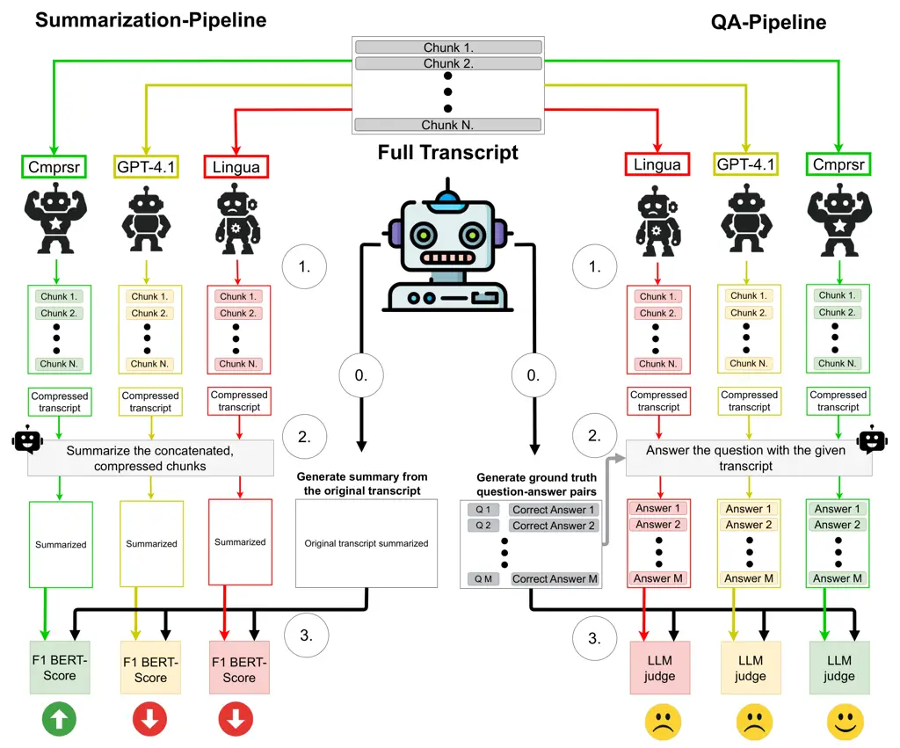
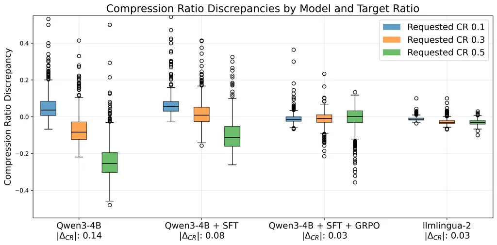
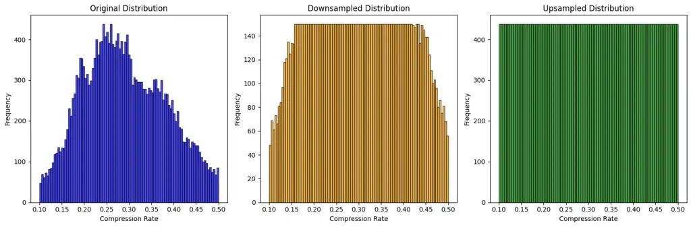
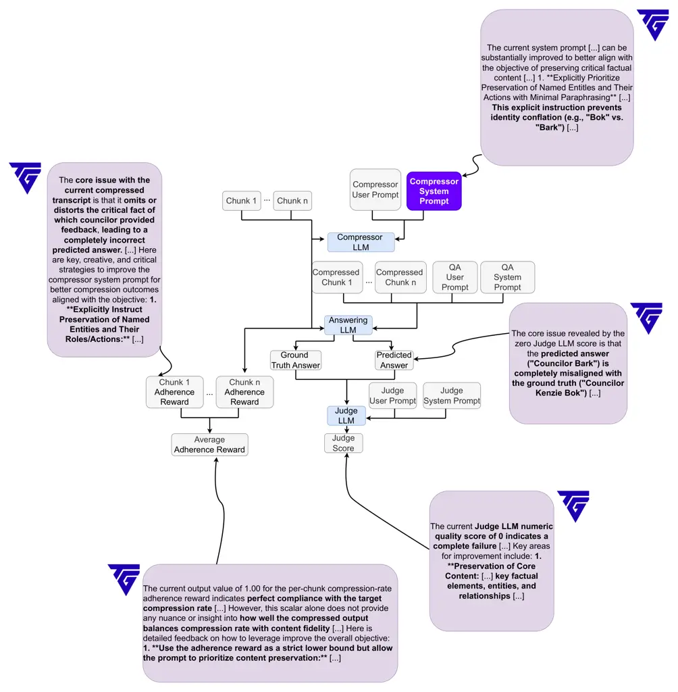

# Cmprsr: Abstractive Token-Level Question-Agnostic Prompt Compressor

Ivan Zakazov  Berke Argın  Oussama Gabouj^(†)^(†)footnotemark:  Kamel
Charaf^(†)^(†)footnotemark: Alexander Sharipov^(†)^(†)footnotemark:
 Alexi Semiz  Lorenzo Drudi  Nicolas Baldwin Robert West Compresr Inc.
 EPFL {ivan, berke, oussama, kamel}@compresr.ai  
{alexander.sharipov, robert.west}@epfl.ch  
^(†)^(†)thanks: Authors contributed equally.

###### Abstract

Motivated by the high costs of using black-box Large Language Models
(LLMs), we introduce a novel prompt compression paradigm, under which we
use smaller LLMs to compress inputs for the larger ones. We present the
first comprehensive LLM-as-a-compressor benchmark spanning $`25`$ open-
and closed-source models, which reveals significant disparity in models’
compression ability in terms of (i) preserving semantically important
information (ii) following the user-provided compression rate (CR). We
further improve the performance of gpt-4.1-mini, the best overall
vanilla compressor, with Textgrad-based compression meta-prompt
optimization. We also identify the most promising open-source vanilla
LLM—Qwen3-4B—and post-train it with a combination of supervised
fine-tuning (SFT) and Group Relative Policy Optimization (GRPO),
pursuing the dual objective of CR adherence and maximizing the
downstream task performance. We call the resulting model Cmprsr and
demonstrate its superiority over both extractive and vanilla abstractive
compression across the entire range of compression rates on lengthy
inputs from MeetingBank and LongBench as well as short prompts from
GSM8k. The latter highlights Cmprsr’s generalizability across varying
input lengths and domains. Moreover, Cmprsr closely follows the
requested compression rate, offering fine control over the cost-quality
trade-off. Importantly, we show that in case of lengthy inputs,
compression can be practically lossless in terms of the downstream task
performance.

## 1 Introduction

The discovery of scaling laws Kaplan et al. (2020) set the trend for
training increasingly large Language Models (LMs). Despite rapid
advancements in both hardware and software supporting LLMs’ inference,
the costs of their usage continue to surge. This trend reflects not only
growing adoption Liang et al. (2025), but also the Jevons paradox
Luccioni et al. (2025): efficiency gains that spur even greater
consumption.

According to recent estimates Tully et al. (2025), $`87\%`$ of the
company’s spending on LLMs is attributed to black-box LLMs, accessed via
API. This means that in practice the only way the majority of LLM
consumers can optimize their spendings is through minimizing the
queries’ length passed to the models; this can be achieved with the
token-level prompt compression Li et al. (2025), i.e. exploiting the
redundancy of human language Shannon (1951) and mapping the original
sequence to a shorter one, while preserving original semantics.

We focus on the question-agnostic compression Jiang et al. (2023), which
aims to process the context provided to the model so that the
compression can be re-used for any context-related question or task:
possible use-cases include (i) combining compression with
Retrieval-Augmented Generation Gao et al. (2023) via retrieving
pre-compressed entries, (ii) single-call compressions of lengthy texts
such as meeting transcripts Hu et al. (2023) for their subsequent
comprehensive analysis involving multiple LLM calls, (iii) optimizing
LLM-powered learning platforms via compressing learning materials (iv)
addressing tokens-per-minute (TPM) API bandwidth limitations.

The most popular approaches tailored for this set-up are extractive
Jiang et al. (2023); Pan et al. (2024), meaning that compression is
posed as a binary classification problem of preserving/removing each of
the input sequence parts (usually tokens). We hypothesize that
abstractive methods, operating under a much larger space of valid
compressions, can provide better outputs through paraphrase of the input
sequence. To this end, we define $`2`$ metrics, characterizing the
quality of a Compressor LLM: (i) Target LLM performance on a downstream
task given its inputs are preprocessed by the Compressor (ii) Adherence
of the Compressor to the target Compression Rate (CR), reflecting user’s
tolerance to the quality deterioration versus the incurred costs. We ask
the following research questions (RQs):

- •
  RQ1. What are the compression capabilities of the off-the-shelf LLMs?
- •
  RQ2. Can we further improve their performance with prompt optimization
  techniques such as Yuksekgonul et al. (2025)?
- •
  RQ3 How does performance of an SFT/RL post-trained “small LLM”
  Compressor compares to the SOTA extractive approaches across different
  datasets?

We share results of the extensive benchmarking addressing RQ1, and show
that the answer to RQ2 is positive in case the prompt is used with the
same Compressor model it was optimized for. Most importantly, we present
Cmprsr, an abstractive Compressor outperforming SOTA extractive
compression across different CR-s, which answers RQ3.

## 2 Related work



Figure 2: Evaluation pipeline. We assess transcripts’ compressions on
$`2`$ downstream tasks. (i) Summarization, i.e we compute BertScore
between compressed and original. (ii) QA, where we build a dataset of
questions and answers from MeetingBank transcripts, and measure the
Target model’s accuracy using the compressed context.

Compression can be performed in either question-aware Shandilya et al.
(2024); Kim et al. (2025); Choi et al. (2024); Yoon et al. (2024) or
question-agnostic way. In the question-aware set-up, compression is
conditioned on the given question and aims to filter out all irrelevant
information. While allowing high CRs, this also prevents compression
re-usage for the new queries. Motivated by the use-cases detailed in
Sec. 1, we focus on question-agnostic set-up. According to Li et al.
(2025), prompt compression can also be divided into the following $`2`$
categories:

Embedding-level (a.k.a soft prompt methods Mu et al. (2023); Chevalier
et al. (2023)), which require access to the Target model, and are
therefore not viable for the black-box models.

Token-level (a.k.a hard prompt methods): (i) Extractive: compression
space is the set of order-preserving subsequences of the input; the
filtering can be implemented on the token Jiang et al. (2023); Pan et
al. (2024); Zhao et al. (2025) or the sentence Liskavets et al. (2025)
level. Notably, Hu et al. (2025); Shandilya et al. (2024) use RL
techniques to optimize the extraction policy. Filtering can be informed
by information entropy Jiang et al. (2023); Li et al. (2023), attention
scores Zhao et al. (2025) or performed with a classification model Pan
et al. (2024) (ii) Abstractive: the compression space is all sequences
over the vocabulary, which allows semantics-preserving reordering via
tokens not present in the input.

Below, we detail prior contributions falling into the same broad
category as ours, i.e. question-agnostic token-level abstractive
compression. Pu et al. (2024) rely on vanilla LLaMA-2-7B to perform
compression guided by demonstrations, optimized for the particular
dataset. Despite improvement over straightforward prompting, this method
is not readily generalizable across tasks, as each new dataset requires
generating/selecting a new set of demonstrations. In a recent work,
Zhang et al. (2025) develop another approach to abstractive compression,
using either GPT-4o-mini or Qwen-2.5: they rely on dynamic chunking and
chunk-specific CRs, which allows to preserve important context.

Neither of the two above-mentioned methods compare a meaningful number
of LLMs in terms of their aptitude for compression, which, as we show,
greatly varies. Furthermore, according to our experiments, even the
models dominating the "vanilla compression leaderboard" can be
significantly improved with post-training in terms of both compression
quality and adherence to the user-specified CR. The work of Chuang et
al. (2024) most closely addresses this limitation: while it still
experiments with a single backbone (Vicuna-7B), the model is actually
tuned for better compressions. The main limitation of the presented
approach is that it falls short of adopting RL: Vicuna-7B serves as both
Compressor and the Target model, and the signal comes from the semantic
preservation loss between the original and the compressed input
activations. Among the works targeting specific downstream tasks,
Larionov and Eger (2025) investigate compression for the machine
translation quality assessment. While the resulting model cannot be used
for prompt compression "in the wild", the authors notably introduce RL
(ORPO) for training an abstractive compressor.

## 3 CompressionBench

We focus on the following $`2`$ metrics reflecting the practical
usability of a Compressor model: (i) adherence to the desired CR:
$`CR=n_{tkns}^{cmpr}/n_{tkns}^{original}`$;
$`\Delta_{CR}=CR_{real}-CR_{desired}`$, where $`desired`$ represents the
user-defined $`CR`$, and $`real`$ stands for the actual one; (ii)
performance on the downstream tasks given compressed inputs.

Figure 2 illustrates the 2 evaluation pipelines used to assess the
impact of compression on model utility: summarization and question
answering (QA) pipelines. The template of the Compressor prompt is
provided in the Appendix. It includes length conditioning, where the
desired CR is converted into a target token count and appended to the
system prompt. For both the benchmarking and the training of Cmprsr,
transcripts are segmented into manageable chunks before being passed to
the Compressor model, following the methodology of Pan et al. (2024) to
avoid truncation of incomplete sentences. Compressed chunks are then
concatenated to reconstruct the full compressed transcript. We evaluate
the resulting compressions through two pipelines:

|                                     |                 |       |       |         |      |      |      |      |      |
| ----------------------------------- | --------------- | ----- | ----- | ------- | ---- | ---- | ---- | ---- | ---- |
|                                     | $`\Delta_{CR}`$ |       |       | BERT-F1 |      |      | QA   |      |      |
| Requested CR                        | 0.1             | 0.3   | 0.5   | 0.1     | 0.3  | 0.5  | 0.1  | 0.3  | 0.5  |
| Closed-source models                |                 |       |       |         |      |      |      |      |      |
| gpt-5-nano                          | 0.19            | 0.17  | 0.04  | 0.87    | 0.88 | 0.88 | 0.25 | 0.30 | 0.31 |
| gpt-4.1-mini                        | 0.07            | -0.00 | -0.17 | 0.89    | 0.90 | 0.90 | 0.20 | 0.29 | 0.30 |
| gpt-5-mini                          | 0.13            | 0.11  | 0.10  | 0.86    | 0.87 | 0.87 | 0.19 | 0.25 | 0.27 |
| gpt-5                               | 0.10            | 0.08  | 0.06  | 0.87    | 0.88 | 0.88 | 0.18 | 0.25 | 0.25 |
| gemini-2.0-flash-lite               | 0.09            | 0.00  | -0.17 | 0.88    | 0.89 | 0.89 | 0.17 | 0.24 | 0.25 |
| gpt-4.1-nano                        | 0.04            | -0.02 | -0.19 | 0.87    | 0.89 | 0.89 | 0.15 | 0.26 | 0.25 |
| gpt-4.1                             | 0.06            | -0.02 | -0.19 | 0.88    | 0.89 | 0.89 | 0.17 | 0.23 | 0.25 |
| gemini-2.5-flash                    | 0.03            | -0.03 | -0.16 | 0.88    | 0.89 | 0.89 | 0.15 | 0.22 | 0.24 |
| o4-mini                             | 0.10            | 0.05  | -0.17 | 0.88    | 0.88 | 0.88 | 0.14 | 0.22 | 0.21 |
| Large Open-source models ($`>10B`$) |                 |       |       |         |      |      |      |      |      |
| gemma-3-12b-it                      | 0.18            | 0.07  | -0.05 | 0.89    | 0.89 | 0.89 | 0.22 | 0.25 | 0.26 |
| Mistral-Small-3.1-24B               | 0.14            | -0.04 | -0.23 | 0.88    | 0.89 | 0.89 | 0.22 | 0.24 | 0.23 |
| DeepSeek-V3                         | 0.11            | -0.05 | -0.24 | 0.89    | 0.89 | 0.89 | 0.21 | 0.24 | 0.25 |
| Small Open-source models ($`<10B`$) |                 |       |       |         |      |      |      |      |      |
| Llama-3.2-3B                        | 0.05            | -0.10 | -0.30 | 0.87    | 0.87 | 0.87 | 0.17 | 0.21 | 0.22 |
| Qwen3-4B                            | 0.05            | -0.08 | -0.26 | 0.86    | 0.88 | 0.88 | 0.16 | 0.21 | 0.22 |
| Qwen2.5-7B                          | 0.08            | -0.11 | -0.31 | 0.87    | 0.88 | 0.88 | 0.16 | 0.19 | 0.18 |
| gemma-3-4b                          | 0.00            | -0.15 | -0.35 | 0.87    | 0.87 | 0.88 | 0.13 | 0.17 | 0.19 |
| Llama-3.1-8B                        | -0.02           | -0.19 | -0.39 | 0.85    | 0.86 | 0.86 | 0.14 | 0.17 | 0.15 |
| Qwen2.5-3B                          | 0.09            | -0.08 | -0.24 | 0.85    | 0.86 | 0.86 | 0.10 | 0.12 | 0.12 |
| Extractive                          |                 |       |       |         |      |      |      |      |      |
| llmlingua-2                         | -0.01           | -0.03 | -0.03 | 0.86    | 0.89 | 0.9  | 0.16 | 0.34 | 0.42 |

Table 1: Compression performance of various vanilla models on the
MeetingBank transcripts; truncated version of Table 4. Within each
group, we sort the models based on the average QA performance across
compression rates.

Summarization pipeline. The goal of this pipeline is to evaluate how
well the compressed transcripts preserve the semantic content necessary
for high-quality summaries. We generate summaries for both the original
and the compressed transcripts using the same Target model, and compute
the BERTScore-F1 between them: a higher BERTScore indicates that the
compressed input preserves the key content of the original.

QA pipeline. This setup assesses whether the compressed context still
contains the information needed to answer questions accurately. We
construct a dataset of question–answer pairs derived from MeetingBank
transcripts and compare the Target model’s accuracy when conditioned on
the compressed versus the original contexts. A smaller performance gap
indicates that the Compressor successfully preserves task-relevant
information.

We present the most important MB results in Table 1, and provide full MB
results (Table 4) along with the GSM8k results (Table 3) and the full
names of the models (Table 2) in the Appendix. We dissect the
benchmarking results below as a set of enumerated findings:

1.  F1
    Vanilla LLMs poorly adhere to the prompted CR. While they are
    susceptible to the prompted rate, the length of the generations
    skews towards some fixed CR, leading to "under-compression" for high
    CRs (0.1) and "over-compression" for low CRs (0.5). LLMLingua-2 does
    not suffer from this limitation, as the classification threshold is
    dynamically adjusted for the extractive methods.
2.  F2
    Abstractive LLMs excel at high CRs. Unlike extractive methods, they
    can rephrase and condense information beyond the original tokens,
    preserving key semantics. This highlights the crucial role of
    abstraction for aggressive compression.
3.  F3
    Comparison of LLMs. Although closed-source models generally
    outperform large open-source models, which in turn surpass smaller
    open-source ones, performance is not monotonic within each class.
    Model size or release date alone does not predict the outcome: for
    example, gpt-4.1-mini outperforms both gpt-4.1 and gpt-5-mini on CR
    adherence and compression quality.
4.  F4
    LLMs vastly outperform LLMLingua-2 on the shorter prompts from
    GSM8k, although CR adherence is worse than for long MB prompt (Table
    3).

The results from this section inform our choice of the models for the
Cmprsr experiments: Qwen3-4B among the small open-source models (it
performs on par with LLama-3.2-3B with slighly better CR adherence), and
gpt-4.1-mini among the closed-source ones.

### 3.1 Boosting vanilla performance with TextGrad

Motivation. As LLMs have grown in popularity, prompting has matured,
offering diverse techniques such as step-by-step reasoning and few-shot
examples. Yet selecting the right technique and phrasing remains
nontrivial and task-dependent. To address this, we employ TextGrad
Yuksekgonul et al. (2024) for principled prompt optimization. TextGrad
treats texts as optimization variables, refining them via
natural-language “gradients.”

Method. We model the MeetingBank QA benchmark as a computation graph
whose nodes represent LLM pipeline stages. Each node has a role
description to help the optimizer-LLM grasp the high-level dependencies.
Beginning with ground-truth evaluation at the output, TextGrad (i)
identifies failures, (ii) proposes fixes, (iii) _backpropagates_
feedback through the graph, and (iv) updates the compressor’s system
prompt. We evaluate QA performance using a 10-point LLM judge that
grades each answer. We also assess adherence to the target CR. Further
details appear in Appendix E. We applied TextGrad to optimize the system
prompt for two well-performing compressor LLMs, gpt-4.1-mini and
Qwen3-4B. The optimization trajectories differed significantly between
the two models.

TextGrad for Qwen3-4B: Figure 3 shows QA quality ($`y`$-axis) versus
compression-rate adherence ($`x`$-axis) on a 100-transcript hold-out
set, with each point representing a TextGrad iteration. Panels display
parts of the initial and best prompts.

The plot reveals a trade-off: longer outputs (weaker adherence) retain
more relevant information, boosting the LLM-Judge score. The
optimization trajectory oscillates, with TextGrad alternating between
improving quality and tightening adherence. The resulting prompts form a
Pareto front, enabling choice between strict CR adherence and slightly
longer, higher-quality compressions. The best prompt yields a 0.51 gain
in the average LLM-Judge score with only a 0.02 drop in CR adherence.

Figure 3: Prompt optimization for Qwen3-4B.

TextGrad for gpt-4.1-mini: In contrast, Figure 4 shows that TextGrad
produced smaller gains for gpt-4.1-mini. By iteration 33, it achieved a
balanced prompt with a 0.06 judge-score increase and a 0.07 drop in
adherence. The resulting prompt resembles Qwen3-4B’s, combining
retention instructions with positive and negative few-shot examples.

This may be because gpt-4.1-mini starts from a stronger baseline (7.11
vs. 6.37 for Qwen3-4B), leaving less room for improvement. Even after 60
iterations (vs. 20 for Qwen3-4B), the Pareto frontier did not expand
further.

Notably, for gpt-4.1-mini, the optimizer found prompts that improved
adherence (+0.009) but reduced the judge score (-0.25). These prompts
emphasize length control (e.g., “… estimate token count and iteratively
trim non-essential content …”). This result reflects the optimization
trajectory oscillations discussed above. Namely, when the quality
improvements stop, TextGrad pivots to the second objective and tightens
CR adherence.

Figure 4: Prompt optimization for gpt-4.1-mini.

## 4 Cmprsr

### 4.1 Supervised fine-tuning (SFT)

#### Data generation.

We use the strongest vanilla Compressor, gpt-4.1-mini, to generate MB
compressions for distillation, sampling prompted CRs from $`[0.1,0.7]`$.
The resulting length distribution deviates from the uniform prompt-rate
range, skewing toward $`\approx 0.3`$. To mitigate this, we test two
rebalancing strategies: (i) downsampling, dropping overrepresented
lengths, and (ii) upsampling, boosting underrepresented ones. Each
generated compression is labeled with its token count.

#### SFT.

This stage has two goals: (i) improving Qwen3-4B performance by
distilling gpt-4.1-mini compression strategies, and (ii) enhancing
adherence to the prompted CR. To this end, we append the true token
count to the prompt, i.e., the fine-tuning sequence is Original + Length
Conditioned Prompt (len(Compression)) + Compression, and the loss is
computed on the Compression part; this “length conditioning” is inspired
by Hindsight Instruction Relabelling (HIR) Zhang et al. (2023); Shypula
et al. (2024). Preliminary experiments also tested “quality
conditioning,” i.e., passing the normalized compression quality relative
to others in the same rate range, but it had limited success. We varied
the learning rate in $`[10^{-4},10^{-8}]`$ and selected the SFT
checkpoint with the best validation accuracy: the one trained on the
upsampled dataset with $`lr=10^{-5}`$.

### 4.2 GRPO

To ensure that the model not only achieves the desired CR but also
retains task-relevant information, we extend the SFT stage with GRPO
training. For each input chunk $`x`$ and its compressed form $`x_{C}`$,
we define two complementary reward functions: a length reward to control
compression and a quality reward to maintain semantic fidelity.

Length reward. The length reward (1) encourages the model to adhere to
the target CR $`r_{T}`$. For a given input, the achieved CR is computed
as $`r_{C}=\frac{|x_{C}|}{|x|}`$. This formulation penalizes
over-compression (when $`r_{C}>r_{T}`$), while assigning a reward close
to $`1`$ if the compression stays within or below the target threshold.

```math
R_{\text{len}}=1-\max\bigl(0,r_{C}-r_{T}\bigr), \tag{1}
```

Quality reward.

The quality reward $`R_{\text{qual}}`$ (2) measures how well the
compressed chunk $`x_{C}`$ preserves information relevant to the
downstream task. We first experimented with a QA-based reward, computed
by evaluating the compressed text on a QA task against the ground-truth
answer from the uncompressed text. However, the model exploited this
reward by outputting many possible answers instead of compressing
effectively. We therefore define a summary-based reward, where the
summary is generated from the original (uncompressed) text. The goal is
for the compressed text to produce the same summary as the original when
given to the target LLM.Given a query $`q`$ and answer
$`a=(a_{1},\dots,a_{|a|})`$ from chunk $`x`$, the reward is:

```math
R_{\text{qual}}=\frac{1}{1-\frac{1}{|a|}\sum_{i=1}^{|a|}\log P\bigl(a_{i}\mid q,x_{C},a_{<i}\bigr)}, \tag{2}
```

where $`|a|`$ is the answer length and $`a_{<i}=(a_{1},\dots,a_{i-1})`$
its prefix. Intuitively, the reward increases when $`x_{C}`$ enables the
solver to predict the answer with high probability, indicating that the
compressed input has preserved sufficient task-relevant information.

Dual-objective reward. To balance compactness and informativeness, we
combine both objectives into a single reward signal (Equation 3). This
combined reward simultaneously penalizes the unnecessary verbosity,
avoids harmful over compression, and promotes representations that are
both efficient and effective for task performance.

```math
R=R_{\text{qual}}+R_{\text{len}}. \tag{3}
```

Training. Further details of GRPO training are given in Sec. B.1. While
we also experimented with DPO and ORPO, these approaches did not
outperform the GRPO-based pipeline; we describe these setups in Sec. B.2
of the Appendix.

Figure 5: Performance comparison across QA and summary benchmarks. Left
panel shows precision scores for QA benchmarks (GSM8K, Ruler, LongBench
QA, InfiniteBench, LongBench v2, and MeetingBank QA). Right panel shows
BERTScore F1 scores for summary benchmarks (MeetingBank Summary and
LongBench Summary). The horizontal dashed lines indicate discrepancy
between prompted and real compression ratios, and the horizontal black
line represents the no-compression baseline. Detailed numerical results
for compression rates and performance scores are also provided in
Appendix C.

### 4.3 Evaluation

To assess the effectiveness of our approach, we evaluate model
performance under two complementary task settings as explained in
Section 3: summarization and QA. Our primary focus is (i) to examine
whether the compressed representations are question-agnostic, i.e., they
preserve general information that supports diverse queries, and (ii) to
verify whether they retain sufficient abstraction to follow the intent
of summarization tasks. Although the model is trained exclusively on the
MeetingBank dataset, we evaluate it across multiple out-of-distribution
(OOD) benchmarks, to test generalization. These include GSM8K for
mathematical reasoning, MeetingBank (QA and Summarization), both version
of LongBench, InfiniteBench, and Ruler. The evaluation pipeline operates
as follows: a compressed text $`x_{C}`$ is first generated, which is
then fed into the solver model (gpt-5-mini) to produce a summary /
answer task-specific questions.

We compare Cmprsr with $`2`$ SOTA extractive methods – LLMLingua-2 and
DAC Pan et al. (2024); Zhao et al. (2025) – and vanilla abstractive
compression. We drop the original LLMLingua Jiang et al. (2023) and
Selective context Li et al. (2023), as they were decisively outperformed
by the baselines mentioned above. To achieve a more accurate comparison,
we use the same backbone – Qwen-3-4B – for Cmprsr and DAC.

We report the evaluation results in Figure 5 and Table 8 in the
Appendix. For summarization tasks, we adopt the Bert-F1 score as the
primary metric, while for QA tasks we use precision. For LongBench,
LongBenchv2, InfiniteBench and Ruler, which include multiple subtasks
within the same dataset, we aggregate results by averaging over
QA-related tasks and separately averaging over summarization-related
tasks. Full results for each subtask are provided in the Appendix C.
Notably, DAC performance on GSM8k differs significantly from the
original paper, as we run it in the zero-shot mode, and compress the
question itself, while Zhao et al. (2025) compress demonstrations.

Based on Table 8, higher raw scores are often achieved at the cost of
exceeding the target CR, i.e., resulting in positive $`\Delta_{CR}`$. To
account for that, we determine the best method under the constraint of
$`\Delta_{CR}\leq\epsilon`$. Under this criterion, Cmprsr consistently
achieves the best trade-off across both QA and summarization tasks. By
effectively combining SFT with GRPO, it maintains $`\Delta_{CR}\leq 0`$,
ensuring strict adherence to the target CR while outperforming baseline
models. Figure 6 further illustrates model adherence to the prompted CR
across the training stages.



Figure 6: Distribution of $`\Delta_{CR}`$ across different models,
illustrating adherence to the target CR.

LLMLingua-2 demonstrates stronger adherence due to its inherently
extractive compression strategy. In contrast, the Qwen3-4B model fails
to match the requested CR, often producing outputs with large negative
$`\Delta_{CR}`$ values. This suggests that, without targeted training,
the model tends to over-compress. SFT partially mitigates this issue by
reducing the average discrepancy, though it still leaves considerable
variance. However, the Cmprsr model, which combines SFT with GRPO,
achieves the most balanced results. It keeps discrepancies close to zero
while simultaneously reducing variance across all CR. This progression
highlights a clear evolution of target adherence throughout the training
pipeline: from poor alignment in the vanilla model, to partial
improvement with single-objective fine-tuning, to robust adherence with
Cmprsr. Moreover, the reduction in variance shows that Cmprsr is not
only accurate on average but also reliable at the instance level.

Importantly, Figure 5 shows that the datasets with the longest entries
(LongBench V2, Infinite bench) allow for almost lossless compression in
terms of the downstream task performance.

### 4.4 Analysis

Cross-entropy under summarization. Table 7 reports cross-entropy (CE)
loss for the summarization task across CRs. Cmprsr yields consistently
lower CE than llmlingua-2 throughout the range $`CR\!\in\![0.1,0.7]`$.
Since both compressors were trained with target rates in this interval,
we restrict evaluation accordingly. Notably, CE remains near its
uncompressed baseline even at $`CR{=}0.5`$, indicating that substantial
prompt reduction can be achieved without materially degrading next-token
predictive quality. We observe the same trend for gemma-3 models of
multiple sizes (see Sec. B.5 in Appendix), suggesting that Cmprsr
generalizes across architectures.

Figure 7: Cross-Entropy (CE) losses of Llama-3.3-70B 4-bit for the
summarization task under two prompt compression methods, LLMLingua-2 and
Cmprsr, across target CRs. Lower CE indicates better information
preservation. The dashed green line marks the mean CE without
compression, while the dashed purple line marks CE with empty
compression. Numeric tags denote the corresponding target $`t`$ and
$`CE`$. Results are averaged over 1000 MeetingBank validation samples.

Local structure preservation. To probe how compression affects surface
form, we compute $`n`$-gram overlaps between compressed and original
prompts (Table 6). Cmprsr outputs show higher 2-gram and 3-gram
overlaps, especially at lower CR. Cmprsr preserves local phrase
structure more faithfully, whereas llmlingua-2 exhibits higher
fragmentation. This pattern supports the hypothesis that Cmprsr
maintains semantic adequacy and short-range syntactic cohesion, which
can be advantageous for downstream components that rely on multi-token
dependencies.

## 5 Conclusion

We propose using LLMs for abstractive prompt compression, starting with
a comprehensive benchmark of $`25`$ off-the-shelf models. Upon that, we
improve the best vanilla compressor—GPT-4.1-mini—with the Textgrad-based
meta-prompt optimization, and one of the smaller models—Qwen-3-4B—using
SFT and GRPO posttraining. The resulting Cmprsr outperforms both the
extractive SOTA LLMLingua-2 and the leading abstractive vanilla –
Textgrad-boosted gpt-4.1-mini.

We argue that "small LLMs" have become capable enough for the
practitioners to shift their focus to the paradigm of smaller LLMs
compressing prompts for the larger ones. However, vanilla models do not
exhibit sufficient performance and should be post-trained for this
specific task. Cmprsr both pioneers this line of research and generates
SOTA level compressions, suggesting immediate practical value for the
community.

## 6 Limitations

While Cmprsr outperforms the baselines across the Compression Rate
spectrum, it is important to note that (i) it is based on a 4B backbone,
while e.g. LLMLingua-2 is a fine-tuned xlm-roberta-large of 0.55B
parameters (ii) the autoregressive nature of Cmprsr leads to the latency
overhead.

\(i\) implies that, for the compression costs to be offset by savings,
Cmprsr should be paired with a sufficiently large Target model. (ii)
suggests that the prime Cmprsr use-cases are those which allow for the
pre-computed compressions: see some of them listed in Sec. 1.

Apart from that, the current version of Cmprsr was trained on a single
dataset, suggesting room for improvement and potentially sub-optimal
behavior on more specialized OOD data, e.g. from coding or medical
domain. Further performance gains can also be reached through more
elaborate GRPO reward design, as the current reward is biased toward
summarization.

## References

- Chevalier et al. (2023) A. Chevalier, A. Wettig, A. Ajith, and D. Chen
  Adapting language models to compress contexts. In Proceedings of the
  2023 Conference on Empirical Methods in Natural Language
  Processing, H. Bouamor, J. Pino, and K. Bali (Eds.), Singapore,
  pp. 3829–3846. External Links:
  [Link](https://aclanthology.org/2023.emnlp-main.232/),
  [Document](https://dx.doi.org/10.18653/v1/2023.emnlp-main.232) Cited
  by: §2.
- Choi et al. (2024) E. Choi, S. Lee, M. Choi, J. Park, and J. Lee From
  reading to compressing: exploring the multi-document reader for prompt
  compression. In Findings of the Association for Computational
  Linguistics: EMNLP 2024, Y. Al-Onaizan, M. Bansal, and Y. Chen (Eds.),
  Miami, Florida, USA, pp. 14734–14754. External Links:
  [Link](https://aclanthology.org/2024.findings-emnlp.864/),
  [Document](https://dx.doi.org/10.18653/v1/2024.findings-emnlp.864)
  Cited by: §2.
- Chuang et al. (2024) Y. Chuang, T. Xing, C. Chang, Z. Liu, X. Chen,
  and X. Hu Learning to compress prompt in natural language formats. In
  Proceedings of the 2024 Conference of the North American Chapter of
  the Association for Computational Linguistics: Human Language
  Technologies (Volume 1: Long Papers), K. Duh, H. Gomez, and S. Bethard
  (Eds.), Mexico City, Mexico, pp. 7756–7767. External Links:
  [Link](https://aclanthology.org/2024.naacl-long.429/),
  [Document](https://dx.doi.org/10.18653/v1/2024.naacl-long.429) Cited
  by: §2.
- Gao et al. (2023) Y. Gao, Y. Xiong, X. Gao, K. Jia, J. Pan, Y. Bi, Y.
  Dai, J. Sun, Q. Guo, M. Wang, and H. Wang Retrieval-augmented
  generation for large language models: a survey. ArXiv abs/2312.10997.
  External Links:
  [Link](https://api.semanticscholar.org/CorpusID:266359151) Cited by:
  §1.
- Hu et al. (2025) J. Hu, W. Zhang, Y. Wang, Y. Hu, B. Xiao, M. Tan,
  and Q. Du Dynamic compressing prompts for efficient inference of large
  language models. External Links: 2504.11004,
  [Link](https://arxiv.org/abs/2504.11004) Cited by: §2.
- Hu et al. (2023) Y. Hu, T. Ganter, H. Deilamsalehy, F. Dernoncourt, H.
  Foroosh, and F. Liu MeetingBank: a benchmark dataset for meeting
  summarization. In Proceedings of the 61st Annual Meeting of the
  Association for Computational Linguistics (ACL), Toronto, Canada.
  Cited by: Appendix E, §1.
- Jiang et al. (2023) H. Jiang, Q. Wu, C. Lin, Y. Yang, and L. Qiu
  LLMLingua: compressing prompts for accelerated inference of large
  language models. In Proceedings of the 2023 Conference on Empirical
  Methods in Natural Language Processing, H. Bouamor, J. Pino, and K.
  Bali (Eds.), Singapore, pp. 13358–13376. External Links:
  [Link](https://aclanthology.org/2023.emnlp-main.825),
  [Document](https://dx.doi.org/10.18653/v1/2023.emnlp-main.825) Cited
  by: §1, §1, §2, §4.3.
- Kaplan et al. (2020) J. Kaplan, S. McCandlish, T. Henighan, T. B.
  Brown, B. Chess, R. Child, S. Gray, A. Radford, J. Wu, and D. Amodei
  Scaling laws for neural language models. External Links: 2001.08361,
  [Link](https://arxiv.org/abs/2001.08361) Cited by: §1.
- Kim et al. (2025) S. Kim, G. Jung, and S. Lee ACoRN: noise-robust
  abstractive compression in retrieval-augmented language models.
  External Links: 2504.12673, [Link](https://arxiv.org/abs/2504.12673)
  Cited by: §2.
- Larionov and Eger (2025) D. Larionov and S. Eger PromptOptMe:
  error-aware prompt compression for LLM-based MT evaluation metrics. In
  Proceedings of the 2025 Conference of the Nations of the Americas
  Chapter of the Association for Computational Linguistics: Human
  Language Technologies (Volume 1: Long Papers), L. Chiruzzo, A. Ritter,
  and L. Wang (Eds.), Albuquerque, New Mexico, pp. 11807–11820. External
  Links: [Link](https://aclanthology.org/2025.naacl-long.592/),
  [Document](https://dx.doi.org/10.18653/v1/2025.naacl-long.592), ISBN
  979-8-89176-189-6 Cited by: §2.
- Li et al. (2023) Y. Li, B. Dong, F. Guerin, and C. Lin Compressing
  context to enhance inference efficiency of large language models. In
  Proceedings of the 2023 Conference on Empirical Methods in Natural
  Language Processing, H. Bouamor, J. Pino, and K. Bali (Eds.),
  Singapore, pp. 6342–6353. External Links:
  [Link](https://aclanthology.org/2023.emnlp-main.391/),
  [Document](https://dx.doi.org/10.18653/v1/2023.emnlp-main.391) Cited
  by: §2, §4.3.
- Li et al. (2025) Z. Li, Y. Liu, Y. Su, and N. Collier Prompt
  compression for large language models: a survey. In Proceedings of the
  2025 Conference of the Nations of the Americas Chapter of the
  Association for Computational Linguistics: Human Language Technologies
  (Volume 1: Long Papers), L. Chiruzzo, A. Ritter, and L. Wang (Eds.),
  Albuquerque, New Mexico, pp. 7182–7195. External Links:
  [Link](https://aclanthology.org/2025.naacl-long.368/), ISBN
  979-8-89176-189-6 Cited by: §1, §2.
- Liang et al. (2025) W. Liang, Y. Zhang, M. Codreanu, J. Wang, H. Cao,
  and J. Zou The widespread adoption of large language model-assisted
  writing across society. External Links: 2502.09747,
  [Link](https://arxiv.org/abs/2502.09747) Cited by: §1.
- Liskavets et al. (2025) B. Liskavets, M. Ushakov, S. Roy, M.
  Klibanov, A. Etemad, and S. K. Luke Prompt compression with
  context-aware sentence encoding for fast and improved llm inference.
  In , AAAI’25/IAAI’25/EAAI’25. External Links: ISBN 978-1-57735-897-8,
  [Link](https://doi.org/10.1609/aaai.v39i23.34639),
  [Document](https://dx.doi.org/10.1609/aaai.v39i23.34639) Cited by: §2.
- Luccioni et al. (2025) A. S. Luccioni, E. Strubell, and K. Crawford
  From efficiency gains to rebound effects: the problem of jevons’
  paradox in ai’s polarized environmental debate. In Proceedings of the
  2025 ACM Conference on Fairness, Accountability, and Transparency,
  FAccT ’25, New York, NY, USA, pp. 76–88. External Links: ISBN
  9798400714825, [Link](https://doi.org/10.1145/3715275.3732007),
  [Document](https://dx.doi.org/10.1145/3715275.3732007) Cited by: §1.
- Mu et al. (2023) J. Mu, X. L. Li, and N. Goodman Learning to compress
  prompts with gist tokens. . External Links: 2304.08467 Cited by: §2.
- Pan et al. (2024) Z. Pan, Q. Wu, H. Jiang, M. Xia, X. Luo, J.
  Zhang, Q. Lin, V. Ruhle, Y. Yang, C. Lin, H. V. Zhao, L. Qiu, and D.
  Zhang LLMLingua-2: data distillation for efficient and faithful
  task-agnostic prompt compression. In Findings of the Association for
  Computational Linguistics ACL 2024, L. Ku, A. Martins, and V. Srikumar
  (Eds.), Bangkok, Thailand and virtual meeting, pp. 963–981. External
  Links: [Link](https://aclanthology.org/2024.findings-acl.57) Cited by:
  §1, §2, §3, §4.3.
- Pu et al. (2024) X. Pu, T. He, and X. Wan Style-compress: an LLM-based
  prompt compression framework considering task-specific styles. In
  Findings of the Association for Computational Linguistics: EMNLP
  2024, Y. Al-Onaizan, M. Bansal, and Y. Chen (Eds.), Miami, Florida,
  USA, pp. 14533–14549. External Links:
  [Link](https://aclanthology.org/2024.findings-emnlp.851/),
  [Document](https://dx.doi.org/10.18653/v1/2024.findings-emnlp.851)
  Cited by: §2.
- Shandilya et al. (2024) S. Shandilya, M. Xia, S. Ghosh, H. Jiang, J.
  Zhang, Q. Wu, and V. Rühle TACO-rl: task aware prompt compression
  optimization with reinforcement learning. External Links: 2409.13035,
  [Link](https://arxiv.org/abs/2409.13035) Cited by: §2, §2.
- Shannon (1951) C. E. Shannon Prediction and entropy of printed
  english. The Bell System Technical Journal 30 (1), pp. 50–64. External
  Links:
  [Document](https://dx.doi.org/10.1002/j.1538-7305.1951.tb01366.x)
  Cited by: §1.
- Shypula et al. (2024) A. Shypula, A. Madaan, Y. Zeng, U. Alon, J. R.
  Gardner, Y. Yang, M. Hashemi, G. Neubig, P. Ranganathan, O. Bastani,
  and A. Yazdanbakhsh Learning performance-improving code edits. In The
  Twelfth International Conference on Learning Representations, External
  Links: [Link](https://openreview.net/forum?id=ix7rLVHXyY) Cited by:
  §4.1.
- Tully et al. (2025) T. Tully, J. Redfern, D. Das, and D. Xiao 2025
  mid-year llm market update: foundation model landscape + economics.
  Note: Menlo Ventures Report External Links:
  [Link](https://menlovc.com/perspective/2025-mid-year-llm-market-update/)
  Cited by: §1.
- Yoon et al. (2024) C. Yoon, T. Lee, H. Hwang, M. Jeong, and J. Kang
  CompAct: compressing retrieved documents actively for question
  answering. In Proceedings of the 2024 Conference on Empirical Methods
  in Natural Language Processing, Y. Al-Onaizan, M. Bansal, and Y. Chen
  (Eds.), Miami, Florida, USA, pp. 21424–21439. External Links:
  [Link](https://aclanthology.org/2024.emnlp-main.1194/),
  [Document](https://dx.doi.org/10.18653/v1/2024.emnlp-main.1194) Cited
  by: §2.
- Yuksekgonul et al. (2024) M. Yuksekgonul, F. Bianchi, J. Boen, S.
  Liu, Z. Huang, C. Guestrin, and J. Zou TextGrad: automatic
  "differentiation" via text. External Links: 2406.07496,
  [Link](https://arxiv.org/abs/2406.07496) Cited by: §3.1.
- Yuksekgonul et al. (2025) M. Yuksekgonul, F. Bianchi, J. Boen, S.
  Liu, P. Lu, Z. Huang, C. Guestrin, and J. Zou Optimizing generative ai
  by backpropagating language model feedback. Nature 639, pp. 609–616.
  Cited by: 2nd item.
- Zhang et al. (2023) T. Zhang, F. Liu, J. Wong, P. Abbeel, and J. E.
  Gonzalez The wisdom of hindsight makes language models better
  instruction followers. In Proceedings of the 40th International
  Conference on Machine Learning, ICML’23. Cited by: §4.1.
- Zhang et al. (2025) T. Zhang, Y. Wang, and D. Z. Wang SCOPE: a
  generative approach for llm prompt compression. External Links:
  2508.15813, [Link](https://arxiv.org/abs/2508.15813) Cited by: §2.
- Zhao et al. (2025) Y. Zhao, Z. Li, H. Zhao, B. Qi, and L. Guoming DAC:
  a dynamic attention-aware approach for task-agnostic prompt
  compression. In Proceedings of the 63rd Annual Meeting of the
  Association for Computational Linguistics (Volume 1: Long Papers), W.
  Che, J. Nabende, E. Shutova, and M. T. Pilehvar (Eds.), Vienna,
  Austria, pp. 19395–19407. External Links:
  [Link](https://aclanthology.org/2025.acl-long.952/),
  [Document](https://dx.doi.org/10.18653/v1/2025.acl-long.952), ISBN
  979-8-89176-251-0 Cited by: §2, §4.3, §4.3.

## Appendix A CompressionBench details

In this section, we detail the exact versions of the models we use
(Table 2) and the full CompressionBench results on MeetingBank, GSM8k,
LongBenchV2 and Ruler.

### A.1 Initial Compressor System Prompt.

The following prompt was used as the initial system prompt in iteration
0 of TextGrad. Additionally, it was used in most experiments and
benchmarking across GSM8k, LongBench, and MeetingBank, unless stated
otherwise. This prompt was explicitly chosen to be dataset-agnostic and
work with most downstream applications.


### A.2 Models

We present all models using their short names, while ensuring that the
corresponding full model names are introduced when first mentioned.

| Full name                           | Short name            |
| ----------------------------------- | --------------------- |
| gpt-5-nano-2025-08-07               | gpt-5-nano            |
| gpt-4.1-mini-2025-04-14             | gpt-4.1-mini          |
| gpt-5-mini-2025-08-07               | gpt-5-mini            |
| gpt-5-2025-08-07                    | gpt-5                 |
| gemini-2.0-flash-lite               | gemini-2.0-flash-lite |
| gpt-4.1-nano-2025-04-14             | gpt-4.1-nano          |
| gpt-4.1-2025-04-14                  | gpt-4.1               |
| gemini-2.5-flash                    | gemini-2.5-flash      |
| o4-mini-2025-04-16                  | o4-mini-2025-04-16    |
| gemma-3-12b-it                      | gemma-3-12b-it        |
| Mistral-Small-3.1-24B-Instruct-2503 | Mistral-Small-3.1-24B |
| DeepSeek-V3                         | DeepSeek-V3           |
| Llama-3.3-70B-Instruct              | Llama-3.3-70B         |
| Qwen3-30B-A3B-Instruct-2507         | Qwen3-30B-A3B         |
| Qwen3-235B-A22B-Instruct-2507       | Qwen3-235B-A22B       |
| Qwen2.5-32B-Instruct                | Qwen2.5-32B           |
| gemma-3-27b-it                      | gemma-3-27b           |
| Meta-Llama-3.1-405B-Instruct        | Meta-Llama-3.1-405B   |
| Qwen2.5-14B-Instruct                | Qwen2.5-14B           |
| Llama-3.2-3B-Instruct               | Llama-3.2-3B          |
| Qwen3-4B-Instruct-2507              | Qwen3-4B              |
| Qwen2.5-7B-Instruct                 | Qwen2.5-7B            |
| gemma-3-4b-it                       | gemma-3-4b            |
| Llama-3.1-8B-Instruct               | Llama-3.1-8B          |
| Qwen2.5-3B-Instruct                 | Qwen2.5-3B            |
| flan-t5-xxl                         | flan-t5-xxl           |
| flan-t5-xl                          | flan-t5-xl            |

Table 2: Models and their short names

### A.3 CompressionBench results on MeetingBank

We present the full results for all models used to benchmark the LLM as
a compressor. Our evaluation includes 9 closed-source models and 18
open-source models spanning a wide range of parameter scales and
architectural families. All experiments were conducted on the validation
split of the MeetingBank dataset, which provides diverse and realistic
meeting transcripts for evaluation. From this split, we randomly
selected 100 samples, each of which was divided into multiple chunks
when exceeding the 512-token limit (the exact number of chunks varies
depending on the tokenizer used).

### A.4 CompressionBench results on GSM8k

We also report results using the GSM8k dataset to further evaluate the
models under a different task setting. In this case, all input sequences
are shorter than 512 tokens, so no chunking was required during
preprocessing. We randomly selected 300 samples from the validation
split of the dataset, ensuring sufficient coverage to assess the
performance of both open- and closed-source models under this setting.
In the math dataset, where the context is very short, LLM-Lingua
performs poorly, which is expected since extractive models cannot
effectively compress mathematical problem statements without
abstraction, rephrasing, or reordering of words. Meanwhile, the
decoder-only vanilla model shows relatively strong performance but does
not adhere to the target CR.

|                                     |                 |      |       |          |      |      |
| ----------------------------------- | --------------- | ---- | ----- | -------- | ---- | ---- |
|                                     | $`\Delta_{CR}`$ |      |       | Accuracy |      |      |
| Requested CR                        | 0.1             | 0.3  | 0.5   | 0.1      | 0.3  | 0.5  |
| Closed-source models                |                 |      |       |          |      |      |
| gpt-5-nano                          | 0.41            | 0.44 | 0.25  | 0.69     | 0.82 | 0.87 |
| gpt-5                               | 0.23            | 0.22 | 0.13  | 0.61     | 0.86 | 0.90 |
| gpt-5-mini                          | 0.20            | 0.23 | 0.12  | 0.55     | 0.85 | 0.88 |
| gpt-4.1                             | 0.22            | 0.17 | 0.05  | 0.58     | 0.82 | 0.86 |
| gemini-2.5-flash                    | 1.27            | 0.17 | 0.17  | 0.52     | 0.79 | 0.87 |
| gemini-2.0-flash-lite               | 0.34            | 0.31 | 0.16  | 0.55     | 0.78 | 0.80 |
| gpt-4.1-mini                        | 0.20            | 0.17 | 0.06  | 0.43     | 0.80 | 0.85 |
| gpt-4.1-nano-2025-04-14             | 0.10            | 0.13 | 0.01  | 0.17     | 0.62 | 0.76 |
| Large Open-source models ($`>10`$B) |                 |      |       |          |      |      |
| Meta-Llama-3.1-405B                 | 0.40            | 0.33 | 0.13  | 0.78     | 0.84 | 0.84 |
| Qwen3-235B-A22B                     | 0.36            | 0.21 | 0.04  | 0.77     | 0.81 | 0.84 |
| Qwen2.5-32B                         | 0.40            | 0.24 | 0.06  | 0.77     | 0.80 | 0.83 |
| DeepSeek-V3                         | 0.34            | 0.21 | 0.04  | 0.70     | 0.80 | 0.83 |
| Qwen3-30B-A3B                       | 0.36            | 0.21 | 0.04  | 0.69     | 0.77 | 0.80 |
| gemma-3-27b-it                      | 0.33            | 0.32 | 0.45  | 0.66     | 0.74 | 0.80 |
| Mistral-Small-3.1-24B               | 0.41            | 0.28 | 0.10  | 0.67     | 0.75 | 0.77 |
| Llama-3.3-70B                       | 0.25            | 0.22 | 0.06  | 0.51     | 0.73 | 0.81 |
| gemma-3-12b-it                      | 0.29            | 0.28 | 0.13  | 0.45     | 0.74 | 0.74 |
| Qwen2.5-14B                         | 0.29            | 0.20 | 0.02  | 0.49     | 0.70 | 0.70 |
| Small Open-source models ($`<10`$B) |                 |      |       |          |      |      |
| Qwen3-4B-Instruct                   | 0.37            | 0.22 | 0.05  | 0.70     | 0.74 | 0.78 |
| Llama-3.1-8B                        | 0.36            | 0.23 | 0.05  | 0.55     | 0.62 | 0.63 |
| Qwen2.5-7B                          | 0.27            | 0.14 | -0.04 | 0.50     | 0.57 | 0.64 |
| gemma-3-4b                          | 0.15            | 0.13 | -0.01 | 0.15     | 0.45 | 0.58 |
| Llama-3.2-3B                        | 0.25            | 0.19 | 0.02  | 0.24     | 0.37 | 0.39 |
| Qwen2.5-3B                          | 0.08            | 0.12 | -0.11 | 0.15     | 0.21 | 0.28 |
| Encoder-Decoder Models              |                 |      |       |          |      |      |
| llmlingua-2                         | 0.02            | 0.02 | -0.00 | 0.01     | 0.19 | 0.49 |

Table 3: Compression performance of various vanilla models on the GSM8k
problems.

|                                     |                 |       |       |         |      |      |      |      |      |
| ----------------------------------- | --------------- | ----- | ----- | ------- | ---- | ---- | ---- | ---- | ---- |
| ratio                               | $`\Delta_{CR}`$ |       |       | BERT-F1 |      |      | QA   |      |      |
|                                     | 0.1             | 0.3   | 0.5   | 0.1     | 0.3  | 0.5  | 0.1  | 0.3  | 0.5  |
| Closed-source models                |                 |       |       |         |      |      |      |      |      |
| gpt-5-nano                          | 0.19            | 0.17  | 0.04  | 0.87    | 0.88 | 0.88 | 0.25 | 0.30 | 0.31 |
| gpt-4.1-mini                        | 0.07            | -0.00 | -0.17 | 0.89    | 0.90 | 0.90 | 0.20 | 0.29 | 0.30 |
| gpt-5-mini                          | 0.13            | 0.11  | 0.10  | 0.86    | 0.87 | 0.87 | 0.19 | 0.25 | 0.27 |
| gpt-5                               | 0.10            | 0.08  | 0.06  | 0.87    | 0.88 | 0.88 | 0.18 | 0.25 | 0.25 |
| gemini-2.0-flash-lite               | 0.09            | 0.00  | -0.17 | 0.88    | 0.89 | 0.89 | 0.17 | 0.24 | 0.25 |
| gpt-4.1-nano                        | 0.04            | -0.02 | -0.19 | 0.87    | 0.89 | 0.89 | 0.15 | 0.26 | 0.25 |
| gpt-4.1                             | 0.06            | -0.02 | -0.19 | 0.88    | 0.89 | 0.89 | 0.17 | 0.23 | 0.25 |
| gemini-2.5-flash                    | 0.03            | -0.03 | -0.16 | 0.88    | 0.89 | 0.89 | 0.15 | 0.22 | 0.24 |
| o4-mini                             | 0.10            | 0.05  | -0.17 | 0.88    | 0.88 | 0.88 | 0.14 | 0.22 | 0.21 |
| Large Open-source models ($`>10B`$) |                 |       |       |         |      |      |      |      |      |
| gemma-3-12b-it                      | 0.18            | 0.07  | -0.05 | 0.89    | 0.89 | 0.89 | 0.22 | 0.25 | 0.26 |
| Mistral-Small-3.1-24B               | 0.14            | -0.04 | -0.23 | 0.88    | 0.89 | 0.89 | 0.22 | 0.24 | 0.23 |
| DeepSeek-V3                         | 0.11            | -0.05 | -0.24 | 0.89    | 0.89 | 0.89 | 0.21 | 0.24 | 0.25 |
| Llama-3.3-70B                       | 0.07            | 0.15  | -0.02 | 0.88    | 0.88 | 0.88 | 0.20 | 0.24 | 0.24 |
| Qwen3-30B-A3B                       | 0.15            | 0.01  | -0.17 | 0.88    | 0.89 | 0.89 | 0.20 | 0.23 | 0.23 |
| Qwen3-235B-A22B                     | 0.13            | 0.03  | -0.11 | 0.88    | 0.89 | 0.89 | 0.18 | 0.21 | 0.23 |
| Qwen2.5-32B                         | 0.08            | -0.06 | -0.25 | 0.88    | 0.88 | 0.88 | 0.18 | 0.21 | 0.22 |
| gemma-3-27b                         | 0.16            | 0.13  | 0.21  | 0.88    | 0.88 | 0.88 | 0.16 | 0.18 | 0.20 |
| Meta-Llama-3.1-405B                 | 0.04            | -0.10 | -0.30 | 0.86    | 0.87 | 0.87 | 0.18 | 0.17 | 0.18 |
| Qwen2.5-14B                         | 0.11            | -0.03 | -0.21 | 0.87    | 0.88 | 0.87 | 0.15 | 0.17 | 0.17 |
| Small Open-source models ($`<10B`$) |                 |       |       |         |      |      |      |      |      |
| Llama-3.2-3B                        | 0.05            | -0.10 | -0.30 | 0.87    | 0.87 | 0.87 | 0.17 | 0.21 | 0.22 |
| Qwen3-4B                            | 0.05            | -0.08 | -0.26 | 0.86    | 0.88 | 0.88 | 0.16 | 0.21 | 0.22 |
| Qwen2.5-7B                          | 0.08            | -0.11 | -0.31 | 0.87    | 0.88 | 0.88 | 0.16 | 0.19 | 0.18 |
| gemma-3-4b                          | 0.00            | -0.15 | -0.35 | 0.87    | 0.87 | 0.88 | 0.13 | 0.17 | 0.19 |
| Llama-3.1-8B                        | -0.02           | -0.19 | -0.39 | 0.85    | 0.86 | 0.86 | 0.14 | 0.17 | 0.15 |
| Qwen2.5-3B                          | 0.09            | -0.08 | -0.24 | 0.85    | 0.86 | 0.86 | 0.10 | 0.12 | 0.12 |
| Encoder-Decoder Models              |                 |       |       |         |      |      |      |      |      |
| flan-t5-xxl                         | 0.60            | 0.39  | 0.18  | 0.89    | 0.89 | 0.89 | 0.31 | 0.30 | 0.31 |
| flan-t5-xl                          | 0.16            | -0.04 | -0.24 | 0.87    | 0.87 | 0.87 | 0.17 | 0.17 | 0.16 |
| Extractive                          |                 |       |       |         |      |      |      |      |      |
| llmlingua-2                         | -0.01           | -0.03 | -0.03 | 0.86    | 0.89 | 0.9  | 0.16 | 0.34 | 0.42 |

Table 4: Compression performance of various vanilla models on the
MeetingBank transcripts.

## Appendix B Cmprsr details

### B.1 GRPO Training Details

We fine-tune the compressor with Grouped Relative Preference
Optimization (GRPO) on a $`10`$k-example subset of the SFT training
split. For each input, target CR is uniformly distributed with
$`r\sim\mathcal{U}(0.1,0.7)`$.

Training runs on two NVIDIA A100 GPUs: one GPU performs optimization,
and the other handles rollout generation and CE computation, decoupling
sampling from updates. We use the frozen Qwen3-4B Instruct model for the
CE computations. All the hype parameters are detailed in Table 5:

| Setting                | Value               |
| ---------------------- | ------------------- |
| Rollouts per input     | $`G=4`$             |
| Epochs                 | $`2`$               |
| Optimizer              | AdamW (8-bit)       |
| Learning rate          | $`5\times 10^{-6}`$ |
| Weight decay           | $`0.01`$            |
| Scheduler / Warmup     | Linear / $`10\%`$   |
| Per-device train batch | $`8`$               |
| Gradient accumulation  | $`16`$              |
| Precision              | bf16                |

Table 5: Training Hyperparameters

### B.2 DPO and ORPO

We apply DPO to learn compression policies under a fixed token budget.
Each training sample contains a prompt (with the conditions seen before)
with the original chunk (extracted from MeetingBank) and a pair of
candidate compressions: a _chosen_ output produced by a stronger,
teacher model (gpt-4.1-mini) and a rejected output produced by a weaker,
student model (gpt-4.1-nano). To make sure that for each chunk the
teacher-produced one contains higher quality compression, we calculate
the BERT-F1 score between the compressed and the original chunks and we
select the triplets only if the teacher has produced higher F1-scored
compressions. We evaluate DPO under two initializations (i) from the
vanilla model and (ii) from the SFT-initialized model. We also evaluate
ORPO, a reference-free variant that simplifies preference optimization
to a single-model setup while retaining the same paired
(chosen/rejected) data using the same setup to enable like-for-like
comparisons

### B.3 Training Data Generation

Figure 8 shows the data distribution in the dataset generated to train
the SFT backbone. The blue plot shows the original distribution which is
favouring  $`0.3`$ CR. To mitigate this, two techniques are applied:
yellow showcases the downsampled version of the dataset, where we
applied a cut at 150 samples in each bin, while the green showcases the
oversampled variant.



Figure 8: Data distribution

### B.4 Plots

Here, we demonstrate how our proposed Compressor surpasses the
extractive baseline LLMLingua-2. Figure 9 illustrates the baseline
performance curve of LLMLingua-2 compared to several abstractive models.
When evaluated on the MeetingBank summarization pipeline using the
BERTScore-F1 metric (on the validation split), we observe that Qwen3-4B
performs relatively poorly in terms of both semantic preservation and
compression adherence. While gpt-4.1-mini achieves higher BERTScore than
LLMLingua-2, it still struggles to precisely follow the target CR,
highlighting that large closed-source models are not ideal as standalone
compressors for cost reduction. Nevertheless, their generations can
serve as valuable synthetic data for distilling compression ability into
smaller models. In contrast, our proposed Cmprsr consistently
outperforms the baselines, achieving better semantic fidelity and
closely adhering to the desired CR across evaluation settings.

Figure 9: Comparing Cmprsr with different baselines.

### B.5 Additional analysis: comparison vs. Lingua-2

We evaluate information preservation using two complementary views: (i)
cross-entropy on downstream summarization as a proxy for semantic
fidelity, and (ii) surface-form retention measured via $`n`$-gram
overlap between the compressed context and the original. Cross-entropy
captures how pruning alters the model’s predictive distribution, while
$`n`$-gram overlap quantifies how much lexical material is preserved at
different granularities (unigrams, bigrams, trigrams), with higher-order
$`n`$-grams reflecting stronger phrase-level continuity.

In Figure 10, we compare LLMLingua-2 and Cmprsr across three model
scales to identify scaling trends in robustness to context pruning.
Lower cross-entropy indicates superior information retention. Results
are averaged over 1,000 evaluation samples.

Table 6 reports overlap statistics as a function of the target
compression rate (CR). As expected, overlap increases with less
aggressive compression (higher target rate) and decreases with larger
$`n`$, since preserving longer contiguous spans is harder than
preserving individual tokens. These statistics help interpret whether a
method retains information primarily by keeping key words (higher 1-gram
overlap) versus maintaining longer segments of the original phrasing
(higher 2/3-gram overlap).

Figure 10: Cross-entropy analysis of Gemma-3 (4B, 12B, 27B) performance
on MeetingBank summarization under llmlingua-2 and Cmprsr compression.

| Target Rate | 1-gram   |        | 2-gram   |        | 3-gram   |        |
| ----------- | -------- | ------ | -------- | ------ | -------- | ------ |
|             | Lingua-2 | Cmprsr | Lingua-2 | Cmprsr | Lingua-2 | Cmprsr |
| 0.1         | 0.065    | 0.065  | 0.017    | 0.024  | 0.003    | 0.008  |
| 0.2         | 0.145    | 0.141  | 0.043    | 0.055  | 0.010    | 0.021  |
| 0.3         | 0.227    | 0.229  | 0.080    | 0.101  | 0.026    | 0.044  |
| 0.4         | 0.318    | 0.327  | 0.137    | 0.166  | 0.057    | 0.085  |
| 0.5         | 0.420    | 0.431  | 0.219    | 0.246  | 0.110    | 0.145  |
| 0.6         | 0.531    | 0.535  | 0.327    | 0.343  | 0.196    | 0.227  |
| 0.7         | 0.644    | 0.572  | 0.454    | 0.380  | 0.315    | 0.260  |

Table 6: N-gram overlap statistics by target CR.

## Appendix C Experimental Results

### C.1 Performance on QA-Specific Benchmarks

The first set of evaluations focuses on standard Question Answering (QA)
benchmarks, specifically LongBench (LB) and the Ruler (R) suite. The
Cmprsr model demonstrates remarkable resilience under high-pressure
constraints. At a 0.1 Compression Ratio (CR), Cmprsr maintains a 52.00%
precision on LB_TriviaQA, closely trailing the uncompressed baseline
(54.00%) and outperforming GPT-4.1-mini. In the Ruler dataset, Cmprsr
consistently outperform Lingua-2 at low CRs (e.g., 44.74% vs. 41.13% on
R_HotpotQA). These results suggest that our model effectively preserves
the information required for QA retrieval even when 90% of the original
context is removed.

### C.2 Multi-Document Reasoning

Evaluating across multiple documents in LongBench V2 (Multi-Doc)
highlights the model’s ability to synthesize information from disjoint
sources. Cmprsr exhibits significant dominance in the Multi-news (34.78%
at 0.1 CR) and Financial (40.00% at 0.1 CR) sectors. Notably, in these
categories, the compressed Cmprsr model actually exceeds the precision
of the "No Compression" baseline, which suggests that the compression
process may act as a de-noising filter, helping the model focus on
salient cross-document patterns. As the CR increases to 0.5, the model
stabilizes near baseline levels for Govt. (39.13%) and Legal (28.57%)
tasks.

### C.3 Single-Document Deep Understanding

On LongBench V2 (Single-Doc) tasks, which require deep semantic tracing
within a single narrative, Cmprsr proves highly adaptable. In the
Literary and Detective categories, the model maintains high precision
across all CR levels, reaching a peak of 36.67% in Literary tasks at 0.3
CR. For the Event Ordering task, we observe a clear scaling effect:
performance improves from 20.00% to 40.00% as the CR relaxes from 0.1 to
0.5. This indicates that while factual recall is preserved at high
compression, complex chronological ordering benefits significantly from
a larger token budget.

### C.4 Summarization and Document Reporting

Finally, we assess the model’s ability to generate coherent,
information-dense summaries using the $`BERT_{F1}`$ metric. In the Gov.
Report, QMSum, and Multi-News benchmarks, Cmprsr achieves its highest
semantic alignment at 0.5 CR, specifically reaching a $`BERT_{F1}`$ of
0.9089 in Multi-News. While $`BERT_{F1}`$ scores are inherently
sensitive to compression (as shorter summaries provide fewer
opportunities for token alignment with the reference), Cmprsr remains
competitive with proprietary models. In the Legal and Govt., Cmprsr
demonstrates its ability to distill formal prose, matching the
uncompressed baseline’s performance in the Legal domain (47.37%) at a
0.5 CR.

CR Model LB*TriviaQA LB_Qasper LB_NarrativeQA R_HotpotQA R_SQuAD Prec.
$`\Delta*{CR}`$ Prec. $`\Delta*{CR}`$ Prec. $`\Delta*{CR}`$ Prec.
$`\Delta*{CR}`$ Prec. $`\Delta*{CR}`$ - No Compression 0.5400 -
0.3400 - 0.4200 - 0.7419 - 0.8417 - 0.1 DAC 0.5200 0.00 0.1300 0.00
0.1300 0.00 0.3536 0.00 0.2912 -0.01 Lingua-2 0.5400 0.00 0.1900 -0.02
0.2200 0.07 0.4113 -0.01 0.3774 -0.02 GPT-4.1-mini 0.5000 0.10 0.3000
0.16 0.2800 0.09 0.5931 0.09 0.5089 0.11 Cmprsr 0.5200 -0.01 0.2400 0.00
0.2500 -0.01 0.4474 -0.01 0.4134 0.02 0.3 DAC 0.5300 -0.01 0.2200 -0.01
0.2500 -0.01 0.4401 -0.01 0.3995 -0.02 Lingua-2 0.5100 0.02 0.2700 -0.01
0.3100 0.01 0.5830 0.02 0.5981 0.02 GPT-4.1-mini 0.5100 0.16 0.3400 0.15
0.3600 0.13 0.6944 0.19 0.7034 0.14 Cmprsr 0.5200 0.03 0.3000 0.03
0.3500 0.02 0.6351 0.03 0.6049 -0.01 0.5 DAC 0.4900 -0.01 0.2300 -0.02
0.3100 -0.01 0.5149 -0.02 0.4780 -0.02 Lingua-2 0.5500 0.02 0.3000 0.01
0.3200 0.04 0.6721 0.01 0.7365 0.02 GPT-4.1-mini 0.5000 0.06 0.3300 0.04
0.3800 0.01 0.7160 0.09 0.7643 0.07 Cmprsr 0.5400 0.04 0.3000 0.01
0.3600 0.01 0.7014 0.01 0.7371 -0.06

CR Model Govt. Legal Multi-news Financial LongDialogue Prec.
$`\Delta_{CR}`$ Prec. $`\Delta_{CR}`$ Prec. $`\Delta_{CR}`$ Prec.
$`\Delta_{CR}`$ Prec. $`\Delta_{CR}`$ - No Compression 0.2174 -
0.3571 - 0.1739 - 0.2667 - 0.2100 - 0.1 DAC 0.3043 0.00 0.2143 0.00
0.2174 0.00 0.2666 0.00 0.1500 -0.01 Lingua-2 0.3913 0.06 0.2857 -0.02
0.1739 0.06 0.4000 0.04 0.1200 0.05 GPT-4.1-mini 0.3043 0.10 0.3571 0.10
0.2174 0.10 0.3333 0.10 0.1000 0.07 Cmprsr 0.3913 -0.01 0.2143 -0.01
0.3478 -0.01 0.4000 -0.01 0.1300 -0.01 0.3 DAC 0.3478 -0.01 0.2143 0.00
0.2174 -0.01 0.2000 -0.01 0.1000 -0.01 Lingua-2 0.2609 0.03 0.1429 0.01
0.3478 -0.04 0.2000 0.02 0.1100 -0.01 GPT-4.1-mini 0.3043 0.14 0.3571
0.10 0.3043 0.17 0.2667 0.20 0.2000 0.20 Cmprsr 0.3478 0.01 0.2143 0.01
0.2609 0.02 0.3333 0.02 0.1300 0.02 0.5 DAC 0.3045 -0.02 0.3571 -0.01
0.1739 -0.01 0.1333 -0.01 0.1600 -0.02 Lingua-2 0.3913 -0.02 0.2143
-0.03 0.2609 0.04 0.2667 -0.02 0.1100 -0.03 GPT-4.1-mini 0.2609 0.05
0.3571 0.04 0.3478 0.08 0.3333 0.07 0.1700 0.11 Cmprsr 0.3913 0.01
0.2857 0.00 0.2609 0.02 0.2667 0.02 0.1900 0.02

CR Model Literary Academic Detective Event Ord. Financial Prec.
$`\Delta_{CR}`$ Prec. $`\Delta_{CR}`$ Prec. $`\Delta_{CR}`$ Prec.
$`\Delta_{CR}`$ Prec. $`\Delta_{CR}`$ - No Compression 0.2667 -
0.3636 - 0.2273 - 0.2500 - 0.4545 - 0.1 DAC 0.2600 0.00 0.3667 0.00
0.3636 0.00 0.2000 0.00 0.1364 0.00 Lingua-2 0.2667 0.00 0.4318 -0.03
0.1727 0.01 0.3000 -0.01 0.3182 -0.02 GPT-4.1-mini 0.3667 0.07 0.4091
0.00 0.3182 0.07 0.1500 0.07 0.3636 0.11 Cmprsr 0.3667 -0.01 0.3182 0.00
0.1818 -0.01 0.2000 -0.01 0.3182 -0.01 0.3 DAC 0.2667 -0.01 0.3409 -0.01
0.3118 -0.01 0.3000 -0.01 0.3636 -0.01 Lingua-2 0.2333 0.02 0.4318 0.01
0.1818 -0.01 0.3000 0.00 0.2727 -0.04 GPT-4.1-mini 0.3333 0.09 0.3636
0.10 0.2727 0.09 0.2000 0.10 0.2273 0.16 Cmprsr 0.3667 0.03 0.3636 0.04
0.2273 0.01 0.2000 0.01 0.2927 0.01 0.5 DAC 0.3667 -0.01 0.4545 -0.01
0.2273 -0.01 0.2500 -0.02 - - Lingua-2 0.2333 -0.01 0.4773 -0.03 0.2273
-0.03 0.4000 0.03 0.3182 0.03 GPT-4.1-mini 0.3333 -0.01 0.3864 0.05
0.2273 0.10 0.2000 -0.02 0.4091 0.07 Cmprsr 0.3000 0.03 0.4318 0.07
0.2727 0.02 0.4000 -0.01 0.3636 0.03

CR Model Govt. Legal QMSum Multi-news Gov. Report Prec. $`\Delta_{CR}`$
Prec. $`\Delta_{CR}`$ BERT*(F1) $`\Delta*{CR}`$ BERT_(F1)
$`\Delta*{CR}`$ BERT*(F1) $`\Delta_{CR}`$ - No Compression 0.3333 -
0.4737 - 0.8900 - 0.9308 - 0.9023 - 0.1 DAC 0.2222 0.00 0.4737 0.00
0.8503 0.00 0.8575 0.00 0.8500 0.00 Lingua-2 0.2778 -0.01 0.3684 -0.02
0.8596 0.04 0.8580 -0.02 0.8527 -0.02 GPT-4.1-mini 0.3333 0.13 0.4737
0.06 0.8663 0.08 0.8852 0.05 0.8723 0.06 Cmprsr 0.2667 -0.01 0.3684
-0.01 0.8635 0.00 0.8815 0.00 0.8645 -0.01 0.3 DAC 0.2778 -0.01 0.4211
-0.01 0.8641 -0.01 0.8778 -0.01 0.8628 -0.01 Lingua-2 0.3333 -0.05
0.4211 0.02 0.8679 -0.01 0.8887 0.03 0.8748 0.06 GPT-4.1-mini 0.2222
0.19 0.5789 0.12 0.8704 0.14 0.8955 0.05 0.8853 0.09 Cmprsr 0.3667 0.02
0.5789 0.03 0.8761 -0.04 0.8995 0.01 0.8862 0.04 0.5 DAC 0.3333 -0.01
0.3158 -0.01 0.8737 -0.01 0.8941 -0.01 0.8756 -0.01 Lingua-2 0.2778 0.02
0.4211 -0.02 0.8780 0.02 0.9084 0.03 0.8829 0.03 GPT-4.1-mini 0.2222
0.11 0.3684 0.05 0.8714 0.04 0.9004 -0.08 0.8875 0.01 Cmprsr 0.3333 0.03
0.4737 0.02 0.8814 -0.06 0.9089 0.00 0.8929 0.08

Table 7: Model performance across all benchmarks under varying CRs.

CR Model LongBench QA InfiniteBench LongBench V2 Ruler Prec.
$`\Delta_{CR}`$ Prec. $`\Delta_{CR}`$ Prec. $`\Delta_{CR}`$ Prec.
$`\Delta_{CR}`$ - No Compression 0.4333 - 0.2100 - 0.3384 - 0.7918 -
0.1 DAC 0.2600 0.00 0.1500 -0.01 0.2886 0.00 0.3224 -0.01 Lingua-2
0.3167 0.02 0.1200 0.05 0.3051 -0.01 0.3944 -0.02 GPT-4.1-mini 0.3600
0.12 0.1000 0.07 0.3449 0.07 0.5510 0.10 Cmprsr 0.3367 -0.01 0.1300
-0.01 0.2886 -0.01 0.4304 0.01 0.3 DAC 0.3333 -0.01 0.1000 -0.01 0.3260
-0.01 0.4198 -0.02 Lingua-2 0.3633 0.01 0.1100 -0.01 0.3106 -0.01 0.5905
0.02 GPT-4.1-mini 0.4033 0.15 0.2000 0.20 0.3140 0.12 0.6989 0.17 Cmprsr
0.3900 0.03 0.1300 0.02 0.3423 0.02 0.6200 0.02 0.5 DAC 0.3433 -0.01
0.1600 -0.02 0.3367 -0.01 0.4965 -0.02 Lingua-2 0.3900 0.02 0.1100 -0.03
0.3364 0.00 0.7043 0.01 GPT-4.1-mini 0.4033 0.04 0.1700 0.11 0.3067 0.05
0.7402 0.08 Cmprsr 0.4000 0.03 0.1900 0.02 0.3679 0.03 0.7193 0.00

(a) Performance on InfiniteBench, LongBench V2, and Ruler

CR Model GSM8K MeetingBank QA MeetingBank LongBench Prec.
$`\Delta_{CR}`$ Prec. $`\Delta_{CR}`$ BERT*(F1) $`\Delta*{CR}`$
BERT_(F1) $`\Delta\_{CR}`$ - No Compression 0.9300 - 0.8410 - 0.9212 -
0.9077 - 0.1 DAC 0.0000 -0.02 0.2410 -0.01 0.8562 -0.01 0.8500 0.00
Lingua-2 0.0033 0.04 0.4475 0.01 0.8641 -0.02 0.8568 0.00 GPT-4.1-mini
0.4933 0.12 0.5030 0.03 0.8824 0.03 0.8746 0.07 Cmprsr 0.1300 0.03
0.4430 0.00 0.8775 0.00 0.8698 0.00 0.3 DAC 0.0034 -0.04 0.3815 0.00
0.8738 0.00 0.8682 -0.01 Lingua-2 0.1200 0.03 0.6810 -0.01 0.8894 -0.01
0.8771 0.03 GPT-4.1-mini 0.8067 0.09 0.6970 -0.01 0.8953 -0.01 0.8837
0.09 Cmprsr 0.4667 0.03 0.6880 0.02 0.9033 0.02 0.8872 0.00 0.5 DAC
0.0300 -0.06 0.4840 -0.01 0.8873 -0.01 0.8811 -0.01 Lingua-2 0.5133 0.02
0.7855 0.02 0.9024 0.02 0.8898 0.03 GPT-4.1-mini 0.9100 0.07 0.7460
-0.14 0.9003 -0.14 0.8864 -0.01 Cmprsr 0.7200 -0.05 0.7670 0.02 0.9106
0.02 0.8944 0.01

(b) Performance on GSM8K, MeetingBank, and LongBench

Table 8: Model performance across Question Answering and Summarization
benchmarks. As our objective is to maximize task performance under a
relaxed constraint of $`\Delta_{CR}\leq\epsilon`$, we focus on the
models that respect the CR budget and highlight the best-performing
method within the corresponding subset. We set $`\epsilon`$ to 0.03.
Note that perfect adherence to the CR target is often unattainable, and
a slightly negative $`\Delta_{CR}`$ is preferable.

## Appendix D Compression Examples

### D.1 Meeting Transcript

Original Text: Good morning everyone. Let’s start today’s quarterly
review meeting. First on the agenda is the sales performance for Q3.
Sarah, can you walk us through the numbers? Thank you, John. Yes, so we
saw a 15% increase in overall sales compared to Q2. Our enterprise
division performed exceptionally well with a 23% growth, driven
primarily by our new cloud solutions package. The SMB segment grew by
8%, which is slightly below our target of 10%. We believe this is due to
increased competition in that space. Our customer acquisition cost
decreased by 12%, which is excellent news for our margins. However, our
churn rate increased slightly from 2.1% to 2.4%, something we need to
address urgently. Thank you Sarah. Those are solid numbers overall.
Mark, what’s your take on the churn rate increase? Well, from our
customer success team’s perspective, we’ve identified three main
factors. First, some customers found our recent UI updates confusing and
felt they weren’t adequately trained. Second, we had some service
disruptions in August that affected about 200 enterprise clients. Third,
our competitor launched an aggressive pricing campaign targeting our
mid-tier customers. We’ve already started implementing solutions. We’re
rolling out comprehensive training webinars, we’ve improved our system
reliability with additional redundancy, and we’re preparing a value-add
package to counter the competitive pressure. That sounds good Mark.
What’s the timeline on these initiatives? The training program launches
next week, the infrastructure improvements went live yesterday, and the
value-add package will be ready by end of month. Excellent. Next item is
product development. Lisa, where are we with the new AI features? Thanks
John. We’re making great progress on the AI-powered analytics module.
The beta version has been testing internally for three weeks now with
positive feedback. We plan to release it to select customers in November
for pilot testing. The natural language query feature is particularly
exciting - users can now ask questions in plain English and get instant
insights from their data. We’ve also enhanced our API based on customer
requests. The team has been working overtime to meet the deadlines, and
I’m confident we’ll deliver on schedule. That’s fantastic Lisa. Now
let’s discuss marketing strategy for Q4.

Cmprsr (Target 0.3 / Actual 0.3556): Q3 sales 15% increase overall.
Enterprise division exceptional 23% growth driven new cloud solutions
package. SMB segment grew 8% below target 10% due competition. Customer
acquisition cost decreased 12% good margins. Churn rate increased from
2.1% to 2.4% urgent. Mark customer success team identifies three
factors: customers found recent UI updates confusing untrained. Service
disruptions August affecting 200 enterprise clients. Competitor
aggressive pricing campaign mid-tier. We rolling out comprehensive
training webinars next week, infrastructure improvements live yesterday,
value-add package ready end month. Product development new AI features:
AI-powered analytics module beta testing internally positive feedback
plan release select customers November pilot. Natural language query
feature exciting users ask plain English get insights. Enhanced API
capabilities.

LLM-Lingua (Target 0.3 / Actual 0.3039): morning quarterly review
meeting sales performance Q3 Sarah? 15% increase sales Q2. enterprise
division 23% growth cloud solutions SMB segment grew 8% below target 10%
increased competition customer cost decreased 12% churn rate increased
2.1% to 2.4% churn rate increase? three factors UI updates confusing
service disruptions August 200 enterprise clients competitor pricing
campaign mid-tier implementing solutions training webinars improved
system reliability preparing value-add package? training infrastructure
improvements value-add package end month product development new AI
features? progress AI-powered module beta version positive feedback
release November natural language query feature insights enhanced API
capabilities team working overtime deadlines deliver schedule marketing
Q4.

DAC (Target 0.3 / Actual 0.2950): Good. start quarterly the the sales
for3 Sarah the numbers?, John Yes so saw5 increase sales compared2 Our
enterprise division performed growth our package The SMB grew slightly
target%. believe due competition space customer decreased %, excellent
margins However churn%, something address urgently Thank Sarah Those
solid Mark churn Well from success’s identified three factors some found
recent UI confusing felt weren adequately Second service disruptions
August about enterprise our competitor an targeting’ve implementing
rolling comprehensive web system additional’re value competitive That
sounds Mark timeline initiatives The program launches week
infrastructure went yesterday ready Excellent Next item product Lisa
where AI Thanks We making-powered beta testing plan select November
natural query particularly ask instant’ve API requests overtime meet
deadlines confident fantastic discuss.

Cmprsr (Target 0.5 / Actual 0.5539) Good morning quarterly review
meeting. First sales performance Q3. Sarah please. We saw 15% increase
overall sales compared Q2. Enterprise division performed exceptionally
well 23% growth driven by new cloud solutions package. SMB segment grew
8% below target 10% due increased competition. Customer acquisition cost
decreased by 12% good for margins. However churn rate increased slightly
from 2.1% to 2.4% need urgent address. Mark your take. Customer success
team identifies three factors: First some customers found recent UI
updates confusing not adequately trained. Second service disruptions in
August affected about 200 enterprise clients. Third competitor launched
aggressive pricing campaign targeting mid-tier customers. We already
implementing solutions: rolling out comprehensive training webinars,
improved system reliability with additional redundancy, preparing
value-add package counter competition. Timeline: training program
launches next week, infrastructure improvements went live yesterday,
value-add package ready by end month. Next product development. Lisa new
AI features. Great progress AI-powered analytics module beta testing
internally three weeks positive feedback will release to select
customers November pilot. Natural language query feature exciting users
can ask plain English get instant insights. Enhanced API capabilities
based customer requests. Team working overtime confident on schedule.
Now discuss marketing strategy Q4.

LLM-Lingua (Target 0.5 / Actual 0.4698): morning start today quarterly
review meeting agenda sales performance for Q3 Sarah walk through
numbers? John 15% increase sales compared to Q2. enterprise division 23%
growth new cloud solutions package SMB segment grew 8% below target 10%
due to increased competition customer cost decreased 12% excellent news
for margins churn rate increased from 2.1% to 2.4% need address urgently
solid numbers Mark take churn rate increase? customer success team
identified three factors customers found UI updates confusing trained
service disruptions August affected 200 enterprise clients competitor
launched aggressive pricing campaign mid-tier customers started
implementing solutions rolling training webinars improved system
reliability redundancy preparing value-add package counter competitive
pressure timeline initiatives? training program launches next week
infrastructure improvements live value-add package ready end of month
Next product development Lisa new AI features? progress on AI-powered
analytics module beta version testing three weeks positive feedback plan
release customers in November pilot testing natural language query
feature exciting ask questions plain English instant insights data
enhanced API capabilities customer requests team working overtime meet
deadlines confident deliver on schedulemarketing strategy Q4

DAC (Target 0.5 / Actual 0.4940): Good morning everyone. Let start today
quarterly review meeting. First on the is the sales performance for3.
Sarah, walk through the numbers? Thank, John Yes so we saw increase
overall sales compared2. Our enterprise division performed exceptionally
with2 growth, driven our cloud solutions package. The SMB grew8 which
slightly target of%. We believe due competition that space. customer
decreased %, excellent margins However churn increased from something
address urgently Thank Sarah Those solid overall. Mark what take the
churn increase Well from customer success identified three factors.,
some found our recent UI confusing felt weren adequately Second we
service disruptions August that about enterprise. our competitor
launched an campaign targeting mid. We’ve implementing solutions.
rolling comprehensive web, we improved system with additional’re
preparing value-add package competitive That sounds Mark What timeline
initiatives The program launches week infrastructure went yesterday
package ready month Excellent Next item product Lisa where with the AI
features Thanks We making the-powered analytics module. beta has testing
internally with. plan release select November for The natural query
particularly - users ask English instant insights.’ve enhanced API
capabilities based customer requests The team overtime meet deadlines I
confident schedule That fantastic Now discuss for.

### D.2 Customer Service Call

Original Text: Thank you for calling TechSupport Solutions, my name is
Jennifer, how may I assist you today? Hi Jennifer, I’m having a really
frustrating problem with my internet connection. It keeps dropping every
few minutes and I work from home so this is causing major issues. I’ve
already tried restarting my router multiple times but nothing seems to
work. I’m sorry to hear you’re experiencing connectivity issues. I
understand how disruptive this can be, especially when you’re working
from home. Let me help you resolve this. Can I start by getting your
account number or the phone number associated with your account? Sure,
it’s 555-0123. Thank you. I’m pulling up your account now. I can see
you’re on our Premium Fiber plan with download speeds up to 1 gigabit.
Can you tell me when this issue started? It started about three days
ago, on Monday morning. Before that everything was working perfectly
fine. I see. And when the connection drops, does it come back on its own
or do you need to restart the router? It usually comes back after a
minute or two, but sometimes I have to unplug the router and plug it
back in. Okay, that’s helpful information. I’m running a diagnostic test
on your line right now. Can you tell me what color lights are showing on
your router at the moment? The power light is solid green, the internet
light is blinking amber, and the WiFi light is solid green. Alright, the
blinking amber on the internet light indicates an unstable connection.
I’m seeing some unusual signal fluctuations on our end. Let me check if
there are any service outages in your area. What’s your zip code? It’s 90210. Thank you. I’m not showing any reported outages in your area, but
I am seeing that your signal strength has been degrading over the past
week. This could be due to a few factors - possibly a damaged cable,
interference, or an issue with the router itself. Your router is about
four years old, which is reaching the end of its optimal lifespan.
Here’s what I’d like to do. I’m going to schedule a technician to come
to your location to inspect the line and test the equipment. There’s no
charge for this service visit. We have availability tomorrow between 1
PM and 5 PM, or Friday morning between 8 AM and noon. Which works better
for you? Tomorrow afternoon would be perfect. I’ll be working from home
anyway.

Cmprsr (Target 0.3 / Actual 0.3438): Thank you Jennifer TechSupport
Solutions. I frustrated internet connection keeps dropping every few
minutes affecting work from home. Tried restarting router multiple
times. Your account number 555-0123. You on Premium Fiber plan up to 1
gigabit. Started three days ago Monday morning before fine. When drops
does come back on own or need restart? Usually comes back after minute
or sometimes unplug router. Router lights: power solid green, internet
blinking amber, WiFi solid green. Blinking amber indicates unstable
connection. No reported outages in your zip 90210 but signal strength
degrading past week. Could due damaged cable interference or router four
years old nearing end lifespan. I will schedule technician visit inspect
line and test equipment no charge. Availability tomorrow 1 PM to 5 PM or
Friday morning 8 AM noon. Tomorrow afternoon perfect.

LLM-Lingua (Target 0.3 / Actual 0.2888): calling TechSupport Solutions
Jennifer assist? frustrating problem internet connection dropping work
from home major issues tried restarting router connectivity issues
disruptive working from home help resolve account number? 555-0123
Premium Fiber plan download speeds 1 gigabit issue started? three days
ago Monday connection drops back restart router? unplug plug running
diagnostic test color lights router? power light solid green internet
light blinking amber WiFi light solid green blinking amber unstable
connection unusual signal fluctuations service outages zip code? 90210
reported outages signal strength degrading due to damaged cable
interference issue router router four years old end optimal lifespan
schedule technician inspect test equipment no charge service
visitavailability tomorrow 1 PM 5 PM Friday 8 AM? home

DAC(Target 0.3 / Actual 0.2950): Thank calling TechSupport Solutions, my
is Jennifer, assist? Hi having really frustrating problem internet
connection. dropping minutes I work home so causing.’ve restarting
router multiple but work sorry hear experiencing connectivity.
understand disruptive you working Let resolve. start getting account
number or associated? Sure it -. Thank pulling now our Premium Fiber
plan download1 gig Can when issue started three ago on Before everything
And drops does own restart the? minute un Okay helpful running
diagnostic line tell color lights your at the? solid internet blinking
amber WiFi Alright the indicates an seeing unusual our Let there
serviceages area What zip9 Thank not reportedages am signal de week This
due few possibly damaged interference Your four reaching Here’d’m
schedule location inspect There charge We availability between PM5 Which
anyway.

Cmprsr (Target 0.5 / Actual 0.4971): Thank you calling TechSupport
Solutions I am Jennifer how assist you. I having frustrating problem my
internet connection keeps dropping every few minutes and I work from
home so major issues. I already tried restarting router multiple times
no work. Can I your account number or phone number? Sure 555-0123. I see
you on Premium Fiber plan with download speeds up to one gigabit. When
this started? Three days ago Monday morning before fine. When drops does
it come back on own or need restart router? Usually comes back after
minute or two but sometimes must unplug replug. I running diagnostic
test your line. What lights on router currently? Power light solid
green, internet light blinking amber, WiFi light solid green. Blinking
amber indicates unstable connection. Seeing unusual signal fluctuations.
Any service outages in your area? Your zip code 90210. No reported
outages but your signal strength has degraded past week. Could due
damaged cable interference or router issue. Your router about four years
old nearing end optimal lifespan. I will schedule technician come
inspect line and test equipment. No charge. Availability tomorrow
between 1 PM to 5 PM or Friday morning 8 AM to noon. Tomorrow afternoon
perfect I working home anyway.

LLM-Lingua (Target 0.5 / Actual 0.4695): you for calling TechSupport
Solutions name Jennifer assist you today? Jennifer frustrating problem
with internet connection keeps dropping every few minutes work from home
causing major issues tried restarting router multiple times nothing work
sorry experiencing connectivity issues understand disruptive especially
working from home help resolve. start by your account number phone
number? it’s 555-0123. pulling up account on Premium Fiber plan with
download speeds up to 1 gigabit. issue started? started three days ago
Monday morning Before everything was working fine connection drops come
back on or need restart router? usually comes back after minute or two
sometimes unplug router plug back in information running diagnostic test
on line color lights on router? power light solid green internet light
blinking amber WiFi light solid green blinking amber on internet light
indicates unstable connection unusual signal fluctuations check if
service outages in area. zip code? 90210. not showing reported outages
signal strength degrading past week due to damaged cable interference or
issue with router router four years old reaching end of optimal lifespan
schedule technician to inspect line test equipment no charge for service
visit.availability tomorrow 1 PM 5 PM Friday 8 AM noon works? Tomorrow
afternoon perfect working from home

DAC (Target 0.5 / Actual 0.4930): Thank you calling TechSupport
Solutions, my is Jennifer, how may assist? Hi Jennifer, I having a
really frustrating problem my internet connection. It keeps dropping
minutes and I work home so this causing. I’ve restarting router multiple
but to work. I sorry hear experiencing connectivity. I understand
disruptive, you working home Let resolve. Can I start your account
number or the phone associated your? Sure it -0. Thank. pulling now can
our Premium Fiber plan with download1 gig. Can tell when this issue
started? It three ago, on Monday Before everything working perfectly
fine I see And when the drops, does come back own or restart the? It
usually after minute two I to un the. Okay that helpful information
running diagnostic test line right. Can tell color lights showing your
at the? power solid internet blinking amber WiFi. Alright the on
indicates an unstable. seeing some unusual signal fluctuations our end
Let check there serviceages area What zip? It9. Thank not showing
reportedages area, am seeing signal has de the week This due few -
possibly damaged interference an router Your about four, reaching
optimal Here what’d’m schedule technician come location line There no
charge service visit We availability between1 PM5, morning8 noon Which?
would perfect be anyway

### D.3 Legal Document Chunk

Original Text: Section 42 - Privacy Rights and Data Protection
Obligations. This section establishes comprehensive requirements for
entities that collect, process, store, or transmit personal information
of California residents. For purposes of this statute, ’personal
information’ means information that identifies, relates to, describes,
is reasonably capable of being associated with, or could reasonably be
linked, directly or indirectly, with a particular consumer or household.
Personal information includes, but is not limited to: identifiers such
as real name, alias, postal address, unique personal identifier, online
identifier, Internet Protocol address, email address, account name,
social security number, driver’s license number, passport number, or
other similar identifiers; commercial information including records of
personal property, products or services purchased, obtained, or
considered, or other purchasing or consuming histories or tendencies;
biometric information including imagery of the iris, retina,
fingerprint, face, hand, palm, vein patterns, and voice recordings,
keystroke patterns or rhythms, gait patterns or rhythms, and sleep,
health, or exercise data that contain identifying information; internet
or other electronic network activity information including, but not
limited to, browsing history, search history, and information regarding
a consumer’s interaction with an Internet Web site, application, or
advertisement; geolocation data; audio, electronic, visual, thermal,
olfactory, or similar information; professional or employment-related
information; education information that is not publicly available
personally identifiable information as defined in the Family Educational
Rights and Privacy Act. A business that controls the collection of a
consumer’s personal information shall implement reasonable security
procedures and practices appropriate to the nature of the personal
information to protect the personal information from unauthorized or
illegal access, destruction, use, modification, or disclosure. In the
event of a breach of the security of the system, the business shall
notify affected California residents without unreasonable delay and in
no case later than forty-five days from the discovery of the breach. The
notification shall include the nature of the breach, the types of
information that were compromised, the actions taken by the business to
remediate the breach, contact information for the business, and
information about what steps consumers can take to protect themselves
from potential harm.

Cmprsr (Target 0.3 / Actual 0.3034): Section 42 Privacy Rights
California residents. Personal information means identifies or
reasonably linked particular consumer or household including identifiers
like name address SS number etc; commercial information purchasing
history; biometric information like fingerprint face voice keystroke
gait sleep health data; internet electronic network activity browsing
search interaction; geolocation data; audio visual thermal olfactory;
professional employment education information not publicly available
FEPA. Business controlling collection must implement reasonable security
procedures protect personal information from unauthorized access
destruction use modification disclosure. In breach must notify affected
California residents without unreasonable delay no later than forty-five
days including nature of breach types compromised information actions
remediated contact business and steps consumers can protect themselves.

LLM-Lingua (Target 0.3 / Actual 0.2644): Section 42 Privacy Rights Data
Protection Obligations establishes requirements entities personal
information California residents information consumer household
information includes name alias postal identifier online identifier
Internet Protocol email account name social security driver’s license
passport commercial information property products services purchasing
histories biometric information keystroke gait sleep health exercise
data internet activity information browsing geolocation data audio
electronic visual thermal olfactory information professional
employment-related information education information identifiable Family
Educational Rights Privacy Act business information security procedures
protect unauthorized access destruction use modification disclosure
breach residents forty-five days from discoverynotification nature
breach types information compromised actions contact information steps
consumers protect harm

DAC (Target 0.3 / Actual 0.2940): Section - Privacy Rights Data
Oblations. This establishes comprehensive requirements entities that
collect personal information California. For statute ’ information means
identifies reasonably associated linked consumer household. Personal
includes limited: identifiers real, alias postal unique online Internet
account social, driver identifiers; commercial information including
records personal property products obtained considered other purchasing
consuming histories tendenciesometric including imagery of the iris
fingerprint hand palm, keyst patterns rhythms g patterns sleep exercise
that contain; other network limited browsing regarding interaction an
Web advertisement ge data electronic thermal ol similar professional
employment that not personally Family controls collection a shall
implement security appropriate from illegal destruction use In system
notify without no than discovery notification include types, about.

Cmprsr (Target 0.5 / Actual 0.4690): Section 42 - Privacy Rights and
Data Protection Obligations. This establishes comprehensive requirements
for entities that collect process store or transmit personal information
of California residents. Personal information means information that
identifies or reasonably capable associated with particular consumer or
household. Includes identifiers like real name postal address unique
personal identifier online identifier IP email account social security
driver license passport; commercial information purchasing histories;
biometric information like iris retina fingerprint face hand palm vein
patterns voice keystroke gait sleep health exercise data; internet
electronic network activity browsing search interaction website
application advertisement; geolocation data; audio visual thermal
olfactory information; professional employment related information
education information not publicly available as per Family Educational
Rights and Privacy Act. Business controlling collection shall implement
reasonable security procedures appropriate nature of information to
protect from unauthorized illegal access destruction use modification or
disclosure. In breach of security must notify affected California
residents without unreasonable delay no later than forty-five days.
Notification shall include nature of breach types compromised
information actions remediated breach business contact information and
steps consumers can take protect themselves.

LLM-Lingua (Target 0.5 / Actual 0.4345): Section 42 - Privacy Rights
Data Protection Obligations section establishes requirements for
entities collect process store transmit personal information California
residents ’personal information means identifies relates consumer
household Personal information includes real name alias postal address
unique personal identifier online identifier Internet Protocol address
email address account name social security number driver’s license
number passport number identifiers commercial information records
personal property products services purchased purchasing consuming
histories tendencies biometric information imagery iris retina
fingerprint face hand palm vein patterns voice recordings keystroke gait
sleep health exercise data identifying internet electronic network
activity information browsing history search history geolocation data
audio electronic visual thermal olfactory information professional
employment-related information education information not publicly
available personally identifiable information Family Educational Rights
Privacy Act business controls collection personal information implement
security procedures practices protect from unauthorized illegal access
destruction use modification disclosure breach security business notify
California residents without delay forty-five days from discovery
breachnotification include nature breach types information compromised
actions business to remediate breach contact information information
steps consumers to protect from potential harm.

DAC (Target 0.5 / Actual 0.4689): Section 42 - Privacy Rights and Data
Protection Obligations. This establishes comprehensive requirements for
entities that collect process store or transmit personal information of
California residents. Personal information means information that
identifies or reasonably capable associated with particular consumer or
household. Includes identifiers like real name postal address unique
personal identifier online identifier IP email account social security
driver license passport; commercial information purchasing histories;
biometric information like iris retina fingerprint face hand palm vein
patterns voice keystroke gait sleep health exercise data; internet
electronic network activity browsing search interaction website
application advertisement; geolocation data; audio visual thermal
olfactory information; professional employment related information
education information not publicly available as per Family Educational
Rights and Privacy Act. Business controlling collection shall implement
reasonable security procedures appropriate nature of information to
protect from unauthorized illegal access destruction use modification or
disclosure. In breach of security must notify affected California
residents without unreasonable delay no later than forty-five days.
Notification shall include nature of breach types compromised
information actions remediated breach business contact information and
steps consumers can take protect themselves.

## Appendix E TextGrad Implementation Details

We utilize TextGrad to optimize the compressor’s _system prompt_ using
question answering (QA) on the MeetingBank dataset Hu et al. (2023) as
the source of the learning signal as follows:

1.  1.  Run the end-to-end pipeline on a batch of transcripts and score
        outputs against the ground truth;
2.  2.  Ask an optimizer-LLM to analyze errors in the output and generate
        improvement suggestions;
3.  3.  Propagate this feedback to the upstream nodes and propose a revised
        prompt;
4.  4.  Accept the updated prompt if it outperforms the initial prompt on a
        hold-out set;
5.  5.  Re-evaluate the pipeline with the updated prompt and repeat until
        reaching the budget constraints.

Figure 11 illustrates the computation graph involved in our prompt
optimization procedure. The grey blocks represent text-based variables,
the blue color denotes LLM nodes, and the optimized compressor system
prompt variable is depicted in indigo. Meanwhile, the purple blocks show
excerpts from TextGrad textual gradients. In this example, the natural
language feedback generated by the optimizer LLM (i) identifies a
question answering mistake (namely, the Answering LLM predicts
“Councilor Bark” instead of the correct “Councilor Bok”) and (ii)
instructs the compressor to explicitly preserve named entities to
prevent such mistakes in the future.



Figure 11: TextGrad Computation Graph on the MeetingBank QA dataset.

The main goal of prompt optimization is to improve (i) downstream QA
quality with compressed context, and (ii) adherence to a user-specified
CR.

#### QA quality scoring.

To assess information retention, we use synthetic QA pairs generated
from the uncompressed MeetingBank transcript. Given a compressed
transcript as context, the _answering LLM_ (gpt-4.1-mini) predicts an
answer. Next, the _judge LLM_ (gpt-4.1-mini) scores this prediction
against the ground truth answer on a discrete $`0`$ to $`10`$ scale.

#### CR Adherence scoring.

For a chunk with the target CR $`r_{\text{tgt}}`$ and the actual
produced CR
$`r_{\text{act}}\!=\!\tfrac{N_{\text{comp}}}{N_{\text{orig}}}`$, the
per–chunk adherence reward $`\mathrm{Adh}_{C}`$ is given by:

```math
\text{Adh}_{C}=1-\max(0,r_{\text{act}}-r_{\text{tgt}}),\quad\text{Adh}_{C}\in(-\infty,1] \tag{4}
```

Note that in the above formula $`N_{\text{comp}}`$ is the number of
tokens in the produced compression and $`N_{\text{orig}}`$ is the number
of tokens in the original input.

For a transcript $`T`$ split into $`K`$ chunks $`\{C_{k}\}_{k=1}^{K}`$,
we report the transcript–level CR adherence reward as the average of the
rewards for each of its constituent chunks:

```math
\displaystyle\mathrm{Adh}_{T}\;=\;\frac{1}{K}\sum_{k=1}^{K}\mathrm{Adh}_{C_{k}} \tag{5}
```

#### Pseudocode overview.

We can now examine the TextGrad prompt optimization approach in greater
detail. Overall, we can identify three main components of the algorithm.

#### 1. Sampling and Compression

1.  1.  Sample a small batch of $`TextGradBatchSize=2`$ training
        transcripts.
2.  2.  Split each transcript into chunks of at most $`MaxChunkTokens=512`$
        tokens.
3.  3.  For each chunk, draw a target CR
        $`r_{\text{tgt}}\sim\mathcal{U}(0.1,\,0.7)`$ and compute the token
        budget $`N_{\text{tgt}}`$ as follows:

    ```math
    N_{\text{tgt}}\;=\;\bigl\lfloor r_{\text{tgt}}\cdot N_{\text{orig}}\bigr\rfloor
    ```

4.  4.  Prompt the LLM-based compressor to produce a compressed chunk under
        budget $`N_{\text{tgt}}`$.
5.  5.  Concatenate the compressed chunks to obtain the compressed
        transcript.

#### 2. QA-based Evaluation

1.  1.  For each compressed transcript $`t`$, evaluate $`Q=20`$ synthetic
        questions and retain $`k=2`$ questions with the lowest judge scores.
        Let $`H_{t}`$ be the indices of these hard questions
        ($`|H_{t}|=k`$). The per-transcript judge average is:

    ```math
    J_{t}=\frac{1}{k}\sum_{i\in H_{t}}S_{t,i} \tag{6}
    ```

    where $`S_{t,i}`$ is the judge score for q $`i`$ in $`t`$, and
    $`J_{t}`$ is the mean quality score for that transcript.

2.  2.  Aggregate metrics over batch size $`B`$. For a transcript $`t`$
        split into $`C_{t}`$ chunks with per-chunk adherence $`a_{t,j}`$,
        the transcript adherence is:

    ```math
    A_{t}=\frac{1}{C_{t}}\sum_{j=1}^{C_{t}}a_{t,j} \tag{7}
    ```

    where $`a_{t,j}`$ is the token-limit adherence for chunk $`j`$, and
    $`A_{t}`$ is the total adherence.

3.  3.  The final batch aggregates are:

    ```math
    \bar{J}=\frac{1}{B}\sum_{t=1}^{B}J_{t},\qquad\bar{A}=\frac{1}{B}\sum_{t=1}^{B}A_{t} \tag{8}
    ```

#### 3. TextGrad Optimization Step

1.  1.  Use $`\bar{J}`$ and $`\bar{A}`$ as TextGrad optimization objectives
        to generate a new candidate prompt.
2.  2.  Validate the candidate on $`100`$ hold-out transcripts.
3.  3.  Accept the update if the new prompt increases either $`\bar{J}`$ or
        $`\bar{A}`$ when compared to the previous prompt.

Combining the three key components of our prompt optimization approach,
we present the complete algorithm in pseudocode section above.

1: $`InitialPrompt`$ $`\leftarrow`$ original system prompt for the
compressor;

2: $`\mathcal{V}`$: validation set of 100 MeetingBank transcripts;

3: $`\{\mathcal{B}_{1},\ldots,\mathcal{B}_{m}\}`$: training batches
(size $`=`$ $`TextgradBatchSize=2`$);

4: $`SyntheticQAs`$: mapping from transcript id $`\to`$ the list of
question-answer tuples $`(q,a)`$;

5: $`AnswerLLM`$: model used to answer questions (gpt-4.1-mini);

6: $`CompressorLLM`$: abstractive compressor (its system prompt is
optimized, Qwen3-4B);

7: $`JudgeLLM`$: LLM judge scoring predicted vs. ground truth answer on
the scale $`[0,10]`$ (gpt-4.1-mini);

8: Hyperparameters: $`MaxChunkTokens=512`$, $`NumHardQ=2`$, target ratio
range $`[0.1,0.7]`$.

9: OptimizedPrompt

10: procedure OptimizePrompt

11:   $`CurrentPrompt\leftarrow InitialPrompt`$

12:
  $`(PrevJudgeAvg,PrevAdherenceAvg)\leftarrow\textsc{MeasurePerformance}(\newline
\mathcal{V},CurrentPrompt)`$ $`\triangleright`$ average judge score and
average rate-adherence

13:   for each batch $`\mathcal{B}`$ in
$`\{\mathcal{B}_{1},\ldots,\mathcal{B}_{m}\}`$ do

14:    $`TrainingPoints\leftarrow\emptyset`$

15:    for each transcript $`T`$ in $`\mathcal{B}`$ do

16:
     $`(CompressedT,~Adh_{T})\leftarrow\textsc{CompressTranscript}(T,CompressorLLM,CurrentPrompt,\newline
 MaxChunkTokens)`$

17:      $`QAResults\leftarrow\emptyset`$

18:      for each $`(q,a)`$ in $`SyntheticQAs[T.\text{id}]`$ do

19:       $`pred\leftarrow AnswerLLM(q,~\text{context}=CompressedT)`$

20:       $`score\leftarrow JudgeLLM(pred,~q,~a)`$ $`\triangleright`$
$`0\leq score\leq 10`$

21:
      $`QAResults\leftarrow QAResults\cup\{\langle q,a,pred,score\rangle\}`$

22:      end for

23:
     $`Hardest\leftarrow\textsc{BottomK}(QAResults,~k=NumHardQ,~\text{by }score)`$
$`\triangleright`$ lowest judge scores

24:      for each $`r\in Hardest`$ do

25:
      $`TrainingPoints\leftarrow TrainingPoints\cup\{\langle r.q,r.a,r.pred,r.score,Adh_{T},T.\text{id}\rangle\}`$

26:      end for

27:    end for

28:
   $`CandidatePrompt\leftarrow\textsc{TextGradBackward}(TrainingPoints,~CurrentPrompt)`$

29:
   $`(NewJudgeAvg,NewAdherenceAvg)\leftarrow\textsc{MeasurePerformance}(\mathcal{V},~CandidatePrompt)`$

30:    if
$`(NewJudgeAvg>PrevJudgeAvg)~\lor~(NewAdherenceAvg>PrevAdherenceAvg)`$
then

31:      $`CurrentPrompt\leftarrow CandidatePrompt`$

32:
     $`(PrevJudgeAvg,PrevAdherenceAvg)\leftarrow(NewJudgeAvg,NewAdherenceAvg)`$

33:    end if

34:   end for

35:   return $`CurrentPrompt`$ $`\triangleright`$ OptimizedPrompt

36: end procedure

Algorithm 1 TextGrad Prompt Optimization via QA and Compression-Rate
Adherence


#### Notable prompts.

We will now present selected prompts used in the TextGrad pipeline.

#### Compressor User Prompt.

Following TextGrad’s practice of reusing a shared system prompt across
inputs, we specify the desired token budget in the user prompt. The user
prompt is lean by design, as most of the compression instructions will
be supplied in the system prompt.


#### Best Quality System Prompt.

The best-quality TextGrad prompt aggregates optimizer LLM strategies
over multiple TextGrad iterations. It explicitly stresses the importance
of named entities, numeric values, and other facts that are likely to
appear in the downstream synthetic questions. The updated prompt also
uses few-shot demonstrations. Through numerous examples and
instructions, the updated prompt distills part of the optimizer LLM’s
knowledge into the student Qwen3-4B compressor.


