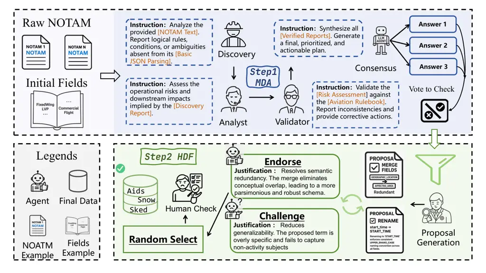
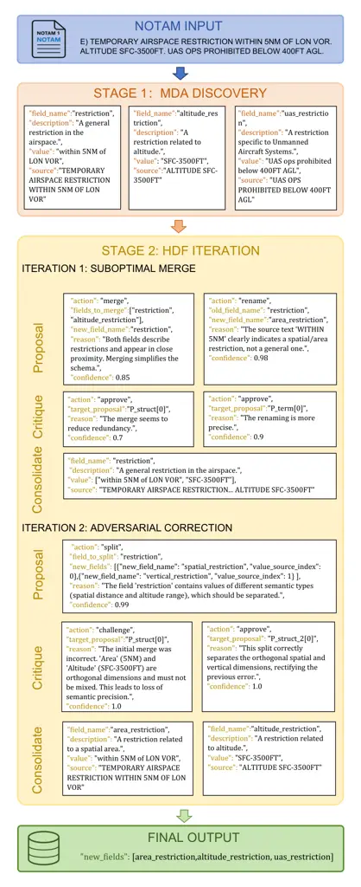

# Knots: A Large-Scale Multi-Agent Enhanced Expert-Annotated Dataset and LLM Prompt Optimization for NOTAM Semantic Parsing

Journal: Knowledge-Based Systems

Maoqi Liu Address: organization=Beijing University of Posts and
Telecommunications,addressline=Xitucheng Road 10, Haidian District,
Beijing, PRC, city=Beijing, postcode=100876, state=Beijing,
country=China    Quan Fang Corresponding author: Corresponding author:
qfang@bupt.edu.cn Address: organization=Beijing University of Posts and
Telecommunications,addressline=Xitucheng Road 10, Haidian District,
Beijing, PRC, city=Beijing, postcode=100876, state=Beijing,
country=China    Yang Yang Address: organization=Beihang
University,department=School of Electronic and Information Engineering,
city=Beijing, postcode=100191, country=China Address: organization=State
Key Laboratory of CNS/ATM,city=Beijing, postcode=100191, country=China
   Can Zhao Address: organization=Aviation Data Communication
Corporation, city=Beijing, postcode=100191, country=China    Kaiquan Cai
Address: organization=Beihang University,department=School of Electronic
and Information Engineering, city=Beijing, postcode=100191,
country=China Address: organization=State Key Laboratory of
CNS/ATM,city=Beijing, postcode=100191, country=China

###### Abstract

Notice to Air Missions (NOTAMs) serve as a critical channel for
disseminating key flight safety information, yet their complex
linguistic structures and implicit reasoning pose significant challenges
for automated parsing. Existing research mainly targets surface-level
tasks like classification and named entity recognition, lacking deep
semantic understanding. To address this, we propose NOTAM semantic
parsing, a task emphasizing semantic inference and integration of
aviation domain knowledge for structured, inference-rich outputs. To
support this task, we construct Knots (Knowledge and NOTAM Semantics), a
high-quality dataset of 12,347 expert-annotated NOTAMs covering 194
Flight Information Regions, enhanced through a multi-agent collaborative
framework for comprehensive field discovery. We systematically evaluate
various prompt engineering strategies and model adaptation techniques,
achieving significant improvements in aviation text understanding and
processing. Our experimental results demonstrate the effectiveness of
the proposed approach and provide valuable insights for automated NOTAM
analysis systems. Our code is available at
[https://github.com/Estrellajer/Knots](https://github.com/Estrellajer/Knots).

###### Keywords: 

NOTAM analysis , Large language models , Dataset

## 1 Introduction

Figure 1: An illustrative comparison of different paradigms for NOTAM
information extraction. The tip of the iceberg represents traditional
methods like regex-based rules and NER, which only scratch the surface
by extracting explicitly stated keywords. In contrast, the submerged
part visualizes the depth required by the "NOTAM parsing" task. This
deeper analysis involves semantic understanding and inference to produce
a highly structured, hierarchical, and application-ready output, a
challenge well-suited for modern LLMs.

Notice to Air Missions (NOTAMs) serve as the core channel for
disseminating time-sensitive and critical information regarding airspace
restrictions, facility outages, and other factors affecting flight
planning and safety decisions. With over one million NOTAMs issued
globally each year, accurate and timely interpretation of this
information is fundamental for maintaining aviation safety standards and
operational efficiency \[1\]. Despite their importance, automated
processing of NOTAMs faces significant challenges due to their complex
linguistic structures, extensive use of domain-specific abbreviations,
and the reasoning skills required to extract actionable information.

Existing research on NOTAM analysis has primarily focused on
classification, Named Entity Recognition (NER), and basic content
filtering \[2, 3\]. While these approaches are valuable for organizing
and categorizing NOTAM content, they remain essentially surface-level,
identifying only explicit textual elements and lacking the deep semantic
understanding necessary for practical operational use. This limitation
is especially evident when NOTAMs include implicit information,
abbreviated references, or complex spatiotemporal relationships
requiring domain expertise for correct interpretation.

To address this gap, we hereby propose NOTAM parsing—a novel task that
extends beyond traditional information extraction. This task involves
generating comprehensive structured representations via semantic
inference, contextual analysis, and incorporation of aviation domain
knowledge. As illustrated in Figure 1, unlike conventional methods that
assume the target information exists explicitly in the source text,
NOTAM parsing demands the ability to infer operational implications,
normalize abbreviations, and unveil latent relationships among fields.
For instance, while a traditional extraction system might identify “RWY
09L degraded 300M”, NOTAM parsing infers from domain knowledge that this
indicates degradation of the Basic Approach Lighting System (BALS).

Historically, rule-based and template-matching approaches, although
effective in certain scenarios, have struggled with the diversity and
unstructured nature of NOTAM texts \[3\]. Consequently, such methods
often fail to resolve semantic ambiguities and meet the implicit
reasoning demands required, thereby limiting their generalization
capabilities and practical utility.

The recent emergence of Large Language Models (LLMs) and their
breakthroughs in natural language understanding present promising
opportunities for the NOTAM parsing task. With powerful semantic
modeling capabilities, LLMs can accurately comprehend complex
instructions and contextual information, offering a viable pathway to
address the inferential challenges inherent in NOTAMs. Although no prior
research has specifically explored the application of LLMs to NOTAM
parsing, advances in related areas such as complex instruction following
and general-purpose information extraction (e.g., \[4\]) provide a solid
technical foundation for our study.

To bridge this gap, our paper pioneers a comprehensive methodology for
the task of NOTAM semantic parsing. Our approach is twofold, addressing
the core challenges from both a data-centric and a model-centric
perspective. First, recognizing that progress is contingent on
high-quality resources, we establish a new benchmark by detailing the
principles and expert-led process for creating a dataset geared for deep
semantic inference. Second, we shift focus to the practical application
of LLMs, presenting a systematic investigation into how these powerful
models can be effectively prompted and optimized to handle the unique
linguistic and safety-critical nature of the aviation domain.

The primary contributions of this paper are as follows:

1.  1.  We construct a meticulously annotated dataset for NOTAM parsing
        covering key operational fields, ensuring both data quality and
        practical relevance.
2.  2.  We design and implement a multi-agent collaborative pipeline for
        automated discovery of new fields, which can support more
        comprehensive future evaluations of NOTAM parsing systems.
3.  3.  We systematically evaluate various prompt engineering strategies for
        the NOTAM parsing task and propose customized improvements informed
        by aviation domain knowledge.

The remainder of this paper is organized as follows. Section 2 reviews
related work in aviation NLP, information extraction, and multi-agent
systems. Section 3 establishes the formal problem definitions and
notation. Section 4 introduces our dataset construction methodology.
Section 5 describes the design of our multi-agent framework. Section 6
presents our comprehensive NOTAM parsing methodology, including prompt
engineering strategies and domain-specific optimization techniques.
Section 7 provides a comprehensive experimental evaluation. Finally,
Section 8 summarizes the research findings and discusses their
implications and future research directions.

## 2 Related Work

### 2.1 NLP Applications in Aviation Domain

Natural Language Processing has become transformative for aviation
safety, with NOTAM analysis being particularly challenging due to its
safety-critical nature \[5, 6\].

NOTAM Processing: Early work established traditional NLP foundations
using transformer architectures for filtering and inconsistency
detection \[2\]. Comprehensive workflows integrated TF-IDF, topic
modeling, and NER for automated segmentation \[3\]. BERT models trained
on 1.2 million NOTAMs achieved significant scalability improvements
\[1\]. However, challenges persist: ambiguous abbreviations,
semantic-practical mismatches, and regional variations compromise safety
\[4\].

Broader Applications: Contemporary research expanded to flight
operations management. Spoken instructions were integrated into
trajectory prediction \[7\], graph-based approaches modeled trajectory
relationships \[8\], and trajectory prediction was framed as language
modeling \[9\]. Specialized applications include pilot phraseology
assessment \[10\] and flight phase classification \[11\]. These advances
reveal the need for adaptive approaches handling aviation’s complex,
safety-critical nature.

### 2.2 Large Language Models for Information Extraction

LLMs have revolutionized information extraction, transitioning from
discriminative to unified generative frameworks \[12, 13\].

Prompt Engineering: Core techniques include zero-shot and few-shot
prompting \[14, 15\], and Chain-of-Thought (CoT) enabling stepwise
reasoning \[16\]. Advanced variants include Automatic CoT \[17\],
Self-Consistency \[18\], and Logical CoT \[19\]. Structural frameworks
like Tree-of-Thoughts \[20\] and Graph-of-Thoughts \[21\] enable
non-linear reasoning. Retrieval-Augmented Generation \[22\] and
Chain-of-Verification \[23\] address factual accuracy. Challenges remain
in robustness and domain adaptation \[24\].

Unified Extraction: Contemporary LLMs unify named entity recognition,
relation extraction, and event extraction \[12\]. Frameworks like UIE,
InstructUIE, and Code4UIE excel in low-resource scenarios through
in-context learning \[25\] and instruction-based fine-tuning \[26\].
Code-style prompting \[27\] and hierarchical representations \[28\]
enhance accuracy. Aviation domains present unique challenges requiring
sophisticated adaptation due to dynamic semantics and safety
requirements.

### 2.3 Multi-Agent Systems for Complex Task Decomposition

LLM-based multi-agent systems establish new paradigms for collaborative
problem-solving through distributed intelligence \[29\].

Collaborative Architectures: Early frameworks emphasized brain,
perception, and action components \[30\]. Communication topologies were
systematically investigated \[31\], with taxonomies categorizing
strategies into merging, ensemble, and cooperative approaches \[32\].

Advanced Mechanisms: Sophisticated approaches leverage cognitive
psychology principles. Planning architectures emphasize specialization
and hierarchical decomposition \[33\]. Debate-driven divergent thinking
enables robust exploration \[34\]. Social psychology-inspired strategies
\[35\] and Theory-of-Mind collaboration \[36\] provide cognitive
foundations for interaction.

Implementation Frameworks: Modular frameworks like CAMEL \[37\] and
AutoGen \[38\] facilitate systematic design. Domain-specific
implementations in digital twins \[39\] and software engineering \[40\]
demonstrate versatility. Despite this potential, application to
safety-critical aviation domains requiring expert knowledge integration
remains unexplored, motivating our approach.

## 3 Preliminaries

We establish formal definitions for the NOTAM parsing problem,
encompassing both foundational field extraction and emergent field
discovery tasks. Our framework addresses two complementary challenges:
extracting predefined operational fields with high accuracy, and
discovering novel, contextually relevant fields that emerge from diverse
NOTAM expressions.

Notation and Problem Space: Let $`\mathcal{X}`$ denote the space of
NOTAM natural language texts, and $`\mathcal{Y}`$ represent the valid
structured representation space for field extractions. We define
$`\mathbb{F}=\{f_{1},\ldots,f_{K}\}`$ as the predefined foundational
field set with $`K`$ critical operational fields (e.g., runway status,
effective periods, restrictions), while $`\mathcal{U}`$ represents the
potential emergent field space where $`|\mathcal{U}|\gg|\mathbb{F}|`$.
Our annotated dataset is denoted as
$`\mathbb{D}=\{(x^{n},y^{n})\}_{n=1}^{N}`$.

Task 1 - Foundational Field Extraction: The primary extraction task maps
NOTAM text to structured representations through semantic inference
rather than simple text matching. We formalize this as
$`G_{\theta}:\mathcal{X}\rightarrow\mathcal{Y}`$, where the optimal
output is determined by
$`\hat{y}=G_{\theta}(x)\triangleq\arg\max_{y\in\mathcal{Y}}P_{\theta}(y|x)`$.
The model parameters $`\theta`$ can be optimized through various
paradigms including zero-shot prompting (leveraging pre-trained
knowledge), in-context learning with domain-specific examples, or
supervised fine-tuning on annotated NOTAM data.

Task 2 - Emergent Field Discovery: Beyond predefined fields, NOTAMs
often contain operationally significant information that cannot be
anticipated in advance, such as aircraft-specific restrictions or
unusual weather conditions. For a given NOTAM text $`x`$, we aim to
discover emergent fields
$`\mathcal{E}(x)=\{e_{1},e_{2},\ldots,e_{M}\}\subset\mathcal{U}`$, where
each emergent field $`e_{i}=(n_{i},d_{i},v_{i},s_{i})`$ consists of a
field name $`n_{i}`$, semantic description $`d_{i}`$, extracted value
$`v_{i}`$, and supporting textual evidence $`s_{i}`$ from the original
NOTAM.

This dual-task formulation enables comprehensive NOTAM understanding:
foundational extraction ensures coverage of essential operational
information, while emergent discovery provides the potential for more
comprehensive NOTAM evaluation in the future.

Figure 2: Category and subcategory distribution of Q-codes within the
NOTAM dataset.

## 4 Dataset Construction and Experimental Setup

### 4.1 Dataset Overview

We introduce Knots, a new, large-scale, and comprehensive dataset
designed to facilitate research in the automated parsing of Notices to
Air Missions (NOTAMs). NOTAMs are critical safety messages that exhibit
significant variations in parsing, posing a major challenge for
automated systems. As illustrated in Figure 2, Knots is structured
around five major operational domains: Airspace Management ($`4286`$),
Ground Facility ($`2928`$), Landing Aid ($`1902`$), Runway & Taxiway
($`1335`$), and Flight Hazard ($`1896`$), encompassing a total of 58
distinct Q-code categories. To capture the diversity of real-world
operations, the dataset was collected from global NOTAM broadcasts,
comprising $`12\,347`$ valid records from $`1484`$ distinct airports,
spanning $`194`$ Flight Information Regions (FIRs) across seven
continents. As detailed in Table 1, the textual content displays
considerable variability, with each NOTAM averaging $`44.8`$ words
(ranging from $`3`$ to $`1541`$) and $`335.6`$ characters (ranging from
$`14`$ to $`12\,895`$). A primary source of this complexity is the
inconsistent adherence to the parsing standards stipulated by the
International Civil Aviation Organization (ICAO). This issue is
compounded by the dataset’s global geographic distribution—sourced
predominantly from Europe ($`43.99\text{\,}\mathrm{\%}`$) and Asia
($`32.37\text{\,}\mathrm{\%}`$)—which introduces significant regional
variations in terminology and formatting conventions. Consequently,
Knots serves as a challenging new benchmark for developing robust and
geographically-aware automated NOTAM interpretation systems.

### 4.2 Data Annotation

The annotation process was meticulously designed to ensure data quality,
domain relevance, and the creation of a benchmark that fosters advanced
semantic understanding rather than simple text extraction. The process
involved a rigorous, expert-led workflow and resulted in two distinct
outputs: the primary annotated dataset and a specialized evaluation set
for field discovery.

|                              |                                        |
| ---------------------------- | -------------------------------------- |
| Properties                   | Value                                  |
| Basic Insight                |                                        |
| Valid Q-codes                | 12347                                  |
| Q-code types                 | 58                                     |
| Airports involved            | 1484                                   |
| FIRs involved                | 194                                    |
| Continents involved          | 8                                      |
| Average validity period      | 9.4 days                               |
| Shortest validity period     | 0.3 days                               |
| Longest validity period      | 1184 days                              |
| Median validity period       | 0 days                                 |
| Average word count           | 44.8                                   |
| Average character count      | 335.6                                  |
| Average line count           | 13.7                                   |
| Q-Code Category Distribution |                                        |
| R                            | Airspace Restrictions (3859, 31.25%)   |
| F                            | Facilities and Services (2486, 20.13%) |
| W                            | Warning Information (1896, 15.36%)     |
| L                            | Lighting Facilities (1424, 11.53%)     |
| M                            | Movement Areas (1335, 10.81%)          |
| I                            | Instrument Systems (478, 3.87%)        |
| N                            | Navigation Facilities (442, 3.58%)     |
| A                            | Airspace Organization (232, 1.88%)     |
| P                            | Flight Procedures (195, 1.58%)         |
| Summary                      |                                        |
| Total NOTAM Records          | 12347                                  |

Table 1: Statistical overview of the NOTAM dataset, detailing Q-code
counts, category distribution, and spatial coverage.

#### 4.2.1 Annotation Process and Quality Assurance

Given the vast number of NOTAMs issued annually, we began by randomly
sampling from the global NOTAM traffic of the entire year 2024. This
approach ensures a manageable data volume while maintaining broad,
representative coverage, a characteristic substantiated by the
statistics in Table 1. The initial set of annotation fields was defined
by expert aviation dispatchers, who selected foundational fields
critical to operational efficiency and safety.

The core of our methodology is a non-extractive, inferential annotation
scheme. Unlike traditional information extraction datasets that rely on
sequence-labeling formats (e.g., BIO), our annotators were tasked with
providing the semantically correct value for each field, irrespective of
whether this value could be directly retrieved from the source text. As
illustrated in Figure 1, this often requires annotators to apply
domain-specific knowledge to infer, normalize, or calculate values. For
instance, a NOTAM might imply a runway closure through technical jargon,
and the annotator’s role is to explicitly assign the value “Closed” to
the “Runway Status” field. This philosophy ensures the dataset supports
the development of models capable of genuine comprehension.

The annotation was performed independently by two expert dispatchers. To
ensure consistency and quality, we calculated the Inter-Annotator
Agreement (IAA), achieving a Krippendorff’s Alpha score of 0.96, which
indicates a very high degree of reliability. All discrepancies were
subsequently resolved by a third, senior expert to produce the final,
gold-standard dataset.

#### 4.2.2 Evaluation Set for Field Discovery

A key challenge in NOTAM processing is the presence of low-frequency yet
operationally critical information, which is often overlooked by
automated systems focused on common fields. Examples include mentions of
“Snow” (implying runway contamination) or a specific “Flight Code”
(indicating restrictions on certain aircraft types). While identifying
such critical, non-standard fields from scratch is difficult, verifying
their importance is a relatively straightforward task for a domain
expert.

Leveraging this principle, we created a specialized benchmark for the
task of automated field discovery. We randomly sampled 500 NOTAMs from
our collection and presented them to an expert. The expert’s task was to
identify and label any information that was not part of the foundational
field set but was nonetheless valuable for safety or efficiency. This
process yielded a curated evaluation set that can be used to validate
methods for importance-driven information extraction and automated
discovery of salient, long-tail data fields.



Figure 3: Overview of the multi-agent field discovery and refinement
framework. The pipeline consists of two main stages: (1) Multi-Agent
Field Discovery (MDA) for systematic field extraction, and (2) Hybrid
Debate Framework (HDF) for collaborative refinement through structured
debate and deterministic consolidation.

## 5 Multi-Agent Framework for Field Discovery and Refinement

Precise interpretation of Notices to Air Missions (NOTAMs) is critical
to aviation safety. While traditional NOTAMs follow a fixed structure,
advanced applications—such as identifying specific restrictions for
aircraft models or commercial flights—necessitate the creation of new,
finer-grained information fields. This task involves a fundamental
trade-off: on one hand, it is essential to discover all potential fields
comprehensively to avoid omission of critical information (prioritizing
high recall); on the other hand, it demands the rigorous refinement of
these fields to ensure their definitions are clear, non-redundant, and
hold business value (prioritizing high precision).

The unique grammatical and stylistic characteristics of NOTAMs render
traditional phrase-mining methods ineffective. Moreover, employing a
single Large Language Model (LLM) often cannot reconcile the competing
requirements of exploratory completeness and strict accuracy. To address
these challenges, we propose an innovative two-stage multi-agent
framework that decomposes the complex task into two key phases, as
depicted in Figure 3: Multi-Agent Discovery (MDA) systematically
uncovers candidate fields through a structured agent pipeline focused on
maximizing recall, while Hybrid Debate Framework (HDF) refines candidate
fields via structured debate mechanisms with adversarial critique and
deterministic decision rules, aiming to maximize precision and
robustness. This “explore-then-refine” design establishes a systematic
balance between recall and precision, producing a field set of
sufficient quality for deployment in practical systems.

### 5.1 Problem Formulation and Theoretical Framework

Given a raw NOTAM text $`t`$, the goal is to extract a structured set of
fields $`F(t)=\{f_{1},f_{2},\dots,f_{N}\}`$, where each field
$`f_{i}=(n_{i},d_{i},v_{i},s_{i})`$ consists of a unique name $`n_{i}`$,
a precise description $`d_{i}`$, extracted value $`v_{i}`$, and
supporting textual evidence $`s_{i}`$ — excerpts from the original text
$`t`$. An ideal framework must achieve high recall (capturing all
business-relevant fields without omission), high precision (excluding
spurious, redundant, or inconsistently defined fields), and robustness
(avoiding premature consensus and errors caused by model biases or
groupthink).

Following the Latent Concept Space perspective \[41\], the output of an
agent (e.g., a candidate field $`z`$) is generated based on an
underlying latent concept $`\theta\in\Theta`$ inferred from the context,
formally expressed as:

```math
P(z\mid\text{context},\phi)=\sum_{\theta\in\Theta}P(z\mid\theta,\phi)\,P(\theta\mid\text{context},\phi)
```

where $`\phi`$ denotes model parameters. However, when multiple agents
collaborate using similar mechanisms, two main failure modes emerge: the
Echo Chamber Effect, where homogeneous agents rapidly reinforce initial
consensus opinions, causing premature convergence and limiting
exploration of alternative hypotheses; and the Tyranny of the Majority,
where an erroneous concept can dominate if a majority coincidentally
endorses it, suppressing correct minority views due to exponentially
increasing peer pressure \[41\]. Such effects undermine the quality and
robustness of conventional multi-agent methods, necessitating active
intervention mechanisms that our Hybrid Debate Framework (HDF)
systematically incorporates.

Input: NOTAM text $`t`$, similarity threshold $`\tau=0.7`$, max
iterations $`I_{max}=5`$

Output: Refined field set $`F_{final}`$

// Stage 1: Multi-Agent Discovery (MDA)

1 $`Z_{1}\leftarrow`$ DiscoveryAgent($`t`$);

2 $`Z_{2}\leftarrow`$ AnalysisAgent($`t,Z_{1}`$);

3 $`Z_{3}\leftarrow`$ ValidationAgent($`t,Z_{1},Z_{2}`$);

4 $`Z_{MDA}\leftarrow`$ ConsensusAggregator($`Z_{3}`$, $`\tau`$);

// Stage 2: Hybrid Debate Framework (HDF)

5 $`F_{current}\leftarrow Z_{MDA}`$;

6 $`iteration\leftarrow 0`$;

7 while _$`iteration<I_{max}`$ and HasNewProposals()_ do

   // Propose: Generate improvement proposals

    8 $`P_{struct}\leftarrow`$ ConsolidationExpert($`F_{current}`$);

    9 $`P_{term}\leftarrow`$ TerminologyExpert($`F_{current}`$);

   // Critique: Adversarial evaluation

    10 $`P_{accepted}\leftarrow`$
CriticAgent($`P_{struct}\cup P_{term}`$, $`F_{current}`$);

   // Consolidate: Apply accepted proposals

    11 $`F_{current}\leftarrow`$ FieldManager.Apply($`P_{accepted}`$,
$`F_{current}`$);

    12 $`iteration\leftarrow iteration+1`$;

13 end while

14 $`F_{final}\leftarrow`$ PostProcess($`F_{current}`$);

15 return _$`F_{final}`$_

Algorithm 1 Multi-Agent Field Discovery and Refinement (MDA-HDF)

### 5.2 Multi-Agent Discovery (MDA) and Hybrid Debate Framework (HDF)

The MDA stage maximizes recall by ensuring coverage of all potential
fields through a sequential pipeline architecture composed of three
agents with distinct roles. Each agent processes and enriches the
outputs of the previous, progressively expanding coverage. The Discovery
Agent performs a broad, surface-level scan of raw text $`t`$ to identify
any spans possibly constituting fields, yielding an initial candidate
set $`Z_{1}`$. The Analysis Agent enriches $`Z_{1}`$ by leveraging
domain knowledge—resolving ambiguities and inferring implicit
fields—producing a semantically enhanced set $`Z_{2}`$. The Validation
Agent performs consistency checks, deduplicates obvious overlaps, and
preliminarily filters for business relevance, yielding a refined
candidate set $`Z_{3}`$.

A Consensus Aggregator then merges semantically similar fields from
$`Z_{3}`$, producing the final candidate set $`Z_{\mathrm{MDA}}`$ for
the refinement stage. The transformation follows:
$`Z_{\mathrm{MDA}}=\text{ConsensusAggregator}(Z_{3},\tau)`$ where
$`\tau=0.7`$ is the Jaccard similarity threshold for semantic merging.
Quality control mechanisms include semantic similarity thresholds for
deduplication, domain relevance scoring based on aviation terminology
frequency, and consistency checks across agent outputs using field name
normalization.

The HDF stage addresses ambiguities, redundancies, and formulation
weaknesses from MDA’s output, systematically counteracting echo chamber
and tyranny effects through structured intervention. The HDF stage
initializes with $`F_{\mathrm{current}}^{(0)}=Z_{\mathrm{MDA}}`$ and
iteratively refines through the transformation
$`F_{\mathrm{current}}^{(t+1)}=\mathrm{HDF}(F_{\mathrm{current}}^{(t)})`$.
Three core interventions form the foundation: Conceptual Partitioning
splits the refinement task into two orthogonal subtasks (structural
optimization for merging/deduplication and expressive optimization for
naming/description), each handled by separate expert agents to foster
diversity and prevent dominance by any single concept. Adversarial
Critique employs an independent Critic Agent to challenge proposals with
counterarguments, reducing acceptance of flawed concepts through
modification intervention that influences agents’ posterior beliefs.
Deterministic Consolidation executes the final application of proposals
via the programmatic FieldManager using deterministic rules rather than
probabilistic voting, ensuring transparent, reproducible decisions while
avoiding tyranny effects from majority overrides.

The refinement process follows a systematic three-stage cycle. During
the Propose stage, two expert agents generate improvement proposals in
parallel: the Consolidation Expert proposes merges or removals to
optimize structure, while the Terminology Expert proposes renaming or
description clarifications. The Critique stage involves the independent
Critic Agent reviewing all proposals, labeling each as supported or
challenged with detailed justification. Finally, the Consolidate stage
sees the FieldManager deterministically accepting all unchallenged
proposals, ensuring efficient and stable progress. The HDF cycle
terminates when no new proposals are generated for two consecutive
iterations, or when a maximum of 5 iterations is reached to prevent
infinite loops. Conflict resolution applies a priority system where
structural consolidation proposals take precedence over terminological
changes, and proposals with stronger textual evidence are preferred.
Final field sets undergo post-processing validation including duplicate
detection, completeness checking against aviation standards, and format
normalization for downstream applications.

This two-stage "explore-then-refine" architecture is intentionally
designed to ensure both robustness and interpretability. The MDA stage
prioritizes high recall, which may introduce some noise or initial
misinterpretations. It is worth noting that unlike in open-domain
question answering, "hallucinations" in our structured extraction task
manifest as outputs that are unfaithful to the source text rather than
ungrounded factual fabrications \[42\]. The subsequent HDF stage,
particularly the Critic Agent, is specifically designed to mitigate such
issues by systematically filtering these imperfections through
structured debate and adversarial critique. This design prevents the
propagation of initial errors, a claim substantiated by our ablation
study (Table 4), where removing HDF caused a significant drop in
precision from 92.0% to 84.0%. Furthermore, while the framework is
complex, it remains debuggable. Each agent operates modularly with
structured, recordable outputs (e.g., JSON proposals). This allows for a
clear audit trail, making it straightforward to trace errors back to the
specific agent and stage where they originated.

### Lemma 1 (Conceptual Space Expansion in MDA)

Let $`\Theta(Z)`$ denote the latent concept set covered by a candidate
field collection $`Z`$, and define $`\mu(\cdot)`$ as a monotonic set
function measuring conceptual coverage, satisfying
$`\mu(A\cup B)\geq\max(\mu(A),\mu(B))`$ for any concept sets $`A,B`$.
Under the assumption that agents possess complementary knowledge
($`\phi_{\mathrm{discover}}\neq\phi_{\mathrm{analyst}}\neq\phi_{\mathrm{validator}}`$),
the final candidate set $`Z_{\mathrm{MDA}}`$ produced via the pipeline
achieves equal or superior conceptual coverage compared to any
individual agent output:

```math
\mu(\Theta(Z_{\mathrm{MDA}}))\geq\max_{k\in\{1,2,3\}}\mu(\Theta(Z_{k}))
```

where the measure $`\mu(\cdot)`$ quantifies the conceptual "breadth" or
"diversity" of a set, with monotonicity ensuring subsets cannot exceed
supersets in coverage.

### Theorem 1 (Robustness of the Hybrid Debate Framework)

Let $`\Omega`$ be the sample space of all possible NOTAM texts and field
extraction scenarios. Denote by
$`\mathcal{P}_{\mathrm{HDF}}(\theta^{*}\mid t)`$ the probability that
HDF converges to the correct latent concept $`\theta^{*}`$ given input
$`t`$, and by $`\mathcal{P}_{\mathrm{Vanilla}}(\theta^{*}\mid t)`$ the
analogous probability for a conventional voting-based debate.
Adversarial critique decreases the likelihood of accepting faulty
proposals:
$`P_{\mathrm{reject}}(z_{\mathrm{proposal}}\mid z_{\mathrm{critique}})>P_{\mathrm{reject}}(z_{\mathrm{proposal}})`$,
while partitioning and deterministic rules significantly reduce
convergence to incorrect majority concepts
$`\theta^{\prime}_{\mathrm{maj}}`$:
$`\mathcal{P}_{\mathrm{HDF}}(\text{converge to }\theta^{\prime}_{\mathrm{maj}}\mid t)<\mathcal{P}_{\mathrm{Vanilla}}(\text{converge to }\theta^{\prime}_{\mathrm{maj}}\mid t)`$.

The ConsensusAggregator implements semantic merging via Jaccard
similarity:

```math
\text{merge}(f_{i},f_{j})\iff\text{Jaccard}(f_{i},f_{j})>\tau
```

where $`\tau=0.7`$ is the similarity threshold. The FieldManager applies
deterministic rules:

```math
\displaystyle\text{Apply}(P,F) \displaystyle=\{f\in F:\neg\exists p\in P,\text{conflicts}(p,f)\}
```

```math
\displaystyle\quad\cup\{p\in P:\text{unchallenged}(p)\}
```

## 6 NOTAM Parsing Methodology

This section presents our comprehensive approach to NOTAM parsing,
focusing on systematic prompt engineering strategies and domain-specific
optimization techniques. We detail the evaluation of foundational
baselines through advanced reasoning techniques, followed by an
exploratory post-processing method designed to address specific,
persistent extraction errors. Our methodology is grounded in a core
principle: parsing in the aviation domain requires careful consideration
of specialized terminology, structured output formats, and the inherent
complexity of safety-critical information.

### 6.1 Core Prompting Strategies

We systematically explored multiple prompting paradigms to optimize
Large Language Model (LLM) performance on NOTAM parsing tasks, with
particular attention to the trade-off between reasoning complexity and
extraction accuracy in aviation contexts.

##### Zero-shot and Few-shot In-Context Learning (ICL)

Our baseline approach employs carefully crafted zero-shot prompts that
leverage pre-trained knowledge while incorporating aviation
domain-specific context. The zero-shot strategy focuses on clear
instruction design, including explicit field definitions and output
format specifications that align with ICAO standards and operational
requirements.

For few-shot In-Context Learning (ICL), we adopt a 5-shot approach with
strategically selected examples that demonstrate domain-specific pattern
learning for professional NOTAM terminology and abbreviation handling
(e.g., RWY 09L CLSD $`\rightarrow`$ interpreted as runway closure),
provide clear JSON output structure to reduce parsing errors and ensure
field extraction consistency, and cover complex mixed-content NOTAMs and
scenarios requiring heavy inference. These ICL examples are vetted
through review by professional aviation dispatchers to ensure
representative coverage across different Q-code categories and
operational scenarios. Each example includes the original NOTAM text and
its corresponding structured output, emphasizing semantic inference
rather than literal text matching. Detailed examples are available in
our code repository.

##### Advanced Reasoning and Reliability Strategies

To address more complex NOTAMs requiring multi-step inference and domain
expertise, we investigated advanced reasoning techniques tailored
specifically for aviation contexts.

Our Chain-of-Thought (CoT) reasoning implementation employs step-by-step
reasoning prompts designed for scenarios requiring complex
spatial-temporal decomposition and implicit information inference. This
approach focuses on decomposing regional restrictions with mixed content
that require systematic analysis of spatial and temporal relationships,
and inferring implicit information from aviation context where domain
knowledge is essential for correct interpretation (e.g., “RWY 09L
degraded 300M” implies a BALS downgrade based on approach lighting
system specifications). The goal was to test whether explicit reasoning
steps could improve accuracy on these challenging cases that require
domain expertise beyond simple text extraction.

While information extraction typically employs deterministic temperature
settings of $`0.0`$ for consistent outputs, we explored self-consistency
as a potential reliability enhancement mechanism. This investigation
involved generating multiple outputs using varied temperature settings
($`0.3`$, $`0.7`$, $`1.0`$) and employing majority voting to determine
the final extraction results. This approach tested the hypothesis that
consensus across multiple reasoning paths could yield more robust
results, particularly for ambiguous cases where multiple valid
interpretations might exist.

### 6.2 Exploratory Approach: Selective Refinement via Contrastive Validation (SRCV)

Recognizing that even the most sophisticated prompting strategies can
fail on specific, complex cases involving nuanced aviation terminology
or implicit reasoning requirements, we conducted a preliminary
investigation into a post-processing method we term _Selective
Refinement via Contrastive Validation (SRCV)_. SRCV is designed as a
two-step error-correction loop, intended to be applied selectively to
fields with low confidence scores or known systematic errors after an
initial ICL-based extraction.

The SRCV process begins with an identification phase where specific
fields in the JSON output are identified as candidates for refinement
based on confidence scoring or systematic error patterns observed during
development. The targeted validation phase then employs a second,
specialized prompt sent to the LLM, presenting the original NOTAM text
alongside the extracted value for the specific field under review. The
model is asked to validate or correct the extraction, with the prompt
augmented by contrastive examples or explicit domain rules to guide the
refinement process (e.g., “Validate the end time. Remember that if
‘PERM’ is present, the end time should be null.”). This approach is
considered exploratory, and our primary aim was to assess its potential
for correcting specific, stubborn errors that resist standard prompting
approaches, particularly those involving complex temporal relationships
or implicit domain knowledge requirements.

### 6.3 Methodological Validation Framework

Our methodology development follows a systematic validation approach
that ensures robustness and practical applicability across diverse NOTAM
processing scenarios. We conduct comprehensive comparisons between
zero-shot, 5-shot ICL, CoT, and self-consistency approaches using
consistent evaluation metrics and controlled experimental conditions, as
presented in Table 2.

Our evaluation spans multiple model architectures, including Qwen3-8B
and GPT-4.1-Nano, Gemini-2.5-Flash, DeepSeek V3.2, and GPT-5-Nano, to
ensure methodology robustness across different LLM capabilities and
scales. This multi-model approach reveals important insights about the
relationship between model size and prompt sensitivity, particularly in
aviation domain applications where specialized terminology and implicit
reasoning requirements may affect smaller and larger models differently.
The systematic evaluation framework provides concrete guidance for
practitioners seeking to implement robust NOTAM parsing systems in
operational environments, establishing a foundation for reliable
automated processing of aviation safety communications.

This comprehensive methodology provides a systematic framework for
applying Large Language Models to aviation safety-critical information
extraction while maintaining the precision and reliability requirements
essential for operational aviation systems. The combination of
systematic prompt engineering strategies with domain-specific
optimizations establishes a robust foundation for automated processing
of aviation safety communications.

|             |              |                  |                     |                 |             |                   |               |
| ----------- | ------------ | ---------------- | ------------------- | --------------- | ----------- | ----------------- | ------------- |
| Setup       | Method       | Backbone         | Airspace Management | Ground Facility | Landing Aid | Runway & Taxi-way | Flight Hazard |
|             |              |                  | (4286)              | (2928)          | (1902)      | (1335)            | (1896)        |
| Traditional | Regex-based  | –                | 36.5                | 37.2            | 35.8        | 36.1              | 34.9          |
|             | UIE          | –                | 51.3                | 52.1            | 50.7        | 51.5              | 49.8          |
| LLM-based   | Zero-shot    | GPT4.1-Nano      | 58.5                | 91.0            | 95.5        | 75.8              | 55.0          |
|             |              | Qwen3-8B         | 67.8                | 90.8            | 95.6        | 82.4              | 64.3          |
|             |              | Gemini-2.5-Flash | 68.5                | 90.9            | 95.8        | 80.5              | 66.2          |
|             |              | DeepSeek V3.2    | 67.0                | 90.7            | 95.7        | 79.8              | 64.3          |
|             |              | GPT-5-Nano       | 66.2                | 90.8            | 95.6        | 79.2              | 63.5          |
|             | CoT          | GPT4.1-Nano      | 63.7                | 90.4            | 95.6        | 72.4              | 73.3          |
|             |              | Qwen3-8B         | 67.1                | 90.7            | 95.9        | 78.6              | 62.5          |
|             |              | Gemini-2.5-Flash | 72.5                | 91.1            | 96.0        | 82.1              | 72.8          |
|             |              | DeepSeek V3.2    | 71.2                | 90.9            | 95.8        | 81.7              | 71.1          |
|             |              | GPT-5-Nano       | 70.5                | 91.0            | 95.7        | 81.0              | 70.4          |
|             | ICL (5-shot) | GPT4.1-Nano      | 69.2                | 91.1            | 96.0        | 79.9              | 81.7          |
|             |              | Qwen3-8B         | 71.1                | 91.6            | 95.9        | 81.0              | 83.8          |
|             |              | Gemini-2.5-Flash | 77.4                | 91.7            | 96.3        | 84.2              | 84.3          |
|             |              | DeepSeek V3.2    | 76.0                | 91.5            | 96.1        | 83.6              | 82.3          |
|             |              | GPT-5-Nano       | 75.3                | 91.3            | 96.0        | 82.9              | 81.5          |

Table 2: Performance comparison of various methods on five datasets.
Values indicate F1 scores (%). The best-performing result is highlighted
in bold.

## 7 Experiments

This section presents a systematic evaluation of our proposed NOTAM
semantic parsing framework through two core experiments. The first
experiment evaluates the capability of our multi-agent collaboration
framework (MDA-HDF) to automatically identify novel and critical
information fields without predefined field schemas, thereby extending
the scope of traditional NOTAM information extraction tasks. The second
experiment focuses on the NOTAM parsing task, conducting rigorous
comparative analysis of various Large Language Model (LLM)-based
prompting strategies.

### 7.1 Field Discovery Evaluation

|                                                   |                                       |                        |                    |                            |                                 |
| ------------------------------------------------- | ------------------------------------- | ---------------------- | ------------------ | -------------------------- | ------------------------------- |
| Input NOTAM                                       | spaCy                                 | RAKE                   | TF-IDF             | AutoPhrase                 | MDA with HDF                    |
| E) RWY 12L/30R CLSD DUE TO MAINT AND STRONG WIND. | 12L/30 clsd.due maint.and strong wind | 12L/30 cls.strong wind | 12L/30R clsd maint | Runway Closure Maintenance | Runway Closure Maintenance WIND |

Table 3: Comparison of field extraction results from different methods
on the same input NOTAM text

We validate the capability of our MDA-HDF framework to automatically
discover novel, low-frequency yet operationally critical information
fields from raw NOTAM text, formulating this as a phrase mining problem.
It is crucial to note that this framework is designed as an offline tool
for dataset enhancement—a one-time process to generate high-quality
field definitions. It is not intended for real-time operational
deployment, and thus its evaluation focuses on output quality (precision
and recall) rather than inference latency. Due to the unique linguistic
structures and domain-specific expressions in NOTAM text, traditional
phrase or keyword extraction methods struggle to adapt to their diverse
and information-sparse characteristics, resulting in significantly
limited performance. We used 500 randomly sampled NOTAM instances from
the Knots dataset with expert-annotated ground truth labels, comparing
against representative baseline methods including spaCy noun phrase
extraction, RAKE keyword extraction, TF-IDF statistical methods,
AutoPhrase phrase mining, and single LLM approaches. Our proposed
methods include the complete MDA-HDF framework and an ablation variant
(MDA w/o HDF) that removes the Hybrid Debate Framework to assess the
specific contribution of the HDF module. Performance evaluation uses
Precision, Recall, and F1-score metrics. All LLM-based methods employ
the same model version (gpt4.1-nano), with result stability controlled
through multiple runs. To clarify the implementation, each agent within
our framework is simulated by making a distinct API request with a
role-specific prompt to a single LLM endpoint. This multi-step process
is an offline, one-time procedure for dataset enhancement and does not
represent a real-time deployment architecture.

As shown in Table 4, the MDA-HDF framework achieves an F1-score of 92%,
significantly outperforming traditional phrase mining methods and
further improving upon single LLM approaches. Traditional methods,
relying on word frequency statistics or general grammatical rules, fail
to effectively adapt to the highly specialized and low-frequency
critical information expressions in NOTAMs, resulting in severely
imbalanced precision or recall. For example, spaCy achieves high recall
(0.92) but extremely low precision (0.18), demonstrating poor noise
filtering capability; AutoPhrase shows higher precision (0.85) but
severely insufficient recall (0.34), resulting in incomplete field
extraction. In contrast, single LLM methods demonstrate stable
performance with F1 scores typically fluctuating between 0.85 and 0.96,
reflecting the significant advantages of language models in
understanding complex semantics and context, though they still suffer
from insufficiently refined candidate field filtering and occasional
redundancy.

The ablation study reveals that MDA without the HDF module achieves
recall of 96%, demonstrating the capability of multi-agent collaboration
strategies to discover comprehensive information; however, precision
drops to 84%, indicating that unconstrained candidate generation tends
to produce more noisy fields. After introducing the HDF module,
multi-round hybrid debate and semantic integration significantly improve
field extraction accuracy to 92% while maintaining high recall,
ultimately achieving a good balance between precision and recall and
substantially improving overall F1 performance.

For intuitive comparison, Table 3 presents extracted key fields from the
same typical NOTAM text using different methods. Traditional tools
produce verbose output containing numerous irrelevant terms, while
single LLM generates semantically complete and relatively concise fields
but with some missing or ambiguously expressed key information. The
complete MDA-HDF output not only covers important low-frequency
information but also ensures accurate field descriptions and diversity,
demonstrating the framework’s advantages in semantic understanding and
information integration.

In summary, traditional phrase extraction methods, due to their
over-reliance on statistical features and general language patterns,
cannot effectively capture the rich and specialized low-frequency key
fields in NOTAM text. Single LLM methods already demonstrate strong
semantic understanding capabilities, achieving relatively high precision
and recall. The MDA-HDF framework, based on multi-agent collaboration
and hybrid debate mechanisms, further improves information extraction
accuracy and completeness through structured adversarial semantic
integration, better meeting the requirements for automated critical
information discovery in the NOTAM domain.

|                       |                    |                   |                 |                    |
| --------------------- | ------------------ | ----------------- | --------------- | ------------------ |
| Method                | Prec. $`\uparrow`$ | Rec. $`\uparrow`$ | F1 $`\uparrow`$ | Avg $`\downarrow`$ |
| Traditional baselines |                    |                   |                 |                    |
| spaCy (Noun Phr.)     | $`18.0`$           | 92.0              | $`30.0`$        | $`47.2`$           |
| RAKE (Keyword)        | $`45.0`$           | $`78.0`$          | $`57.0`$        | $`18.6`$           |
| TF-IDF                | $`41.0`$           | $`69.0`$          | $`51.0`$        | $`15.3`$           |
| AutoPhrase            | $`85.0`$           | $`34.0`$          | $`48.0`$        | 3.7                |
| Single LLM            |                    |                   |                 |                    |
| Single LLM            | $`89.0`$           | $`83.0`$          | $`86.0`$        | $`9.7`$            |
| Proposed methods      |                    |                   |                 |                    |
| MDA (w/o HDF)         | $`84.0`$           | 96.0              | $`89.0`$        | $`14.2`$           |
| MDA-HDF (Full)        | 92.0               | $`93.0`$          | 92.0            | $`9.3`$            |

Table 4: Field discovery performance. F1 denotes overall extraction
quality. $`\uparrow`$ means higher is better, $`\downarrow`$ means lower
is better.

### 7.2 NOTAM Parsing Evaluation

We conduct systematic evaluation of the NOTAM parsing task using the
Knots dataset with standard 80/10/10 splits, reporting strict
entity-level metrics requiring exact matches for both field types and
normalized values. Our evaluation encompasses comprehensive analysis of
various prompting strategies, domain-specific optimizations, and
exploratory refinement techniques across multiple model architectures.

##### Experimental Configuration and Baseline Comparison

As shown in Table 2, we compare the performance of various methods on
the Knots dataset across five major operational domains. Considering
practical application requirements, we adopt five representative models:
Qwen3-8B, GPT4.1-Nano, Gemini-2.5-Flash, DeepSeek V3.2, and GPT-5-Nano
as backbones, ensuring robust evaluation across different model scales
and capabilities.

Traditional methods demonstrate limited effectiveness in NOTAM parsing
tasks. Regex-based heuristic approaches maintain F1-scores around 36-37%
across all domains, reflecting the challenge of capturing semantic
nuances through rule-based pattern matching. The UIE method performs
moderately better with F1-scores in the 50-52% range, yet still falls
short of the semantic understanding required for complex aviation
terminology processing.

LLM-based methods reveal clear performance hierarchies and
domain-specific variations. Zero-shot prompting strategies achieve
baseline F1-scores ranging from 55-96%, with notable performance
disparities across operational domains. Ground Facility and Landing Aid
domains show consistently high performance ($`>90`$)% across all models,
likely due to their more standardized terminology and clearer structural
patterns. In contrast, Airspace Management and Flight Hazard domains
present greater challenges, with F1-scores varying significantly between
55-84%, reflecting the complexity of spatial-temporal reasoning and
hazard interpretation requirements.

##### In-Context Learning Superiority and Strategy Effectiveness

The 5-shot In-Context Learning (ICL) strategy demonstrates consistent
superiority across all experimental conditions. As shown in Table 2, ICL
achieves the highest F1-scores across all domains, with Gemini-2.5-Flash
reaching up to 96.3% and consistently outperforming other models. This
represents substantial improvements over zero-shot approaches. This
superiority can be attributed to several key factors that align
particularly well with aviation domain requirements.

Domain-specific pattern learning emerges as a critical advantage of ICL.
Aviation NOTAM processing benefits significantly from concrete examples
that demonstrate specialized terminology handling, abbreviation
normalization, and implicit semantic inference. For instance, examples
showing how "RWY 09L CLSD DUE TO MAINT" should be interpreted as a
runway closure with maintenance causation provide crucial contextual
guidance that enables models to handle similar patterns effectively.

Format consistency represents another substantial benefit of ICL
implementation. The inclusion of structured JSON output examples
significantly reduces parsing errors and ensures field extraction
consistency across different NOTAM formats. This proves particularly
valuable in aviation contexts where output reliability and
standardization are paramount for operational safety.

Edge case coverage through strategic example selection enables robust
handling of complex mixed-content NOTAMs that require heavy inference.
Our carefully curated 5-shot examples span different Q-code categories
and operational scenarios, providing comprehensive coverage of
challenging cases that might otherwise result in extraction failures.

##### Chain-of-Thought Analysis and Limitations

Contrary to expectations based on general NLP literature,
Chain-of-Thought (CoT) reasoning shows mixed effectiveness in aviation
domain parsing. While CoT achieves F1-scores of 62-96% across all
models, with Gemini-2.5-Flash showing strong performance, performance
improvements over zero-shot baselines are inconsistent across domains
and models.

The mixed results reveal important insights about reasoning strategy
application in structured extraction tasks. CoT proves beneficial for
complex reasoning scenarios requiring multi-step spatial-temporal
decomposition, such as analyzing regional airspace restrictions with
overlapping temporal boundaries. However, for more straightforward
extraction tasks involving standardized aviation terminology, the
additional reasoning steps often introduce unnecessary complexity
without corresponding accuracy gains.

Model dependency emerges as a significant factor affecting CoT
effectiveness. The reasoning strategy shows more pronounced improvements
on GPT4.1-Nano and Gemini-2.5-Flash for certain domains (notably Flight
Hazard, improving from 55% to 73% and 66.2% to 72.8% respectively),
while other models demonstrate more modest and inconsistent gains. This
suggests that CoT benefits may be more closely tied to underlying model
reasoning capabilities than previously anticipated.

Figure 4: Self-consistency F1-scores vs. temperature on Landing Aid task
using Qwen3-8B model.

##### Temperature Analysis and Self-Consistency Effects

Our systematic evaluation of temperature effects on extraction
performance reveals critical insights about optimal generation
strategies for safety-critical domains. As illustrated in Figure 4,
deterministic settings (temperature=0.0) consistently outperform
stochastic sampling approaches across all models and domains, with
F1-scores showing steady degradation as temperature increases.

The self-consistency analysis using the Qwen3-8B model on the Landing
Aid task demonstrates that performance peaks at temperature=0.0 with an
F1-score of approximately 95.9%, then gradually decreases as temperature
increases to 0.3, 0.7, and 1.0. This pattern confirms that the precision
requirements of safety-critical information processing clearly favor
deterministic generation over diversity-oriented approaches.

This finding has critical implications for aviation applications where
consistency and reproducibility are paramount. These results confirm
that operational NOTAM parsing systems should prioritize reliability
over creative interpretation.

##### Selective Refinement via Contrastive Validation (SRCV) Analysis

Our preliminary investigation of Selective Refinement via Contrastive
Validation (SRCV) reveals both promising potential and current
limitations. As illustrated in Figure 5, SRCV demonstrates targeted
improvements in specific challenging scenarios while introducing risks
in others.

The SRCV method shows notable performance improvements when applied to
both GPT4.1-Nano and Qwen3-8B models, with improvements varying across
different operational domains. For GPT4.1-Nano, SRCV achieves
improvements ranging from approximately 2-8% across different
categories, while Qwen3-8B shows similar patterns with improvements of
3-10% in certain domains. The most significant improvements are observed
in complex reasoning scenarios involving temporal relationships and
implicit domain knowledge requirements.

However, the exploratory nature of SRCV becomes apparent through mixed
results across different field types. While improvements are observed in
specific error-prone fields, the approach occasionally introduces
unintended side effects in previously accurate extractions. This
suggests that SRCV requires more sophisticated targeting mechanisms and
careful validation protocols before deployment in operational systems.
The preliminary results indicate that selective refinement techniques
represent a promising research direction but require substantial
development to ensure both safety and reliability in aviation
applications.

Targeted effectiveness emerges as SRCV’s primary strength, with notable
improvements observed in complex temporal relationship parsing and
implicit domain knowledge requirements. For cases involving ambiguous
time specifications or technical terminology requiring aviation
expertise, the contrastive validation approach successfully corrects
systematic errors that resist standard prompting strategies. Future work
should focus on developing more precise targeting criteria and robust
validation mechanisms to minimize collateral effects while maximizing
correction effectiveness.

Figure 5: Performance improvement from ICL to SRCV method across
different models, showing percentage gains and baseline comparisons.

|             |          |          |          |          |
| ----------- | -------- | -------- | -------- | -------- |
| Model       | vanilla  |          | icl      |          |
|             | weak     | clear    | weak     | clear    |
| Qwen3-8B    | $`95.5`$ | $`95.5`$ | $`95.6`$ | $`95.9`$ |
| Qwen3-14B   | $`95.9`$ | $`96.1`$ | $`95.8`$ | $`96.2`$ |
| Qwen3-32B   | $`96.0`$ | $`96.1`$ | $`96.1`$ | $`96.3`$ |
| GPT4.1-Nano | $`95.5`$ | $`95.9`$ | $`96.0`$ | $`96.2`$ |
| GPT4.1-Mini | $`95.9`$ | $`96.2`$ | $`96.0`$ | $`96.4`$ |
| GPT4.1-Full | $`94.8`$ | $`94.8`$ | $`95.1`$ | $`95.6`$ |

Table 5: Model performance with grouped headers.

##### Domain-Specific Optimization Impact

Our investigation into field naming conventions reveals substantial
impact on extraction performance, particularly for smaller models.
Experiments comparing generic field names (e.g., "upper", "lower") with
descriptive, domain-aligned alternatives (e.g., "height_upper_limit",
"height_lower_limit") demonstrate consistent F1-score improvements of
0.2–0.4% for models like GPT-4.1-Nano, as detailed in Table 5.

The performance improvements from semantic clarity are most pronounced
in smaller models, confirming our hypothesis about the relationship
between model scale and prompt sensitivity. GPT4.1-Nano shows +0.4%
improvement in vanilla settings and +0.2% in ICL settings, while larger
models demonstrate diminishing sensitivity to field naming conventions.
This finding has important implications for practical deployment
scenarios where computational constraints may necessitate smaller model
usage.

Domain alignment with standard aviation terminology proves consistently
beneficial across all model scales. Field names that correspond directly
to ICAO specifications and operational terminology (e.g., "TORA" instead
of "declared_distance") leverage models’ pre-trained aviation knowledge
more effectively, resulting in improved semantic understanding and
reduced ambiguity in extraction tasks.

|                 |             |                   |
| --------------- | ----------- | ----------------- |
| Category        | Avg. Length | Avg. Instructions |
| Airspace Mgmt.  | $`294.9`$   | $`7.2`$           |
| Ground Facility | $`67.3`$    | $`4.3`$           |
| Landing Aid     | $`84.6`$    | $`4.7`$           |
| Runway/Taxiway  | $`353.7`$   | $`6.4`$           |
| Flight Hazard   | $`318.2`$   | $`6.6`$           |

Table 6: Complexity analysis of parsing tasks across NOTAM categories.
The instruction count reflects the number of explicit rules, conditional
logic statements, and mapping constraints defined in each prompt.

To provide a deeper analysis of the performance disparities observed in
Table 2—particularly the lower F1 scores in the “Airspace Management”
and “Flight Hazard” domains—we quantified the complexity of the parsing
tasks for each category, following the methodology of prior work \[43\].
As detailed in Table 6, this analysis was based on two key metrics: the
average length of the input NOTAMs and the average number of
instructions the model must follow (i.e., rule constraints, format
constraints, and value constraints). The latter is derived from our
prompt design, and an average is used because the number of applicable
constraints varies even for NOTAMs within the same category depending on
the information they contain. The data clearly indicates that the
“Airspace Management” and “Flight Hazard” tasks are significantly more
complex, involving not only longer inputs but also a greater number of
instructions to follow (7.2 and 6.6, respectively). This heightened
complexity directly correlates with the observed performance gap,
providing a clear, data-driven explanation for the challenges these
domains present.

##### Parameter Analysis

To ensure the robustness and optimal performance of our proposed
methods, we conducted targeted parameter analyses for key
hyperparameters. Table 7 presents a sensitivity analysis for the Jaccard
similarity threshold used in the Consensus Aggregator of our MDA
framework. The results demonstrate a clear trade-off between precision
and recall. A lower threshold (e.g., 0.5) increases recall by merging
more fields but harms precision by incorrectly combining dissimilar
ones. Conversely, a higher threshold (e.g., 0.9) improves precision at
the cost of recall. The F1-score, which balances both metrics, peaks at
a threshold of 0.7, validating our choice for this parameter. Similarly,
to justify the selection of 5-shot for our ICL strategy, we performed an
ablation study, with the results shown in Table 8. The performance
across all backbone models generally improves as the number of shots
increases from one to five. However, the gains diminish and performance
saturates at 5-shot, with 7-shot offering no significant additional
benefit. Therefore, 5-shot was chosen as the optimal configuration,
providing the best balance between accuracy and computational
efficiency.

|           |           |          |        |
| --------- | --------- | -------- | ------ |
| Threshold | Prec. (%) | Rec. (%) | F1 (%) |
| 0.5       | 85.2      | 96.1     | 90.3   |
| 0.6       | 89.8      | 94.5     | 92.1   |
| 0.7       | 92.0      | 93.0     | 92.5   |
| 0.8       | 95.3      | 88.2     | 91.6   |
| 0.9       | 97.1      | 81.5     | 88.6   |

Table 7: Sensitivity analysis of the similarity threshold for the field
merging task. Precision and F1-score achieve the best trade-off around a
threshold of 0.7, where the F1-score reaches its maximum (92.5%).

|                  |              |        |        |        |
| ---------------- | ------------ | ------ | ------ | ------ |
| Backbone         | F1-Score (%) |        |        |        |
|                  | 1-shot       | 3-shot | 5-shot | 7-shot |
| GPT4.1-Nano      | 75.2         | 78.8   | 79.9   | 79.8   |
| Qwen3-8B         | 76.5         | 80.1   | 81.0   | 81.1   |
| Gemini-2.5-Flash | 79.1         | 83.0   | 84.2   | 84.2   |
| DeepSeek V3.2    | 78.5         | 82.4   | 83.6   | 83.5   |
| GPT-5-Nano       | 77.8         | 81.7   | 82.9   | 82.8   |

Table 8: Ablation study on the number of examples for In-Context
Learning (ICL) on the Runway & Taxiway task. The table shows F1-scores
for different numbers of shots. Performance generally saturates at
5-shot, which offers the best trade-off between accuracy and efficiency.

##### Practical Implementation Guidance

Based on our comprehensive experimental evaluation, we provide concrete
guidance for practitioners implementing robust NOTAM parsing systems in
operational environments. The systematic comparison of prompting
strategies establishes a clear hierarchy: 5-shot ICL represents the
optimal approach for achieving high accuracy and reliability, while
advanced reasoning techniques like CoT should be applied selectively
based on specific domain requirements and model capabilities.

Domain-specific optimization emerges as a critical success factor, with
careful attention to field naming conventions, output format
specification, and example selection proving essential for achieving
production-ready performance levels. The investigation into model scale
effects provides valuable insights for deployment scenarios with varying
computational constraints, enabling informed decisions about model
selection and prompt optimization strategies.

Temperature analysis confirms that deterministic settings
(temperature=0.0) are non-negotiable for safety-critical applications,
while SRCV techniques show promise for targeted error correction but
require careful validation before operational deployment. These findings
establish a foundation for reliable automated processing of aviation
safety communications, contributing to enhanced operational efficiency
and safety in global aviation systems.

The experimental results demonstrate that while traditional information
extraction methods struggle with the semantic complexity of NOTAM texts,
LLM-based approaches with appropriate prompt engineering can achieve
high performance across diverse operational domains. The multi-agent
framework for field discovery provides additional capabilities for
identifying novel, operationally critical information that might
otherwise be overlooked by conventional systems.

## 8 Conclusion

This paper introduces NOTAM parsing, a novel semantic parsing task that
extends beyond traditional information extraction to enable deep
understanding and structured interpretation of aviation safety
communications. Unlike conventional approaches focused on surface-level
keyword extraction, NOTAM parsing emphasizes semantic inference, domain
knowledge integration, and the generation of operationally relevant
structured outputs.

Our contributions are threefold. First, we introduce Knots, a
comprehensive dataset of 12,347 expert-annotated NOTAMs from 194 Flight
Information Regions, whose non-extractive, inferential annotation scheme
provides a robust foundation for models with genuine semantic
understanding. Second, we propose a novel multi-agent collaborative
framework, MDA-HDF, which systematically discovers and refines new,
operationally critical information fields, achieving a 92% F1-score in
automated field discovery that significantly outperforms traditional and
single-LLM methods. Third, we establish a set of optimized prompting
strategies for the parsing task, demonstrating that 5-shot In-Context
Learning (ICL) is the most effective approach, yielding F1-scores up to
96%. Our analysis provides critical guidelines for practical
implementation, confirming that domain-specific optimizations and
deterministic temperature settings are essential for achieving
safety-critical reliability.

Our work focuses on prompt engineering rather than fine-tuning. This
approach establishes a strong baseline for the NOTAM parsing task by
evaluating the "out-of-the-box" capabilities of LLMs, demonstrating
their robust zero-shot and few-shot learning abilities within the
aviation domain. This highlights the complementary nature of our
contributions: the Knots dataset provides a solid foundation for future
supervised fine-tuning, while our validated prompting strategies can
further enhance both pre-trained and fine-tuned models.

Limitations and Future Work: While this work provides a foundational
approach to the NOTAM parsing problem, several limitations suggest
avenues for future investigation. A performance gap remains in fully
resolving the task, particularly for NOTAMs involving highly complex
linguistic structures or deep inferential reasoning. Additionally, the
generalizability of our multi-agent framework may be constrained, as its
architecture and expert-crafted prompts were specifically tailored to
the semantic nuances of NOTAMs.

Future work can build upon this foundation in several promising
directions. A primary avenue is to leverage the Knots dataset for
supervised fine-tuning of Large Language Models (LLMs), which is
expected to further enhance model performance and domain adaptation.
Furthermore, expanding our methodology to other safety-critical domains
could validate the generalizability of our enhanced dataset construction
and prompt optimization principles.

## Appendix A Theoretical Proofs and Example Prompts

This appendix provides formal mathematical proofs of the theoretical
results presented in Section 5, followed by illustrative examples of the
prompts used in our multi-agent framework.

### A.1 Proof of Lemma 1 (Conceptual Space Expansion in MDA)

###### Proof.

Define $`I_{0}=\{t\}`$ as the initial information (raw NOTAM text). Each
agent’s output $`Z_{k}`$ is conditioned on all preceding context
$`I_{k-1}=I_{0}\cup Z_{1}\cup\dots\cup Z_{k-1}`$.

Because $`I_{k}\supseteq I_{k-1}`$, the reachable latent concept space
satisfies:

```math
\Theta(I_{k})\supseteq\Theta(I_{k-1})
```

Agents with complementary knowledge properties sample new regions:

```math
Z_{k}\sim P(\theta\mid\phi_{k},I_{k-1}),\quad\theta\in\Theta(I_{k-1})
```

Aggregating outputs through the consensus mechanism yields:

```math
Z_{\mathrm{MDA}}=\text{ConsensusAggregator}(Z_{1}\cup Z_{2}\cup Z_{3},\tau)
```

where the aggregator merges semantically similar fields. Since the
aggregation preserves conceptual content while potentially reducing
redundancy:

```math
\Theta(Z_{\mathrm{MDA}})\supseteq\Theta(Z_{1})\cup\Theta(Z_{2})\cup\Theta(Z_{3})
```

Using monotonicity of $`\mu`$:

```math
\mu(\Theta(Z_{\mathrm{MDA}}))\geq\max_{k\in\{1,2,3\}}\mu(\Theta(Z_{k}))
```

This completes the proof. ∎

### A.2 Proof of Theorem 1 (Robustness of the HDF)

###### Proof.

The proof consists of two parts:

(a) Adversarial Critique Reduces Erroneous Proposal Acceptance

By the Misconception Refutation principle \[41\], the introduction of a
refuting critique $`z_{\mathrm{critique}}`$ reduces the posterior
probability of erroneous concepts $`\theta^{\prime}`$:

```math
P(\theta^{\prime}\mid z_{\mathrm{proposal}},z_{\mathrm{critique}})<P(\theta^{\prime}\mid z_{\mathrm{proposal}})
```

Acceptance probability of a proposal correlates positively with this
posterior, so:

```math
P_{\mathrm{reject}}(z_{\mathrm{proposal}}\mid z_{\mathrm{critique}})>P_{\mathrm{reject}}(z_{\mathrm{proposal}})
```

This shows $`A_{\mathrm{critic}}`$ effectively suppresses flawed
notions.

(b) Partitioning and Deterministic Rules Mitigate Majority Tyranny

Voting-based debates amplify the majority latent concept
$`\theta^{\prime}_{\mathrm{maj}}`$ via peer pressure, suppressing
minority voices. Conceptual partitioning into orthogonal subspaces
(e.g., structural $`\Theta_{S}`$ and terminological $`\Theta_{T}`$)
isolates dominance in one space from the others. The deterministic
FieldManager $`M_{\mathrm{field}}`$ applies proposals only if
unchallenged by $`A_{\mathrm{critic}}`$, eliminating probabilistic
"volume-based" voting and thereby removing the root cause of tyranny.

Hence,

```math
\mathcal{P}_{\mathrm{HDF}}(\mathrm{converge\ to\ }\theta^{\prime}_{\mathrm{maj}})<\mathcal{P}_{\mathrm{Vanilla}}(\mathrm{converge\ to\ }\theta^{\prime}_{\mathrm{maj}})
```

Establishing greater robustness of HDF. ∎

### A.3 HDF Workflow: A Case Study

Figure 6 illustrates a complete refinement cycle of the Hybrid Debate
Framework (HDF), showing how initial agent proposals, rule-based
acceptance, and a critic-triggered corrective pass interact. The
sequence makes explicit how iterative proposal, targeted adversarial
review, and deterministic consolidation reduce redundancy and resolve
ambiguity to yield a stable final specification.



Figure 6: An illustrative case study of the HDF’s multi-iteration
workflow. The process begins with proposals and a rule-based decision in
Iteration 1. A subsequent iteration is triggered to refine the outcome
based on a challenge from the Critic Agent. As defined in Algorithm 1,
this iterative cycle continues until a stable state is reached (i.e., no
new proposals are generated), ensuring a robust and converged final
output.

### A.4 Example Prompts

We present representative prompts used in our framework to demonstrate
how semantic parsing and field refinement are systematically
implemented. These examples illustrate the prompt engineering strategies
that enable effective NOTAM information extraction and processing.

NOTAM Parsing Prompt: Demonstrates the core NOTAM semantic parsing task,
showing how complex aviation terminology and domain knowledge are
integrated to extract structured information from raw NOTAM text. This
example focuses on runway lighting systems with detailed mapping rules
and status determination logic.


Field Consolidation Prompt: Focuses on semantic overlap detection and
field merging, employing domain knowledge to identify redundant or
overlapping fields and propose consolidation strategies based on
semantic similarity analysis.


Terminology Standardization Prompt: Responsible for renaming fields
using precise aviation terminology, ensuring that discovered fields
conform to industry standards and best practices through systematic
terminology validation and standardization.


Quality Control Prompt: Provides evaluation and quality control for
merging and renaming proposals, implementing adversarial critique
mechanisms to challenge potentially flawed suggestions and ensure
robustness through systematic review processes.


These prompt examples demonstrate the systematic approach to NOTAM
parsing and field refinement, where specialized prompts handle different
aspects of the semantic processing pipeline while maintaining
consistency and domain expertise.

## References

- \[1\] A. Arnold, F. Ernez, C. Kobus, M.-C. Martin, Knowledge
  extraction from aeronautical messages (notams) with self-supervised
  language models for aircraft pilots, in: Proceedings of NAACL-HLT
  2022: Industry Track Papers, 2022, pp. 188–196.
- \[2\] M. Bravin, S. Mazumder, D. Pfäffli, M. Pouly, Automated
  smartification of notices to airmen, in: Proceedings of the 7th Swiss
  Conference on Data Science (SDS), 2020, pp. 51–52.
- \[3\] S. S. B. Clarke, P. Maynard, J. A. Almache, S. G. Kumar,
  S. Rajkumar, A. C. Kemp, R. Pai, Natural language processing analysis
  of notices to airmen for air traffic management optimization, in:
  Proceedings of the AIAA Aviation Forum 2021, 2021, pp. 1–26.
- \[4\] M. M. Morarasu, C. H. Roman, Ai-driven optimization of
  operational notam management, in: 2024 Integrated Communications,
  Navigation and Surveillance Conference (ICNS), IEEE, 2024, pp. 1–6.
  [doi:10.1109/ICNS60906.2024.10550725](https://doi.org/10.1109/ICNS60906.2024.10550725).
- \[5\] A. Mogillo-Dettwiler, Filtering and sorting of notices to air
  missions (notams) (2024).
- \[6\] B. Mi, Y. Fan, Y. Sun, Notam text analysis and classification
  based on attention mechanism, Journal of Physics: Conference Series
  2171 (1) (2022) 012042.
  [doi:10.1088/1742-6596/2171/1/012042](https://doi.org/10.1088/1742-6596/2171/1/012042).
- \[7\] D. Guo, Z. Zhang, B. Yang, J. Zhang, H. Yang, Y. Lin,
  Integrating spoken instructions into flight trajectory prediction to
  optimize automation in air traffic control, Nature Communications
  15 (1) (2024) 9662.
- \[8\] Y. Fan, Y. Tan, L. Wu, H. Ye, Z. Lyu, [Global and local
  interattribute relationships-based graph convolutional network for
  flight trajectory
  prediction](https://doi.org/10.1109/TAES.2024.3357668), IEEE Trans.
  Aerosp. Electron. Syst. 60 (3) (2024) 2642–2657.
  [doi:10.1109/TAES.2024.3357668](https://doi.org/10.1109/TAES.2024.3357668).  
  URL
  [https://doi.org/10.1109/TAES.2024.3357668](https://doi.org/10.1109/TAES.2024.3357668)
- \[9\] K. Luo, J. Zhou, [Large language models for single-step and
  multi-step flight trajectory
  prediction](https://doi.org/10.48550/arXiv.2501.17459), CoRR
  abs/2501.17459 (2025).
  [arXiv:2501.17459](http://arxiv.org/abs/2501.17459),
  [doi:10.48550/ARXIV.2501.17459](https://doi.org/10.48550/ARXIV.2501.17459).  
  URL
  [https://doi.org/10.48550/arXiv.2501.17459](https://doi.org/10.48550/arXiv.2501.17459)
- \[10\] X. Liu, B. Zou, A. Aw, [An nlp-focused pilot training agent for
  safe and efficient aviation
  communication](https://doi.org/10.18653/v1/2024.naacl-industry.8), in:
  Y. Yang, A. Davani, A. Sil, A. Kumar (Eds.), Proceedings of the 2024
  Conference of the North American Chapter of the Association for
  Computational Linguistics: Human Language Technologies: Industry
  Track, NAACL 2024, Mexico City, Mexico, June 16-21, 2024, Association
  for Computational Linguistics, 2024, pp. 89–96.
  [doi:10.18653/V1/2024.NAACL-INDUSTRY.8](https://doi.org/10.18653/V1/2024.NAACL-INDUSTRY.8).  
  URL
  [https://doi.org/10.18653/v1/2024.naacl-industry.8](https://doi.org/10.18653/v1/2024.naacl-industry.8)
- \[11\] A. Nanyonga, H. Wasswa, G. Wild, Aviation safety enhancement
  via nlp & deep learning: Classifying flight phases in atsb safety
  reports, in: 2023 Global Conference on Information Technologies and
  Communications (GCITC), IEEE, 2023, pp. 1–5.
- \[12\] D. Xu, W. Chen, W. Peng, C. Zhang, T. Xu, X. Zhao, X. Wu,
  Y. Zheng, E. Chen, [Large language models for generative information
  extraction: A
  survey](https://api.semanticscholar.org/CorpusID:266690657), Frontiers
  Comput. Sci. 18 (2023) 186357.  
  URL
  [https://api.semanticscholar.org/CorpusID:266690657](https://api.semanticscholar.org/CorpusID:266690657)
- \[13\] T. B. Brown, B. Mann, N. Ryder, M. Subbiah, J. Kaplan,
  P. Dhariwal, et al., [Language models are few-shot
  learners](https://arxiv.org/abs/2005.14165) (2020).
  [arXiv:2005.14165](http://arxiv.org/abs/2005.14165).  
  URL
  [https://arxiv.org/abs/2005.14165](https://arxiv.org/abs/2005.14165)
- \[14\] T. B. Brown, B. Mann, N. Ryder, M. Subbiah, J. Kaplan,
  P. Dhariwal, et al., [Language models are few-shot
  learners](https://arxiv.org/abs/2005.14165) (2020).
  [arXiv:2005.14165](http://arxiv.org/abs/2005.14165).  
  URL
  [https://arxiv.org/abs/2005.14165](https://arxiv.org/abs/2005.14165)
- \[15\] P. Sahoo, A. K. Singh, S. Saha, V. Jain, S. Mondal, A. Chadha,
  A systematic survey of prompt engineering in large language models:
  Techniques and applications, arXiv preprint arXiv:2402.07927 (2024).
- \[16\] J. Wei, X. Wang, D. Schuurmans, M. Bosma, F. Xia, E. Chi, Q. V.
  Le, D. Zhou, et al., Chain-of-thought prompting elicits reasoning in
  large language models, Advances in neural information processing
  systems 35 (2022) 24824–24837.
- \[17\] Z. Zhang, A. Zhang, M. Li, A. Smola, Automatic chain of thought
  prompting in large language models, arXiv preprint arXiv:2210.03493
  (2022).
- \[18\] X. Wang, J. Wei, D. Schuurmans, Q. Le, E. Chi, S. Narang,
  A. Chowdhery, D. Zhou, Self-consistency improves chain of thought
  reasoning in language models, arXiv preprint arXiv:2203.11171 (2022).
- \[19\] X. Zhao, M. Li, W. Lu, C. Weber, J. H. Lee, K. Chu, S. Wermter,
  Enhancing zero-shot chain-of-thought reasoning in large language
  models through logic, arXiv preprint arXiv:2309.13339 (2023).
- \[20\] S. Yao, D. Yu, J. Zhao, I. Shafran, T. Griffiths, Y. Cao,
  K. Narasimhan, Tree of thoughts: Deliberate problem solving with large
  language models, Advances in neural information processing systems
  36 (2023) 11809–11822.
- \[21\] Y. Yao, Z. Li, H. Zhao, Beyond chain-of-thought, effective
  graph-of-thought reasoning in language models, arXiv preprint
  arXiv:2305.16582 (2023).
- \[22\] P. Lewis, E. Perez, A. Piktus, F. Petroni, V. Karpukhin,
  N. Goyal, H. Küttler, M. Lewis, W.-t. Yih, T. Rocktäschel, et al.,
  Retrieval-augmented generation for knowledge-intensive nlp tasks,
  Advances in neural information processing systems 33 (2020) 9459–9474.
- \[23\] S. Dhuliawala, M. Komeili, J. Xu, R. Raileanu, X. Li,
  A. Celikyilmaz, J. Weston, Chain-of-verification reduces hallucination
  in large language models, arXiv preprint arXiv:2309.11495 (2023).
- \[24\] X. Yuan, C. Shen, S. Yan, X. Zhang, L. Xie, W. Wang, R. Guan,
  Y. Wang, J. Ye, Instance-adaptive zero-shot chain-of-thought
  prompting, Advances in Neural Information Processing Systems 37 (2024)
  125469–125486.
- \[25\] P. Li, T. Sun, Q. Tang, H. Yan, Y. Wu, X. Huang, X. Qiu,
  CodeIE: Large code generation models are better few-shot information
  extractors, in: Proceedings of the 61st Annual Meeting of the
  Association for Computational Linguistics (Volume 1: Long Papers),
  Association for Computational Linguistics, Toronto, Canada, 2023, pp.
  15339–15353.
- \[26\] X. Wang, W. Zhou, C. Zu, H. Xia, T. Chen, Y. Zhang, R. Zheng,
  J. Ye, Q. Zhang, T. Gui, et al., InstructUIE: Multitask instruction
  tuning for unified information extraction, arXiv preprint
  arXiv:2304.08085 (2023).
- \[27\] O. Sainz, I. García-Ferrero, R. Agerri, O. Lopez de Lacalle,
  G. Rigau, E. Agirre, [GoLLIE: Annotation guidelines improve zero-shot
  information-extraction](https://openreview.net/forum?id=Y3wpuxd7u9),
  in: The Twelfth International Conference on Learning Representations, 2024.  
  URL
  [https://openreview.net/forum?id=Y3wpuxd7u9](https://openreview.net/forum?id=Y3wpuxd7u9)
- \[28\] Z. Li, Y. Zeng, Y. Zuo, W. Ren, W. Liu, M. Su, Y. Guo, Y. Liu,
  et al., KnowCoder: Coding structured knowledge into LLMs for universal
  information extraction, in: Proceedings of the 62nd Annual Meeting of
  the Association for Computational Linguistics (Volume 1: Long Papers),
  Association for Computational Linguistics, Bangkok, Thailand, 2024,
  pp. 8758–8779.
- \[29\] K.-T. Tran, D. Dao, M.-D. Nguyen, Q.-V. Pham, B. O’Sullivan,
  H. D. Nguyen, [Multi-agent collaboration mechanisms: A survey of
  llms](https://api.semanticscholar.org/CorpusID:275471465), ArXiv
  abs/2501.06322 (2025).  
  URL
  [https://api.semanticscholar.org/CorpusID:275471465](https://api.semanticscholar.org/CorpusID:275471465)
- \[30\] Z. Xi, W. Chen, X. Guo, W. He, Y. Ding, B. Hong, M. Zhang,
  J. Wang, S. Jin, E. Zhou, et al., The rise and potential of large
  language model based agents: A survey, Science China Information
  Sciences 68 (2) (2025) 121101.
- \[31\] T. Guo, X. Chen, Y. Wang, R. Chang, S. Pei, N. V. Chawla,
  O. Wiest, X. Zhang, Large language model based multi-agents: A survey
  of progress and challenges, arXiv preprint arXiv:2402.01680 (2024).
- \[32\] J. Lu, Z. Pang, M. Xiao, Y. Zhu, R. Xia, J. Zhang, Merge,
  ensemble, and cooperate! a survey on collaborative strategies in the
  era of large language models, arXiv preprint arXiv:2407.06089 (2024).
- \[33\] S. Han, Q. Zhang, Y. Yao, W. Jin, Z. Xu, Llm multi-agent
  systems: Challenges and open problems, arXiv preprint arXiv:2402.03578
  (2024).
- \[34\] T. Liang, Z. He, W. Jiao, X. Wang, Y. Wang, R. Wang, Y. Yang,
  S. Shi, Z. Tu, Encouraging divergent thinking in large language models
  through multi-agent debate, arXiv preprint arXiv:2305.19118 (2023).
- \[35\] J. Zhang, X. Xu, N. Zhang, R. Liu, B. Hooi, S. Deng, Exploring
  collaboration mechanisms for llm agents: A social psychology view,
  arXiv preprint arXiv:2310.02124 (2023).
- \[36\] H. Li, Y. Q. Chong, S. Stepputtis, J. Campbell, D. Hughes,
  M. Lewis, K. Sycara, Theory of mind for multi-agent collaboration via
  large language models, arXiv preprint arXiv:2310.10701 (2023).
- \[37\] G. Li, H. Hammoud, H. Itani, D. Khizbullin, B. Ghanem, Camel:
  Communicative agents for" mind" exploration of large language model
  society, Advances in Neural Information Processing Systems 36 (2023)
  51991–52008.
- \[38\] Q. Wu, G. Bansal, J. Zhang, Y. Wu, B. Li, E. Zhu, L. Jiang,
  X. Zhang, S. Zhang, J. Liu, et al., Autogen: Enabling next-gen llm
  applications via multi-agent conversations, in: First Conference on
  Language Modeling, 2024.
- \[39\] J. He, C. Treude, D. Lo, Llm-based multi-agent systems for
  software engineering: Literature review, vision, and the road ahead,
  ACM Transactions on Software Engineering and Methodology 34 (5) (2025)
  1–30.
- \[40\] S. Lambiase, G. Catolino, F. Palomba, F. Ferrucci, Motivations,
  challenges, best practices, and benefits for bots and conversational
  agents in software engineering: A multivocal literature review, ACM
  Computing Surveys 57 (4) (2024) 1–37.
- \[41\] A. Estornell, Y. Liu, Multi-llm debate: Framework, principals,
  and interventions, in: A. Globerson, L. Mackey, D. Belgrave, A. Fan,
  U. Paquet, J. Tomczak, C. Zhang (Eds.), Advances in Neural Information
  Processing Systems, Vol. 37, Curran Associates, Inc., 2024, pp.
  28938–28964.
- \[42\] L. Huang, W. Yu, W. Ma, W. Zhong, Z. Feng, H. Wang, Q. Chen,
  W. Peng, X. Feng, B. Qin, T. Liu, A survey on hallucination in large
  language models: Principles, taxonomy, challenges, and open questions,
  ACM Transactions on Information Systems 43 (2023) 1 – 55.
- \[43\] X. Zhang, H. Yu, C. Fu, F. Huang, Y. Li, [IOPO: Empowering LLMs
  with complex instruction following via input-output preference
  optimization](https://aclanthology.org/2025.acl-long.1079/), in:
  Proceedings of the 63rd Annual Meeting of the Association for
  Computational Linguistics (Volume 1: Long Papers), Association for
  Computational Linguistics, 2025.  
  URL
  [https://aclanthology.org/2025.acl-long.1079/](https://aclanthology.org/2025.acl-long.1079/)
