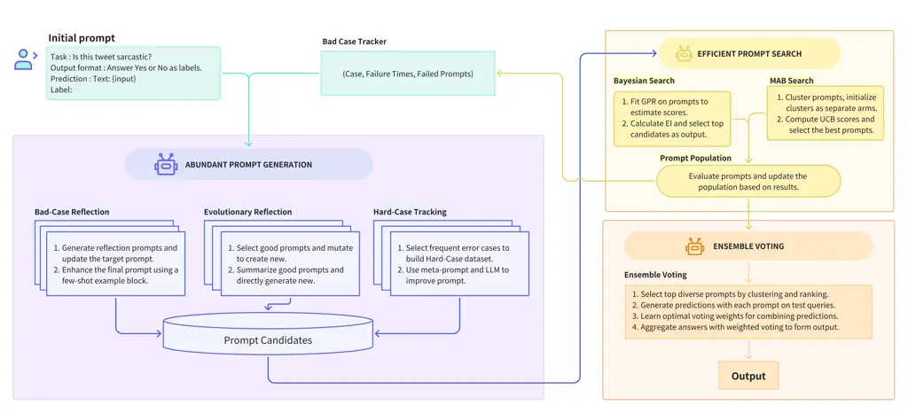
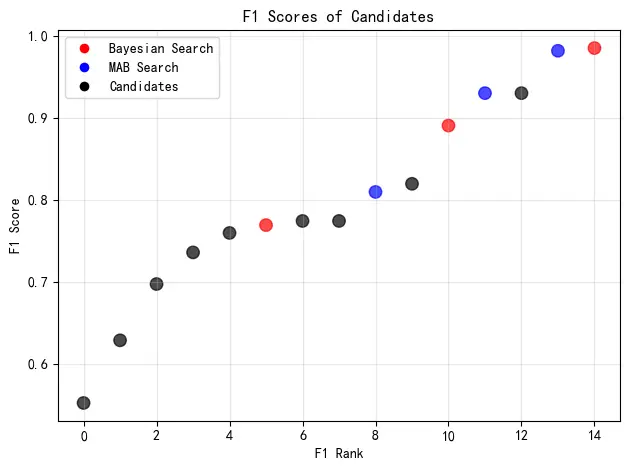

# ELPO: Ensemble Learning Based Prompt Optimization for Large Languages Models

Qing Zhang Affiliation: ByteDance, China Correspondence to:
<zhangqing.thomas@bytedance.com>    Bing Xu Affiliation: ByteDance,
China    Xudong Zhang Affiliation: ByteDance, China    Yifan Shi
Affiliation: ByteDance, China    Yang Li Affiliation: ByteDance, China
   Chen Zhang Affiliation: Department of Electrical and Electronic
Engineering, The University of Hong Kong, HKSAR, China    Yik Chung Wu
Affiliation: Department of Electrical and Electronic Engineering, The
University of Hong Kong, HKSAR, China    Ngai Wong
Affiliation: Department of Electrical and Electronic Engineering, The
University of Hong Kong, HKSAR, China    Yijie Chen
Affiliation: ByteDance, China    Hong Dai Affiliation: ByteDance, China
   Xiansen Chen Affiliation: ByteDance, China    Mian Zhang
Affiliation: ByteDance, China

###### Abstract

The remarkable performance of Large Language Models (LLMs) highly relies
on crafted prompts. However, manual prompt engineering is a laborious
process, creating a core bottleneck for practical application of LLMs.
This phenomenon has led to the emergence of a new research area known as
Automatic Prompt Optimization (APO), which develops rapidly in recent
years. Existing APO methods such as those based on evolutionary
algorithms or trial-and-error approaches realize an efficient and
accurate prompt optimization to some extent. However, those researches
focus on a single model or algorithm for the generation strategy and
optimization process, which limits their performance when handling
complex tasks. To address this, we propose a novel framework called
Ensemble Learning based Prompt Optimization (ELPO) to achieve more
accurate and robust results. Motivated by the idea of ensemble learning,
ELPO conducts voting mechanism and introduces shared generation
strategies along with different search methods for searching superior
prompts. Moreover, ELPO creatively presents more efficient algorithms
for the prompt generation and search process. Experimental results
demonstrate that ELPO outperforms state-of-the-art prompt optimization
methods across different tasks, e.g., improving F1 score by 7.6 on
ArSarcasm dataset.

###### Keywords: 

Machine Learning, ICML

^(†)^(†)affiliationnotice: Equal contribution

## 1 Introduction

Over the past few years, Large Language Models (LLMs) have emerged not
merely as incremental improvements in natural language processing (NLP),
but as transformative agents redefining the relationship between humans
and intelligent systems. Flagship families including GPT (Radford et
al., 2018; Radford et al., 2019; Brown et al., 2020; Achiam et al.,
2023), LLaMA (Touvron et al., 2023a; Touvron et al., 2023b), and PaLM
(Anil et al., 2023) are trained on web-scale corpora and display
emergent capabilities that are unforeseen in smaller-scale predecessors.
Among these, in-context learning (Brown et al., 2020) exemplifies a
paradigm shift: models without any fine-tuning can tackle sentiment
analysis, text classification, code generation, logical reasoning, and
other diverse tasks by following natural language instructions, also
known as “prompts”.

This ability has fueled visions of a “general-purpose linguistic
interface” where machine behavior is shaped as effortlessly as
conversing with a colleague. Yet, this promise comes with a sharp
problem: LLMs are strikingly sensitive to small changes in prompts
(Jiang et al., 2020; Zhao et al., 2021; Lu et al., 2022). Synonym
substitutions, minor structural tweaks or rephrased instructions may
lead to outputs drastically different from what human intuition expects
(Webson and Pavlick, 2022). Such fragility has propelled prompt
engineering, the art and science of designing prompts for high-quality
outputs into the spotlight (Liu et al., 2023; Reynolds and McDonell,
2021). But for many users, particularly non-experts, crafting effective
prompts is an opaque, trial-and-error process, hindered by the vast,
unstructured search space of possible natural language instructions
(Jiang et al., 2022).

To ease this burden, the field has turned toward Automatic Prompt
Optimization (APO) (Zhou et al., 2023). APO automates the prompt design
process by creating candidate instructions and identifying the optimal
ones through performance evaluation. Strategies ranging from
feedback-driven refinement, evolutionary algorithms, to trajectory-based
exploration have shown encouraging results. However, they have surfaced
some new, fundamental difficulties. First, relying on a single
optimization algorithm risks fragility: in light of the “No Free Lunch”
theorem for optimization (Wolpert and Macready, 2002), no one strategy
can consistently capture every subtlety across tasks. Second, most
existing systems treat the candidate pool as a flat, unstructured set,
leading to wasted computation on unpromising variants, thereby
diminishing efficiency. These bottlenecks leave APO methods struggling
to fulfil the promise of truly adaptive, scalable prompt engineering.

Motivated by both the remarkable potential of LLMs and the instability
of prompt-based interaction, we propose a novel framework for APO called
Ensemble Learning based Prompt Optimization (ELPO) which combines
multiple generation and search algorithms to derive accurate and robust
results. As for the prompt generation, three strategies are applied to
maintain the diversity and quality of candidate prompts. It is expensive
to evaluate each candidate prompt on the entire training dataset (Prasad
et al., 2023), so well-designed search methods for minimizing the
queries for employing LLMs are also necessary. With respect to prompt
search, to the best of our knowledge, we are the first to combine
Bayesian search (Jones et al., 1998; Brochu et al., 2010; Snoek et al., 2012) and Multi-Armed Bandit (MAB) (Audibert and Bubeck, 2010; Lattimore
and Szepesvári, 2020), applying it to APO for improving search
efficiency substantially. Inspired by the idea of ensemble learning
(Zhou, 2012), a robust result is chosen by applying multiple generation
and search methods along with ensemble voting.

In summary, this paper makes the following main contributions.

- (1)
  As for generation, we creatively propose Hard-Case Tracking which
  focuses on recurrent error samples and analyzes them in conjunction
  with failed prompts, employing large language models to generate more
  robust and generalizable prompts. Moreover, we combine it with other
  two strategies simultaneously when generating new prompts.
- (2)
  In terms of search efficiency, we propose a novel search algorithm in
  APO based on Bayesian search. It reflects prompts into
  high-dimensional spaces to increase search efficiency as a result of
  evaluation on only part of the prompts.
- (3)
  In terms of robustness and generalization, we use an ensemble voting
  strategy that aggregates multiple well-performing yet structurally
  diverse candidate prompts.
- (4)
  We conduct extensive experiments on various tasks and demonstrate that
  our algorithm outperforms state-of-the-art methods. The ablation study
  validates the effectiveness of each individual component, confirming
  their respective contributions to the algorithm’s success.

## 2 Related Work

The field of APO has rapidly evolved, moving from simple
generation-and-selection pipelines to highly sophisticated search and
refinement strategies. The existing methods can be broadly categorized
by their core mechanism for proposing and selecting new prompts
considering different optimization space, criteria, operators and
iterative algorithms (Cui et al., 2025).

Many researches are based on soft prompt space optimization (Li and
Liang, 2021; Sun et al., 2022; Zou et al., 2023; Zhao et al., 2024; Zhou
et al., 2024; Zhao et al., 2025), despite their efficiency, these
methods suffer from two major drawbacks that limit their practical
application, especially with modern, closed-source LLMs. Firstly, they
are inherently white-box, requiring direct access to the model’s
internal states, such as gradients and hidden layer activations, for
backpropagation. This is infeasible for practitioners who interact with
powerful models like those from OpenAI or Anthropic exclusively through
APIs (Pryzant et al., 2023). Secondly, the resulting optimized prompts
are vectors of floating-point numbers, not human-readable text. Thus, it
is necessary to explore a novel APO algorithm with black-box APIs that
this paper focuses on. Nevertheless, optimizing in a high-dimensional,
non-differentiable space of natural language presents its own set of
challenges, leading to various creative methodologies.

Reinforcement Learning (RL) Based Algorithms. These methods formulates
prompt optimization as an RL problem. Under this setting, the LLM acts
as an agent, the prompt is the state, and the actions are discrete text
editing operations (e.g., add, delete, or rephrase a word). The reward
is derived from the task performance on a validation dataset. For
example, RLPrompt (Deng et al., 2022) and TEMPERA (Zhang et al., 2023)
train a policy network to decide which editing actions to take. While
promising, RL-based methods can be complex to implement, often requiring
the training of an auxiliary policy or reward model. Furthermore, the
discrete, phrase-level operations may lead to grammatically flawed or
semantically incoherent prompts (Prasad et al., 2023).

Search and Evolution Based Algorithms. Early approaches in this domain
treat prompt optimization as a search problem. Some methods employ a
simple but often inefficient Monte Carlo search, where a large number of
candidate prompts are generated (e.g., through paraphrasing) and
evaluated. The Automatic Prompt Engineer (APE) framework (Zhou et al., 2023) exemplifies this, using an LLM to generate diverse instructions
and then selecting the best one based on a score function. Inspired by
APE, (Wang et al., 2024) propose PromptAgent which extend Monte Carlo to
a search tree through a series of selections, expansions, simulations,
and backpropagation steps. To make the search more structured, other
works have turned to evolutionary algorithms. Methods like GPS (Xu et
al., 2022), EvoPrompt (Guo et al., 2024), and PromptBreeder (Fernando et
al., 2024) maintain a population of candidate prompts and iteratively
apply genetic operators such as mutation (e.g., rephrasing a sentence),
crossover (e.g., combining parts of two prompts). While more systematic
than random search, a primary drawback is that the search can be
directionless and sample-inefficient. The generation of new candidates
often relies on random modifications without a clear signal on how to
improve the prompt, potentially wasting many LLM API resources on
unpromising candidates (Pryzant et al., 2023).

LLM-as-Optimizer and Feedback Based Algorithms. Recently, a more
directed approach has emerged that leverages the LLM’s own reasoning
capabilities to guide the optimization process (Pryzant et al., 2023;
Zhou et al., 2023; Cheng et al., 2024; Yang et al., 2024; Ye et al.,
2024; Juneja et al., 2025; Xiang et al., 2025). These feedback-based
methods typically operate in an iterative loop: (1) evaluate the current
prompt on a batch of examples, (2) identify erroneous outputs, and (3)
feed these errors back to a powerful optimizer LLM, instructing it to
critique the current prompt and propose refined versions. A foundational
method in this subfield is ProTeGi (Pryzant et al., 2023), which
introduces the concept of “textual gradients”. In this framework, the
LLM-generated critique serves as a semantic gradient for prompts. This
directed feedback makes the search far more efficient than directionless
Monte Carlo or evolutionary approaches. Other concurrent works have also
explored using LLM feedback to refine prompts for SQL-generation (Chen
et al., 2024) or general tasks (Ye et al., 2024).

Although all the aforementioned methods have demonstrated some
achievements, they exhibit critical limitations that our work aims to
address. Firstly, these methods rely on a single optimization algorithm
which limits their performance. Secondly, they are often myopic,
operating on a step-by-step basis. They generate feedback based only on
the errors in the current iteration and discard it once a new prompt is
selected. Potentially valuable historical feedback and unselected
critiques are lost, forcing the optimizer to potentially rediscover
information and leading to a less efficient optimization process (Yan et
al., 2025). Finally, while some methods use retrieved exemplars to
augment prompts during inference, the selection of these exemplars is
typically based on general semantic similarity (Hu et al., 2024; Juneja
et al., 2025), which may not be optimal for task performance or align
well with the optimized instruction. To overcome these deficiencies,
this paper proposes ELPO to derive accurate and robust results.

## 3 Methodology

### 3.1 Preliminary

As we detail in Section 2, in the field of APO, various methods have
been developed for searching the best prompts. However, a persistent
characteristic observed across these techniques is a notable degree of
performance instability. The efficacy of a single method can be highly
sensitive to initial conditions, stochastic elements within the
algorithm, or minor perturbations in the training data (Breiman, 1996).
Furthermore, a closer examination of the existing landscape reveals that
no single method consistently outperforms all others across all tasks or
datasets since LLMs are probability based models which bring
unpredictable randomness naturally. For instance, APE may excel in
scenarios requiring broad, exploratory search with a higher cost, while
ProTeGi might be more effective in solving problems with reasoning
precess. Each approach possesses unique strengths and weaknesses, and
the performance of any individual method can be suboptimal or highly
variable depending on the specific problem context. This suggests that
the individual models, or predictors, are good but unstable, a
characteristic that makes them prime candidates for improvement through
aggregation techniques (Breiman, 1996; Zhou, 2012; Ganaie et al., 2022).

Figure 1: Pipeline of ELPO.

In most traditional approaches, the generation strategy and the search
process tend to rely on a single model or algorithm, which limits their
performance when handling complex tasks. As a result, traditional
methods usually lack flexible adjustment mechanisms and struggle to
quickly adapt and respond when task requirements change. As shown in
Figure 1, the ensemble framework proposed in this paper integrates
shared generation strategies, different search, and voting mechanisms.
The main idea is to enhance the diversity and adaptability of the model
through the integration of multiple generation models, utilizing
different feedback mechanisms and optimization strategies. Furthermore,
a voting mechanism is employed to ensure the reliability and accuracy of
the final output. Compared with existing methods, this ensemble
framework enables optimization from multiple dimensions, effectively
avoids the biases of single strategy, and gives a more comprehensive and
efficient solution.

### 3.2 Abundant Prompt Generation

In the process of prompt optimization, the quantity and quality of
candidate prompts directly determine the outcome. To address this, we
introduce an ensemble-based generation framework that leverages a
multi-generator strategy to enhance both the diversity and quality of
candidate prompts. Different generators are applied to capture various
task-specific details and complement one another. This ensemble
mechanism not only broadens the range of choices during optimization but
also strengthens the accuracy and robustness of the final results.

Bad-Case Reflection. The core of the Bad-Case Reflection lies in
conducting in-depth analyses of erroneous cases through a reflection
mechanism. Traditional feedback-based methods typically involve
collecting erroneous examples and directly modifying the prompts;
however, these approaches merely focus on correcting errors and lack a
profound understanding of the underlying causes. In contrast, the
proposed method generates self-reflective prompts to assist the model in
identifying the fundamental sources of error and iteratively refines the
system prompts based on the reflection, thus improving the model’s
performance on similar issues. Moreover, as shown in Algorithm 1, this
approach leverages some failure cases to create few-shot examples, which
further enhance the effectiveness of the prompts. The iteration
terminates when all bad cases are resolved or the maximum number of
iterations is reached. Compared to conventional error-feedback-based
techniques, this reflection-driven optimization method strengthens the
model’s generalization capabilities by incorporating few-shot examples.

1:  Input: Initial prompt $`p`$, bad cases $`B`$, the number of
iterations for optimization $`T`$

2:  Sample bad case set $`B_{\mathrm{s}}\subset B`$

3:  for $`t=1,\dots,T`$ do

4:   Generate reflection prompt $`p_{\mathrm{ref}}`$ based on $`p`$ and
$`B_{\mathrm{s}}`$

5:   Update target prompt $`p_{t}`$ using $`p_{\mathrm{ref}}`$

6:   Evaluate prompt $`p_{t}`$ on $`B_{\mathrm{s}}`$ to get a new bad
cases set $`\widehat{B}_{\mathrm{s}}`$, and let
$`B_{\mathrm{s}}\leftarrow\widehat{B}_{\mathrm{s}}`$

7:  end for

8:  $`p^{*}\leftarrow`$ Generate Few-shot block from $`B_{\mathrm{s}}`$
and add it to target prompt $`p_{T}`$

9:  Output: $`p^{*}`$

Algorithm 1 Bad-Case Reflection

Evolutionary Reflection. Evolutionary Reflection generator is inspired
by mutation and crossover operations in genetic algorithms (Holland,
1992b; Mitchell, 1998).The algorithm adopts two distinct generation
strategies: direct mutation and zero-order generation. Direct mutation
involves modifying the current prompt directly to produce new prompts
that are semantically similar but expressed differently, analogous to
the mutation operation (Holland, 1992a) in genetic algorithms. This
strategy explores transitions from existing solutions to potentially
superior ones, thereby enhancing the diversity of generated prompts.
Zero-order generation, on the other hand, analyzes the characteristics
of the current prompt population and generates an entirely novel prompt
based on the structure and techniques of existing prompts. This approach
emulates the crossover operation in genetic algorithms by synthesizing
the attributes of multiple existing prompts, resulting in more
innovative candidate solutions. As we detail in Algorithm 2, these two
strategies complement each other. Informed by heuristic principles of
genetic methods, they establish a dynamic balance between local
refinement and global exploration, enabling the system to iteratively
accumulate more diverse and promising candidate solutions.

1:  Input: prompt population $`P`$, the number of iterations for
optimization $`T`$, the sizes of candidate prompts $`s_{1},s_{2}`$

2:  Generate new candidate prompts $`P_{1}`$ via direct mutation from
$`P`$ with $`|P_{1}|=s_{1}`$

3:  Generate new candidate prompts via zero-order generation from $`P`$
with $`|P_{2}|=s_{2}`$

4:  Evaluate candidate prompts $`P_{1}\cup P_{2}`$, and let
$`p^{*}\leftarrow`$ best prompt in $`P_{1}\cup P_{2}`$

5:  Output: $`p^{*}`$

Algorithm 2 Evolutionary Reflection

Hard-Case Tracking. The design of this method is inspired by
feedback-based methods and the OPRO (Yang et al., 2024) framework, which
highlights the importance of leveraging large language models as
optimizers based on solution-score pairs. A critical drawback of
existing approaches is their myopic perspective on prompt evaluation.
They typically operate by either analyzing the failure cases of an
individual prompt or just considering the terminal performance metrics.
Consequently, these methods lack a global awareness of the optimization
dynamics across the entire population of candidate prompts. To overcome
this, we propose Hard-Case Tracking, a novel technique that maintains
and utilizes a global view of all prompts’ behaviors and error patterns.
Additionally, recognizing the sophisticated inferential power of
contemporary LLMs (Kojima et al., 2022; Wei et al., 2022), our framework
forgoes the generation of explicit intermediate summaries. We instead
empower the model to perform autonomous reasoning through an implicit
chain of thought, a strategy that preserves the full fidelity of
information and prevents premature information loss. Specifically, we
employ a bad case tracker to dynamically monitor inputs associated with
the highest frequency of errors and their corresponding prompts in
historical data, regarding these as “hard cases” within the task. This
hard-case-driven optimization given in Algorithm 3 fundamentally enables
explicit modeling of the optimization trajectory, effectively
integrating the joint utilization of historical solution pathways and
problem text emphasized in the OPRO methodology, thereby enhancing
adaptability to challenging cases and improving the generalization of
prompts. Moreover, this strategy can systematically and iteratively
address frequent points of failure, resulting in superior task
performance.

1:  Input: Bad case tracker $`B`$, prompt population $`P`$, the size of
Hard-Case dataset $`k`$

2:  Select top-$`k`$ cases by error frequency from $`B`$ to build
Hard-Case dataset
$`D:=\{{(Case_{i},Failure\_times_{i},Failed\_prompts_{i})\}_{i=1}^{k}}`$

3:  Construct meta-prompt $`p_{\mathrm{meta}}`$ using $`D`$

4:  Use an LLM to generate improved prompt $`p^{*}`$ based on
$`p_{\mathrm{meta}}`$

5:  Output: $`p^{*}`$

Algorithm 3 Hard-Case Tracking

### 3.3 Efficient Prompt Search

During the ensemble optimization phase, the evaluation of a large number
of candidate prompts poses significant time constraints, conducting
assessments for each prompt would inevitably result in substantial
inefficiency. To address this challenge, we introduce an intelligent
screening mechanism based on Bayesian optimization and the MAB principle
to efficiently pre-select candidate prompts. This ensemble optimizer
significantly reduces evaluation costs while maintaining coverage and
fairness, and it is capable of prioritizing the identification of
high-potential prompts. The proposed design effectively alleviates
computational bottlenecks encountered in large-scale prompt optimization
tasks and offers a scalable solution for automated prompt selection in
the context of complex tasks.

Bayesian Search. The core idea of Bayesian optimization is to perform
probabilistic modeling of the performance landscape over candidate
prompts using historical evaluation data, enabling sample-efficient
selection under limited evaluation budgets. Specifically, given a set of
evaluated prompts $`\{\mathbf{x}_{i},y_{i}\}_{i=1}^{n}`$, where
$`\mathbf{x}_{i}`$ denotes the embedding of the $`i`$-th prompt and
$`y_{i}`$ is its observed performance, a Gaussian Process Regression
(GPR) model is fitted to estimate the underlying objective function
$`f(\mathbf{x})`$. For any unevaluated candidate $`\mathbf{x}`$, the
posterior predictive distribution is
$`f(\mathbf{x})\sim\mathcal{N}(\mu(\mathbf{x}),\sigma^{2}(\mathbf{x})),`$
where $`\mu(\mathbf{x})`$ and $`\sigma^{2}(\mathbf{x})`$ represent the
expectation and variance of $`\mathbf{x}`$, respectively. The
acquisition function, Expected Improvement (EI), quantifies the expected
gain over the current best observed performance $`f^{*}`$, and is
defined as:

$`\mathrm{EI}(\mathbf{x}):=\mathbb{E}\left[\max(f(\mathbf{x})-f^{*}-\xi,0)\right],`$

where $`\xi`$ is a positive constant for exploration. The closed-form
expression is:
$`\mathrm{EI}(\mathbf{x})=(\mu(\mathbf{x})-f^{*}-\xi)\Phi(Z)+\sigma(\mathbf{x})\phi(Z),`$
where $`Z=(\mu(\mathbf{x})-f^{*}-\xi)/{\sigma(\mathbf{x})}`$,
$`\Phi(\cdot)`$ and $`\phi(\cdot)`$ denote the cumulative distribution
function and the probability density function of the standard normal
distribution, respectively. By computing $`\mathrm{EI}(\mathbf{x})`$ for
all candidate prompts and selecting those with the highest EI values for
evaluation, the algorithm efficiently explores the search space and
identifies optimal or near-optimal prompts with fewer evaluations.
Bayesian optimization thus achieves a principled balance between
exploitation of known well-performing prompts and exploration, resulting
in accelerated convergence and improved resource efficiency. This
process is shown in Algorithm 4.

1:  Input: Candidate prompts $`\mathcal{C}`$, evaluated prompts and
their scores $`\{(\mathbf{x}_{i},y_{i})\}_{i=1}^{n}`$, the number of
optimized prompts $`N`$

2:  Fit GPR on $`(\mathbf{x}_{i},y_{i})`$ to estimate $`f(\mathbf{x})`$

3:  for each candidate $`\mathbf{x}\in\mathcal{C}`$ do

4:   Calculate posterior mean $`\mu(\mathbf{x})`$ and variance
$`\sigma^{2}(\mathbf{x})`$

5:   Compute EI value as:
$`\mathrm{EI}(\mathbf{x})=(\mu(\mathbf{x})-f^{*}-\xi)\Phi(Z)+\sigma(\mathbf{x})\phi(Z)`$

6:  end for

7:  Select top-$`N`$ candidates $`\mathcal{C}^{*}`$ with the highest
$`\mathrm{EI}(\mathbf{x})`$

8:  Output: $`\mathcal{C}^{*}`$

Algorithm 4 Bayesian Search for Prompt Selection

MAB Search. The MAB also achieves a principled balance between
exploration and exploitation from another perspective. Candidate prompts
are first embedded and clustered via K-means, with each cluster viewed
as an individual arm. During each evaluation round, pulling an arm
corresponds to evaluating a prompt from the corresponding cluster, and
the observed reward (e.g., F1 score) is recorded. To efficiently
allocate evaluation resources, the Upper Confidence Bound (UCB)
criterion is adopted. For the $`k`$-th arm, the UCB score is defined as:

$`\mathrm{UCB}_{k}:=\bar{r}_{k}+c\sqrt{{\ln N}/{n_{k}}},`$

where $`\bar{r}_{k}`$ denotes the average reward for arm $`k`$,
$`n_{k}`$ is the number of pulls for arm $`k`$, $`c`$ is an exploration
parameter and $`N`$ is the total number of pulls across all arms. At
each step, the arms with the highest UCB scores are selected, and
prompts are randomly sampled from these clusters for evaluation. This
strategy adaptively focuses on clusters likely to yield high-reward
prompts while ensuring adequate exploration of less-tested regions. This
iterative process is formalized in Algorithm 5. Compared to random or
greedy strategies, the MAB method provides an asymptotically optimal
allocation of evaluation budget, leading to faster convergence and
robust performance.

1:  Input: Candidate prompts $`\mathcal{C}`$, the number of clusters
$`K`$

2:  Embed $`\mathcal{C}`$ into Euclidean space and perform K-means
clustering with parameter $`K`$, time steps $`T_{s}`$, exploration
parameter $`c`$

3:  Initialize each cluster as an arm $`k\in\{1,\dots,K\}`$ with
$`\bar{r}_{k}=0`$ and $`n_{k}=0`$

4:  for $`N_{ts}=1,\dots,T_{S}`$ do

5:   For each arm $`k`$, compute UCB score:
$`\mathrm{UCB}_{k}=\bar{r}_{k}+c\sqrt{({\ln N_{ts}})/{n_{k}}}`$

6:   Select top arms as a set $`S_{K}`$ with the highest UCB scores

7:   For each arm $`k\in S_{K}`$, randomly choose a prompt for
evaluation and updating $`n_{k}`$ and $`\bar{r}_{k}`$

8:  end for

9:  Output: Prompts with highest observed rewards

Algorithm 5 MAB Search for Prompt Selection

### 3.4 Ensemble Voting

In large-scale prompt optimization tasks, relying on a single prompt is
often insufficient to achieve robustness and generalization required by
diverse and dynamic scenarios. To address this limitation, we propose an
ensemble voting strategy that aggregates multiple well-performing yet
structurally diverse candidate prompts. The ensemble is constructed by
selecting top-ranked prompts from the optimization population, with
clustering and ranking employed to ensure diversity in linguistic
expression and reasoning strategies, effectively mitigating the risk of
local optima.

Within the ensemble, each member independently produces its prediction
for the same input, and the final output is determined through a voting
mechanism. Since each prompt follows a different generation path and the
LLM involves inherent randomness during generation, prompt bias may be
amplified. Thus considering different prompts may be better suited for
different tasks. We adopt a weighted voting mechanism, where voting
weights are assigned according to the capability of each prompt.
Formally, given $`M`$ ensemble members, the final prediction
$`\hat{y}(x)`$ for input $`x`$ is defined as:

$`\hat{y}(x)=\arg\max_{y\in\mathcal{Y}}\sum_{j=1}^{M}w_{j}\cdot\mathbb{I}\{f_{j}(x)=y\},`$

where $`w_{j}`$ is the weight of the $`j`$-th prompt, $`f_{j}(x)`$
represents its prediction, and $`\mathbb{I}`$ is the indicator function.
The weight vector $`\mathbf{w}`$ is obtained by solving the following
optimization problem:

$`\min_{\mathbf{w}}\left\{-\mathrm{F1}_{\text{macro}}(\mathbf{w})+\lambda\|\mathbf{w}\|_{2}^{2}\right\}\quad\text{s.t.}\quad\sum_{j=1}^{M}w_{j}=1,\,w_{j}\geq w_{\min},`$

where $`\lambda`$ is a regularization coefficient designed to ensure
balanced weight allocation and reduce the risk of overfitting,
$`w_{\min}>0`$ is a pre-given constant as a weight threshold.

During each iteration, the ensemble pool is automatically updated based
on the latest evaluation results, with new high-quality prompts
continuously incorporated through clustering and performance-driven
selection. Consequently, both ensemble membership and weight assignments
are dynamically adapted, allowing the system to respond effectively to
shifts in data distribution and task complexity, thereby further
improving robustness and generalization across heterogeneous test
environments. This voting method is summarized in Algorithm 6. Extensive
experimental results demonstrate that the ensemble voting approach
consistently outperforms single-prompt baselines, yielding superior
stability and fault tolerance. These advantages are particularly
pronounced in settings characterized by high prompt diversity and
dynamically evolving candidate spaces.

1:  Input: Queries $`Q`$, optimization population $`{P}`$, test dataset
$`D_{\mathrm{test}}=\{(q_{i},a_{i})\}_{i}`$ consists of queries and
answers, ensemble size $`M`$, regularization parameter $`\lambda`$,
minimum weight $`w_{\min}`$

2:  Select $`M`$ well-performing and diverse prompts
$`\{p_{j}\}_{j=1}^{M}`$ from $`\mathcal{P}`$ via clustering and ranking

3:  Generate predictions $`f_{j}(q_{i})`$ for
$`(q_{i},a_{i})\in D_{\mathrm{test}}`$ and $`j\in\{1,\dots,M\}`$

4:  Construct prediction matrix $`\mathbf{F}`$ with
$`\mathbf{F}_{ij}=f_{j}(q_{i})`$

5:  Optimize weights $`\mathbf{w}=(w_{1},\dots,w_{M})`$ by solving
$`\min_{\mathbf{w}}\;\left\{-\mathrm{F1}_{\mathrm{macro}}(\mathbf{w};\mathbf{F},D_{\mathrm{test}})+\lambda\|\mathbf{w}\|_{2}^{2}\right\}`$
s.t. $`\sum_{j=1}^{M}w_{j}=1,\quad w_{j}\geq w_{\min}\ \ (j=1,\dots,M)`$

6:  for each query $`q\in Q`$ do

7:   Aggregate predictions by weighted voting:
$`\hat{a}(q)=\arg\max_{a}\sum_{j=1}^{M}w_{j}\,\mathbb{I}\{f_{j}(q)=a\}`$

8:  end for

9:  Output: $`A(Q)=\{\hat{a}(q)\}_{q\in Q}`$

Algorithm 6 Ensemble Voting

## 4 Experiments and Results

Datasets. We perform evaluation on the following 6 datasets: Liar (Wang,
2017), BBH-navigate (Suzgun et al., 2023), Ethos (Mollas et al., 2022),
ArSarcasm (Farha and Magdy, 2020), WSC (Levesque et al., 2012),
GSM8K(Cobbe et al., 2021). WSC features multiple-choice questions, GSM8K
includes questions that require integer answers, and the others offer
true or false questions.

Baselines. Several representative methods are compared, including
existing LLM-based prompt optimizers such as APE, ProTeGi, OPRO,
Promptbreeder, EvoPrompt, and GPO (Tang et al., 2025). Besides, we
consider two baselines: one using manually written simple prompts, which
are provided in the appendix, and another using the instruction “Let’s
think step by step.” from chain-of-thought (CoT) as proposed by Kojima
et al. (2022) for performance comparison.

### 4.1 Main Results

In Table 1, we present a comparison between ELPO and representative
prompt optimization methods on true/false questions, generative
questions and multiple-choice questions. Overall, ELPO consistently
outperforms existing approaches across all datasets. All the F1 score
and accuracy results are multiplied by 100. For true/false questions,
our approach shows notable improvement. Specifically, ELPO achieves an
F1 score of 91.1 on the BBH dataset, outperforming CoT’s 81.9 by 9.2
points and demonstrating better generalization. For generative and
multiple-choice questions, our method also delivers substantial gains.
On the WSC and GSM8K datasets, ELPO attains an accuracy of 95.9 and a
score of 96.0, respectively, surpassing GPO’s 84.0 and Promptbreeder’s
91.7.

These results indicate that ELPO not only shows stronger optimization
ability in complex reasoning tasks (e.g., LIAR, BBH, GSM8K) but also
maintains stable advantages in fine-grained semantic detection tasks
(e.g., ETHOS, ArSarcasm, WSC). Compared with feedback-based methods
(e.g., ProTeGi) and evolutionary methods (e.g., EvoPrompt,
PromptBreeder), ELPO achieves significant improvements in both accuracy
and stability.

|                                       |      |      |       |           |        |        |
| ------------------------------------- | ---- | ---- | ----- | --------- | ------ | ------ |
| Method                                | LIAR | BBH  | ETHOS | ArSarcasm | WSC    | GSM8K  |
|                                       | (F1) | (F1) | (F1)  | (F1)      | (Acc.) | (Acc.) |
| Empty                                 | 46.4 | 69.4 | 93.0  | 83.7      | 77.3   | 89.0   |
| CoT (Kojima et al., 2022)             | 46.0 | 81.9 | 84.5  | 83.7      | 81.3   | 89.0   |
| APE (Zhou et al., 2023)               | 51.2 | 74.3 | 93.2  | 84.3      | 79.3   | 91.3   |
| ProTeGi (Pryzant et al., 2023)        | 60.3 | 73.6 | 97.0  | 84.1      | 80.0   | 91.0   |
| OPRO (Yang et al., 2024)              | 52.1 | 75.0 | 94.8  | 84.7      | 83.3   | 90.7   |
| Promptbreeder (Fernando et al., 2024) | 51.8 | 75.7 | 95.7  | 84.5      | 80.0   | 91.7   |
| EvoPrompt (Guo et al., 2024)          | 52.3 | 76.4 | 94.3  | 83.9      | 78.8   | 90.7   |
| GPO (Tang et al., 2025)               | 56.6 | 75.0 | 95.5  | 83.8      | 84.0   | 90.3   |
| ELPO                                  | 72.1 | 91.1 | 98.4  | 92.3      | 95.9   | 96.0   |

Table 1: Comparison of performance between ELPO and existing methods.

### 4.2 Ablation Study

Effect of Each Component. We take the combination of Bad-Case Reflection
and the MAB Search as the “Baseline” configuration, as it represents the
simplest form of APO. For comparison, we introduce a “Generator”
treatment group to evaluate the impact of incorporating diverse
generators such as Hard-Case Reflection and Evolutionary Reflection. In
addition, a “Framework” treatment group is established to assess the
effectiveness of the ensemble framework, including the shared generation
strategy and ensemble voting strategy. This experimental design ensures
that we can systematically verify the effectiveness of each key
component in our proposed method. The results are given in Table 2. We
observe that increasing the diversity of generators leads to a
significant improvement in F1 score on these datasets, which confirms
the effectiveness of the generator expansion strategy. Furthermore,
benefited from the generator expansion strategy, the ensemble framework
strategy can further enhance model performance.

| Baseline | Generator | Framework | LIAR | BBH  | ETHOS | ArSarcasm | WSC    | GSM8K  |
| -------- | --------- | --------- | ---- | ---- | ----- | --------- | ------ | ------ |
|          |           |           | (F1) | (F1) | (F1)  | (F1)      | (Acc.) | (Acc.) |
| ✓        |           |           | 42.5 | 71.1 | 97.6  | 74.4      | 76.2   | 76.7   |
| ✓        | ✓         |           | 65.3 | 84.0 | 97.7  | 86.7      | 88.9   | 90.5   |
| ✓        |           | ✓         | 43.2 | 73.1 | 97.9  | 79.2      | 87.0   | 80.0   |
| ✓        | ✓         | ✓         | 72.1 | 91.1 | 98.4  | 92.3      | 95.9   | 96.0   |

Table 2: Effect of each component in our method.

Effect of Voting Method. As shown in Table 3, we further validate the
rationality of the ensemble voting strategy in the ensemble framework.
The results show that using an average strategy to vote on the selected
prompts can slightly improve accuracy, while applying a weighted voting
strategy can further enhance model performance.

|          |         |          |      |      |       |           |        |        |
| -------- | ------- | -------- | ---- | ---- | ----- | --------- | ------ | ------ |
| Baseline | average | weighted | LIAR | BBH  | ETHOS | ArSarcasm | WSC    | GSM8K  |
|          |         |          | (F1) | (F1) | (F1)  | (F1)      | (Acc.) | (Acc.) |
| ✓        |         |          | 63.3 | 84.7 | 95.1  | 83.3      | 91.2   | 93.3   |
| ✓        | ✓       |          | 66.7 | 85.8 | 98.3  | 85.7      | 94.7   | 93.8   |
| ✓        |         | ✓        | 72.1 | 91.1 | 98.4  | 92.3      | 95.9   | 96.0   |

Table 3: Effect of Voting Method.

## 5 Conclusion

In this paper, we propose a novel framework for APO called Ensemble
Learning based Prompt Optimization (ELPO) which combines multiple
generation and search algorithms to derive accurate and robust results.
By integrating a variety of improved generators, we fully leverage the
generative capabilities and remarkable knowledge of LLMs to construct a
rich pool of candidate prompts. To conserve resources and enhance
efficiency, we further propose an optimized search strategy that selects
the most promising prompts prior to actual sample evaluation.
Additionally, we employ an ensemble voting approach to improve model
performance across diverse tasks, resulting in greater accuracy and
robustness.

Despite the promising results, our study has several limitations.
Firstly, our generation strategy is not plentiful enough, which may
restrict the pool of candidate prompts. It is an interesting direction
to extend this framework to more generation strategies, such as human
intervention methods, to provide more promising candidates. Secondly,
our search strategy is not sufficiently robust. Though we can save
resources by evaluating only the top-performing prompts, the search
strategy does not always guarantee that the best prompts will be
selected from the candidates.

Random seeds were fixed for all runs.

## References

- Achiam et al. (2023) J. Achiam, S. Adler, S. Agarwal, L. Ahmad, I.
  Akkaya, F. L. Aleman, D. Almeida, J. Altenschmidt, S. Altman, S.
  Anadkat, et al. Gpt-4 technical report. arXiv preprint
  arXiv:2303.08774. Cited by: §1.
- Anil et al. (2023) R. Anil, A. M. Dai, O. Firat, M. Johnson, D.
  Lepikhin, A. Passos, S. Shakeri, E. Taropa, P. Bailey, Z. Chen, et al.
  Palm 2 technical report. arXiv preprint arXiv:2305.10403. Cited by:
  §1.
- Audibert and Bubeck (2010) J. Audibert and S. Bubeck Best arm
  identification in multi-armed bandits. In Conference on Learning
  Theory (COLT 2010), pp. 41–53. Cited by: §1.
- Breiman (1996) L. Breiman Bagging predictors. Machine learning 24 (2),
  pp. 123–140. Cited by: §3.1.
- Brochu et al. (2010) E. Brochu, V. M. Cora, and N. De Freitas A
  tutorial on bayesian optimization of expensive cost functions, with
  application to active user modeling and hierarchical reinforcement
  learning. arXiv preprint arXiv:1012.2599. Cited by: §1.
- Brown et al. (2020) T. Brown, B. Mann, N. Ryder, M. Subbiah, J. D.
  Kaplan, P. Dhariwal, A. Neelakantan, P. Shyam, G. Sastry, A. Askell,
  et al. Language models are few-shot learners. In Advances in Neural
  Information Processing Systems, Vol. 33, pp. 1877–1901. Cited by: §1.
- Chen et al. (2024) X. Chen, M. Lin, N. Schärli, and D. Zhou Teaching
  large language models to self-debug. In International Conference on
  Learning Representations, Cited by: §2.
- Cheng et al. (2024) J. Cheng, X. Liu, K. Zheng, P. Ke, H. Wang, Y.
  Dong, J. Tang, and M. Huang Black-box prompt optimization: aligning
  large language models without model training. In Proceedings of the
  62nd Annual Meeting of the Association for Computational Linguistics
  (Volume 1: Long Papers), pp. 3201–3219. Cited by: §2.
- Cobbe et al. (2021) K. Cobbe, V. Kosaraju, M. Bavarian, M. Chen, H.
  Jun, L. K. andMatthias Plappert, J. Tworek, J. Hilton, R. Nakano, C.
  Hesse, and J. Schulman Training verifiers to solve math word problems.
  CoRR, pp. abs/2110.14168. Cited by: §A.1, §4.
- Cui et al. (2025) W. Cui, J. Zhang, Z. Li, H. Sun, D. Lopez, K.
  Das, B. A. Malin, and S. Kumar Heuristic-based search algorithm in
  automatic instruction-focused prompt optimization: a survey. In
  Findings of the Association for Computational Linguistics: ACL 2025,
  pp. 22093–22111. Cited by: §2.
- Deng et al. (2022) M. Deng, J. Wang, C. Hsieh, Y. Wang, H. Guo, T.
  Shu, M. Song, E. P. Xing, and Z. Hu Rlprompt: optimizing discrete text
  prompts with reinforcement learning. In Proceedings of the 2022
  Conference on Empirical Methods in Natural Language Processing,
  pp. 3369–3391. Cited by: §2.
- Farha and Magdy (2020) I. A. Farha and W. Magdy From arabic sentiment
  analysis to sarcasm detection: the arsarcasm dataset. In Proceedings
  of the 4th Workshop on Open-Source Arabic Corpora and Processing
  Tools, with a Shared Task on Offensive Language Detection, pp. 32–39.
  Cited by: §A.1, §4.
- Fernando et al. (2024) C. Fernando, D. S. Banarse, H. Michalewski, S.
  Osindero, and T. Rocktäschel Promptbreeder: self-referential
  self-improvement via prompt evolution. In International Conference on
  Machine Learning, Vol. 235, pp. 13481–13544. Cited by: §2, Table 1.
- Ganaie et al. (2022) M. A. Ganaie, M. Hu, A. K. Malik, M. Tanveer,
  and P. N. Suganthan Ensemble deep learning: a review. Engineering
  Applications of Artificial Intelligence 115, pp. 105151. Cited by:
  §3.1.
- Guo et al. (2024) Q. Guo, R. Wang, J. Guo, B. Li, K. Song, X. Tan, G.
  Liu, J. Bian, and Y. Yang Connecting large language models with
  evolutionary algorithms yields powerful prompt optimizers. In
  International Conference on Learning Representations, Cited by: §2,
  Table 1.
- Holland (1992a) J. H. Holland Adaptation in natural and artificial
  systems: an introductory analysis with applications to biology,
  control, and artificial intelligence. MIT Press. Cited by: §3.2.
- Holland (1992b) J. H. Holland Genetic algorithms. Scientific American
  267 (1), pp. 66–73. Cited by: §3.2.
- Hu et al. (2024) X. Hu, P. Tang, S. Zuo, Z. Wang, B. Song, Q. Lou, J.
  Jiao, and D. Charles Evoke: evoking critical thinking abilities in
  llms via reviewer-author prompt editing. In International Conference
  on Learning Representations, Cited by: §2.
- Jiang et al. (2022) E. Jiang, K. Olson, E. Toh, A. Molina, A.
  Donsbach, M. Terry, and C. J. Cai Promptmaker: prompt-based
  prototyping with large language models. In Extended Abstracts of the
  2022 CHI Conference on Human Factors in Computing Systems, pp. 1–8.
  Cited by: §1.
- Jiang et al. (2020) Z. Jiang, F. F. Xu, J. Araki, and G. Neubig How
  can we know what language models know?. Transactions of the
  Association for Computational Linguistics 8, pp. 423–438. Cited by:
  §1.
- Jones et al. (1998) D. R. Jones, M. Schonlau, and W. J. Welch
  Efficient global optimization of expensive black-box functions.
  Journal of Global Optimization 13 (4), pp. 455–492. Cited by: §1.
- Juneja et al. (2025) G. Juneja, G. Jajoo, N. Natarajan, H. Li, J.
  Jiao, and A. Sharma Task facet learning: a structured approach to
  prompt optimization. In Findings of the Association for Computational
  Linguistics: ACL 2025, pp. 23473–23496. Cited by: §2, §2.
- Kojima et al. (2022) T. Kojima, S. S. Gu, M. Reid, Y. Matsuo, and Y.
  Iwasawa Large language models are zero-shot reasoners. In Advances in
  Neural Information Processing Systems, Vol. 35, pp. 22199–22213. Cited
  by: §3.2, Table 1, §4.
- Lattimore and Szepesvári (2020) T. Lattimore and C. Szepesvári Bandit
  algorithms. Cambridge University Press. Cited by: §1.
- Levesque et al. (2012) H. J. Levesque, E. Davis, and L. Morgenstern
  The winograd schema challenge. In Proceedings of the Thirteenth
  International Conference on Principles of Knowledge Representation and
  Reasoning, pp. 552–561. Cited by: §A.1, §4.
- Li and Liang (2021) X. L. Li and P. Liang Prefix-tuning: optimizing
  continuous prompts for generation. In Proceedings of the 59th Annual
  Meeting of the Association for Computational Linguistics and the 11th
  International Joint Conference on Natural Language Processing (Volume
  1: Long Papers), pp. 4582–4597. Cited by: §2.
- Liu et al. (2023) P. Liu, W. Yuan, J. Fu, Z. Jiang, H. Hayashi, and G.
  Neubig Pre-train, prompt, and predict: a systematic survey of
  prompting methods in natural language processing. ACM Computing
  Surveys 55 (9), pp. 1–35. Cited by: §1.
- Lu et al. (2022) Y. Lu, M. Bartolo, A. Moore, S. Riedel, and P.
  Stenetorp Fantastically ordered prompts and where to find them:
  overcoming few-shot prompt order sensitivity. In Proceedings of the
  60th Annual Meeting of the Association for Computational Linguistics
  (Volume 1: Long Papers), pp. 8086–8098. Cited by: §1.
- Mitchell (1998) M. Mitchell An introduction to genetic algorithms. MIT
  Press. Cited by: §3.2.
- Mollas et al. (2022) I. Mollas, Z. Chrysopoulou, S. Karlos, and G.
  Tsoumakas ETHOS: a multi-label hate speech detection dataset. Complex
  & Intelligent Systems 8 (6), pp. 4663–4678. Cited by: §A.1, §4.
- Prasad et al. (2023) A. Prasad, P. Hase, X. Zhou, and M. Bansal Grips:
  gradient-free, edit-based instruction search for prompting large
  language models. In Proceedings of the 17th Conference of the European
  Chapter of the Association for Computational Linguistics,
  pp. 3845––3864. Cited by: §1, §2.
- Pryzant et al. (2023) R. Pryzant, D. Iter, J. Li, Y. T. Lee, C. Zhu,
  and M. Zeng Automatic prompt optimization with “gradient descent” and
  beam search. In Proceedings of the 2023 Conference on Empirical
  Methods in Natural Language Processing, pp. 7957–7968. Cited by: §2,
  §2, §2, Table 1.
- Radford et al. (2018) A. Radford, K. Narasimhan, T. Salimans, I.
  Sutskever, et al. Improving language understanding by generative
  pre-training. Cited by: §1.
- Radford et al. (2019) A. Radford, J. Wu, R. Child, D. Luan, D.
  Amodei, I. Sutskever, et al. Language models are unsupervised
  multitask learners. OpenAI blog 1 (8), pp. 9. Cited by: §1.
- Reynolds and McDonell (2021) L. Reynolds and K. McDonell Prompt
  programming for large language models: beyond the few-shot paradigm.
  In Extended Abstracts of the 2021 CHI Conference on Human Factors in
  Computing Systems, pp. 1–7. Cited by: §1.
- Snoek et al. (2012) J. Snoek, H. Larochelle, and R. P. Adams Practical
  bayesian optimization of machine learning algorithms. In Advances in
  Neural Information Processing Systems, Vol. 25, pp. 2951–2959. Cited
  by: §1.
- Srivastava et al. (2023) A. Srivastava, A. Rastogi, A. Rao, A. A.
  Shoeb, A. Abid, A. Fisch, A. R. Brown, A. Santoro, A. Gupta, A.
  Garriga-Alonso, et al. Beyond the imitation game: quantifying and
  extrapolating the capabilities of language models. Transactions on
  Machine Learning Research. Cited by: §A.1.
- Sun et al. (2022) T. Sun, Y. Shao, H. Qian, X. Huang, and X. Qiu
  Black-box tuning for language-model-as-a-service. In International
  Conference on Machine Learning, pp. 20841–20855. Cited by: §2.
- Suzgun et al. (2023) M. Suzgun, N. Scales, N. Schärli, S. Gehrmann, Y.
  Tay, H. W. Chung, A. Chowdhery, Q. V. Le, E. H. Chi, D. Zhou, et al.
  Challenging big-bench tasks and whether chain-of-thought can solve
  them. In Findings of the Association for Computational Linguistics:
  ACL 2023, pp. 13003–13051. Cited by: §A.1, §4.
- Tang et al. (2025) X. Tang, X. Wang, W. X. Zhao, S. Lu, Y. Li, and J.
  Wen Unleashing the potential of large language models as prompt
  optimizers: analogical analysis with gradient-based model optimizers.
  In Proceedings of the AAAI Conference on Artificial Intelligence, Vol.
  39, pp. 25264–25272. Cited by: Table 1, §4.
- Touvron et al. (2023a) H. Touvron, T. Lavril, G. Izacard, X.
  Martinet, M. Lachaux, T. Lacroix, B. Rozière, N. Goyal, E. Hambro, F.
  Azhar, et al. Llama: open and efficient foundation language models.
  arXiv preprint arXiv:2302.13971. Cited by: §1.
- Touvron et al. (2023b) H. Touvron, L. Martin, K. Stone, P. Albert, A.
  Almahairi, Y. Babaei, N. Bashlykov, S. Batra, P. Bhargava, S. Bhosale,
  et al. Llama 2: open foundation and fine-tuned chat models. arXiv
  preprint arXiv:2307.09288. Cited by: §1.
- Wang (2017) W. Y. Wang ” Liar, liar pants on fire”: a new benchmark
  dataset for fake news detection. arXiv preprint arXiv:1705.00648.
  Cited by: §A.1, §4.
- Wang et al. (2024) X. Wang, C. Li, Z. Wang, F. Bai, H. Luo, J.
  Zhang, N. Jojic, E. P. Xing, and Z. Hu Promptagent: strategic planning
  with language models enables expert-level prompt optimization. In
  International Conference on Learning Representations, Cited by: §2.
- Webson and Pavlick (2022) A. Webson and E. Pavlick Do prompt-based
  models really understand the meaning of their prompts?. In Proceedings
  of the 2022 Conference of the North American Chapter of the
  Association for Computational Linguistics: Human Language
  Technologies, pp. 2300–2344. Cited by: §1.
- Wei et al. (2022) J. Wei, X. Wang, D. Schuurmans, M. Bosma, F. Xia, E.
  Chi, Q. V. Le, D. Zhou, et al. Chain-of-thought prompting elicits
  reasoning in large language models. In Advances in Neural Information
  Processing Systems, Vol. 35, pp. 24824–24837. Cited by: §3.2.
- Wolpert and Macready (2002) D. H. Wolpert and W. G. Macready No free
  lunch theorems for optimization. IEEE transactions on evolutionary
  computation 1 (1), pp. 67–82. Cited by: §1.
- Xiang et al. (2025) J. Xiang, J. Zhang, Z. Yu, F. Teng, J. Tu, X.
  Liang, S. Hong, C. Wu, and Y. Luo Self-supervised prompt optimization.
  arXiv preprint arXiv:2502.06855. Cited by: §2.
- Xu et al. (2022) H. Xu, Y. Chen, Y. Du, N. Shao, Y. Wang, H. Li,
  and Z. Yang Gps: genetic prompt search for efficient few-shot
  learning. In Proceedings of the 2022 Conference on Empirical Methods
  in Natural Language Processing, pp. 8162–8171. Cited by: §2.
- Yan et al. (2025) C. Yan, J. Wang, L. Zhang, R. Zhao, X. Wu, K.
  Xiong, Q. Liu, G. Kang, and Y. Kang Efficient and accurate prompt
  optimization: the benefit of memory in exemplar-guided reflection. In
  Proceedings of the 63rd Annual Meeting of the Association for
  Computational Linguistics (Volume 1: Long Papers), pp. 753–779. Cited
  by: §2.
- Yang et al. (2024) C. Yang, X. Wang, Y. Lu, H. Liu, Q. V. Le, D. Zhou,
  and X. Chen Large language models as optimizers. In International
  Conference on Learning Representations, Cited by: §2, §3.2, Table 1.
- Ye et al. (2024) Q. Ye, M. Ahmed, R. Pryzant, and F. Khani Prompt
  engineering a prompt engineer. In Findings of the Association for
  Computational Linguistics: ACL 2024, pp. 355–385. Cited by: §2.
- Zhang et al. (2023) T. Zhang, X. Wang, D. Zhou, D. Schuurmans,
  and J. E. Gonzalez Tempera: test-time prompt editing via reinforcement
  learning. In International Conference on Learning Representations,
  Cited by: §2.
- Zhao et al. (2025) C. Zhao, Z. Liu, X. Wang, J. Lu, and C. Ruan PMPO:
  probabilistic metric prompt optimization for small and large language
  models. arXiv preprint arXiv:2505.16307. Cited by: §2.
- Zhao et al. (2024) Y. Zhao, W. Zheng, T. Cai, D. Xuan Long, K.
  Kawaguchi, A. Goyal, and M. Q. Shieh Accelerating greedy coordinate
  gradient and general prompt optimization via probe sampling. In
  Advances in Neural Information Processing Systems, Vol. 37,
  pp. 53710–53731. Cited by: §2.
- Zhao et al. (2021) Z. Zhao, E. Wallace, S. Feng, D. Klein, and S.
  Singh Calibrate before use: improving few-shot performance of language
  models. In International Conference on Machine Learning,
  pp. 12697–12706. Cited by: §1.
- Zhou et al. (2024) A. Zhou, B. Li, and H. Wang Robust prompt
  optimization for defending language models against jailbreaking
  attacks. In Advances in Neural Information Processing Systems, Vol.
  37, pp. 40184–40211. Cited by: §2.
- Zhou et al. (2023) Y. Zhou, A. I. Muresanu, Z. Han, K. Paster, S.
  Pitis, H. Chan, and J. Ba Large language models are human-level prompt
  engineers. In International Conference on Learning Representations,
  Cited by: §1, §2, §2, Table 1.
- Zhou (2012) Z. Zhou Ensemble methods: foundations and algorithms. CRC
  Press. Cited by: §1, §3.1.
- Zou et al. (2023) A. Zou, Z. Wang, N. Carlini, M. Nasr, J. Z. Kolter,
  and M. Fredrikson Universal and transferable adversarial attacks on
  aligned language models. arXiv preprint arXiv:2307.15043. Cited by:
  §2.

## Appendix A Additional Details for the Setup

### A.1 Tasks and Data Details

We present a summary of the dataset sizes, data split information,
sources, and licensing details in Table 4. To the best of our knowledge,
our usage of these datasets aligns with their intended purposes, and the
data we utilize do not contain any personal or sensitive information.

| Dataset Name                                                     | Task               | Train & Dev | Test | License    |
| ---------------------------------------------------------------- | ------------------ | ----------- | ---- | ---------- |
| [LIAR](https://www.cs.ucsb.edu/~cwilliam/data/liar_dataset.zip)  | True/False         | 3681        | 461  | Unknown    |
| [BBH-Navigate](https://github.com/google/BIG-bench)              | True/False         | 153         | 97   | Apache-2.0 |
| [ETHOS](https://huggingface.co/datasets/iamollas/ethos)          | True/False         | 300         | 217  | GNU GPLv3  |
| [ArSarcasm](https://github.com/iabufarha/ArSarcasm)              | True/False         | 8437        | 2110 | MIT        |
| [GSM8K](https://github.com/openai/grade-school-math)             | Integer Generation | 7473        | 1319 | MIT        |
| [WSC](https://huggingface.co/datasets/ErnestSDavis/winograd_wsc) | Multiple-Choice    | 162         | 123  | CC BY 4.0  |

Table 4: Dataset tails.

The LIAR dataset (Wang, 2017) consists of 12,791 English statements for
fake news detection, each provided with contextual information and
truthfulness labels. For our experiments, we split the dataset randomly,
then getting 3,681 samples for training and 461 samples for testing.

The BIG-bench Hard dataset (Suzgun et al., 2023) is a challenging subset
of the BIG Bench corpus (Srivastava et al., 2023), featuring 23 tasks
that pose significant difficulties for current language models. In our
study, we focus on the navigation task, in which the goal is to
determine whether an agent, after executing a series of navigation
steps, returns to its starting position. We allocate 153 instances for
training and 97 instances for testing.

ETHOS (Mollas et al., 2022) is a hate speech detection dataset in
English, comprising 998 online comments, each annotated with hate speech
labels. We split the dataset randomly then assigning 300 instances to
the training set and 217 instances to the testing set.

The ArSarcasm dataset (Farha and Magdy, 2020) is an Arabic sarcasm
detection corpus made up of 10,547 online comments, all labeled for
sarcasm. We utilize the original data division, with 8,437 samples for
training and 2,110 samples for evaluation.

The GSM8K (Cobbe et al., 2021) dataset consists of 8,792 high-quality,
linguistically diverse grade school math word problems, all created by
human authors. Following the dataset division used in GPO (Tang et al.,
2024), we employ 7473 samples for training and 1319 for testing.

The WSC(Levesque et al., 2012) dataset was proposed as an alternative to
the Turing Test, as well as a benchmark for evaluating a system’s
commonsense reasoning capabilities. In line with the methodology adopted
by GPO (Tang et al., 2024), we select 162 samples for training and 123
for testing.

### A.2 Implementation Details

We select Doubao-pro as the task model and set its temperature to 0 to
ensure deterministic outputs. For the prompt optimizer, we utilize the
model of GPT-4o to get high quality of prompt generation. the prompts
for different tasks can be founded later in the paper. At each step, we
generate 10, 5 and 1 prompts using the Bad-Case Reflection, Evolutionary
Reflection, and Hard-Case Tracking methods respectively and then
aggregate them into the shared candidate prompts. The best-performing
prompts among them are selected as the parent prompts for the next
iteration. All experiments are conducted three times, and we report the
average results.

## Appendix B ELPO Process

### B.1 Prompt Generation

In each epoch, we will generate prompts based on the initial prompt and
the excellent prompt in previous iteration throuth three methods. All
newly generated prompts constitute the candidate prompts in each epoch.

` `

### B.2 Prompt Search

Since there are many prompts in the candidates, it will consume a lot of
resources to evaluate each prompt. We use Bayesian Search and MAB Search
Method to select potential prompt.

`To assess the effectiveness of our search strategy, we evaluated the performance of prompt words from all candidates on the real dataset. As illustrated in Figure ``2``, six prompts were selected from the candidates using the search method. The average F1 score across all candidates is 80.2.Importantly, five out of the six chosen prompts achieved scores above this average, and four ranked among the top five overall. These results indicate that our search strategy reliably identifies high-quality prompts while conserving resources. `

Figure 2: Efficiency of search.

### B.3 Ensemble Voting

` `

## Appendix C Additional Result

Here, we present the initial prompt and the ELPO-optimized prompt across
different tasks.

`langley00`
