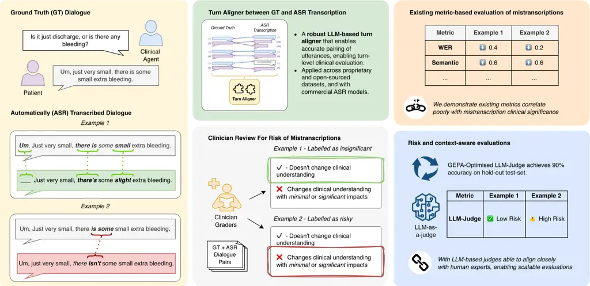
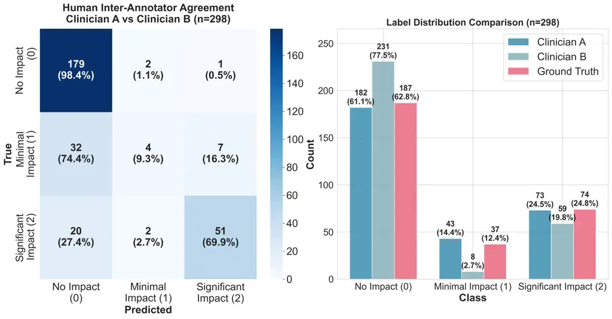
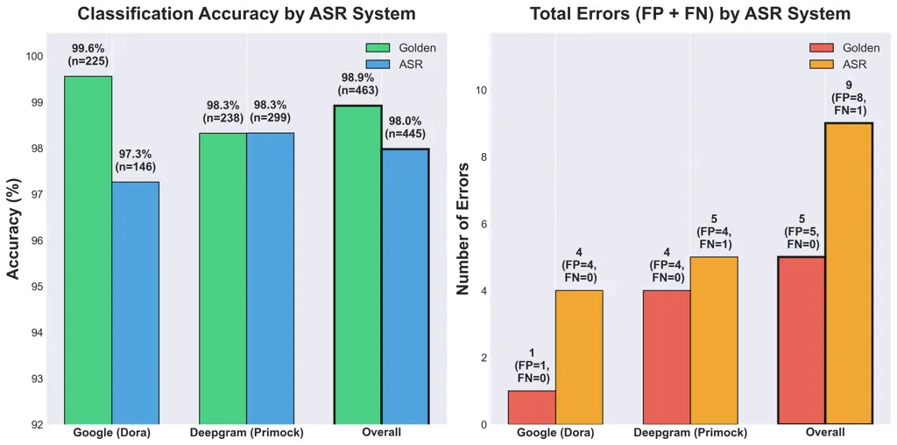
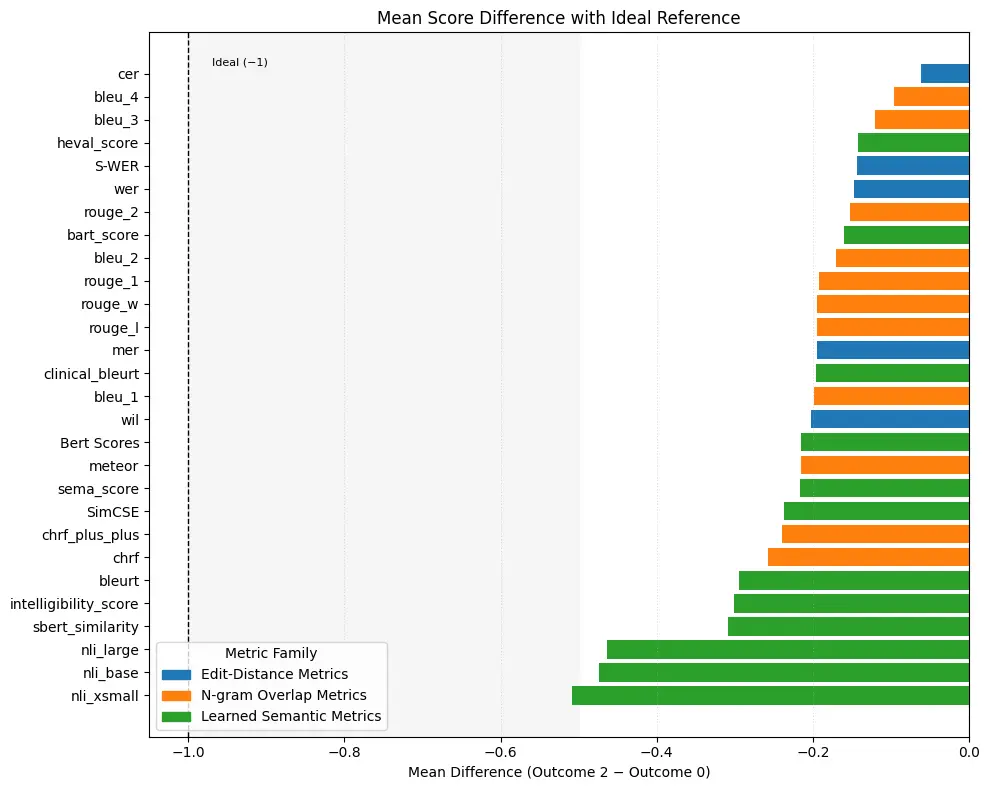
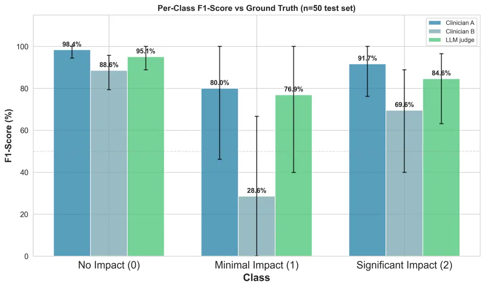
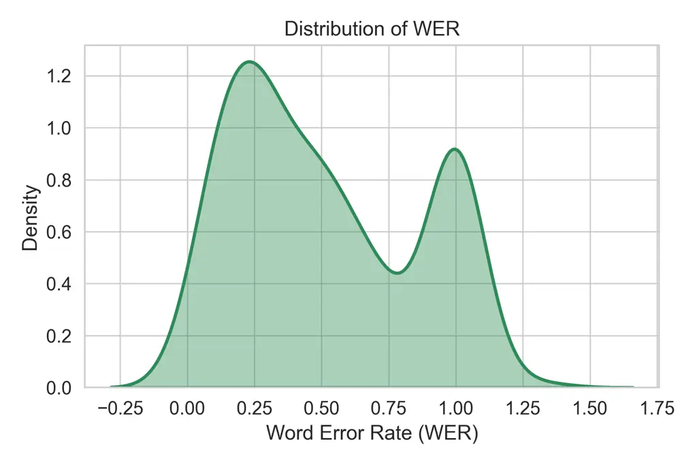
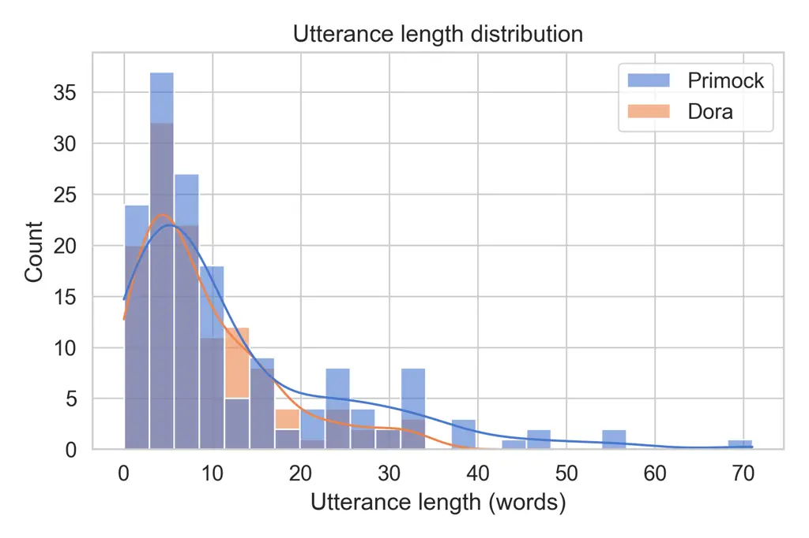
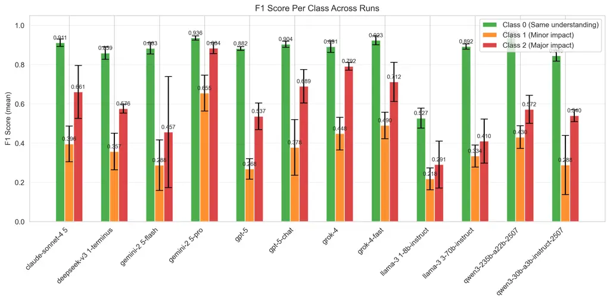

# WER is Unaware: Assessing How ASR Errors Distort Clinical Understanding in Patient Facing Dialogue

Zachary Ellis ^(†)^(†)thanks: Equal contribution. Affiliation: Ufonia
Limited    Jared Joselowitz¹¹footnotemark: 1 Affiliation: Ufonia Limited
   Yash Deo Affiliation: University of York    Yajie He
Affiliation: Ufonia Limited    Anna Kalygina Affiliation: Ufonia Limited
   Aisling Higham Affiliation: Ufonia Limited Affiliation: Oxford
University Hospitals    Mana Rahimzadeh Affiliation: Moorfields Eye
Hospital Correspondence:[jj@ufonia.com](mailto:jj@ufonia.com)    Yan Jia
Affiliation: University of York    Ibrahim Habli Affiliation: University
of York    Ernest Lim Affiliation: Ufonia Limited
Affiliation: University of York

###### Abstract

As Automatic Speech Recognition (ASR) is increasingly deployed in
clinical dialogue, standard evaluations still rely heavily on Word Error
Rate (WER). This paper challenges that standard, investigating whether
WER or other common metrics correlate with the clinical impact of
transcription errors. We establish a gold-standard benchmark by having
expert clinicians compare ground-truth utterances to their ASR-generated
counterparts, labeling the clinical impact of any discrepancies found in
two distinct doctor-patient dialogue datasets. Our analysis reveals that
WER and a comprehensive suite of existing metrics correlate poorly with
the clinician-assigned risk labels (No, Minimal, or Significant Impact).
To bridge this evaluation gap, we introduce an LLM-as-a-Judge,
programmatically optimized using GEPA to replicate expert clinical
assessment. The optimized judge (Gemini-2.5-Pro) achieves
human-comparable performance, obtaining 90% accuracy and a strong
Cohen’s $`\kappa`$ of 0.816. This work provides a validated, automated
framework for moving ASR evaluation beyond simple textual fidelity to a
necessary, scalable assessment of safety in clinical dialogue.

## 1 Introduction



Figure 1: Overview of the clinical impact evaluation framework. Left:
Two examples of ASR errors in patient utterances. Middle: We curate a
dataset of clinical dialogues and transcriptions, and apply a novel
semantically-aware sentence alignment pipeline to enable contextual
clinical evaluation. Expert clinicians annotate a dataset of these
errors based on our defined scale, labelling the minor change (Ex. 1) as
"Insignificant" but the clinically dangerous negation (Ex. 2) as
"Impactful". Right: Existing metrics like WER and other semantic scores
correlate poorly with clinical risk. Our GEPA-optimized LLM-as-a-Judge
closely matches clinical expert ratings.

Patient-facing clinical dialogue agents are increasingly being deployed
into live clinical environments, automating tasks from documentation to
direct consultations (Teo et al., 2025). Their performance depends
critically on Automatic Speech Recognition (ASR), the "ears" of these
clinical agents. While significant research has examined text-level
hallucinations in generative models (Kim et al., 2025), the fidelity of
the ASR models that feed these models has received far less scrutiny.

ASR systems are typically benchmarked using Word Error Rate (WER).
However, WER is context-agnostic and ill-suited for safety-critical
dialogue. It treats all word errors equally, failing to distinguish
between trivial disfluencies and clinically hazardous substitutions. For
example, a substitution that changes "there is some extra bleeding" to
"there isn’t some extra bleeding" minimally affects WER yet inverts
clinical meaning. Even modern semantic metrics such as BLEURT or
BERTScore remain blind to such risks, rewarding textual similarity while
ignoring potential clinical consequences.

This paper argues that ASR evaluation in clinical dialogue must evolve
towards assessing real clinical impact. To bridge this gap, we make
three core contributions (Also illustrated in Figure 1):

A clinician-annotated benchmark for ASR clinical impact. We define a
three-point scale for clinical distortion and recruit expert clinicians
to annotate mistranscriptions from two doctor–patient datasets; one
proprietary and one open-source spanning two ASR systems (Google Chirp
and Deepgram Nova-3), yielding a diverse, high-quality dataset of
clinically rated ASR errors.

A robust LLM-based turn aligner. We outline that traditional alignment
methods fail under inconsistent segmentation and semantic ambiguity
across ASR providers. Our LLM aligner reasons jointly over meaning,
context, and sequence, ensuring accurate pairing of ground-truth and ASR
utterances for turn-level comparison.

A validated LLM-as-a-judge for context-sensitive clinical risk
assessment. Using our dataset, we show that WER and existing semantic
metrics correlate poorly with expert-assigned clinical impact. We then
optimize an LLM-based evaluator (Gemini-2.5-Pro) via GEPA, achieving 90%
accuracy (Cohen’s $`\kappa`$ of 0.816), human-comparable performance for
scalable clinical safety evaluation.

These contributions provide a concrete step towards risk-informed,
context-sensitive evaluations for the development of safer clinical
dialogue systems.

## 2 Background and Related Works

### 2.1 Limitations of WER in Clinical Contexts

The standard metric in ASR evaluation, WER, is fundamentally limited for
safety-critical domains like clinical dialogue (Sasindran et al., 2024).
As a context-agnostic measure of lexical fidelity (substitutions,
deletions, insertions) (Likhomanenko et al., 2021), WER overlooks
semantic accuracy which is critical in clinical settings where a single
misrecognized negation or medication name can reverse meaning and cause
severe clinical harm despite a low WER (Sasindran et al., 2024).
Moreover, ASR models optimized for specific benchmarks often show
substantially higher WERs in conversational or multi-speaker contexts
(Likhomanenko et al., 2021), revealing domain variability and the
continued need for post-editing for clinical transcriptions. These
findings underscore the need for evaluation methods that capture not
just textual accuracy but also preservation of clinical meaning.

### 2.2 Beyond Lexical Fidelity: Semantic and Hybrid ASR Evaluation

To overcome the limitations of lexical fidelity, recent work focuses on
semantic fidelity - measuring the meaning-level distance between
reference and hypothesis texts. Early embedding-based methods like
Semantic Distance (Kim et al., 2021) use vector representations to
quantify similarity, demonstrating better alignment with human
perception of quality than WER.

More sophisticated hybrid metrics integrate both error quantification
and semantic scoring. Clinical BERTScore (Shor et al., 2023) conducts
utterance-level analysis validated against clinician preferences,
showing improved performance over standard WER in specialized,
non-conversational settings. Similarly, SeMaScore (Sasindran et al., 2024) combines error rates with segment-wise semantic similarity,
yielding stronger correlations with expert judgments, even in noisy
speech.

These semantic and hybrid metrics show stronger correlation with human
judgments of intelligibility and correctability. Metrics like Human
Perceived Accuracy and integrated weighted combinations (e.g., phonetic,
semantic, NLI features) achieve better correlations than WER for these
domains (Mishra et al., 2011; Phukon et al., 2025).

While these metrics indicate progress, they prioritize semantic
resemblance rather than clinical impact. Changes that alter symptom
severity ("some mild pain" → "no mild pain") have vastly different
clinical implications yet metrics like cosine similarity may fail to
capture the consequences of these differences. Thus, even meaning-aware
metrics may fail to distinguish clinically consequential errors from
inconsequential ones. Furthermore, pre-trained embeddings are robust to
ASR errors when predicting user ratings of dialogue systems, suggesting
limited sensitivity to clinically relevant ASR distortion (Georgila,
2024). As a result, existing metrics (whether edit-distance, n-gram, or
semantic) remain poor proxies for clinical impact, as they measure
textual divergence rather than its effect on clinical understanding or
decision-making.

To address this gap, our work moves beyond linguistic similarity toward
clinically aware ASR evaluation: quantifying the magnitude of clinical
distortion caused by transcription errors. We empirically test how
traditional metrics from these three families (edit-distance,
overlap-based, and semantic) align with expert clinical judgments and
propose an LLM-based evaluator that better reflects the actual clinical
consequences of misrecognition.

### 2.3 Limitations of Traditional Methods for Sentence-Level Alignment

Accurately pairing ground-truth clinical utterances with their ASR
outputs is essential for valid evaluation, yet conventional alignment
methods often fail under the messy, overlapping conditions of real-world
dialogue and the inconsistent segmentation produced by different ASR
systems.

Timestamp-Proximity Alignment. Simple proximity matching pairs each gold
utterance with the nearest ASR hypothesis, but noisy or drifting
timestamps often cause swapped or merged segments (Bain et al., 2023).
Dynamic Time Warping mitigates rate differences by minimizing cumulative
time distance, yet non-monotonic or inaccurate timestamps yield locally
coherent but semantically incorrect alignments, especially when
utterances are split or merged (Jiang et al., 2020).

Text-Based Alignment. Edit-distance algorithms like Needleman–Wunsch
(Needleman and Wunsch, 1970) and Smith–Waterman (Smith and Waterman, 1981) align tokens by lexical similarity alone, ignoring timing and
context but they fail when sentence boundaries diverge or ASR outputs
contain paraphrases and disfluencies, producing unstable or crossing
alignments (Snover et al., 2006).

Embedding-Based Similarity. Sentence embeddings (e.g., SBERT) align
semantically similar utterances (Reimers and Gurevych, 2019a), but short
backchannels (e.g., "yes", "okay") merge into similar vectors,
domain-specific terms are under represented (Zheng et al., 2021), and
ignoring sequence order allows semantically plausible yet positionally
inconsistent matches (Liu and Zhu, 2022).

These limitations motivate a context-aware approach that integrates
semantic and sequential reasoning. We therefore introduce an LLM-based
aligner that robustly maps utterances across fragmented or merged ASR
outputs, forming a reliable foundation for our clinical impact
benchmark.

### 2.4 Large Language Models as Judges for Clinical Impact

The LLM-as-a-Judge framework provides a promising solution for providing
nuanced and contextually aware evaluations of transcription quality,
moving beyond the limits of static metrics (Gu et al., 2024; Pulikodan
et al., 2025). LLMs have been leveraged to assess the severity and
nature of transcription errors, a process that is essential for
operational risk monitoring. Domain-specific adaptations, like
Significant ASR Error Detection (SASRED) (Harvill et al., 2024),
classify errors as Significant (altering key entities or actions) or
Non-Significant (minor surface changes on an Amazon Alexa general
diaogue dataset). However, whilst showing promise with non-expert human
evaluators  Li et al. (2024), these model have limitations and variable
validation for expert tasks, particularly in healthcare (Szymanski et
al., 2025).

These LLM-based frameworks are often tailored to assess critical
healthcare dimensions such as factual correctness, clinical utility, and
logical coherence to ensure outputs are safe and align with clinical
workflow standards Croxford et al. (2025). Building on these advances,
our methodology tasks expert clinicians, and a subsequent LLM judge,
with evaluating transcription errors based on their direct impact on the
clinical understanding of a patient’s condition, and subsequent risk
changes.

## 3 Methods

### 3.1 Programmatic Alignment of Ground-Truth and Hypothesis Utterances

To handle segmentation and semantic drift across ASR providers, we
employ an LLM-based aligner that performs semantic and structural
sentence-level alignment between gold and ASR utterances, instead of
relying on time or token matching.

#### 3.1.1 Prompt Design

Each conversation contained two ordered sequences: (1) a gold transcript
of verified patient utterances with timestamps, and (2) an ASR
hypothesis of recognized segments with confidence scores. The LLM
aligned each gold utterance $`G_{i}`$ to one or more ASR hypotheses
$`A_{j}`$ under the following constraints: each ASR segment could be
matched once; consecutive segment could merge if forming a single
utterance; and consecutive gold utterances could map jointly if merged
by the recognizer. The model considered semantic similarity, sequential
order, and ASR confidence without introducing new text (prompt provided
in Appendix A).

Gemini-2.5-Pro was used with conservative decoding parameters
(temperature = 0.1, top-p = 0.95, top-k = 40) to ensure stable
long-context outputs (up to 65k tokens). It produced structured JSON
alignments specifying indices, match types (exact, fuzzy, missing), and
similarity scores.

#### 3.1.2 Post-Processing and Refinement

Raw alignments were parsed into structured objects and refined through
deterministic rules to ensure validity and robustness: (1) duplicate
correction merged consecutive gold segments sharing identical ASR text;
(2) miss recovery re-evaluated unmatched gold utterances against unused
ASR hypotheses (lexical similarity $`\geq`$ 0.65); and (3)
multi-fragment reconstruction combined gold utterances spanning
consecutive ASR fragments, averaging confidence and timestamps.

This hybrid design combines the LLM’s reasoning with deterministic
corrections, producing content-aware, sequence-consistent alignments
resilient to real-world ASR behavior (fragmented or merged outputs). The
final alignments, annotated with similarity scores, match types, and
multi-fragment indicators, were saved as structured JSON for downstream
evaluation. Worked example of the alignment can be seen in Appendix B.

### 3.2 Clinician Labelling of Meaning Change and Clinical Impact

To evaluate the clinical impact of ASR errors, two clinician annotators
independently labelled a stratified sample of patient utterances (the
Clinical Subset) from post-operative cataract and general-practice
consultations. Each example contained a short dialogue segment where
only the patient’s final utterance differed between the ground-truth and
ASR transcription. Annotators compared these paired versions and judged
whether the transcription error altered the perceived clinical meaning
of the exchange. For each instance, clinicians answered the following
question:

> “If uncorrected, and if you could only read the transcription alone,
> would it have changed your understanding of the patient’s clinical
> condition?”

They assigned one of three ordinal labels reflecting the magnitude of
clinical distortion:

- •
  0 – No change in understanding of the patient’s clinical condition
- •
  1 – Change in understanding with minimal clinical impact
- •
  2 – Change in understanding with significant clinical impact

Full task instructions and clinician background are outlined in Appendix
C. Brief justifications were also recorded to capture reasoning and
highlight borderline cases. These annotations formed the reference set
for subsequent metric development and correlation analysis.

#### 3.2.1 Clinician Inter-Annotator Agreement

Inter-annotator agreement (IAA) was assessed on the full labelled
Clinical Subset using Cohen’s $`\kappa`$ and raw percentage agreement.
Figure 2 shows the agreement per class and the final adjudicated label
distribution. Overall agreement was 79% ($`\kappa=0.54`$), indicating
moderate agreement. Notably, the majority of disagreements occurred
between the ’No Impact’ (0) and ’Minimal Impact’ (1) classes,
highlighting the inherent subjectivity and nuance in distinguishing
cosmetic errors from those with minor clinical significance. Following
the initial round, the annotators met to resolve disagreements,
producing a reconciled gold-standard set.



Figure 2: Clinician annotation agreement and final label distribution.
Left: IAA between two clinicians on the full labelled subset
($`n=298`$), with most disagreements between adjacent classes (0 vs. 1),
yielding 79% agreement ($`\kappa=0.54`$). Right: Final adjudicated
labels show a predominance of no-impact cases, with fewer minimal and
significant-impact examples.

### 3.3 LLM-as-a-Judge Training

Implementation. The LLM judge was implemented using DSPy (Khattab et
al., 2024), a framework for programmatic prompt optimization. The judge
is given a ground truth conversation and and ASR hypothesis as input,
and outputs a clinical impact assessment with reasoning.

Prompt Optimization via GEPA. Rather than manually engineering prompts,
we used GEPA (Genetic-Pareto) to automatically optimize the judge’s
instructions (Agrawal et al., 2025). GEPA employs a reflective prompt
evolution strategy that leverages LLM introspection to iteratively
improve prompts based on observed failures.

The optimization process operates as follows: (1) the current prompt is
evaluated on minibatches of training examples (batch size = 3); (2)
incorrect predictions trigger generation of rich textual feedback
describing the narure and severity; (3) a reflection LM uses the current
prompt, failed examples, and feedback to generate multiple candidate
improved prompts; (4) candidates are evaluated on a validation set and
selected via Pareto frontier optimization to maintain diverse
high-performing strategies; (5) the process iterates until convergence.
Chain-of-Thought approach was used to encourage step-by-step reasoning
before classification.

Dataset Split and Evaluation Metric. From the 298 labelled conversation
pairs of the Clinical Subset, we created a stratified split of 218
training, 30 validation, and 50 test examples, preserving class
distributions. To encourage clinically meaningful optimization, we used
a custom cost matrix $`C`$ where $`C[i,j]`$ represents the reward or
penalty for predicting class $`j`$ when the true class is $`i`$. The
matrix heavily penalized missed critical errors (e.g., $`C[2,0]=-1.2`$)
and applied smaller penalties for adjacent-class confusions. Combined
with GEPA’s textual feedback, this cost-sensitive setup enabled learning
of the relative importance of error types. The cost matrix is shown in
Appendix D.

Model Configuration. We used Gemini-2.5-Pro for both executing clinical
assessments and generating improved prompts during GEPA’s reflection
phase. This configuration allowed the model to both perform the judgment
task and introspect on its failures to propose improvements. The GEPA
optimizer was configured with auto=’medium’, Pareto-based candidate
selection, and was set to skip examples achieving perfect scores to
focus computational resources on challenging cases. The final prompt can
be seen in Appendix E.

### 3.4 Existing Metric Evaluation

We benchmarked three ASR metric families against clinician-assigned risk
labels, using aligned ground-truth and hypothesis pairs. A full list of
evaluated metrics is provided in Appendix F.

Edit-distance metrics (e.g., WER, Character Error Rate (CER)) measure
minimal token or character-level edits between reference and hypothesis.
The N-gram overlap metrics (e.g., BLEU, ROUGE) capture lexical overlap
through contiguous n-grams. Finally, the learned semantic metrics (e.g.,
BERTScore, BLEURT) use pretrained neural models to assess meaning
preservation.

Enrichment–delta analysis was performed, with all scores normalized as
$`1-\text{error rate}`$ so higher values indicate better performance.
For each metric, we computed the mean score difference between
clinically safe ($`y{=}0`$) and high-impact ($`y{=}2`$) transcripts,
$`\Delta=\mathbb{E}[s\mid y{=}2]-\mathbb{E}[s\mid y{=}0]`$, to quantify
sensitivity to clinical severity. This measure captures whether
higher-risk cases receive systematically lower quality scores,
indicating alignment between metric sensitivity and clinical relevance.

## 4 Data

We curated two complementary datasets of real doctor–patient
conversations, differing in domain and ASR provider, to robustly
evaluate how ASR mistranscriptions distort clinical meaning.

### 4.1 Sources

Both datasets contain English-language doctor-patient conversations. For
the analysis, only the patient’s speech is used.

Dora comprises 21 anonymized production calls from a proprietary
telehealth service, Ufonia Limited (Ufonia Ltd, 2025), capturing
naturally occurring mistranscriptions in a live clinical environment
rather than data engineered for this study. These routine post-operative
cataract consultations were conducted by an LLM-based conversational
agent.

Primock57 is an open-source set of 21 mock primary-care dialogues (Sarac
et al., 2022). ¹¹ 1 All accompanying code and the clinician-labelled
Primock57 Clinical subsets is publicly released at
[https://github.com/Ufonia/wer-is-unaware](https://github.com/Ufonia/wer-is-unaware).
The Dora data originates from a proprietary internal dataset and cannot
be shared.

The combination provides both proprietary and public data analysis,
spanning distinct clinical pathways, recording conditions, and ASR
providers.

### 4.2 Transformation

All audio was transcribed to produce ground-truth (GT) references and
corresponding ASR hypotheses for utterance-level comparison.

Ground-Truth Transcription. For Dora, GT transcripts were created using
an human–AI pipeline shown to yield fast, high-accuracy transcriptions
(Liu et al., 2022; Yuan et al., 2021a). Gemini-2.5-Pro generated initial
transcripts from patient audio, which human annotators then verified and
corrected. For Primock57, we used the provided human transcriptions as
GT. In both datasets, adjacent utterances by the same speaker were
concatenated into a single, continuous turn.

Automatic Transcription. To capture variation across commercial systems,
Dora audio was transcribed using Google Chirp and Primock57 using
Deepgram Nova-3, reflecting diversity in ASR output and segmentation
behaviors. Due to cost and time constraints, only one ASR provider was
used per dataset. Systematic cross-provider comparisons on the same data
are left to future work.

Utterance Alignment. Each dataset was decomposed into aligned pairs of
patient GT utterances and ASR hypotheses using the LLM-based semantic
aligner (Section 3.1), ensuring consistent pairing despite
provider-level segmentation differences. For each target utterance, the
preceding two doctor turns and the most recent patient turn were
appended to preserve conversational context for later clinical
annotation. Summary statistics, including WER distribution and average
utterance length, are provided in Appendix G.

### 4.3 Curation

Aligned patient utterances were curated into a clinician-labelling
sample. After text cleaning (Appendix H), WER was computed between
ground-truth and ASR pairs, and perfect matches ($`WER=0`$) were
excluded. Random sampling from both datasets ensured diversity across
speakers and call types. To achieve a balanced range of transcription
quality, utterances with higher error rates ($`WER\in[0.4,1)`$) were
selectively included from Primock57. Each pair was manually checked for
correct alignment, and any misaligned examples were removed. This
curation process yielded a Clinical Subset dataset of 298 examples which
was used for clinician labelling (Sec. 3.2) and the training and testing
of the LLM Judge (Sec. 3.3).

For the existing metrics evaluation (Sec. 3.4), we additionally filtered
out non-lexical tokens, as detailed in Appendix H. Twenty of the 298
Clinical Subset pairs became perfect matches ($`WER=0`$) differing only
by these tokens, and were excluded from the existing metrics evaluation
(Sec. 5.2); this yielded the Metrics Subset. The statistics of both
subsets are provided in Table 1.

| Subset   | Source    | \# Calls | \# Utterances | Avg. Words/Utt. | Avg. WER |
| -------- | --------- | -------- | ------------- | --------------- | -------- |
| Clinical | Dora      | 21       | 123           | 9.28            | 0.51     |
|          | Primock57 | 21       | 175           | 12.7            | 0.50     |
|          | Total     | 42       | 298           | 11.29           | 0.51     |
| Metrics  | Dora      | 21       | 121           | 9.03            | 0.53     |
|          | Primock57 | 21       | 157           | 12.52           | 0.51     |
|          | Total     | 42       | 278           | 10.99           | 0.52     |

Table 1: Datasets used in this study. Statistics are shown for both the
Clinical and Metrics subsets; non-lexical tokens are filtered only for
the Metrics Subset.

## 5 Results

### 5.1 LLM-Based Aligner

To ensure the validity of our downstream clinical impact analysis, we
first evaluated the LLM-based alignment system. The accuracy of this
component is critical, as alignment errors would invalidate the
comparisons made by clinician annotators.

#### 5.1.1 Gold-Standard Alignment Dataset

A human annotator manually aligned patient utterances from a subset of
13 conversations; 7 transcribed with Google Chirp and 6 with Deepgram
Nova-3. The dataset contains 463 ground-truth utterances and 445 ASR
hypotheses, with each gold utterance mapped to its correct ASR
counterpart(s). The annotator labeled one-to-one, one-to-many (merges),
many-to-one (splits), and zero-to-one (missed) mappings. This dataset
served as the gold standard for the alignment evaluations.

#### 5.1.2 Evaluation Metrics

We evaluate the LLM-based transcript aligner using two complementary
metrics. Classification Accuracy assesses whether the aligner correctly
identifies if an utterance has a corresponding segment in the other
transcript. For each of the 463 ground-truth and 445 ASR utterances,
this is treated as a binary classification task: correctly labeling an
utterance as matched or unmatched (missed). Errors include false
positives (incorrectly labeling a match as a miss) and false negatives
(failing to detect a true miss). Structural Alignment Accuracy provides
a stricter, mapping-level evaluation. It measures the percentage of
ground-truth utterances that were mapped to the exact same ASR utterance
index (or indices) as specified in the gold-standard annotation. This
metric is sensitive to structural errors like boundary shifts,
mis-merges, or the incorrect use of a duplicate ASR segment (see
Appendix B.2 for a worked example).

#### 5.1.3 Performance Results

##### The LLM-based aligner achieved high, system-agnostic performance.

For Classification Accuracy, results were 98.9% on gold utterances and
98.0% on ASR utterances (Figure 3). Misclassifications were minimal with
one false unmatched case on the golden side for Google, and five for
Deepgram, with similarly low counts for ASR results.

For Structural Alignment Accuracy, performance remained strong (96.4%).
Minor discrepancies stemmed from boundary drift in long utterances or
duplicated ASR fragments, none of which affected clinical meaning in
downstream comparisons.

Overall, these results confirm that the LLM-based aligner is robust and
accurate enough, providing a reliable foundation for subsequent clinical
impact annotation.



Figure 3: Performance of the LLM-based transcript aligner across Google
(Dora) and Deepgram (Primock) ASR hypotheses. The figure shows high
classification accuracy ($`>98\%`$) and low total error counts for both
golden and ASR utterances.

### 5.2 Existing Metric Evaluation

##### Existing metrics correlate poorly with clinical labels for risk.

Across all metrics, the enrichment–delta analysis (Figure 4) revealed
that score differences between high–impact ($`y{=}2`$) and safe
($`y{=}0`$) transcriptions were generally small, confirming that most
conventional text metrics only weakly track clinically meaningful
errors. Among families, learned semantic metrics (e.g., BLEURT, SBERT,
NLI models) showed the strongest and most consistent alignment with
clinical risk, with clearer score separation between safe and
high-impact cases and more negative enrichment deltas, indicating that
lower scores generally corresponded to higher clinical severity.
Edit-distance metrics (WER, CER, etc.) exhibited moderate but less
stable associations, while N-gram overlap metrics (BLEU, ROUGE, METEOR)
provided the weakest discrimination, with high overlap in scores across
all clinical categories. A table of results, a Kendall correlation, and
an example qualitative error analysis are provided in Appendix I.

Overall, the results suggest that while semantic metrics are relatively
better proxies for clinical reliability, no existing metric family
reliably reflects real clinical impact, underscoring the need for
domain-aware evaluation frameworks.



Figure 4: Mean score difference per metric on the Metrics Subset,
coloured by family; more negative bars indicate stronger alignment with
clinical severity.

### 5.3 LLM-as-a-Judge Automation

##### Gemini-2.5-Pro outperforms other state-of-the-art LLMs.

To validate our model selection, we benchmarked the final GEPA-optimized
prompt across a suite of leading open source and proprietry models. The
full comparison, detailed in Appendix J.1, shows that Gemini-2.5-Pro
achieved a mean Macro F1 of 0.825 and Cohen’s $`\kappa`$ of 0.790. This
establishes a clear performance advantage over all other tested models,
justifying its use.

##### The Judge excels in ambiguous cases.

A granular per-class F1 analysis (Appendix J.1) reveals that while most
models perform adequately on clear-cut ’No Impact’ (Class 0) or
’Significant Impact’ (Class 2) cases, they consistently fail on the
nuanced ’Minimal Impact’ (Class 1) category. This reflects the
difficulty of this class, which also proved most challenging for human
annotators (Figure 5). Gemini-2.5-Pro was the only model to achieve an
F1 score \> 0.5 (it got 0.655) for this difficult class, demonstrating a
superior capacity for nuanced clinical assessment (Figure 8).

##### Judge achieves human-comparable performance and agreement.

The LLM Judge’s performance is comparable to its human expert
counterparts. From Table 2, its 90% accuracy
($`\mathbf{\kappa=0.816}`$), places it between the two expert annotators
(Clinician A: 94%; Clinician B: 80%).

Furthermore, from Table 11, the Judge’s agreement patterns mirrors
expert reliability. Its pairwise $`\kappa`$ with Clinician A (0.713) and
Clinician B (0.497) is consistent with the inter-clinician $`\kappa`$ of
0.505. This demonstrates the Judge successfully operates within the same
range of expert subjectivity.

| Comparison          | Acc (95% CI)       | Cohens $`\kappa`$ (95% CI) |
| ------------------- | ------------------ | -------------------------- |
| LLM Judge vs Gold   | 90% \[82.0-96.0\]  | 0.816 \[0.649-0.933\]      |
| Clinician A vs Gold | 94% \[88.0-100.0\] | 0.891 \[0.764-1.000\]      |
| Clinician B vs Gold | 80% \[68.0-90.0\]  | 0.567 \[0.336-0.767\]      |

Table 2: Agreement with gold-standard labels across 50 cases with 95%
confidence interval estimated via 1,000 bootstrap iterations. The LLM
Judge shows high alignment with human clinicians.

##### The Judge mirrors the stronger clinician across classes, with greatest uncertainty on the minority class.

Beyond aggregate scores, the Judge’s per-class F1 performance (Figure 5)
closely tracks that of the stronger human annotator. The Judge achieves
95.1% on _No Impact_, 76.9% on _Minimal Impact_, and 84.6% on
_Significant Impact_, compared with Clinician A’s 98.4% / 80.0% / 91.7%
and Clinician B’s 88.6% / 28.6% / 69.6%. Both the Judge and Clinician A
perform nearly perfectly on clear-cut _No Impact_ cases, show moderate
decline on _Significant Impact_, and exhibit the greatest variability on
the ambiguous _Minimal Impact_ class, reflecting its inherent
difficulty.



Figure 5: Per class Test set results of clinicians and judge. 95%
confidence interval estimated via 1,000 bootstrap iterations

## 6 Discussion

Our findings highlight the critical gap between existing ASR evaluation
and clinical safety. We demonstrate that metrics must move beyond
textual fidelity (e.g. WER), and even semantic fidelity, both
insufficient proxies for risk for clinical dialogue tasks, and therefore
falling short for required safety evidence for regulated medical devices
(Teferra, 2017). Our LLM-judge closes this gap by achieving
human-comparable performance in a challenging and nuanced task, using
anonymized real-world data from production use of a conversational
system, supported by an open-sourced primary care dataset.

Furthermore, programmatic optimization via GEPA yields not only a
high-performing judge but also a reproducible, auditable artefact for
the prompt tuning process. Unlike manual prompt engineering, GEPA’s
training process enables alignment with best-practice AI governance
requirements in medicine, established for more traditional ML systems
(Gallifant et al., 2025; Ganapathi et al., 2022). Additionally, this
analysis was enabled by the LLM-based sentence aligner, which ensured
robust utterance-level pairing between ground-truth and ASR transcripts
despite segmentation drift or merged utterances.

Limitations include the benchmark’s moderate size ($`n=298`$), and the
initial focus on a smaller set of clinical domains. Future work should
expand the evaluation to more clinical pathways and involve a larger,
more diverse group of clinical labellers.

## 7 Conclusion

Standard ASR evaluation fails to ensure patient safety. We show
empirically that existing metrics like WER are insufficient, and
introduce an expert-annotated benchmark and a validated LLM Judge that
achieves human-level accuracy in classifying clinical risk. Together,
these contributions establish the first scalable framework for
certifying the clinical safety of transcription systems in
conversational clinical dialogues, enabling their responsible
development and deployment in healthcare.

## References

- Agrawal et al. (2025) L. A. Agrawal, S. Tan, D. Soylu, N. Ziems, R.
  Khare, K. Opsahl-Ong, A. Singhvi, H. Shandilya, M. J. Ryan, M.
  Jiang, C. Potts, K. Sen, A. G. Dimakis, I. Stoica, D. Klein, M.
  Zaharia, and O. Khattab GEPA: reflective prompt evolution can
  outperform reinforcement learning. External Links: 2507.19457,
  [Link](https://arxiv.org/abs/2507.19457) Cited by: §3.3.
- Bain et al. (2023) M. Bain, J. Huh, T. Han, and A. Zisserman WhisperX:
  time-accurate speech transcription of long-form audio. In Proceedings
  of Interspeech 2023, External Links:
  [Link](https://arxiv.org/abs/2303.00747) Cited by: §2.3.
- Banerjee and Lavie (2005) S. Banerjee and A. Lavie METEOR: an
  automatic metric for mt evaluation with improved correlation with
  human judgments. In Proceedings of the acl workshop on intrinsic and
  extrinsic evaluation measures for machine translation and/or
  summarization, pp. 65–72. Cited by: 3rd item.
- Ben Abacha et al. (2023) A. Ben Abacha, W. Yim, G. Michalopoulos,
  and T. Lin An investigation of evaluation methods in automatic medical
  note generation. In Findings of the Association for Computational
  Linguistics: ACL 2023, A. Rogers, J. Boyd-Graber, and N. Okazaki
  (Eds.), Toronto, Canada, pp. 2575–2588. External Links:
  [Link](https://aclanthology.org/2023.findings-acl.161/),
  [Document](https://dx.doi.org/10.18653/v1/2023.findings-acl.161) Cited
  by: 3rd item.
- Croxford et al. (2025) E. Croxford, Y. Gao, E. First, N.
  Pellegrino, M. Schnier, J. Caskey, M. Oguss, G. Wills, G. Chen, D.
  Dligach, et al. Automating evaluation of ai text generation in
  healthcare with a large language model (llm)-as-a-judge. medRxiv,
  pp. 2025–04. Cited by: §2.4.
- Gallifant et al. (2025) J. Gallifant, M. Afshar, S. Ameen, Y.
  Aphinyanaphongs, S. Chen, G. Cacciamani, D. Demner-Fushman, D.
  Dligach, R. Daneshjou, C. Fernandes, et al. The tripod-llm reporting
  guideline for studies using large language models. Nature medicine 31
  (1), pp. 60–69. Cited by: §6.
- Ganapathi et al. (2022) S. Ganapathi, J. Palmer, J. E. Alderman, M.
  Calvert, C. Espinoza, J. Gath, M. Ghassemi, K. Heller, F. Mckay, A.
  Karthikesalingam, et al. Tackling bias in ai health datasets through
  the standing together initiative. Nature medicine 28 (11),
  pp. 2232–2233. Cited by: §6.
- Gao et al. (2021) T. Gao, X. Yao, and D. Chen Simcse: simple
  contrastive learning of sentence embeddings. arXiv preprint
  arXiv:2104.08821. Cited by: 5th item.
- Georgila (2024) K. Georgila Comparing pre-trained embeddings and
  domain-independent features for regression-based evaluation of
  task-oriented dialogue systems. In Proceedings of the 25th Annual
  Meeting of the Special Interest Group on Discourse and Dialogue, T.
  Kawahara, V. Demberg, S. Ultes, K. Inoue, S. Mehri, D. Howcroft,
  and K. Komatani (Eds.), Kyoto, Japan, pp. 610–623. External Links:
  [Link](https://aclanthology.org/2024.sigdial-1.52/),
  [Document](https://dx.doi.org/10.18653/v1/2024.sigdial-1.52) Cited by:
  §2.2.
- Gu et al. (2024) J. Gu, X. Jiang, Z. Shi, H. Tan, X. Zhai, C. Xu, W.
  Li, Y. Shen, S. Ma, H. Liu, et al. A survey on llm-as-a-judge. arXiv
  preprint arXiv:2411.15594. Cited by: §2.4.
- Harvill et al. (2024) J. Harvill, R. Khaziev, S. Li, R. Cogill, L.
  Wang, G. Chennupati, and H. Thadakamalla Significant asr error
  detection for conversational voice assistants. In ICASSP 2024-2024
  IEEE International Conference on Acoustics, Speech and Signal
  Processing (ICASSP), pp. 11606–11610. Cited by: §2.4.
- Jiang et al. (2020) Y. Jiang, Y. Qi, W. K. Wang, B. Bent, R. Avram, J.
  Olgin, and J. Dunn EventDTW: An Improved Dynamic Time Warping
  Algorithm for Aligning Signals with Uneven Sampling Frequencies.
  Sensors 20 (10), pp. 2700. External Links:
  [Document](https://dx.doi.org/10.3390/s20102700) Cited by: §2.3.
- Khattab et al. (2024) O. Khattab, A. Singhvi, P. Maheshwari, Z.
  Zhang, K. Santhanam, S. Vardhamanan, S. Haq, A. Sharma, T. T.
  Joshi, H. Moazam, H. Miller, M. Zaharia, and C. Potts DSPy: compiling
  declarative language model calls into self-improving pipelines. Cited
  by: §3.3.
- Kim et al. (2021) S. Kim, A. Arora, D. Le, C. Yeh, C. Fuegen, O.
  Kalinli, and M. L. Seltzer Semantic distance: a new metric for asr
  performance analysis towards spoken language understanding. External
  Links: 2104.02138, [Link](https://arxiv.org/abs/2104.02138) Cited by:
  §2.2.
- Kim et al. (2025) Y. Kim, H. Jeong, S. Chen, S. S. Li, M. Lu, K.
  Alhamoud, J. Mun, C. Grau, M. Jung, R. Gameiro, et al. Medical
  hallucinations in foundation models and their impact on healthcare.
  arXiv preprint arXiv:2503.05777. Cited by: §1.
- Li et al. (2024) H. Li, Q. Dong, J. Chen, H. Su, Y. Zhou, Q. Ai, Z.
  Ye, and Y. Liu Llms-as-judges: a comprehensive survey on llm-based
  evaluation methods. arXiv preprint arXiv:2412.05579. Cited by: §2.4.
- Likhomanenko et al. (2021) T. Likhomanenko, Q. Xu, V. Pratap, P.
  Tomasello, J. Kahn, G. Avidov, R. Collobert, and G. Synnaeve
  Rethinking evaluation in asr: are our models robust enough?. External
  Links: 2010.11745, [Link](https://arxiv.org/abs/2010.11745) Cited by:
  §2.1.
- Lin (2004) C. Lin Rouge: a package for automatic evaluation of
  summaries. In Text summarization branches out, pp. 74–81. Cited by:
  2nd item.
- Liu et al. (2022) A. Liu, S. Swayamdipta, N. A. Smith, and Y. Choi
  WANLI: worker and AI collaboration for natural language inference
  dataset creation. In Findings of the Association for Computational
  Linguistics: EMNLP 2022, Y. Goldberg, Z. Kozareva, and Y. Zhang
  (Eds.), Abu Dhabi, United Arab Emirates, pp. 6826–6847. External
  Links: [Link](https://aclanthology.org/2022.findings-emnlp.508/),
  [Document](https://dx.doi.org/10.18653/v1/2022.findings-emnlp.508)
  Cited by: §4.2.
- Liu and Zhu (2022) W. Liu and C. Zhu Bertalign: high-quality sentence
  alignment for Chinese-English parallel corpora of literary texts. In
  Proceedings of the 29th International Conference on Computational
  Linguistics, Gyeongju, Republic of Korea, pp. 164–175. Cited by: §2.3.
- Mishra et al. (2011) T. Mishra, A. Ljolje, and M. Gilbert Predicting
  human perceived accuracy of asr systems.. In INTERSPEECH,
  pp. 1945–1948. Cited by: §2.2.
- Needleman and Wunsch (1970) S. B. Needleman and C. D. Wunsch A general
  method applicable to the search for similarities in the amino acid
  sequence of two proteins. Journal of Molecular Biology 48 (3),
  pp. 443–453. External Links:
  [Document](https://dx.doi.org/10.1016/0022-2836%2870%2990057-4) Cited
  by: §2.3.
- Papineni et al. (2002) K. Papineni, S. Roukos, T. Ward, and W. Zhu
  Bleu: a method for automatic evaluation of machine translation. In
  Proceedings of the 40th annual meeting of the Association for
  Computational Linguistics, pp. 311–318. Cited by: 1st item.
- Phukon et al. (2025) B. Phukon, X. Zheng, and M. Hasegawa-Johnson
  Aligning asr evaluation with human and llm judgments: intelligibility
  metrics using phonetic, semantic, and nli approaches. arXiv preprint
  arXiv:2506.16528. Cited by: 6th item, 9th item, §2.2.
- Popović (2015) M. Popović ChrF: character n-gram f-score for automatic
  mt evaluation. In Proceedings of the tenth workshop on statistical
  machine translation, pp. 392–395. Cited by: 4th item.
- Pulikodan et al. (2025) S. Pulikodan, P. K. Ghosh, V. Sanka, N. Desai,
  et al. An approach to measuring the performance of automatic speech
  recognition (asr) models in the context of large language model (llm)
  powered applications. arXiv preprint arXiv:2507.16456. Cited by: §2.4.
- Reimers and Gurevych (2019a) N. Reimers and I. Gurevych Sentence-BERT:
  sentence embeddings using Siamese BERT-networks. In Proceedings of the
  2019 Conference on Empirical Methods in Natural Language Processing
  and the 9th International Joint Conference on Natural Language
  Processing (EMNLP-IJCNLP), K. Inui, J. Jiang, V. Ng, and X. Wan
  (Eds.), Hong Kong, China, pp. 3982–3992. External Links:
  [Link](https://aclanthology.org/D19-1410/),
  [Document](https://dx.doi.org/10.18653/v1/D19-1410) Cited by: §2.3.
- Reimers and Gurevych (2019b) N. Reimers and I. Gurevych Sentence-bert:
  sentence embeddings using siamese bert-networks. arXiv preprint
  arXiv:1908.10084. Cited by: 5th item.
- Roy (2021) S. Roy Semantic-wer: a unified metric for the evaluation of
  asr transcript for end usability. External Links: 2106.02016,
  [Link](https://arxiv.org/abs/2106.02016) Cited by: 5th item.
- Russell et al. (2024) S. O. Russell, I. Gessinger, A. Krason, G.
  Vigliocco, and N. Harte What automatic speech recognition can and
  cannot do for conversational speech transcription. Research Methods in
  Applied Linguistics 3 (3), pp. 100163. External Links: ISSN 2772-7661,
  [Document](https://dx.doi.org/https%3A//doi.org/10.1016/j.rmal.2024.100163),
  [Link](https://www.sciencedirect.com/science/article/pii/S2772766124000697)
  Cited by: item 5.
- Sarac et al. (2022) R. Sarac, F. Moramarco, A. Papadopoulos Korfiatis,
  and A. Savkov PriMock57: a dataset of primary care mock consultations.
  In Proceedings of the 60th Annual Meeting of the Association for
  Computational Linguistics, Cited by: §4.1.
- Sasindran et al. (2024) Z. Sasindran, H. Yelchuri, and T. V. Prabhakar
  SeMaScore: a new evaluation metric for automatic speech recognition
  tasks. In Interspeech 2024, pp. 4558–4562. External Links:
  [Link](http://dx.doi.org/10.21437/Interspeech.2024-2033),
  [Document](https://dx.doi.org/10.21437/interspeech.2024-2033) Cited
  by: 8th item, §2.1, §2.2.
- Sasindran et al. (2023) Z. Sasindran, H. Yelchuri, T. Prabhakar,
  and S. Rao H eval: a new hybrid evaluation metric for automatic speech
  recognition tasks. In 2023 IEEE Automatic Speech Recognition and
  Understanding Workshop (ASRU), pp. 1–7. Cited by: 7th item.
- Sellam et al. (2020) T. Sellam, D. Das, and A. P. Parikh BLEURT:
  learning robust metrics for text generation. arXiv preprint
  arXiv:2004.04696. Cited by: 2nd item.
- Shor et al. (2023) J. Shor, R. A. Bi, S. Venugopalan, S. Ibara, R.
  Goldenberg, and E. Rivlin Clinical bertscore: an improved measure of
  automatic speech recognition performance in clinical settings. arXiv
  preprint arXiv:2303.05737. Cited by: 1st item, §2.2.
- Smith and Waterman (1981) T. F. Smith and M. S. Waterman
  Identification of common molecular subsequences. Journal of Molecular
  Biology 147 (1), pp. 195–197. External Links:
  [Document](https://dx.doi.org/10.1016/0022-2836%2881%2990087-5) Cited
  by: §2.3.
- Snover et al. (2006) M. Snover, B. Dorr, R. Schwartz, L. Micciulla,
  and J. Makhoul A study of translation edit rate with targeted human
  annotation. In Proceedings of the 7th Conference of the Association
  for Machine Translation in the Americas (AMTA), pp. 223–231. External
  Links: [Link](https://aclanthology.org/2006.amta-papers.25) Cited by:
  §2.3.
- Szymanski et al. (2025) A. Szymanski, N. Ziems, H. A.
  Eicher-Miller, T. J. Li, M. Jiang, and R. A. Metoyer Limitations of
  the llm-as-a-judge approach for evaluating llm outputs in expert
  knowledge tasks. In Proceedings of the 30th International Conference
  on Intelligent User Interfaces, pp. 952–966. Cited by: §2.4.
- Teferra (2017) M. N. Teferra ISO 14971-medical device risk management
  standard. International Journal of Latest Research in Engineering and
  Technology (IJLRET) 3 (3), pp. 83–87. Cited by: §6.
- Teo et al. (2025) Z. L. Teo, A. J. Thirunavukarasu, K. Elangovan, H.
  Cheng, P. Moova, B. Soetikno, C. Nielsen, A. Pollreisz, D. S. J.
  Ting, R. J. Morris, et al. Generative artificial intelligence in
  medicine. Nature Medicine, pp. 1–13. Cited by: §1.
- Ufonia Ltd (2025) Ufonia Ltd Ufonia — artificial clinical
  intelligence. Note:
  [https://www.ufonia.com/](https://www.ufonia.com/)Accessed: 2025-10-20
  Cited by: §4.1.
- Yuan et al. (2021a) A. Yuan, D. Ippolito, V. Nikolaev, C.
  Callison-Burch, A. Coenen, and S. Gehrmann SynthBio: a case study in
  faster curation of text datasets. In Thirty-fifth Conference on Neural
  Information Processing Systems Datasets and Benchmarks Track (Round
  2), External Links:
  [Link](https://openreview.net/forum?id=Fkpr2RYDvI1) Cited by: §4.2.
- Yuan et al. (2021b) W. Yuan, G. Neubig, and P. Liu Bartscore:
  evaluating generated text as text generation. Advances in neural
  information processing systems 34, pp. 27263–27277. Cited by: 4th
  item.
- Zhang et al. (2019) T. Zhang, V. Kishore, F. Wu, K. Q. Weinberger,
  and Y. Artzi Bertscore: evaluating text generation with bert. arXiv
  preprint arXiv:1904.09675. Cited by: 1st item.
- Zheng et al. (2021) L. Zheng, N. Guha, B. R. Anderson, P. Henderson,
  and D. E. Ho When does pretraining help? assessing self-supervised
  learning for law and the casehold dataset. External Links: 2104.08671,
  [Link](https://arxiv.org/abs/2104.08671) Cited by: §2.3.

## Appendix A LLM Aligner Prompt


## Appendix B Worked Alignment Examples and Alignment Quality Metrics

### B.1 Worked Alignment Examples Across Common ASR Segmentation Scenarios

ASR systems produce variable-length output segments that do not
correspond reliably to linguistic sentences or speaker turns. As a
result, alignment is performed between contiguous groups of golden
utterances and contiguous groups of ASR segments, allowing one-to-one,
many-to-one, one-to-many, and partial matches.

Below we illustrate the most common alignment scenarios observed in
practice.

Scenario A: One-to-one alignment (clean segmentation).

Golden utterance (index 0):  
“Hello, good morning.”

ASR segment (index 0):  
“hello good morning”

Alignment:

- •
  golden_indices = \[0\]
- •
  asr_indices = \[0\]
- •
  match_type = exact

This represents the ideal case where ASR segmentation aligns cleanly
with the golden transcript.

Scenario B: Many-to-one alignment (ASR splits a single utterance).

Golden utterance (index 2):  
“Yes. Uh, my name is John Smith. And I was born on the fifth of April,
uh, nineteen seventy three.”

ASR segments (indices 2–3):

- •
  “yes my name is john smith”
- •
  “i was born on the fifth of april nineteen”

Alignment:

- •
  golden_indices = \[2\]
- •
  asr_indices = \[2, 3\]
- •
  match_type = multi_fragment

This occurs when a single semantic utterance is split across multiple
ASR chunks.

Scenario C: One-to-many alignment (golden utterance spans multiple
lines).

Golden utterance (indices 8–9):

- •
  “Um it’s much more like itchy. And my eczema was more like only in the
  arm. But now it’s also on the chest. And in the on the, on the hands
  as well.”
- •
  “Like pretty, yeah when, like I like, for instance hiking, during the
  weekend. And I am, I can’t really do it anymore, because it’s like
  very like I wanted to do that last weekend. And because super painful,
  and I I have to take like showers every day to be able to, cannot uh
  ease this itching part, which is very very annoying.”

ASR segments (indices 11):  
“it’s much more like itchy and my eczema was more like only in the arms
and now also on the chest and in the in the on the hands as well like
yeah when like i like for instance hiking during the weekends and i i
can’t really do it anymore because it’s like very like like i wanted to
do that last weekend and it was super painful and i i have to take like
showers every day to be able to kind of ease this itching part which is
very very annoying”

Alignment:

- •
  golden_indices = \[8, 9\]
- •
  asr_indices = \[11\]
- •
  match_type = multi_fragment

Here, a golden sentence that was broken over two lines (due to the
doctor’s interruption), was transcribed as a single sentence by the ASR
provider.

### B.2 Worked Example of Alignment Evaluation Metrics

We illustrate the computation of the two alignment evaluation metrics
using a small synthetic example.

##### Toy example setup.

Consider a short patient interaction with the following golden
utterances:

- •
  G0: “Yes, my name is John Smith.”
- •
  G1: “I was born on the fifth of April.”
- •
  G2: “I have some swelling on my elbow.”
- •
  G3: “Bye.”

The corresponding ASR output is segmented as:

- •
  A0: “yes my name is john smith”
- •
  A1: “i was born on the fifth of april”
- •
  A2: “i have some swelling”
- •
  A3: “on my elbow”
- •
  A4: “thank”

The gold-standard alignment specifies:

```math
\displaystyle(0) \displaystyle\rightarrow[0]
```

```math
\displaystyle(1) \displaystyle\rightarrow[1]
```

```math
\displaystyle(2) \displaystyle\rightarrow[2,3]
```

with unmatched content:

```math
\text{Unmatched golden}=\{3\},\text{Unmatched ASR}=\{4\}.
```

An LLM aligner produces the following prediction:

```math
\displaystyle(0) \displaystyle\rightarrow[0]
```

```math
\displaystyle(1) \displaystyle\rightarrow[1]
```

```math
\displaystyle(2) \displaystyle\rightarrow[2]
```

with predicted unmatched sets:

```math
\text{Unmatched golden}=\{3\},\text{Unmatched ASR}=\{3,4\}.
```

This prediction contains a structural error (missing ASR index $`3`$)
and an unmatched-detection error (incorrectly marking ASR index $`3`$ as
unused).

##### Classification Accuracy.

Classification Accuracy evaluates whether each utterance or ASR segment
is correctly labeled as matched or unmatched.

Golden utterances:

```math
\text{TP}=1,\;\text{FP}=0,\;\text{FN}=0,\;\text{TN}=3,
```

yielding an accuracy of:

```math
\frac{TP+TN}{TP+TN+FP+FN}=\frac{4}{4}=1.00.
```

ASR segments:

```math
\text{TP}=1,\;\text{FP}=1,\;\text{FN}=0,\;\text{TN}=3,
```

yielding an accuracy of:

```math
\frac{TP+TN}{TP+TN+FP+FN}=\frac{4}{5}=0.80.
```

This reflects that the aligner correctly identifies unused golden
content, but incorrectly discards one ASR segment that should have been
aligned.

##### Structural Alignment Accuracy.

Structural Alignment Accuracy evaluates whether the aligner produces the
_exact_ same ASR index grouping for each golden utterance as in the
gold-standard alignment.

In this example, the alignments for G0 and G1 are correct, while the
alignment for G2 is incorrect due to a missing ASR fragment. With four
golden utterances in total, this yields:

```math
\text{Structural Accuracy}=\frac{4-1}{4}=0.75.
```

##### Interpretation.

Classification Accuracy captures whether the aligner correctly
determines which content should participate in alignment, while
Structural Alignment Accuracy captures whether the resulting fragment
groupings are structurally correct. Both metrics are required to fully
characterize alignment quality in the presence of inconsistent ASR
segmentation.

## Appendix C Annotation Instructions

The following show the full annotation instructions that clinician
labellers used for initial labelling, and subsequent disagreement
resolution. Clinician annotators’ backgrounds are also reported here.

### C.1 Demographic Backgrounds for Clinician Annotators

| Clinician Labeller | Years of Post-graduate Experience | Primary Specialty |
| ------------------ | --------------------------------- | ----------------- |
| A                  | 8 years                           | Ophthalmology     |
| B                  | 7 years                           | Ophthalmology     |

Both clinicians were ophthalmologists due to the nature of the Dora
dataset being primarily in cataract surgery follow up, with the
remainder of the Primock dataset being primary care clinical
interactions.

### C.2 Full annotation instructions provided to labellers

Objective  
We are examining how transcription errors can affect clinical meaning in
a clinical conversational context, and looking to build better metrics
to capture this.

Your task is to then assess if your understanding of the patient’s
clinical situation is different because of the transcription errors, and
what the potential clinical impact of that is. All the excerpts you will
see are from either post-cataract surgery follow-up calls, or general
practice consultations. You’ll be shown short sections of these
dialogues. For each one, you will see the Ground Truth (what the patient
actually said) and a Transcription (an automatically transcribed version
that may contain errors). Only the last sentence is different in these
transcription vs ground-truth examples.

The Annotation Task  
For each example, you will be presented with:  
The patient’s Ground Truth utterance (what was actually said)  
The patient’s Transcription utterance (what was transcribed, with only
the last sentence being different)  
Some additional context is provided of the conversation preceding these
two statements as well. Please read the two versions of the
conversation, and then, consider this question:

> “If uncorrected, and if you could only read the transcription-alone,
> would it have changed your understanding of the patient’s clinical
> condition?”

Please assign one of the following three labels and provide a brief
justification for your choice.  
0 - It does not change my understanding of the patient’s clinical
condition.  
1 - It changes my understanding of the patient’s clinical condition,
with minimal clinical impact.  
2 - It changes my understanding of the patient’s clinical condition,
with significant clinical impact.

Below shows additional detail for each category and some examples.

Detailed Rating Definitions

0 - It does not change my understanding of the patient’s clinical
condition.

This will commonly include situations where  
The meaning of the utterance is preserved despite the errors  
The meaning is changed, but not of something relating to the patient’s
clinical condition or situation - (e.g. administrative, patient
feedback, address or logistical).  
The ground-truth was not clear, and the transcription didn’t really
change it or misrepresent it.

1 - It changes my understanding of the patient’s clinical condition,
with minimal clinical impact.

This is where something is changed, and it is relevant to the patient’s
clinical condition, however, it has either minimal or no clinical
significance. This will commonly include situations where  
A patient preference is missing or misunderstood, but this for something
administrative or not extremely clinically risky.  
A part of an utterance is missed or wrong, and this is clinically
relevant, (i.e. does relate to the patient’s condition, expectations,
treatment plan, family history) but it is unlikely to affect the overall
outcomes, or it was not a critical piece of information that was missed
or wrong.

2 - It changes my understanding of the patient’s clinical condition,
with significant clinical impact.

This is where something is changed, and it is relevant to the patient’s
clinical condition, and it potentially leads to significant clinical
impact. This will commonly include situations where:  
A patient answers about a symptom but significant parts of it are
altered or omitted.  
A fact is missed or wrong, especially if it’s clinically relevant to the
scenario, and if its meaning has been totally changed.  
Key history parameters are wrong (e.g. past medical history, drug
history, family history)  
The patient could have had relevant questions or other points that
weren’t captured.

Examples

This is a mock-example:  
Note that in all example pairs only the sentences in bold are different
between the ground-truth and context+transcripts.

Example A

| Context + Ground Truth                                  | Context + Transcript                         |
| ------------------------------------------------------- | -------------------------------------------- |
| (21) Doctor: Is your eye red?                           | (21) Doctor: Is your eye red?                |
| (21) Patient: No                                        | (21) Patient: No                             |
| (22) Doctor: Great, and Is your eye painful?            | (22) Doctor: Great, and Is your eye painful? |
| (22) Patient: Well it’s not painful, just a bit gritty. | (22) Patient: Well it’s painful              |

This would be labelled 2 - as going off the transcript alone, my
understanding of the situation has completely flipped from “just a bit
gritty” and “not painful” to simply “it’s painful”. This is clinically
significant as is a core clinical question.

Example B

| Context + Ground Truth                                             | Context + Transcript                         |
| ------------------------------------------------------------------ | -------------------------------------------- |
| (21) Doctor: Is your eye red?                                      | (21) Doctor: Is your eye red?                |
| (21) Patient: No                                                   | (21) Patient: No                             |
| (22) Doctor: Great, and Is your eye painful?                       | (22) Doctor: Great, and Is your eye painful? |
| (22) Patient: Well it’s not painful, just a bit gritty that’s all. | (22) Patient: not painful, just bit gritty   |

Although the sentence is notably changed, the meaning between both
transcript and ground truth is not changed and so this would be labelled 0.

Example C

| Context + Ground Truth                                                                                    | Context + Transcript                                                      |
| --------------------------------------------------------------------------------------------------------- | ------------------------------------------------------------------------- |
| (21) Doctor: Okay and do you drink?                                                                       | (21) Doctor: Okay and do you drink?                                       |
| (21) Patient: No                                                                                          | (21) Patient: No                                                          |
| (22) Doctor: Do you smoke?                                                                                | (22) Doctor: Do you smoke?                                                |
| (22) Patient: Um, occasionally, you know, just socially, the odd cigarette. But i don’t vape or anything. | (22) Patient: Um, yeah occasionally, social cigarettes and vape anything. |

This would be labelled 1 - going off the transcript alone, it sounds
like the patient is a social smoker and vapes rather than just a social
smoker. However, this is unlikely to be of significant clinical impact
overall given this is a social history, and we are able to understand in
both that they are a smoker.

Example D

| Context + Ground Truth              | Context + Transcript                |
| ----------------------------------- | ----------------------------------- |
| (21) Doctor: Okay and do you drink? | (21) Doctor: Okay and do you drink? |
| (21) Patient: No                    | (21) Patient: No                    |
| (22) Doctor: Do you smoke?          | (22) Doctor: Do you smoke?          |
| (22) Patient: um                    | (22) Patient: ah                    |

This would be labelled 0 - Both transcripts are unclear, and the ground
truth didn’t misrepresent or edit it.

Clarifying Instructions  
You are comparing between the Ground-truth and transcription. If the
original ground-truth transcription is confusing or unclear, please
assess any additional change in meaning from the Ground Truth.

## Appendix D GEPA Cost Matrix

We employed a cost-sensitive metric using matrix C, where $`C[i,j]`$ is
the reward/penalty for predicting class j when the true class is i:

|        | Pred 0 | Pred 1 | Pred 2 |
| ------ | ------ | ------ | ------ |
| True 0 | 1.2    | 0.3    | -1.0   |
| True 1 | 0.3    | 1.5    | 0.5    |
| True 2 | -1.2   | 0.4    | 1.5    |

Table 3: Confusion matrix $`C`$

The matrix encodes three priorities:

1.  1.  reward correct classifications (diagonal \> 1.0),
2.  2.  heavily penalise missing critical errors ($`C[2,0]=-1.2`$),
3.  3.  tolerate adjacent class confusions (small values for
        $`C[i,i\pm 1]`$).

This reflects that missing a significant transcription error is more
dangerous than over-classifying a cosmetic error, while acknowledging
that boundaries between adjacent severity levels contain inherent
ambiguity. The aggregate score guides GEPA optimization toward
clinically safe performance.

## Appendix E GEPA Final Prompt


## Appendix F Evaluation Metrics Comparison

### F.1 Edit-Distance Metrics

This family of metrics quantifies the dissimilarity between an
ASR-generated hypothesis and a ground-truth reference by calculating the
minimum number of edits required to make them identical. They are
fundamentally error rates, where a lower score indicates a better
transcription.

- •
  Word Error Rate (WER) is the de facto standard, measuring word-level
  substitutions, deletions, and insertions.
- •
  Character Error Rate (CER) is a variant of WER that operates at the
  character level, useful for morphologically complex languages.
- •
  Match Error Rate (MER) is a bounded version of WER that includes
  matches in its denominator, making it less sensitive to reference
  length.
- •
  Word Information Lost (WIL) is an information-theoretic extension of
  WER that weighs errors based on their probabilistic impact.
- •
  Semantic-WER (S-WER) is an enhanced WER that adds semantic weights to
  penalize errors on important words more heavily Roy (2021).

### F.2 N-gram Overlap Metrics

Borrowed primarily from the field of machine translation, these metrics
evaluate quality by measuring the lexical overlap of n-grams (contiguous
sequences of items) between the hypothesis and reference texts.

- •
  BLEU (Bilingual Evaluation Understudy) is a precision-focused metric
  that measures n-gram overlap with a penalty for overly short
  transcriptions. Papineni et al. (2002)
- •
  ROUGE (Recall-Oriented Understudy for Gisting Evaluation) is a
  recall-focused metric for n-gram overlap; variants include ROUGE-N,
  ROUGE-L, and ROUGE-W. Lin (2004). The F-Measure is reported for all
  ROUGE variants in this work.
- •
  METEOR (Metric for Evaluation of Translation with Explicit ORdering)
  is an advanced metric aligning unigrams using stemming and synonym
  matching for greater flexibility. Banerjee and Lavie (2005)
- •
  chrF and chrF++ compute an F-score based on character n-gram overlap,
  with the ‘++‘ version also including word n-grams. Popović (2015)

### F.3 Learned Semantic Metrics

This modern class of metrics leverages deep learning models to move
beyond lexical overlap and capture semantic similarity, determining if
the core meaning of the text is preserved.

- •
  BERTScore utilizes contextual embeddings to compute a nuanced semantic
  similarity score between tokens. Zhang et al. (2019) Shor et al.
  (2023)
- •
  BLEURT is a regression-based model trained on human quality ratings to
  predict the quality of a generated text. Sellam et al. (2020)
- •
  ClincalBLEURT is a version of BLEURT fine-tuned on family medicine and
  orthopaedic notes. Ben Abacha et al. (2023)
- •
  BARTScore is a generation-based metric using the BART model to assess
  quality based on conditional probability. Yuan et al. (2021b)
- •
  SBERT-Similarity and SimCSE compute sentence embeddings for the
  hypothesis and reference and measure their cosine similarity. Reimers
  and Gurevych (2019b) Gao et al. (2021)
- •
  Natural Language Inference (NLI) Scores repurpose Natural Language
  Inference models to measure semantic equivalence using bidirectional
  entailment (mutual entailment), following the approach in Phukon et
  al. (2025).
- •
  HEVAL - Hybrid Evaluation Metric for Automatic Speech Recognition
  Tasks introduces a hybrid metric combining traditional error-based
  scoring (e.g. edit distances) on non-keywords with embedding-based
  semantic distance for ASR outputs. (Sasindran et al., 2023)
- •
  SeMaScore combines phonetic error rates with segment-wise semantic
  similarity to yield stronger correlations with expert judgements in
  noisy speech settings (Sasindran et al., 2024). In our experiments the
  word embeddings were extracted using deberta-large-mnli.
- •
  Intelligibility Score is a hybrid metric that fuses phonetic,
  semantic, and NLI-based features to align ASR evaluation with human
  judgements of comprehensibility. (Phukon et al., 2025).In our
  experiments the word embeddings were extracted using RoBERTa-large
  fine-tuned on SNLI.

### F.4 Evaluation Metrics Model and Implementation Details

Additional information on the implementation of the different evaluation
metrics is provided in Table 4.

|                          |                                                      |                                                                                           |
| ------------------------ | ---------------------------------------------------- | ----------------------------------------------------------------------------------------- |
| Metric                   | Model / Implementation                               | Source                                                                                    |
| Edit-Distance Metrics    |                                                      |                                                                                           |
| WER                      | jiwer                                                | [\[Link\]](https://pypi.org/project/jiwer/)                                               |
| CER                      |                                                      |                                                                                           |
| MER                      |                                                      |                                                                                           |
| WIL                      |                                                      |                                                                                           |
| S-WER                    | sentence-transformer                                 | [\[Link\]](https://huggingface.co/sentence-transformers)                                  |
| N-gram Overlap Metrics   |                                                      |                                                                                           |
| BLEU variants            | NLTK                                                 | [\[Link\]](https://www.nltk.org/_modules/nltk/translate/bleu_score.html)                  |
| ROUGE variants           | rouge_score                                          | [\[GitHub\]](https://github.com/google-research/google-research/tree/master/rouge)        |
| ChrF(++)                 | sacrebleu                                            | [\[GitHub\]](https://github.com/mjpost/sacrebleu/blob/master/sacrebleu/metrics/chrf.py)   |
| METEOR                   | NLTK                                                 | [\[Link\]](https://www.nltk.org/api/nltk.translate.meteor_score.html)                     |
| Learned Semantic Metrics |                                                      |                                                                                           |
| SEMA Score               | microsoft/deberta-large-mnli                         | [\[Link\]](https://huggingface.co/microsoft/deberta-large-mnli)                           |
| Intelligibility Score    | ynie/roberta-large-snli_mnli_fever_anli_R1_R2_R3-nli | [\[Link\]](https://huggingface.co/ynie/roberta-large-snli_mnli_fever_anli_R1_R2_R3-nli)   |
| HEVAL Score              | roberta-base                                         | [\[Link\]](https://huggingface.co/FacebookAI/roberta-base)                                |
| Clinical BLEURT          | bleurt-oss-21 (fine-tuned)                           | [\[GitHub\]](https://github.com/abachaa/EvaluationMetrics-ACL23/tree/main/ClinicalBLEURT) |
| BLEURT                   | bleurt-oss-21                                        | [\[GitHub\]](https://github.com/google-research/bleurt)                                   |
| BART Score               | facebook/bart-large-cnn                              | [\[HF Link\]](https://github.com/neulab/BARTScore)                                        |
| SBERT Similarity         | all-MiniLM-L6-v2                                     | [\[HF Link\]](https://huggingface.co/sentence-transformers/all-MiniLM-L6-v2)              |
| NLI XSmall               | cross-encoder/nli-deberta-v3-xsmall                  | [\[HF Link\]](https://huggingface.co/cross-encoder/nli-deberta-v3-xsmall)                 |
| NLI Base                 | cross-encoder/nli-deberta-v3-base                    | [\[HF Link\]](https://huggingface.co/cross-encoder/nli-deberta-v3-base)                   |
| NLI Large                | cross-encoder/nli-deberta-v3-large                   | [\[HF Link\]](https://huggingface.co/cross-encoder/nli-deberta-v3-large)                  |
| BERTScore                | microsoft/deberta-large-mnl                          | [\[HF Link\]](https://huggingface.co/microsoft/deberta-large-mnli)                        |
| SimCSE                   | princeton-nlp/sup-simcse-bert-base-uncased           | [\[Link\]](https://github.com/princeton-nlp/SimCSE)                                       |

Table 4: Model Specifications and Sources for Evaluation Metrics

## Appendix G Dataset Distribution Details



Figure 6: Distribution of WER across utterances on the combined Metrics
Subset. A bimodal distribution is observed, with one peak at a low WER
and a second smaller peak at high WER.



Figure 7: Utterance length distribution for Dora and Primock57 on the
Metrics Subset. Both datasets are skewed toward short utterances, with
Primock57 showing a longer tail, reflecting occasional extended patient
turns.

## Appendix H Dataset Cleaning Process

Prior to metric calculation, both the reference (ground truth) and
hypothesis (ASR output) transcripts underwent standardised text
normalization to ensure fair comparison. The preprocessing pipeline,
implemented using the Python jiwer library, consisted of the following
sequential transformations:

1.  1.  Number Normalisation: All numeric expressions were converted to
        their word equivalents using British English conventions (e.g.,
        "1st" -\> "first", "23" -\> "twenty-three") via the num2words
        library.
2.  2.  Case Normalisation: All text was converted to lowercase.
3.  3.  Punctuation Standardisation: Hyphens were replaced with spaces to
        prevent word concatenation, and all remaining punctuation was
        removed.
4.  4.  Whitespace Normalisation: Multiple consecutive spaces were collapsed
        into single spaces, and leading/trailing whitespace was removed.
5.  5.  Non-Lexical Token Removal (for the Metrics Subset only, Sec. 4.3):
        Disfluencies and filler words (e.g., "um", "uh", "hmm") were removed
        based on a predefined lexicon of 43 non-lexical tokens adapted from
        Speechmatics documentation (Russell et al., 2024).

This preprocessing was applied identically to both reference and
hypothesis texts immediately before each metric calculation (WER, BLEU,
ROUGE, etc.), ensuring consistent normalisation across all evaluation
metrics.

## Appendix I Detailed Results for Existing Metric Evaluation

### I.1 Mean Difference Scores per Metric - Enrichment–Delta Analysis

|                          |                 |
| ------------------------ | --------------- |
| Metric                   | Mean Difference |
| Edit-Distance Metrics    |                 |
| WER                      | $`-0.148`$      |
| CER                      | $`-0.062`$      |
| MER                      | $`-0.195`$      |
| WIL                      | $`-0.202`$      |
| S-WER                    | $`-0.144`$      |
| N-gram Overlap Metrics   |                 |
| BLEU-1                   | $`-0.198`$      |
| BLEU-2                   | $`-0.170`$      |
| BLEU-3                   | $`-0.121`$      |
| BLEU-4                   | $`-0.097`$      |
| ROUGE-L                  | $`-0.195`$      |
| ROUGE-1                  | $`-0.193`$      |
| ROUGE-2                  | $`-0.152`$      |
| ROUGE-W                  | $`-0.195`$      |
| ChrF                     | $`-0.257`$      |
| ChrF++                   | $`-0.239`$      |
| METEOR                   | $`-0.216`$      |
| Learned Semantic Metrics |                 |
| SEMA Score               | $`-0.216`$      |
| Intelligibility Score    | $`-0.301`$      |
| HEVAL Score              | $`-0.142`$      |
| Clinical BLEURT          | $`-0.196`$      |
| BLEURT                   | $`-0.294`$      |
| BART Score               | $`-0.160`$      |
| SBERT Similarity         | $`-0.309`$      |
| NLI XSmall               | $`-0.508`$      |
| NLI Base                 | $`-0.475`$      |
| NLI Large                | $`-0.463`$      |
| BERTScore                | $`-0.215`$      |
| SimCSE                   | $`-0.237`$      |

Table 5: Mean Difference in Score (Condition 2 minus Condition 0)
Grouped by Metric Family

### I.2 Kendalls Correlation between Metrics and Clinical Labels

|                          |                                   |
| ------------------------ | --------------------------------- |
| Metric                   | $`\mathbf{\tau}`$ (Kendall’s Tau) |
| Edit-Distance Metrics    |                                   |
| WER                      | $`0.206\,765`$                    |
| CER                      | $`0.232\,115`$                    |
| MER                      | $`0.214\,383`$                    |
| WIL                      | $`0.215\,302`$                    |
| S-WER                    | $`0.227\,910`$                    |
| N-gram Overlap Metrics   |                                   |
| BLEU-1                   | $`-0.218\,176`$                   |
| BLEU-2                   | $`-0.188\,999`$                   |
| BLEU-3                   | $`-0.149\,426`$                   |
| BLEU-4                   | $`-0.125\,599`$                   |
| ROUGE-L                  | $`-0.224\,263`$                   |
| ROUGE-1                  | $`-0.223\,657`$                   |
| ROUGE-2                  | $`-0.163\,319`$                   |
| ROUGE-W                  | $`-0.224\,263`$                   |
| ChrF                     | $`-0.289\,068`$                   |
| ChrF++                   | $`-0.261\,439`$                   |
| METEOR                   | $`-0.235\,693`$                   |
| Learned Semantic Metrics |                                   |
| SEMA Score               | $`-0.222\,682`$                   |
| Intelligibility Score    | $`-0.394\,572`$                   |
| HEVAL Score              | $`0.280\,065`$                    |
| Clinical BLEURT          | $`-0.381\,359`$                   |
| BLEURT                   | $`-0.372\,970`$                   |
| BART Score               | $`-0.253\,080`$                   |
| SBERT Similarity         | $`-0.323\,138`$                   |
| NLI XSmall               | $`-0.422\,054`$                   |
| NLI Base                 | $`-0.389\,810`$                   |
| NLI Large                | $`-0.394\,935`$                   |
| BERTScore                | $`-0.233\,922`$                   |
| SimCSE                   | $`-0.371\,572`$                   |

Table 6: Kendall’s $`\tau`$ Correlation Grouped by Metric Family

### I.3 Qualitative Error Analysis of Existing Metrics

Two examples from the Primock57 portion of the Metrics Subset
demonstrate specific scenarios where traditional evaluation metrics fail
to detect clinical distortion. Table 7 (Example A) presents a high-risk
scenario where the ASR system mistranscribed a key word "throat" as
"so". Expert clinicians assigned this a Significant Impact (2) rating,
noting that the error transforms a specific symptom denial, "not
throat", into the vague phrase, "not so". In the context of assessing
breathing difficulties, this ambiguity is dangerous as it fails to
clearly rule out the symptom, potentially affecting patient treatment.
However, many standard metrics, whether edit-distance, n-gram
overlap-based, or learned semantic, failed to capture this dangerous
distortion. Table 9 shows that the transcript had a relatively low WER
(0.1176) and high scores across embedding-based similarity metrics
(BERTScore: 0.9656; SimCSE: 0.9523), indicating that such similarity
metrics failed to detect the crucial change in clinical meaning between
"not throat" and "not so".

Example B (Table 8) demonstrates the inverse case of a transcription
with elevated WER (0.3333), yet No Clinical Impact (0). Despite the ASR
substituting "sitting" for "feeling", core clinical meaning was
preserved given the conversational context. Standard context-agnostic
metrics, however, penalized the ASR transcript (Table 9), unable to
recognize that the core clinical information remained intact. In
contrast to existing automated metrics, the LLM-as-a-Judge predictions
aligned with the expert clinicians’ assessment on both examples.

Example A - Significant Clinical Impact, Low WER

| Context                                                                                                                                                                                                                                                                           |                                                                                             |
| --------------------------------------------------------------------------------------------------------------------------------------------------------------------------------------------------------------------------------------------------------------------------------- | ------------------------------------------------------------------------------------------- |
| (6) Doctor: Mm-hmm. (6) Patient: And now I’m, um, just starting to notice a few things. Yeah, I’m having quite shallow breath. (7) Doctor: You’re having difficulties breathing since then, yeah? OK. So, is there any swelling of your lips, you feel your throat is closing up? |                                                                                             |
| Ground Truth                                                                                                                                                                                                                                                                      | Transcript                                                                                  |
| (7) Patient: Not throat, but I can , yeah, I can I can definitely feel something in the lips, yeah.                                                                                                                                                                               | (7) Patient: not so but i can i yeah i can i can definitely feel something in the lips yeah |

Table 7: Example A: High-risk error (Significant Impact) where the
crucial word "throat" is substituted for "so".


Example B - No Change In Understanding, Elevated WER

| Context                                                                                             |                                                |
| --------------------------------------------------------------------------------------------------- | ---------------------------------------------- |
| (9) Doctor: Any abnormal smells or tastes? (9) Patient: No. (10) Doctor: Any, any nausea, vomiting? |                                                |
| Ground Truth                                                                                        | Transcript                                     |
| (10) Patient: Uh, no, no, been feeling fine actually.                                               | (10) Patient: no no it’s sitting fine actually |

Table 8: Example B: Benign error (No Clinical Impact) with elevated WER.
Although the transcript discusses "sitting" rather than "feeling", the
core clinical meaning is contextually preserved in context of the
doctor’s question.


Evaluation Metrics Data for Both Examples

|                                           |           |           |               |
| ----------------------------------------- | --------- | --------- | ------------- |
|                                           | Example A | Example B | Risk-Aligned? |
| WER $`\downarrow`$                        | 0.1176    | 0.3333    | No            |
| CER $`\downarrow`$                        | 0.0875    | 0.2500    | No            |
| MER $`\downarrow`$                        | 0.1111    | 0.3333    | No            |
| WIL $`\downarrow`$                        | 0.1634    | 0.5556    | No            |
| S-WER $`\downarrow`$                      | 0.0094    | 0.1111    | No            |
| BLEU-1 $`\uparrow`$                       | 0.8889    | 0.6667    | No            |
| BLEU-2 $`\uparrow`$                       | 0.8245    | 0.5164    | No            |
| BLEU-3 $`\uparrow`$                       | 0.7760    | 0.0000    | No            |
| BLEU-4 $`\uparrow`$                       | 0.7277    | 0.0000    | No            |
| ROUGE-L $`\uparrow`$                      | 0.9143    | 0.6667    | No            |
| ROUGE-1 $`\uparrow`$                      | 0.9143    | 0.6667    | No            |
| ROUGE-2 $`\uparrow`$                      | 0.7879    | 0.4000    | No            |
| ROUGE-W $`\uparrow`$                      | 0.9143    | 0.6667    | No            |
| chrF $`\uparrow`$                         | 0.8387    | 0.5767    | No            |
| chrF++ $`\uparrow`$                       | 0.8459    | 0.5659    | No            |
| METEOR $`\uparrow`$                       | 0.9214    | 0.6250    | No            |
| SeMaScore $`\uparrow`$                    | 0.8813    | 0.6849    | No            |
| Intelligibility $`\uparrow`$              | 0.8670    | 0.6151    | No            |
| HEVAL $`\downarrow`$                      | 0.0059    | 0.0602    | No            |
| Clinical BLEURT $`\uparrow`$              | 0.4967    | 0.0982    | No            |
| BLEURT $`\uparrow`$                       | 0.3749    | 0.1722    | No            |
| BARTScore $`\uparrow`$                    | -2.9802   | -3.9300   | No            |
| SBERT Sim $`\uparrow`$                    | 0.7402    | 0.5003    | No            |
| NLI (XSmall) $`\uparrow`$                 | 0.8863    | 0.1430    | No            |
| NLI (Base) $`\uparrow`$                   | 0.9963    | 0.9743    | No            |
| NLI (Large) $`\uparrow`$                  | 0.9680    | 0.0433    | No            |
| BERTScore $`\uparrow`$                    | 0.9656    | 0.8942    | No            |
| SimCSE $`\uparrow`$                       | 0.9523    | 0.5814    | No            |
| LLM-as-a-Judge Prediction $`\downarrow`$  | 2         | 0         | Yes           |
| Reconciled Clinician Label $`\downarrow`$ | 2         | 0         | N/A           |

Table 9: Existing metric scores for Example A (Significant Impact) and
Example B (No Impact), with LLM-as-a-Judge predictions and clinician
labels. The ’Risk-Aligned?’ column indicates whether the metric
correctly identifies A as a more clinically impactful error (lower
quality transcript) than B. Arrows indicate the direction of improvement
for a metric ($`\uparrow`$ higher is better quality; $`\downarrow`$
lower is better quality).

## Appendix J LLM-as-a-Judge Automation

### J.1 Model Comparison

This section provides a detailed comparison of the performance of
various LLMs on the clinical impact classification task, using the final
GEPA-optimized prompt. All evaluations were conducted on the 50-item
held-out test set, with results averaged over five independent runs. The
results demonstrate that while the optimized prompt is effective across
models, its performance is maximized by Gemini-2.5-Pro, particularly on
the most clinically nuanced classification tasks.



Figure 8: While most high-performing models can reliably identify ’No
Impact’ (Class 0) and ’Significant Impact’ (Class 2) errors, they
struggle with the nuanced ’Minimal Impact’ (Class 1) category. This
highlights the difficulty of discerning subtle changes in clinical
meaning, a task where Gemini-2.5-Pro demonstrates unique proficiency as
the only model to achieve an F1 score over 0.5, where it got 0.655, for
this challenging class. Error bars represent standard deviation across 5
runs.

| Model                       | Provider  | Macro F1              | Cohens $`\kappa`$     |
| --------------------------- | --------- | --------------------- | --------------------- |
| gemini-2.5-pro              | Vertex AI | $`0.825\pm 0.000707`$ | $`0.790\pm 0.000472`$ |
| grok-4                      | xAI       | $`0.710\pm 0.001448`$ | $`0.638\pm 0.003150`$ |
| grok-4-fast                 | xAI       | $`0.708\pm 0.002754`$ | $`0.645\pm 0.003754`$ |
| gpt-5-chat                  | OpenAI    | $`0.657\pm 0.003607`$ | $`0.588\pm 0.004064`$ |
| claude-sonnet-4.5           | Anthropic | $`0.656\pm 0.006194`$ | $`0.589\pm 0.010008`$ |
| qwen3-235b-a22b-2507        | Nebius AI | $`0.646\pm 0.001014`$ | $`0.592\pm 0.001982`$ |
| gpt-5                       | OpenAI    | $`0.562\pm 0.000805`$ | $`0.459\pm 0.000790`$ |
| qwen3-30b-a3b-instruct-2507 | Nebius AI | $`0.558\pm 0.003491`$ | $`0.428\pm 0.005847`$ |
| llama-3.3-70b-instruct      | Crusoe    | $`0.545\pm 0.002365`$ | $`0.451\pm 0.002753`$ |
| gemini-2.5-flash            | Vertex AI | $`0.542\pm 0.021385`$ | $`0.450\pm 0.032153`$ |
| llama-3.1-8b-instruct       | Groq      | $`0.345\pm 0.001609`$ | $`0.138\pm 0.001388`$ |

Table 10: The table details the aggregate performance of each LLM judge.
The data shows a consistent trend across both metrics (F1-score and
Cohen’s $`\kappa`$), with Gemini-2.5-Pro establishing a significant
lead. Results are presented as Mean ± Standard Deviation over 5 runs.

### J.2 Clinicians and Judge Agreement

|             | Clinician A          | Clinician B          | Judge                |
| ----------- | -------------------- | -------------------- | -------------------- |
| Clinician A | —                    | 0.505 (0.285, 0.708) | 0.713 (0.535, 0.867) |
| Clinician B | 0.505 (0.285, 0.708) | —                    | 0.497 (0.273, 0.702) |
| Judge       | 0.713 (0.535, 0.867) | 0.497 (0.273, 0.702) | —                    |

Table 11: Agreement between clinicians and judge using Cohen’s
$`\kappa`$ with 95% bootstrap confidence intervals.
