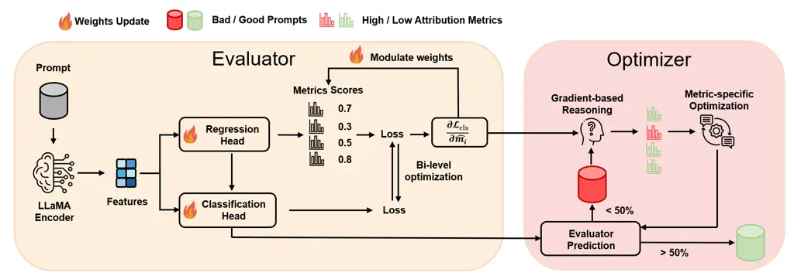
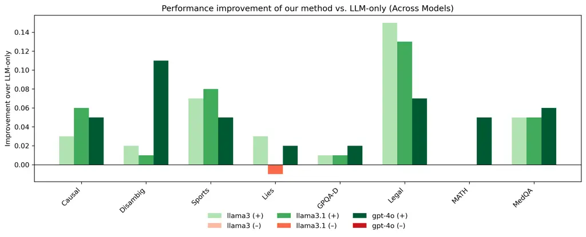

# Knowing How to Edit: Reliable Evaluation Signals for Diagnosing and Optimizing Prompts at Query Level

Ke Chen kec10@illinois.edu Affiliation: School of Information Sciences
Affiliation: University of Illinois Urbana-Champaign    Yifeng Wang
yifengw3@andrew.cmu.edu Affiliation: College of Engineering
Affiliation: Carnegie Mellon University    Hassan Almosapeeh
halmosap@illinois.edu Affiliation: School of Information Sciences
Affiliation: University of Illinois Urbana-Champaign    Haohan Wang
haohanw@illinois.edu Affiliation: School of Information Sciences
Affiliation: University of Illinois Urbana-Champaign

###### Abstract

Prompt optimization has become a central mechanism for eliciting strong
performance from LLMs, and recent work has made substantial progress by
proposing diverse prompt evaluation metrics and optimization strategies.
Despite these advances, prompt evaluation and prompt optimization are
often developed in isolation, limiting the extent to which evaluation
can effectively inform prompt refinement. In this work, we study prompt
optimization as a process guided by performance-relevant evaluation
signals. To address the disconnect between evaluation and optimization,
we propose an evaluation-instructed prompt optimization approach that
explicitly connects prompt evaluation with query-dependent optimization.
Our method integrates multiple complementary prompt quality metrics into
a performance-reflective evaluation framework and trains an
execution-free evaluator that predicts prompt quality directly from
text, avoiding repeated model executions. These evaluation signals then
guide prompt refinement in a targeted and interpretable manner.
Empirically, the proposed evaluator achieves 83.7% accuracy in
predicting prompt performance. When incorporated into the optimization
process, our approach consistently outperforms existing optimization
baselines across eight benchmark datasets and three different backbone
LLMs. Overall, our results demonstrate that reliable and efficient
evaluation signals can serve as an effective foundation for robust and
interpretable prompt optimization.

## 1 Introduction

As the capabilities of large language models (LLMs) continue to improve,
prompting has become a primary interface for eliciting and shaping model
behavior Liu et al. (2025). This has sparked rapid progress along two
closely related directions: methods for evaluating prompt quality, and
strategies for optimizing prompts to improve downstream performance. A
wide range of prompt evaluation metrics and optimization techniques have
been proposed, reporting notable performance improvements across diverse
tasks. Despite this progress, prompt evaluation and prompt optimization
are typically developed as separate components. Many evaluation methods
focus on measuring prompt quality without indicating how prompts should
be modified, while optimization procedures frequently rely on heuristic,
unstable, or opaque signals that are weakly grounded in systematic
evaluation. This separation raises a fundamental question: How can
evaluation provide reliable signals for deciding where and how to refine
prompts?

In this work, we take a step toward connecting prompt evaluation with
prompt optimization. Rather than treating evaluation as a post-hoc
assessment, we explore how evaluation signals can be used to inform
where and how prompts should be refined. At a high level, this
perspective involves two closely related aspects: (i) how prompt quality
should be comprehensively evaluated, and (ii) how such evaluation
signals can be used to guide prompt optimization.

Existing prompt optimization strategies broadly fall into two
categories: static template optimization and dynamic, query-level
optimization. Traditional approaches optimize a single prompt template
for a given task and apply it uniformly to all queries, as in methods
such as TextGrad Yuksekgonul et al. (2024), ProTeGi Pryzant et al.
(2023), and their variants. These methods implicitly assume that queries
within a task share similar semantic and reasoning structures, allowing
a global template to generalize. However, as LLM applications expand to
more diverse and open-ended settings, this assumption becomes
increasingly fragile. In dynamic and complex real-world user scenarios,
static templates often fail to adapt, leading to suboptimal or unstable
performance.

To address this limitation, recent work has moved toward query-dependent
prompt optimization, including methods such as IAP Yuan et al. (2024),
Self-Refine Madaan et al. (2023), QPO Kong et al. (2024), and
Prompt-OIRL Sun et al. (2023a). These approaches tailor prompts to
individual queries rather than relying on a single template. Despite
their flexibility, most dynamic methods rely on heuristic, noisy, or
opaque optimization signals, such as LLM-generated textual feedback or
black-box reward models. As a result, optimization is often unstable and
difficult to interpret, as these methods lack a principled way to decide
where and how prompts should be edited. This highlights the need for
reliable evaluation signals to guide prompt optimization.

A natural solution for providing such guidance is prompt evaluation. A
growing body of work has proposed diverse metrics to assess prompt
quality, including semantic LLM-based measures and quantitative,
response-based metrics such as stability Chen et al. (2025) and
mutual-information scores Kraskov et al. (2004). While these metrics
offer useful perspectives, they are typically developed in isolation,
capturing only partial aspects of prompt behavior and exhibiting weak or
inconsistent alignment with downstream task performance. The absence of
a systematic, performance-reflective evaluation framework has therefore
limited their use as actionable signals for prompt optimization, and
prompt evaluation is often treated as a post-hoc assessment rather than
as a tool for guiding prompt refinement. Moreover, many evaluation
metrics are response-based and require repeated model executions, making
them difficult to deploy in query-level or multi-agent settings.

To address these challenges, we propose an evaluation-instructed prompt
optimization system that explicitly connects prompt evaluation with
optimization decisions. Rather than treating evaluation as a post-hoc
analysis, our goal is to use evaluation signals to determine where and
how prompts should be edited during optimization.

First, to overcome the fragmented nature of existing metrics, we
construct a performance-reflective evaluation framework that integrates
multiple complementary dimensions of prompt quality and aligns them with
downstream task accuracy. Second, to mitigate the high cost of
response-based evaluation, we train an execution-free evaluator that
predicts prompt quality scores directly from text, enabling prompt
assessment without repeated model executions. Finally, we use these
evaluation signals to guide prompt optimization, allowing prompt
revisions to be targeted, interpretable, and query-dependent.

Empirically, the proposed evaluator achieves an accuracy of 83.7% in
predicting prompt success rate. When integrated with the metric-aware
optimization process, our approach consistently outperforms both
static-template optimization methods and existing query-dependent
optimization baselines across 8 benchmark datasets on 3 different
backbone LLMs.

Our main contribution is proposing the first prompt
evaluation–optimization pipeline, which unifies comprehensive evaluation
and dynamic optimization within a single closed loop. Building on this
pipeline, our contributions are twofold:

1.  1.  Performance-reflective prompt evaluation. We establish a
        comprehensive prompt-quality evaluation system, and train an
        execution-free evaluator capable of predicting multi-dimensional
        quality and downstream performance, which provides reliable signal
        for prompt optimization.
2.  2.  Evaluation–instructed optimization mechanism. We bridge the gap
        between prompt evaluation and optimization in query-dependent
        settings, improving robustness and interpretability by allowing
        evaluation signals to directly guide optimization directions.

## 2 Related Works

### 2.1 Static Prompt Template Optimization

A substantial body of prior work studies prompt optimization by
searching for a single prompt template that generalizes across all
queries within a task. Representative approaches include Automatic
Prompt Engineer (APE) Zhou et al. (2023), OPRO Yang et al. (2024), and
PromptAgent Wang et al. (2023). These methods typically generate
candidate prompts, execute them on a training set, evaluate performance
against ground-truth responses, and iteratively refine prompts using
reinforcement learning, evolutionary strategies, or heuristic search.
Such approaches have been shown to automate prompt discovery and improve
performance over manually designed templates.

However, static template optimization assumes that queries within a task
share sufficiently similar linguistic and reasoning structures for a
single prompt to generalize. In practice, real-world queries often
exhibit substantial heterogeneity. For example, reasoning benchmarks
such as GSM8K Cobbe et al. (2021) contain problems that differ widely in
both surface form and underlying logical structure. Even an optimized
static prompt primarily encodes task-level instructions and cannot adapt
its reasoning strategy or contextual emphasis to individual queries Sun
et al. (2023b). As a result, the effectiveness of static prompts is
fundamentally constrained in settings where query-level variation is
pronounced.

From a modeling perspective, static prompt optimization can be viewed as
learning a global prompt that minimizes average loss over a task
distribution. While effective in relatively homogeneous settings, this
formulation limits the ability of prompts to exploit query-specific
structure or contextual information, motivating the development of more
adaptive optimization strategies.

### 2.2 Query-Dependent Prompt Optimization

To overcome the limitations of static templates, recent work has
explored query-dependent prompt optimization, where prompts are tailored
to individual queries. Instance-Adaptive Prompting (IAP) Yuan et al.
(2024), for example, selects prompts based on attention-gradient
saliency scores derived from internal model representations. Self-Refine
Madaan et al. (2023) and ProRefine Pandita et al. (2025) iteratively
improve prompts using LLM-generated textual feedback, while QPO Kong et
al. (2024) and Prompt-OIRL Sun et al. (2023a) train auxiliary models to
generate or rank prompts for each instance.

Although these methods increase flexibility and enable query-specific
adaptation, they differ substantially in how optimization signals are
obtained. Many approaches, such as Self-Refine Madaan et al. (2023) and
ProRefine Pandita et al. (2025), rely on natural-language feedback
generated by LLMs to approximate optimization directions, which can
introduce instability and sensitivity to sampling noise Gou et al.
(2023). Others depend on black-box reward models or access to internal
model states (e.g., IAP Yuan et al. (2024), QPO Kong et al. (2024), and
Prompt-OIRL Sun et al. (2023a) ), which limits interpretability,
portability, or scalability. As a result, while query-dependent methods
improve expressiveness compared to static templates, they often lack
clear and interpretable mechanisms for determining how prompts should be
modified.

### 2.3 Prompt Evaluation Metrics

Parallel to advances in prompt optimization, a growing literature has
proposed metrics for evaluating prompt quality. Existing metrics span
semantic LLM-based measures, such as clarity, coherence, and specificity
Shah (2024), as well as quantitative, response-based metrics including
stability Chen et al. (2025) and mutual-information scores Kraskov et
al. (2004). These metrics provide complementary perspectives on prompt
behavior, capturing aspects such as semantic alignment, output
consistency, and sensitivity to sampling.

However, most prompt evaluation metrics are developed independently and
focus on one specific attribute of prompt behavior, leading to
fragmented assessments that may not consistently reflect downstream task
performance. Moreover, many commonly used metrics, such as stability
Chen et al. (2025), MI Kraskov et al. (2004), and prompt entropy Lu et
al. (2022), are response-based and require repeated executions of an LLM
to obtain stable estimates, which significantly increases computational
cost. This limits their practical use in settings where prompts must be
evaluated or updated at the query level, such as interactive systems or
multi-agent frameworks.

Due to these limitations, prompt evaluation is often used as a post-hoc
analysis tool rather than as a direct input to prompt optimization.
Bridging prompt evaluation with optimization in a principled and
efficient manner remains an open challenge.

## 3 Method

Our goal is to build a reliable and interpretable prompt evaluator that
can estimate prompt quality across multiple dimensions without executing
the prompt itself, and use the scores on different metrics to instruct
the prompt optimization process. This section introduces how we
construct the training dataset, select quantitative evaluation metrics,
design and train the evaluator model, and use the evaluation results to
instruct query dependent prompt optimization.

### 3.1 Training Dataset Generation

To train an evaluator that accurately captures how prompts behave across
different quality dimensions, we require a dataset that spans a wide
spectrum of prompt quality. Rather than generating only high-performing
prompts, our goal is to construct a diverse collection of prompts with
varying structures, styles, and performance levels. This diversity
enables the evaluator to learn generalizable patterns relating prompt
characteristics to downstream execution performance. In other words, the
objective of this stage is diversity, not optimality; main performance
improvement is achieved during the subsequent optimization stage
(Section  3.4).

We sample queries from multiple benchmarks, including BBH Suzgun et al.
(2022) (causal_judgement, disambiguation_qa, sports_understanding,
web_of_lies), GPQA Rein et al. (2024) (diamond, main), and LegalBench
Guha et al. (2023) (definition_classification). For each query, we
generate prompt candidates from three complementary sources:

#### (1) Static prompt templates.

We select five widely used prompt templates covering several mainstream
prompting paradigms, including direct prompting, chain-of-thought,
tree-of-thought, and multi-expert debate/voting structures. The
templates are shown in Appendix Table 5, which serve as a diverse and
stylistically rich foundation for prompt construction.

#### (2) LLM-generated prompts.

To introduce systematic stylistic diversity, we instruct the LLM with a
higher temperature to generate new prompts conditioned on each query. We
design six prompting styles: step-by-step reasoning, expert discussion,
Socratic questioning, creative exploration, verification-oriented
prompting, and contrastive prompting. We provide concrete examples of
these six prompting styles in Appendix Table 6.These styles reflect
different reasoning dynamics and linguistic patterns, enabling the
evaluator to observe a broad set of semantic variations.

#### (3) Evolutionary recombination.

Inspired by genetic algorithms, we further expand the prompt pool
through semantic recombination. From the union of static and
LLM-generated prompts, we randomly sample two parent prompts. We apply
an LLM agent to semantically decompose each parent prompt into two
segments, cross-combine the segments into new hybrids, and then rephrase
the resulting prompts to ensure smoothness and semantic coherence.
Illustrative examples of the recombination process are provided in
Appendix Table 7 This procedure effectively blends structural and
stylistic features from multiple prompting strategies while maintaining
natural-language fluency.

####

Across these three sources, we obtain a total of 11,530 prompt
candidates with substantial diversity in reasoning structure, linguistic
form, semantic content, and overall quality. This diverse dataset
provides a strong foundation for training a generalizable evaluator.

### 3.2 Metric Selection

To comprehensively evaluate prompt quality, we collect a diverse set of
quantitative metrics commonly used in existing prompt-evaluation
research. These metrics can be grouped into four categories: (1)
LLM-based semantic metrics: clarity, coherence, and specificity Shah
(2024); (2) Prompt-intrinsic metric: nll_score Lastras (2019); (3)
Response-based metrics: stability_score Chen et al. (2025), mi_score
Kraskov et al. (2004), and prompt_entropy Lu et al. (2022), each
computed from multiple executions of the same prompt; (4) Task-level
metric: query_entropy Lu et al. (2022), which captures the inherent
uncertainty or difficulty of the query itself.

In addition to these metrics, we record each prompt’s execution
accuracy. To obtain stable estimates under stochastic decoding, every
prompt is executed ten times. We then use whether its average accuracy
exceeds 50% as a binary indicator of prompt quality. This threshold
follows a majority-voting logic: once a prompt’s accuracy exceeds 50%,
aggregating multiple executions by majority vote will consistently
recover the correct answer despite sampling noise.

Using all 11,530 prompts, we first compute their full multi-dimensional
metric scores strictly following the formal definitions of each metric.
For metrics that require model execution (e.g., response-based metrics),
we execute each prompt ten times under controlled sampling settings and
average the resulting scores to obtain stable estimates. With these
rigorously obtained metric scores, we then perform metric selection
based on their ability to reflect downstream performance. Specifically,
we generate semantic embeddings for each prompt using the
text-embedding-3-large model, train an XGBoost classifier to predict
whether accuracy exceeds 50%, and use the gain importance scores to
evaluate each metric’s contribution. Metrics with only weak associations
to performance are removed.

Through this analysis, we identify four metrics that exhibit both high
importance and strong complementarity. Each metric captures a distinct
dimension of prompt behavior:

\(1\) nll_score: Measures the negative log-likelihood of directly
generating the correct answer. Lower scores indicate stronger semantic
guidance and a more restrictive output space.

\(2\) stability_score: Quantifies response consistency across repeated
executions. Higher stability reflects reduced sensitivity to sampling
noise.

\(3\) mi_score: Computes the mutual information between the query and
the generated output, representing semantic alignment and task
relevance.

\(4\) query_entropy: Captures the intrinsic difficulty of the query by
accessing the entropy. Ambiguous or high-reasoning queries exhibit
higher entropy without prompting.

These four metrics were used both as supervision targets and as
interpretability anchors for the evaluator, jointly providing a
comprehensive and complementary view of prompt quality. The detailed
formulas and underlying rationale for each metric will be further
discussed in Section 3.4.

### 3.3 Evaluator Architecture



Figure 1: Overview of our evaluation-instructed optimization pipeline.

Our evaluator $`\mathcal{E}_{\theta}`$ is built upon a LLaMA-8B-Instruct
backbone with lightweight LoRA adaptation, and is designed as a
multi-task model that jointly performs binary classification and metric
regression. Formally, the evaluator implements a mapping:

```math
\mathcal{E}_{\theta}:x\mapsto\big(\hat{y},\,\hat{\mathbf{m}}\big),\quad\text{with}\quad\hat{y}=f_{\mathrm{cls}}(z;\theta_{c}),\quad\hat{\mathbf{m}}=f_{\mathrm{reg}}(h;\theta_{r})\in\mathbb{R}^{M}.
```

Here, $`h`$ denotes the shared encoder representation, and $`z`$ is the
metric-aware fusion of semantic and regression features. Both quantities
are formally defined in the following equations.

#### Shared Encoder.

The evaluator constructs the textual input from the user query $`q`$ and
the prompt candidate $`p`$. To exploit the model’s reasoning
capabilities, we prepend a fixed natural-language prefix $`r`$
describing the evaluation objective and the definition of each metric;
this improves stability and ensures the encoder internalizes the meaning
of every score dimension. The concatenated input is then encoded through
the LLaMA backbone:

```math
x=[r;\ q;\ p],\qquad h=f_{\mathrm{enc}}(x;\theta_{\mathrm{enc}}).
```

#### Metric regression and feature fusion.

A regression head predicts continuous values for the selected metrics.
To enable the classifier to be both semantics-aware and metric-aware,
the predicted metric vector is fused with the feature map via a
lightweight MLP:

```math
z=\phi(h,\,\hat{\mathbf{m}})=MLP([h;\hat{\mathbf{m}}]).
```

This fusion encourages the classifier to base its decision not only on
prompt semantics but also on the evaluator’s internal expectations of
metric behavior.

#### Bi-level training objective.

The evaluator is trained through a bi-level objective in which
regression assists classification by providing additional structural
signals. For a fixed set of metric weights $`\mathbf{w}`$, the model
parameters $`\theta`$ are optimized through:

```math
\theta^{\ast}(\mathbf{w})=\arg\min_{\theta}\left(\mathcal{L}_{\mathrm{cls}}(\theta)+\lambda\sum_{i=1}^{M}w_{i}\,\mathcal{L}_{i}^{\mathrm{reg}}(\theta)\right),\qquad\mathbf{w}^{\ast}=\arg\min_{\mathbf{w}}\mathcal{L}_{\mathrm{cls}}\!\left(\theta^{\ast}(\mathbf{w})\right).
```

This design ensures that metric regression helps classification only
when useful, preventing the regression task from dominating or
misguiding learning.

#### Gradient-informed metric weighting.

To identify which metric dimensions most strongly affect prompt success,
we update each weight $`w_{i}`$ using gradient signals from the
classification loss:

```math
w_{i}\leftarrow\mathcal{A}\!\left(w_{i},\;\left\lVert\nabla_{\hat{m}_{i}}\,\mathcal{L}_{\mathrm{cls}}\right\rVert\right)\quad\text{with}\quad\mathcal{A}\!\left(w_{i},g_{i}\right)\,=\,Normalize(w_{i}-\eta\,\frac{\partial\mathcal{L}_{\mathrm{cls}}}{\partial\hat{m}_{i}}),
```

where the adaptation operator increases the influence of metrics that
exert stronger gradients on the classification objective. This creates a
closed-loop mechanism in which regression dimensions are automatically
aligned with performance-relevant signals.

#### Lightweight adaptation.

To maintain efficiency and portability, we fine-tune only a small subset
of attention layers through LoRA adapters, amounting to roughly 5.5% of
total parameters. This keeps computational cost low while preserving
generalization across prompt types and downstream models.

### 3.4 Metric-Aware Optimization

Once the evaluator identifies a prompt as low-quality (i.e.,
$`\hat{y}<0.5`$), the system initiates a metric-instructed optimization
process. The core idea is to trace _why_ a prompt fails by examining the
gradient of the classification loss with respect to each predicted
metric dimension, which quantifies the negative contribution to the
evaluator’s decision of a particular metric. This enables the system to
attribute performance degradation to specific factors (e.g., low answer
confidence, high ambiguity, unstable reasoning trajectory, ect.) rather
than treating all errors as a single homogeneous failure mode. For each
problematic metric dimension, the optimizer invokes a corresponding
diagnostic module that inspects the prompt for metric-specific issues
and suggests targeted corrective edits. These refined suggestions are
aggregated to construct an improved prompt, which is then reevaluated.

Below we present the four core metrics used in this process, including
their definitions, diagnostic intuition, and how the optimization module
improves each dimension.

#### Negative Log-Likelihood (NLL).

For a query–prompt pair $`(q,p)`$ and the correct answer token sequence
$`\mathbf{y}^{\*}=(y^{\*}_{1},\dots,y^{\*}_{T})`$, the NLL score is
computed by forcing the model to generate the correct answer and
measuring the probability:

```math
\text{NLL}(p,q)=-\frac{1}{T}\sum_{t=1}^{T}\log P_{\theta}(y^{\*}_{t}\mid q,p,y^{\*}_{<t}).
```

In practice, this measures the model’s confidence in the correct answer.
A high NLL (i.e., low confidence) suggests that the prompt does not
sufficiently constrain the model’s generative distribution.

Typical causes of poor NLL include: (1) _Instruction conflict_: the
prompt simultaneously demands incompatible goals, diluting the model’s
focus; (2) _Noisy or long preambles_: excessive role-play, fillers, or
redundant restatements weaken the clarity of the task; (3) _Few-shot
inconsistency_: demonstrations differ in reasoning style or label
format, confusing the model’s internal alignment; (4) _Task mismatch_:
the reasoning template implied by the prompt is misaligned with the
actual task type. A metric-specific diagnoser then detects these issues
and provide optimization suggestions.

#### Semantic Stability.

For a prompt $`p`$, we sample $`N`$ model outputs $`a_{1},\dots,a_{N}`$
and embed each output via $`v_{i}=\phi(a_{i})`$. Stability score is
calculated as:

```math
S(p,q)=1-\frac{2}{N(N-1)}\sum_{i<j}d_{ij},\quad with\quad d_{ij}=1-\frac{v_{i}\cdot v_{j}}{\lVert v_{i}\rVert\,\lVert v_{j}\rVert}.
```

High stability implies more stable and robust responses.

Instability typically arises from: (1) _Unspecified output format_:
missing a deterministic “final answer” field or clear parseable
structure; (2) _Conflicting objectives_: prompts encouraging creativity
or multiple perspectives during an accuracy-oriented task; (3)
_Unconstrained reasoning paths_: allowing arbitrary-length or
hedge-heavy reasoning chains introduces randomness; (4) _Missing guiding
example_: the lack of a stable template increases trajectory drift. The
optimizer therefore introduces fixed-slot formats, removes
diversity-inducing instructions, constrains reasoning depth, or uses
micro few-shot examples.

#### Mutual Information (MI).

We measure how strongly the prompt influences the model’s output beyond
the query alone:

```math
\text{MI}(p,q)=H(A\mid q)-H(A\mid q,p),\qquad H(A\mid q,p)=-\sum_{a}\hat{P}(a\mid q,p)\,\log\hat{P}(a\mid q,p).
```

High MI indicates that the prompt provides meaningful, actionable
guidance; low MI suggests that the output is nearly independent of the
prompt.

Low MI is usually caused by: (1) _Hollow templates_: vague instructions
like “answer carefully” that lack concrete operational cues; (2)
_Stylistic noise_: role-play, persona, or politeness instructions that
add tokens but not guidance; (3) _Missing schemas_: prompts that do not
define variables, conditions, or verification steps. Optimization
introduces explicit variable definitions, checklist-style schemas, and
strong reasoning cues that increase prompt–response coupling.

#### Query Entropy.

To measure the intrinsic difficulty of the query itself, we estimate the
entropy of the model’s answer distribution when no prompt is provided:

```math
H(A\mid q)=-\sum_{a}\hat{P}(a\mid q)\,\log\hat{P}(a\mid q).
```

Higher entropy indicates that the query naturally induces divergent or
unstable answers, often because the problem lacks explicit assumptions
or requires domain-specific guidance.

Common sources of high query entropy include: (1) _Ambiguity or missing
assumptions_: unclear definitions, scope, or hidden constraints; (2)
_Lack of reasoning structure_: the prompt does not provide a stable
scaffold for step-by-step solving; (3) _Missing domain context_:
specialized tasks require minimal technical framing that the prompt may
not supply; (4) _Unconstrained output space_: no guidance on allowable
answer formats or numeric ranges. For the query-entropy dimension, the
optimizer first invokes ambiguity- and uncertainty-focused diagnosers to
detect potential issues. Unlike the other metrics, whose fixes modify
the system prompt, improvements here are applied by augmenting the query
side with minimal clarifications and constraints.

#### Gradient-Based Attribution and Revision.

For each metric $`\hat{m}_{i}`$, the evaluator computes

```math
g_{i}=\bigl\lVert\nabla_{\hat{m}_{i}}\mathcal{L}_{\mathrm{cls}}\bigr\rVert,
```

which quantifies how strongly that metric dimension influences the “bad”
classification. These sensitivities guide both the reweighting of
regression losses and the selection of metric-specific diagnostic
prompts. The optimizer then queries the corresponding metric-specific
diagnosers (e.g., instruction-conflict detector for NLL, format guard
for stability, etc,) and rewrites the prompt dimension-by-dimension.

By grounding optimization in interpretable and metric-aligned signals
from the evaluator, the overall procedure becomes more stable,
principled, and effective than heuristic prompt rewriting approaches.

## 4 Experiments

### 4.1 Setup

Our experiments cover both open-domain and domain-specific datasets,
including the BBH tasks Suzgun et al. (2022) (causal judgement,
disambiguation QA, sports understanding, web of lies), GPQA Diamond Rein
et al. (2024), LegalBench definition classification Guha et al. (2023),
MATH500 Lightman et al. (2023), and the medical QA dataset MedQA Jin et
al. (2021). These tasks span diverse reasoning types—causal inference,
semantic disambiguation, common-sense reasoning, factual judgment, and
professional knowledge QA—providing a broad evaluation ground for prompt
performance across varied semantic and reasoning settings.

For each dataset, we randomly sample 100 examples for training and 100
for testing; for datasets with fewer than 200 samples, we adopt a
50%–50% train–test split. Using the three diverse prompt-generation
strategies described in Section 3.1, we generate multiple prompt samples
for each question and construct a prompt pool containing 11,530
examples. Among these, MedQA Jin et al. (2021) and MATH500 Lightman et
al. (2023) are excluded from training and used exclusively to evaluate
the method’s generalization ability to unseen tasks, especially in
specialized domains such as medicine.

For model setup, we use LLaMA-3-8B-Instruct as the sole base model for
generating training data and training the evaluator. During testing, we
used LLaMA-3-8B-Instruct, LLaMA-3.1-8B-Instruct, and GPT-4o as prompt
execution backbones to examine whether an evaluator trained on a single
model can generalize across different LLMs.

Notably, the “training” process here refers solely to training the
evaluator—learning to predict prompt quality across different metrics
and execution performance. The optimization process is untrained,
relying entirely on the evaluator’s predicted scores to guide dynamic
prompt adjustment.

### 4.2 Metric Selection Results

We evaluated eight widely used candidate metrics: clarity, coherence,
specificity, nll_score, stability_score, mi_score, prompt_entropy, and
query_entropy. These metrics were used as input features to an XGBoost
classifier predicting whether each prompt’s execution accuracy exceeded
50%. Table 2 shows the feature importance distribution of all metrics.
Following a threshold of overall gain contribution greater than 10%, we
selected four core metrics that are most strongly correlated with
downstream performance: nll_score, stability_score, mi_score, and
query_entropy.

|                 |            |            |
| --------------- | ---------- | ---------- |
| Feature         | Importance | Weight (%) |
| query_entropy   | 0.101      | 30.9       |
| stability_score | 0.066      | 20.2       |
| nll_score       | 0.043      | 13.0       |
| mi_score        | 0.035      | 10.7       |
| prompt_entropy  | 0.025      | 7.5        |
| specificity     | 0.022      | 6.8        |
| clarity         | 0.020      | 6.1        |
| coherence       | 0.016      | 4.9        |

Table 1: Feature importance of prompt evaluation metrics from XGBoost.

|                 |            |
| --------------- | ---------- |
| Feature         | Weight (%) |
| query_entropy   | 32.7       |
| nll_score       | 26.4       |
| stability_score | 22.3       |
| mi_score        | 18.6       |

Table 2: Learned weights of prompt evaluation metrics from our
evaluator.

These features are complementary and relatively independent in terms of
information contribution. Although XGBoost does not explicitly model
orthogonality among features, its layer-wise decision structure
implicitly reduces the importance of collinear variables once key
features have been explained, thereby minimizing redundancy. For
example, the mutual information score partially captures the semantic
diversity represented by prompt entropy, which explains its higher
relative importance and the natural attenuation of prompt entropy.
Overall, this mechanism helps preserve feature complementarity and
enables multi-dimensional modeling of prompt quality and performance.

### 4.3 Metric and Performance Prediction

Based on the prompt pool constructed in Section 3.1 and the selected
performance-reflective metrics, we fine-tune the evaluator model. 80% of
samples are used for training and 20% for validation. On the validation
set, our evaluator achieves a prompt-quality classification accuracy of
83.7%, significantly outperforming random and baseline levels. For
comparison, we tested the evaluation model in Prompt-OIRL Sun et al.
(2023a), which is based on embedding + XGBoost. Under identical data and
evaluation settings, even when provided with ground-truth metric scores,
it achieves only 69% accuracy—indicating that our evaluator more
effectively captures the relationship between prompt semantics and
execution performance.

#### Ablation Study.

To assess the contribution of each component, we conduct systematic
ablation experiments by removing or replacing key modules: (1) using all
metrics instead of the selected performance-related ones; (2) removing
the task-descriptive prefix from prompts; (3) removing the guidance from
predicted metric regression results to the classification task; (4)
removing the fusion of metric scores with the encoder’s feature map; and
(5) disabling the gradient-based dynamic weighting of regression losses.

|                              |                     |
| ---------------------------- | ------------------- |
| Configuration                | Validation Accuracy |
| Complete evaluator           | 83.7%               |
| Use all metrics              | 79.6%               |
| w/o prefix                   | 80.2%               |
| w/o predicted metric score   | 75.5%               |
| w/o feature map from encoder | 67.3%               |
| w/o dynamic loss weighting   | 80.6%               |

Table 3: Ablation results of the evaluator model.

The results demonstrate that: (1) keeping only representative metrics
reduces noise and redundancy, improving learning efficiency; (2)
providing task-descriptive prefixes enhances the evaluator’s semantic
understanding; (3) fusing metric predictions with encoder features
improves the model’s ability to assess prompt quality; and (4)
dynamically weighting metric losses according to classification
gradients is beneficial, as different metrics contribute unequally to
final performance.

We further extract the learned weights of each metric after training. As
shown in Table 2, the distribution remains consistent with the XGBoost
results—dominated by query_entropy (32.7%), followed by nll_score,
stability_score, and mi_score. This finding indicates that the effect of
prompts on LLM performance is largely bounded by the intrinsic
difficulty of the query and the capability ceiling of the model. This is
expected: the purpose of prompt optimization is not to enable a weaker
model to achieve a qualitative leap (e.g., making LLaMA-8B outperform
GPT-4o), but rather to maximize its potential within existing capability
limits. In other words, while prompt optimization cannot alter the
model’s capacity boundary, it can yield substantial gains within that
boundary. Compared with XGBoost, our evaluator exhibits a more balanced
weighting across metrics and significantly higher overall accuracy,
suggesting that it learns richer and more complementary information from
multiple dimensions.

### 4.4 Systematic Performance

We compare our framework with two major categories of prompt
optimization baselines: (1) Query-dependent optimization methods:
Self-Refine and Pro-Refine; and (2) Static template optimization
methods: APE Zhou et al. (2023) and TextGrad. For fairness, all methods
are evaluated on the same base model, LLaMA-3-8B-Instruct, with the
maximum number of optimization iterations set to 3.

As shown in Table 4, our method achieves the best performance on nearly
all tasks. Notably, for all three different backbone LLMs, it attains
approximately 10% improvement over the single-agent baseline on the
LegalBench definition classification task and a 5%-6% gain on MedQA, an
unseen medical-domain task. These results demonstrate that our framework
consistently enhances performance across seen tasks and generalizes
effectively to new domains. This generalization is reasonable, as our
training focuses solely on learning the evaluator’s scoring ability
rather than fitting to specific tasks or domains—thus providing
transferable optimization signals even for unseen scenarios.

|                          |          |          |                              |             |            |                       |      |
| ------------------------ | -------- | -------- | ---------------------------- | ----------- | ---------- | --------------------- | ---- |
|                          |          |          | Query-dependent Optimization |             |            | Template Optimization |      |
| Task                     | Model    | LLM only | Ours                         | Self-Refine | Pro-Refine | TextGrad              | APE  |
| bbh_causal judgement     | llama3   | 0.60     | 0.63                         | 0.58        | 0.61       | 0.62                  | 0.59 |
|                          | llama3.1 | 0.58     | 0.64                         | 0.59        | 0.61       | 0.57                  | 0.53 |
|                          | gpt-4o   | 0.73     | 0.78                         | 0.74        | 0.75       | 0.74                  | 0.72 |
| bbh_disambi-guation_qa   | llama3   | 0.63     | 0.65                         | 0.65        | 0.63       | 0.64                  | 0.63 |
|                          | llama3.1 | 0.64     | 0.65                         | 0.66        | 0.64       | 0.65                  | 0.63 |
|                          | gpt-4o   | 0.58     | 0.69                         | 0.56        | 0.63       | 0.71                  | 0.67 |
| bbh_sports understanding | llama3   | 0.68     | 0.75                         | 0.68        | 0.71       | 0.70                  | 0.69 |
|                          | llama3.1 | 0.67     | 0.75                         | 0.71        | 0.70       | 0.73                  | 0.68 |
|                          | gpt-4o   | 0.78     | 0.83                         | 0.79        | 0.82       | 0.80                  | 0.79 |
| bbh_web of_lies          | llama3   | 0.66     | 0.69                         | 0.67        | 0.71       | 0.74                  | 0.72 |
|                          | llama3.1 | 0.69     | 0.68                         | 0.66        | 0.70       | 0.73                  | 0.71 |
|                          | gpt-4o   | 0.96     | 0.98                         | 0.94        | 0.96       | 0.96                  | 0.95 |
| GPQA Diamond             | llama3   | 0.28     | 0.29                         | 0.26        | 0.28       | 0.26                  | 0.27 |
|                          | llama3.1 | 0.26     | 0.27                         | 0.26        | 0.29       | 0.27                  | 0.24 |
|                          | gpt-4o   | 0.22     | 0.24                         | 0.20        | 0.21       | 0.23                  | 0.22 |
| Legal Bench              | llama3   | 0.55     | 0.70                         | 0.63        | 0.63       | 0.58                  | 0.55 |
|                          | llama3.1 | 0.56     | 0.69                         | 0.63        | 0.63       | 0.58                  | 0.61 |
|                          | gpt-4o   | 0.83     | 0.90                         | 0.81        | 0.86       | 0.84                  | 0.84 |
| MATH500                  | llama3   | 0.31     | –                            | –           | –          | –                     | –    |
|                          | llama3.1 | 0.36     | –                            | –           | –          | –                     | –    |
|                          | gpt-4o   | 0.81     | 0.86                         | 0.78        | 0.80       | 0.81                  | 0.82 |
| MedQA                    | llama3   | 0.47     | 0.52                         | 0.50        | 0.51       | 0.50                  | 0.49 |
|                          | llama3.1 | 0.46     | 0.51                         | 0.49        | 0.51       | 0.48                  | 0.44 |
|                          | gpt-4o   | 0.51     | 0.57                         | 0.54        | 0.46       | 0.49                  | 0.51 |

Table 4: Performance comparison with baseline prompt-optimization
methods across three backbone LLMs (LLaMA-3, LLaMA-3.1, GPT-4o). Results
for MATH500 are omitted for LLaMA-3/3.1 because these mid-sized models
lack sufficient arithmetic capability, causing errors dominated by
computation rather than prompt design.

Table 4 also demonstrated the cross-model generalization of our system.
Although all training samples are generated from LLaMA-3-8B-Instruct, we
replace it with LLaMA-3.1-8B-Instruct and GPT-4o during testing as the
prompt execution models. Figure 2 visualizes the performance
improvements of our optimized prompts over the LLM-only baseline on
three backbone models (LLaMA-3, LLaMA-3.1, and GPT-4o). Each bar shows
the relative gain (or drop) for a given dataset–model pair, with green
indicating improvements and red indicating performance decreases. We
observe that, despite being trained exclusively on LLaMA-3-8B samples,
our evaluator consistently produces positive gains across most datasets
and models. The overall pattern remains stable across backbones,
suggesting that the learned metric-aware optimization signals are highly
transferable and largely model-agnostic. Remaining variations mainly
reflect differences in backbone capability rather than failures of the
optimization mechanism.



Figure 2: Improvement of our optimized prompts over the LLM-only
baseline across three backbone models (LLaMA-3, LLaMA-3.1, and GPT-4o).
Positive gains are shown in green and negative changes in red, with
color intensity reflecting model size.

This stable cross-model performance highlights the core advantage of our
framework: by decomposing prompt quality into interpretable
multi-dimensional metrics and forming a closed evaluation–optimization
loop, our method achieves consistent, efficient, and robust prompt
optimization across diverse tasks and backbone models.

## 5 Conclusion

This work presents a systematic and interpretable prompt
evaluation–optimization framework that unifies multi-dimensional
evaluation and dynamic optimization within a single closed loop. Unlike
prior approaches that either rely on textual feedback or black-box
reward models, our framework establishes a metric-based evaluator that
predicts prompt quality directly from text without execution, bridging
the gap between performance-oriented evaluation and query-dependent
optimization.

Through comprehensive experiments across 8 benchmarks, we demonstrate
that the proposed evaluator achieves an 83.7% validation accuracy in
predicting prompt performance, surpassing embedding-based baselines by a
large margin. When integrated into the optimization process, it
consistently outperforms both static-template methods and
query-dependent baselines across diverse reasoning and
knowledge-intensive tasks. The evaluator further exhibits strong
generalization to unseen domains such as MedQA and maintains stable
optimization performance across different base models, underscoring its
model-agnostic and portable nature.

Overall, our results validate that effective prompt optimization can be
achieved without retraining the underlying LLM or relying on costly
multi-execution feedback. By decomposing prompt quality into
interpretable metrics and coupling evaluation with optimization, our
framework provides a scalable foundation for future execution-free,
performance-oriented, and cross-model prompt optimization in both
standalone and multi-agent systems.

## 6 Limitation and Discussion

While the proposed framework provides a systematic and interpretable
foundation for performance-oriented prompt optimization, several
limitations remain that point to directions for future work.

\(1\) For the MATH500 benchmark, we report results only for GPT-4o. This
dataset requires multi-step symbolic computation that exceeds the
numerical and algebraic capabilities of small-scale models such as
LLaMA-3-8B and LLaMA-3.1-8B. In these settings, most errors arise from
the backbone model’s inability to carry out the required calculations,
rather than from prompt design itself, making prompt optimization
largely ineffective. More generally, our results indicate that prompt
optimization cannot fundamentally overcome the inherent capability
limits of an LLM. Across all datasets, the performance gap between
different backbone models, such as LLaMA-8B versus GPT-4o, is
substantially larger than the improvement provided by any
prompt-optimization method. Our evaluator therefore offers consistent
gains within a model’s natural capacity range, but its impact remains
bounded by the underlying model’s expressive and reasoning limits.

\(2\) The current evaluation framework focuses primarily on
performance-related metrics. Although these metrics effectively capture
the correlation between prompt quality and task accuracy, they do not
account for other important dimensions such as safety, token efficiency,
or user-centric factors (e.g., readability or controllability).
Incorporating these broader criteria would enable a more comprehensive
assessment of prompt quality in practical applications.

## References

- Chen et al. (2025) K. Chen, Y. Zhou, X. Zhang, et al. Prompt stability
  matters: evaluating and optimizing auto-generated prompt in
  general-purpose systems. arXiv preprint arXiv:2505.13546. External
  Links: 2505.13546 Cited by: §1, §2.3, §2.3, §3.2.
- Cobbe et al. (2021) K. Cobbe, V. Kosaraju, M. Bavarian, M. Chen, H.
  Jun, L. Kaiser, M. Plappert, J. Tworek, J. Hilton, J. Kaplan, R.
  Nakano, A. Power, J. Schulman, I. Sutskever, and W. Zaremba Training
  verifiers to solve math word problems. arXiv preprint
  arXiv:2110.14168. External Links: 2110.14168 Cited by: §2.1.
- Gou et al. (2023) Z. Gou, Z. Shao, Y. Gong, J. Shen, Y. Xu, Y.
  Miao, Y. Shen, D. Jiang, J. Yang, B. Van Durme, and Y. Wang CRITIC:
  large language models can self-correct with tool-interactive
  critiquing. arXiv preprint arXiv:2305.11738. External Links:
  2305.11738 Cited by: §2.2.
- Guha et al. (2023) N. Guha, J. Nyarko, D. E. Ho, C. Ré, A. Chilton, A.
  Narayana, A. Chohlas-Wood, A. Peters, B. Waldon, D. N. Rockmore, D.
  Zambrano, D. Talisman, E. Hoque, F. Surani, F. Fagan, G.
  Sarfaty, G. M. Dickinson, H. Porat, J. Hegland, J. Wu, J. Nudell, J.
  Niklaus, J. Nay, J. H. Choi, K. Tobia, M. Hagan, M. Ma, M.
  Livermore, N. Rasumov-Rahe, N. Holzenberger, N. Kolt, P. Henderson, S.
  Rehaag, S. Goel, S. Gao, S. Williams, S. Gandhi, T. Zur, V. Iyer,
  and Z. Li LegalBench: a collaboratively built benchmark for measuring
  legal reasoning in large language models. External Links: 2308.11462
  Cited by: §3.1, §4.1.
- Jin et al. (2021) D. Jin, E. Pan, N. Oufattole, W. Weng, H. Fang,
  and P. Szolovits What disease does this patient have? a large-scale
  open domain question answering dataset from medical exams. Applied
  Sciences 11 (14), pp. 6421. External Links:
  [Document](https://dx.doi.org/10.3390/app11146421) Cited by: §4.1,
  §4.1.
- Kong et al. (2024) Y. Kong, H. Mao, Q. Zhao, Y. Zhang, J. Tan, C.
  Li, H. Su, and J. Zhu QPO: query-dependent prompt optimization via
  multi-loop offline reinforcement learning. arXiv preprint
  arXiv:2408.10504. External Links: 2408.10504 Cited by: §1, §2.2, §2.2.
- Kraskov et al. (2004) A. Kraskov, H. Stögbauer, and P. Grassberger
  Estimating mutual information. Physical Review E — Statistical,
  Nonlinear, and Soft Matter Physics 69 (6), pp. 066138. External Links:
  [Document](https://dx.doi.org/10.1103/PhysRevE.69.066138) Cited by:
  §1, §2.3, §2.3, §3.2.
- Lastras (2019) L. A. Lastras Information theoretic lower bounds on
  negative log likelihood. arXiv preprint arXiv:1904.06395. External
  Links: 1904.06395 Cited by: §3.2.
- Lightman et al. (2023) H. Lightman, V. Kosaraju, Y. Burda, H.
  Edwards, B. Baker, T. Lee, J. Leike, J. Schulman, I. Sutskever, and K.
  Cobbe Let’s verify step by step. arXiv preprint arXiv:2305.20050.
  Cited by: §4.1, §4.1.
- Liu et al. (2025) Y. Liu, J. Xu, L. Zhang, Z. Wang, T. Chen, Y. Zhao,
  and Y. Huang Beyond prompt content: enhancing llm performance via
  content-format integrated prompt optimization. arXiv preprint
  arXiv:2502.04295. External Links: 2502.04295 Cited by: §1.
- Lu et al. (2022) Y. Lu, M. Bartolo, A. Moore, S. Riedel, and P.
  Stenetorp Fantastically ordered prompts and where to find them:
  overcoming few-shot prompt order sensitivity. In Proceedings of the
  60th Annual Meeting of the Association for Computational Linguistics
  (Volume 1: Long Papers), pp. 8086–8098. Cited by: §2.3, §3.2.
- Madaan et al. (2023) A. Madaan, N. Tandon, P. Gupta, S. Wang, F. F.
  Xu, D. Schuurmans, D. Yang, P. Ammanabrolu, K. Lo, P. Clark, H.
  Hajishirzi, W. Yih, and I. Beltagy Self-refine: iterative refinement
  with self-feedback. In Advances in Neural Information Processing
  Systems, Vol. 36, pp. 46534–46594. Cited by: §1, §2.2, §2.2.
- Pandita et al. (2025) D. Pandita, T. C. Weerasooriya, A. P. Shah, et
  al. ProRefine: inference-time prompt refinement with textual feedback.
  arXiv preprint arXiv:2506.05305. External Links: 2506.05305 Cited by:
  §2.2, §2.2.
- Pryzant et al. (2023) R. Pryzant, D. Iter, J. Li, A. Lee, S. Chen, H.
  Zhu, A. Bolton, M. Zeng, and A. H. Awadallah Automatic prompt
  optimization with “gradient descent” and beam search. arXiv preprint
  arXiv:2305.03495. External Links: 2305.03495 Cited by: §1.
- Rein et al. (2024) D. Rein, B. L. Hou, A. C. Stickland, J.
  Petty, R. Y. Pang, J. Dirani, J. Michael, and S. R. Bowman GPQA: a
  graduate-level google-proof q&a benchmark. In First Conference on
  Language Modeling, External Links:
  [Link](https://openreview.net/forum?id=Ti67584b98) Cited by: §3.1,
  §4.1.
- Shah (2024) D. ShahEvaluating prompt effectiveness: key metrics and
  tools(Website) Note: Blog post on Portkey.ai External Links:
  [Link](https://portkey.ai/blog/evaluating-prompt-effectiveness-key-metrics-and-tools/)
  Cited by: §2.3, §3.2.
- Sun et al. (2023a) H. Sun, A. Hüyük, and M. van der Schaar
  Query-dependent prompt evaluation and optimization with offline
  inverse rl. arXiv preprint arXiv:2309.06553. External Links:
  2309.06553 Cited by: §1, §2.2, §2.2, §4.3.
- Sun et al. (2023b) H. Sun, A. Hüyük, and M. van der Schaar
  Query-dependent prompt evaluation and optimization with offline
  inverse rl. arXiv preprint arXiv:2309.06553. External Links:
  2309.06553 Cited by: §2.1.
- Suzgun et al. (2022) M. Suzgun, N. Scales, N. Schärli, S. Gehrmann, Y.
  Tay, H. W. Chung, A. Chowdhery, Q. V. Le, E. H. Chi, D. Zhou, and J.
  Wei Challenging big-bench tasks and whether chain-of-thought can solve
  them. arXiv preprint arXiv:2210.09261. Cited by: §3.1, §4.1.
- Wang et al. (2023) X. Wang, C. Li, Z. Wang, H. Zhang, Y. Jiang, X.
  Gao, S. Reddy, and J. He PromptAgent: strategic planning with language
  models enables expert-level prompt optimization. arXiv preprint
  arXiv:2310.16427. External Links: 2310.16427 Cited by: §2.1.
- Yang et al. (2024) C. Yang, X. Wang, Y. Lu, E. Chi, D. Zhou, J.
  Wei, X. Chen, Y. Zhao, Z. Dai, and Q. V. Le Large language models as
  optimizers. In The Twelfth International Conference on Learning
  Representations (ICLR), External Links:
  [Link](https://openreview.net/forum?id=n6zdf6vdQ5) Cited by: §2.1.
- Yuan et al. (2024) X. Yuan, C. Shen, S. Yan, S. Dong, Z. Li, Y. Chen,
  and Y. Liu Instance-adaptive zero-shot chain-of-thought prompting. In
  Advances in Neural Information Processing Systems, Vol. 37,
  pp. 125469–125486. Cited by: §1, §2.2, §2.2.
- Yuksekgonul et al. (2024) M. Yuksekgonul, F. Bianchi, J. Boen, et al.
  TextGrad: automatic “differentiation” via text. arXiv preprint
  arXiv:2406.07496. External Links: 2406.07496 Cited by: §1.
- Zhou et al. (2023) Y. Zhou, A. I. Muresanu, Z. Han, P. Sharma, and J.
  Zou Large language models are human-level prompt engineers. In The
  Eleventh International Conference on Learning Representations (ICLR),
  External Links: [Link](https://openreview.net/forum?id=9L8T0pHn_x5)
  Cited by: Table 5, §2.1, §4.4.

## Appendix A Appendix

|                                                                                                                                                                                                                                                                              |                                         |
| ---------------------------------------------------------------------------------------------------------------------------------------------------------------------------------------------------------------------------------------------------------------------------- | --------------------------------------- |
| Static Prompt Templates                                                                                                                                                                                                                                                      | Source                                  |
| “Let’s think step by step:”                                                                                                                                                                                                                                                  | zero-shot CoT (Kojima et al., 2022)     |
| “Let’s work this out in a step by step way to be sure we have the right answer:”                                                                                                                                                                                             | APE Zhou et al. (2023)                  |
| “First, decompose the question into several sub-questions that need to be solved, and then solve each question step by step:”                                                                                                                                                | Least-to-most (Zhou et al., 2022a)      |
| “Imagine three different experts are answering this question. All experts will write down 1 step of their thinking, and then share it with the group. Then all experts will go on to the next step, etc. If any expert realizes they’re wrong at any point then they leave.” | Tree-of-thought (Hulbert, 2023)         |
| “3 experts are discussing the question, trying to solve it step by step, and make sure the result is correct:”                                                                                                                                                               | multi-agent debate (Liang et al., 2023) |

Table 5: Widely used static prompt templates for training dataset
construction.

|                   |                                                                                                                                                                                                                                                                                         |
| ----------------- | --------------------------------------------------------------------------------------------------------------------------------------------------------------------------------------------------------------------------------------------------------------------------------------- |
| Prompt Style      | LLM Generated Prompt                                                                                                                                                                                                                                                                    |
| Step-by-step      | Solve the logic puzzle by explicitly defining truth values for each person, translating each statement into formal constraints, examining all logically possible assignments, eliminating inconsistent ones, and concluding with a clear determination of whether Vina tells the truth. |
| Expert Discussion | Simulate a panel of expert logicians who each contribute structured reasoning, challenge potential inconsistencies, refine the shared logical model of the puzzle, and collaboratively reach a consensus on whether Vina is telling the truth.                                          |
| Socratic          | Reason through the puzzle by asking yourself iterative Socratic questions that clarify assumptions, test alternative truth-value assignments, probe contradictions, refine provisional conclusions, and justify whether Vina tells the truth.                                           |
| Creative          | Analyze the puzzle using analogy or imaginative framing to highlight the dependencies among speaker claims, explore consistent scenarios, reconcile intuitive and formal reasoning, and end with a precise judgment about whether Vina tells the truth.                                 |
| Verification      | Generate a provisional answer to the puzzle, evaluate the internal consistency of all statements under that assumption, consider alternative assignments, revise if necessary, and conclude definitively whether Vina tells the truth.                                                  |
| Contrastive       | Construct and compare multiple hypotheses about Vina’s truthfulness, analyze their logical consequences for all speakers, reject inconsistent possibilities, and select the hypothesis that remains coherent.                                                                           |

Table 6: Comparison of LLM-prompt-generation styles using a sample
question from the BBH Web of Lies: “Rashida lies; Fletcher says Rashida
lies; Antwan says Fletcher lies; Willian says Antwan tells the truth;
Vina says Willian tells the truth; question: Does Vina tell the truth?"
illustrates how different LLM prompting paradigms lead to distinct
prompt formulations.

|                              |                                                                                                                              |                                                                                                                                                                                   |
| ---------------------------- | ---------------------------------------------------------------------------------------------------------------------------- | --------------------------------------------------------------------------------------------------------------------------------------------------------------------------------- |
| Parent 1 (Expert Discussion) | Segment 1: Simulate a panel of expert logicians who contribute structured reasoning                                          | Hybrid Prompt: Simulate a panel of expert logicians who contribute structured reasoning, then probe contradictions, refine conclusions, and justify whether Vina tells the truth. |
|                              | Segment 2: challenge inconsistencies, refine the shared logical model, and reach a consensus on whether Vina tells the truth |                                                                                                                                                                                   |
| Parent 2 (Socratic)          | Segment 1: Ask yourself iterative Socratic questions that test assumptions                                                   |                                                                                                                                                                                   |
|                              | Segment 2: probe contradictions, refine conclusions, and justify whether Vina tells the truth                                |                                                                                                                                                                                   |

Table 7: Illustration of the evolutionary recombination process using
two prompts from distinct prompting styles, using the same example as
Table 6. Each parent prompt is decomposed into two semantic segments,
which are cross-combined to produce a hybrid prompt that blends features
from both parents.
