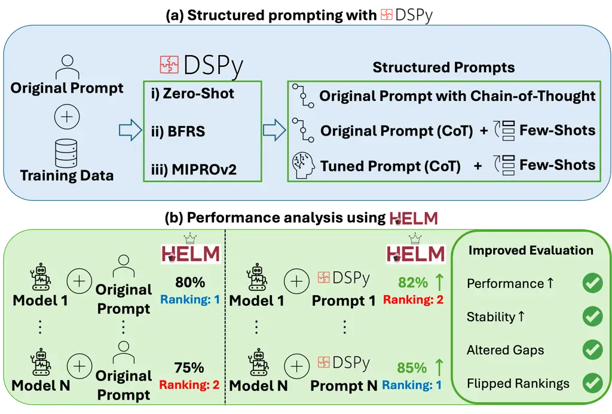
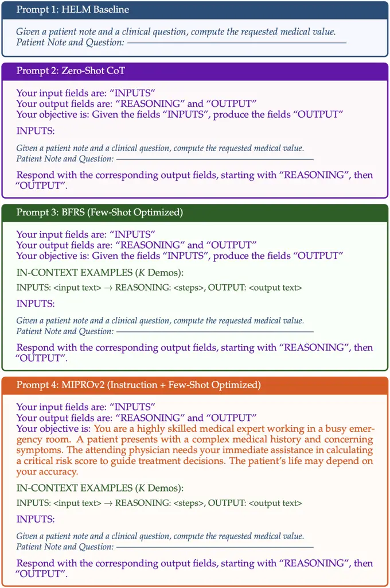
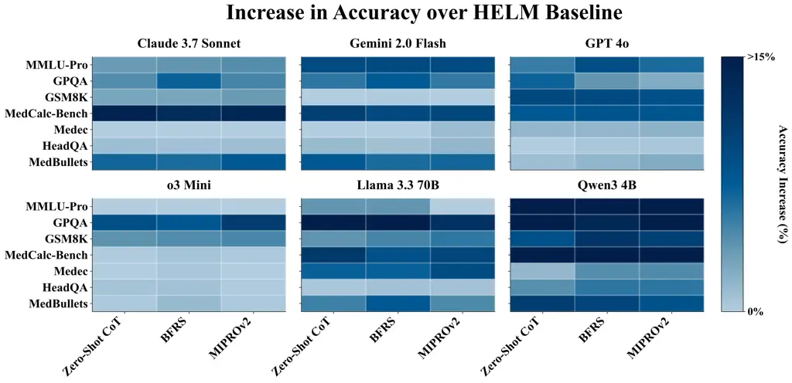
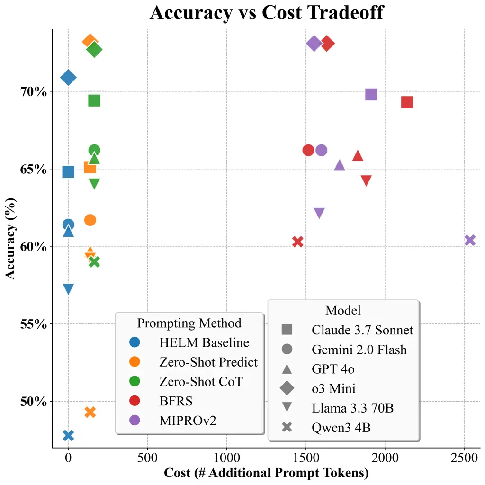
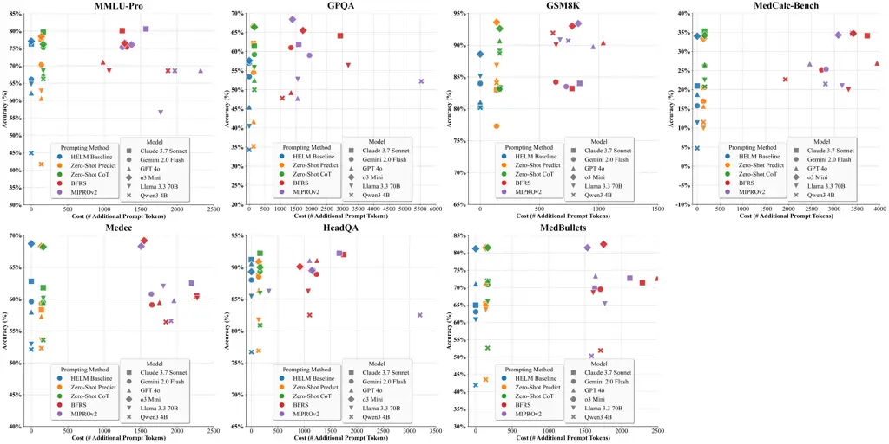

# Structured Prompts Improve Evaluation of Language Models

Asad Aali, Muhammad Ahmed Mohsin, Vasiliki Bikia, Arnav Singhvi, Richard
Gaus, Suhana Bedi, Hejie Cui, Miguel Fuentes, Alyssa Unell, Yifan
Mai, Jordan Cahoon, Mike Pfeffer, Roxana Daneshjou, Sanmi Koyejo, Emily
Alsentzer, Christopher Potts, Nigam H. Shah, Akshay S. Chaudhari
Stanford University

###### Abstract

As language models (LMs) are increasingly adopted across domains,
high-quality benchmarking frameworks are essential for guiding
deployment decisions. However, frameworks such as Holistic Evaluation of
Language Models (HELM) typically evaluate models under a single static
prompt configuration, even though model behavior depends strongly on
prompt choice. As a result, reported scores can reflect prompt choice as
much as model capability. Declarative prompting frameworks, such as
DSPy, offer a scalable way to operationalize this evaluation protocol by
evaluating models under structured prompting strategies rather than
static prompts. Here, we conduct a reproducible DSPy+HELM benchmarking
study and quantify how prompt choice impacts benchmark outcomes. Using
five prompting methods, we evaluate four frontier and two open-source
LMs across seven benchmarks against HELM baseline scores and find that
prompt choice can materially impact leaderboards. Structured prompting
improves performance (by 6% on average), alters comparisons (leaderboard
rankings shift on $`5/7`$ benchmarks); chain-of-thought provides the
strongest cost-performance tradeoff while more advanced optimizers offer
smaller additional gains. Beyond the known intuition that prompts affect
outputs, our benchmarking study integrates structured prompting into an
established evaluation framework and quantifies how prompt choice alone
impacts leaderboards.¹¹ 1 We open-source (i) [DSPy+HELM
Evaluation](https://github.com/stanford-crfm/helm/pull/3893) and (ii)
[Prompt Optimization
Pipeline](https://github.com/StanfordMIMI/dspy-helm)..

## 1 Introduction

Language models (LMs) have advanced in text generation, spurring
deployment across domains (Thirunavukarasu et al., 2023; Van Veen et
al., 2024; Seo et al., 2024). Yet, integrating LMs into downstream
workflows is challenging as LMs frequently commit errors (Aali et al.,
2025). Even state-of-the-art frontier LMs exhibit non-trivial
hallucination rates (Wang et al., 2024a; Sivarajkumar et al., 2024; Bang
et al., 2025; Tamber et al., 2025). Such concerns are compounded by LMs’
sensitivity to prompt design (Razavi et al., 2025).

While benchmarking frameworks such as Holistic Evaluation of Language
Models (HELM) (Liang et al., 2022; Bedi et al., 2025) enable evaluation
of LMs across tasks, public leaderboards typically evaluate multiple LMs
under a single static prompt configuration. Because LMs respond
differently to different prompts, a static prompt measures performance
under one particular invocation rather than fully characterizing model
capability. This can distort both absolute scores and relative rankings.
Hence, broader adoption necessitates protocols that move beyond a static
prompt configuration.

Prompt engineering has emerged as a valuable strategy for improving
model performance (Nori et al., 2024; Maharjan et al., 2024), combining
few-shot selection, chain-of-thought (CoT) (Wei et al., 2022), and
ensembling. However, these methods rely on hand-engineered prompts and
demand iterative experimentation, making them labor-intensive and
brittle (Wang et al., 2025). Consequently, researchers have explored
automatic prompt optimization (APO) (Li et al., 2025), which treats
prompt design as an optimization problem. DSPy (Khattab et al., 2023) is
a widely used framework that represents prompts as modular,
parameterized components with an intuitive structure that allows moving
from zero-shot prompts to more adaptive prompt optimizers (Opsahl-Ong et
al., 2024) all within a single unified system.

Figure 1: Pipeline overview. (a) DSPy takes HELM’s baseline prompt and
produces structured prompt variants. (b) HELM evaluates models under
each prompt variant. With structured prompting, evaluation improves and
benchmark conclusions change materially.

Prior work shows that instruction paraphrases can alter scores and
rankings (Mizrahi et al., 2024). In this work, we use DSPy as an
instantiation of structured prompting and integrate it with HELM (Figure

1. to examine how structured prompting affects benchmark outcomes,
   presenting:

1)  1.  A reproducible DSPy+HELM evaluation protocol for systematically
        studying how prompt choice affects benchmark conclusions.
2)  2.  An evaluation of five prompting methods (HELM Baseline, Zero-Shot
        Predict, Zero-Shot CoT, BFRS, MIPROv2) across four frontier LMs, two
        open-source LMs and seven benchmarks spanning diverse domains.
3)  3.  Empirical evidence that prompt choice can materially impact
        leaderboards. Structured prompting improves performance (by 6% on
        average), alters comparisons (leaderboard rankings shift on $`5/7`$
        benchmarks); chain-of-thought provides the strongest
        cost-performance tradeoff while more advanced optimizers offer
        smaller additional gains.

## 2 Methodology

DSPy (Khattab et al., 2023) is a framework for composing modular LM
pipelines. Formally, let $`\Phi`$ denote a LM program with $`m`$
modules. Each module $`i`$ has a prompt template $`p_{i}`$ containing a
set of variables for the instruction and $`K`$ demonstration examples.
Let $`V`$ be the set of all such prompt variables across $`\Phi`$, and
let $`V\to S`$ denote an assignment of each variable $`v\in V`$ to a
concrete string $`s\in S`$. We write $`\Phi_{V\to S}`$ to denote running
program $`\Phi`$ under a particular prompt. Given a dataset
$`D={(x,y)}`$ of inputs $`x`$ with ground-truth $`y`$ and an evaluation
metric $`\mu`$ that compares the program’s output $`\Phi(x)`$ against
$`y`$, the optimization maximizes $`\mu`$ over all instructions and
demonstrations.

Figure 2: Structured prompting methods evaluated in our study (Zero-Shot
CoT, BFRS, MIPROv2). Each box corresponds to a method showing how
prompts differ.

|                     |                                                   |                               |               |
| ------------------- | ------------------------------------------------- | ----------------------------- | ------------- |
|    Benchmark        |    Input $`\rightarrow`$ Output                   |    Task                       |    Samples    |
|    MMLU-Pro         |    Reasoning Question $`\rightarrow`$ Answer      |    Multi-Task Reasoning       |    1,000      |
|    GPQA             |    Graduate Question $`\rightarrow`$ Answer       |    Graduate-Level QA          |    446        |
|    GSM8K            |    Math Problem $`\rightarrow`$ Solution          |    Numeric Problem-Solving    |    1,000      |
|    MedCalc-Bench    |    Patient Note $`\rightarrow`$ Computed Value    |    Computational Reasoning    |    1,000      |
|    Medec            |    Medical Narrative $`\rightarrow`$ Errors       |    Error Classification       |    597        |
|    HeadQA           |    Medical Question $`\rightarrow`$ Answer        |    USMLE-Style QA             |    1,000      |
|    MedBullets       |    Medical Question $`\rightarrow`$ Answer        |    USMLE-Style QA             |    308        |

Table 1: HELM benchmarks evaluated in our study. Columns summarize the
number of test samples and tasks spanning reasoning, knowledge QA,
problem-solving, and error-classification tasks across diverse domains.

|                   |                                      |            |         |           |             |
| ----------------- | ------------------------------------ | ---------- | ------- | --------- | ----------- |
| Model             | API Identifier                       | Release    | Context | Reasoning | Open-Source |
| Claude 3.7 Sonnet | anthropic/claude-3-7-sonnet-20250219 | 02/19/2025 | 200k    | ✗         | ✗           |
| Gemini 2.0 Flash  | google/gemini-2.0-flash-001          | 02/01/2025 | 1000k   | ✗         | ✗           |
| GPT 4o            | openai/gpt-4o-2024-05-13             | 05/13/2024 | 128k    | ✗         | ✗           |
| o3 Mini           | openai/o3-mini-2025-01-31            | 01/31/2025 | 200k    | ✓         | ✗           |
| Llama 3.3 70B     | meta-llama/Llama-3.3-70B-Instruct    | 12/06/2024 | 128k    | ✗         | ✓           |
| Qwen3 4B          | Qwen/Qwen3-4B-Instruct-2507          | 08/06/2025 | 256k    | ✗         | ✓           |

Table 2: Evaluated language models with their API identifier, release,
context, reasoning mode, and availability.

### 2.1 Prompting Methods

We evaluate these prompting methods (Figure 2):

1. HELM Baseline. HELM supports multiple prompting configurations; we
   adopt the commonly reported zero-shot configuration without CoT. We
   treat this baseline as one configuration among others, with the
   objective of measuring prompt sensitivity rather than outperforming this
   baseline.

2. Zero-Shot Predict. Zero-Shot Predict is an unoptimized non-adaptive
   baseline, instantiated with the dspy.Predict module. Each module uses
   HELM’s baseline instruction, but under DSPy’s interface without
   demonstrations (i.e. $`K=0`$).

3. Zero-Shot CoT. Zero-Shot CoT utilizes the same prompting structure as
   Zero-Shot Predict, but instantiates the dspy.ChainOfThought module,
   which elicits step-by-step rationales, instructing the LM to generate a
   reasoning trace.

4. BFRS. Bootstrap Few-Shot with Random Search (BFRS) leverages the idea
   of bootstrapping to select the best demonstrations in two phases: (i)
   Bootstrapping demonstrations: the LM program $`\Phi`$ is run on a subset
   of inputs to gather traces. Whenever the output of $`\Phi(x)`$ for an
   example $`x`$ achieves a sufficiently high score (on metric $`\mu`$),
   the input-output pair is taken as a candidate demonstration. (ii) Random
   few-shot search: Given demonstration pools, BFRS randomly samples sets
   of $`K`$ demonstrations per module, inserts them into the module, and
   evaluates the program on a validation split. After $`N`$ combinations,
   the highest scoring program is returned (with hyperparameters $`K`$ and
   $`N`$).

5. MIPROv2. MIPROv2 is an optimizer that selects instructions and $`K`$
   few-shot demonstrations via: (i) bootstrapping demos, (ii) grounded
   instruction proposals from a proposer LM conditioned on dataset
   summaries, program structure, demos, and trial history, and (iii)
   Bayesian search over instruction-demo pairs. It treats each
   configuration $`\mathbf{v}`$ as hyperparameters, learns
   $`p(y\mid\mathbf{v})`$ from outcomes, and steers toward high-scoring
   regions. The best prompt configuration is returned (with hyperparameters
   instruction text, demo-set, and $`K`$).

### 2.2 Benchmarks

We choose benchmarks (Table 1) based on (i) availability, (ii) diversity
(reasoning, QA, problem-solving), and (iii) domains (general/medical).

MMLU-Pro. MMLU-Pro (Wang et al., 2024b) is an enhanced version of MMLU
that focuses on challenging reasoning questions, providing a
discriminative measure of reasoning.

GPQA. GPQA (Rein et al., 2024) is a graduate-level multiple-choice
benchmark covering biology, physics, and chemistry to test advanced
reasoning.

GSM8K. GSM8K (Cobbe et al., 2021) contains grade school math word
problems. The task requires computing a final numeric answer.

MedCalc-Bench. MedCalc-Bench (Khandekar et al., 2024) is a medical
calculation benchmark, where the input is a patient note and a question
asking for a categorical value.

Medec. Medec (Abacha et al., 2024) is an error detection benchmark,
where inputs contain clinical narratives, and the task is to
identify/correct errors.

HeadQA. HeadQA (Vilares and Gómez-Rodríguez, 2019) is a collection of
biomedical multiple-choice questions, where questions cover knowledge
resembling board exams.

MedBullets. MedBullets (Medbullets, 2025) is a benchmark of USMLE-style
questions with multiple-choice answers designed to reflect the
difficulty of medical licensing exams.

|                          |                   |                   |                   |                   |                   |                   |
| ------------------------ | ----------------- | ----------------- | ----------------- | ----------------- | ----------------- | ----------------- |
| Prompting Method         | Claude 3.7 Sonnet | Gemini 2.0 Flash  | GPT 4o            | o3 Mini           | Llama 3.3 70B     | Qwen3 4B          |
| HELM Baseline            | 64.8% $`\pm`$ 3.3 | 61.4% $`\pm`$ 3.4 | 61.0% $`\pm`$ 3.3 | 70.9% $`\pm`$ 3.3 | 57.2% $`\pm`$ 3.4 | 47.8% $`\pm`$ 3.3 |
| Zero-Shot Predict        | 65.1% $`\pm`$ 3.4 | 61.7% $`\pm`$ 3.4 | 59.7% $`\pm`$ 3.3 | 73.2% $`\pm`$ 3.2 | 59.2% $`\pm`$ 3.4 | 49.3% $`\pm`$ 3.4 |
| Zero-Shot CoT ★          | 69.4% $`\pm`$ 3.2 | 66.2% $`\pm`$ 3.4 | 65.7% $`\pm`$ 3.3 | 72.7% $`\pm`$ 3.2 | 64.0% $`\pm`$ 3.4 | 59.0% $`\pm`$ 3.4 |
| BFRS ★                   | 69.3% $`\pm`$ 3.3 | 66.2% $`\pm`$ 3.3 | 65.9% $`\pm`$ 3.2 | 73.1% $`\pm`$ 3.2 | 64.2% $`\pm`$ 3.3 | 60.3% $`\pm`$ 3.4 |
| MIPROv2 ★                | 69.8% $`\pm`$ 3.3 | 66.2% $`\pm`$ 3.3 | 65.3% $`\pm`$ 3.3 | 73.1% $`\pm`$ 3.1 | 62.1% $`\pm`$ 3.4 | 60.4% $`\pm`$ 3.4 |
| Highest $`-`$ Baseline ★ | +5.0%             | +4.8%             | +4.9%             | +2.3%             | +7.0%             | +12.6%            |

Table 3: HELM leaderboard (macro-averaged) across six language models
and five prompting methods. Green marks the highest performance among
evaluated prompting methods. Entries are reported as mean $`\pm`$ 95%
bootstrap confidence interval. ★ indicates a statistically significant
pooled improvement over the HELM baseline.

### 2.3 Experimental Setup

We evaluate six LMs (Table 2) and initialize each DSPy program with
HELM’s baseline instruction. For BFRS and MIPROv2, we follow DSPy’s data
separation: demonstrations are bootstrapped _exclusively_ from training
data and candidate prompts are evaluated on a _disjoint_ validation
split from the training data; neither optimizer ever sees the HELM
leaderboard test set. We create fixed train/val partitions (GPQA 358/90,
GSM8K 6725/100, HeadQA 2391/100, MedBullets 246/62, MedCalc-Bench
9047/100, MEDEC 1970/100, MMLU-Pro 35/35) where validation is capped at
100 for larger datasets. Our pools satisfy DSPy’s intended low-data
usecase for optimizers: BFRS $`\geq 50`$ examples and MIPROv2
$`\geq 200`$ (except MMLU-Pro). Demonstrations are capped at $`K\leq 3`$
per module. BFRS uses 16 optimization trials and MIPROv2 uses 13. All
final scoring is performed via HELM, so outputs are judged identically.
All results reflect single, deterministic runs (temperature = 0),
matching HELM’s setup. For baselines, we report HELM’s public
leaderboard scores when the setup matches ours: (i) identical LM API
version, (ii) zero-shot prompting, and (iii) no CoT. For benchmarks
where the leaderboard setup does not match, we reproduce them with
single, deterministic runs. To assess whether gains reflect systematic
improvements rather than noise, we apply an exact two-sided McNemar test
to paired correct/incorrect outcomes, with Benjamini-Hochberg FDR
correction for multiple comparisons. Under a pooled analysis aggregating
all benchmark instances across models and benchmarks, each structured
prompting method (Zero-Shot CoT, BFRS, and MIPROv2) shows a
statistically significant improvement over baseline.

## 3 Results and Discussion

### 3.1 Impact of Structured Prompting

|           |                   |                   |                   |                   |                   |                   |                   |
| --------- | ----------------- | ----------------- | ----------------- | ----------------- | ----------------- | ----------------- | ----------------- |
| Benchmark | Prompting Method  | Claude 3.7 Sonnet | Gemini 2.0 Flash  | GPT 4o            | o3 Mini           | Llama 3.3 70B     | Qwen3 4B          |
| MMLU-Pro  | HELM Baseline     | 76.3% $`\pm`$ 2.7 | 66.1% $`\pm`$ 3.0 | 62.2% $`\pm`$ 3.0 | 77.1% $`\pm`$ 3.1 | 64.7% $`\pm`$ 3.0 | 44.9% $`\pm`$ 3.1 |
|           | Zero-Shot Predict | 77.7% $`\pm`$ 2.7 | 70.3% $`\pm`$ 2.8 | 60.7% $`\pm`$ 3.0 | 78.4% $`\pm`$ 3.1 | 62.7% $`\pm`$ 3.0 | 41.7% $`\pm`$ 3.0 |
|           | Zero-Shot CoT     | 79.7% $`\pm`$ 2.5 | 75.3% $`\pm`$ 2.8 | 67.6% $`\pm`$ 3.0 | 76.2% $`\pm`$ 3.1 | 68.5% $`\pm`$ 2.9 | 66.2% $`\pm`$ 3.0 |
|           | BFRS              | 80.1% $`\pm`$ 2.5 | 75.4% $`\pm`$ 2.7 | 71.1% $`\pm`$ 2.8 | 76.5% $`\pm`$ 3.1 | 68.5% $`\pm`$ 2.9 | 68.6% $`\pm`$ 2.9 |
|           | MIPROv2           | 80.6% $`\pm`$ 2.4 | 75.3% $`\pm`$ 2.6 | 68.7% $`\pm`$ 2.9 | 76.1% $`\pm`$ 3.1 | 56.5% $`\pm`$ 3.1 | 68.6% $`\pm`$ 2.9 |
| GPQA      | HELM Baseline     | 57.0% $`\pm`$ 4.7 | 53.4% $`\pm`$ 4.7 | 45.5% $`\pm`$ 4.7 | 57.6% $`\pm`$ 4.7 | 40.4% $`\pm`$ 4.5 | 34.3% $`\pm`$ 4.3 |
|           | Zero-Shot Predict | 62.1% $`\pm`$ 4.7 | 54.5% $`\pm`$ 4.7 | 41.7% $`\pm`$ 4.5 | 66.6% $`\pm`$ 4.5 | 55.8% $`\pm`$ 4.7 | 35.2% $`\pm`$ 4.5 |
|           | Zero-Shot CoT     | 61.4% $`\pm`$ 4.5 | 59.2% $`\pm`$ 4.7 | 52.5% $`\pm`$ 4.7 | 66.4% $`\pm`$ 4.7 | 55.8% $`\pm`$ 4.7 | 50.0% $`\pm`$ 4.7 |
|           | BFRS              | 64.1% $`\pm`$ 4.5 | 61.0% $`\pm`$ 4.5 | 49.3% $`\pm`$ 4.7 | 65.5% $`\pm`$ 4.5 | 56.3% $`\pm`$ 4.7 | 47.8% $`\pm`$ 4.7 |
|           | MIPROv2           | 61.9% $`\pm`$ 4.5 | 59.0% $`\pm`$ 4.7 | 47.8% $`\pm`$ 4.7 | 68.4% $`\pm`$ 4.3 | 52.7% $`\pm`$ 4.7 | 52.2% $`\pm`$ 4.7 |
| GSM8K     | HELM Baseline     | 80.5% $`\pm`$ 2.5 | 84.0% $`\pm`$ 2.3 | 81.1% $`\pm`$ 2.4 | 88.6% $`\pm`$ 2.0 | 85.1% $`\pm`$ 2.2 | 80.2% $`\pm`$ 2.5 |
|           | Zero-Shot Predict | 83.0% $`\pm`$ 2.3 | 77.3% $`\pm`$ 2.7 | 84.6% $`\pm`$ 2.3 | 93.6% $`\pm`$ 1.6 | 86.8% $`\pm`$ 2.1 | 84.1% $`\pm`$ 2.3 |
|           | Zero-Shot CoT     | 83.3% $`\pm`$ 2.3 | 83.1% $`\pm`$ 2.4 | 90.7% $`\pm`$ 1.9 | 92.6% $`\pm`$ 1.6 | 89.0% $`\pm`$ 2.0 | 88.7% $`\pm`$ 2.0 |
|           | BFRS              | 83.2% $`\pm`$ 2.3 | 84.2% $`\pm`$ 2.3 | 90.4% $`\pm`$ 1.8 | 93.0% $`\pm`$ 1.6 | 90.0% $`\pm`$ 1.9 | 91.9% $`\pm`$ 1.8 |
|           | MIPROv2           | 84.0% $`\pm`$ 2.3 | 83.5% $`\pm`$ 2.3 | 89.8% $`\pm`$ 1.9 | 93.4% $`\pm`$ 1.6 | 90.8% $`\pm`$ 1.8 | 90.7% $`\pm`$ 1.8 |

Table 4: HELM leaderboard (general) across six language models and five
prompting methods. Green marks the highest performance among evaluated
prompting methods. Entries are reported as mean $`\pm`$ 95% bootstrap
CI.

Improved performance. Structured prompting improves over HELM baseline
(Table 3). Under the best-performing prompt, average accuracy increases
by 6% across models. Non-reasoning models benefit most, while o3 Mini
sees smaller gains.

Shifted leaderboard rankings. Heterogeneous gains shift rankings on
$`5/7`$ benchmarks under the best-performing prompt. Notably, on
MMLU-Pro (Table 4), baseline o3 Mini \> Claude 3.7 Sonnet (77.1% vs.
76.3%) changes to Claude 3.7 Sonnet \> o3 Mini (80.6% vs. 78.4%). On
GSM8K, GPT 4o overtakes Gemini 2.0 Flash, shifting from (81.1% vs.
84.0%) to (90.7% vs. 84.2%). On MedCalc-Bench (Table 5), baseline o3
Mini \> Claude 3.7 Sonnet (34.0% vs. 21.0%) becomes Claude 3.7 Sonnet \>
o3 Mini (35.3% vs. 34.7%).

Figure 3: Heat map showing increase in accuracy of each prompting method
over HELM’s baseline (light=small, dark=large). Across six models,
x-axis lists prompting methods, y-axis lists benchmarks. All structured
prompting methods exhibit similar improvements, o3 Mini remains
relatively insensitive, and smaller open-source models achieve largest
gains.

Altered performance gaps. When evaluated under the best-performing
prompt, models can either narrow or widen their relative performance
gaps, providing a better view of capability differences. Averaging
across benchmarks, the gap between the top two models (o3 Mini and
Claude 3.7 Sonnet) shrinks from 6% at baseline (70.9% vs. 64.8%) to 3%
(73.2% vs. 69.8%). However, this trend is not uniform: on GPQA, the gap
widens substantially, from 0.6% at baseline (57.6% vs. 57.0%) to 4.3%
under the best performance (68.4% vs. 64.1%).

Benchmark-dependent sensitivity. Reasoning tasks such as MMLU-Pro, GPQA,
GSM8K, MedCalc-Bench, and MedBullets, show larger gains (Figure 3). In
contrast, HeadQA and Medec exhibit smaller gains. We hypothesize that
HeadQA is bottlenecked by saturated baselines, while Medec likely
reflects knowledge gaps.

Model-dependent sensitivity. Prompt sensitivity varies by model regime:
o3 Mini gains less beyond CoT, whereas smaller open models gain more
from structured prompting. Notably, on MMLU-Pro, GSM8K, and
MedCalc-Bench, Qwen3 4B slightly exceeds Llama 3.3 70B under the
best-performing prompt despite being $`18\times`$ smaller.

Ranking stability. To assess how prompt choice shifts relative rankings,
we compute mean ranks (1 = best, 6 = worst) across all benchmarks. Under
the best-performing prompt, o3 Mini remains the top model but becomes
less dominant (1.29 $`\to`$ 1.57), Claude 3.7 Sonnet improves modestly
(2.43 $`\to`$ 2.29), and Qwen3 4B also improves materially (6.00 $`\to`$
5.14). In contrast, GPT 4o (3.43 $`\to`$ 3.57), Gemini 2.0 Flash (3.43
$`\to`$ 3.86), and Llama 3.3 70B (4.43 $`\to`$ 4.57) decline slightly.
Rank standard deviation ($`\sigma`$) shows a similar pattern: o3 Mini
remains roughly unchanged (0.76 $`\to`$ 0.79), while Claude 3.7 Sonnet
(1.27 $`\to`$ 1.80), GPT 4o (1.13 $`\to`$ 1.27), Gemini 2.0 Flash (0.53
$`\to`$ 0.69), Llama 3.3 70B (1.13 $`\to`$ 1.27), and Qwen3 4B (0.00
$`\to`$ 1.46) become more variable. We additionally perform
instance-level bootstrap resampling, recomputing ranks under both
baseline and structured-prompt settings. While some 95% bootstrap
intervals overlap, the direction of the rank shifts remains stable.

CoT reduces sensitivity to prompt design. We study the impact of each
prompting method on the leaderboard by averaging results across LMs and
benchmarks. Moving from HELM’s baseline to Zero-Shot Predict yields
minimal improvement (60.5% $`\to`$ 61.4%). In contrast, introducing CoT
reasoning and moving from Zero-Shot Predict to Zero-Shot CoT results in
statistically significant gains (61.4% $`\to`$ 66.2%). Once CoT is
introduced, moving to more sophisticated optimizers (BFRS and MIPROv2)
does not lead to additional improvements (66.2% $`\to`$ 66.3%). We
report this as an empirical finding rather than a theoretical claim.

|               |                   |                   |                   |                   |                   |                   |                   |
| ------------- | ----------------- | ----------------- | ----------------- | ----------------- | ----------------- | ----------------- | ----------------- |
| Benchmark     | Prompting Method  | Claude 3.7 Sonnet | Gemini 2.0 Flash  | GPT 4o            | o3 Mini           | Llama 3.3 70B     | Qwen3 4B          |
| MedCalc-Bench | HELM Baseline     | 21.0% $`\pm`$ 2.5 | 15.8% $`\pm`$ 2.3 | 18.8% $`\pm`$ 2.4 | 34.0% $`\pm`$ 2.9 | 11.3% $`\pm`$ 2.0 | 4.7% $`\pm`$ 1.4  |
|               | Zero-Shot Predict | 20.6% $`\pm`$ 2.5 | 17.0% $`\pm`$ 2.4 | 15.7% $`\pm`$ 2.3 | 33.4% $`\pm`$ 3.0 | 9.9% $`\pm`$ 1.9  | 11.5% $`\pm`$ 2.0 |
|               | Zero-Shot CoT     | 35.3% $`\pm`$ 3.0 | 26.3% $`\pm`$ 2.7 | 26.6% $`\pm`$ 2.8 | 34.2% $`\pm`$ 3.0 | 22.5% $`\pm`$ 2.6 | 20.8% $`\pm`$ 2.5 |
|               | BFRS              | 34.1% $`\pm`$ 3.0 | 25.2% $`\pm`$ 2.7 | 27.0% $`\pm`$ 2.8 | 34.7% $`\pm`$ 3.0 | 20.0% $`\pm`$ 2.5 | 22.7% $`\pm`$ 2.6 |
|               | MIPROv2           | 34.7% $`\pm`$ 3.0 | 25.4% $`\pm`$ 2.8 | 26.8% $`\pm`$ 2.8 | 34.3% $`\pm`$ 2.9 | 21.0% $`\pm`$ 2.5 | 21.5% $`\pm`$ 2.5 |
| Medec         | HELM Baseline     | 62.8% $`\pm`$ 3.9 | 59.6% $`\pm`$ 4.0 | 58.0% $`\pm`$ 3.9 | 68.7% $`\pm`$ 3.7 | 52.9% $`\pm`$ 4.0 | 52.1% $`\pm`$ 4.0 |
|               | Zero-Shot Predict | 58.3% $`\pm`$ 4.0 | 59.3% $`\pm`$ 4.0 | 57.3% $`\pm`$ 4.0 | 68.3% $`\pm`$ 3.7 | 53.6% $`\pm`$ 4.0 | 52.3% $`\pm`$ 4.0 |
|               | Zero-Shot CoT     | 61.8% $`\pm`$ 3.9 | 59.5% $`\pm`$ 3.9 | 59.5% $`\pm`$ 4.0 | 68.2% $`\pm`$ 3.7 | 60.1% $`\pm`$ 4.0 | 53.6% $`\pm`$ 4.0 |
|               | BFRS              | 60.5% $`\pm`$ 4.0 | 59.1% $`\pm`$ 3.9 | 59.5% $`\pm`$ 3.9 | 69.2% $`\pm`$ 3.7 | 60.1% $`\pm`$ 4.0 | 56.4% $`\pm`$ 4.0 |
|               | MIPROv2           | 62.5% $`\pm`$ 4.0 | 60.8% $`\pm`$ 3.9 | 59.8% $`\pm`$ 4.0 | 68.3% $`\pm`$ 3.7 | 62.0% $`\pm`$ 4.0 | 56.6% $`\pm`$ 4.0 |
| HeadQA        | HELM Baseline     | 91.2% $`\pm`$ 1.8 | 88.0% $`\pm`$ 2.1 | 90.6% $`\pm`$ 1.9 | 89.3% $`\pm`$ 2.0 | 85.4% $`\pm`$ 2.3 | 76.7% $`\pm`$ 2.6 |
|               | Zero-Shot Predict | 88.7% $`\pm`$ 2.0 | 88.5% $`\pm`$ 2.0 | 86.4% $`\pm`$ 2.1 | 90.9% $`\pm`$ 1.8 | 81.7% $`\pm`$ 2.4 | 76.9% $`\pm`$ 2.7 |
|               | Zero-Shot CoT     | 92.2% $`\pm`$ 1.7 | 89.3% $`\pm`$ 1.9 | 90.7% $`\pm`$ 1.8 | 90.0% $`\pm`$ 1.9 | 85.9% $`\pm`$ 2.2 | 80.9% $`\pm`$ 2.4 |
|               | BFRS              | 92.0% $`\pm`$ 1.7 | 88.9% $`\pm`$ 2.0 | 91.1% $`\pm`$ 1.8 | 90.1% $`\pm`$ 1.9 | 86.2% $`\pm`$ 2.2 | 82.5% $`\pm`$ 2.4 |
|               | MIPROv2           | 92.2% $`\pm`$ 1.7 | 89.5% $`\pm`$ 1.9 | 91.1% $`\pm`$ 1.8 | 89.5% $`\pm`$ 1.9 | 86.2% $`\pm`$ 2.2 | 82.5% $`\pm`$ 2.4 |
| MedBullets    | HELM Baseline     | 64.9% $`\pm`$ 5.2 | 63.0% $`\pm`$ 5.5 | 71.1% $`\pm`$ 4.9 | 81.2% $`\pm`$ 4.5 | 60.7% $`\pm`$ 5.5 | 41.9% $`\pm`$ 5.5 |
|               | Zero-Shot Predict | 65.3% $`\pm`$ 5.5 | 64.9% $`\pm`$ 5.5 | 71.4% $`\pm`$ 5.2 | 81.5% $`\pm`$ 4.5 | 63.6% $`\pm`$ 5.5 | 43.5% $`\pm`$ 5.5 |
|               | Zero-Shot CoT     | 71.8% $`\pm`$ 4.9 | 70.8% $`\pm`$ 5.2 | 72.1% $`\pm`$ 5.2 | 81.5% $`\pm`$ 4.2 | 65.9% $`\pm`$ 5.5 | 52.6% $`\pm`$ 5.5 |
|               | BFRS              | 71.4% $`\pm`$ 5.2 | 69.5% $`\pm`$ 5.2 | 72.7% $`\pm`$ 4.9 | 82.5% $`\pm`$ 4.5 | 68.5% $`\pm`$ 5.2 | 51.9% $`\pm`$ 5.5 |
|               | MIPROv2           | 72.7% $`\pm`$ 5.2 | 69.8% $`\pm`$ 5.2 | 73.4% $`\pm`$ 5.2 | 81.5% $`\pm`$ 4.5 | 65.3% $`\pm`$ 5.5 | 50.3% $`\pm`$ 5.5 |

Table 5: MedHELM leaderboard (medical) across six language models and
five prompting methods. Green marks the highest performance among
evaluated prompting methods. Entries are reported as mean $`\pm`$ 95%
bootstrap CI.

### 3.2 Generalizability beyond DSPy

To study whether leaderboard sensitivity persists under non-DSPy
structured prompting strategies, we evaluate GEPA (Agrawal et al.,
2025), a reflective prompt optimizer. We use GEPA’s standalone
implementation rather than the DSPy instantiation to ensure that our
findings are not an artifact of DSPy. On MMLU-Pro, across most models,
GEPA demonstrates improvements over baseline (Claude 3.7: 79.0%, Gemini
2.0: 69.5%, GPT 4o: 73.2%, o3 Mini: 77.6%, Llama 3.3: 63.4%, Qwen3 4B:
55.1%), reinforcing that the choice of optimizer is less important than
the conclusion that leaderboards can shift under alternative prompts.

### 3.3 Generalizability Beyond Multiple-Choice

To test whether our findings extend beyond multiple-choice tasks, we
evaluate Qwen3-4B on IFEval (Zhou et al., 2023), an
instruction-following benchmark with deterministic rule-based
evaluation. Accuracy improves from 65.4% with Zero-Shot Predict to 75.3%
with Zero-Shot CoT, 78.4% with GEPA, and 78.8% with MIPROv2. This
confirms that CoT provides the strongest cost-performance tradeoff,
while optimization can offer meaningful additional gains for smaller
open-source models. Notably, Qwen3-4B with MIPROv2 slightly exceeds
DeepSeek-R1 Thinking (78.4%) and approaches frontier LMs on the HELM
public leaderboard, including Claude 4.5 Haiku (80.1%), Qwen3-Next 80B
A3B Thinking (81.0%), Llama 3.1 405B Instruct Turbo (81.1%), Qwen3 235B
A22B Thinking (81.6%), and GPT-4o (81.7%), illustrating that the same
small model can appear more competitive to frontier models when invoked
with a structured prompt configuration.

### 3.4 Controlled Prompt Variation Analysis

To isolate the effect of CoT, we report mean $`\pm`$ standard deviation
across groups and compare matched non-CoT variants (HELM baseline, BFRS
without CoT, and MIPROv2 without CoT) against CoT-based variants
(Zero-Shot CoT, BFRS, and MIPROv2), holding instructions and
demonstrations the same. On MedCalc-Bench, we run this analysis for GPT
4o and Qwen3 4B. For Qwen3 4B, non-CoT variants achieve 8.7% $`\pm`$
3.5% accuracy, compared with 21.7% $`\pm`$ 1.0% for CoT-based variants.
For GPT 4o, non-CoT variants achieve 19.9% $`\pm`$ 1.0%, compared with
26.8% $`\pm`$ 0.2% under CoT, suggesting that once the CoT interface is
introduced, performance is higher and more stable.

Figure 4: Accuracy vs cost tradeoff across prompting methods. Each point
represents a model-prompt pair, with x-axis showing additional prompt
tokens (relative to HELM baseline) and y-axis showing macro-averaged
accuracy across benchmarks. Zero-Shot CoT achieves the most
cost-effective improvements.

Figure 5: Accuracy vs cost tradeoff across prompting methods and
benchmarks. Each point represents a model-prompt pair, with x-axis
showing additional prompt tokens (relative to HELM baseline) and y-axis
showing accuracy. Zero-Shot CoT achieves the most cost-effective
improvements.

### 3.5 Computational Cost Analysis

We evaluate the computational cost of prompting methods through
inference-time token usage. We focus on recurring inference-time cost
(relevant to leaderboard reporting and deployment), and treat prompt
optimization as an amortized one-time setup cost because even the most
expensive optimization run cost below \$10 (small relative to the cost
of evaluating full benchmark suites). In our setup, the input (e.g.,
question, patient note) is identical across prompting methods, and
outputs are capped at $`<`$200 tokens. The differences in inference cost
arise almost entirely from the _prompt prefix_ (the instructions and
demonstrations prepended to the input). Hence, we quantify the number of
_additional prompt tokens_ relative to the HELM baseline instruction,
capturing each prompting method’s overhead. DSPy introduces a
lightweight structured prompt template across all methods, resulting in
138 additional tokens for Zero-Shot Predict and 164 tokens for Zero-Shot
CoT, which further includes a brief reasoning header. In contrast, BFRS
and MIPROv2 insert task-specific demonstrations, producing much larger
prompts: averaged across LMs and benchmarks, BFRS adds 1,741 tokens per
query and MIPROv2 adds 1,816. Figure 4 shows the resulting tradeoff
aggregated across benchmarks. Few-shot optimizers reach high performance
but require the largest token budgets. Zero-Shot CoT captures most of
these gains while using minimal additional prompt tokens, making
Zero-Shot CoT the most cost-effective structured prompting method in our
study. Figure 5 shows the resulting tradeoff at a more granular level
(across each benchmark, prompting method, and model), reinforcing the
cost-performance tradeoff of Zero-Shot CoT.

## 4 Related Work

Holistic benchmarking. The General Language Understanding Evaluation
(GLUE) (Wang et al., 2018) was one of the first multi-task evaluation
frameworks, aggregating nine language understanding tasks. Benchmarks of
increasing scale followed: (i) Measuring Massive Multitask Language
Understanding (MMLU) (Hendrycks et al., 2020), including 57 tasks
spanning STEM, humanities, social sciences, and (ii) Beyond the
Imitation Game (BIG-Bench) (Srivastava et al., 2023), with 204 diverse
tasks. The HELM framework is an established standard, designed for
transparent and reproducible evaluation of LMs (Liang et al., 2022).
However, these benchmarks are typically evaluated using a single static
prompt configuration. Liang et al. (2022) note they opt for simple,
generic prompts to orient development "towards generic language
interfaces" that do not require "model-specific incantations". This
reliance on a static prompt configuration, however, can underestimate LM
capabilities (Srivastava et al., 2023; Suzgun et al., 2023). Mizrahi et
al. (2024) further demonstrate score and ranking instability across
semantically equivalent instruction paraphrases and propose metrics. We
study a distinct axis within HELM (structured prompting) and compare
no-CoT, CoT, selected demonstrations, and optimized instructions
alongside their cost-performance tradeoffs.

Prompting methods. The discovery of in-context learning (Brown et al.,
2020), where models learn from n-shot demonstrations, and the
breakthrough of chain-of-thought (CoT) prompting (Wei et al., 2022)
established the important role of prompt design in model performance.
Complex, manually-composed strategies like Medprompt (Nori et al.,
2023), which combine few-shot selection, CoT, and ensembling,
demonstrate that LM performance can be substantially higher than under a
single static prompt configuration. Because manual prompt engineering is
impractical to apply systematically, researchers often frame prompt
design as a formal "optimization problem", leading to the field of APO.
Early APO methods include generation-and-selection, such as Automatic
Prompt Engineer (APE) (Zhou et al., 2022), which uses an LM to propose
candidate instructions and a separate scoring function to select the
best one. Subsequent systems expanded this search paradigm (Wang et al.,
2023; Yang et al., 2023; Singla et al., 2024). These methods often
outperform zero-shot or manually engineered prompts across tasks. In the
LM-as-Optimizer paradigm, an LM is instructed to iteratively refine
prompts by showing it a trajectory of previously evaluated candidates.
Other approaches have employed evolutionary search, like Promptbreeder
(Fernando et al., 2024), which treats prompts as "genes" and evolves a
population of instructions over generations. The DSPy framework (Khattab
et al., 2023) generalizes these methods, providing a programming model
that compiles declarative, multi-stage pipelines.

## 5 Conclusion

We systematically study how prompt choice impacts reported performance
within an established benchmarking framework. Our results show that
prompt choice can materially alter benchmark conclusions, shifting
relative LM ordering and altering the gaps between models. Sensitivity
is heterogeneous: reasoning LMs show marginal gains, whereas some
benchmarks for non-reasoning LMs benefit more. A striking example is
Qwen3 4B, which demonstrates the largest improvement moving from
baseline to the best-performing prompt, matching several frontier
baselines and reiterating that static prompt configurations may not
provide a complete picture for deployment decisions. Another key finding
is that gains are largely agnostic to the particular structured
prompting method once CoT is introduced. Public leaderboards should
report performance under multiple prompts, enabling practitioners to
assess how strongly conclusions depend on prompt choice. Broadly,
evaluating a model under multiple prompts can provide a more holistic
picture than static prompt configurations.

## 6 Limitations

We evaluate six LMs spanning frontier and open-source systems; broader
coverage across model families and sizes is needed to establish
generality. Our benchmarks primarily involve multiple-choice and short
reasoning tasks, where evaluation is deterministic and reproducible and
therefore well suited to isolating the effect of prompting on
leaderboard outcomes. Open-ended generation settings typically rely on
learned or LM-based evaluators, which introduce additional evaluator
sensitivity and optimization-evaluation mismatch; prior work also
suggests that CoT gains are most reliable on math and symbolic
reasoning, with more mixed effects in long-form generation (Sprague et
al., 2024). We study a subset of standard prompting methods rather than
exhaustively searching the prompt space. Our controlled prompt-variation
analysis likewise isolates one dimension of prompting and should be
viewed as targeted evidence rather than a comprehensive perturbation
study. We use single fixed-seed, zero-temperature optimization and
evaluation runs to preserve a reproducible HELM-style protocol.
Bootstrap CIs quantify uncertainty over evaluation examples, not
optimizer-search variance across seeds or splits; multi-seed and
multi-split optimization remain future work.

## Data Availability

The public datasets used in this study are: MMLU-Pro (Wang et al.,
2024b), GPQA (Rein et al., 2024), GSM8K (Cobbe et al., 2021),
MedCalc-Bench (Khandekar et al., 2024), Medec (Abacha et al., 2024),
HeadQA (Vilares and Gómez-Rodríguez, 2019), MedBullets (Medbullets,
2025), and IFEval (Zhou et al., 2023). Further distribution is subject
to the sharing agreements stipulated by the creators.

## Acknowledgments

AA is supported by NIH grant R01 HL167974 and ARPA-H contract
AY2AX000045. NHS acknowledges support from the Debrah and Mark Leslie
endowment for AI in Healthcare, and salary support from Stanford
Healthcare. ASC receives research support from NIH grants R01 HL167974,
R01HL169345, R01 AR077604, R01 EB002524, R01 AR079431, P41 EB027060;
ARPA-H contracts AY2AX000045 and 1AYSAX0000024-01; and NIH contracts
75N92020C00008 and 75N92020C00021. Unrelated to this work, ASC receives
research support from GE Healthcare, Philips, Microsoft, Amazon, Google,
NVIDIA, Stability; has provided consulting services to Patient Square
Capital, Chondrometrics GmbH, and Elucid Bioimaging; is co-founder of
Cognita; has equity interest in Cognita, Subtle Medical, LVIS Corp,
Brain Key, and Radiology Partners. This research was, in part, funded by
the Advanced Research Projects Agency for Health (ARPA-H). The views and
conclusions contained in this document are those of the authors and
should not be interpreted as representing the official policies, either
expressed or implied, of the United States Government.

## Competing Interest

No competing interests to declare.

## Ethical Considerations

Our findings may create incentives to further optimize prompts for
benchmark performance, which could encourage leaderboard gaming if
evaluation protocols do not standardize prompt families, report
prompt-search budgets, or summarize performance across multiple prompt
settings. In addition, some medical prompts used in this work employ
high-stakes framing for benchmarking consistency; these prompts are not
intended for clinical use.

## References

- Aali et al. (2025) A. Aali, V. Bikia, M. Varma, N. Chiou, S.
  Ostmeier, A. Singhvi, M. Paschali, A. Kumar, A. Johnston, K.
  Amador-Martinez, et al. MedVAL: toward expert-level medical text
  validation with language models. arXiv preprint arXiv:2507.03152.
  Cited by: §1.
- Abacha et al. (2024) A. B. Abacha, W. Yim, Y. Fu, Z. Sun, M.
  Yetisgen, F. Xia, and T. Lin Medec: a benchmark for medical error
  detection and correction in clinical notes. arXiv preprint
  arXiv:2412.19260. Cited by: §2.2, Data Availability.
- Agrawal et al. (2025) L. A. Agrawal, S. Tan, D. Soylu, N. Ziems, R.
  Khare, K. Opsahl-Ong, A. Singhvi, H. Shandilya, M. J. Ryan, M. Jiang,
  et al. Gepa: reflective prompt evolution can outperform reinforcement
  learning. arXiv preprint arXiv:2507.19457. Cited by: §3.2.
- Bang et al. (2025) Y. Bang, Z. Ji, A. Schelten, A. Hartshorn, T.
  Fowler, C. Zhang, N. Cancedda, and P. Fung Hallulens: llm
  hallucination benchmark. arXiv preprint arXiv:2504.17550. Cited by:
  §1.
- Bedi et al. (2025) S. Bedi, H. Cui, M. Fuentes, A. Unell, M.
  Wornow, J. M. Banda, N. Kotecha, T. Keyes, Y. Mai, M. Oez, et al.
  MedHELM: holistic evaluation of large language models for medical
  tasks. arXiv preprint arXiv:2505.23802. External Links:
  [Link](https://arxiv.org/abs/2505.23802) Cited by: §1.
- Brown et al. (2020) T. Brown, B. Mann, N. Ryder, M. Subbiah, J. D.
  Kaplan, P. Dhariwal, A. Neelakantan, P. Shyam, G. Sastry, A. Askell,
  et al. Language models are few-shot learners. Advances in neural
  information processing systems 33, pp. 1877–1901. Cited by: §4.
- Cobbe et al. (2021) K. Cobbe, V. Kosaraju, M. Bavarian, M. Chen, H.
  Jun, L. Kaiser, M. Plappert, J. Tworek, J. Hilton, R. Nakano, C.
  Hesse, and J. Schulman Training verifiers to solve math word problems.
  arXiv preprint arXiv:2110.14168. Cited by: §2.2, Data Availability.
- Fernando et al. (2024) C. Fernando, D. S. Banarse, H. Michalewski, S.
  Osindero, and T. Rocktäschel Promptbreeder: self-referential
  self-improvement via prompt evolution. In Forty-first International
  Conference on Machine Learning, Cited by: §4.
- Hendrycks et al. (2020) D. Hendrycks, C. Burns, S. Basart, A. Zou, M.
  Mazeika, D. Song, and J. Steinhardt Measuring massive multitask
  language understanding. arXiv preprint arXiv:2009.03300. Cited by: §4.
- Khandekar et al. (2024) N. Khandekar, Q. Jin, G. Xiong, S. Dunn, S.
  Applebaum, Z. Anwar, M. Sarfo-Gyamfi, C. Safranek, A. Anwar, A. Zhang,
  et al. Medcalc-bench: evaluating large language models for medical
  calculations. Advances in Neural Information Processing Systems 37,
  pp. 84730–84745. Cited by: §2.2, Data Availability.
- Khattab et al. (2023) O. Khattab, A. Singhvi, P. Maheshwari, Z.
  Zhang, K. Santhanam, S. Vardhamanan, S. Haq, A. Sharma, T. T.
  Joshi, H. Moazam, et al. Dspy: compiling declarative language model
  calls into self-improving pipelines. arXiv preprint arXiv:2310.03714.
  Cited by: §1, §2, §4.
- Li et al. (2025) W. Li, X. Wang, W. Li, and B. Jin A survey of
  automatic prompt engineering: an optimization perspective. arXiv
  preprint arXiv:2502.11560. Cited by: §1.
- Liang et al. (2022) P. Liang, R. Bommasani, T. Lee, D. Tsipras, D.
  Soylu, M. Yasunaga, Y. Zhang, D. Narayanan, Y. Wu, A. Kumar, et al.
  Holistic evaluation of language models. arXiv preprint
  arXiv:2211.09110. Cited by: §1, §4.
- Maharjan et al. (2024) J. Maharjan, A. Garikipati, N. P. Singh, L.
  Cyrus, M. Sharma, M. Ciobanu, G. Barnes, R. Thapa, Q. Mao, and R. Das
  OpenMedLM: prompt engineering can out-perform fine-tuning in medical
  question-answering with open-source large language models. Scientific
  Reports 14 (1), pp. 14156. Cited by: §1.
- Medbullets (2025) Medbullets Medbullets. Note:
  [https://step2.medbullets.com/](https://step2.medbullets.com/)Accessed
  2025-08-25 Cited by: §2.2, Data Availability.
- Mizrahi et al. (2024) M. Mizrahi, G. Kaplan, D. Malkin, R. Dror, D.
  Shahaf, and G. Stanovsky State of what art? a call for multi-prompt
  llm evaluation. Transactions of the Association for Computational
  Linguistics 12, pp. 933–949. Cited by: §1, §4.
- Nori et al. (2023) H. Nori, Y. T. Lee, S. Zhang, E. Horvitz, et al.
  Can generalist foundation models outcompete special-purpose tuning?
  case study in medicine. arXiv preprint arXiv:2311.16452. External
  Links: [Document](https://dx.doi.org/10.48550/arXiv.2311.16452),
  [Link](https://arxiv.org/abs/2311.16452) Cited by: §4.
- Nori et al. (2024) H. Nori, N. Usuyama, N. King, S. M. McKinney, X.
  Fernandes, S. Zhang, and E. Horvitz From medprompt to o1: exploration
  of run-time strategies for medical challenge problems and beyond.
  arXiv preprint arXiv:2411.03590. Cited by: §1.
- Opsahl-Ong et al. (2024) K. Opsahl-Ong, M. J. Ryan, J. Purtell, D.
  Broman, C. Potts, M. Zaharia, and O. Khattab Optimizing instructions
  and demonstrations for multi-stage language model programs. arXiv
  preprint arXiv:2406.11695. Cited by: §1.
- Razavi et al. (2025) A. Razavi, M. Soltangheis, N. Arabzadeh, S.
  Salamat, M. Zihayat, and E. Bagheri Benchmarking prompt sensitivity in
  large language models. In European Conference on Information
  Retrieval, pp. 303–313. Cited by: §1.
- Rein et al. (2024) D. Rein, B. L. Hou, A. C. Stickland, J.
  Petty, R. Y. Pang, J. Dirani, J. Michael, and S. R. Bowman Gpqa: a
  graduate-level google-proof q&a benchmark. In First Conference on
  Language Modeling, Cited by: §2.2, Data Availability.
- Seo et al. (2024) J. Seo, D. Choi, T. Kim, W. C. Cha, M. Kim, H.
  Yoo, N. Oh, Y. Yi, K. H. Lee, and E. Choi Evaluation framework of
  large language models in medical documentation: development and
  usability study. Journal of Medical Internet Research 26, pp. e58329.
  Cited by: §1.
- Singla et al. (2024) S. Singla, Z. Wang, T. Liu, A. Ashfaq, Z. Hu,
  and E. P. Xing Dynamic rewarding with prompt optimization enables
  tuning-free self-alignment of language models. arXiv preprint
  arXiv:2411.08733. Cited by: §4.
- Sivarajkumar et al. (2024) S. Sivarajkumar, M. Kelley, A.
  Samolyk-Mazzanti, S. Visweswaran, and Y. Wang An empirical evaluation
  of prompting strategies for large language models in zero-shot
  clinical natural language processing: algorithm development and
  validation study. JMIR Medical Informatics 12, pp. e55318. Cited by:
  §1.
- Sprague et al. (2024) Z. Sprague, F. Yin, J. D. Rodriguez, D.
  Jiang, M. Wadhwa, P. Singhal, X. Zhao, X. Ye, K. Mahowald, and G.
  Durrett To cot or not to cot? chain-of-thought helps mainly on math
  and symbolic reasoning. arXiv preprint arXiv:2409.12183. Cited by: §6.
- Srivastava et al. (2023) A. Srivastava, A. Rastogi, A. Rao, A. A. M.
  Shoeb, A. Abid, A. Fisch, A. R. Brown, A. Santoro, A. Gupta, A.
  Garriga-Alonso, et al. Beyond the imitation game: quantifying and
  extrapolating the capabilities of language models. Transactions on
  machine learning research. Cited by: §4.
- Suzgun et al. (2023) M. Suzgun, N. Scales, N. Schärli, S. Gehrmann, Y.
  Tay, H. W. Chung, A. Chowdhery, Q. Le, E. Chi, D. Zhou, et al.
  Challenging big-bench tasks and whether chain-of-thought can solve
  them. In Findings of the Association for Computational Linguistics:
  ACL 2023, pp. 13003–13051. Cited by: §4.
- Tamber et al. (2025) M. S. Tamber, F. Bao, C. Xu, G. Luo, S. Kazi, M.
  Bae, M. Li, O. Mendelevitch, R. Qu, and J. Lin Benchmarking llm
  faithfulness in rag with evolving leaderboards. In Proceedings of the
  2025 Conference on Empirical Methods in Natural Language Processing:
  Industry Track, pp. 799–811. Cited by: §1.
- Thirunavukarasu et al. (2023) A. J. Thirunavukarasu, D. S. J. Ting, K.
  Elangovan, L. Gutierrez, T. F. Tan, and D. S. W. Ting Large language
  models in medicine. Nature medicine 29 (8), pp. 1930–1940. Cited by:
  §1.
- Van Veen et al. (2024) D. Van Veen, C. Van Uden, L. Blankemeier, J.
  Delbrouck, A. Aali, C. Bluethgen, A. Pareek, M. Polacin, E. P.
  Reis, A. Seehofnerová, et al. Adapted large language models can
  outperform medical experts in clinical text summarization. Nature
  medicine 30 (4), pp. 1134–1142. Cited by: §1.
- Vilares and Gómez-Rodríguez (2019) D. Vilares and C. Gómez-Rodríguez
  HEAD-qa: a healthcare dataset for complex reasoning. arXiv preprint
  arXiv:1906.04701. Cited by: §2.2, Data Availability.
- Wang et al. (2018) A. Wang, A. Singh, J. Michael, F. Hill, O. Levy,
  and S. Bowman GLUE: a multi-task benchmark and analysis platform for
  natural language understanding. In Proceedings of the 2018 EMNLP
  workshop BlackboxNLP: Analyzing and interpreting neural networks for
  NLP, pp. 353–355. Cited by: §4.
- Wang et al. (2024a) L. Wang, X. Chen, X. Deng, H. Wen, M. You, W.
  Liu, Q. Li, and J. Li Prompt engineering in consistency and
  reliability with the evidence-based guideline for llms. NPJ digital
  medicine 7 (1), pp. 41. Cited by: §1.
- Wang et al. (2023) X. Wang, C. Li, Z. Wang, F. Bai, H. Luo, J.
  Zhang, N. Jojic, E. P. Xing, and Z. Hu Promptagent: strategic planning
  with language models enables expert-level prompt optimization. arXiv
  preprint arXiv:2310.16427. Cited by: §4.
- Wang et al. (2024b) Y. Wang, X. Ma, G. Zhang, Y. Ni, A. Chandra, S.
  Guo, W. Ren, A. Arulraj, X. He, Z. Jiang, et al. Mmlu-pro: a more
  robust and challenging multi-task language understanding benchmark.
  Advances in Neural Information Processing Systems 37, pp. 95266–95290.
  Cited by: §2.2, Data Availability.
- Wang et al. (2025) Z. Wang, H. Wang, B. Danek, Y. Li, C. Mack, L.
  Arbuckle, D. Biswal, H. Poon, Y. Wang, P. Rajpurkar, et al. A
  perspective for adapting generalist ai to specialized medical ai
  applications and their challenges. npj Digital Medicine 8 (1),
  pp. 429. Cited by: §1.
- Wei et al. (2022) J. Wei, X. Wang, D. Schuurmans, M. Bosma, F. Xia, E.
  Chi, Q. V. Le, D. Zhou, et al. Chain-of-thought prompting elicits
  reasoning in large language models. Advances in neural information
  processing systems 35, pp. 24824–24837. Cited by: §1, §4.
- Yang et al. (2023) C. Yang, X. Wang, Y. Lu, H. Liu, Q. V. Le, D. Zhou,
  and X. Chen Large language models as optimizers. In The Twelfth
  International Conference on Learning Representations, Cited by: §4.
- Zhou et al. (2023) J. Zhou, T. Lu, S. Mishra, S. Brahma, S. Basu, Y.
  Luan, D. Zhou, and L. Hou Instruction-following evaluation for large
  language models. arXiv preprint arXiv:2311.07911. Cited by: §3.3, Data
  Availability.
- Zhou et al. (2022) Y. Zhou, A. I. Muresanu, Z. Han, K. Paster, S.
  Pitis, H. Chan, and J. Ba Large language models are human-level prompt
  engineers. In The eleventh international conference on learning
  representations, Cited by: §4.
