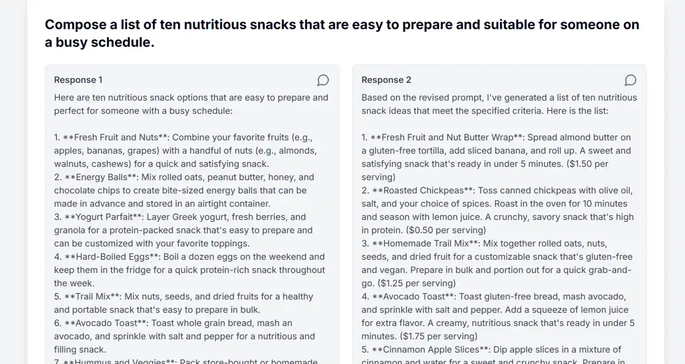
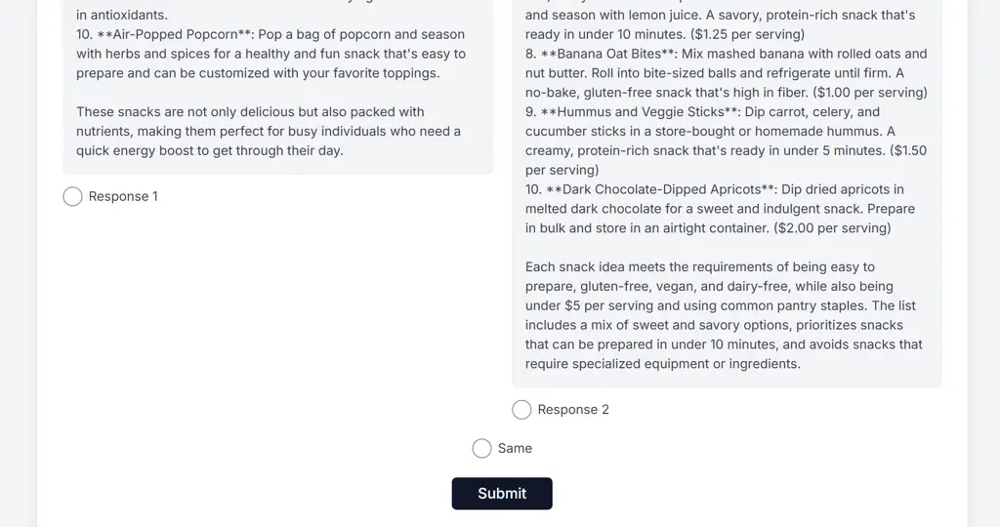

# PromptTailor: Multi-turn Intent-Aligned Prompt Synthesis for Lightweight LLMs

Yizhou Xu Affiliation: Whitman College, Department of Computer Science
   Janet Davis Affiliation: {xuy2, davisj}@whitman.edu

###### Abstract

Lightweight language models remain attractive for on-device and
privacy-sensitive applications, but their responses are highly sensitive
to prompt quality. For open-ended generation, non-expert users often
lack the knowledge or time to consistently craft high-quality prompts,
leading them to rely on prompt optimization tools. However, a key
challenge is ensuring the optimized prompts genuinely align with users’
original intents and preferences. We introduce PromptTailor, a system
for controllable prompt generation for open-ended text that improves
model output quality by intent-aligned prompt synthesis. PromptTailor
expands minimal user instructions into rich, domain-aware prompts while
preserving the user’s stated preferences. The system is a quantized
Llama3-8B model fine-tuned with a lightweight LoRA adapter on 12,300
prompt-refinement dialogues spanning 41 everyday domains, distilled from
three stronger LLMs. The adapter attaches to any Llama3-8B base,
enabling edge deployment. In human and LLM-judge evaluations across
multiple target models and optimization baselines, PromptTailor yields
higher preference rates than chain-of-thought prompting and matches or
surpasses state-of-the-art prompt optimization methods while requiring
fewer model calls (e.g., 3 vs. 9). These results show that a compact
student, guided by powerful teachers, can learn effective
prompt-generation strategies that enhance response quality while
maintaining alignment with user intent.

Figure 1: An example of integrating PromptTailor into an existing
Llama3-8B model. While multiple integration strategies are possible, our
proposed structure allows the user to choose whether to activate the
prompt generation capability. The intermediate output is then fed
directly back into the model to produce results. The PromptTailor
operates as a separate LoRA adapter agent, ensuring that it does not
impact other LoRA adapters or components within the model.

## 1 Introduction

We have seen the superb performance of recent reasoning models like
OpenAI o3 (Pfister and Jud, 2025). Those language models are capable of
generating high-quality responses without requiring several iterations
for prompt optimization. However, the lightweight language models are
still useful due to their ability to run on mobile or personal devices.
For those models with less than 8B parameters and especially for
quantized ones, the quality of the prompt still has a high impact on the
response (Liu et al., 2023a). It might be difficult and time-consuming
for non-expert users to self-design the prompt for the large language
models (LLMs). Non-expert users often lack the experience or domain
knowledge necessary to craft high-quality prompts and may instead rely
on prompt optimization tools. However, existing prompt optimization
strategies are sometimes difficult for general users to use or
interpret. This also raises the question of whether the optimized
prompts truly align with the users’ original intent and preferences.

In this paper, we introduce PromptTailor¹¹ 1 Link for the accompanying
generation prompts/templates:
[https://github.com/riverside234/data-template](https://github.com/riverside234/data-template).,
an LLM-based prompt generation system that transforms user intents and
preferences into enriched and elaborated prompts, while maintaining
alignment with the original intent. The system is capable of generating
elaborate prompts that most prior methods cannot produce, and these
prompts are human-readable, making them user-friendly and easy to edit.
Specifically, we fine-tuned a quantized 4-bit version of Llama3-8B
(Grattafiori et al., 2024) using a novel synthetic dataset. To ensure
the lightweight LLM acquires sufficient prompt generation and
optimization capabilities, we leverage three efficient yet powerful LLMs
to construct our synthetic dataset. This comprehensive dataset spans
over 41 diverse domains, featuring detailed prompt generation and
optimization dialogues across its 12,300 instances.

In our synthetic dataset formulation, we introduce a crucial mechanism:
"capabilities." This mechanism ensures that the generated prompt remains
intent-aligned while still providing the LLM with room to improvise
during prompt generation. We instruct the LLM to gather capabilities
information from two sources: (1) a list of capabilities deemed
necessary to complete the task, and (2) capabilities explicitly
mentioned in or inferred from the user’s original intent. In subsequent
turns, the model is instructed to balance these derived capabilities
during prompt optimization.

Since our PromptTailor is essentially based on a fine-tuned LoRA
adapter, it can be seamlessly integrated into an existing LLM. This
integration allows for easy usage by non-expert users and also preserves
system efficiency. There are various methods for integrating our system.
See Figure 1 for an example of the system structure. In our proposed
structure, PromptTailor acts as a separate LoRA agent that does not
affect the functionality of other components in the existing LLM. Users
can selectively activate the agent when prompt generation capabilities
are required. Our agent runs automatically for several turns to generate
an optimized prompt. To further enhance generation quality, the agent
system incorporates two additional components: a local user preference
database and a custom-designed capabilities information collector (see
Figure 2 for details).

For evaluation, we conduct both human and automated assessments to
record performance improvements on Lightweight LLMs using different
prompting methods. For automated assessment, we designed an LLM-based
evaluator that conducts pairwise comparisons on the quality of
open-ended responses from LLMs. We provide three pieces of information
during evaluation: (1) user original intent and preferences, (2) the
response generated by the original user intent and preferences, and (3)
the response generated by the LLM using a prompt produced by our
PromptTailor (or another prompting method).

The LLM evaluator or human participants are asked to provide scores
(1-10) based on two metrics: (1) how well the response aligns with the
user’s original intent and preferences, and (2) overall response
quality, including correctness, usefulness of information, and a
well-structured style, etc. The two scores are averaged and compared
with the other method. The method with the higher average score is
considered the "winner" or "better." Our automated evaluation results
indicated that our PromptTailor outperforms CoT prompting and is
equivalent to recent prompt optimization techniques such as Evoke (Hu et
al., 2023). However, our method is more efficient, requiring three model
calls compared to Evoke’s nine calls.

Additionally, we assessed the effectiveness of prompts generated by
PromptTailor across different LLMs, including those with capabilities
stronger or weaker than our base model. The findings from both human and
automated evaluation suggest that a more substantial improvement can be
seen on weaker models, while a noticeable improvement can still be
observed on stronger models.

## 2 Related Works

Recent approaches aim to improve LLM performance by guiding their
behavior through structured prompting strategies. Multi-expert Prompting
(Long et al., 2024) steers an LLM to simulate and aggregate several
expert viewpoints, then selects the safest, most factual, and useful
response. ExpertPrompting (Xu et al., 2023) auto-generates task-specific
expert personas that steer LLMs to deliver more accurate, expert-level
answers. The Evoke (Hu et al., 2023) reframes prompt engineering as a
reviewer–author dialogue in which two instances of the same LLM
iteratively critique and rewrite a prompt—and, aided by a selector that
feeds only “hard” examples—converges on a refined instruction in just
three cycles (nine API calls). However, some of these approaches assume
the existence of a well-structured short prompt to optimize. In
contrast, our approach generates and refines a prompt directly from user
intent and preferences. In addition, we shrink the overall framework and
system by distilling knowledge into a lightweight model that can run on
edge devices.

Adapting an LLM to a specific domain or task commonly involves
fine-tuning on in-domain data (Lu et al., 2024). We instead treat prompt
refinement itself as a specialization mechanism. Because no public
dataset for prompt generation and optimization exists, we leverage three
powerful LLMs to synthesize training data. To assess the quality of the
optimized prompts generated by our fine-tuned model, we build an
LLM-based evaluator. Existing LLM-based evaluators such as GPTScore (Fu
et al., 2024) repurposes GPT models as instruction-guided, training-free
evaluators that flexibly score generated text on any user-specified
criteria. CritiqueLLM Ke et al. (2023) trains an open-source evaluator
to generate both scalar scores and textual critiques using supervision
distilled from GPT-4. The model achieves GPT-4-level alignment with
human preferences while providing actionable feedback for response
improvement. G-Eval (Liu et al., 2023b) couples GPT-4’s chain-of-thought
reasoning with rubric-style form filling to score NLG outputs in
stronger alignment with human judgments. However, we noticed that
absolute score assignments by LLMs can be arbitrary and less reliable
when conducting cross-data comparisons. To address this, we use pairwise
comparisons instead of absolute scoring to evaluate the quality of
responses generated from optimized prompts.

## 3 Methods

### 3.1 Synthetic Data Generation

We built a synthetic dataset of high-quality prompt generation and
optimization dialogues for fine-tuning. The dataset covers 41 diverse
domains (see Appendix A.1), from legal advice and business inquiries to
everyday tasks such as cooking. To keep the fine-tuned model from merely
mimicking the style and strength of a single system, we utilized three
distinct yet cost-efficient LLMs—GPT-4o-mini (OpenAI, 2024a), Claude 3
Haiku (Anthropic, 2024), and Grok-3-mini (xAI, 2025). We generated the
majority of dialogues (8,200) using Grok-3-mini due to its superior
performance, with the remaining instances contributed by the other two
models, yielding a total of 12,300 dialogues.

In each dialogue, the LLM first simulates a user by generating a
domain-specific intent and a set of preferences. We then use the LLM to
generate and refine a prompt based on this intent and preference. To
clearly identify the user’s goals, the LLM is instructed to elaborate on
the purpose, context, and desired outcomes derived from the intent and
preference. The model is later asked to strictly adhere to this
information when generating and refining the prompt.

While testing our framework, we observed that directly generating
prompts from user intent sometimes led to the LLM misinterpreting the
term "prompt". In some cases, the model generated "prompts" intended for
academic reports or assignments, misaligning with the objective of
eliciting specific LLM behavior. To address this, instead of generating
a prompt directly, we instruct the LLM to first craft a plan for an LLM
agent based on the user’s intent and preferences, and then generate a
corresponding prompt for that agent.

A common challenge we identified is that while generated prompts should
ideally align with user intent, prompts that perfectly align might not
always be optimal for eliciting the best LLM response. To address this
trade-off, we introduce "capabilities" as a crucial mechanism. This
ensures that the generated prompt remains intent-aligned while still
providing the LLM with room to improvise and optimize. For example, in
the context of a financial report generator, a relevant capability might
be "identifying and explaining market trends." We instruct the LLM to
gather capability information from two distinct sources: (1) a list of
capabilities deemed necessary to complete the task, and (2) capabilities
explicitly mentioned in or inferred from the user’s original intent.
This aggregated capability information is then passed to the subsequent
turns, and we instruct the model to balance between the capabilities
derived from these two sources when formulating its response.

Each dialogue in our dataset contains the following four turns (See
Appendix A.2):

- •
  User Intent and Preference: To ensure generalization to real-world
  prompts, we first generated realistic user intents designed to mimic
  typical user inputs (e.g., “I want to draft an overview of the safety
  precautions and travel advisories…” ). To diversify the dataset, some
  intents were made more detailed, while others were intentionally
  underspecified. Detailed intents typically consist of a short
  paragraph with specific user directives, whereas underspecified ones
  are one or two sentences that provide only broad guidance.
  Additionally, extra user preference information related to the
  context—such as “the user prefers short, concise responses” or “the
  user enjoys cooking”—was generated and appended to the end.
- •
  Intent Understanding and Base Prompt Formulation: In this stage, the
  LLM is instructed to perform the following steps: (1) Intent and
  Preference Categorization: Convert raw user intents and preferences
  into two distinct categories: "purpose" and "context." (2) Desired
  Outcome Analysis: Carefully analyze the desired outcome (or output)
  the user expects from the LLM agent. (3) Capability Information
  Gathering: Explicit/Inferred Capabilities: Extract any capabilities
  explicitly mentioned in or inferred from the user’s original intent;
  Task-Required Capabilities: Assess the type of LLM agent required for
  the user’s task, and identify its essential capabilities (4) Agent
  Plan Generation: Provide a short, high-level plan for the agent. (5)
  Initial Prompt Generation: Generate a simple, foundational prompt for
  the agent.
- •
  Prompt Optimization Suggestions: In this stage, the LLM is instructed
  to first carefully review and briefly summarize the information passed
  from the previous turn, including the purpose, context, and desired
  outcome. Subsequently, the model rebalances the capability information
  from the last turn to generate an optimized list of capabilities.
  Finally, it produces five concrete suggestions for optimizing the
  original agent prompt: (1) define an appropriate role for the
  agent; (2) use precise, domain-specific terminology; (3) provide any
  necessary extra background context; (4) add missing details for
  completeness; and (5) specify the desired output format, length, and
  formatting.
- •
  Final Prompt Generation: We asked the LLM to generate a optimized
  prompt based on the plan and suggestions they provided.

We conducted an additional data filtering step using Grok-3-mini to
discard low-quality refined prompts, generating additional prompts to
replace each discarded one. Finally, we randomly selected ten generated
dialogues from each domain (41 domains) to form a test set of 410
dialogues, with the remaining dialogues serving as the training set. We
will use this test set in subsequent experiments.

Figure 2: Agent System Structure: The agent processes initial user input
through three consecutive model calls. The agent’s dialogue flow mirrors
that of our synthetic data. The system utilizes RAG to retrieve
historical user preference information from a local preference database.
Additionally, capabilities information is collected from various sources
by a dedicated collector component to help the LLM adjust its responses
accordingly in subsequent turns.

### 3.2 Model Fine-Tuning

We fine-tuned a quantized 4-bit version of Llama3-8B (Unsloth, 2024c) on
our synthetic dataset. Quantization reduces the memory footprint,
thereby enabling fine-tuning on a single NVIDIA A100 GPU and inference
on resource-constrained devices.

#### Training Details

Each dialogue is first converted into the Llama 3 chat format with the
required special tokens. We employed the Hugging Face TRL SFTTrainer
with LoRA (Low-Rank Adaptation) for parameter-efficient fine-tuning (Hu
et al., 2022). Guided by prior work (Halfon et al., 2024) on Llama3-8B
fine-tuning, we adopted a total batch size of 32 (8 per device, using
$`4\times`$ gradient accumulation) and the 8-bit AdamW optimizer. We set
the learning rate to $`4\times 10^{-5}`$ and used a constant_with_warmup
scheduler, with a warmup ratio of 0.05. For LoRA, we used a rank of 32,
$`\alpha=64`$, and a dropout rate of 0.05.

To determine an appropriate stopping point, we ran some exploratory
experiments for three epochs. The training losses plateaued at
approximately 0.5 during the second epoch. Consequently, our final
experiment trained on the full dataset for two epochs, yielding a
training loss of 0.537.

### 3.3 Agent System Structure

Most previous prompt optimization methods require external programs and
additional computation to revise prompts; however, our system can be
integrated directly into the base model, preserving efficiency. See
Figure 1 for an integration example. Our PromptTailor is essentially a
fine-tuned LoRA adapter for the Llama3-8B model. During inference, the
integrated model can selectively activate this LoRA adapter, enabling
dual capabilities: generating prompts or performing other tasks. The
approach is compatible with LLMs other than the Llama3-8B model, as long
as the new model is fine-tuned on our synthetic dataset.

In our proposed agent system, after the user provides an initial intent
and preferences for a desired prompt, the agent automatically executes
three turns to produce a final optimized prompt. (See Figure 2 for more
details.) We designed the prompt generation flow of the agent system to
match the structure of the synthetic data on which it was fine-tuned. To
maintain efficiency across these turns, we employ a context window
optimization strategy. Instead of passing the entire conversational
history to the LLM in each step, we selectively curate and structure
prior information into a concise intermediate format.

The system utilizes Retrieval-Augmented Generation (RAG) to retrieve
historical user preference information from a local database. Following
retrieval, the "purpose and context" section is updated with this
additional user preference information. Furthermore, capabilities
information is systematically collected from various sources by a
dedicated collector component, enabling the LLM to adjust its responses
accordingly in subsequent turns.

We identify three distinct channels through which capabilities
information can be collected. First, users may explicitly include
capability details within their initial intent and preferences, which
the LLM is instructed to infer and extend based on the input. Second, if
a user has previously conducted related tasks, relevant capabilities
information can be retrieved from the database using RAG. Lastly, a list
of capabilities deemed necessary to complete the task is generated by
the LLM during the first turn. The model is then instructed to balance
the capabilities derived from these three sources in subsequent turns.

| Model     | Response Comparison        | 1 (First Better) | 2 (Second Better) | 0 (Same) |
| --------- | -------------------------- | ---------------- | ----------------- | -------- |
| Llama3-8B | Original vs. CoT           | 177              | 216               | 17       |
| Llama3-8B | Original vs. Expert        | 170              | 225               | 15       |
| Llama3-8B | Original vs. Evoke(Llama3) | 145              | 253               | 12       |
| Llama3-8B | Original vs. Llama3(FT)    | 141              | 248               | 21       |

Table 1: Results of automated assessments, sample size 410. This table
compares responses from Llama3-8B generated using prompts from the
original user intent versus various optimization methods. “Original”
refers to the original user intents, “CoT” refers to CoT prompting,
"Expert" refers to ExpertPrompting, "Evoke" refers to the Evoke
prompting framework that uses Llama3-8B, and "Llama3(FT)" refers to
using our fine-tuned PromptTailor model to optimize the prompt. Each
cell shows the number of judgments favoring the response from the
original prompt (1), the optimized prompt (2), or indicating no
difference (0).

Figure 3: The bar chart version of the table above. Each cell shows the
number of judgments favoring the response from the raw user intent and
preference (1), the optimized prompt (2), or indicating no difference
(0).

| Model      | Response Comparison     | 1 (First Better) | 2 (Second Better) | 0 (Same) |
| ---------- | ----------------------- | ---------------- | ----------------- | -------- |
| Llama3-8B  | Original vs. Llama3(FT) | 141              | 248               | 21       |
| Gemma2-9B  | Original vs. Llama3(FT) | 147              | 230               | 33       |
| Mistral-7B | Original vs. Llama3(FT) | 103              | 298               | 9        |
| Llama3-70B | Original vs. Llama3(FT) | 155              | 232               | 23       |

Table 2: Results of automated assessments, sample size 410. We conduct a
comparative analysis of responses from four LLMs (all quantized
versions), evaluating their performance when provided with the original
user intent (Original) versus prompts optimized by our fine-tuned
optimizer PromptTailor. “Original” refers to the original user intents
and "Llama3(FT)" denotes using our fine-tuned Llama3 model
(PromptTailor) to refine the prompt. Each cell shows judgments favoring
the response from the original prompt (1), the optimized prompt (2), or
same (0).

Figure 4: The bar chart version of the table above. Each cell shows the
number of judgments favoring the response from the raw user intent and
preference (1), the optimized prompt (2), or indicating no difference
(0).

## 4 Experiment Results and Discussion

### 4.1 Automated Assessments

To evaluate open-ended generations from language models, we designed an
LLM-based evaluator rather than relying on standardized benchmarks. We
selected a reasoning model, OpenAI o1-mini (OpenAI, 2024b) as the
backbone model for the evaluator, balancing cost and efficiency given
the large volume of text to assess. The evaluation focuses on comparing
responses generated from original user intents with those from optimized
prompts across diverse methods and LLMs. However, score assignment by
LLMs can be arbitrary and less reliable for cross-dataset comparisons.
To address this, we use pairwise comparisons instead of absolute scoring
to evaluate response quality.

To evaluate responses, our LLM-based system is provided with raw user
intents and preferences along with two candidate responses. The
evaluation scoring is based on two criteria: (1) the degree to which the
response aligns with the original user intent, and (2) the overall
quality of the response. The system first compares these responses by
analyzing each and assigning two integer scores (1-10) based on these
criteria. The two scores are then averaged and compared with those from
the other method. To determine a winner, the LLM is instructed to return
an integer: 0 (indicating equal quality), 1 (first response is better),
or 2 (second response is better), based on the assigned scores. This
evaluation is repeated five times, and the final winner is selected
based on the mode. In cases with multiple modes, the experiment runs for
an additional round, although this rarely occurs.

#### Implementation details

Our test set comprises 410 raw user intents and preferences. These are
then fed into PromptTailor, which first analyzes user intents to suggest
prompt components, and subsequently generates a complete prompt using a
total of three model calls. We conduct pairwise comparisons to evaluate
the responses of LLMs, considering prompts generated by both
PromptTailor and other methods. In our experiments, external information
sources, such as a local user preference database, were not included.

| Model     | Response Comparison                 | 1 (F. Better) | 2 (S. Better) | 0 (Same) |
| --------- | ----------------------------------- | ------------- | ------------- | -------- |
| Llama3-8B | "Without Cap" vs. "Cap" (Llama3-8B) | 171           | 212           | 27       |
| Llama3-8B | "Without Cap" vs. "Cap" (Gemma2-9B) | 152           | 218           | 40       |

Table 3: Results of our ablation study, evaluated on responses from a
base Llama3-8B model, sample size 410. The prompts for this base model
were generated by two separate, fine-tuned optimizers: one built on
Llama3-8B and the other on Gemma2-9B. The table compares the
effectiveness of each optimizer when trained "Cap" (our full method)
versus "Without Cap" (without the capabilities mechanism). Each cell
shows the number of judgments favoring the response from "Without Cap"
(1), "Cap" (2), or indicating no difference (0).

Figure 5: The bar chart version of the table above. Each cell shows the
number of judgments favoring the response from "Without Cap" (1), "Cap"
(2), or indicating no difference (0).

#### Baselines

We compare PromptTailor with the following techniques and baselines: (1)
Original refers to using the unmodified Llama3-8B model to transform raw
user intents and preferences into a short prompt (a few sentences). This
transformation is necessary because the raw intents may contain
meta-text (e.g., “Show me a prompt…”) or preference information that
influences the focus of the response, such as “the user is interested in
swimming.” (2) CoT (Wei et al., 2022) refers to chain-of-thought
prompting. (3) Expert refers to ExpertPrompting (Xu et al., 2023), a
method that steers LLMs to adopt specialized expert roles and coordinate
those roles. (4) Evoke (Llama3) refers to applying the Evoke prompt
refinement framework (Juneja et al., 2024) to edit the prompt. For a
fair comparison, we replace the original GPT-4-based editor with the
unmodified Llama3-8B model. The framework involves three rounds of
editing, comprising a total of nine calls: three Author, three Reviewer,
and three Selector steps.

The results of the pairwise comparisons between baselines and our
PromptTailor are presented in Table 1 and Figure 3. Compared to CoT
prompting, our fine-tuned model achieves superior performance, with 248
favorable outcomes. In terms of performance, Evoke is largely on par
with our framework, showing comparable favorable outcomes against
original prompts. However, PromptTailor distinguishes itself by
requiring significantly fewer model calls—three compared to Evoke’s
nine—making it a more efficient and preferable solution for edge device
deployment.

#### Cross Model Comparisons

We conduct a cross-model comparison, comparing responses generated by
four distinct quantized LLMs (Unsloth, 2024a; Unsloth, 2024b; Unsloth,
2024d) using both raw user intents (transformed by the unmodified
Llama3-8B) and optimized prompts produced by PromptTailor. As shown in
Table 2 and Figure 4, smaller models such as a quantized 4-bit version
of Mistral-7B benefit significantly from optimized prompts, with 298
favorable judgments for optimized prompts versus 103 for original ones.
Even with a much stronger target model—Llama-3 70B, whose base
capability exceeds that of the 8B optimizer—prompt optimization remains
beneficial. The result demonstrates greater gains for weaker models,
with some improvement also seen for stronger ones.

### 4.2 Analysis on the "Capabilities" Mechanism

To isolate the impact of our proposed "capabilities" mechanism, we
conducted an ablation study. We compared two models fine-tuned on
distinct versions of our synthetic dataset: (1) "Without Cap", trained
on an earlier version of the dataset lacking the capabilities framework,
and (2) "Cap", trained on the final dataset incorporating this
mechanism. During inference, the "Cap" model maintains context across
its three optimization turns by selectively curating and structuring
information from prior steps—a process we refer to as context window
optimization (Figure 2). In contrast, the "Without Cap" model performs a
direct three-turn optimization without this guidance. To ensure our
findings generalize, we fine-tuned quantized 4-bit versions of Llama3-8B
and Gemma2-9B to serve as two separate prompt optimizers. During the
evaluation, prompts from each of these optimizers were fed to a base
Llama3-8B model. We then used our LLM-as-a-Judge to evaluate the final
responses generated by this base model. As shown in Table 3, for both
the Llama3-8B and Gemma2-9B optimizers, prompts generated using the
With-Cap method were generally preferred, confirming the efficacy of the
capabilities mechanism.

### 4.3 Human Assessments

To complement our automated evaluation, we conducted a small human study
with 10 participants. The results, detailed in Appendix A.4, generally
align with the findings from our automated assessments. Participants
showed a clear preference for responses generated from optimized prompts
over those from the original, unrefined user intents. However, we
observed some variance in participant sensitivity; while some evaluators
identified significant nuances in response quality, others perceived the
outputs as being broadly similar. A larger-scale human evaluation to
investigate these subtleties is left as future work.

## 5 Conclusion and Future Work

This paper introduces PromptTailor, an agent designed to automatically
generate refined prompts that align with user intents and preferences.
We fine-tuned a lightweight Llama3-8B model using synthetic data derived
from three powerful large language models. This approach produces
improved prompts, effectively bridging the knowledge gap for non-expert
users. Our evaluation demonstrates PromptTailor’s advantages across
various methods and settings, highlighting particularly strong
improvements for weaker models. The findings show that a lightweight
student model, guided by powerful teachers, can effectively improve the
open-ended responses of other LLMs, even though the optimizer itself is
considerably smaller.

Future work could explore non-linear synthetic data generation with a
more complex, multi-component prompt generation structure. While our
current dialogue flow structure is linear for convenient fine-tuning,
training on a more complex dataset could benefit from utilizing a
Mixture-of-Experts (MoE) LoRA framework. This framework would allow
individual LoRA adapters to be trained on specific dialogue components
and activated dynamically during inference.

## Limitations

Because of our limited scope and budget, we did not use the most
powerful model as the backbone of our evaluator, and we recruited only
ten participants for the human assessments. Additionally, while our
LLM-based evaluator performs reliable pairwise comparisons, it lacks the
ability to quantify response superiority. A marginally better response
is currently treated as an absolute win. Future work should combine
binary pairwise judgments with continuous metrics—such as average
score—to better capture response quality differentials. For our
experiment, we only compared our method (PromptTailor) with a few other
prompt optimization methods, such as CoT, ExpertPrompting, Evoke.
However, most recent prompting methods only consider prompt optimization
rather than generation tailored to user preferences, which increases the
difficulty of direct comparison. We leave this as an open question for
future work.

## Ethical Considerations

Our human assessments were approved by the institution’s IRB. Each
participant signed an informed-consent form and received a \$10 gift
card as compensation. All participant information has been anonymized.

## References

- Anthropic (2024) Anthropic The Claude 3 Model Family: Opus, Sonnet,
  Haiku. Note:
  [https://www.anthropic.com/news/claude-3-family](https://www.anthropic.com/news/claude-3-family)Accessed
  22 June 2025 Cited by: §3.1.
- Fu et al. (2024) J. Fu, S. Ng, Z. Jiang, and P. Liu GPTScore: evaluate
  as you desire. In Proceedings of the 2024 Conference of the North
  American Chapter of the Association for Computational Linguistics:
  Human Language Technologies (NAACL-HLT), pp. 6556–6576. External
  Links: [Link](https://aclanthology.org/2024.naacl-long.365) Cited by:
  §2.
- Grattafiori et al. (2024) A. Grattafiori, A. Dubey, A. Jauhri, A.
  Pandey, A. Kadian, A. Al-Dahle, A. Letman, A. Mathur, A. Schelten, A.
  Vaughan, et al. The llama 3 herd of models. arXiv preprint
  arXiv:2407.21783. External Links:
  [Link](https://arxiv.org/abs/2407.21783) Cited by: §1.
- Halfon et al. (2024) A. Halfon, S. Gretz, O. Arviv, A. Spector, O.
  Toledo-Ronen, Y. Katz, L. Ein-Dor, M. Shmueli-Scheuer, and N. Slonim
  Stay tuned: an empirical study of the impact of hyperparameters on llm
  tuning in real-world applications. Note:
  [https://arxiv.org/abs/2407.18990](https://arxiv.org/abs/2407.18990)Accessed:
  2025-05-14 Cited by: §3.2.
- Hu et al. (2022) E. J. Hu, Y. Shen, P. Wallis, Z. Allen-Zhu, Y. Li, S.
  Wang, L. Wang, and W. Chen LoRA: low-rank adaptation of large language
  models. In International Conference on Learning Representations
  (ICLR), External Links: [Link](https://arxiv.org/abs/2106.09685) Cited
  by: §3.2.
- Hu et al. (2023) X. Hu, P. Tang, S. Zuo, Z. Wang, B. Song, Q. Lou, J.
  Jiao, and D. Charles Evoke: evoking critical thinking abilities in
  llms via reviewer–author prompt editing. In International Conference
  on Learning Representations (ICLR) 2024, Note: ICLR 2024 poster
  External Links: [Link](https://arxiv.org/abs/2310.13855) Cited by: §1,
  §2.
- Juneja et al. (2024) G. Juneja, N. Natarajan, H. Li, J. Jiao, and A.
  Sharma Task facet learning: a structured approach to prompt
  optimization. arXiv preprint arXiv:2406.10504. External Links:
  [Link](https://arxiv.org/abs/2406.10504) Cited by: §4.1.
- Ke et al. (2023) L. Ke, B. Li, S. Wang, H. Zhang, Y. Li, Y. Xie,
  and D. Yang CritiqueLLM: generating better feedback for free-form
  responses with large language models. In Proceedings of the 2023
  Conference on Empirical Methods in Natural Language Processing
  (EMNLP), External Links: [Link](https://arxiv.org/abs/2309.16798)
  Cited by: §2.
- Liu et al. (2023a) P. Liu, W. Yuan, J. Fu, Z. Jiang, H. Hayashi,
  and G. Neubig Pre-train, prompt, and predict: a systematic survey of
  prompting methods in natural language processing. ACM Computing
  Surveys 55 (9), pp. 1–35. External Links:
  [Document](https://dx.doi.org/10.1145/3569026),
  [Link](https://dl.acm.org/doi/10.1145/3569026) Cited by: §1.
- Liu et al. (2023b) Y. Liu, D. Iter, Y. Xu, S. Wang, R. Xu, and C. Zhu
  G-eval: nlg evaluation using gpt-4 with better human alignment. In
  Proceedings of the 2023 Conference on Empirical Methods in Natural
  Language Processing, Singapore, pp. 2511–2522. External Links:
  [Document](https://dx.doi.org/10.18653/v1/2023.emnlp-main.153),
  [Link](https://aclanthology.org/2023.emnlp-main.153/) Cited by: §2.
- Long et al. (2024) D. X. Long, D. N. Yen, A. T. Luu, K. Kawaguchi, M.
  Kan, and N. F. Chen Multi-expert prompting improves reliability,
  safety and usefulness of large language models. In Proceedings of the
  2024 Conference on Empirical Methods in Natural Language Processing,
  Miami, Florida, USA, pp. 20370–20401. External Links:
  [Document](https://dx.doi.org/10.18653/v1/2024.emnlp-main.1135),
  [Link](https://aclanthology.org/2024.emnlp-main.1135) Cited by: §2.
- Lu et al. (2024) W. Lu, R. K. Luu, and M. J. Buehler Fine-tuning large
  language models for domain adaptation: exploration of training
  strategies, scaling, model merging, and synergistic capabilities.
  arXiv preprint arXiv:2409.03444. External Links:
  [Link](https://arxiv.org/abs/2409.03444) Cited by: §2.
- OpenAI (2024a) OpenAI GPT-4o mini: Advancing Cost-Efficient
  Intelligence. Note:
  [https://openai.com/index/gpt-4o-mini](https://openai.com/index/gpt-4o-mini)Accessed
  22 June 2025 Cited by: §3.1.
- OpenAI (2024b) OpenAI O1: a reasoning-optimized large language model.
  Note:
  [https://platform.openai.com/docs/models/o1](https://platform.openai.com/docs/models/o1)Released
  December 5, 2024; chain-of-thought reasoning Cited by: §4.1.
- Pfister and Jud (2025) R. Pfister and H. Jud Understanding and
  benchmarking artificial intelligence: openai’s o3 is not agi. arXiv
  preprint arXiv:2501.07458. External Links:
  [Link](https://arxiv.org/abs/2501.07458) Cited by: §1.
- Unsloth (2024a) Unsloth Unsloth/gemma2-9b-instruct-bnb-4bit. Hugging
  Face. Note:
  [https://huggingface.co/unsloth/gemma-2-9b-it-bnb-4bit](https://huggingface.co/unsloth/gemma-2-9b-it-bnb-4bit)Accessed:
  2025-05-14 Cited by: §4.1.
- Unsloth (2024b) Unsloth Unsloth/llama-3-70b-instruct-bnb-4bit. Hugging
  Face. Note:
  [https://huggingface.co/unsloth/llama-3-70b-Instruct-bnb-4bit](https://huggingface.co/unsloth/llama-3-70b-Instruct-bnb-4bit)Accessed:
  2025-05-14 Cited by: §4.1.
- Unsloth (2024c) Unsloth Unsloth/llama-3-8b-instruct-bnb-4bit. Hugging
  Face. Note:
  [https://huggingface.co/unsloth/llama-3-8b-Instruct-bnb-4bit](https://huggingface.co/unsloth/llama-3-8b-Instruct-bnb-4bit)Accessed:
  2025-05-14 Cited by: §3.2.
- Unsloth (2024d) Unsloth Unsloth/mistral-7b-instruct-v0.3-bnb-4bit.
  Hugging Face. Note:
  [https://huggingface.co/unsloth/mistral-7b-instruct-v0.3-bnb-4bit](https://huggingface.co/unsloth/mistral-7b-instruct-v0.3-bnb-4bit)Accessed:
  2025-05-14 Cited by: §4.1.
- Wei et al. (2022) J. Wei, X. Wang, D. Schuurmans, M. Bosma, F. Xia, E.
  Chi, Q. V. Le, D. Zhou, et al. Chain-of-thought prompting elicits
  reasoning in large language models. Advances in neural information
  processing systems 35, pp. 24824–24837. Cited by: §4.1.
- xAI (2025) xAI Grok 3 Beta — The Age of Reasoning Agents. Note:
  [https://x.ai/news/grok-3](https://x.ai/news/grok-3)Accessed 22 June
  2025 Cited by: §3.1.
- Xu et al. (2023) B. Xu, A. Yang, J. Lin, Q. Wang, C. Zhou, Y. Zhang,
  and Z. Mao ExpertPrompting: instructing large language models to be
  distinguished experts. arXiv preprint arXiv:2305.14688. External
  Links: [Link](https://arxiv.org/abs/2305.14688) Cited by: §2, §4.1.

## Appendix A Appendix

### A.1 Domains and Themes for the Dataset

1.  1.  Role-Play and Simulation – characters, worlds, scenarios
2.  2.  Marketing, Brand and Social Strategy – positioning, campaigns,
        community
3.  3.  Entertainment, Media and Pop Culture – industry trends, fandoms,
        critique
4.  4.  Politics and Public Policy – domestic governance, policy analysis
5.  5.  Sports and Athletics – rules, tactics, commentary
6.  6.  Education and Instructional Design – curricula, pedagogy, assessment
7.  7.  History and Historiography – events, sources, methods
8.  8.  Science Communication – explainers for lay audiences
9.  9.  Philosophy and Ethics – logic, moral frameworks, dilemmas
10. 10. Psychology and Behavioral Science – cognition, behavior, motivation
11. 11. Business Strategy and Leadership – org models, scaling, executive
        practice
12. 12. Career Coaching and Job Search – resumes, interviews, growth plans
13. 13. Health and Medicine – conditions, care models, health systems
14. 14. Software and Digital Transformation – development topics, IT
        modernization
15. 15. Environment and Sustainability – climate, conservation, stewardship
16. 16. Economics and Markets – theory, policy, market dynamics
17. 17. Law and Legal Literacy – rights, procedures, legal concepts
18. 18. Human Resources and People Ops – hiring, performance, culture
19. 19. Project and Program Management – planning, delivery, PMO
20. 20. Corporate Finance and Investing – valuation, portfolio theory
21. 21. Real Estate and Urban Development – property, zoning, city growth
22. 22. Travel and Tourism – itineraries, cultural etiquette, destinations
23. 23. Food and Culinary Arts – techniques, cuisines, menu ideas
24. 24. Fashion and Personal Style – aesthetics, wardrobe systems
25. 25. Creative Arts and Music Production – visual design, composition,
        recording
26. 26. Gaming and Interactive Media – mechanics, design, esports
27. 27. Relationships, Family and Parenting – communication, development,
        dynamics
28. 28. Personal Productivity and Time Management – workflows, habits, tools
29. 29. Home, DIY and Gardening – projects, materials, horticulture
30. 30. Pet Care and Animal Behavior – training, enrichment, health basics
31. 31. Automotive and Mobility – vehicles, maintenance, transport tech
32. 32. Fitness and Nutrition – training programs, diet planning,
        performance
33. 33. Mental Health and Wellbeing – coping skills, mindfulness, supports
34. 34. Spirituality and Comparative Religion – beliefs, practices,
        traditions
35. 35. Social and Cultural Studies – institutions, norms, anthropology
36. 36. International Relations and Geopolitics – states, alliances,
        strategy
37. 37. Journalism and Media Literacy – reporting, verification, bias
        detection
38. 38. Communication, Persuasion and Rhetoric – argumentation, framing,
        style
39. 39. Artificial Intelligence and Data Science – models, analytics,
        insights
40. 40. Innovation and Design Thinking – discovery, prototyping, iteration
41. 41. Entrepreneurship and Startups – idea validation, traction, funding

### A.2 Synthetic Data Example

- •
  User intent and preference: I need to draft a comprehensive report
  summarizing the quarterly financial performance for the last fiscal
  quarter. The report should highlight key revenue streams,
  expenditures, and profit margins. Please include a section on market
  trends impacting our sales and provide actionable recommendations for
  improving profitability in the next quarter. I prefer a concise,
  data-driven response and wants the report to be easily digestible for
  executive leadership.
- •
  Intent Detection and Prompt Generation:

  {

  "purpose": "To draft a comprehensive report summarizing quarterly
  financial performance, highlighting revenue, expenditures, and profit
  margins, including market trends and actionable recommendations for
  profitability improvement.",

  "context": "The report is for executive leadership, needs to be
  concise and data-driven, and covers the last fiscal quarter.",

  "desired_outcome": "A well-structured, concise financial report that
  includes specific financial metrics, analysis of market trends, and
  practical recommendations, easily understandable by executives.",

  "capability_information": {

  "explicit_inferred_capabilities": \[

  "Summarizing quarterly financial performance",

  "Highlighting key revenue streams",

  "Highlighting expenditures",

  "Highlighting profit margins",

  "Including a section on market trends impacting sales",

  "Providing actionable recommendations for improving profitability",

  "Generating concise responses",

  "Generating data-driven responses",

  "Creating easily digestible content for executive leadership"

  \],

  "task_required_capabilities": \[

  "Understanding financial terminology and concepts",

  "Synthesizing quantitative data into clear summaries",

  "Identifying and explaining relevant market trends",

  "Formulating strategic, actionable recommendations",

  "Structuring a formal report",

  "Adhering to specific formatting and length constraints"

  \]

  },

  "agent_plan": "The agent will first process financial data (assumed to
  be provided or accessible), then structure the report into sections
  for financial metrics, market trends, and recommendations. It will
  ensure the report is concise, data-driven, and tailored for executive
  readability.",

  "initial_prompt": "Generate a concise financial report for executive
  leadership summarizing last quarter’s performance. Include revenue,
  expenditures, profit margins, market trends, and recommendations for
  improving profitability."

  }

- •
  Prompt Optimization Suggestions:

  { "summary": {

  "purpose": "To draft a comprehensive report summarizing quarterly
  financial performance, highlighting revenue, expenditures, and profit
  margins, including market trends and actionable recommendations for
  profitability improvement.",

  "context": "The report is for executive leadership, needs to be
  concise and data-driven, and covers the last fiscal quarter.",

  "desired_outcome": "A well-structured, concise financial report that
  includes specific financial metrics, analysis of market trends, and
  practical recommendations, easily understandable by executives."

  },

  "optimized_capabilities": \[

  "Synthesizing and summarizing complex financial data (revenue,
  expenditures, profit margins)",

  "Understanding and applying relevant financial terminology and
  concepts",

  "Analyzing and explaining significant industry-specific market trends
  and their impact on financial performance",

  "Formulating strategic, actionable recommendations for improving
  profitability",

  "Structuring professional, concise, and data-driven reports tailored
  for executive audiences",

  "Adhering to specified output format, length, and formatting
  requirements"

  \],

  "plan_prompt_improvement": "The goal is to transform the simple prompt
  into a highly effective instruction set that guides the LLM agent to
  produce a superior financial report. This involves clearly defining
  the agent’s role, ensuring precise terminology is used, providing
  essential background, adding any missing details, and strictly
  specifying the output format and length, while balancing intent
  alignment with optimal LLM performance through refined capabilities.",

  "optimization_suggestions": \[

  {

  "suggestion_number": 1,

  "title": "Define an appropriate role for the agent",

  "description": "Clearly establish the LLM’s persona, such as ’You are
  a seasoned Financial Analyst and Report Generator.’ This sets
  expectations for the tone, depth, and expertise required for the
  report."

  },

  {

  "suggestion_number": 2,

  "title": "Use precise, domain-specific terminology",

  "description": "Enhance clarity by incorporating specific financial
  terms like ’net profit margin,’ ’operational expenditures,’ or
  ’revenue streams’ and clearly defining periods such as ’fiscal quarter
  (Q1 2025)’ to ensure accuracy and professionalism."

  },

  {

  "suggestion_number": 3,

  "title": "Provide any necessary extra background context",

  "description": "Emphasize the report’s audience and strategic purpose,
  for example, ’This report is critical for executive leadership to
  inform strategic decision-making and quarterly planning.’"

  },

  {

  "suggestion_number": 4,

  "title": "Add missing details for completeness",

  "description": "Specify any assumptions about data availability (e.g.,
  ’Assume financial data for Q1 2025 will be provided in a structured
  format’) or what specific elements to include in ’market trends’
  (e.g., ’Identify supply chain disruptions or shifts in consumer
  demand’)."

  },

  {

  "suggestion_number": 5,

  "title": "Specify the desired output format, length, and formatting",

  "description": "Clearly state structural requirements like ’Present
  the report in markdown with distinct sections and subheadings,’ ’Limit
  the total length to approximately 750-1000 words,’ and ’Ensure all
  numerical data is presented in a clear, summarized table format where
  appropriate.’"

  }

  \]

  }

- •
  Optimized prompt:

  {

  "optimized_prompt": "You are a \*\*seasoned Financial Analyst and
  Report Generator\*\*, highly adept at \*\*synthesizing complex
  financial data\*\*, \*\*analyzing market trends\*\*, and
  \*\*formulating strategic, actionable recommendations\*\*. Your core
  mission is to create a \*\*comprehensive, concise, and data-driven
  quarterly financial performance report\*\* for \*\*executive
  leadership\*\*, providing clear insights to inform critical strategic
  decision-making.\\n\\nFor the \*\*last fiscal quarter (Q1 2025)\*\*,
  prepare a report that thoroughly summarizes key financial metrics,
  including \*\*revenue streams, operational and capital expenditures,
  and net profit margins\*\*. Present these figures with utmost clarity,
  preferably within a \*\*summary table\*\* or under distinct,
  well-labeled headings to ensure immediate readability for
  executives.\\n\\nCrucially, identify and explain any \*\*significant
  industry-specific market trends\*\* that impacted our sales and
  overall financial performance during this period. Your analysis should
  highlight both positive and negative influences.\\n\\nFinally, based
  on your comprehensive financial and market analysis, provide
  \*\*concrete, actionable recommendations\*\* aimed at improving
  profitability and optimizing financial performance for the \*\*next
  fiscal quarter (Q2 2025)\*\*. Ensure these recommendations are
  pragmatic and demonstrate clear potential for impact.\\n\\n\*\*Output
  Requirements:\*\*\\n\* \*\*Format:\*\* The report must be presented in
  \*\*markdown format\*\*, utilizing \*\*clear, descriptive headings and
  subheadings\*\* (e.g., ‘# Financial Performance Overview‘, ‘## Revenue
  Analysis‘, ‘### Key Trends‘). Use \*\*bullet points\*\* for lists and
  recommendations to enhance readability.\\n\* \*\*Length:\*\* Aim for a
  report approximately \*\*750-1000 words\*\* in length, balancing
  detail with executive-level conciseness.\\n\* \*\*Tone:\*\* Maintain a
  \*\*professional, analytical, and objective tone\*\* throughout,
  suitable for high-level corporate review.\\n\* \*\*Data Handling:\*\*
  Assume the necessary raw financial data for Q1 2025 will be provided
  to you separately. Your focus should be entirely on \*\*analysis,
  interpretation, and recommendation generation\*\*. \*\*Do not
  fabricate or ’hallucinate’ specific financial figures if they are not
  explicitly given; use placeholders or descriptive language instead if
  specific numbers are not available.\*\*"

  }

### A.3 Automated Assessments Detail

#### Evaluation examples:

- •
  Task: Draft an overview of the safety precautions and travel
  advisories for solo female travelers in Southeast Asia, with specific
  country recommendations.
- •
  Response 1:

  Solo Female Travel in Southeast Asia: Safety Precautions and Travel
  Advisories\*\*

  Southeast Asia is a popular destination for solo female travelers,
  offering a unique blend of culture, history, and adventure. However,
  as with any travel destination, it’s essential to take necessary
  safety precautions and stay informed about local conditions. Here’s an
  overview of safety precautions and travel advisories for solo female
  travelers in Southeast Asia, along with specific country
  recommendations.

  \*\*General Safety Precautions:\*\*
  1. \*\*Research, research, research\*\*: Before traveling to any new
     destination, research the local culture, customs, and laws to avoid
     unintentionally offending anyone.
  2. \*\*Be mindful of your surroundings\*\*: Pay attention to your
     environment, especially at night, and avoid walking alone in dimly lit
     or deserted areas.
  3. \*\*Keep valuables secure\*\*: Lock your luggage, keep your
     passport and important documents safe, and avoid carrying large
     amounts of cash.
  4. \*\*Trust your instincts\*\*: If you feel uncomfortable or unsafe,
     trust your instincts and avoid the situation.
  5. \*\*Stay in touch with friends and family\*\*: Keep your loved ones
     informed about your itinerary and expected return times.
  6. \*\*Learn basic phrases in the local language\*\*: Knowing basic
     phrases like hello, thank you, and help can go a long way in
     communicating with locals.
  7. \*\*Respect local customs\*\*: Dress modestly, remove your shoes
     when entering temples or homes, and avoid public displays of
     affection.

  \*\*Country-Specific Safety Precautions and Travel Advisories:\*\*
  1. \*\*Thailand\*\*: Thailand is generally a safe country for solo
     female travelers, but take necessary precautions in crowded areas and
     night markets. Avoid traveling alone at night, and be mindful of your
     belongings.
  2. \*\*Vietnam\*\*: Vietnam is a popular destination for solo
     travelers, but petty theft and scams are common. Keep your valuables
     secure, and avoid giving money to beggars or street performers.
  3. \*\*Cambodia\*\*: Cambodia is a developing country with limited
     infrastructure. Be prepared for dusty roads, poor sanitation, and
     occasional power outages. Avoid traveling alone at night, and be
     respectful of local customs.
  4. \*\*Laos\*\*: Laos is a laid-back country with a relaxed
     atmosphere. However, be prepared for limited healthcare facilities and
     occasional power outages. Avoid traveling alone at night, and be
     respectful of local customs.
  5. \*\*Indonesia\*\*: Indonesia is a vast and diverse country with
     many tourist attractions. However, be prepared for occasional
     earthquakes, volcanic eruptions, and terrorist attacks. Avoid
     traveling alone at night, and be respectful of local customs.
  6. \*\*Malaysia\*\*: Malaysia is a multicultural country with a mix of
     Malay, Chinese, and Indian influences. However, be prepared for
     occasional flooding and traffic congestion. Avoid traveling alone at
     night, and be respectful of local customs.
  7. \*\*Philippines\*\*: The Philippines is a beautiful country with
     stunning beaches and vibrant culture. However, be prepared for
     occasional typhoons, flooding, and terrorist attacks. Avoid traveling
     alone at night, and be respectful of local customs.

  \*\*Specific Country Recommendations:\*\*
  1. \*\*Thailand\*\*: Chiang Mai, Bangkok, and Phuket are popular
     destinations for solo female travelers. Take a cooking class, visit
     the temples, and enjoy the night markets.
  2. \*\*Vietnam\*\*: Hanoi, Ho Chi Minh City, and Hoi An are must-visit
     destinations. Try the local cuisine, visit the ancient city of Hoi An,
     and take a motorbike tour.
  3. \*\*Cambodia\*\*: Siem Reap and Angkor Wat are a must-visit for any
     traveler. Take a guided tour of the temples, and visit the bustling
     markets.
  4. \*\*Laos\*\*: Luang Prabang and Vientiane are charming towns with a
     relaxed atmosphere. Take a boat trip along the Mekong River, and visit
     the ancient temples.
  5. \*\*Indonesia\*\*: Bali and Yogyakarta are popular destinations for
     solo female travelers. Take a yoga class, visit the temples, and enjoy
     the beautiful beaches.
  6. \*\*Malaysia\*\*: Kuala Lumpur and Penang are vibrant cities with a
     mix of Malay, Chinese, and Indian influences. Try the local cuisine,
     visit the Petronas Twin Towers, and take a stroll along the beach.
  7. \*\*Philippines\*\*: Boracay and Palawan are stunning destinations
     with beautiful beaches and crystal-clear waters. Take a snorkeling or
     diving trip, visit the Chocolate Hills, and enjoy the local cuisine.

  \*\*Conclusion:\*\*

  Southeast Asia is a wonderful destination for solo female travelers,
  offering a unique blend of culture, history, and adventure. By taking
  necessary safety precautions and staying informed about local
  conditions, you can have a safe and enjoyable trip. Remember to
  research, be mindful of your surroundings, and respect local customs.
  With the right preparation and attitude, you can have a fantastic time
  exploring this beautiful region.

- •
  Response 2:

  Comprehensive Travel Guide for Solo Female Travelers in Southeast
  Asia\*\*

  As a solo female traveler, Southeast Asia is an exciting and rewarding
  destination. With its rich cultural heritage, beautiful landscapes,
  and vibrant cities, it’s no wonder why this region is a popular choice
  for travelers. However, solo female travelers may face unique
  challenges and concerns while traveling in Southeast Asia, including
  safety risks, cultural differences, and language barriers. In this
  comprehensive travel guide, we will provide you with the information
  and advice you need to stay safe, navigate cultural differences, and
  have a memorable and enjoyable trip to Southeast Asia.

  \*\*Country-Specific Information and Recommendations\*\*

  This guide covers at least 5 countries in Southeast Asia, including
  Indonesia, Thailand, Vietnam, Malaysia, and the Philippines. Each
  country has its unique culture, customs, and challenges, and we will
  provide you with country-specific information and recommendations to
  help you navigate each destination safely and confidently.

  \*\*Indonesia\*\*

  \* Safety Precautions: Indonesia is generally a safe country, but
  petty theft and scams are common in tourist areas. Be mindful of your
  belongings, and avoid carrying large amounts of cash.  
  \* Travel Advisories: The US Department of State advises travelers to
  exercise increased caution in Indonesia due to terrorism, crime, and
  natural disasters.  
  \* Country-Specific Recommendations:
  - Visit the ancient temples of Borobudur and Prambanan in
    Yogyakarta.
  - Explore the vibrant city of Jakarta and its many markets and
    shopping centers.
  - Take a boat trip to the Gili Islands for snorkeling and diving.

  \*\*Thailand\*\*

  \* Safety Precautions: Thailand is generally a safe country, but be
  mindful of your belongings and avoid traveling alone at night.  
  \* Travel Advisories: The US Department of State advises travelers to
  exercise increased caution in Thailand due to terrorism, crime, and
  civil unrest.  
  \* Country-Specific Recommendations:
  - Visit the bustling streets of Bangkok and its many markets and
    shopping centers.
  - Explore the ancient city of Chiang Mai and its many temples and
    cultural attractions.
  - Take a boat trip to the islands of Koh Samui and Koh Phangan for
    snorkeling and diving.  

  \*\*Vietnam\*\*

  \* Safety Precautions: Vietnam is generally a safe country, but be
  mindful of your belongings and avoid traveling alone at night.  
  \* Travel Advisories: The US Department of State advises travelers to
  exercise increased caution in Vietnam due to terrorism, crime, and
  civil unrest.  
  \* Country-Specific Recommendations:
  - Visit the ancient city of Hoi An and its many temples and cultural
    attractions.
  - Explore the vibrant city of Ho Chi Minh City and its many markets
    and shopping centers.
  - Take a boat trip to Ha Long Bay for snorkeling and diving.

  \*\*Malaysia\*\*

  \* Safety Precautions: Malaysia is generally a safe country, but be
  mindful of your belongings and avoid traveling alone at night.  
  \* Travel Advisories: The US Department of State advises travelers to
  exercise increased caution in Malaysia due to terrorism, crime, and
  civil unrest.  
  \* Country-Specific Recommendations:
  - Visit the vibrant city of Kuala Lumpur and its many markets and
    shopping centers.
  - Explore the ancient city of Malacca and its many temples and
    cultural attractions.
  - Take a boat trip to the islands of Langkawi and Penang for
    snorkeling and diving.  

  \*\*Philippines\*\*

  \* Safety Precautions: The Philippines is generally a safe country,
  but be mindful of your belongings and avoid traveling alone at
  night.  
  \* Travel Advisories: The US Department of State advises travelers to
  exercise increased caution in the Philippines due to terrorism, crime,
  and natural disasters.  
  \* Country-Specific Recommendations:
  - Visit the ancient city of Intramuros in Manila and its many cultural
    attractions.
  - Explore the vibrant city of Cebu and its many markets and shopping
    centers.
  - Take a boat trip to the islands of Palawan and Bohol for snorkeling
    and diving.  

  \*\*Practical Tips and Recommendations\*\*

  \* Accommodation: Consider staying in guesthouses or hostels, which
  are often cheaper and more social than hotels.  
  \* Transportation: Use local transportation such as buses, taxis, and
  motorbikes, which are often cheaper and more convenient than renting a
  car.  
  \* Food: Try local street food and markets, which are often cheaper
  and more authentic than restaurants.  
  \* Cultural Norms: Be respectful of local customs and traditions, and
  avoid public displays of affection.

  \*\*Safety Precautions and Travel Advisories\*\*

  \* Petty theft and scams are common in tourist areas, so be mindful of
  your belongings and avoid carrying large amounts of cash.  
  \* Avoid traveling alone at night, and use reputable taxi services or
  ride-sharing apps.  
  \* Check local weather forecasts and natural disaster warnings before
  traveling.  
  \* Register with your government’s travel advisory service, such as
  the US Department of State’s Smart Traveler Enrollment Program (STEP),
  to receive important safety and security updates about your
  destination.

  \*\*Conclusion\*\*

  Southeast Asia is a wonderful destination for solo female travelers,
  with its rich cultural heritage, beautiful landscapes, and vibrant
  cities. However, solo female travelers may face unique challenges and
  concerns while traveling in Southeast Asia, including safety risks,
  cultural differences, and language barriers. In this comprehensive
  travel guide, we have provided you with country-specific information
  and recommendations to help you navigate each destination safely and
  confidently. Remember to always exercise increased caution, be mindful
  of your belongings, and respect local customs and traditions. Happy
  travels!

| Model      | Response Comparison     | 1 (First Better) | 2 (Second Better) | 0 (Same) |
| ---------- | ----------------------- | ---------------- | ----------------- | -------- |
| Llama3-8B  | Original vs. Llama3(FT) | 12               | 22                | 6        |
| Mistral-7B | Original vs. Llama3(FT) | 5                | 26                | 9        |

Table 4: Results of human assessments, sample size 40. We are comparing
responses from Llama3-8B and Mistral-7B when given the original user
intents versus the optimized prompt. “Original” refers to the original
user prompt and "Llama3(FT)" denotes using our fine-tuned Llama3 model
(PromptTailor) to revise the prompt.

### A.4 Human Assessments

For the human evaluation, we randomly selected 8 original user prompts
from the test set. We recruited 10 participants from our campus
community, mostly undergraduate students. Each participant used a web
interface to compare responses side-by-side. Participants were divided
into two groups, with each group assigned to compare either original vs
Llama3-8B or original vs Mistral-7B. Participants were instructed to
select the better response or indicate if the responses were of equal
quality. During the assessment, participants needed to consider two
metrics: 1) Alignment with User Intent: how well the response aligns
with user intents and correctly meets user needs. 2) Response Quality:
this includes the usefulness of information, style, correctness, and so
on. Participants were asked to record a score for each metric (on a
scale of 1-10) and then average these scores. The response with a higher
average score was designated the "better," or "same" if the scores were
identical.

The aggregated results are shown in Table 4. We observed greater
variation among individual human assessments: while some participants
preferred the responses generated from the optimized prompt, others
found the responses similar. However, the aggregated results in Table 4
generally align with the automated assessment, although they show a
greater preference for 0 (“same”).

Figure 6: Screenshots of our web interface.

### A.5 Human Assessments Web Interface

See Figure 6 for screenshots of the web interface.
