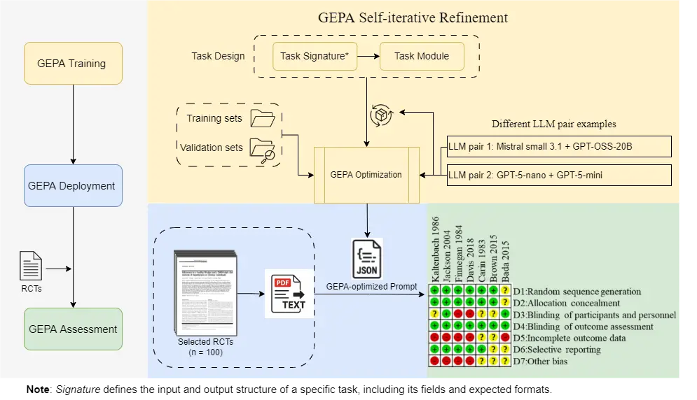
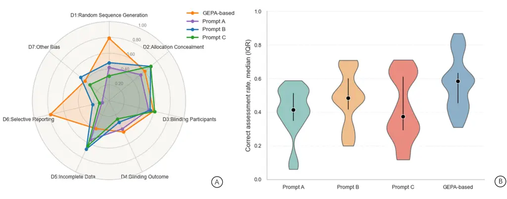

# Automated Risk-of-Bias Assessment of Randomized Controlled Trials: A First Look at a GEPA-trained Programmatic Prompting Framework

Lingbo Li ^(†)^(†)thanks: Corresponding author: L.Li5@massey.ac.nz
Affiliation: School of Mathematical and Computational Sciences
Affiliation: Massey University Affiliation: Auckland, New Zealand   

 Anuradha Mathrani Affiliation: School of Mathematical and Computational
Sciences Affiliation: Massey University Affiliation: Auckland, New
Zealand   

 Teo Susnjak Affiliation: School of Mathematical and Computational
Sciences Affiliation: Massey University Affiliation: Auckland, New
Zealand

###### Abstract

Assessing risk of bias (RoB) in randomized controlled trials is
essential for trustworthy evidence synthesis, but the process is
resource-intensive and prone to variability across reviewers. Large
language models (LLMs) offer a route to automation, but existing methods
rely on manually engineered prompts that are difficult to reproduce,
generalize, or evaluate. This study introduces a programmable RoB
assessment pipeline that replaces ad-hoc prompt design with structured,
code-based optimization using DSPy and its GEPA module. GEPA refines LLM
reasoning through Pareto-guided search and produces inspectable
execution traces, enabling transparent replication of every step in the
optimization process. We evaluated the method on 100 RCTs from published
meta-analyses across seven RoB domains. GEPA-generated prompts were
applied to both open-weight models (Mistral Small 3.1 with GPT-oss-20b)
and commercial models (GPT-5 Nano and GPT-5 Mini). In domains with
clearer methodological reporting, such as Random Sequence Generation,
GEPA-generated prompts performed best, with similar results for
Allocation Concealment and Blinding of Participants, while the
commercial model performed slightly better overall. We also compared
GEPA with three manually designed prompts using Claude 3.5 Sonnet. GEPA
achieved the highest overall accuracy and improved performance by
30%–40% in Random Sequence Generation and Selective Reporting, and
showed generally comparable, competitively aligned performance in the
other domains relative to manual prompts. These findings suggest that
GEPA can produce consistent and reproducible prompts for RoB assessment,
supporting the structured and principled use of LLMs in evidence
synthesis.

   

A Preprint

|     |
| --- |
|     |

*Keywords* Risk of bias, Randomized controlled trials, Large language
models, GEPA, Evidence Synthesis Automation, Programmatic Risk
Assessment

## 1 Introduction

Meta-analyses serve as cornerstone methodologies for synthesizing
clinical evidence \[1, 2\]. However, the credibility of such evidence
syntheses fundamentally depends on rigorous risk of bias (RoB)
assessments to evaluate the methodological quality of included studies
\[3, 4\]. This challenge is particularly relevant for randomized
controlled trials (RCTs), which constitute the primary evidence source
for intervention effectiveness and require specialized assessment
frameworks \[5\]. Currently, these assessments rely predominantly on
manual evaluation processes that, while methodologically sound, face
significant scalability challenges \[6, 7, 8\]. Manual RoB assessment is
inherently time-intensive, requiring expert reviewers to extract and
evaluate methodological details from each trial report \[6, 9, 10, 8,
7\]. Moreover, the process introduces unavoidable subjectivity, as
different reviewers may interpret identical methodological descriptions
differently, leading to inter-rater variability that can compromise the
reliability of evidence syntheses\[11, 12, 13, 14\].

Large language models (LLMs) have opened new opportunities for
automating evidence synthesis \[15\]. These models demonstrate strong
capabilities in processing unstructured clinical text \[16\],
understanding contextual dependencies\[17, 18, 19\], and adapting to
specialized domains \[20, 21\], making them promising tools for RoB
assessment. Several studies have explored the application of LLMs for
automating RoB assessment in systematic reviews and meta-analysis. Lai
et al.\[22\] applied GPT-series models and Claude to evaluate RoB in
randomized trials using a structured prompt developed by experts,
achieving high accuracy and substantial agreement with human reviewers.
However, the study was limited by a small sample size, reliance on
handcrafted prompts, and restricted validation within specific review
domains, leaving its generalizability uncertain. In early 2025,
Eisele-metzger et al.\[23\] evaluated Claude 2 using the RoB 2 tool and
reported only slight-to-fair agreement with human assessments,
emphasising inconsistencies in LLM performance across tools and
datasets. Lai et al.\[24\] further extended LLM applications to
complementary medicine, demonstrating that LLM-assisted approaches
achieved up to 97.9% accuracy and markedly reduced assessment time, yet
the study remained limited to complementary medicine RCTs and required
expert-designed prompts for reliable performance. Most recently, Xai et
al.\[25\] applied GPT-4o, Moonshot-v1-128k, and DeepSeek-V3 to cohort
studies, finding comparable accuracy (80.8–83.3%) and substantial
efficiency gains, though manual prompt construction and human oversight
were still required. Across these studies, despite encouraging progress,
LLM-based systems remained dependent on brittle, handcrafted prompts
which exhibit high variability in outputs\[26\]. They also possess
limited-domain validation, restricting their interpretability and
reproducibility required for transparent science, as well as scalability
across diverse review contexts.

In this study, we explored an alternative approach to LLM-driven RoB
assessment that emphasizes transparency, while offering modularity and
end-to-end integration. Rather than relying on static prompt
engineering, we leveraged the DSPy \[27\] framework (a Python framework
that lets users build and control LLM reasoning steps through clear,
modular code rather than opaque prompts) and its GEPA \[28\] module
(Genetic-Pareto, a prompt optimization algorithm that uses natural
language reflection and Pareto-based search to iteratively refine LLM
reasoning) to encode domain-specific decision logic in a structured,
programmable format that enhances both interpretability and
maintainability. Unlike prior approaches, this framework supports
few-shot learning while explicitly incorporating systematic validation,
and cross-task reuse, which removes manual prompt tuning. We focus
specifically on the original Cochrane RoB 1 \[29\] tool, capitalizing on
its deterministic structure and explicit criteria that render it
particularly amenable to transparent automation.

Therefore, we aim to answer a fundamental question: Can a
prompt-optimization based framework like GEPA effectively automate
Cochrane RoB 1 assessments for RCTs while maintaining alignment with
expert human judgments? To investigate this question, we applied our
methodology to a dataset of 100 RCTs that had been previously assessed
by systematic reviewers in published meta-analyses, enabling direct
comparison between automated model outputs and established expert
evaluations across all RoB domains. This study presents an investigation
to assess the feasibility of using structured, programmable LLM
pipelines for evidence synthesis. Our research makes four key
contributions to the field of automated RoB assessment. First, to our
knowledge, this is the first empirical study to implements the prompt
optimization approach to systematic reviews and meta-analysis as
proposed by Susnjak \[26\], with an application to RoB. Second, we
quantitatively validate GEPA-optimized prompts against expert
annotations from real-world meta-analysis. Third, we evaluate both
open-weight and commercial LLMs within the DSPy–GEPA workflow,
highlighting trade-offs between transparency, accessibility, and
performance. Fourth, we compare GEPA-generated prompts with handcrafted
human prompts, showing that GEPA achieves comparable accuracy while
offering substantially greater robustness and reproducibility. These
contributions show that programmatic prompt optimization can
meaningfully reduce reliance on manual prompt design, enhance
reproducibility, and provide a scalable, transparent foundation for
integrating LLMs into evidence-synthesis workflows. The modular,
code-based structure of DSPy–GEPA supports adaptation across clinical
domains and review settings, offering a practical pathway toward
sustainable, human-oversight-compatible automation in meta-analysis.

## 2 Methodology

Prompt-based automation of RoB assessment currently relies on extensive
manual prompt engineering and iterative refinement, often leading to
inconsistent and non-reproducible outcomes\[30\]. Instead of manually
crafting prompts, we used DSPy to programmatically construct and manage
them through the GEPA reasoning module. This pipeline replaces manual
prompt engineering with a programmatically trained process that learns
and manages prompts through declarative, modular components, enabling
transparent and reproducible evaluation (see Figure 1). The following
subsections describe the structure and implementation of this pipeline.

Figure 1: GEPA-based automated RoB assessment workflow

### 2.1 Study Design

We conceptualized automated RoB assessment as a structured, multi-domain
decision-making process, consistent with the Cochrane RoB 1 framework.
The study aimed to systematically generate domain-specific bias
judgments, classified as Low, High, or Unclear risk, for each RCT across
seven methodological domains: random sequence generation (whether
randomization was truly random and clearly described; requires an
appropriate random method), allocation concealment (whether group
assignments were hidden before enrollment; requires a mechanism
preventing foreknowledge of allocation), blinding of participants and
personnel (whether awareness of treatment could influence behavior or
care; requires masking when feasible), blinding of outcome assessors
(whether knowledge of allocation could affect outcome measurement;
requires blinded or independent assessors), incomplete outcome data
(whether missing or excluded data were handled properly; requires
balanced and transparent reporting), selective reporting (whether all
pre-specified outcomes were reported; requires full outcome disclosure),
and other bias (any remaining concerns such as early stopping or
baseline differences; requires justification of trial conduct and design
integrity). Detailed criteria for Low, High, and Unclear risk judgments
in each domain are provided in Appendix Table 5.

For this study, the test dataset comprised RCTs from ten meta-analyses,
randomly selected from Q1-ranked medical journals spanning diverse
clinical fields, including cardiovascular disease, metabolic disorders,
women’s health, and pediatrics. In total, 111 RCTs were identified;
after excluding non-English trials, 100 were randomly selected for
inclusion, with their distribution across clinical domains and
meta-analyses detailed in Table 1. Full-text RCTs constituted the
textual corpus for automated RoB evaluation, with author-reported RoB 1
judgments from the original meta-analyses acting as the initial human
reference standard (hereafter referred to as the Gold Labels). This
approach prioritized a diverse and neutral evaluation corpus, enabling
comprehensive benchmarking of model performance across varied reporting
styles and methodological contexts. The automated model’s outputs were
compared against Gold Labels to evaluate prediction agreement and assess
performance across RoB domains.

| Clinical Domain                      | No. of Meta-analyses | No. of RCTs (initial) | No. of RCTs (included) |
| ------------------------------------ | -------------------- | --------------------- | ---------------------- |
| Cardiovascular disease\[31, 32, 33\] | 3                    | 31                    | 30                     |
| Metabolic disorders\[34, 35, 36\]    | 3                    | 22                    | 22                     |
| Women’s health \[37, 38\]            | 2                    | 30                    | 23                     |
| Pediatrics\[39, 40\]                 | 2                    | 28                    | 25                     |
| Total                                | 10                   | 111                   | 100                    |

Table 1: Distribution of RCTs across clinical domains and meta-analyses

### 2.2 GEPA-based Modules

A customized GEPA implementation was developed within DSPy to enable
domain-specific reasoning for automated RoB assessment. All core
components, including the curated training and validation datasets,
paired DSPy Signatures definitions, module configurations were
specifically designed for this study. The subsequent subsections outline
the operational workflow, dataset optimization and model–environment
settings.

#### 2.2.1 Operational Workflow

The framework processes full-text RCTs (converted from PDF to plain text
using MinerU \[41\]) through a two-stage reasoning pipeline. For each of
the seven Cochrane RoB 1 domains, the system employs sequential
reasoning guided by paired questions based on Cochrane criteria: one
focusing on identifying information relevant to the methodological
process (e.g., “Extract the exact sentence(s) describing how the
allocation sequence was generated.”) and the other assessing the
adequacy of the reported method (e.g., “Was the allocation sequence
adequately generated?”). The reasoning process integrates textual
information and evaluative inference within a coherent reasoning
framework. Evidence identification operates as an internal reasoning
step that contextualizes each domain-specific judgment, while the final
output represents a categorical risk-of-bias classification (“low,”
“high,” or “unclear”).

#### 2.2.2 Dataset and Optimization

For each RoB 1 domain, a balanced dataset was constructed, consisting of
18 training and 12 validation examples evenly distributed across the
three risk categories. Each example comprised a domain-specific text
excerpt from an RCT, accompanied by a structured set of elements
including an evidence identification question, the corresponding
evidence span, an evaluative question, the annotated risk-of-bias label,
and the textual justification supporting that label. This setup
supported few-shot learning and iterative supervision under constrained
data conditions. GEPA optimization employed the auto=“light”
configuration (approximately 428 metric calls), balancing exploration
depth with computational efficiency. All optimization runs employed
fixed random seeds (42) and deterministic decoding parameters
(temperature = 0.0, top_p = 1.0). Nevertheless, because GEPA employs
heuristic multi-objective search, slight variations in the Pareto
optimization process can produce distinct yet equally valid optima, even
under identical configurations. We assessed the stability of GEPA
optimization by conducting five domain-level runs under identical
settings, generating distinct optimized prompts. Each prompt was then
evaluated three times on the test set to measure inference consistency
and performance variability.

#### 2.2.3 Language Models and Environment Settings

GEPA operates within DSPy (version used was 3.0.4b1) through a
dual-model setup, comprising a base model responsible for primary
reasoning and a reflection model guiding optimization feedback. Two
configurations were implemented to assess performance under different
computational constraints: an open-weight setup (Mistral 3.1
small\[42\] + GPT-oss-20b\[43\]) and a commercial setup
(GPT-5-nano\[44\] + GPT-5-mini\[45\]). All experiments were conducted
via the OpenRouter\[46\] API (September–October 2025) under uniform
computational settings. This setup ensured methodological consistency
and enabled direct comparison between the open-source and commercial
model families. All Python scripts are available at the GitHub
repository:
[https://github.com/Ivylee6108/GEPA_RoB.git](https://github.com/Ivylee6108/GEPA_RoB.git).

### 2.3 Evaluation

We implemented a multi-dimensional evaluation framework to assess both
the internal validity and external comparability of the GEPA-based RoB
assessment system. The evaluation comprised two complementary
components: (1) quantitative assessment of model performance and
stability, and (2) comparison with manually crafted RoB assessment
prompts from prior studies.

#### 2.3.1 Model Performance

Model performance was evaluated by comparing each model’s RoB
predictions against Gold Labels derived from published meta-analyses.
For each RoB domain, we computed standard agreement metrics, including
the correct assessment rate (accuracy), sensitivity, specificity,
positive predictive value (PPV), and negative predictive value (NPV),
each accompanied by 95% confidence intervals. Sensitivity was defined as
the proportion of instances labeled as “low risk” in the Gold Labels
that were correctly identified by the model. Specificity captured the
proportion of instances labeled as “unclear” or “high risk” that were
not correctly classified as “low risk” by the model. PPV represented the
proportion of model-assigned “low risk” judgments that were also labeled
as “low risk” in the Gold Labels, whereas NPV reflected the proportion
of model-assigned “unclear” or “high risk” judgments that were
consistent with the reference labels. Overall consistency was further
quantified using Cohen’s Kappa coefficient ($`\kappa`$, 95% CI). All
metrics were calculated directly from the resulting predictions.

#### 2.3.2 Comparison with Manually Crafted Prompt Sets

We also compared the proposed framework’s performance against three
manually crafted RoB assessment prompt sets from prior literature \[22,
24, 23\] (denoted as A \[23\], B \[22\], and C \[24\]). Prompt A was
developed under the RoB 2 tool and originally evaluated using Claude-2.
Because our framework follows the RoB 1 criteria, we matched the domains
for cross-version comparability by mapping A’s “random sequence
generation and allocation concealment” domain to the ROB 1 counterparts,
“randomization process” and “allocation concealment”. Prompt B and C
were both designed with RoB 1-like criteria but evaluated using
different LLMs (ChatGPT and Claude for B, Moonshot-v1-128k and
Claude-3.5-Sonnet for C). Both prompts used a four-level categorical
scale (“definitely yes,” “probably yes,” “probably no,” “definitely
no”). We harmonized these ratings with the tripartite RoB 1 scheme by
mapping “definitely yes/no” to low/high risk and “probably yes/no” to
unclear risk. Following this normalization, we merged their
blinding-related subdomains to match the seven canonical RoB 1 domains:
items concerning patients and providers were aggregated as blinding of
participants and personnel, while those related to data collectors,
outcome assessors, and analysts were grouped under blinding of outcome
assessment. Within each merged domain, we applied a hierarchical rule:
any subdomain rated “high” yielded an overall “high” rating; if all were
“low,” the domain was marked “low”; otherwise, “unclear.”

Although the three prior studies employed different language models, all
incorporated at least one model from the Claude family, therefore, we
re-evaluated prompt A–C using Claude-3.5-Sonnet \[47\]. We also
maintained continuity with these Claude-based evaluation settings by
adopting Claude-3.5-Sonnet as the teacher model in our GEPA framework,
providing a coherent and comparable assessment environment across all
approaches. Each manual prompt set (A–C) was executed three times under
identical conditions, and results were averaged across runs. For the
GEPA-based framework, five distinct prompts were generated through the
student–teacher interaction process (student: Mistral Small 3.1;
teacher: Claude-3.5-Sonnet). Each generated prompt was evaluated three
times using the same RCTs in Claude-3.5-Sonnet, and the results were
aggregated to yield the final framework performance. Model performance
was assessed using standard quantitative metrics (accuracy) computed at
both the domain and overall RoB judgment levels.

## 3 Results

This section outlines the evaluation results of our GEPA-based RoB
assessment pipeline. We present overall and domain-specific performance
for two pair models, comparing results against Gold Labels.

### 3.1 Overall Performance

RoB judgments generated by the two evaluated pair-models are summarized
in Table 2. The commercial model pair demonstrated higher overall
accuracy and domain-level consistency compared with the open-weight
pair. Across most RoB domains (D1–D5), the commercial models achieved
higher correct assessment rates, with relative improvements of
approximately 2–4 percentage points (e.g., 0.799 vs. 0.773 in D1 and
0.671 vs. 0.654 in D5). Sensitivity gains were similarly observed,
indicating enhanced ability to identify “low risk” cases (0.773 vs.
0.745 in D1; 0.671 vs. 0.654 in D5). Specificity remained high for both
systems, though the commercial pair showed slightly lower values in some
domains (e.g., 0.888 vs. 0.910 in D1), suggesting a modestly more
inclusive classification tendency. Both models achieved high positive
predictive values (PPV \> 0.9), while the commercial pair maintained
marginally higher negative predictive values (NPV), such as 0.721 vs.
0.714 in D1 and 0.804 vs. 0.781 in D3, reflecting greater stability in
“non–low-risk” assessments. Cohen’s $`\kappa`$ values followed a similar
pattern, with the commercial pair showing higher agreement with human
reference judgments in most domains (e.g., $`\kappa=0.602`$ vs. 0.567 in
D1). Agreement was weaker in selective reporting (D6) and other bias
(D7). Appendix Table 6, the gold-standard label distribution was
markedly imbalanced in several domains, particularly D6, where 89% of
studies were labeled “low risk.” Overall, the commercial models achieved
higher and more consistent performance across all evaluated metrics,
with improvements in accuracy, sensitivity, and NPV, and minimal
trade-offs in specificity and PPV.

|                                        |                                  |                      |                      |                      |                      |                         |
| -------------------------------------- | -------------------------------- | -------------------- | -------------------- | -------------------- | -------------------- | ----------------------- |
| Model Pair & RoB Domains               | Accuracy                         |                      |                      |                      |                      | Consistency             |
|                                        | Correct assessment rate (95% CI) | Sensitivity (95% CI) | Specificity (95% CI) | PPV (95% CI)         | NPV (95% CI)         | Cohen’s Kappa (95% CI)  |
| Mistral small 3.1 with GPT-oss-20b     |                                  |                      |                      |                      |                      |                         |
|     D1 (‘random sequence generation’)  | 0.773 (0.732, 0.813)             | 0.795 (0.729, 0.861) | 0.910 (0.869, 0.952) | 0.945 (0.926, 0.963) | 0.714 (0.648, 0.779) | 0.567 (0.528, 0.605)    |
|     D2 (‘allocation concealment’)      | 0.563 (0.509, 0.618)             | 0.402 (0.310, 0.493) | 0.927 (0.912, 0.942) | 0.830 (0.814, 0.845) | 0.638 (0.606, 0.671) | 0.248 (0.187, 0.309)    |
|     D3 (‘blinding participants’)       | 0.554 (0.466, 0.642)             | 0.470 (0.314, 0.626) | 0.981 (0.963, 0.999) | 0.952 (0.911, 0.992) | 0.724 (0.666, 0.783) | 0.350 (0.267, 0.433)    |
|     D4 (‘blinding outcome assessment’) | 0.395 (0.366, 0.425)             | 0.317 (0.293, 0.342) | 0.945 (0.928, 0.963) | 0.878 (0.842, 0.915) | 0.531 (0.522, 0.541) | 0.162 (0.138, 0.185)    |
|     D5 (‘incomplete outcome data’)     | 0.255 (0.199, 0.312)             | 0.169 (0.092, 0.246) | 0.908 (0.830, 0.986) | 0.833 (0.763, 0.903) | 0.309 (0.293, 0.324) | 0.046 (0.025, 0.067)    |
|     D6 (‘selective reporting’)         | 0.473 (0.377, 0.569)             | 0.478 (0.403, 0.553) | 0.437 (0.334, 0.539) | 0.870 (0.843, 0.898) | 0.095 (0.072, 0.118) | -0.029 (-0.076, 0.017)  |
|     D7 (‘other bias’)                  | 0.377 (0.305, 0.448)             | 0.201 (0.102, 0.301) | 0.913 (0.875, 0.950) | 0.720 (0.679, 0.761) | 0.515 (0.493, 0.537) | 0.080 (0.047, 0.113)    |
| GPT-5 Nano with GPT-5 mini             |                                  |                      |                      |                      |                      |                         |
|     D1 (‘random sequence generation’)  | 0.795 (0.769, 0.821)             | 0.811 (0.771, 0.852) | 0.888 (0.855, 0.920) | 0.932 (0.917, 0.946) | 0.721 (0.679, 0.763) | 0.602 (0.573, 0.631)    |
|     D2 (‘allocation concealment’)      | 0.591 (0.556, 0.627)             | 0.457 (0.409, 0.504) | 0.912 (0.903, 0.922) | 0.822 (0.809, 0.836) | 0.655 (0.637, 0.673) | 0.297 (0.252, 0.342)    |
|     D3 (‘blinding participants’)       | 0.591 (0.580, 0.603)             | 0.675 (0.665, 0.684) | 0.984 (0.974, 0.994) | 0.969 (0.951, 0.987) | 0.807 (0.803, 0.811) | 0.390 (0.379, 0.401)    |
|     D4 (‘blinding outcome assessment’) | 0.465 (0.424, 0.507)             | 0.513 (0.453, 0.572) | 0.803 (0.784, 0.822) | 0.761 (0.753, 0.769) | 0.576 (0.551, 0.601) | 0.191 (0.160, 0.222)    |
|     D5 (‘incomplete outcome data’)     | 0.304 (0.265, 0.343)             | 0.194 (0.163, 0.226) | 0.959 (0.937, 0.981) | 0.922 (0.886, 0.959) | 0.327 (0.319, 0.336) | 0.107 (0.087, 0.127)    |
|     D6 (‘selective reporting’)         | 0.389 (0.225, 0.554)             | 0.387 (0.240, 0.534) | 0.467 (0.367, 0.567) | 0.841 (0.803, 0.880) | 0.087 (0.080, 0.093) | -0.044 (-0.054, -0.033) |
|     D7 (‘other bias’)                  | 0.300 (0.274, 0.326)             | 0.135 (0.063, 0.206) | 0.893 (0.827, 0.959) | 0.595 (0.548, 0.641) | 0.488 (0.483, 0.493) | 0.017 (-0.004, 0.038)   |

- •
  Abbreviations: CI, confidence interval; PPV, positive predictive
  value; NPV, negative predictive value.
- •
  Sensitivity: proportion correctly classified as ‘low risk’ by each
  evaluated model (as specified in the table) in relation to all ‘low
  risk’ judgements by the Gold Labels.
- •
  Specificity: proportion correctly classified as ‘unclear’ or ‘high
  risk’ by each evaluated model in relation to all such judgements by
  the Gold Labels.
- •
  PPV: proportion correctly classified as ‘low risk’ by each evaluated
  model in relation to all ‘low risk’ judgements by that model.
- •
  NPV: proportion correctly classified as ‘unclear’ or ‘high risk’ by
  each evaluated model in relation to all such judgements by that model.

Table 2: Performance of different LLMs compared to the Gold Labels
($`n=100`$ RCTs)

### 3.2 Performance Comparison with Manual Prompts

We compared the GEPA-generated prompt performance with three
representative manually designed prompts (Prompt A, Prompt B, and Prompt
C) to examine its generalizability and consistency (see Figure 2). The
GEPA-generated prompt presents a more balanced radar shape than the
manually designed prompts, suggesting steadier performance across
different types of bias assessment. The most pronounced advantages of
the GEPA-generated prompt are observed in Random Sequence Generation
(mean = 0.79, 95% CI 0.74–0.84) and Selective Reporting (mean = 0.78,
95% CI 0.70–0.86), where its accuracy exceeds that of the best manual
prompts by approximately 0.30–0.40. The higher accuracy suggests that
the prompts generated by GEPA guided the LLM to make more accurate risk
judgments than the manually constructed prompts. The GEPA-generated
prompt also performs slightly better, though less markedly, in Blinding
of Outcome Assessment (mean = 0.44, 95% CI 0.40–0.48), showing a modest
improvement over manual prompts. In Allocation Concealment (mean = 0.60,
95% CI 0.56–0.63) and Blinding of Participants (mean = 0.60, 95% CI
0.57–0.62), GEPA performs on par with the strongest manual prompts (mean
= 0.61–0.70). For Other Bias, where only Prompts B, C, and GEPA were
compared, the GEPA-generated prompt reaches a mean accuracy of 0.40 (95%
CI 0.34–0.46), comparable to Prompt B (mean = 0.47, 95% CI 0.43–0.51)
and higher than Prompt C (mean = 0.32, 95% CI 0.29–0.35). GEPA maintains
accuracy within the upper range of manual prompts. In the Incomplete
Data domain, the GEPA-generated prompt performed less well than the
manually designed prompts. Its mean correct assessment rate was 0.39
(95% CI 0.33–0.45), compared with 0.55 (95% CI 0.50–0.60) for Prompt A,
0.68 (95% CI 0.64–0.72) for Prompt B, and 0.63 (95% CI 0.60–0.66) for
Prompt C. The lower accuracy suggests that GEPA was less effective in
distinguishing between the different risk levels for incomplete data.
Across all evaluations, the GEPA-generated prompts achieved the highest
overall accuracy, with a median of 0.59 when averaged across the seven
risk-of-bias domains. In comparison, the manually designed prompts
reached medians of 0.49 for Prompt B, 0.38 for Prompt C, and 0.42 for
Prompt A. Among them, Prompt A covered six domains, while Prompt B,
Prompt C, and the GEPA-based approach included all seven. The higher
median for the GEPA-generated prompts indicates that they enable the
model to make more accurate and stable risk judgments across domains.

Figure 2: Performance comparison of GEPA-based and manually designed
prompts. Radar plots (A) show domain-level mean accuracy across all
domains, and violin plots (B) summarize overall correct assessment rates

### 3.3 Computational Efficiency and Resource Cost

The GEPA framework demonstrated high computational efficiency and
affordability across all evaluated model configurations (see Table 3).
The training process consisted of two measurable components: the main
generation cost, incurred by the primary LLM, and the reflection cost,
generated during the self-evaluation stage by reflective LLM. Across
model pairs, both components remained modest. For example, in the
openweight configuration (Mistral small 3.1 with GPT-oss-20b), the main
cost for each domain averaged \$0.04, with an additional reflection cost
of \$0.01–\$0.02. Even when employing more capable models such as Claude
3.5-sonnet, the reflection cost remained highly manageable (\$0.2–\$0.5
per domain). Total training time ranged from approximately 22 minutes
for Mistral small 3.1 with Claude 3.5-sonnet to under three hours for
the GPT-5 Nano with GPT-5 mini setup. Importantly, the testing or
inference cost per article was extremely low(typically below
\$0.001–\$0.05), and the processing time per document remained within a
few minutes, depending on the model used. These findings confirm that
the GEPA procedure is transparent, quantifiable, and cost-efficient,
offering reproducible and affordable time–cost trade-offs suitable for
RoB synthesis applications.

|                                          |                         |                               |                      |                         |                       |
| ---------------------------------------- | ----------------------- | ----------------------------- | -------------------- | ----------------------- | --------------------- |
| Model Pair & RoB Domains                 | Training Procedure      |                               |                      | Testing Procedure       |                       |
|                                          | Main Cost (\$) (95% CI) | Reflection Cost (\$) (95% CI) | Time (min) (95% CI)  | Cost\* (\$) (95% CI)    | Time\* (min) (95% CI) |
| Mistral small 3.1 with GPT-oss-20b       |                         |                               |                      |                         |                       |
|     D1 (‘random sequence generation’)    | 0.039 (0.031, 0.048)    | 0.013 (0.006, 0.020)          | 88.7 (83.8, 93.6)    | 0.0006 (0.0005, 0.0008) | 1.6 (1.6, 1.7)        |
|     D2 (‘allocation concealment’)        | 0.036 (0.032, 0.040)    | 0.016 (0.011, 0.020)          | 91.4 (86.8, 96.0)    |                         |                       |
|     D3 (‘blinding participants’)         | 0.040 (0.034, 0.047)    | 0.028 (0.020, 0.035)          | 94.2 (88.2, 100.2)   |                         |                       |
|     D4 (‘blinding outcome assessment’)   | 0.036 (0.026, 0.047)    | 0.010 (0.007, 0.014)          | 89.8 (83.3, 96.3)    |                         |                       |
|     D5 (‘incomplete outcome data’)       | 0.046 (0.040, 0.052)    | 0.013 (0.010, 0.016)          | 92.5 (86.8, 98.2)    |                         |                       |
|     D6 (‘selective reporting’)           | 0.048 (0.041, 0.056)    | 0.016 (0.013, 0.018)          | 87.9 (83.0, 92.8)    |                         |                       |
|     D7 (‘other bias’)                    | 0.041 (0.029, 0.054)    | 0.014 (0.012, 0.017)          | 90.6 (84.8, 96.3)    |                         |                       |
| GPT-5 Nano with GPT-5 mini               |                         |                               |                      |                         |                       |
|     D1 (‘random sequence generation’)    | 0.657 (0.457, 0.741)    | 0.161 (0.130, 0.191)          | 110.5 (95.3, 130.2)  | 0.0014 (0.0012, 0.0019) | 8.7 (8.6, 8.8)        |
|     D2 (‘allocation concealment’)        | 0.550 (0.493, 0.608)    | 0.111 (0.091, 0.132)          | 89.7 (84.2, 95.3)    |                         |                       |
|     D3 (‘blinding participants’)         | 0.726 (0.626, 0.826)    | 0.150 (0.126, 0.174)          | 134.1 (99.2, 168.9)  |                         |                       |
|     D4 (‘blinding outcome assessment’)   | 0.913 (0.631, 1.195)    | 0.108 (0.086, 0.130)          | 169.5 (127.3, 180.6) |                         |                       |
|     D5 (‘incomplete outcome data’)       | 0.742 (0.486, 0.997)    | 0.133 (0.117, 0.149)          | 133.8 (95.1, 152.4)  |                         |                       |
|     D6 (‘selective reporting’)           | 0.681 (0.559, 0.804)    | 0.169 (0.143, 0.195)          | 125.6 (104.8, 146.3) |                         |                       |
|     D7 (‘other bias’)                    | 0.867 (0.596, 1.138)    | 0.143 (0.114, 0.172)          | 138.9 (109.1, 168.8) |                         |                       |
| Mistral small 3.1 with Claude-3.5-sonnet |                         |                               |                      |                         |                       |
|     D1 (‘randomization generation’)      | 0.030 (0.029, 0.032)    | 0.254 (0.220, 0.287)          | 21.3 (20.5, 22.2)    | 0.0552 (0.0468, 0.0631) | 1.7 (1.6, 1.8)        |
|     D2 (‘allocation concealment’)        | 0.031 (0.030, 0.032)    | 0.297 (0.264, 0.330)          | 22.2 (21.2, 23.3)    |                         |                       |
|     D3 (‘blinding participants’)         | 0.036 (0.035, 0.037)    | 0.460 (0.429, 0.491)          | 22.4 (20.7, 24.2)    |                         |                       |
|     D4 (‘blinding outcome assessment’)   | 0.033 (0.032, 0.034)    | 0.212 (0.157, 0.267)          | 18.2 (16.7, 19.7)    |                         |                       |
|     D5 (‘incomplete outcome data’)       | 0.037 (0.035, 0.038)    | 0.377 (0.263, 0.490)          | 24.1 (21.0, 27.1)    |                         |                       |
|     D6 (‘selective reporting’)           | 0.035 (0.034, 0.037)    | 0.402 (0.380, 0.425)          | 23.1 (20.6, 25.6)    |                         |                       |
|     D7 (‘other bias’)                    | 0.037 (0.034, 0.040)    | 0.447 (0.384, 0.510)          | 25.1 (22.7, 27.4)    |                         |                       |

- •
  Note. \* Cost and time are measured per article (i.e., total cost and
  total processing time for one document).

Table 3: Computational cost and time efficiency of the GEPA-based
approach

### 3.4 Disagreement Analysis

We analysed disagreements across all seven RoB domains to investigate
where and why GEPA-based automated judgments diverged from human
ratings. Rather than assuming that such divergences necessarily
reflected errors, we sought to understand how LLMs, prompted with
structured reasoning templates from GEPA, may be interpreting the
available evidence in ways that differ from human reviewers. We focused
on two dimensions: the direction of disagreement and the evidentiary
characteristics that appeared to trigger these divergences.

#### 3.4.1 Overall distribution and directional tendencies

Quantitative results showed substantial variability in GEPA–gold
agreement across domains (See Table 2, Figure 2). Mean accuracies ranged
from 0.30 to 0.83, and Cohen’s $`\kappa`$ from –0.04 to 0.57, indicating
that consistency was uneven and typically limited to slight or fair
agreement. Only random sequence generation (D1) achieved a moderate
level of agreement (mean $`\kappa`$ = 0.57), while most other domains
fell below $`\kappa`$ = 0.40. An instructive outlier was D6 (selective
reporting): Claude 3.5 sonnet achieved high accuracy (0.80), yet
$`\kappa`$ was close to zero. This reflects the impact of extreme class
imbalance in the gold data (89 low risk vs. 11 unclear, 0 high), which
suppresses $`\kappa`$ despite meaningful agreement. In such cases, raw
accuracy is a more valid indicator of alignment.

Despite this variability, the direction of disagreement was remarkably
consistent: models were systematically more cautious than the reference,
most often downgrading low/high risk ratings to unclear. Across domains,
models tended to require explicit procedural detail before assigning a
low/high risk label, even in cases where human reviewers accepted
adequacy based on conventional phrasing or contextual inference. Rather
than indicating random inconsistency or optimism, these divergences
point to a prompt-conditioned inferential style grounded in textual
literalism. This “conservatism bias” was particularly salient when
reports used formulaic expressions (e.g., “participants were
randomized,” “sealed envelopes were used”) without elaborating
operational safeguards. In such cases, models treated absent detail as
residual uncertainty, whereas human raters inferred adequacy from tacit
norms.

Model scale modulated the strength of this tendency, but not the
direction. Larger and more instruction-tuned LLMs achieved higher
agreement, particularly in domains requiring interpretive ability (e.g.,
selective reporting by Claude 3.5 sonnet achieve 80% accuracy, while
mistral 3.1 small and GPT-5nano only have accuracy below 50%, strong LLM
granted low risk when the reporting was stylistically polished or
implied sufficiency.) Yet even the strongest models retained the core
conservatism shaped by GEPA prompts, hesitating to assign low/high risk
without direct textual confirmation. This suggests that improved
alignment arose not from optimism, but from smarter caution.

#### 3.4.2 Domain-specific disagreement illustrations

While the overall direction of disagreement revealed a prompt-driven
conservatism in model behavior, its manifestation varied across domains.
This section presents illustrative examples from each domain to
highlight the types of textual cues that most frequently triggered
divergences, and how the LLMs’ interpretive strategies conflicted with
Gold Labels. These examples reflect the typical failure modes or
thresholds of caution observed in that domain under GEPA-prompted
inference. We include a representative example from the domain of
“allocation concealment” in Table 4 to concretely illustrate the how
LLMs demand for explicit textual confirmation led to a downgrade
relative to human judgment. Additional examples across all domains are
provided in Appendix Table 7.

[TABLE]

Table 4: Representative disagreement in the domain of allocation
concealment

##### D1: Randomization generation

Disagreements in this domain were relatively rare, with most labels
aligning between LLM predictions and the gold standard. When
disagreements occurred, they typically reflected the influence of the
GEPA-generated prompts, which emphasized the need for explicitly
documented randomization procedures. For example, studies that merely
stated “participants were randomized” were frequently labeled unclear by
the model, even when human reviewers judged them as low risk. Since the
GEPA framework was trained on annotated data to produce prompts that
foreground direct evidence (e.g., “computer-generated sequence”, “random
number table”), the resulting prompts shaped the model’s interpretive
stance to demand such concrete phrasing before assigning low risk.
Rather than relying on conventional assumptions, the model treated vague
or formulaic expressions as insufficient, reflecting a more text-bound
evidentiary threshold encouraged by the GEPA-guided prompting.

##### D2: Allocation concealment

This domain showed a high rate of disagreement, primarily reflecting
LLMs’ insistence—guided by GEPA prompts—on detailed procedural
transparency. GEPA prompts highlighted key indicators such as opaque,
sequentially numbered, and independently administered concealment
methods. In contrast, many trial reports used generic phrases like
“envelopes were used” without specifying safeguards. The LLMs, following
GEPA’s stricter evidentiary framing, typically assigned unclear unless
all key qualifiers were present.

##### D3: Blinding participants

Disagreements in this domain were frequent and predominantly reflected
the conservative evidentiary stance encouraged by the GEPA-generated
prompts. In trials involving physical, behavioral, or lifestyle
interventions, the models rarely assigned low risk unless explicit
descriptions of blinding procedures were present. GEPA’s structured
prompting emphasized the need to verify whether participants and
personnel were blinded and whether the lack of blinding could plausibly
influence performance-related outcomes. As a result, when reports did
not clearly state whether blinding was implemented, or when blinding was
inherently infeasible due to the nature of the intervention, the LLMs
defaulted to high or unclear risk.

##### D4: Blinding outcome assessment

Disagreements in this domain were common and primarily stemmed from the
models’ insistence on explicit evidence of assessor blinding. Guided by
GEPA-derived prompts, the LLMs required concrete details, such as who
conducted the outcome assessments, whether they were blinded, and how
blinding was implemented. Human reviewers, by contrast, frequently
assigned low risk when measurement tools were objective or standardized,
inferring adequate protection against detection bias. This divergence
reflects GEPA’s conservative evidentiary stance: lacking direct textual
confirmation, the model defaulted to unclear, prioritizing procedural
transparency over contextual inference.

##### D5: Incomplete outcome data

Disagreements in this domain also reflected the LLMs’ limited access to
information presented in non-textual elements, such as CONSORT flow
diagrams. While GEPA-trained LLMs required explicit numerical reporting
(e.g., dropout counts, reasons for attrition) and detailed analytical
descriptions (e.g., intention-to-treat implementation) in the text
before assigning low risk, human reviewers often integrated information
from figures or supplementary materials. Consequently, human raters
judged some cases as low risk when visual data indicated minimal,
balanced attrition, even though the textual record alone appeared
incomplete. This divergence highlights how LLMs, constrained by textual
input and GEPA’s rigid evidentiary thresholds, may underestimate
reporting adequacy compared to human reviewers’ more holistic
interpretations.

##### D6: Selective reporting

Disagreements in this domain were shaped by LLMs’ differing thresholds
for what constitutes sufficient evidence of outcome reporting
transparency. Despite being trained on GEPA examples where comprehensive
outcome reporting sufficed for low risk, even without quoting registry
contents, smaller models (e.g., Mistral, GPT-5 nano) often defaulted to
unclear unless a direct comparison to a registered protocol was present.
This conservatism persisted even when reports listed all primary and
secondary outcomes transparently. In contrast, stronger models like
Claude more accurately captured the intended standard. When trial
reports mentioned a protocol or registration and provided detailed,
structured outcome reporting, Claude was more likely to assign low risk,
reflecting better generalization of the training signal. Divergence in
this domain was therefore more about the models’ varying ability to
infer adequacy from indirect cues.

##### D7: Other bias

Disagreements in this domain were highly variable and largely stemmed
from the inherently subjective nature of the “Other bias” category in
RoB 1. Human reviewers themselves often applied this domain
inconsistently, as it covers a wide array of loosely defined concerns,
ranging from funding sources to adherence issues or baseline imbalances.
GEPA-trained LLMs struggled to apply stable criteria, particularly when
trial texts mentioned potential bias-adjacent issues (e.g., small sample
sizes or recruitment concerns) without clarifying their methodological
implications. In such cases, models typically defaulted to unclear,
reflecting both a conservative stance and ambiguity in the task framing.
Some disagreements arose from the models’ heightened caution, while
others reflected divergent assumptions about what constitutes a
risk-relevant concern.

## 4 Discussion

In this study, we introduce a programmatic approach for optimizing
prompts used in LLM, namely assisted RoB assessment. Rather than relying
on manually crafted instructions, which can vary widely across different
teams, GEPA formalizes prompt development as an explicit, data-driven
optimization procedure. Our findings demonstrate that optimized prompts
can meaningfully improve the consistency and robustness of automated RoB
judgments, while also revealing important methodological considerations
related to the inherent subjectivity of RoB assessment, domain-specific
variability, and the continued need for human oversight.

### 4.1 From Hand-Crafted to Programmatically Optimized Prompts

Prompt development for LLM-assisted evidence synthesis has historically
relied on expert intuition and iterative trial-and-error. Hand-crafted
prompts embed tacit heuristics and stylistic tendencies that differ
across reviewers, leading to substantial variability and limited
reproducibility. Moreover, manual prompts are inherently volatile: small
changes in wording or formatting can produce disproportionately
different LLM outputs, undermining the stability required for reliable
RoB assessment. This fragility is particularly consequential in domains
where judgments depend on contextual interpretation. As a result,
handcrafted prompts constrain the transparency, portability, and
standardization needed for evidence-based workflows and create
persistent challenges whenever models are updated or replaced. GEPA
addresses these methodological limitations by formalizing prompt design
as a structured optimization problem. Rather than depending on
subjective refinement, GEPA systematically searches a broad space of
candidate prompts and identifies those that satisfy predefined criteria
for accuracy, faithfulness, and conciseness. Crucially, the entire
optimization process produces comprehensive execution traces, including
intermediate candidates, reasoned model outputs, Pareto-front
evaluations, and the final compiled prompt, which can be inspected,
versioned, and shared with the scientific community. This level of
transparency is rarely achievable with handcrafted prompts and
represents a substantial advance in the reproducibility of LLM-driven
RoB assessment. Because every step of the search and selection process
is logged, GEPA produces prompts that are transparent, reproducible, and
model-agnostic. Our experiments show that optimized prompts transfer
effectively across related models, indicating that GEPA captures
task-level regularities instead of overfitting to model-specific
linguistic quirks. This methodological stability enables GEPA to serve
as a durable foundation for LLM-based evidence synthesis, even as LLM
architectures continue to change.

### 4.2 Human Oversight with Minimal Prompt Design Burden

Beyond methodological reproducibility, GEPA-optimized prompts inform on
how human reviewers interact with LLM-assisted workflows. In
conventional pipelines, a major barrier to reliable automation is the
substantial manual effort required to design and validate prompts for
each RoB domain. This task demands methodological expertise and can vary
widely across reviewers, introducing inefficiencies and inconsistencies
into the workflow. As prompts often need re-engineering when models
evolve, maintaining such pipelines becomes labor-intensive and
error-prone. GEPA alleviates this burden by generating stable,
criteria-oriented prompts without requiring manual engineering. With
optimized prompts in place, LLMs can provide consistent, text-grounded
first-pass assessments, allowing human reviewers to redirect their
expertise toward higher-value activities, such as adjudicating ambiguous
cases, integrating evidence across trials, and ensuring coherence with
the broader literature. This redistribution of effort enhances
efficiency, reduces workflow fragility, and is particularly advantageous
for teams with heterogeneous training or when processing large volumes
of evidence rapidly. Rather than replacing human judgment, GEPA supports
a more structured, dependable human-in-the-loop process by removing the
need for handcrafted prompts.

### 4.3 Domain-Specific Variability

The performance of GEPA-optimized prompts requires deeper consideration
on the conduct of human RoB assessment itself. Prior works \[49, 50,
51\] repeatedly shown that reviews differ in how strictly they apply RoB
criteria, and RoB judgments are inherently subjective, with only
moderate agreement even among trained reviewers. Many systematic review
teams rely on contributors with varying levels of methodological
expertise, and reviewers frequently draw on tacit knowledge, prior
experience, or domain-specific expectations that are not explicitly
codified in guidance documents. These factors introduce variability into
human assessments that is difficult to eliminate, even with standardized
tools such as the Cochrane RoB tool. As a result, the GEPA-optimized
prompts reflect of a mixture of high-quality judgment, heterogeneous
heuristics, and variable interpretive practices. Their judgement do not
affect all RoB domains equally. Domains with clearly specified criteria,
such as random sequence generation and allocation concealment, tend to
elicit more consistent human assessments, providing GEPA with a stronger
and more coherent supervisory signal. In contrast, domains such as other
bias or incomplete outcome data involve greater interpretive
flexibility, lower inter-rater reliability, and more heterogeneous
reasoning. GEPA faces an intrinsically more difficult optimization
problem, and performance ceilings naturally differ across domains.
However, this variability also highlights an important methodological
advantage of GEPA. By optimizing prompts against patterns that are
stable across many annotations, GEPA distills a more standardized and
reproducible interpretation of RoB criteria than can typically be
achieved by individual reviewers. In contrast to handcrafted prompts,
GEPA learns decision boundaries shaped by aggregate judgment behavior,
smoothing over idiosyncratic tendencies. Through this process, GEPA
tends to adopt a more conservative and criteria-driven stance,
particularly when textual justification is incomplete. This strictness
corresponds to the normative intent of RoB tools, which emphasize
cautious inference when reporting is insufficient, and contrasts with
the more permissive patterns sometimes observed among untrained or
inconsistently trained reviewers. Therefore, within the constraints of
what is documented in trial reports, GEPA provides a stable, defensible
baseline that is often more consistent than typical human practice,
especially in resource-limited review settings.

### 4.4 Implications for Evidence Synthesis

Adoption of GEPA has implications that extend beyond automating discrete
components of RoB assessment. By replacing handcrafted prompts with a
reproducible optimization procedure, GEPA offers a practical mechanism
for standardizing the interface between human judgment and LLM-based
reasoning. This development is particularly relevant for systematic
reviews and living evidence syntheses, where variability in reviewer
expertise and constraints on time and resources often limit the
consistency of methodological appraisal. Equally important, GEPA’s
complete execution logs provide an auditable record of how reasoning
strategies were derived. These traces can be packaged and shared
alongside the compiled prompts, facilitating scientific replication,
model-to-model comparison, and long-term reproducibility in evidence
synthesis workflows. More broadly, GEPA illustrates how programmatic
optimization can be used to formalize and stabilize workflows that have
traditionally relied on tacit knowledge or iterative trial-and-error.
Embedding such standardized components into evidence synthesis pipelines
has the potential to enhance reproducibility, reduce reviewer workload,
and support scalable review processes as evidence bases continue to
expand. While human oversight remains essential, GEPA demonstrates a
pathway toward more structured, transparent, and sustainable integration
of LLMs in evidence synthesis practice.

## 5 Conclusion, Limitations, and Future Research

This study introduced a programmatic and fully auditable approach to
automating risk-of-bias assessment, replacing volatile manually crafted
prompts with a transparent and optimizable computational process. The
GEPA-based optimization pipeline systematically learns and refines
reasoning strategies through structured Pareto-guided search rather than
ad-hoc textual instructions. The method achieved expert-level
consistency in objective domains, such as random sequence generation and
allocation concealment, while maintaining interpretability,
transparency, and reproducibility. Importantly, every step of the
optimization procedure generates inspectable execution traces that can
be packaged and shared to support full scientific replication. In more
subjective domains, including blinding outcome assessment and other
bias, its cautious performance highlights the continued need for
contextual reasoning and human oversight.

Despite these contributions, several limitations warrant attention and
provide directions for future research. First, our framework is built
around the RoB 1 tool, which relies on domain-level judgments and does
not incorporate the signaling-question–based structure introduced in RoB 2. Extending GEPA to accommodate multi-step reasoning chains and
conditional decision rules would enhance its applicability and alignment
with current methodological standards. Second, our preprocessing relied
on PDF-to-text conversion, resulting in the loss of figures and flow
diagrams that may contain relevant methodological information.
Integrating multimodal inputs or structured metadata may help mitigate
this limitation. Third, the dataset used for optimization was selected
to balance coverage and feasibility, but the optimal scope and
characteristics of such datasets remain unclear. Variability in human
RoB judgments, particularly in domains with lower inter-rater agreement,
also limits the achievable ceiling for fully automated systems. Future
work should examine how larger, more diverse, and more consistently
annotated datasets could improve stability and generalizability.

Beyond these methodological considerations, GEPA illustrates a broader
opportunity for extending programmatic optimization within evidence
synthesis. By replacing ad-hoc prompt design with a principled
optimization pipeline, the framework demonstrates how interpretive
reasoning tasks can be formalized, audited, and scaled. Although the
present study focuses on RoB assessment, the same principles could be
applied to other components of meta-analytic workflows, including
literature retrieval, data extraction, and evidence aggregation, where
reproducibility, traceability, and scalable human oversight are
essential.

## References

- \[1\] H. Cooper (2017) Research Synthesis and Meta-Analysis: A
  Step-by-Step Approach. 5 edition, SAGE Publications, Inc, Thousand
  Oaks, California. External Links:
  [Link](https://methods.sagepub.com/book/mono/research-synthesis-and-meta-analysis-5e/toc),
  [Document](https://dx.doi.org/10.4135/9781071878644) Cited by: §1.
- \[2\] J. J. Deeks, J. P. Higgins, D. G. Altman, and on behalf of the
  Cochrane Statistical Methods Group (2019) Analysing data and
  undertaking meta-analyses. In Cochrane Handbook for Systematic Reviews
  of Interventions, pp. 241–284. External Links: ISBN 9781119536604,
  [Document](https://dx.doi.org/https%3A//doi.org/10.1002/9781119536604.ch10),
  [Link](https://onlinelibrary.wiley.com/doi/abs/10.1002/9781119536604.ch10),
  https://onlinelibrary.wiley.com/doi/pdf/10.1002/9781119536604.ch10
  Cited by: §1.
- \[3\] L. Ma, Y. Wang, Z. Yang, D. Huang, H. Weng, and X. Zeng (2020)
  Methodological quality (risk of bias) assessment tools for primary and
  secondary medical studies: what are they and which is better?.
  Military Medical Research 7 (1), pp. 7. External Links:
  [Document](https://dx.doi.org/10.1186/s40779-020-00238-8),
  [Link](https://doi.org/10.1186/s40779-020-00238-8), ISSN 2054-9369
  Cited by: §1.
- \[4\] K. Kolaski, L. R. Logan, and J. P. A. Ioannidis (2023) Guidance
  to best tools and practices for systematic reviews. Systematic Reviews
  12 (1), pp. 96. External Links:
  [Document](https://dx.doi.org/10.1186/s13643-023-02255-9),
  [Link](https://doi.org/10.1186/s13643-023-02255-9), ISSN 2046-4053
  Cited by: §1.
- \[5\] J. P. T. Higgins, J. Thomas, J. Chandler, M. Cumpston, T.
  Li, M. J. Page, and V. A. Welch (Eds.) (2024) Cochrane handbook for
  systematic reviews of interventions. Version 6.5 edition, Cochrane.
  Note: Updated February 2024 External Links:
  [Link](https://training.cochrane.org/handbook/current) Cited by: §1.
- \[6\] I. J. Marshall, J. Kuiper, and B. C. Wallace (2015) Automating
  risk of bias assessment for clinical trials. IEEE Journal of
  Biomedical and Health Informatics 19 (4), pp. 1406–1412. External
  Links: [Document](https://dx.doi.org/10.1109/JBHI.2015.2431314) Cited
  by: §1.
- \[7\] P. S. J. Jardim, C. J. Rose, H. M. Ames, J. F. M. Echavez, S.
  Van de Velde, and A. E. Muller (2022) Automating risk of bias
  assessment in systematic reviews: a real-time mixed methods comparison
  of human researchers to a machine learning system. BMC Medical
  Research Methodology 22 (1), pp. 167. External Links:
  [Document](https://dx.doi.org/10.1186/s12874-022-01649-y),
  [Link](https://doi.org/10.1186/s12874-022-01649-y), ISSN 1471-2288
  Cited by: §1.
- \[8\] E. Tomlinson, C. Cooper, C. Davenport, A. W.S. Rutjes, M.
  Leeflang, S. Mallett, and P. Whiting (2024) Common challenges and
  suggestions for risk of bias tool development: a systematic review of
  methodological studies. Journal of Clinical Epidemiology 171,
  pp. 111370. External Links: ISSN 0895-4356,
  [Document](https://dx.doi.org/https%3A//doi.org/10.1016/j.jclinepi.2024.111370),
  [Link](https://www.sciencedirect.com/science/article/pii/S0895435624001252)
  Cited by: §1.
- \[9\] R. Borah, A. W. Brown, P. L. Capers, and K. A. Kaiser (2017)
  Analysis of the time and workers needed to conduct systematic reviews
  of medical interventions using data from the prospero registry. BMJ
  Open 7 (2). External Links:
  [Document](https://dx.doi.org/10.1136/bmjopen-2016-012545), ISSN
  2044-6055, [Link](https://bmjopen.bmj.com/content/7/2/e012545),
  https://bmjopen.bmj.com/content/7/2/e012545.full.pdf Cited by: §1.
- \[10\] J. P.T. Higgins, J. Thomas, J. Chandler, M. Cumpston, T.
  Li, M. J. Page, and V. A. Welch (2019) Cochrane handbook for
  systematic reviews of interventions. wiley (English (US)). Note:
  Publisher Copyright: © 2019 The Cochrane Collaboration. External
  Links: [Document](https://dx.doi.org/10.1002/9781119536604), ISBN
  9781119536628 Cited by: §1.
- \[11\] S. Minozzi, M. Cinquini, S. Gianola, G. Castellini, C. Gerardi,
  and R. Banzi (2019) Risk of bias in nonrandomized studies of
  interventions showed low inter-rater reliability and challenges in its
  application. Journal of Clinical Epidemiology 112, pp. 28–35. External
  Links: ISSN 0895-4356,
  [Document](https://dx.doi.org/https%3A//doi.org/10.1016/j.jclinepi.2019.04.001),
  [Link](https://www.sciencedirect.com/science/article/pii/S0895435619301179)
  Cited by: §1.
- \[12\] M. M. Jeyaraman, N. Al-Yousif, R. C. Robson, L. Copstein, C.
  Balijepalli, K. Hofer, M. S. Fazeli, M. T. Ansari, A. C. Tricco, R.
  Rabbani, and A. M. Abou-Setta (2020) Inter-rater reliability and
  validity of risk of bias instrument for non-randomized studies of
  exposures: a study protocol. Systematic Reviews 9 (1), pp. 32.
  External Links:
  [Document](https://dx.doi.org/10.1186/s13643-020-01291-z),
  [Link](https://doi.org/10.1186/s13643-020-01291-z), ISSN 2046-4053
  Cited by: §1.
- \[13\] J. Belur, L. Tompson, A. Thornton, and M. Simon (2021)
  Interrater reliability in systematic review methodology: exploring
  variation in coder decision-making. Sociological Methods & Research 50
  (2), pp. 837–865. External Links:
  [Document](https://dx.doi.org/10.1177/0049124118799372),
  [Link](https://doi.org/10.1177/0049124118799372),
  https://doi.org/10.1177/0049124118799372 Cited by: §1.
- \[14\] I. Kaiser, A. B. Pfahlberg, S. Mathes, W. Uter, K. Diehl, T.
  Steeb, M. V. Heppt, and O. Gefeller (2023) Inter-rater agreement in
  assessing risk of bias in melanoma prediction studies using the
  prediction model risk of bias assessment tool (probast): results from
  a controlled experiment on the effect of specific rater training.
  Journal of Clinical Medicine 12 (5). External Links:
  [Link](https://www.mdpi.com/2077-0383/12/5/1976), ISSN 2077-0383,
  [Document](https://dx.doi.org/10.3390/jcm12051976) Cited by: §1.
- \[15\] L. Li, A. Mathrani, and T. Susnjak (2025) Transforming evidence
  synthesis: a systematic review of the evolution of automated
  meta-analysis in the age of ai. External Links: 2504.20113,
  [Link](https://arxiv.org/abs/2504.20113) Cited by: §1.
- \[16\] L. Schmidt, K. Hair, S. Graziosi, F. Campbell, C. Kapp, A.
  Khanteymoori, D. Craig, M. Engelbert, and J. Thomas (2024) Exploring
  the use of a large language model for data extraction in systematic
  reviews: a rapid feasibility study. External Links: 2405.14445,
  [Link](https://arxiv.org/abs/2405.14445) Cited by: §1.
- \[17\] D. Kartchner, S. Ramalingam, I. Al-Hussaini, O. Kronick, and C.
  Mitchell (2023) Zero-shot information extraction for clinical
  meta-analysis using large language models. In The 22nd Workshop on
  Biomedical Natural Language Processing and BioNLP Shared Tasks, D.
  Demner-fushman, S. Ananiadou, and K. Cohen (Eds.), Toronto, Canada,
  pp. 396–405. External Links:
  [Link](https://aclanthology.org/2023.bionlp-1.37/),
  [Document](https://dx.doi.org/10.18653/v1/2023.bionlp-1.37) Cited by:
  §1.
- \[18\] F. Shah-Mohammadi and J. Finkelstein (2024) Large Language
  Model-Based Architecture for Automatic Outcome Data Extraction to
  Support Meta-Analysis. In 2024 IEEE 14th Annual Computing and
  Communication Workshop and Conference (CCWC), pp. 0079–0085 (en-US).
  External Links:
  [Document](https://dx.doi.org/10.1109/CCWC60891.2024.10427829) Cited
  by: §1.
- \[19\] H. S. Yun, D. Pogrebitskiy, I. J. Marshall, and B. C.
  Wallace (2024) Automatically extracting numerical results from
  randomized controlled trials with large language models. In
  Proceedings of the 9th Machine Learning for Healthcare Conference, K.
  Deshpande, M. Fiterau, S. Joshi, Z. Lipton, R. Ranganath, and I.
  Urteaga (Eds.), Proceedings of Machine Learning Research, Vol. 252.
  External Links: [Link](https://proceedings.mlr.press/v252/yun24a.html)
  Cited by: §1.
- \[20\] M. Issaiy, H. Ghanaati, S. Kolahi, M. Shakiba, A. H. Jalali, D.
  Zarei, S. Kazemian, M. A. Avanaki, and K. Firouznia (2024)
  Methodological insights into ChatGPT’s screening performance in
  systematic reviews. BMC Medical Research Methodology 24 (1) (en-US).
  External Links: ISSN 14712288 (ISSN),
  [Document](https://dx.doi.org/10.1186/s12874-024-02203-8) Cited by:
  §1.
- \[21\] Y. Wei, T. Zhang, H. Zhang, T. Zhong, L. Zhao, Z. Liu, C.
  Ma, S. Zhang, M. Shang, L. Du, X. Li, T. Liu, and J. Han (2023)
  Chat2Brain: a method for mapping open-ended semantic queries to brain
  activation maps. In 2023 IEEE International Conference on
  Bioinformatics and Biomedicine (BIBM), Vol. , pp. 1523–1530. External
  Links: [Document](https://dx.doi.org/10.1109/BIBM58861.2023.10385933)
  Cited by: §1.
- \[22\] H. Lai, L. Ge, M. Sun, B. Pan, J. Huang, L. Hou, Q. Yang, J.
  Liu, J. Liu, Z. Ye, D. Xia, W. Zhao, X. Wang, M. Liu, J. R.
  Talukdar, J. Tian, K. Yang, and J. Estill (2024) Assessing the Risk of
  Bias in Randomized Clinical Trials With Large Language Models. JAMA
  Network Open 7 (5), pp. e2412687 (en). External Links: ISSN 2574-3805,
  [Link](https://jamanetwork.com/journals/jamanetworkopen/fullarticle/2818882),
  [Document](https://dx.doi.org/10.1001/jamanetworkopen.2024.12687)
  Cited by: §1, §2.3.2.
- \[23\] A. Eisele-Metzger, J. Lieberum, M. Toews, W. Siemens, F.
  Heilmeyer, C. Haverkamp, D. Boehringer, and J. J. Meerpohl (2025)
  Exploring the potential of Claude 2 for risk of bias assessment: Using
  a large language model to assess randomized controlled trials with RoB 2. Research Synthesis Methods 16 (3), pp. 491–508 (en). External
  Links: ISSN 1759-2879, 1759-2887,
  [Link](https://www.cambridge.org/core/product/identifier/S1759287925000122/type/journal_article),
  [Document](https://dx.doi.org/10.1017/rsm.2025.12) Cited by: §1,
  §2.3.2.
- \[24\] H. Lai, J. Liu, C. Bai, H. Liu, B. Pan, X. Luo, L. Hou, W.
  Zhao, D. Xia, J. Tian, Y. Chen, L. Zhang, J. Estill, J. Liu, X.
  Liao, N. Shi, X. Sun, H. Shang, Z. Bian, K. Yang, L. Huang, L. Ge, On
  behalf of ADVANCED Working Group, H. Li, Y. Wang, H. Zhang, D. Zhu, D.
  Peng, F. Wang, Y. Li, S. Tang, H. Liu, Z. Li, Z. Yang, X. Yu, and Y.
  Qin (2025) Language models for data extraction and risk of bias
  assessment in complementary medicine. npj Digital Medicine 8 (1),
  pp. 74 (en). External Links: ISSN 2398-6352,
  [Link](https://www.nature.com/articles/s41746-025-01457-w),
  [Document](https://dx.doi.org/10.1038/s41746-025-01457-w) Cited by:
  §1, §2.3.2.
- \[25\] D. Xia, H. Lai, W. Zhao, J. Huang, J. Liu, Z. Ye, J. Liu, M.
  Sun, L. Hou, B. Pan, and L. Ge (2025) Assessing risk of bias of cohort
  studies with large language models. Research Synthesis Methods,
  pp. 1–15 (en). External Links: ISSN 1759-2879, 1759-2887,
  [Link](https://www.cambridge.org/core/product/identifier/S1759287925100288/type/journal_article),
  [Document](https://dx.doi.org/10.1017/rsm.2025.10028) Cited by: §1.
- \[26\] T. Susnjak (2025) Compiling prompts, not crafting them: a
  reproducible workflow for ai-assisted evidence synthesis. arXiv
  preprint arXiv:2509.00038. Cited by: §1, §1.
- \[27\] O. Khattab, A. Singhvi, P. Maheshwari, Z. Zhang, K.
  Santhanam, S. V. A, S. Haq, A. Sharma, T. T. Joshi, H. Moazam, H.
  Miller, M. Zaharia, and C. Potts (2023) DSPy: compiling declarative
  language model calls into self-improving pipelines. In
  R0-FoMo:Robustness of Few-shot and Zero-shot Learning in Large
  Foundation Models, External Links:
  [Link](https://openreview.net/forum?id=PFS4ffN9Yx) Cited by: §1.
- \[28\] L. A. Agrawal, S. Tan, D. Soylu, N. Ziems, R. Khare, K.
  Opsahl-Ong, A. Singhvi, H. Shandilya, M. J. Ryan, M. Jiang, C.
  Potts, K. Sen, A. G. Dimakis, I. Stoica, D. Klein, M. Zaharia, and O.
  Khattab (2025) GEPA: reflective prompt evolution can outperform
  reinforcement learning. External Links: 2507.19457,
  [Link](https://arxiv.org/abs/2507.19457) Cited by: §1.
- \[29\] J. P. T. Higgins, D. G. Altman, P. C. Gøtzsche, P. Jüni, D.
  Moher, A. D. Oxman, J. Savović, K. F. Schulz, L. Weeks, and J. A. C.
  Sterne (2011) The cochrane collaboration’s tool for assessing risk of
  bias in randomised trials. BMJ 343, pp. d5928. External Links:
  [Document](https://dx.doi.org/10.1136/bmj.d5928) Cited by: §1.
- \[30\] S. Šuster, T. Baldwin, and K. Verspoor (2024) Zero- and
  few-shot prompting of generative large language models provides weak
  assessment of risk of bias in clinical trials. Research Synthesis
  Methods 15 (6), pp. 988–1000. External Links:
  [Document](https://dx.doi.org/https%3A//doi.org/10.1002/jrsm.1749),
  [Link](https://onlinelibrary.wiley.com/doi/abs/10.1002/jrsm.1749),
  https://onlinelibrary.wiley.com/doi/pdf/10.1002/jrsm.1749 Cited by:
  §2.
- \[31\] R. Guo, N. Li, R. Yang, X. Liao, Y. Zhang, B. Zhu, Q. Zhao, L.
  Chen, Y. Zhang, and Y. Lei (2021) Effects of the Modified DASH Diet on
  Adults With Elevated Blood Pressure or Hypertension: A Systematic
  Review and Meta-Analysis.. Frontiers in nutrition 8, pp. 725020
  (en-US). External Links: ISSN 2296-861X,
  [Document](https://dx.doi.org/10.3389/fnut.2021.725020) Cited by:
  Table 1.
- \[32\] F. AlAnouti, M. Abboud, D. Papandreou, N. Mahboub, S. Haidar,
  and R. Rizk (2020) Effects of Vitamin D Supplementation on Lipid
  Profile in Adults with the Metabolic Syndrome: A Systematic Review and
  Meta-Analysis of Randomized Controlled Trials. Nutrients 12 (11),
  pp. 3352 (en). Note: TLDR: VDS seems not to affect blood lipids in
  adults with MetS, and did not affect total, low-density, high-density
  cholesterol levels, and novel lipid-related biomarkers. External
  Links: ISSN 2072-6643,
  [Link](https://www.mdpi.com/2072-6643/12/11/3352),
  [Document](https://dx.doi.org/10.3390/nu12113352) Cited by: Table 1.
- \[33\] V. Lanke, K. Trimm, B. Habib, and R. Tamblyn (2025) Evaluating
  the Effectiveness of Mobile Apps on Medication Adherence for Chronic
  Conditions: Systematic Review and Meta-Analysis. Journal of Medical
  Internet Research 27, pp. e60822–e60822 (en). Note: TLDR: From the
  studies included in this review, mobile apps, designed for a wide
  variety of chronic conditions with a range of features, were shown to
  improve medication adherence and may be a tool to successfully manage
  chronic conditions. External Links: ISSN 1438-8871,
  [Link](https://www.jmir.org/2025/1/e60822),
  [Document](https://dx.doi.org/10.2196/60822) Cited by: Table 1.
- \[34\] N. Khalid, D. N. Abdelrahim, N. Hanach, R. AlKurd, M. Khan, L.
  Mahrous, H. Radwan, F. Naja, M. Madkour, K. Obaideen, H. Khraiwesh,
  and M. Faris (2023) Effect of camel milk on lipid profile among
  patients with diabetes: a systematic review, meta-analysis, and
  meta-regression of randomized controlled trials. BMC Complementary
  Medicine and Therapies 23 (1), pp. 438 (en). External Links: ISSN
  2662-7671,
  [Link](https://bmccomplementalternmed.biomedcentral.com/articles/10.1186/s12906-023-04257-5),
  [Document](https://dx.doi.org/10.1186/s12906-023-04257-5) Cited by:
  Table 1.
- \[35\] Y. Yu, Y. Fu, Y. Chen, Y. Fang, and M. Tsai (2025) Effect of
  dietary glycemic index on insulin resistance in adults without
  diabetes mellitus: a systematic review and meta-analysis. Frontiers in
  Nutrition 12, pp. 1458353 (en). External Links: ISSN 2296-861X,
  [Link](https://www.frontiersin.org/articles/10.3389/fnut.2025.1458353/full),
  [Document](https://dx.doi.org/10.3389/fnut.2025.1458353) Cited by:
  Table 1.
- \[36\] P. D. Rose, M. Au, R. J. Woodman, D. Tee, and M. A.
  Chinnaratha (2021) Pre-procedural use of thrombopoietin-receptor
  agonists in cirrhosis and severe thrombocytopenia: A systematic review
  and meta-analysis. Digestive and Liver Disease 53 (11), pp. 1396–1403
  (en). Note: Place: Netherlands TLDR: Compared to placebo, TPO-agonists
  used in cirrhotic patients with severe thrombocytopenia prior to
  elective invasive procedures had 88% reduced odds of requiring
  peri-procedural platelet transfusion and increased platelet count
  pre-Procedure, with no difference in AE rates. External Links: ISSN
  15908658,
  [Link](https://linkinghub.elsevier.com/retrieve/pii/S1590865821003844),
  [Document](https://dx.doi.org/10.1016/j.dld.2021.07.015) Cited by:
  Table 1.
- \[37\] Z. Li, Y. Li, B. Pan, X. Wang, Y. Wu, K. Guo, M. Yang, M.
  Ma, C. Qiao, and K. Yang (2023) The Effects of Oral Probiotic
  Supplementation in Postmenopausal Women with Overweight and Obesity: A
  Systematic Review and Meta-analysis of Randomized Controlled Trials.
  Probiotics and Antimicrobial Proteins 15 (6), pp. 1567–1582 (en).
  External Links: ISSN 1867-1306, 1867-1314,
  [Link](https://link.springer.com/10.1007/s12602-022-10037-3),
  [Document](https://dx.doi.org/10.1007/s12602-022-10037-3) Cited by:
  Table 1.
- \[38\] H. Wang, Y. Liu, J. Y. Y. Kwok, F. Xu, R. Li, J. Tang, S. Tang,
  and M. Sun (2025) The effectiveness of yoga on menopausal symptoms: A
  systematic review and meta-analysis of randomized controlled trials.
  International Journal of Nursing Studies 161, pp. 104928 (en). Note:
  TLDR: Yoga significantly improved menopausal symptoms, sleep quality,
  anxiety, depressive symptoms, body mass index, systolic blood
  pressure, and diastolic blood pressure among women with menopause,
  suggesting that integrating yoga interventions into clinical practice
  has the potential to address the significant burden of
  menopause-related outcomes. External Links: ISSN 00207489,
  [Link](https://linkinghub.elsevier.com/retrieve/pii/S0020748924002414),
  [Document](https://dx.doi.org/10.1016/j.ijnurstu.2024.104928) Cited
  by: Table 1.
- \[39\] A. Zankl, J. Martin, J. G. Davey, and D. A. Osborn (2021)
  Opioid treatment for opioid withdrawal in newborn infants. Cochrane
  Database of Systematic Reviews 2021 (7) (en). Note: TLDR: Assessment
  of the effectiveness and safety of using an opioid for treatment of
  NAS due to withdrawal from opioids in newborn infants found moderate
  certainty evidence of an increase in days hospitalisation and a
  decrease in days treatment. External Links: ISSN 14651858,
  [Link](http://doi.wiley.com/10.1002/14651858.CD002059.pub4),
  [Document](https://dx.doi.org/10.1002/14651858.CD002059.pub4) Cited
  by: Table 1.
- \[40\] E. B. Esu, C. Oringanje, and M. M. Meremikwu (2021)
  Intermittent preventive treatment for malaria in infants. Cochrane
  Database of Systematic Reviews 2021 (7) (en). Note: TLDR: Overall IPTi
  impacts on the incidence of clinical malaria overall, with a 30%
  reduction, and the effect of SP appeared to attenuate over time, with
  trials conducted after 2009 showing little or no effect of the
  intervention. External Links: ISSN 14651858,
  [Link](http://doi.wiley.com/10.1002/14651858.CD011525.pub3),
  [Document](https://dx.doi.org/10.1002/14651858.CD011525.pub3) Cited
  by: Table 1.
- \[41\] B. Wang, C. Xu, X. Zhao, L. Ouyang, F. Wu, Z. Zhao, R. Xu, K.
  Liu, Y. Qu, F. Shang, B. Zhang, L. Wei, Z. Sui, W. Li, B. Shi, Y.
  Qiao, D. Lin, and C. He (2024) MinerU: an open-source solution for
  precise document content extraction. External Links: 2409.18839,
  [Link](https://arxiv.org/abs/2409.18839) Cited by: §2.2.1.
- \[42\] M. AI (2025) Mistral Small 3.1. Note:
  [https://mistral.ai/news/mistral-small-3-1](https://mistral.ai/news/mistral-small-3-1)Open-weight
  instruction-tuned model (24B parameters). Cited by: §2.2.3.
- \[43\] OpenAI (2025) GPT-OSS-120B & GPT-OSS-20B Model Card. Note:
  [https://cdn.openai.com/pdf/oai_gpt-oss_model_card.pdf](https://cdn.openai.com/pdf/oai_gpt-oss_model_card.pdf)This
  work specifically used the GPT-OSS-20B variant described in the model
  card. Cited by: §2.2.3.
- \[44\] OpenAI (2025) GPT-5 Nano. Note:
  [https://platform.openai.com/docs/models/gpt-5-nano](https://platform.openai.com/docs/models/gpt-5-nano)Fastest,
  most cost-efficient variant of the GPT-5 series via OpenAI API. Cited
  by: §2.2.3.
- \[45\] OpenAI (2025) GPT-5 Mini. Note:
  [https://platform.openai.com/docs/models/gpt-5-mini](https://platform.openai.com/docs/models/gpt-5-mini)Lighter,
  faster variant of the GPT-5 series via OpenAI API. Cited by: §2.2.3.
- \[46\] OpenRouter (2025) OpenRouter API. Note:
  [https://openrouter.ai](https://openrouter.ai) Cited by: §2.2.3.
- \[47\] Claude 3.5 sonnet External Links:
  [Link](https://www.anthropic.com/news/claude-3-5-sonnet) Cited by:
  §2.3.2.
- \[48\] R. Chattha, R. Nagarathna, V. Padmalatha, and H.
  Nagendra (2008) Effect of yoga on cognitive functions in climacteric
  syndrome: a randomised control study. BJOG: An International Journal
  of Obstetrics & Gynaecology 115 (8), pp. 991–1000. External Links:
  [Document](https://dx.doi.org/https%3A//doi.org/10.1111/j.1471-0528.2008.01749.x),
  [Link](https://obgyn.onlinelibrary.wiley.com/doi/abs/10.1111/j.1471-0528.2008.01749.x),
  https://obgyn.onlinelibrary.wiley.com/doi/pdf/10.1111/j.1471-0528.2008.01749.x
  Cited by: Table 4.
- \[49\] L. Jørgensen, A. S. Paludan-Müller, D. R. T. Laursen, J.
  Savović, I. Boutron, J. A. C. Sterne, J. P. T. Higgins, and A.
  Hróbjartsson (2016) Evaluation of the cochrane tool for assessing risk
  of bias in randomized clinical trials: overview of published comments
  and analysis of user practice in cochrane and non-cochrane reviews.
  Systematic Reviews 5 (1), pp. 80. External Links:
  [Document](https://dx.doi.org/10.1186/s13643-016-0259-8),
  [Link](https://doi.org/10.1186/s13643-016-0259-8), ISSN 2046-4053
  Cited by: §4.3.
- \[50\] S. Minozzi, M. Cinquini, S. Gianola, M. Gonzalez-Lorenzo,
  and R. Banzi (2020) The revised cochrane risk of bias tool for
  randomized trials (rob 2) showed low interrater reliability and
  challenges in its application. Journal of Clinical Epidemiology 126,
  pp. 37–44. External Links:
  [Document](https://dx.doi.org/10.1016/j.jclinepi.2020.06.015) Cited
  by: §4.3.
- \[51\] N. Könsgen, S. Abraham, and J. J. Meerpohl (2020) Inter-review
  agreement of risk-of-bias judgments varied in cochrane reviews.
  Journal of Clinical Epidemiology 120, pp. 25–32. External Links:
  [Document](https://dx.doi.org/10.1016/j.jclinepi.2019.12.016) Cited
  by: §4.3.
- \[52\] H. S. Bada, T. Sithisarn, J. Gibson, K. Garlitz, R. K.
  Caldwell, G. J. Capilouto, Y. Li, M. Leggas, and P. J. Breheny (2015)
  Morphine versus clonidine for neonatal abstinence syndrome. Pediatrics
  135, pp. e383 – e391. External Links:
  [Link](https://api.semanticscholar.org/CorpusID:297356) Cited by:
  Table 7.
- \[53\] L. K. Brahe, E. L. Chatelier, E. Prifti, N. Pons, S. P.
  Kennedy, T. Blædel, J. Håkansson, T. K. Dalsgaard, T. Hansen, O.
  Pedersen, A. Astrup, S. D. Ehrlich, and L. H. Larsen (2015) Dietary
  modulation of the gut microbiota – a randomised controlled trial in
  obese postmenopausal women. The British Journal of Nutrition 114,
  pp. 406 – 417. External Links:
  [Link](https://api.semanticscholar.org/CorpusID:13812789) Cited by:
  Table 7.
- \[54\] K. E. Innes and T. K. Selfe (2012) The effects of a gentle yoga
  program on sleep, mood, and blood pressure in older women with
  restless legs syndrome (rls): a preliminary randomized controlled
  trial. Evidence-Based Complementary and Alternative Medicine 2012 (1),
  pp. 294058. External Links:
  [Document](https://dx.doi.org/https%3A//doi.org/10.1155/2012/294058),
  [Link](https://onlinelibrary.wiley.com/doi/abs/10.1155/2012/294058),
  https://onlinelibrary.wiley.com/doi/pdf/10.1155/2012/294058 Cited by:
  Table 7.
- \[55\] B. Jayabharathi and A. Judie (2014) Complementary health
  approach to quality of life in menopausal women: a community-based
  interventional study. Clinical Interventions in Aging 9,
  pp. 1913–1921. External Links:
  [Document](https://dx.doi.org/10.2147/CIA.S70064) Cited by: Table 7.
- \[56\] P. Zou, C.-L. Dennis, R. Lee, and M. Parry (2017) Dietary
  approach to stop hypertension with sodium reduction for chinese
  canadians (dashna-cc): a pilot randomized controlled trial. The
  journal of nutrition, health & aging 21 (10), pp. 1225–1232. External
  Links: ISSN 1760-4788,
  [Document](https://dx.doi.org/10.1007/s12603-016-0861-4),
  [Link](https://doi.org/10.1007/s12603-016-0861-4) Cited by: Table 7.
- \[57\] J. A. Lee, J. W. Kim, and D. Y. Kim (2012) Effects of yoga
  exercise on serum adiponectin and metabolic syndrome factors in obese
  postmenopausal women. Menopause 19 (3), pp. 296–301. Note: Erratum in:
  Menopause. 2012 Apr;19(4):486. External Links:
  [Document](https://dx.doi.org/10.1097/gme.0b013e31822d59a2) Cited by:
  Table 7.
- \[58\] S. Elavsky and E. McAuley (2007) Physical activity and mental
  health outcomes during menopause: a randomized controlled trial.
  Annals of Behavioral Medicine 33 (2), pp. 132–142. External Links:
  [Document](https://dx.doi.org/10.1007/BF02879894) Cited by: Table 7.

## Appendix A Criteria for Low, High, and Unclear Risk Judgments in Each RoB Domain

| Domain                                 | Low Risk                                                                                                | Unclear Risk                                      | High Risk                                                                    |
| -------------------------------------- | ------------------------------------------------------------------------------------------------------- | ------------------------------------------------- | ---------------------------------------------------------------------------- |
| Sequence generation                    | Randomization method clearly described and appropriate (e.g., computer-generated, random number table). | Randomization mentioned but method not described. | Non-random or predictable method (e.g., alternation, date of birth).         |
| Allocation concealment                 | Concealment mechanism prevents foreknowledge (e.g., sealed opaque envelopes, central allocation).       | Insufficient details on concealment method.       | Allocation predictable or not concealed.                                     |
| Blinding of participants and personnel | Blinding implemented and likely effective.                                                              | Blinding unclear or partial.                      | No blinding, and outcomes likely influenced by knowledge of intervention.    |
| Blinding of outcome assessment         | Outcome assessors blinded and unlikely to be influenced.                                                | Blinding not reported or uncertain.               | Assessors not blinded and outcomes subjective or easily biased.              |
| Incomplete outcome data                | Few or balanced dropouts; reasons explained; appropriate handling (e.g., ITT analysis).                 | Incomplete data or handling not described.        | High or unequal attrition without adequate explanation or handling.          |
| Selective reporting                    | All prespecified outcomes reported as planned.                                                          | Unclear whether all outcomes reported.            | Evidence of omitted or selectively reported outcomes.                        |
| Other bias                             | No additional concerns.                                                                                 | Possible but unverified sources of bias.          | Clear evidence of other problems (e.g., early stopping, baseline imbalance). |

Table 5: Criteria for Low, High, and Unclear Risk Judgments in Each RoB
Domain

## Appendix B Distribution of gold-standard RoB judgments across seven domains

| Domain                            | Low Risk | Unclear | High Risk |
| --------------------------------- | -------- | ------- | --------- |
| D1 Random sequence generation     | 65       | 28      | 7         |
| D2 Allocation concealment         | 47       | 42      | 11        |
| D3 Blinding of participants       | 42       | 28      | 30        |
| D4 Blinding of outcome assessment | 55       | 21      | 24        |
| D5 Incomplete outcome data        | 71       | 13      | 16        |
| D6 Selective reporting            | 89       | 11      | 0         |
| D7 Other bias                     | 52       | 32      | 16        |

Table 6: Distribution of gold-standard RoB judgments across seven
domains

## Appendix C Illustrative disagreements across all RoB domains

| Domain | Trial ID | Gold    | LLM     | Text Snippet                                                                                                                                                                                                                                                                                                                                                                                                                                                                                                                                                                                                                                                                                                                                                                                                                                                                                                                                                                                                                                                                                                                                                                                                                                                                                                                                                                                                                                                                                                                                                                                                                                                                                                                                                                                                                                                                                                                                                                                                                                                                                                                                                                                                                                                                                                                                                                                                                                     | LLM Justification                                                                                                                                                                                                                                                                                                                                                                                                                                                                                                                                                                                                                                                                                                                                                                                                                                                                                                                                                                                                                                                                                                                                     | Commentary                                                                                                                                                                                                                                                                                                                                                                                                                                                                |
| ------ | -------- | ------- | ------- | ------------------------------------------------------------------------------------------------------------------------------------------------------------------------------------------------------------------------------------------------------------------------------------------------------------------------------------------------------------------------------------------------------------------------------------------------------------------------------------------------------------------------------------------------------------------------------------------------------------------------------------------------------------------------------------------------------------------------------------------------------------------------------------------------------------------------------------------------------------------------------------------------------------------------------------------------------------------------------------------------------------------------------------------------------------------------------------------------------------------------------------------------------------------------------------------------------------------------------------------------------------------------------------------------------------------------------------------------------------------------------------------------------------------------------------------------------------------------------------------------------------------------------------------------------------------------------------------------------------------------------------------------------------------------------------------------------------------------------------------------------------------------------------------------------------------------------------------------------------------------------------------------------------------------------------------------------------------------------------------------------------------------------------------------------------------------------------------------------------------------------------------------------------------------------------------------------------------------------------------------------------------------------------------------------------------------------------------------------------------------------------------------------------------------------------------------ | ----------------------------------------------------------------------------------------------------------------------------------------------------------------------------------------------------------------------------------------------------------------------------------------------------------------------------------------------------------------------------------------------------------------------------------------------------------------------------------------------------------------------------------------------------------------------------------------------------------------------------------------------------------------------------------------------------------------------------------------------------------------------------------------------------------------------------------------------------------------------------------------------------------------------------------------------------------------------------------------------------------------------------------------------------------------------------------------------------------------------------------------------------- | ------------------------------------------------------------------------------------------------------------------------------------------------------------------------------------------------------------------------------------------------------------------------------------------------------------------------------------------------------------------------------------------------------------------------------------------------------------------------- |
| D1     | \[52\]   | Low     | Unclear | “When the FS met criteria for pharmacologic treatment and after consent, the infant received the study drug based on the randomization schedule (4 per block), available only through the investigational drug unit of the Department of Pharmacy."                                                                                                                                                                                                                                                                                                                                                                                                                                                                                                                                                                                                                                                                                                                                                                                                                                                                                                                                                                                                                                                                                                                                                                                                                                                                                                                                                                                                                                                                                                                                                                                                                                                                                                                                                                                                                                                                                                                                                                                                                                                                                                                                                                                              | 1. The evidence indicates use of a block randomization approach (4 per block), which is a valid randomization method in principle 2. However, crucial details are missing: - The method used to generate the randomization schedule is not specified - No information about who generated the sequence - No description of the actual sequence generation process 3. While the involvement of the pharmacy department suggests proper implementation, this relates more to allocation concealment than sequence generation 4. The lack of specific information about how the randomization schedule was created prevents a “Low" risk assessment 5. There are no clear signs of systematic bias that would warrant a “High" risk assessment Therefore, due to insufficient information about the sequence generation process, an “Unclear" risk assessment is most appropriate.                                                                                                                                                                                                                                                                       | We agree the LLM’s “Unclear” rating is appropriate, as the study does not describe the method used to generate the randomization sequence, despite mentioning block randomization.                                                                                                                                                                                                                                                                                        |
| D2     | \[53\]   | Low     | Unclear | “Enrolment of participants was performed continuously by the same two researchers, and randomisation was carried out continuously using pre-prepared opaque sealed envelopes with an equal allocation ratio of 1:1:1."                                                                                                                                                                                                                                                                                                                                                                                                                                                                                                                                                                                                                                                                                                                                                                                                                                                                                                                                                                                                                                                                                                                                                                                                                                                                                                                                                                                                                                                                                                                                                                                                                                                                                                                                                                                                                                                                                                                                                                                                                                                                                                                                                                                                                           | 1. The study uses opaque sealed envelopes, which is a potential method for adequate concealment 2. However, two critical aspects raise concerns: - The envelopes are not described as sequentially numbered, which is essential for preventing selection bias - The same researchers handled both enrollment and randomization, which could potentially compromise the concealment process 3. While some concealment measures were in place (opaque sealed envelopes), the description lacks sufficient detail to ensure the process was truly secure 4. Without confirmation of sequential numbering and separation of duties, we cannot be certain that foreknowledge of assignments was prevented 5. Therefore, while not clearly high risk, there is insufficient information to confirm adequate concealment, leading to an unclear risk assessment                                                                                                                                                                                                                                                                                              | We agree the LLM’s “Unclear” rating is appropriate, as the study lacks key details about allocation concealment, including whether envelopes were sequentially numbered and whether roles in enrollment and assignment were separated.                                                                                                                                                                                                                                    |
| D3     | \[54\]   | Low     | High    | “All assessments were conducted by experienced General Clinical Research Center and university clinical laboratory staff blinded to participant treatment assignment. Following enrollment, screening, and baseline assessment, eligible participants were randomized, using a computer-generated randomization list provided by a statistician not associated with the study, to receive either a gentle 8-week yoga program (n = 38) or an 8-week educational film program (n = 37). Each participant was administered her treatment assignment sequentially in order of enrollment, via coded opaque envelopes containing general study instructional materials, a welcome letter, and information pertinent to the yoga or educational film program. Each group (yoga and film intervention) attended a 90-minute class twice weekly for 8 weeks. Classes for the two programs were scheduled at the same times and in similar settings. Film group participants also received the yoga home practice materials, as well as coupons to attend local Iyengar yoga classes. Similarly, yoga group participants were also offered the opportunity to view the educational films following completion of the final assessment. Participants randomized to the yoga program completed a gentle Iyengar yoga program specifically designed for older, sedentary adults. In addition to attending classes, participants were asked to complete at least 30 minutes of home practice on nonclass days, with the aid of a DVD and a booklet illustrating the yoga home practice routines. This standardized educational film program, described in detail elsewhere, was designed to be easily replicable and to ensure comparability of staff attention, class time, and social interaction. Each class began with a brief meet and greet period, followed by viewing of an educational film chosen for its relevance and interest to our study population, then concluded with a 10-15 minute group discussion facilitated by a health professional with expertise in complementary and alternative therapies and women’s health. To increase credibility and reduce participant bias, the educational film program was presented to potential participants as an informative, engaging, and relaxing alternative to the yoga classes. Participants underwent a comprehensive assessment at baseline and following the 8-week intervention period." | 1. The study design inherently precludes effective blinding of participants and personnel: - Participants actively engaged in either yoga practice or watching films, making it impossible for them not to know their assignment - Yoga instructors and film program facilitators necessarily knew which intervention they were delivering - The interventions were fundamentally different in nature (physical activity vs. passive viewing) 2. While the study implemented some measures to minimize bias: - Assessment staff were blinded to treatment assignment - The educational film program was presented as a credible alternative - Similar class times, settings, and attention levels were maintained These measures help reduce some forms of bias but do not achieve true blinding of participants and personnel. 3. The inability to blind participants and personnel could influence outcomes, particularly for self-reported measures like sleep quality, stress, mood, and anxiety, which are susceptible to performance bias.                                                                                                      | We agree the LLM’s “High” rating is appropriate, as blinding of participants and personnel was not feasible given the nature of the interventions, increasing the risk of performance bias for subjective outcomes.                                                                                                                                                                                                                                                       |
| D4     | \[55\]   | Unclear | High    | “QoL was assessed by the investigator using the same questionnaire at weeks 6, 12, and 18, and reinforcement sessions were implemented following each test. The investigator remained with the women while they completed the questionnaire and answered any questions. The questionnaire used in this study comprised two sections. Section 1 pertained to information regarding demographic data, including age, religion, marital status, type of family, availability of a support system, age of menarche, parity, and duration of attainment of menopause. Section 2 consisted of the standardized WHO QoL-BREF scale to assess QoL in menopausal women. The Tamil version of the WHO QoL-BREF scale was used without any modification. Formal permission was obtained from the WHO to use this scale in the present study. The scale contains 26 items under four domains, ie, a physical domain, a psychological domain, a social domain, and an environment domain. Of the 26 items, 23 are positively scored and three (items 3, 4 and 26) are negatively scored on the scale. The first two items are examined separately: item 1 asks about the subject’s overall perception of QoL and item 2 asks about the subject’s overall perception of health in menopausal women (satisfaction of health status). The other 24 items are included in the domains. Raw scores are transformed into 100. Domain scores are scaled in a positive direction (higher scores denoting better QoL). The mean score for items within each domain is used to calculate the domain score. Mean scores are then multiplied by 4 in order to derive the domain scores and subsequently transformed to a 0-100 scale using the formula given by the WHO. Domain-wise interpretation of the data was done using various statistical methods."                                                                                                                                                                                                                                                                                                                                                                                                                                                                                                                                                                                                              | 1. The evidence indicates that the investigator was directly involved in the assessment process, remaining with participants during questionnaire completion 2. There is no mention of any blinding procedures or attempts to prevent the investigator from knowing group assignments 3. While a standardized questionnaire (WHO QoL-BREF) was used, which provides some structure to the assessment: - The direct interaction between investigator and participants during assessment - The investigator’s role in answering questions during completion - The lack of explicit blinding procedures All suggest that outcome assessors likely knew participant group assignments 4. The presence of reinforcement sessions following each test further indicates ongoing interaction between investigators and participants, increasing the likelihood that group assignments were known 5. This setup presents a high risk of bias as the outcome assessor’s knowledge of group assignments could influence how they interact with participants or interpret responses                                                                              | We agree the LLM’s “High” rating is appropriate, as the investigator conducting the assessments was not blinded and interacted directly with participants during questionnaire completion, creating substantial potential for detection bias.                                                                                                                                                                                                                             |
| D5     | \[56\]   | Low     | Unclear | "Sample size calculation was based on systolic blood pressure reduction, reported in DASH (15), DASH-sodium (14), and PREMIER (13). With a power of 80% and two-tailed significance level of 5%, to detect a 3 mm Hg difference on systolic blood pressure measurement between study groups (within-group standard deviation 10 mm Hg), a total sample size of 350 (175 per group) would be required. To account for an estimated 10% loss to follow-up, a sample size of 386 (193 per group) would be needed, but because this was a pilot trial, only 60 participants (30 per group) were recruited." "In total, 57 (95%) participants attended the 8 weeks post-randomization follow-up session." "All participants were analyzed in the group to which they were assigned following the intention to treat principle."                                                                                                                                                                                                                                                                                                                                                                                                                                                                                                                                                                                                                                                                                                                                                                                                                                                                                                                                                                                                                                                                                                                                                                                                                                                                                                                                                                                                                                                                                                                                                                                                                       | While some aspects suggest good handling of missing data: 1. Very low overall dropout rate (5%, only 3 participants) 2. Use of intention-to-treat analysis 3. High retention rate (95% completion) Several missing elements: - No information about group distribution of the 3 dropouts - No documentation of reasons - No details about how missing data was handled - Cannot assess if missingness related to outcomes Despite the low dropout rate, the missing information prevents a confident Low risk assessment. The ITT use is positive, but insufficient to confirm robustness.                                                                                                                                                                                                                                                                                                                                                                                                                                                                                                                                                            | We disagree with the LLM’s “Unclear” rating. Although the text lacks detail, the flow diagram (Figure 1) provides sufficient information on dropout distribution and reasons, supporting a “Low” risk assessment for missing outcome data.                                                                                                                                                                                                                                |
| D6     | \[57\]   | Low     | Unclear | "The variables of body composition, serum lipids, MS factors, and energy metabolism were measured in all women before the start of the training program and at the end of the 16-week yoga exercise program. The yoga exercise group and control group at baseline were similar in body weight, percentage of BF (% BF), lean body mass, BMI, WC, and VFA. After the yoga exercise program, the yoga group had significantly lower body weight, % BF, BMI, WC, and VFA (P \< 0.05) than did the control group; however, lean body mass did not change. The yoga exercise group had significantly higher adiponectin (P \< 0.001) and lower TC, systolic blood pressure (SBP), DBP, glucose, and HOMA-IR than did the control group after the training program (P \< 0.05). In a multiple linear regression analysis, serum adiponectin concentrations were significantly correlated with WC, HDL-C, DBP, and HOMA-IR in the postyoga exercise group. The yoga exercise program induced a decrease in body weight, % BF, BMI, WC, and VFA. Yoga training provided continuous improvement in serum adiponectin, MS factors, insulin, and HOMA-IR. The yoga exercise group had significantly higher adiponectin and lower blood pressure and HOMA-IR compared with the control group. Yoga exercise significantly decreased body weight, % BF, BMI, WC, VFA, TC, TG, LDL-C, blood pressure, insulin, glucose, and HOMA-IR. The results of this investigation revealed a significant improvement in both SBP and DBP compared with baseline values. Adiponectin also showed a significant positive correlation with HDL-C and significant negative correlations with DBP and HOMA-IR. The concentration of adiponectin increased during the yoga exercise program, with a significant negative correlation being observed between adiponectin and WC. The study was approved by the Institutional Human Research Committee. The participants were randomized to a yoga exercise group (n = 8) or to a no exercise (control group (n = 8) for 16 weeks. The intervention trial was designed to compare pre-exercise and postexercise intervention variables. Changes from baseline to the end of the intervention were determined using a paired t test and an independent t test. A power analysis was conducted using a sample size for each group of eight, obtaining an estimated power of 0.81 for a paired-sample t test."                      | The risk level is assessed as “Unclear" for the following reasons: 1. Protocol/Registry Status: - No mention of a pre-registered protocol or trial registry - Cannot verify if outcomes were pre-specified as reported 2. Comprehensive Reporting Evidence: - Clear reporting of primary outcomes (body composition, serum lipids, MS factors) - Complete statistical analysis methods described - Both significant and non-significant results reported - Detailed baseline and post-intervention data provided - Power analysis included 3. Transparency Factors: - Results presented for all mentioned variables - Both positive and negative findings reported - No indication of selective reporting - Statistical methods appropriate and clearly described While the reporting appears thorough, without a protocol to compare against, we cannot definitively rule out selective reporting. This leads to an “Unclear" rather than “Low" risk assessment, despite the apparently complete reporting.                                                                                                                                          | We agree the LLM’s “Unclear” rating is appropriate. Although outcome reporting appears complete and balanced, the absence of a protocol or trial registration prevents verification that outcomes were prespecified. Thorough reporting alone is not sufficient to rule out selective reporting bias.                                                                                                                                                                     |
| D7     | \[58\]   | Unclear | High    | "Participants in the control group were found to be slightly younger than participants in the walking or yoga groups (p \< .05) and participants in the yoga group had more children (p \< .05) and higher income (p \< .05). There were no other baseline differences among participants. Including age as a covariate in the analyses changed the pattern of results only for menopause-related QOL and menopausal symptoms. All remaining analyses are presented unadjusted." "Dropouts differed from those who completed the study relative to baseline body mass index (dropouts 35.5 vs. 28.9, p = .001), trunk fat (dropouts 41.4% vs. 35.5%, p \< .01), waist-to-hip ratio (dropouts .88 vs. .81, p = .001), and total body fat (dropouts 40.5% vs. 37.3%, p \< .05)." "Although an intent-to-treat approach was adopted for the analyses, there were some missing data across assessments due to participant refusal to answer certain questions, failure to return some questionnaires, or refusal to participate in physiological testing or body composition assessment using the DXA.""                                                                                                                                                                                                                                                                                                                                                                                                                                                                                                                                                                                                                                                                                                                                                                                                                                                                                                                                                                                                                                                                                                                                                                                                                                                                                                                                             | The high risk assessment is justified through the following steps: 1. Baseline Imbalances: - Significant differences existed between groups in age, number of children, and income - While some statistical adjustments were made, they only affected specific outcomes - Other outcomes remained unadjusted despite known baseline differences 2. Systematic Differences in Dropouts: - Dropouts had significantly different physical characteristics - Higher BMI, trunk fat, and body fat percentages in dropouts suggest systematic attrition - This pattern could bias results if related to treatment effectiveness 3. Incomplete Data Collection: - Multiple sources of missing data identified - Participant refusal for certain assessments suggests non-random missing data - Despite intent-to-treat approach, missing data could affect outcome validity 4. Cumulative Impact: - The combination of baseline imbalances, systematic dropout patterns, and missing data creates multiple potential sources of bias - These issues could systematically affect the study results in ways that statistical adjustments may not fully address | We agree the LLM’s “High” rating is appropriate, as the study shows evidence of multiple potential sources of other bias. These include baseline imbalances in age, number of children, and income; systematic differences between dropouts and completers in key physiological variables; and non-random missing data due to participant refusal. Such issues are not addressed fully by statistical adjustments and could affect the internal validity of the findings. |

Table 7: Representative disagreement examples across all RoB domains

Table 7: \*

## Appendix D Examples of GEPA-trained Prompts

### D.1 Mistral small 3.1 with GPT-oss 20b

markdown

\## Instruction for Risk-of-Bias Assessment (Allocation Sequence
Generation)

You will be given a \*\*question\*\* about the adequacy of the
allocation sequence in a randomized study and a short excerpt of the
study’s description (the \*evidence\*). Your task is to produce a
structured answer with four fields:

\| Field \| Purpose \| Format \|

\|-------\|---------\|--------\|

\| \*\*reasoning\*\* \| A concise, step-by-step explanation of how you
evaluated the evidence. \| Plain text, 1-3 sentences. \|

\| \*\*risk_level\*\* \| The overall risk of bias judgment for the
allocation sequence. \| One of: ‘Low‘, ‘Unclear‘, ‘High‘. \|

\| \*\*justification\*\* \| A brief narrative that ties the reasoning to
the risk level. \| Plain text, 2-4 sentences. \|

\| \*\*confidence\*\* \| Your confidence in the judgment, expressed as a
decimal between 0 and 1. \| Numeric value (e.g., ‘0.85‘). \|

\### Domain-Specific Knowledge

1. \*\*Randomization\*\*

- \*Adequate\* if the study explicitly states that participants were
  randomly assigned (e.g., ‘‘randomly assigned,’’ ‘‘randomized’’) and
  describes a method that gives each participant an equal chance of
  assignment (e.g., computer-generated random numbers, random number
  tables, dice rolls).

- \*Inadequate\* if assignment was based on clinician judgment, patient
  preference, or any deterministic rule.

- \*Unclear\* if the description is missing, vague, or does not specify
  how randomness was achieved.

2. \*\*Stratification\*\*

- Stratified randomization (e.g., ‘‘stratified by sex and baseline pain
  intensity’’) is acceptable \*\*provided\*\* the stratification variables
  were used to generate separate random sequences.

- If stratification is mentioned but no randomization method is
  described, the risk remains \*Unclear\*.

3. \*\*Allocation Concealment\*\*

- Not required for the \*sequence generation\* domain, but if the
  evidence includes concealment details (e.g., sealed envelopes, central
  randomization), note it in the reasoning.

- Lack of concealment does \*\*not\*\* automatically raise the risk for
  sequence generation, but it may be relevant for other bias domains.

4. \*\*Common Pitfalls\*\*

- \*\*Non-random assignment\*\* (e.g., ‘‘clinicians decided based on
  presentation’’) $`\rightarrow`$ \*\*High\*\* risk.

- \*\*Random method described but no details\*\* (e.g., ‘‘randomly
  assigned’’ with no method) $`\rightarrow`$ \*\*Unclear\*\* risk.

- \*\*Random method described with clear, reproducible procedure\*\*
  $`\rightarrow`$ \*\*Low\*\* risk.

\### Decision Rules

\| Evidence \| Risk Level \|

\|----------\|------------\|

\| Clear random method (e.g., die roll, computer randomization) \| Low
\|

\| Random method described but lacking detail or reproducibility \|
Unclear \|

\| No random method, deterministic or clinician-based assignment \| High
\|

\| Evidence missing or ambiguous \| Unclear \|

\### Confidence Scoring

- \*\*0.90-1.00\*\*: Very high confidence (clear evidence, no
  ambiguity).

- \*\*0.70-0.89\*\*: High confidence (minor uncertainty).

- \*\*0.50-0.69\*\*: Moderate confidence (some ambiguity).

- \*\*\<0.50\*\*: Low confidence (significant uncertainty).

\### Output Example

‘‘‘yaml

reasoning: "The study reports that participants were randomly assigned
using a computer-generated sequence, with stratification by sex and
baseline pain intensity."

risk_level: Low

justification: "The explicit mention of a computer-generated random
sequence and stratification indicates a robust randomization process,
minimizing selection bias."

confidence: 0.92

### D.2 GPT-5 Nano with GPT-5 mini

Prompt:

You are to assess risk-of-bias for the ROB1 criterion "Was the
allocation sequence adequately generated?" using only the provided
evidence. Your output must follow the exact output fields used in the
examples: reasoning, risk_level, justification, confidence.

Input format (what you will be given):

- assessment_question: (always the same ROB1 question about allocation
  sequence generation)

- ideal_evidence: a short text excerpt from a study describing
  (partially or fully) how participants were assigned.

Task objective:

- Decide whether the evidence supports Low, Unclear, or High risk of
  bias for allocation sequence generation and justify that decision
  concisely and explicitly with reference to the evidence.

Rules, domain knowledge, and decision algorithm (use this exactly when
you assess):

1. Focus only on sequence generation (ROB1-Sequence Generation). Do NOT
   conflate this with allocation concealment or other biases. You may
   mention concealment only to note it is not assessed here.

2. Extract explicit indicators from the evidence. Look for clear method
   keywords. Consider these examples of adequate vs inadequate indicators:

Adequate methods $`\rightarrow`$ support Low risk when explicitly
described:

- "random number table"

- "computer-generated random sequence" / "random-number generator"

- "coin toss" or "random draw" when described as applied to allocate
  participants

- randomization list prepared in advance by an independent
  person/center

- "block randomization" or "stratified randomization" with method
  stated (and not clearly deterministic)

Inadequate / non-random methods $`\rightarrow`$ support High risk:

- alternation, date of birth, hospital record number, order of
  enrolment, clinician judgement, or any systematic rule ("first come
  first served", "odd/even date")

- allocation by predictable method (e.g., "assigned according to
  medical record number")

Vague/insufficient information $`\rightarrow`$ support Unclear risk:

- only says "randomized" or "simple randomisation" without specifying
  the mechanism

- describes equal group sizes or balanced groups without providing the
  randomization method

- any statement that asserts randomization but gives no method details

3. Decision flow (apply in order):

a. If evidence explicitly states an adequate random method (see Adequate
list), assign Low.

b. Else if evidence explicitly states a non-random / quasi-random method
(see Inadequate list), assign High.

c. Else if evidence only gives vague/insufficient statements
("randomized", "simple randomisation", "participants were divided
equally", or no relevant detail), assign Unclear.

d. If evidence contains conflicting statements (e.g., calls study
randomized but elsewhere describes alternation), treat as High if any
clear non-random process is described; otherwise treat as Unclear.

4. Do NOT infer adequacy from indirect signs:

- Do not infer Low just because groups are equal in size or because the
  study calls itself "randomized" without method.

- Do not assume an adequate computer method unless it is named.

5. Justification content requirements:

- Start with a concise statement of what the evidence says (quote or
  paraphrase the critical phrase).

- Link that phrase to the rule that led to your risk_level (e.g.,
  "explicit random number table $`\rightarrow`$ Adequate $`\rightarrow`$
  Low").

- If Unclear or High, name why (missing details or explicit non-random
  method) and what specific additional information would change the
  judgment (e.g., "If the authors reported a computer-generated sequence,
  this would support Low").

- Keep the justification in bullet points and be explicit about which
  parts of the excerpt you used.

6. Reasoning:

- Provide a short (1-3 sentence) summary explaining your interpretive
  logic (this is the concise chain-of-thought style explanation of how you
  mapped evidence $`\rightarrow`$ risk level). Do not include long
  introspective chains or extensive private reasoning---keep it
  outcome-focused and factual.

7. Confidence score:

- Provide a numeric confidence between 0 and 1.

- Guidance:

- High confidence (0.8-0.95) when the evidence clearly and
  unambiguously matches the Adequate or Inadequate lists.

- Moderate confidence (0.5-0.79) when evidence suggests but is not
  fully explicit.

- Low confidence (0.2-0.49) when evidence is very sparse or ambiguous.

- Do not use 0 or 1; avoid extremes.

8. Output format (exact fields):

- reasoning: \<concise summary, 1-3 sentences\>

- risk_level: one of {Low, Unclear, High}

- justification: bullet-point list referencing the evidence and
  applying the rules above

- confidence: numeric (0-1) per guidance

9. Tone and style:

- Be concise, factual, and explicit.

- Do not speculate beyond what the evidence supports; if something is
  unknown, call it Unclear and say what would be needed to
  upgrade/downgrade the judgment.

Examples to follow:

- "Randomization was performed by a study coordinator using a random
  number table prepared prior to recruitment." $`\rightarrow`$ Low
  (explicit random number table). High confidence (e.g., 0.8-0.9).

- "This study was designed as a randomized... trial." $`\rightarrow`$
  Unclear (study claims randomized but no method). Moderate/low confidence
  (e.g., 0.5-0.65).

- "Divided into two equal groups using the simple randomisation method."
  $`\rightarrow`$ Unclear, unless the mechanism is specified. Do not infer
  Low based on the phrase "simple randomisation" alone.

Adhere strictly to these rules each time you assess an input.

### D.3 Mistral small 3.1 with Claude-3.5-sonnet

Task: Assess the risk of bias for allocation sequence generation in
research studies using the ROB1 (Risk of Bias 1) criteria. Evaluate how
participants were assigned to different study groups and determine the
level of potential bias in the allocation process.

Input Format:

- assessment_question: Question about whether the allocation sequence
  was adequately generated

- ideal_evidence: Description of how participants were allocated to
  study groups

Expected Outputs:

1. reasoning: Analysis explaining how the evidence relates to allocation
   sequence generation

2. risk_level: Assessment as "Low", "High", or "Unclear" based on these
   criteria:

- "Low" risk when:

\* Simple random methods like coin toss (when properly implemented and
documented)

\* Computer-generated sequences

\* Random number tables

\* Dedicated randomization software

\* Clear description of stratification variables and block sizes if used

- "High" risk when:

\* Systematic allocation methods (e.g., alternating sequence, A/B
pattern)

\* Allocation based on enrollment order

\* Any predictable or non-random sequence

\* Allocation based on participant preference

- "Unclear" risk when:

\* Only mentions "predetermined allocation list" without details

\* Only mentions "random" or "randomized" without methodological details

\* Mentions stratification variables but no details about sequence
generation

\* Insufficient information about how the sequence was created

3. justification: Detailed explanation supporting the risk level,
   including:

- Specific quotes or evidence from the text

- Analysis of whether the method could introduce systematic differences

- Impact on group comparability

- Discussion of any stratification or blocking methods used

4. confidence: Score between 0-1 reflecting assessment certainty

- High (\>0.9): Explicit description of randomization method with
  technical details

- Medium (0.7-0.9): Some methodological information but missing
  specific details

- Low ($`\leq`$0.7): Minimal or vague information about allocation

Key Assessment Guidelines:

1. Simple randomization methods like coin toss, when properly
   implemented and documented, should be considered low risk

2. Any allocation based on participant preference or non-random criteria
   should be considered high risk

3. Predetermined allocation lists without details about their generation
   should be considered unclear risk

4. The presence of a research coordinator or observer does not affect
   the risk level - focus on the method itself

5. Consider whether the described method could allow prediction of
   future assignments

6. When in doubt between risk levels, focus on the specific details of
   the sequence generation method

7. The mere mention of "randomization" without supporting details is
   insufficient for low risk

Domain-Specific Knowledge:

1. Coin toss, when properly implemented and documented, is an acceptable
   randomization method

2. Participant preference-based allocation always introduces high risk
   of bias

3. The presence of observers or coordinators does not affect the
   randomization quality

4. Predetermined lists require explicit details about their generation
   method

5. Transparency in procedure does not compensate for inadequate
   randomization methods

Remember: Focus specifically on how the sequence was generated, not on
other aspects of randomization like allocation concealment or
implementation.
