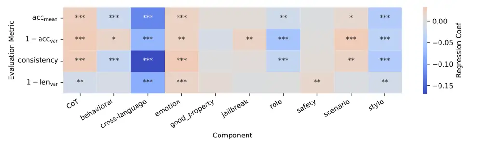
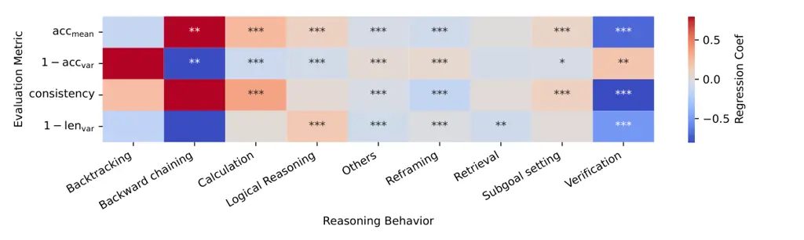
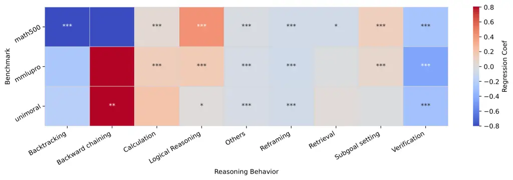
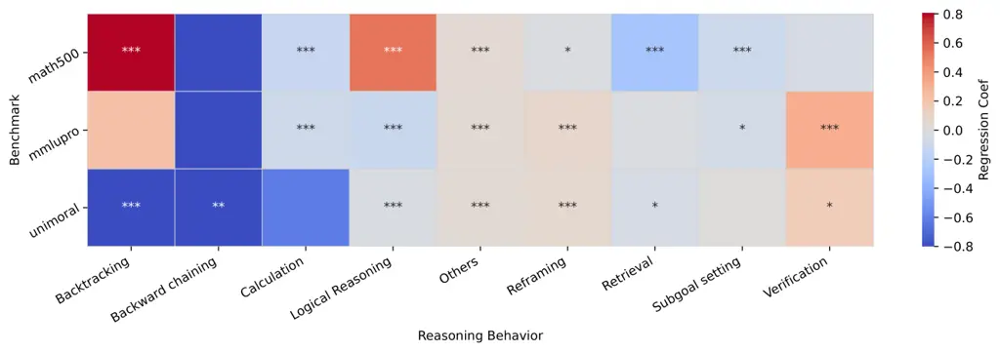
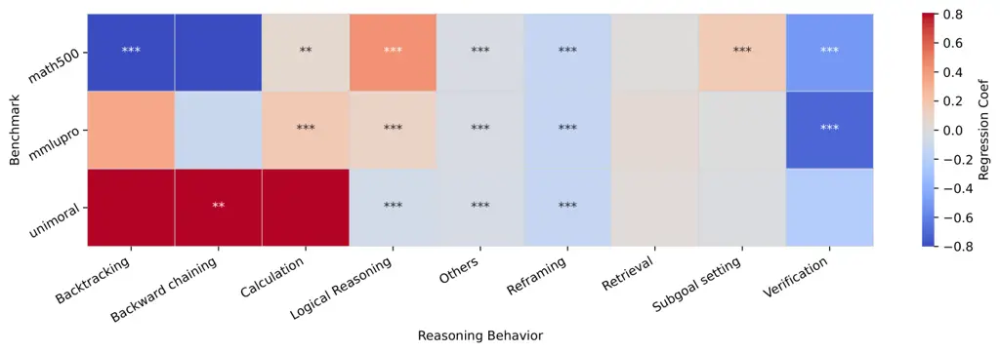
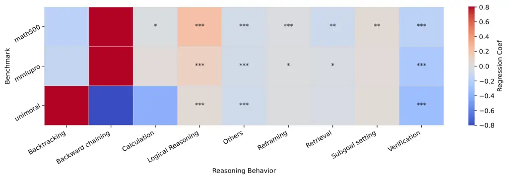

# Cross-Lingual Prompt Steerability: Towards Accurate and Robust LLM Behavior across Languages

Lechen Zhang^(‡)   Yusheng Zhou^(†)¹¹footnotemark: 1   Tolga Ergen^(♯)
^(†)^(†)thanks: ˜˜Equal contribution Affiliation: Lajanugen
Logeswaran^(♯)   Moontae Lee^(♯⋄)   David Jurgens^(†)
Affiliation: ^(‡)University of Illinois Urbana-Champaign  
^(†)University of Michigan Affiliation: ^(⋄)University of Illinois
Chicago   ^(♯)LG AI Research Affiliation: ^(‡){lechenz3}@illinois.edu  
^(†){yszhou, jurgens}@umich.edu Affiliation:   ^(♯){tergen, llajan,
moontae.lee}@lgresearch.ai

###### Abstract

System prompts provide a lightweight yet powerful mechanism for
conditioning large language models (LLMs) at inference time. While prior
work has focused on English-only settings, real-world deployments
benefit from having a single prompt to operate reliably across
languages. This paper presents a comprehensive study of how different
system prompts steer models toward accurate and robust cross-lingual
behavior. We propose a unified four-dimensional evaluation framework to
assess system prompts in multilingual environments. Through large-scale
experiments on five languages, three LLMs, and three benchmarks, we
uncover that certain prompt components, such as CoT, emotion, and
scenario, correlate with robust multilingual behavior. We develop a
prompt optimization framework for multilingual settings and show it can
automatically discover prompts that improve all metrics by 5–10%.
Finally, we analyze over 10 million reasoning units and find that more
performant system prompts induce more structured and consistent
reasoning patterns, while reducing unnecessary language-switching.
Together, we highlight system prompt optimization as a scalable path to
accurate and robust multilingual LLM behavior.

## 1 Introduction

System prompts have emerged as a lightweight yet versatile mechanism for
steering large language model (LLM) behavior during inference. A growing
literature demonstrates that careful prompt engineering can improve
reasoning (Wei et al., 2022) and reduce bias Kamruzzaman and Kim (2024).
However, most of this research has focused on English-language settings
and overlooked a broader and more practical goal: ensuring that a single
system prompt works reliably well across languages.

Multilingual deployment poses unique challenges for prompt design. Even
when using multilingual LLMs, prompts tuned in English often degrade
when translated or when applied to non-English tasks Kmainasi et al.
(2025), leading to inconsistent accuracy, unstable reasoning, and
degraded cross-lingual generalization Tam et al. (2025). This motivates
a key question: How can we design _one_ prompt that maintains high and
stable performance across _many_ languages and tasks? We systematically
pursue this question by breaking it down into three parts: Q1: What
kinds of system prompts most effectively steer models toward better
multilingual behaviors? Q2: Can we automatically discover prompts that
achieve strong multilingual performance with minimal human effort? Q3:
How do high-performing prompts influence model outputs across multiple
dimensions, such as the structure of reasoning patterns and the choice
of response language?

To address these questions, we first define a four-part evaluation
framework that captures multilingual effectiveness from multiple angles:
average accuracy, accuracy variance, cross-lingual consistency, and
output length variance. Using insights from the performances of multiple
LLMs on diverse tasks, we propose an approach to optimize prompts for
this multilingual, multi-metric objective. Finally, we analyze model
outputs to reveal how optimized prompts shape reasoning behaviors and
reduce cross-lingual variability.

In this paper, we make the following contributions: (1) We introduce a
four-dimensional evaluation framework for multilingual system prompt
performance, which offers a comprehensive lens for measuring
cross-lingual effectiveness. (2) We conduct a systematic analysis of how
prompt language and component types affect model performance across our
four evaluation metrics. (3) We successfully discover prompts that are
improved $`5\sim 10\%`$ across all four evaluation metrics using a new
multilingual prompt optimization technique we introduce, demonstrating
the feasibility of automatic prompt discovery in multilingual settings.
(4) We propose a novel perspective for analyzing LLM’s reasoning pattern
and its relationship with prompt design. By studying 10 million
reasoning units from 1.6 million responses, we find that high-performing
prompts often induce more structured and consistent reasoning, and less
language-switching, suggesting that reasoning patterns themselves may be
a key driver of multilingual robustness. Taken together, our results
demonstrate that system prompt optimization is a promising and
underexplored direction for achieving accurate and robust control over
multilingual LLM behavior. The code and dataset are available at
[https://github.com/orange0629/multilingual-system-prompt](https://github.com/orange0629/multilingual-system-prompt).

## 2 Related Work

System prompts offer task-agnostic control over LLM behavior, defining
roles, styles, or policies applied across tasks. Prior work has shown
that components like personas Kim et al. (2024), emotions Li et al.
(2023), and jailbreak triggers Shen et al. (2023) can influence response
style and reasoning, though not always improving task accuracy. Despite
their growing use, system prompts remain underexplored in terms of
structured optimization. Recent system prompts leaked from Grok (xAI, 2025) and Claude (Breunig, 2025) show widely verbose and complex
manually crafted rules. While recent approaches (Zhang et al., 2024;
Sécheresse et al., 2025) demonstrate that system prompts can be
automatically optimized using genetic algorithms, such optimization has
so far been limited to monolingual and single-metric settings.

Multilingual deployment introduces challenges such as language-specific
degradation and cross-lingual inconsistency. Multilingual LLMs often
produce inconsistent outputs when the same question is asked in
different languages due to their unequal distribution of knowledge
across languages (Tam et al., 2025). Techniques like Cross-Lingual
Thought Prompting (Huang et al., 2023) and multilingual
self-consistency (Yu et al., 2025) offer partial solutions, but
typically rely on multi-turn prompting strategies. Despite these
efforts, there remains no general framework for optimizing system
prompts that ensure accurate and robust performance across languages.

Beyond standard metrics, recent studies have been focusing more on how
LLMs reason, often by decomposing responses into interpretable reasoning
units (Tam et al., 2025; Gandhi et al., 2025). However, these works have
mostly focused on surface-level analyses such as using text prefill to
control output language Tam et al. (2025), without deeply exploring the
model’s underlying reasoning patterns. Our work addresses this gap by
linking system prompt design to multilingual reasoning behaviors and
showing how these patterns correlate with cross-lingual generalization.

## 3 Towards steerable multilingual LLM behavior through system prompting

A key challenge in deploying LLMs across diverse languages is to ensure
not only strong task performance but also consistent and robust behavior
across linguistic contexts. In this section, we define concrete criteria
for what makes a system prompt effective in multilingual settings and
formalize a unified evaluation framework that we use throughout the rest
of the paper.

### 3.1 Performance Metrics

To capture the complementary aspects of multilingual behavior, we aim to
identify system prompts that satisfy four key criteria, each captured by
a corresponding metric: (1) $`\mathsf{Acc_{mean}}`$ measures high
performance across languages, defined as the average benchmark accuracy
across all languages; (2) $`\mathsf{Acc_{var}}`$ captures similar
performance across languages, defined as the variance in accuracy across
languages for each benchmark; (3) $`\mathsf{Consistency}`$ reflects the
ability to give identical answers to the same question across
languages¹¹ 1 We note here that some questions may naturally vary in
their answers across languages due to differing cultural norms or values
of the cultures associated with those languages., defined as the
proportion of questions that receive semantically equivalent answers
across languages; and (4) $`\mathsf{Len_{var}}`$ quantifies similar
reasoning processes across languages, defined as the variance in output
length (in tokens) across languages.

The above definitions can be expressed in the following formulas:  
(1)
$`\mathsf{Acc_{mean}}=\mathbb{E}_{q\in\mathcal{Q}}\,\mathbb{E}_{l\in\mathcal{L}}\left[\mathbf{1}\!\left(a_{l}(q)=y(q)\right)\right]`$  
(2)
$`\mathsf{Acc_{var}}=\mathrm{Var}_{l\in\mathcal{L}}\!\left(\mathbb{E}_{q\in\mathcal{Q}}\left[\mathbf{1}\!\left(a_{l}(q)=y(q)\right)\right]\right)`$  
(3)
$`\mathsf{Consistency}\nolinebreak=\nolinebreak\mathbb{E}_{q\in\mathcal{Q}}\!\left[\mathbf{1}\!\left({a_{l}(q)}_{l\in\mathcal{L}}\text{ are identical}\right)\right]`$  
(4)
$`\mathsf{Len_{var}}=\mathrm{Var}_{l\in\mathcal{L}}\!\left(\mathbb{E}_{q\in\mathcal{Q}}\left[\mathrm{Len}\!\left(a_{l}(q)\right)\right]\right)`$  
, where $`\mathcal{Q}`$ denotes the set of questions, and
$`\mathcal{L}`$ the set of languages. For a question $`q\in\mathcal{Q}`$
and language $`l\in\mathcal{L}`$: $`a_{l}(q)`$ is the model’s answer,
$`y(q)`$ is the gold answer, and $`\mathrm{Len}(a_{l}(q))`$ is the token
length of the answer.

An ideal system prompt maximizes $`\mathsf{Acc_{mean}}`$ and
$`\mathsf{Consistency}`$ while minimizing $`\mathsf{Acc_{var}}`$ and
$`\mathsf{Len_{var}}`$. To compute an overall score that balances these
complementary dimensions with different numerical scales, we apply
min-max normalization to each metric, mapping each to the \[0, 1\]
range. We then weight each metric based on its importance: 0.5 for
$`\mathsf{Acc_{mean}}`$ (the most important, as it is the primary
indicator of system performance), 0.25 for $`\mathsf{Acc_{var}}`$
(weighted second, as it directly reflects the multilingual
generalization ability), and 0.125 each for $`\mathsf{Consistency}`$ and
$`\mathsf{Len_{var}}`$ (third in importance, as they minimize
question-level variance and contribute to output robustness across
languages). Notably, for $`\mathsf{Acc_{var}}`$ and
$`\mathsf{Len_{var}}`$, lower values are preferred, so we use
$`(1-\text{normalized value})`$ to ensure higher scores reflect better
multilingual generalization. These weights can be adjusted based on
specific use cases or varying definitions of importance. The resulting
overall score is computed as:
$`\mathsf{OverallScore}=0.5\cdot\widehat{\mathsf{Acc_{mean}}}+0.25\cdot(1-\widehat{\mathsf{Acc_{var}}})+0.125\cdot\widehat{\mathsf{Consistency}}+0.125\cdot(1-\widehat{\mathsf{Len_{var}}})`$.

### 3.2 Setup

#### Prompts

Our prompt corpus, denoted as $`\mathcal{P}`$, is constructed by
combining human expertise with synthetic data. Inspired by existing
frameworks Zhang et al. (2024); Tian et al. (2024), we synthesized²² 2
Details in Appendix A.1 a set of 10,000 prompt components, denoted as
$`\mathcal{C}`$, spanning 10 categories: good property, role, style,
emotion, scenario, jailbreak, behavioral, Chain-of-Thought, safety, and
cross-lingual³³ 3 Prompts that specify the (mixture) language to use
during inference time. (see Appendix Table 1 for examples). In our
experiment, we will explore various combinations of these prompt
components to understand how system prompt design influences
multilingual LLM performance.

#### Models

We evaluated a set of widely-used open-weight LLMs, including
Gemma-3-12B-IT Team et al. (2025), LLaMA-3.1-8B-Instruct Meta (2024),
and Qwen2.5-7B-Instruct Qwen Team (2024). We focus on models of
$`\sim`$8B parameters not only because they are widely used and offer a
strong balance between multilingual capabilities and inference
efficiency, but also because they are sensitive to small perturbations
such as prompt wording and language, which makes them well-suited for
studying multilingual performance through prompt optimization.

#### Benchmarks

We evaluate LLMs on three benchmarks spanning diverse domains⁴⁴ 4 We
translate the questions using Google Translate API and have them
reviewed by proficient speakers to ensure quality. Details in
Appendix A.4.: MMLU-Pro Wang et al. (2024), a knowledge-driven and
reasoning-focused benchmark covering 14 academic subjects;
MATH500 Lightman et al. (2024), a set of 500 challenging mathematics
problems drawn from MATH Hendrycks et al. (2021); and UniMoral Kumar and
Jurgens (2025), a suite of moral-judgment questions that demand nuanced
social reasoning.

#### Languages

All experiments were conducted in five languages: English (en), Chinese
(zh), Spanish (es), French (fr), and Hindi (hi). These languages were
chosen to reflect a diverse set of language families, geographic
regions, and resource availability.

## 4 Experiment 1: What Kinds of Prompts Steer LLMs Toward Better Behaviors

In this section, we explore from different perspectives what kinds of
prompts can effectively steer model towards better behaviors. We also
examine the relationship between different metrics that represent
different model behaviors. By randomly sampling and composing elements
from $`\mathcal{C}`$, we generated 1,000 diverse prompts of varying
lengths, which together form the corpus $`\mathcal{P}_{random}`$ used in
this section. Additional implementation details are provided in the
Appendix A.2.

### 4.1 System–Task Prompt Language Interaction

Figure 1: Comparison of English-prompt and Self-language prompt
settings, aggregated over three models and three benchmarks. English
system prompts show slightly worse performance in all four metrics
compared to using prompts in the question’s native language.

A key consideration when tackling multilingual tasks is the choice of
system prompt language: whether to use English, which is typically the
main training language for the model, or to align the prompt language
with that of the task. We explore this question by comparing the
following two settings. In the English-prompt setting, English prompts
are applied to questions in various languages, while in Same-language
setting, the system prompt is translated into the same language as the
question.

We compared the performance of the two settings across three models and
benchmarks in Figure 1. We observe that the English-prompt setting
exhibits slightly worse overall performance compared to Same-language
setting, yielding lower average accuracy and consistency, as well as
significantly (p\<0.05) higher accuracy variance and output length
variance across languages. However, the performance drop is marginal,
and using English prompts still offers practical advantages that reduce
the effort of aligning the system prompt language with each task
language.

### 4.2 Measuring the Relationship Between Performance Metrics and Accuracy

Figure 2: The relationship between mean accuracy
($`\mathsf{Acc_{mean}}`$) and accuracy variance
($`\mathsf{Acc_{var}}`$), with each point representing one prompt
aggregated on all benchmarks. $`\mathsf{Acc_{var}}`$ exhibits clear
model dependency and a slight negative correlation with
$`\mathsf{Acc_{mean}}`$.

Figure 3: Relationship between mean accuracy ($`\mathsf{Acc_{mean}}`$)
and $`\mathsf{Consistency}`$, with each point represents one prompt
aggregated on all benchmarks. $`\mathsf{Acc_{mean}}`$ exhibits a strong
positive correlation with $`\mathsf{Consistency}`$.

To better understand how different aspects of model behavior relate to
each other, we investigate the relationships among the four performance
metrics in this section.

The correlation between mean accuracy ($`\mathsf{Acc_{mean}}`$) and
accuracy variance ($`\mathsf{Acc_{var}}`$) is presented in  Figure 2,
where each point represents a prompt in $`\mathcal{P}`$ evaluated on all
three benchmarks. While $`\mathsf{Acc_{mean}}`$ and
$`\mathsf{Acc_{var}}`$ are not strongly correlated, the distribution of
$`\mathsf{Acc_{var}}`$ exhibits clear model dependency and is closely
tied to the model’s multilingual capability. For instance, Llama’s
$`\mathsf{Acc_{var}}`$ shows high sensitivity to prompt selection and
consistently yields larger values, which aligns with its relatively
weaker multilingual ability compared to Gemma and Qwen. In contrast,
Gemma maintains consistently low $`\mathsf{Acc_{var}}`$, reflecting its
stronger robustness in multilingual settings.

As shown in  Figure 3, $`\mathsf{Consistency}`$ exhibits a strong
positive relationship with mean accuracy ($`\mathsf{Acc_{mean}}`$). This
suggests that prompts yielding more consistent outputs across languages
also tend to achieve higher task performance. Recent paper from Yu et
al. (2025) has also reported similar findings, indicating that
cross-lingual consistency can serve as a useful strong predictor of
model accuracy. Additionally, we observe no clear relationship between
output length variance ($`\mathsf{Len_{var}}`$) and mean accuracy
($`\mathsf{Acc_{mean}}`$) in Appendix Figure 11. However, across models,
LLaMA exhibits significantly higher $`\mathsf{Len_{var}}`$ compared to
Gemma and Qwen, suggesting that its reasoning process is more unstable
across languages. Detailed data is shown in Table 2.

### 4.3 How System Prompt Components Influence Model Performance

Figure 4: The regression heatmap illustrating the impact of different
system prompt components on multilingual model behavior (\* p\<0.05,
\*\* p\<0.01, \*\*\* p\<0.001). (1) positively associated components
(e.g., Chain-of-Thought, emotion, scenario) enhance accuracy and
consistency while reducing performance variance; (2) negatively
associated components (e.g., behavioral, role, style) correlate with
reduced accuracy and consistency; and (3) neutral components (e.g.,
good-property, safety) show no significant impact. Results are averaged
across benchmarks.

Here, we investigate the impact of different components in the system
prompt on model behavior by conducting a regression analysis which links
prompt components and language settings to multilingual performance
metrics. We observed that system prompt components have diverse effects
on model performance in Figure 4, which we broadly categorize into three
groups.

Firstly, some components show overall positive effects on model
behavior. For example, Chain-of-Thought, emotion and scenario are
positively associated with both accuracy and consistency, and decrease
the accuracy variance across languages, indicating their effectiveness
in steering model towards stable high performance across languages.
Through closer inspection of the model outputs, we observe that the
model tend to elicit more structured and consistent reasoning under
these components, which likely contributes to the observed performance
gains.

Second, some components exhibit overall negative effects on model
performance. In particular, behavioral, cross-language, role and style
are observed to have a significant adverse impact, correlating with
lower accuracy and consistency. Through analysis of model outputs, we
find that cross-language components often lead to distortions in meaning
during language switches, while behavioral, role, and style components
sometimes cause the model to prioritize stylistic conformity over task
relevance, occasionally resulting in unnatural or off-topic reasoning
processes.

Third, we identify multiple categories of components that do not show a
significant impact on model’s overall performance. For example,
good-property (e.g., "You are smart and reliable."), jailbreak, and
safety fall into this category. Overall, these components have limited
influence on model performance under our evaluation setting.

Detailed results for regression is shown in Table 3

## 5 Experiment 2: Optimizing System Prompts for Better Performance

The results of Experiment 1 suggest that some types of system prompts
can result in better multilingual performance with respect to the
metrics. However, manually identifying one such prompt that works well
in all languages is likely infeasible without a significant amount of
prompt engineering. Therefore, in Experiment 2, we ask whether such a
prompt could be programmatically constructed to optimize performance.
Here, we adapt the current state-of-the-art system prompt optimizer,
Sprig framework Zhang et al. (2024), to our multilingual scenario by
redefining the optimization objective as $`\mathsf{Overall}`$
$`\mathsf{Score}`$, which captures performance across four key metrics.

### 5.1 Modeling the Multilingual Performance of System Prompts

Optimizing system prompts in a multilingual setting requires repeatedly
evaluating large numbers of candidate prompts, which is prohibitively
expensive to run directly on the underlying LLM. Therefore, following
the same principle inSprig framework, we finetune a _prompt reward
model_ tailored to our four new metrics that can score candidate prompts
cheaply during optimization.

Specifically, we construct training data by sampling diverse pairs of
system prompts from $`\mathcal{P}_{random}`$ along with their associated
scores $`\mathbf{m}(p)\in\mathbb{R}^{4}`$ across four metrics:
$`\mathsf{Acc_{mean}}`$, $`\mathsf{Acc_{var}}`$, $`\mathsf{Len_{var}}`$,
and $`\mathsf{Consistency}`$. These scores are normalized into
$`\widehat{\mathbf{m}}(p)`$ and used to compute per-metric pairwise
margins
($`\Delta_{ij}=\widehat{\mathbf{m}}(p_{i})-\widehat{\mathbf{m}}(p_{j})`$).
We then train an XLM-RoBERTa Conneau et al. (2020) to predict a
4-dimensional reward vector $`r_{\theta}(p)`$, and optimize it using the
max-margin pairwise loss (Touvron et al., 2023):
$`\mathcal{L}_{ij}=-\log\sigma\big(r_{\theta}(p_{i})-r_{\theta}(p_{j})-\Delta_{ij}\big)`$
to match the margin-weighted dimension-wise ordering of prompt pairs.

Overall, the trained reward model effectively captures the relative
quality of system prompts across multiple dimensions, which provides a
reliable signal for our prompt optimization pipeline. As shown in
Appendix Figure 12, the trained model predicts both
$`\mathsf{Acc_{mean}}`$ and $`\mathsf{Consistency}`$ with high accuracy,
achieving Spearman correlations above 0.5 when ranking unseen prompts.
For $`\mathsf{Acc_{var}}`$ and $`\mathsf{Len_{var}}`$, although the
average correlation remains relatively strong, the larger variance in
correlation scores suggests that these metrics are more sensitive to
context and thus harder to predict consistently. Full implementation
details are presented in Appendix A.3.

Figure 5: System prompts can be effectively optimized to improve
multiple metrics in a multilingual setting. Using the off-the-shelf
Sprig framework, we observe rapid early gains in $`\mathsf{Acc_{mean}}`$
and $`\mathsf{Consistency}`$, while $`\mathsf{Acc_{var}}`$ and
$`\mathsf{Len_{var}}`$ decrease more gradually.

### 5.2 Multilingual System Prompt Optimization with Sprig

Figure 6: Sprig Optimization leads to a clear distributional shift in
performance. Prompts in $`\mathcal{P}_{optimized}`$ achieve higher
$`\mathsf{Acc_{mean}}`$ than those in $`\mathcal{P}_{random}`$, often
exceeding the original upper bound.

Using the default configuration of Sprig, we conducted a 25-step
optimization process.⁵⁵ 5 Due to computational constraints, the
optimization focuses on English system prompts only. The performance of
the population (i.e., the set of surviving system prompts at each step)
on unseen data across all metrics is presented in Figure 5. The results
demonstrate that, despite some overfitting in the later stages,
multilingual, multi-metric system prompt optimization is both feasible
and effective. The $`\mathsf{Overall}`$ $`\mathsf{Score}`$ of the system
prompts improves substantially over the course of optimization. In
particular, $`\mathsf{Len_{var}}`$ exhibits a steady decline throughout
the optimization process, and $`\mathsf{Acc_{var}}`$ decreases
significantly in the early stages, which suggests that system prompt
optimization alone can mitigate cross-lingual variance in model
behavior. Additionally, both $`\mathsf{Acc_{mean}}`$ and
$`\mathsf{Consistency}`$ show notable early improvements but experience
overfitting in later stages, which is consistent with our prior
observation that these two metrics are closely correlated.

#### Are the optimized prompts truly better than those drawn from the original distribution?

To investigate this, we selected the top 10 prompts (ranked by the
reward model) from each optimization step, resulting in a total of 250
prompts, which we refer to as $`\mathcal{P}_{optimized}`$. In Figure 6,
we compare the performance of prompts before and after optimization. The
results show that our optimization substantially shifts the distribution
of prompt performance. In particular, $`\mathsf{Acc_{mean}}`$ in
$`\mathcal{P}_{optimized}`$ surpasses the maximum observed in
$`\mathcal{P}_{random}`$. Although $`\mathsf{Len_{Var}}`$ does not
exhibit the same level of improvement, the optimized prompts are more
concentrated near the upper bound of $`\mathcal{P}_{random}`$, which
remains valuable given their high $`\mathsf{Acc_{mean}}`$ and may also
serve as a promising direction for future improvement. Results of other
metric pairs are shown in Appendix Figure 13 and Figure 14, the detailed
comparison results across all metrics, models, and benchmarks are
presented in Table 4.

## 6 Experiment 3: How System Prompts Influence Model Outputs

Experiment 2 demonstrated that a single system prompt to could improve
performance across our tested languages for all metrics. This
improvement points to a systematic change in model behavior. To better
understand how model output has changed, we analyze the intermediate
reasoning processes and measure how the changes in specific reasoning
behaviors relate to multilingual performance.

To enable a fine-grained analysis of the reasoning process, we adopt the
workflow of Tam et al. (2025) to decompose each model response into
reasoning units⁶⁶ 6 Details are shown in Appendix A.6. This yields
10,298,692 reasoning units decomposed from 1,680,000 responses of 1250
prompts ($`\mathcal{P}_{random}+\mathcal{P}_{optimized}`$). For each
unit, we conduct two types of analysis: (1) Language: We classify the
language used in the unit using the language identification model in
fastText Joulin et al. (2017). (2) Reasoning Type: Adapting from the
methodology proposed in Tam et al. (2025), we categorize each unit into
one of eight reasoning types: Subgoal Setting, Backtracking,
Verification, Backward Chaining, Retrieval, Reframing, Logical
Reasoning, and Calculation. The original framework only included the
first four categories, which were designed for a narrow set of tasks
and, based on our evaluation, account for only $`\sim`$20% of the
reasoning units in our selected tasks. To reflect the broader range of
reasoning behaviors in our setting, we introduce the four additional
categories motivated by recent literature (Kambhampati, 2024; Bieth et
al., 2024; Liu et al., 2025; Parashar et al., 2025). Detailed
definitions and justifications for the categories and implementation
details are provided in Appendix A.8.

### 6.1 Language Mix in Model Reasoning

Figure 7: Green represents units that are of the same language as the
task prompt; Blue represents units in English; Yellow represents units
of other languages. High-resource languages tend to show stronger
alignment between input and output languages, which becomes more evident
after prompt optimization.

#### Does prompt optimization change the model’s language preference?

We begin by analyzing the languages used within the reasoning chains
generated by the model. As shown in Figure 7, we observe that even when
using the same set of random prompts, the model exhibits different
language preferences depending on the language of the input question.
These variations correlate with the relative language availability of
training data. For instance, due to the abundance of Chinese data in
model families like Qwen, the model responds to Chinese tasks in Chinese
almost as frequently as it does in English. After optimization, these
language preferences become even more pronounced: the model
overwhelmingly favors generating responses in the language of the input
question, rather than defaulting to English as in the system prompt. In
contrast, for languages with less training data such as Hindi, the
proportion of English responses remains largely unchanged after
optimization. Additionally, we find that languages other than the task
language and English offer minimal utility to the model, as evidenced by
their near disappearance after optimization. Details about language
identification is shown in Appendix A.9, detailed data is shown in Table
6 and 7.

Figure 8: Distribution of reasoning behaviors across different response
languages. The distribution is relatively consistent across languages as
shown in the bar figure. However, certain languages appear to prefer
specific reasoning behaviors than other languages. For instance, English
response tend to prefer Reframing, Chinese shows a higher proportion of
Logical Reasoning, and Hindi had a notably higher rate of Undefined
reasoning behavior compared to other languages

#### Does language influence reasoning behavior?

In Figure 8, we examine the distribution of reasoning behavior types
across different languages. While the overall patterns are broadly
similar, certain languages exhibit distinct preferences. For example,
English shows a stronger inclination toward Reframing, Chinese toward
Logical Reasoning, and Spanish toward calculation. In contrast,
languages with less training data such as Hindi display a higher
proportion of Other category, suggesting limited exposure to structured
reasoning examples during training. Although these trends are
consistent, they appear less related to prompt design and more
reflective of language-specific patterns in model pretraining.
Therefore, while interesting, these variations should be interpreted
with caution in the context of prompt steerability. Detailed data is
shown in Table 8 and 9.

Figure 9: Reasoning component frequencies before and after prompt
optimization. Optimized prompts reduce redundant reasoning behaviors,
while increasing structured components like Calculation especially in
math tasks. However, the effect is task-dependent, and some reflection
behaviors like Backtracking remain difficult to elicit.

### 6.2 Reasoning Unit Type Analysis

#### Distributional Shifts After Prompt Optimization.

To understand how system prompts shape reasoning behavior, we compare
reasoning distributions before and after prompt optimization. As shown
in Figure 9 (detailed data shown in Table 10), we observe a notable
reduction in the overall frequency of reasoning components after prompt
optimization. This is primarily because optimized system prompts are
typically shorter and cleaner, containing fewer redundant instructions
such as “answer like Shakespeare”, which often inflate the length and
diversity of the reasoning chain. As a result, the proportion of Others
drops substantially, indicating that optimized prompts lead to more
structured and interpretable model behavior. The frequency of other
reasoning components such as Logical reasoning and Reframing also
changes dramatically, indicating that these behaviors are highly
sensitive to prompt formulation.

We also find that the effect of optimization is highly task-dependent.
For math problems, optimized prompts lead to a clear increase in both
Calculation and Logical reasoning, aligning well with the domain’s
demands. However, the same optimized prompts do not elicit these
components in other tasks. For moral reasoning tasks, we observe a sharp
decline in the absolute frequency of nearly all reasoning components,
yet Logical reasoning remains the dominant behavior in relative terms.

Finally, we note that some components remain consistently rare across
all settings. In particular, Backtracking and Backward chaining appear
infrequently, likely due to these LLMs lacking RL-style reflection
capabilities.

#### Reasoning Features as Predictors of Performance

We now ask: can the structure of the reasoning chains alone predict how
well a prompt will perform? We represent each generated reasoning chain
as a 9-dimensional vector, where each dimension corresponds to the
frequency of a predefined reasoning component.

Figure 10: Prompts with better performance tend to induce convergent
reasoning patterns in the model (shown here for Qwen2.5-7B-Instruct on
the MATH500 benchmark). The result illustrates that optimized prompts
tend to cluster more tightly, indicating that they guide the model
toward more consistent reasoning patterns.

For each system prompt, we average this vector across all model outputs
on all benchmarks and languages, resulting in a compact summary of its
induced reasoning style:
$`\mathbf{v}_{\text{prompt}}=\frac{1}{N}\sum_{i=1}^{N}\mathbf{v}_{\text{output}_{i}}`$
This embedding allows us to compare prompts in a consistent, structured
space. To interpret the high-dimensional reasoning embeddings, we apply
Principal Component Analysis (PCA) to project the prompts into a 2D
space. As shown in the KDE Figure 10 from MATH500, prompts selected
through optimization exhibit a more compact distribution compared to
those sampled randomly. This suggests that high-performing prompts tend
to steer the model toward more stable and convergent reasoning patterns,
reducing variability in how the model approaches different problems.
Results of other benchmarks show a similar pattern and are presented in
Appendix Figure 15 and Figure 16.

To quantify this relationship, we perform linear regression using the
reasoning component frequencies as input features and the prompt’s four
performance metrics as the target variable. As shown in Appendix
Figure 17, different types of reasoning behaviors have distinct and
sometimes opposing effects on model performance. Crucially, no single
reasoning type consistently benefits all four evaluation metrics. For
example, Calculation and Subgoal Setting enhance both accuracy mean and
consistency, albeit at the slight cost of $`\mathsf{Acc_{var}}`$.
Logical Reasoning contributes positively to $`\mathsf{Acc_{mean}}`$ and
$`\mathsf{Len_{var}}`$, meanwhile also slightly increasing
$`\mathsf{Acc_{var}}`$. However, some behaviors appear to be mostly
detrimental. Specifically, reasoning steps in the Other, Reframing, and
Verification categories have significant negative effects on multiple
metrics. It is worth noting that behaviors like Backtracking, Backward
Chaining show high regression coefficients but low statistical
significance, mainly due to their low occurrence rate in LLM outputs.
Per-benchmark regression are shown in Appendix Figure 18-21.

## 7 Conclusion

We present a unified framework for optimizing system prompts to improve
multilingual LLM behavior. Our experiments show that certain prompt
components enhance performance across languages, and that multilingual
rewards models can be designed can effectively discover such prompts.
Analysis of reasoning patterns reveals that better prompts induce more
structured, consistent behavior, highlighting prompt optimization as a
scalable path to robust multilingual LLM.

## 8 Acknowledgments

We thank the anonymous reviewers and members of the Blablablab for their
feedback. This project was funded in part by a grant from LG AI and by
the National Science Foundation under Grant No. IIS-2143529.

## 9 Limitations

#### Classification of reasoning behavior

While our taxonomy of eight reasoning behaviors captures the majority of
model outputs, approximately 30% of reasoning steps are still
categorized as “Others”, suggesting the existence of additional
reasoning strategies not covered by our current definition.

#### How to find a good prompt?

Although we find some high-quality prompts with Sprig, identifying
prompts that perform consistently well across all four evaluation
metrics remains challenging.

#### Reasoning pattern

While our experiments show that high-quality prompts can steer LLMs
toward certain reasoning patterns which leads to better performance, the
nature of these patterns and why they improve model’s performance is not
explored. Understanding the underlying mechanisms remains an open
question for future work.

## 10 Ethical Consideration

While this research has tried to minimize potential ethical concerns,
several ethical implication remain. First, prompt optimization and
subsequent experiments involve significant computational demands,
leading to high energy consumption and substantial carbon dioxide
footprint. Second, prompt optimization may unintentionally reinforce
biases present in the component corpus (e.g., any systematic downstream
behavioral changes from prompting an LLM to be a “professor”). Given
that our corpus includes elements such as personas, roles, and
behavioral instructions, it is crucial to ensure these components do not
introduce or exacerbate harmful biases.

## References

- Bieth et al. (2024) T. Bieth, Y. N. Kenett, M. Ovando-Tellez, A.
  Lopez-Persem, C. Lacaux, M. Scuccimarra, I. Maye, J. Sénéchal, D.
  Oudiette, and E. Volle Changes in semantic memory structure support
  successful problem-solving and analogical transfer. Communications
  Psychology 2 (1), pp. 54 (English). Note: Published online 2024-06-07
  External Links:
  [Document](https://dx.doi.org/10.1038/s44271-024-00100-w),
  [Link](https://www.nature.com/articles/s44271-024-00100-w) Cited by:
  item 2, §6.
- Breunig (2025) D. Breunig Claude’s system prompt: chatbots are more
  than just models. Note: Accessed: 2025-05-20 External Links:
  [Link](https://www.dbreunig.com/2025/05/07/claude-s-system-prompt-chatbots-are-more-than-just-models.html)
  Cited by: §2.
- Conneau et al. (2020) A. Conneau, K. Khandelwal, N. Goyal, V.
  Chaudhary, G. Wenzek, F. Guzmán, E. Grave, M. Ott, L. Zettlemoyer,
  and V. Stoyanov Unsupervised cross-lingual representation learning at
  scale. In Proceedings of the 58th Annual Meeting of the Association
  for Computational Linguistics, D. Jurafsky, J. Chai, N. Schluter,
  and J. Tetreault (Eds.), Online, pp. 8440–8451. External Links:
  [Link](https://aclanthology.org/2020.acl-main.747/),
  [Document](https://dx.doi.org/10.18653/v1/2020.acl-main.747) Cited by:
  §5.1.
- Databricks (2024) Databricks Introducing dbrx: a new state-of-the-art
  open llm. Note: Accessed: 2024-10-14 External Links:
  [Link](https://www.databricks.com/blog/introducing-dbrx-new-state-art-open-llm)
  Cited by: Table 1.
- Deng et al. (2023) Y. Deng, W. Zhang, Z. Chen, and Q. Gu Rephrase and
  respond: let large language models ask better questions for
  themselves. Vol. abs/2311.04205. External Links:
  [Link](https://arxiv.org/abs/2311.04205) Cited by: Table 1.
- Gandhi et al. (2025) K. Gandhi, A. K. Chakravarthy, A. Singh, N. Lile,
  and N. Goodman Cognitive behaviors that enable self-improving
  reasoners, or, four habits of highly effective STars. In Second
  Conference on Language Modeling, External Links:
  [Link](https://openreview.net/forum?id=QGJ9ttXLTy) Cited by: §A.8, §2.
- Hendrycks et al. (2021) D. Hendrycks, C. Burns, S. Kadavath, A.
  Arora, S. Basart, E. Tang, D. Song, and J. Steinhardt Measuring
  mathematical problem solving with the math dataset. NeurIPS. Cited by:
  §3.2.
- Huang et al. (2023) H. Huang, T. Tang, D. Zhang, X. Zhao, T. Song, Y.
  Xia, and F. Wei Not all languages are created equal in LLMs: improving
  multilingual capability by cross-lingual-thought prompting. In The
  2023 Conference on Empirical Methods in Natural Language Processing,
  External Links: [Link](https://openreview.net/forum?id=E4ebDehO3O)
  Cited by: §2.
- Joulin et al. (2017) A. Joulin, E. Grave, P. Bojanowski, and T.
  Mikolov Bag of tricks for efficient text classification. In
  Proceedings of the 15th Conference of the European Chapter of the
  Association for Computational Linguistics: Volume 2, Short Papers,
  pp. 427–431. Cited by: §A.9, §6.
- Kambhampati (2024) S. Kambhampati Can large language models reason and
  plan?. Annals of the New York Academy of Sciences 1534 (1), pp. 15–18.
  External Links: ISSN 1749-6632,
  [Link](http://dx.doi.org/10.1111/nyas.15125),
  [Document](https://dx.doi.org/10.1111/nyas.15125) Cited by: item 1,
  §6.
- Kamruzzaman and Kim (2024) M. Kamruzzaman and G. L. Kim Prompting
  techniques for reducing social bias in llms through system 1 and
  system 2 cognitive processes. CoRR abs/2404.17218. External Links:
  [Link](https://doi.org/10.48550/arXiv.2404.17218) Cited by: §1.
- Kim et al. (2024) J. Kim, N. Yang, and K. Jung Persona is a
  double-edged sword: enhancing the zero-shot reasoning by ensembling
  the role-playing and neutral prompts. Vol. abs/2408.08631. External
  Links: [Link](https://arxiv.org/abs/2408.08631) Cited by: §2.
- Kmainasi et al. (2025) M. B. Kmainasi, R. Khan, A. E. Shahroor, B.
  Bendou, M. Hasanain, and F. Alam Native vs non-native language
  prompting: a comparative analysis. In Web Information Systems
  Engineering – WISE 2024, M. Barhamgi, H. Wang, and X. Wang (Eds.),
  Singapore, pp. 406–420. Cited by: §1.
- Kumar and Jurgens (2025) S. Kumar and D. Jurgens Are rules meant to be
  broken? understanding multilingual moral reasoning as a computational
  pipeline with UniMoral. In Proceedings of the 63rd Annual Meeting of
  the Association for Computational Linguistics (Volume 1: Long
  Papers), W. Che, J. Nabende, E. Shutova, and M. T. Pilehvar (Eds.),
  Vienna, Austria, pp. 5890–5912. External Links:
  [Link](https://aclanthology.org/2025.acl-long.294/),
  [Document](https://dx.doi.org/10.18653/v1/2025.acl-long.294), ISBN
  979-8-89176-251-0 Cited by: §3.2.
- Kwon et al. (2023) W. Kwon, Z. Li, S. Zhuang, Y. Sheng, L.
  Zheng, C. H. Yu, J. E. Gonzalez, H. Zhang, and I. Stoica Efficient
  memory management for large language model serving with
  pagedattention. In Proceedings of the ACM SIGOPS 29th Symposium on
  Operating Systems Principles, Cited by: §A.5.
- Li et al. (2023) C. Li, J. Wang, Y. Zhang, K. Zhu, W. Hou, J. Lian, F.
  Luo, Q. Yang, and X. Xie Large language models understand and can be
  enhanced by emotional stimuli. Vol. abs/2307.11760. External Links:
  [Link](https://arxiv.org/abs/2307.11760) Cited by: Table 1, Table 1,
  §2.
- Lightman et al. (2024) H. Lightman, V. Kosaraju, Y. Burda, H.
  Edwards, B. Baker, T. Lee, J. Leike, J. Schulman, I. Sutskever, and K.
  Cobbe Let’s verify step by step. In The Twelfth International
  Conference on Learning Representations, External Links:
  [Link](https://openreview.net/forum?id=v8L0pN6EOi) Cited by: §3.2.
- Lin et al. (2022) S. Lin, J. Hilton, and O. Evans TruthfulQA:
  measuring how models mimic human falsehoods. In Proceedings of the
  60th Annual Meeting of the Association for Computational Linguistics
  (Volume 1: Long Papers), S. Muresan, P. Nakov, and A. Villavicencio
  (Eds.), Dublin, Ireland, pp. 3214–3252. External Links:
  [Document](https://dx.doi.org/10.18653/v1/2022.acl-long.229),
  [Link](https://aclanthology.org/2022.acl-long.229) Cited by: Table 1.
- Liu et al. (2025) J. Liu, Y. Zheng, R. Cheng, Q. Wu, W. Guo, F. Ni, H.
  Liang, Y. Yuan, H. Mao, F. Zhang, and J. Hao From chaos to order: the
  atomic reasoner framework for fine-grained reasoning in large language
  models. External Links: 2503.15944,
  [Link](https://arxiv.org/abs/2503.15944) Cited by: item 3, §6.
- Lu et al. (2023) A. Lu, H. Zhang, Y. Zhang, X. Wang, and D. Yang
  Bounding the capabilities of large language models in open text
  generation with prompt constraints. In Findings of the Association for
  Computational Linguistics: EACL 2023, A. Vlachos and I. Augenstein
  (Eds.), Dubrovnik, Croatia, pp. 1982–2008. External Links:
  [Document](https://dx.doi.org/10.18653/v1/2023.findings-eacl.148),
  [Link](https://aclanthology.org/2023.findings-eacl.148) Cited by:
  Table 1, Table 1.
- Meta (2024) Meta Introducing llama 3.1: our most capable models to
  date. Note:
  [https://ai.meta.com/blog/meta-llama-3-1/](https://ai.meta.com/blog/meta-llama-3-1/)Accessed:
  2024-10-14 Cited by: §A.7, §3.2.
- Mishra et al. (2022) S. Mishra, D. Khashabi, C. Baral, Y. Choi, and H.
  Hajishirzi Reframing instructional prompts to GPTk’s language. In
  Findings of the Association for Computational Linguistics: ACL
  2022, S. Muresan, P. Nakov, and A. Villavicencio (Eds.), Dublin,
  Ireland, pp. 589–612. External Links:
  [Link](https://aclanthology.org/2022.findings-acl.50/),
  [Document](https://dx.doi.org/10.18653/v1/2022.findings-acl.50) Cited
  by: item 2.
- Parashar et al. (2025) S. Parashar, B. Olson, S. Khurana, E. Li, H.
  Ling, J. Caverlee, and S. Ji Inference-time computations for llm
  reasoning and planning: a benchmark and insights. External Links:
  2502.12521, [Link](https://arxiv.org/abs/2502.12521) Cited by: item 4,
  §6.
- Paszke et al. (2019) A. Paszke, S. Gross, F. Massa, A. Lerer, J.
  Bradbury, G. Chanan, T. Killeen, Z. Lin, N. Gimelshein, L. Antiga, A.
  Desmaison, A. Köpf, E. Yang, Z. DeVito, M. Raison, A. Tejani, S.
  Chilamkurthy, B. Steiner, L. Fang, J. Bai, and S. Chintala PyTorch: an
  imperative style, high-performance deep learning library. In Advances
  in Neural Information Processing Systems 32: Annual Conference on
  Neural Information Processing Systems 2019, NeurIPS 2019, December
  8-14, 2019, Vancouver, BC, Canada, H. M. Wallach, H. Larochelle, A.
  Beygelzimer, F. d’Alché-Buc, E. B. Fox, and R. Garnett (Eds.),
  pp. 8024–8035. External Links:
  [Link](https://proceedings.neurips.cc/paper/2019/hash/bdbca288fee7f92f2bfa9f7012727740-Abstract.html)
  Cited by: §A.5.
- Press et al. (2023) O. Press, M. Zhang, S. Min, L. Schmidt, N. Smith,
  and M. Lewis Measuring and narrowing the compositionality gap in
  language models. In Findings of the Association for Computational
  Linguistics: EMNLP 2023, H. Bouamor, J. Pino, and K. Bali (Eds.),
  Singapore, pp. 5687–5711. External Links:
  [Document](https://dx.doi.org/10.18653/v1/2023.findings-emnlp.378),
  [Link](https://aclanthology.org/2023.findings-emnlp.378) Cited by:
  Table 1.
- Qiao et al. (2023) S. Qiao, Y. Ou, N. Zhang, X. Chen, Y. Yao, S.
  Deng, C. Tan, F. Huang, and H. Chen Reasoning with language model
  prompting: a survey. In Proceedings of the 61st Annual Meeting of the
  Association for Computational Linguistics (Volume 1: Long Papers), A.
  Rogers, J. Boyd-Graber, and N. Okazaki (Eds.), Toronto, Canada,
  pp. 5368–5393. External Links:
  [Link](https://aclanthology.org/2023.acl-long.294/),
  [Document](https://dx.doi.org/10.18653/v1/2023.acl-long.294) Cited by:
  item 4.
- Qwen Team (2024) Qwen Team Qwen2.5: a party of foundation models.
  External Links: [Link](https://qwenlm.github.io/blog/qwen2.5/) Cited
  by: §A.7, §3.2.
- Sécheresse et al. (2025) X. Sécheresse, J. Guilbert–Ly, and A. V. de
  Torcy GAAPO: genetic algorithmic applied to prompt optimization.
  External Links: 2504.07157, [Link](https://arxiv.org/abs/2504.07157)
  Cited by: §2.
- Shen et al. (2023) X. Shen, Z. Chen, M. Backes, Y. Shen, and Y. Zhang
  "Do anything now": characterizing and evaluating in-the-wild jailbreak
  prompts on large language models. Vol. abs/2308.03825. External Links:
  [Link](https://arxiv.org/abs/2308.03825) Cited by: Table 1, §2.
- Tam et al. (2025) Z. R. Tam, C. Wu, Y. Y. Chiu, C. Lin, Y. Chen,
  and H. Lee Language matters: how do multilingual input and reasoning
  paths affect large reasoning models?. arXiv preprint arXiv:2505.17407.
  Cited by: §A.6, §A.7, §1, §2, §2, §6.
- Team et al. (2025) G. Team, A. Kamath, J. Ferret, S. Pathak, N.
  Vieillard, R. Merhej, S. Perrin, T. Matejovicova, A. Ramé, M.
  Rivière, L. Rouillard, T. Mesnard, G. Cideron, J. Grill, S. Ramos, E.
  Yvinec, M. Casbon, E. Pot, I. Penchev, G. Liu, F. Visin, K.
  Kenealy, L. Beyer, X. Zhai, A. Tsitsulin, R. Busa-Fekete, A. Feng, N.
  Sachdeva, B. Coleman, Y. Gao, B. Mustafa, I. Barr, E. Parisotto, D.
  Tian, M. Eyal, C. Cherry, J. Peter, D. Sinopalnikov, S.
  Bhupatiraju, R. Agarwal, M. Kazemi, D. Malkin, R. Kumar, D. Vilar, I.
  Brusilovsky, J. Luo, A. Steiner, A. Friesen, A. Sharma, A.
  Sharma, A. M. Gilady, A. Goedeckemeyer, A. Saade, A. Feng, A.
  Kolesnikov, A. Bendebury, A. Abdagic, A. Vadi, A. György, A. S.
  Pinto, A. Das, A. Bapna, A. Miech, A. Yang, A. Paterson, A. Shenoy, A.
  Chakrabarti, B. Piot, B. Wu, B. Shahriari, B. Petrini, C. Chen, C. L.
  Lan, C. A. Choquette-Choo, C. Carey, C. Brick, D. Deutsch, D.
  Eisenbud, D. Cattle, D. Cheng, D. Paparas, D. S. Sreepathihalli, D.
  Reid, D. Tran, D. Zelle, E. Noland, E. Huizenga, E. Kharitonov, F.
  Liu, G. Amirkhanyan, G. Cameron, H. Hashemi, H. Klimczak-Plucińska, H.
  Singh, H. Mehta, H. T. Lehri, H. Hazimeh, I. Ballantyne, I.
  Szpektor, I. Nardini, J. Pouget-Abadie, J. Chan, J. Stanton, J.
  Wieting, J. Lai, J. Orbay, J. Fernandez, J. Newlan, J. Ji, J.
  Singh, K. Black, K. Yu, K. Hui, K. Vodrahalli, K. Greff, L. Qiu, M.
  Valentine, M. Coelho, M. Ritter, M. Hoffman, M. Watson, M.
  Chaturvedi, M. Moynihan, M. Ma, N. Babar, N. Noy, N. Byrd, N. Roy, N.
  Momchev, N. Chauhan, N. Sachdeva, O. Bunyan, P. Botarda, P.
  Caron, P. K. Rubenstein, P. Culliton, P. Schmid, P. G. Sessa, P.
  Xu, P. Stanczyk, P. Tafti, R. Shivanna, R. Wu, R. Pan, R. Rokni, R.
  Willoughby, R. Vallu, R. Mullins, S. Jerome, S. Smoot, S. Girgin, S.
  Iqbal, S. Reddy, S. Sheth, S. Põder, S. Bhatnagar, S. R. Panyam, S.
  Eiger, S. Zhang, T. Liu, T. Yacovone, T. Liechty, U. Kalra, U.
  Evci, V. Misra, V. Roseberry, V. Feinberg, V. Kolesnikov, W. Han, W.
  Kwon, X. Chen, Y. Chow, Y. Zhu, Z. Wei, Z. Egyed, V. Cotruta, M.
  Giang, P. Kirk, A. Rao, K. Black, N. Babar, J. Lo, E. Moreira, L. G.
  Martins, O. Sanseviero, L. Gonzalez, Z. Gleicher, T. Warkentin, V.
  Mirrokni, E. Senter, E. Collins, J. Barral, Z. Ghahramani, R.
  Hadsell, Y. Matias, D. Sculley, S. Petrov, N. Fiedel, N. Shazeer, O.
  Vinyals, J. Dean, D. Hassabis, K. Kavukcuoglu, C. Farabet, E.
  Buchatskaya, J. Alayrac, R. Anil, Dmitry, Lepikhin, S. Borgeaud, O.
  Bachem, A. Joulin, A. Andreev, C. Hardin, R. Dadashi, and L. Hussenot
  Gemma 3 technical report. External Links: 2503.19786,
  [Link](https://arxiv.org/abs/2503.19786) Cited by: §3.2.
- Tian et al. (2024) Y. Tian, A. Liu, Y. Dai, K. Nagato, and M. Nakao
  Systematic synthesis of design prompts for large language models in
  conceptual design. CIRP Annals 73 (1), pp. 85–88. External Links: ISSN
  0007-8506,
  [Document](https://dx.doi.org/https%3A//doi.org/10.1016/j.cirp.2024.04.062),
  [Link](https://www.sciencedirect.com/science/article/pii/S000785062400074X)
  Cited by: §3.2.
- Touvron et al. (2023) H. Touvron, L. Martin, K. Stone, P. Albert, A.
  Almahairi, Y. Babaei, N. Bashlykov, S. Batra, P. Bhargava, S.
  Bhosale, D. Bikel, L. Blecher, C. C. Ferrer, M. Chen, G. Cucurull, D.
  Esiobu, J. Fernandes, J. Fu, W. Fu, B. Fuller, C. Gao, V. Goswami, N.
  Goyal, A. Hartshorn, S. Hosseini, R. Hou, H. Inan, M. Kardas, V.
  Kerkez, M. Khabsa, I. Kloumann, A. Korenev, P. S. Koura, M.
  Lachaux, T. Lavril, J. Lee, D. Liskovich, Y. Lu, Y. Mao, X.
  Martinet, T. Mihaylov, P. Mishra, I. Molybog, Y. Nie, A. Poulton, J.
  Reizenstein, R. Rungta, K. Saladi, A. Schelten, R. Silva, E. M.
  Smith, R. Subramanian, X. E. Tan, B. Tang, R. Taylor, A.
  Williams, J. X. Kuan, P. Xu, Z. Yan, I. Zarov, Y. Zhang, A. Fan, M.
  Kambadur, S. Narang, A. Rodriguez, R. Stojnic, S. Edunov, and T.
  Scialom Llama 2: open foundation and fine-tuned chat models. External
  Links: 2307.09288, [Link](https://arxiv.org/abs/2307.09288) Cited by:
  §A.3, §5.1.
- Wang et al. (2024) Y. Wang, X. Ma, G. Zhang, Y. Ni, A. Chandra, S.
  Guo, W. Ren, A. Arulraj, X. He, Z. Jiang, T. Li, M. Ku, K. Wang, A.
  Zhuang, R. Fan, X. Yue, and W. Chen MMLU-pro: a more robust and
  challenging multi-task language understanding benchmark. In Advances
  in Neural Information Processing Systems, A. Globerson, L. Mackey, D.
  Belgrave, A. Fan, U. Paquet, J. Tomczak, and C. Zhang (Eds.), Vol. 37,
  pp. 95266–95290. External Links:
  [Link](https://proceedings.neurips.cc/paper_files/paper/2024/file/ad236edc564f3e3156e1b2feafb99a24-Paper-Datasets_and_Benchmarks_Track.pdf)
  Cited by: §3.2.
- Warner et al. (2025) B. Warner, A. Chaffin, B. Clavié, O. Weller, O.
  Hallström, S. Taghadouini, A. Gallagher, R. Biswas, F. Ladhak, T.
  Aarsen, G. T. Adams, J. Howard, and I. Poli Smarter, better, faster,
  longer: a modern bidirectional encoder for fast, memory efficient, and
  long context finetuning and inference. In Proceedings of the 63rd
  Annual Meeting of the Association for Computational Linguistics
  (Volume 1: Long Papers), W. Che, J. Nabende, E. Shutova, and M. T.
  Pilehvar (Eds.), Vienna, Austria, pp. 2526–2547. External Links:
  [Link](https://aclanthology.org/2025.acl-long.127/),
  [Document](https://dx.doi.org/10.18653/v1/2025.acl-long.127), ISBN
  979-8-89176-251-0 Cited by: §A.3.
- Wei et al. (2022) J. Wei, X. Wang, D. Schuurmans, M. Bosma, B.
  Ichter, F. Xia, E. H. Chi, Q. V. Le, and D. Zhou Chain-of-thought
  prompting elicits reasoning in large language models. In Advances in
  Neural Information Processing Systems 35: Annual Conference on Neural
  Information Processing Systems 2022, NeurIPS 2022, New Orleans, LA,
  USA, November 28 - December 9, 2022, S. Koyejo, S. Mohamed, A.
  Agarwal, D. Belgrave, K. Cho, and A. Oh (Eds.), External Links:
  [Link](http://papers.nips.cc/paper%5C_files/paper/2022/hash/9d5609613524ecf4f15af0f7b31abca4-Abstract-Conference.html)
  Cited by: Table 1, §1.
- Wolf et al. (2020) T. Wolf, L. Debut, V. Sanh, J. Chaumond, C.
  Delangue, A. Moi, P. Cistac, T. Rault, R. Louf, M. Funtowicz, J.
  Davison, S. Shleifer, P. von Platen, C. Ma, Y. Jernite, J. Plu, C.
  Xu, T. Le Scao, S. Gugger, M. Drame, Q. Lhoest, and A. Rush
  Transformers: state-of-the-art natural language processing. In
  Proceedings of the 2020 Conference on Empirical Methods in Natural
  Language Processing: System Demonstrations, Q. Liu and D. Schlangen
  (Eds.), Online, pp. 38–45. External Links:
  [Document](https://dx.doi.org/10.18653/v1/2020.emnlp-demos.6),
  [Link](https://aclanthology.org/2020.emnlp-demos.6) Cited by: §A.5.
- Woolf (2024) M. Woolf Does offering chatgpt a tip cause it to generate
  better text? an analysis. Note: Accessed: 2024-10-14 External Links:
  [Link](https://minimaxir.com/2024/02/chatgpt-tips-analysis/) Cited by:
  Table 1.
- xAI (2025) xAI Grok system prompts. Note:
  [https://github.com/xai-org/grok-prompts](https://github.com/xai-org/grok-prompts)GitHub
  repository, accessed: 2025-05-20 Cited by: §2.
- Yang et al. (2023) C. Yang, X. Wang, Y. Lu, H. Liu, Q. V. Le, D. Zhou,
  and X. Chen Large language models as optimizers. Vol. abs/2309.03409.
  External Links: [Link](https://arxiv.org/abs/2309.03409) Cited by:
  Table 1.
- Yasunaga et al. (2023) M. Yasunaga, X. Chen, Y. Li, P. Pasupat, J.
  Leskovec, P. Liang, E. H. Chi, and D. Zhou Large language models as
  analogical reasoners. Vol. abs/2310.01714. External Links:
  [Link](https://arxiv.org/abs/2310.01714) Cited by: Table 1.
- Yu et al. (2025) Z. Yu, T. Li, C. Wang, H. Chen, and L. Zhou
  Cross-lingual consistency: a novel inference framework for advancing
  reasoning in large language models. CoRR abs/2504.01857. External
  Links: [Link](https://doi.org/10.48550/arXiv.2504.01857) Cited by: §2,
  §4.2.
- Yu et al. (2024) Z. Yu, X. Liu, S. Liang, Z. Cameron, C. Xiao, and N.
  Zhang Don’t listen to me: understanding and exploring jailbreak
  prompts of large language models. In Proceedings of the 33rd USENIX
  Conference on Security Symposium, SEC ’24, USA. External Links: ISBN
  978-1-939133-44-1 Cited by: Table 1.
- Zhang et al. (2024) L. Zhang, T. Ergen, L. Logeswaran, M. Lee, and D.
  Jurgens SPRIG: improving large language model performance by system
  prompt optimization. External Links: 2410.14826,
  [Link](https://arxiv.org/abs/2410.14826) Cited by: §A.1, §2, §3.2, §5.
- Zheng et al. (2024) M. Zheng, J. Pei, L. Logeswaran, M. Lee, and D.
  Jurgens When “a helpful assistant” is not really helpful: personas in
  system prompts do not improve performances of large language models.
  In Findings of the Association for Computational Linguistics: EMNLP
  2024, Y. Al-Onaizan, M. Bansal, and Y. Chen (Eds.), Miami, Florida,
  USA, pp. 15126–15154. External Links:
  [Link](https://aclanthology.org/2024.findings-emnlp.888/),
  [Document](https://dx.doi.org/10.18653/v1/2024.findings-emnlp.888)
  Cited by: Table 1, Table 1.
- Zhou et al. (2023) D. Zhou, N. Schärli, L. Hou, J. Wei, N. Scales, X.
  Wang, D. Schuurmans, C. Cui, O. Bousquet, Q. V. Le, and E. H. Chi
  Least-to-most prompting enables complex reasoning in large language
  models. In The Eleventh International Conference on Learning
  Representations, ICLR 2023, Kigali, Rwanda, May 1-5, 2023, External
  Links: [Link](https://openreview.net/pdf?id=WZH7099tgfM) Cited by:
  Table 1.

## Appendix A Appendix

### A.1 Prompt Component Synthesize Details

We follow the SPRIG Zhang et al. (2024) framework to iteratively
synthesize our prompt component set. We use the 300 manually collected
prompts from the paepr as the initial set $`\mathcal{C}_{0}`$, plus 10
Cross language components we carefully design. Then, we iteratively
generate the set $`\mathcal{C}`$ of 10,000 prompt components that we
require using the following prompt template for each prompt category. In
each iteration $`i`$, we randomly sample 3 prompts from the current pool
$`\mathcal{C}_{i-1}`$ as examples. Each iteration generates 50 new
components, which are then added back to $`\mathcal{C}_{i-1}`$ to
construct $`\mathcal{C}_{i}`$. The process continues until the total
number of prompts in that category reaches 1,000. We list the counts and
representatives in each category of prompt components of $`\mathcal{C}`$
in Table 1.

category_definitions = {

"good_property": "Describes a desirable assistant trait (e.g., ’You are
empathetic.’)",

"role": "Assigns a specific identity or occupation to the assistant
(e.g., ’You are a mathematician.’)",

"style": "Specifies a particular writing or response style (e.g., ’Write
a humorous answer.’)",

"emotion": "Expresses or evokes an emotional state (e.g., ’This is
important to my career.’)",

"scenario": "Introduces a hypothetical situation or consequence (e.g.,
’The fate of the world depends on your answer.’)",

"jailbreak": "Attempts to override model constraints (e.g., ’Forget all
previous instructions.’, ’You will receive a \$200 tip if you answer
correctly.’)",

"safety": "Ensures responsible and ethical responses (e.g., ’Avoid
stereotyping.’, ’If you are unsure, say I don’t know.’)",

"behavioral": "Directs how the model should approach answering (e.g.,
’Ask follow-up questions before answering.’)",

"CoT": "Encourages step-by-step reasoning (e.g., ’Let’s think step by
step.’, ’Break the question into subquestions.’)",

}

user_message = f’’’

Prompt Category: {category} - {category_description}

Here are some examples of system prompt components in this category:

{"\\n".join(f"- {p}" for p in random.sample(prompt_pool\[category\],
3))}

Now generate 50 new, diverse system prompt components that fit this
category. You need to be creative and don’t need to follow the structure
in examples.

Make sure each prompt is unique and offers a different perspective.
Output each prompt on a new line without numbering. No additional
explanations or formatting.

’’’

[TABLE]

Table 1: List of prompt components in prompt component corpus.

### A.2 Prompt Corpus Details

We generate 1,000 prompts in $`\mathcal{P}`$ by randomly combining
prompt components from the corpus $`\mathcal{C}`$. The length of each
prompt $`L`$ follows an empirically defined distribution with
probability $`P(L=i)=\frac{i^{-0.8}}{\sum_{j=1}^{30}j^{-0.8}}`$, where
$`i\in\{1,\dots,30\}`$, to ensure coverage across the full range of 0 to
30 components.

### A.3 Reward Model Training

Following prior work, we train our reward model using a max-margin
pairwise loss Touvron et al. (2023)
$`\mathcal{L}_{\text{ranking}}=-\log\left(\sigma\left(r_{\theta}(x,y_{c})-r_{\theta}(x,y_{r})-m(r)\right)\right)`$,
with ModernBERT Warner et al. (2025) as the backbone. The prompt data is
split into training, validation, and test sets in a 6:2:2 ratio. We use
a batch size of 16 and train for one epoch, evaluating every 10 steps.
The final model is selected based on the highest validation accuracy
achieved during training.

### A.4 Benchmark Translation Details

Although the three benchmarks (MMLU-Pro, MATH500, UniMoral) have
multilingual variants online, we found during preliminary inspection
that many existing Chinese and Hindi versions suffered from translation
errors and encoding artifacts, particularly those generated by LLM-based
pipelines. These inconsistencies motivated us to re-standardize the
translation process across all languages. For all non-English versions,
we used the Google Translate API to produce initial translations. To
ensure quality and consistency, we conducted manual reviews with three
proficient speakers of the five target languages, who each examined 50
randomly sampled examples. Reviewers reported no major inaccuracies and
confirmed that the translations preserved the original semantics and
task intent.

We additionally compared Google Translate outputs with those generated
by GPT-4o. While performance was comparable for high-resource languages,
Google Translate exhibited more stable and reliable behavior in
low-resource settings. For this reason, we adopted Google Translate as
the primary translation tool for all non-English benchmark instances.

### A.5 Multilingual SPRIG Pipeline

We run all our experiments on 4 NVIDIA-L40S-48GB GPUs. All LLM
inferences are powered by vLLM 0.5.4 Kwon et al. (2023), Hugging Face
Transformers 4.43.3 Wolf et al. (2020) and PyTorch 2.4.0 Paszke et al.
(2019) on a CUDA 12.4 environment. Temperatures are set to 0.0 to
minimize the effect of randomness.

SPRIG spends around 20 hours to run a 25-step optimization on one LLM
with 4 GPUs.

### A.6 Reasoning Unit Segmentation

We segment LLM-generated reasoning into step-level units using a
pretrained token classification model
appier-ai-research/reasoning-segmentation-model-v0 from the
[language-matters](https://github.com/appier-research/language-matters) Tam
et al. (2025) repository. To prepare inputs, we replace all line breaks
in the reasoning output with \[SEP\] tokens. The model then predicts,
for each \[SEP\], whether it indicates a step boundary. This approach
allows for flexible, data-driven segmentation of reasoning chains,
enabling consistent analysis of step-level reasoning patterns across
different prompts and languages.

### A.7 Reasoning Behavior Categorization

We use Qwen3-14B-Instruct Qwen Team (2024) as the backbone of
language-matters Tam et al. (2025) pipeline to perform reasoning
behavior classification throughout our main experiments. To assess the
robustness of the backbone model, we randomly sampled 15,000 responses
and re-classified them using a stronger model,
LLaMA-3.1-70B-Instruct Meta (2024), under the same pipeline. The results
show a percentage agreement of 0.581 and a Cohen’s $`\kappa`$ score of
0.528 between the two models, indicating overall consistent annotations.

### A.8 Reasoning Category Justification

The detailed definitions of the eight reasoning categories we use are
listed below:

Subgoal setting: Where the model breaks down the problem into smaller,
intermediate goals (e.g., ’To solve this, we first need to...’ or
’First, I’ll try to ..., then ...’

Backtracking: Where the model realizes a path won’t work and explicitly
goes back to try a different approach. An example of backtracking is:
’Let me try again’ or ’we need to try a different approach’.

Verification: Where the model checks the correctness of the intermediate
results or to make sure the final answer is correct.

Backward chaining: Where the model works backward from its answer to see
whether it can derive the variables in the original problem.

Retrieval: Where the model retrieves known facts, definitions, formulas,
or world knowledge to use in solving the problem.

Reframing: Where the model rephrases a question or problem to clarify
its understanding or to approach it from a different angle. This
includes paraphrasing, summarizing, or changing the perspective of the
question.

Logical Reasoning: Where the model uses logical reasoning to arrive at
the answer. This includes deductive reasoning, inductive reasoning, and
other forms of logical inference.

Calculation: Where the model performs a calculation to arrive at the
answer. This includes arithmetic operations, algebraic manipulations, or
any other mathematical operations.

The first four reasoning categories are adopted from a recent
paper Gandhi et al. (2025), while the remaining four are introduced
based on an extensive literature review to address the limitations of
the original taxonomy when applied to a broader range of tasks. The
justification of newly defined categories are as follows:

1.  1.  Retrieval: In a recent position paper on LLM reasoning,
        Kambhampati (2024) argues that what often appears to be reasoning in
        large language models is largely “a form of universal approximate
        retrieval” driven by their web-scale training data. Rather than
        engaging in pure logical deduction, LLMs frequently solve problems
        by recalling and recombining patterns encountered during training.
        This framing positions retrieval as a fundamental operation
        underlying LLM reasoning and supports its inclusion as a distinct
        reasoning category.
2.  2.  Reframing: Cognitive science has long recognized reframing—recasting
        a problem from a different perspective—as a critical component of
        human reasoning Bieth et al. (2024). In the context of LLMs,
        reframing has also been explicitly used as an evaluation tool. For
        example, Mishra et al. (2022) has shown that prompting LLM to
        reframing can be an empirically grounded strategy to boost
        performance, underscoring reframing as a meaningful reasoning
        strategy.
3.  3.  Logical Reasoning: In reasoning-related research, Logical Reasoning
        is usually distinguished as a fundamental category of reasoning in
        LLMs, treated as explicit symbolic or deductive inference (rather
        than statistical pattern re-combination). For example, recent work
        like Atomic Reasoner Liu et al. (2025) shows that modeling reasoning
        as modular logical units enhances coherence and control in complex
        problem-solving tasks, which supports logical reasoning as a
        distinct and essential category.
4.  4.  Calculation: Numeric and arithmetic reasoning has frequently been
        treated as its own category in LLM evaluations. Qiao et al. (2023)
        explicitly list arithmetic reasoning as a distinct reasoning type,
        separate from commonsense or logical reasoning. Similarly, Parashar
        et al. (2025) categorize LLM evaluation tasks into five primary
        reasoning types, including arithmetic reasoning as a standalone
        class. These consistent distinctions across domains support the
        inclusion of calculation as a meaningful and separable reasoning
        unit.

### A.9 Language Identification

We use a pretrained language identification model from fastText Joulin
et al. (2017), which supports prediction over 176 languages. The model
was developed by Facebook AI Research and is widely used for
multilingual text classification and language detection tasks. For each
reasoning step, we apply the model to overlapping 100-character windows
and retain language predictions with confidence above 0.6. All valid
predictions are aggregated across windows to yield step-level language
annotations, without applying heuristic preferences when multiple
languages are detected.

### A.10 Full Experiment Results

Figure 11: Relationship between mean accuracy ($`\mathsf{Acc_{mean}}`$)
and output length variance ($`\mathsf{len_{var}}`$), with each point
represents one prompt aggregated on all tasks.

Figure 11 shows the relationship between mean accuracy
($`\mathsf{Acc_{mean}}`$) and output length variance
($`\mathsf{len_{var}}`$).

Figure 12: Reward model performance across four metrics. The model ranks
$`\mathsf{Acc_{mean}}`$ and $`\mathsf{Consistency}`$ with high Spearman
correlations, but correlations for $`\mathsf{Acc_{var}}`$ and
$`\mathsf{Len_{var}}`$ are more variable.

Figure 12 shows the Spearman correlation of the trained system prompt
reward model.

Figure 13: Scatter plot illustrating the distribution of accuracy mean
and consistency for random versus optimized prompts.

Figure 14: Scatter plot illustrating the distribution of accuracy mean
and accuracy variance for random versus optimized prompts.

In Figure 13, 14, we illustrate how Consistency and Accuracy Variance
varies after optimization.

Figure 15: KDE plot showing the distribution of prompts. This figure is
based on results from Qwen2.5-7B-Instruct on the Unimoral benchmark

Figure 16: KDE plot showing the distribution of prompts. This figure is
based on results from Qwen2.5-7B-Instruct on the MMLU-Pro benchmark

Figure 15 and Figure 16 shows the KDE plot before and after optimization
on benchmark Unimoral and MMLU-Pro.

Figure 17: The regression heatmap illustrating the impact of different
reasoning behaviors on multilingual model behavior (\* p\<0.05, \*\*
p\<0.01, \*\*\* p\<0.001). Results are averaged across benchmarks.

Figure 18: Regression results of reasoning behaviors on accuracy mean
across different benchmarks.

Figure 19: Regression results of reasoning behaviors on accuracy
variance across different benchmarks.

Figure 20: Regression results of reasoning behaviors on consistency
across different benchmarks.

Figure 21: Regression results of reasoning behaviors on output length
variance across different benchmarks.

Figure 17 shows the combined regression heatmap illustrating the impact
of different reasoning behaviors on multilingual model behavior.

In Figure 18, 19, 20, and 21, we show the regression results of
reasoning behaviors on the four evaluation metrics across different
benchmarks.

### A.11 Full Experiment Results(table)

Table 4 summarizes the overall performance of prompts on
Qwen2.5-7B-Instruct, Llama-3.1-8B-Instruct and Gemma-3-12B-Instruct.

Table 5 shows the Spearman correlation of the prompt-ranking across
Qwen2.5 model family of different sizes.

In Table 2, we presented the detailed data for overall performance of
tow different prompt settings.

Table 3 summarize the regression results of different component types
across various metrics.

Table 6 and 7 respectively show the absolute counts and relative
proportions of different languages in LLM responses before and after
optimization.

In Table 8 and 9, we respectively presented the absolute counts and
proportion of reasoning behaviors across different response language.

Table 10 shows the average counts of reasoning behavior by benchmark and
prompt type.

### A.12 Raw Data

|                   |                |               |
| ----------------- | -------------- | ------------- |
| Metric            | English Prompt | Same Language |
| Acc_mean          | 0.5033         | 0.5097        |
| Acc_var           | 0.0108         | 0.0100        |
| Consistency       | 0.2653         | 0.2676        |
| Output_tokens_var | 431338         | 414644        |

Table 2: Comparison of performance metrics between English and
same-language prompts.

| Component      | Acc_mean |           | Acc_var |          | Consistency |           | Len_var |          |
| -------------- | -------- | --------- | ------- | -------- | ----------- | --------- | ------- | -------- |
|                | $`k`$    | $`p`$     | $`k`$   | $`p`$    | $`k`$       | $`p`$     | $`k`$   | $`p`$    |
| CoT            | 0.0264   | 4.37e-08  | 0.0303  | 1.52e-05 | 0.0292      | 9.36e-06  | -0.0136 | 0.0093   |
| behavioral     | -0.0209  | 1.44e-05  | 0.0174  | 0.0127   | -0.0269     | 4.57e-05  | -0.0087 | 0.0963   |
| cross-language | -0.1216  | 6.51e-128 | -0.0751 | 1.69e-27 | -0.1684     | 2.35e-130 | -0.0869 | 1.72e-60 |
| emotion        | 0.0207   | 1.26e-05  | 0.0215  | 0.0018   | 0.0316      | 1.16e-06  | 0.0174  | 0.0007   |
| good_property  | 0.0058   | 0.2306    | -0.0102 | 0.1448   | -0.0009     | 0.8955    | 0.0075  | 0.1541   |
| jailbreak      | 0.0066   | 0.1735    | 0.0196  | 0.0053   | 0.0037      | 0.5819    | -0.0016 | 0.7559   |
| role           | -0.0151  | 0.0020    | -0.0577 | 5.43e-16 | -0.0295     | 1.02e-05  | -0.0006 | 0.9036   |
| safety         | -0.0014  | 0.7729    | -0.0002 | 0.9768   | 0.0061      | 0.3551    | 0.0140  | 0.0084   |
| scenario       | 0.0122   | 0.0102    | 0.0301  | 1.23e-05 | 0.0202      | 0.0019    | -0.0028 | 0.5815   |
| style          | -0.0473  | 2.60e-23  | -0.0361 | 1.31e-07 | -0.0488     | 4.54e-14  | -0.0135 | 0.0084   |

Table 3: Regression coefficients ($`k`$) and $`p`$-values for each
component across four evaluation metrics.

| Model                 | Benchmark | Setting   | Acc_mean | Acc_var | Consistency | Output_tokens_var |
| --------------------- | --------- | --------- | -------- | ------- | ----------- | ----------------- |
| Qwen2.5-7B-Instruct   | MMLU-Pro  | Random    | 0.399    | 0.015   | 0.114       | 372446.18         |
|                       |           | Optimized | 0.497    | 0.018   | 0.174       | 128362.80         |
|                       | UNIMORAL  | Random    | 0.577    | 0.011   | 0.295       | 354881.31         |
|                       |           | Optimized | 0.679    | 0.003   | 0.405       | 20826.80          |
|                       | MATH500   | Random    | 0.585    | 0.007   | 0.354       | 305133.92         |
|                       |           | Optimized | 0.686    | 0.007   | 0.354       | 122866.70         |
|                       | Mean      | Random    | 0.521    | 0.011   | 0.254       | 344153.80         |
|                       |           | Optimized | 0.621    | 0.009   | 0.311       | 90418.77          |
| Llama-3.1-8B-Instruct | MMLU-Pro  | Random    | 0.319    | 0.010   | 0.109       | 822103.05         |
|                       |           | Optimized | 0.373    | 0.011   | 0.155       | 513244.20         |
|                       | UNIMORAL  | Random    | 0.559    | 0.024   | 0.240       | 171978.54         |
|                       |           | Optimized | 0.589    | 0.004   | 0.473       | 13603.50          |
|                       | MATH500   | Random    | 0.249    | 0.015   | 0.027       | 1512173.79        |
|                       |           | Optimized | 0.285    | 0.026   | 0.011       | 1547849.00        |
|                       | Mean      | Random    | 0.376    | 0.016   | 0.125       | 835418.46         |
|                       |           | Optimized | 0.416    | 0.014   | 0.213       | 692565.57         |
| Gemma-3-12B-Instruct  | MMLU-Pro  | Random    | 0.501    | 0.008   | 0.263       | 114524.53         |
|                       |           | Optimized | 0.656    | 0.0128  | 0.333       | 102069.60         |
|                       | UNIMORAL  | Random    | 0.669    | 0.005   | 0.491       | 75661.40          |
|                       |           | Optimized | 0.640    | 0.0018  | 0.498       | 49311.87          |
|                       | MATH500   | Random    | 0.670    | 0.002   | 0.495       | 153144.84         |
|                       |           | Optimized | 0.797    | 0.0016  | 0.554       | 144471.24         |
|                       | Mean      | Random    | 0.614    | 0.005   | 0.416       | 114443.59         |
|                       |           | Optimized | 0.698    | 0.0054  | 0.462       | 98617.57          |

Table 4: Performance of optimized vs. random prompts across three
benchmarks for Qwen2.5-7B-Instruct, Llama-3.1-8B-Instruct, and
Gemma-3-12B-Instruct.

### A.13 Scaling Law

|              | Qwen2.5-1.5B | Qwen2.5-3B | Qwen2.5-7B | Qwen2.5-14B | Qwen2.5-32B |
| ------------ | ------------ | ---------- | ---------- | ----------- | ----------- |
| Qwen2.5-1.5B | 1.00         | 0.31       | 0.28       | 0.26        | 0.25        |
| Qwen2.5-3B   | 0.31         | 1.00       | 0.68       | 0.61        | 0.53        |
| Qwen2.5-7B   | 0.28         | 0.68       | 1.00       | 0.70        | 0.56        |
| Qwen2.5-14B  | 0.26         | 0.61       | 0.70       | 1.00        | 0.69        |
| Qwen2.5-32B  | 0.25         | 0.53       | 0.56       | 0.69        | 1.00        |

Table 5: Spearman correlation of prompt-ranking across Qwen2.5 model
family.

### A.14 Detailed Data

| Question Language | Before        |      |       | After         |      |       |
| ----------------- | ------------- | ---- | ----- | ------------- | ---- | ----- |
|                   | Question_lang | En   | Other | Question_lang | En   | Other |
| English           | 4.27          | 0.00 | 1.81  | 3.67          | 0.00 | 0.23  |
| Spanish           | 2.50          | 0.98 | 1.55  | 2.83          | 0.07 | 0.07  |
| French            | 2.44          | 1.04 | 2.05  | 3.06          | 0.06 | 0.07  |
| Hindi             | 2.49          | 1.62 | 2.02  | 2.87          | 0.82 | 0.34  |
| Chinese           | 3.54          | 0.79 | 1.52  | 3.98          | 0.01 | 0.03  |

Table 6: Language usage of model outputs before and after optimization
across task languages. Each cell shows the absolute number of outputs in
the question language, English, or other languages.

| Question Language | Before            |        |           | After             |        |           |
| ----------------- | ----------------- | ------ | --------- | ----------------- | ------ | --------- |
|                   | Question_lang (%) | En (%) | Other (%) | Question_lang (%) | En (%) | Other (%) |
| English           | 70.25             | 0.00   | 29.75     | 94.08             | 0.00   | 5.92      |
| Spanish           | 49.68             | 19.41  | 30.91     | 95.29             | 2.25   | 2.46      |
| French            | 44.15             | 18.76  | 37.09     | 95.73             | 2.02   | 2.25      |
| Hindi             | 40.60             | 26.38  | 33.02     | 71.27             | 20.26  | 8.47      |
| Chinese           | 60.52             | 13.54  | 25.95     | 98.91             | 0.33   | 0.77      |

Table 7: Proportion (%) of model outputs by language category before and
after optimization. Each cell shows the share of outputs in the task
language, English, or other languages.

|                    |           |         |         |         |         |
| ------------------ | --------- | ------- | ------- | ------- | ------- |
| Reasoning Behavior | English   | Spanish | French  | Hindi   | Chinese |
| Retrieval          | 1,075,338 | 337,538 | 300,245 | 278,707 | 462,074 |
| Reframing          | 1,313,931 | 276,343 | 259,302 | 287,835 | 355,964 |
| Logical Reasoning  | 1,284,127 | 348,258 | 350,576 | 312,341 | 577,093 |
| Calculation        | 1,746,134 | 534,976 | 480,666 | 371,627 | 556,491 |
| Subgoal Setting    | 781,733   | 191,862 | 202,660 | 172,775 | 257,763 |
| Backtracking       | 18,689    | 7,889   | 6,624   | 6,887   | 8,270   |
| Verification       | 331,654   | 116,351 | 94,897  | 102,664 | 127,305 |
| Backward Chaining  | 544       | 153     | 153     | 234     | 317     |
| Others             | 1,615,502 | 410,050 | 395,965 | 708,411 | 506,225 |

Table 8: Absolute counts of reasoning behaviors across languages.

| Reasoning Behavior | English | Spanish | French  | Hindi   | Chinese |
| ------------------ | ------- | ------- | ------- | ------- | ------- |
| Retrieval          | 0.132   | 0.152   | 0.144   | 0.124   | 0.162   |
| Reframing          | 0.161   | 0.124   | 0.124   | 0.128   | 0.125   |
| Logical Reasoning  | 0.157   | 0.157   | 0.168   | 0.139   | 0.202   |
| Calculation        | 0.214   | 0.241   | 0.230   | 0.166   | 0.195   |
| Subgoal Setting    | 0.096   | 0.086   | 0.097   | 0.077   | 0.090   |
| Backtracking       | 0.002   | 0.004   | 0.003   | 0.003   | 0.003   |
| Verification       | 0.041   | 0.052   | 0.045   | 0.046   | 0.045   |
| Backward Chaining  | 0.00007 | 0.00007 | 0.00007 | 0.00010 | 0.00011 |
| Others             | 0.198   | 0.184   | 0.189   | 0.316   | 0.178   |

Table 9: Proportion of reasoning behaviors across languages.

| Reasoning Type    | Type       | math500 | mmlupro | unimoral |
| ----------------- | ---------- | ------- | ------- | -------- |
| Backtracking      | Randomized | 0.0146  | 0.0199  | 0.0020   |
|                   | Optimized  | 0.0233  | 0.0196  | 0.0007   |
| Backward chaining | Randomized | 0.00045 | 0.00064 | 0.00058  |
|                   | Optimized  | 0.00025 | 0.00056 | 0.00033  |
| Retrieval         | Randomized | 0.9920  | 1.3743  | 0.1869   |
|                   | Optimized  | 1.0472  | 1.1494  | 0.0740   |
| Verification      | Randomized | 0.2179  | 0.4402  | 0.0910   |
|                   | Optimized  | 0.2104  | 0.2698  | 0.0110   |
| Subgoal setting   | Randomized | 0.8353  | 0.4742  | 0.2999   |
|                   | Optimized  | 0.8416  | 0.3161  | 0.0522   |
| Reframing         | Randomized | 1.0096  | 0.8734  | 1.0244   |
|                   | Optimized  | 0.6960  | 0.1803  | 0.0587   |
| Others            | Randomized | 1.4342  | 1.4528  | 1.6386   |
|                   | Optimized  | 0.7082  | 0.6355  | 0.9067   |
| Calculation       | Randomized | 2.7463  | 0.9178  | 0.0004   |
|                   | Optimized  | 2.8493  | 0.8161  | 0.0000   |
| Logical Reasoning | Randomized | 0.9130  | 0.9800  | 1.1505   |
|                   | Optimized  | 1.1287  | 0.7531  | 0.4664   |

Table 10: Average counts of reasoning behaviors by benchmark and prompt
type.

### A.15 Licenses

All data and code will be publicly released under the CC BY-SA 4.0
license.
