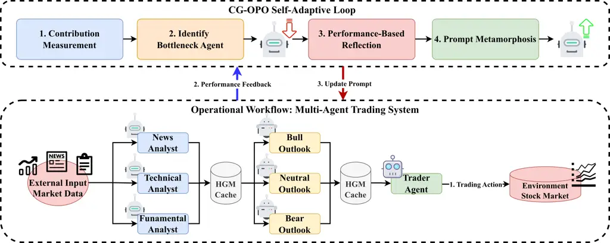

# HiveMind: Contribution-Guided Online Prompt Optimization of LLM Multi-Agent Systems

Yihan Xia    Taotao Wang ^(†)^(†)thanks: Corresponding author.   
Shengli Zhang    Zhangyuhua Weng    Bin Cao    Soung Chang Liew

###### Abstract

Recent advances in LLM-based multi-agent systems have demonstrated
remarkable capabilities in complex decision-making scenarios such as
financial trading and software engineering. However, evaluating each
individual agent’s effectiveness and online optimization of
underperforming agents remain open challenges. To address these issues,
we present HiveMind, a self-adaptive framework designed to optimize LLM
multi-agent collaboration through contribution analysis. At its core,
HiveMind introduces Contribution-Guided Online Prompt Optimization
(CG-OPO), which autonomously refines agent prompts based on their
quantified contributions. We first propose the Shapley value as a
grounded metric to quantify each agent’s contribution, thereby
identifying underperforming agents in a principled manner for automated
prompt refinement. To overcome the computational complexity of the
classical Shapley value, we present DAG-Shapley, a novel and efficient
attribution algorithm that leverages the inherent Directed Acyclic Graph
structure of the agent workflow to axiomatically prune non-viable
coalitions. By hierarchically reusing intermediate outputs of agents in
the DAG, our method further reduces redundant computations, and
achieving substantial cost savings without compromising the theoretical
guarantees of Shapley values. Evaluated in a multi-agent stock-trading
scenario, HiveMind achieves superior performance compared to static
baselines. Notably, DAG-Shapley reduces LLM calls by over 80% while
maintaining attribution accuracy comparable to full Shapley values,
establishing a new standard for efficient credit assignment and enabling
scalable, real-world optimization of multi-agent collaboration.

¹College of Electronic and Information Engineering, Shenzhen University

²School of Information and Communication Engineering, Beijing University
of Posts and Telecommunications

³Department of Information Engineering, The Chinese University of Hong
Kong

xiayihan2023@email.szu.edu.cn, ttwang@szu.edu.cn, zsl@szu.edu.cn,

2410043007@mails.szu.edu.cn, caobin@bupt.edu.cn, soung@ie.cuhk.edu.hk

## Introduction

Large Language Models (LLMs) have revolutionized Multi-Agent Systems
(MAS), enabling the creation of sophisticated agent teams capable of
addressing complex collaborative tasks across diverse domains, such as
financial trading, automated software development, and scientific
discovery. Despite their remarkable potential, deploying these systems
in dynamic, real-world environments introduces critical challenges,
particularly in maintaining optimal performance through continuous,
autonomous adaptation.

Two fundamental issues arise in this context. First, optimizing
underperforming agents autonomously during runtime is essential for
adapting to dynamic environments but remains an open problem. Second,
accurately attributing individual agents’ contributions to the overall
system performance is a significant challenge, especially in complex
workflows where interactions between agents are non-trivial. Current
solutions often rely on static agent configurations, manually crafted
prompts, and periodic updates. While this approach may suffice in stable
environments, it struggles in dynamic scenarios where agent roles and
requirements evolve rapidly, necessitating real-time adaptation.

To address these challenges, we propose HiveMind, a self-adaptive
framework designed to optimize LLM-based multi-agent collaboration
through autonomous refinement and contribution analysis. At its core,
HiveMind introduces Contribution-Guided Online Prompt Optimization
(CG-OPO), a closed-loop optimization mechanism that continuously refines
agent prompts based on their quantified contributions. By autonomously
monitoring agent performance, CG-OPO identifies underperforming agents
and initiates targeted prompt refinements through an LLM-driven
reflection process, enabling dynamic system improvement during runtime.
A key enabler of CG-OPO is DAG-Shapley, a novel and efficient algorithm
for contribution measurement. DAG-Shapley leverages the Directed Acyclic
Graph (DAG) structure inherent in agent workflows to compute Shapley
values, a principled metric for quantifying individual contributions. By
axiomatically pruning non-viable coalitions and hierarchically reusing
intermediate outputs, DAG-Shapley significantly reduces computational
complexity compared to classical Shapley value calculations, making
real-time attribution feasible without compromising theoretical
guarantees.

HiveMind operates as a self-adaptive cycle of diagnosis and
optimization: DAG-Shapley provides rapid and accurate identification of
performance bottlenecks, while CG-OPO executes targeted adjustments to
enhance agent collaboration. This framework eliminates the need for
human intervention, ensuring scalable and robust MAS performance in
dynamic environments. Our primary contributions are as follows:

- •
  Dynamic Autonomous Optimization Framework: We introduce CG-OPO, a
  mechanism that enables continuous refinement of agent prompts based on
  quantified contributions, ensuring sustained system improvement during
  runtime.
- •
  Efficient Contribution Measurement Algorithm: We propose DAG-Shapley,
  a computationally efficient algorithm for real-time attribution in
  DAG-structured agent systems, reducing LLM calls by over 80% compared
  to classical Shapley value calculations.
- •
  Integrated Self-Adaptive Framework: HiveMind combines CG-OPO and
  DAG-Shapley into a cohesive framework for building scalable,
  self-optimizing agent teams.

Evaluated in a multi-agent stock-trading scenario, HiveMind demonstrates
superior performance compared to static baselines, achieving efficient
credit assignment and scalable optimization of multi-agent
collaboration. By addressing the challenges of dynamic optimization and
real-time attribution, HiveMind establishes a new standard for MAS,
paving the way for robust applications in complex, evolving
environments.

## Related Work

Our work builds upon and contributes to three primary areas of research:
LLM-based multi-agent systems, credit assignment in cooperative games,
and automated prompt engineering.

### LLM-Based Multi-Agent Systems

The concept of multi-agent systems has a rich history, but the advent of
LLMs has catalyzed a new wave of research into more capable and flexible
agent architectures (Wang et al. 2024; Zhang et al. 2023). Recent works
have demonstrated the potential of LLM-based agents for complex,
collaborative tasks. In software development, frameworks like MetaGPT
(Hong et al. 2023) and ChatDev (Qian et al. 2023) simulate entire
software companies with specialized agent roles. For social science and
human behavior studies, systems like Generative Agents (Park et al. 2023) create believable simulacra of human interaction in sandbox
environments. Beyond specific domains, general-purpose collaborative
frameworks such as AgentVerse (Chen et al. 2023) and AutoGen (Wu et al. 2023) have been proposed to facilitate cooperation among LLM agents to
solve a wide array of complex problems. Recent advances in multi-modal
information processing have also explored efficient hashing techniques
for handling heterogeneous data types in collaborative systems (Tu et
al. 2025b). While these systems showcase impressive capabilities, the
coordination and optimization of agent collaboration often rely on
predefined heuristics or manual intervention. Our work moves beyond this
by proposing a framework for autonomous, online optimization of the
agent workflow itself.

### Credit Assignment

The problem of fairly attributing a collective outcome to individual
contributors is a central theme in both reinforcement learning (Sutton
and Barto 2018) and cooperative game theory. The Shapley value (Shapley
and others 1953) remains the gold standard for fair credit assignment
due to its strong axiomatic guarantees. However, its exponential
complexity has spurred a long line of research into approximation
methods. In multi-agent reinforcement learning, credit assignment is
often addressed through value function factorization, as seen in
influential works like VDN (Sunehag et al. 2017) and QMIX (Rashid et al.
2018). Our work, DAG-Shapley, falls into the category of structural
credit assignment, we are the first to leverage the inherent Directed
Acyclic Graph (DAG) structure of LLM-based agent workflows to create a
computationally efficient and accurate credit assignment mechanism
specifically for LLM-based systems.

### Automated Prompt Engineering

The performance of LLMs is highly sensitive to the quality of their
prompts. This has led to a surge in research on automated prompt
engineering, or “prompt optimization.” Foundational prompting strategies
that elicit complex reasoning, such as Chain-of-Thought (CoT) (Wei et
al. 2022) and Tree-of-Thoughts (ToT) (Yao et al. 2023), have
demonstrated the profound impact of prompt structure. Building on this,
automated methods have emerged to discover optimal prompts. These
include discrete optimization methods like Automatic Prompt Engineer
(APE) (Zhou et al. 2022), gradient-free optimization (Pryzant et al.
2023), and methods using reinforcement learning to refine prompts (Deng
et al. 2022). Complementary research in vision-language pre-training has
demonstrated the importance of semantic completion learning for
enhancing multi-modal understanding capabilities (Tu et al. 2025a). Our
Contribution-Guided Online Prompt Optimization (CG-OPO) framework
extends this concept to the multi-agent setting. It represents a novel
approach where the optimization of individual agent prompts is guided by
a global, system-level assessment of each agent’s contribution, creating
a direct, performance-driven link between collaborative success and
prompt refinement.



Figure 1: Overall system architecture showing the closed-loop
optimization cycle.

## System Formalization

This section details HiveMind, our self-adaptive optimization framework
for LLM-based multi-agent systems. The framework addresses two
fundamental challenges: autonomous optimization of underperforming
agents during runtime and accurate attribution of individual agent
contributions to overall system performance. HiveMind introduces two key
innovations: Contribution-Guided Online Prompt Optimization (CG-OPO), a
closed-loop optimization mechanism that continuously refines agent
prompts based on quantified contributions; and DAG-Shapley, an efficient
algorithm for contribution measurement that leverages Directed Acyclic
Graph structure to compute Shapley values with dramatically reduced
computational complexity.

HiveMind operates as a closed-loop, periodic optimization system that
continuously improves collective performance through autonomous
adaptation. The framework consists of an iterative cycle: performance
evaluation $`\rightarrow`$ contribution measurement $`\rightarrow`$
bottleneck identification $`\rightarrow`$ prompt optimization
$`\rightarrow`$ system update. At its core, CG-OPO provides targeted
agent enhancement guided by precise contribution measurement from
Shapley value. This combination eliminates manual intervention
requirements while ensuring scalable optimization in dynamic
environments. Figure 1 illustrates the primary components and their data
flow within this continuous optimization loop, where each iteration
refines individual agent behavior based on measured contributions to
overall system performance.

### System Architecture and Information Flow

To systematically manage agent interactions and enable principled
contribution analysis, we model our Multi-Agent System (MAS) as a
Directed Acyclic Graph (DAG). This architectural choice is motivated by
three key observations: (1) many collaborative tasks exhibit natural
information flow hierarchies that preclude cycles, (2) acyclic
structures enable efficient topological scheduling and prevent
information loops that can destabilize learning, and (3) DAG constraints
facilitate rigorous credit assignment through game-theoretic frameworks
(Shapley and others 1953; Li et al. 2024). Our approach builds upon
recent advances in DAG-based multi-agent coordination (Qian et al. 2024)
while addressing the specific challenges of financial decision-making
under uncertainty.

#### Graph Formalization and Constraints

Formally, we define the system as a graph
$`\mathcal{G}=(\mathcal{V},\mathcal{E})`$, where
$`\mathcal{V}=\{a_{1},a_{2},\ldots,a_{N}\}`$ is the set of $`N`$ agents,
and $`\mathcal{E}\subseteq\mathcal{V}\times\mathcal{V}`$ is the set of
directed edges. An edge $`(a_{i},a_{j})\in\mathcal{E}`$ signifies that
the output of agent $`a_{i}`$ is a required input for agent $`a_{j}`$.
The acyclicity constraint ensures that there exists a topological
ordering $`\pi:\mathcal{V}\rightarrow\{1,2,\ldots,N\}`$ such that for
all $`(a_{i},a_{j})\in\mathcal{E}`$, we have $`\pi(a_{i})<\pi(a_{j})`$.

Within this graph, we distinguish critical subsets of nodes:

- •
  Source nodes:
  $`\mathcal{V}_{\text{source}}=\{v\in\mathcal{V}:\text{in-degree}(v)=0\}`$,
  which process external information
- •
  Sink node: $`a_{T}\in\mathcal{V}`$ such that
  $`\text{out-degree}(a_{T})=0`$, which produces the system’s final
  output
- •
  Intermediate nodes:
  $`\mathcal{V}_{\text{intermediate}}=\mathcal{V}\setminus(\mathcal{V}_{\text{source}}\cup\{a_{T}\})`$

#### Access Control and Data Dependencies

The DAG structure enforces strict information flow constraints through a
formal access control mechanism (Myerson 1977). Let $`\mathcal{D}`$
represent the universe of available data, and define an information
access function $`I:\mathcal{V}\rightarrow 2^{\mathcal{D}}`$ that maps
each agent to its accessible data subset. For any agent $`a_{i}`$, its
information set $`I(a_{i})`$ includes:

```math
I(a_{i})=\mathcal{D}_{\text{external}}^{(i)}\cup\bigcup_{(a_{j},a_{i})\in\mathcal{E}}O(a_{j}) \tag{1}
```

where $`\mathcal{D}_{\text{external}}^{(i)}`$ represents external data
directly accessible to agent $`a_{i}`$, and $`O(a_{j})`$ denotes the
output of agent $`a_{j}`$. This formalization ensures that information
flows strictly according to the DAG topology, preventing unauthorized
data access that could compromise the system’s hierarchical structure.

#### Structural Benefits and Complexity

The DAG constraint provides several computational and organizational
advantages:

1.  1.  Efficient Scheduling: The topological ordering enables parallel
        execution within layers while maintaining dependencies, achieving
        optimal scheduling complexity $`O(|\mathcal{V}|+|\mathcal{E}|)`$.
2.  2.  Bounded Computation: The acyclic property guarantees termination and
        prevents infinite loops in iterative processes, ensuring system
        stability.
3.  3.  Hierarchical Learning: The structured information flow enables
        layer-wise optimization and facilitates credit assignment through
        backward propagation of gradients or game-theoretic value
        distribution.

#### Implementation and Agent Roles

To ground this abstraction, we instantiate our framework within a
multi-agent financial trading system designed for stock market analysis
and decision-making, a domain where multi-agent approaches have
demonstrated significant promise (Xiao et al. 2024; Tran et al. 2025).
The system comprises seven agents organized into three distinct
hierarchical layers:

Analysis Layer ($`\mathcal{V}_{\text{source}}`$): This layer consists of
three independent specialist agents:

- •
  News Analyst Agent (NAA): Processes news feeds and sentiment data
- •
  Technical Analyst Agent (TAA): Analyzes price history and technical
  indicators
- •
  Fundamental Analyst Agent (FAA): Evaluates financial statements and
  company metrics

Each agent processes raw, heterogeneous market data in parallel to
produce focused analytical summaries, forming the source nodes of our
DAG.

Outlook Layer ($`\mathcal{V}_{\text{intermediate}}`$): This layer
contains three agents that synthesize outputs from the Analysis Layer:

- •
  Bullish Outlook Agent (BOA): Aggregates positive market signals
- •
  Bearish Outlook Agent (BeOA): Consolidates negative market indicators
- •
  Neutral Outlook Agent (NOA): Balances conflicting signals

These agents are explicitly prohibited from accessing raw market data
through the information flow constraints defined by $`I(\cdot)`$,
forcing reliance solely on structured analyses from the previous layer.

Decision Layer (Sink Node): The Trader Agent (TRA) constitutes the final
layer, consuming competing outlooks to produce actionable trading
decisions. This agent serves as the system’s sink node $`a_{T}`$.

The integration of Shapley value theory into this DAG-based framework
provides a principled approach to contribution assessment that leverages
the structured information flow (Myerson 1977). This combination enables
both efficient execution and fair credit assignment, making it
particularly suitable for collaborative decision-making tasks where
individual agent contributions must be quantified and optimized.

### Contribution-Guided Online Prompt Optimization

In multi-agent systems, evaluating each individual agent’s effectiveness
and performing online optimization of underperforming agents remain open
challenges.

To address these challenges, we introduce Contribution-Guided Online
Prompt Optimization (CG-OPO), a systematic framework that autonomously
transforms contribution measurement scores into targeted agent
improvements. CG-OPO establishes a principled feedback mechanism
utilizing game-theoretic attribution to concentrate optimization on
underperforming components while preserving well-functioning agents. By
integrating Shapley value-based attribution with automated prompt
optimization techniques (Li et al. 2025; Pryzant et al. 2023), CG-OPO
addresses fundamental system bottlenecks, enabling scalable autonomous
improvement in DAG-structured multi-agent architectures

In our framework, the optimization is iterative. We use $`t`$ to denote
the current optimization cycle or time step (e.g., a weekly evaluation
period), during which historical data $`\mathcal{H}_{t}`$ is collected.

#### Four-Stage Optimization Pipeline

CG-OPO operates through four sequential stages:

- •
  Contribution Measurement: Evaluates individual agent performance using
  game-theoretic attribution
- •
  Identify Bottleneck Agent: Selects the lowest-performing agent for
  optimization
- •
  Performance-Based Reflection: Analyzes failure and success cases via
  meta-optimizer to extract improvement insights
- •
  Prompt Metamorphosis: Integrates learned lessons into the target
  agent’s prompt for enhanced performance

The complete optimization process is formalized in Algorithm 1.

#### Stage 1: Contribution Measurement

The optimization cycle begins with comprehensive evaluation of each
agent’s contribution to system performance. For each agent
$`a_{i}\in\mathcal{V}`$, we compute the Shapley value $`\phi_{i}(t)`$
representing agent $`i`$’s contribution to the system’s overall
performance, based on the Sharpe ratio of coalition subsets (Hua et al.
2025; Liang et al. 2024). The Shapley value for agent $`i`$ is defined
as:

```math
\phi_{i}(v)=\sum_{S\subseteq\mathcal{V}\setminus\{a_{i}\}}\frac{|S|!(N-|S|-1)!}{N!}[v(S\cup\{a_{i}\})-v(S)] \tag{2}
```

where $`v(S)`$ represents the coalition performance measured by the
Sharpe ratio:

```math
v(S)=\text{Sharpe}(S)=\frac{\mathbb{E}[R_{S}]-R_{f}}{\sigma(R_{S})} \tag{3}
```

where $`R_{S}`$ is the return generated by coalition $`S`$, $`R_{f}`$ is
the risk-free rate, and $`\sigma(R_{S})`$ is the standard deviation of
coalition returns.

#### Stage 2: Identify Bottleneck Agent

Based on the contribution scores computed in Stage 1, the system
identifies the target agent for optimization:

```math
a^{*}=\arg\min_{a_{i}\in\mathcal{V}}\phi_{i}(t) \tag{4}
```

Optimization is triggered only if
$`\phi_{a^{*}}(t)<\tau_{\text{threshold}}`$, focusing computational
resources on genuine bottlenecks while preserving well-performing
agents, as shown in Algorithm 1.

#### Stage 3: Performance-Based Reflection

When a bottleneck is identified, the system extracts failure cases
$`\mathcal{F}^{*}=\{(s,a,r)\in\mathcal{H}_{t}(a^{*}):r<0\}`$ and success
cases $`\mathcal{S}^{*}=\{(s,a,r)\in\mathcal{H}_{t}(a^{*}):r\geq 0\}`$
from the target agent’s historical performance data
$`\mathcal{H}_{t}(a^{*})`$. A meta-optimizer analyzes these cases to
generate actionable lessons $`\mathcal{L}_{t}`$ that identify systematic
weaknesses and successful patterns through conceptual verbal
reinforcement (Yu et al. 2024). This approach leverages collaborative
agent interaction and iterative refinement of analysis to enhance
reasoning capabilities, particularly effective in financial
decision-making contexts. The reflective learning mechanism draws upon
meta-optimization principles to systematically improve agent
performance. The detailed reflection process is presented in
Algorithm 2.

#### Stage 4: Prompt Metamorphosis

The final stage integrates the extracted lessons into the target agent’s
prompt through structured augmentation, following principles from
automated prompt engineering and prompt evolution techniques:

```math
P_{t+1}(a^{*})=P_{t}(a^{*})\oplus\mathcal{L}_{t} \tag{5}
```

where $`\oplus`$ denotes concatenation that preserves the agent’s core
functionality while incorporating experience-based guidance. This
approach ensures incremental improvement without disrupting established
capabilities, as implemented in Algorithm 1.

Input: Agent set $`\mathcal{V}`$, contribution scores
$`\{\phi_{i}(t)\}_{i=1}^{n}`$, weekly I/O data $`\mathcal{H}_{t}`$  
Output: Updated agent prompts for cycle $`t+1`$

1:  $`a^{*}\leftarrow\arg\min_{a_{i}\in\mathcal{V}}\phi_{i}(t)`$ //
Bottleneck identification

2:
 $`\mathcal{F}^{*}\leftarrow f_{\text{extract}}(\mathcal{H}_{t},a^{*})`$
// Collect performance feedback

3:
 $`\Pi_{\text{reflect}}\leftarrow f_{\text{prompt}}(a^{*},\phi_{a^{*}}(t),\mathcal{F}^{*})`$
// Performance-Based Reflection

4:
 $`\mathcal{L}_{t}\leftarrow f_{\text{reflect}}(\Pi_{\text{reflect}})`$
// Generate lessons learned

5:
 $`P_{t+1}(a^{*})\leftarrow P_{t}(a^{*})\oplus f_{\text{format}}(\mathcal{L}_{t})`$
// Prompt metamorphosis

6:  return $`\{P_{t+1}(a_{i})\}_{i=1}^{n}`$

Algorithm 1 Contribution-Guided Online Prompt Optimization (CG-OPO)

Input: Target agent $`a^{*}`$, historical data
$`\mathcal{H}_{t}(a^{*})`$, contribution score $`\phi_{a^{*}}(t)`$  
Output: Lessons learned $`\mathcal{L}_{t}`$

1:  $`\mathcal{F}\leftarrow\{(s,a,r)\in\mathcal{H}_{t}(a^{*}):r<0\}`$ //
Extract failure cases

2:
 $`\mathcal{S}\leftarrow\{(s,a,r)\in\mathcal{H}_{t}(a^{*}):r\geq 0\}`$
// Extract success cases

3:
 $`\Pi_{\text{context}}\leftarrow f_{\text{format}}(\mathcal{F},\mathcal{S},\phi_{a^{*}}(t))`$

4:
 $`\Pi_{\text{reflect}}\leftarrow\Pi_{\text{template}}\oplus\Pi_{\text{context}}`$

5:
 $`\mathcal{L}_{t}\leftarrow f_{\text{optimize}}(\Pi_{\text{reflect}})`$

6:  return $`\mathcal{L}_{t}`$

Algorithm 2 Performance-Based Reflection Process

This creates a complete self-improvement mechanism where contribution
measurement enables accurate targeting of genuine bottlenecks, while
CG-OPO provides responsive optimization that adapts to changing system
dynamics through continuous monitoring and validation of improvements.

### DAG-Shapley: Efficient Contribution Measurement

CG-OPO requires precise computation of contribution scores
$`\phi_{i}(t)`$ for real-time bottleneck identification. While exact
Shapley value computation provides optimal attribution accuracy (Shapley
and others 1953), the exponential complexity of evaluating $`2^{n}`$
coalitions necessitates efficient algorithms for operational deployment
in LLM-based systems where each coalition evaluation requires expensive
API calls (Hua et al. 2025).

We introduce DAG-Shapley, exploiting DAG structure to achieve exact
Shapley computation with enhanced efficiency through coalition space
reduction and hierarchical memoization (Qian et al. 2024; Myerson 1977;
Li and Shan 2020). The directed nature of our agent workflow aligns with
directed graph games theory, where asymmetric information flow and
hierarchical relationships naturally emerge. DAG-Shapley operates
through two optimization stages: (1) Coalition Space Pruning eliminates
structurally invalid coalitions, and (2) Generalized Hierarchical
Memoization (GHM) caches functionally equivalent computations.

#### Coalition Space Pruning

Coalition space pruning leverages the DAG structure to eliminate
coalitions incapable of producing system outputs. The directed graph
framework (Li and Shan 2020) provides theoretical foundation for
analyzing coalition formation in hierarchical structures with asymmetric
relationships.

Given workflow structure $`\mathcal{G}=(\mathcal{V},\mathcal{E})`$ with
source agents $`\mathcal{V}_{\text{source}}`$ and sink agent $`a_{T}`$,
coalition viability requires three conditions:

```math
\displaystyle\text{HasTrader}(S) \displaystyle\triangleq a_{T}\in S \tag{6}
```

```math
\displaystyle\text{HasSource}(S) \displaystyle\triangleq S\cap\mathcal{V}_{\text{source}}\neq\emptyset \tag{7}
```

```math
\displaystyle\text{Connected}(S) \displaystyle\triangleq\exists v\in(\mathcal{V}_{\text{source}}\cap S):v\rightsquigarrow a_{T}\text{ in }\mathcal{G}|_{S} \tag{8}
```

A coalition $`S`$ is considered viable if it meets these conditions. We
define a viability function:

```math
\text{Viable}(S)\triangleq\text{HasTrader}(S)\land\text{HasSource}(S)\land\text{Connected}(S) \tag{9}
```

For non-viable coalitions where $`\text{Viable}(S)`$ is false, their
value is zero ($`v(S)=0`$), enabling systematic elimination while
preserving Shapley exactness (Myerson 1977). The pruning process is
formalized in Algorithm 3, reducing evaluations from 128 to 49
coalitions for the 7-agent system.

Input: Agent set $`\mathcal{V}`$, source agents
$`\mathcal{V}_{\text{source}}`$, trader $`a_{T}`$, DAG $`\mathcal{G}`$  
Output: Viable coalitions $`\mathcal{C}_{\text{viable}}`$

1:  $`\mathcal{C}_{\text{viable}}\leftarrow\emptyset`$

2:  for each coalition $`S\in 2^{\mathcal{V}}`$ do

3:   if $`a_{T}\notin S`$ then

4:    continue // Endpoint Rule

5:   end if

6:   if $`S\cap\mathcal{V}_{\text{source}}=\emptyset`$ then

7:    continue // Source Rule

8:   end if

9:   if
$`\nexists v\in\mathcal{V}_{\text{source}}\cap S:v\rightsquigarrow a_{T}`$
in $`\mathcal{G}|_{S}`$ then

10:    continue // Connectivity Rule

11:   end if

12:
  $`\mathcal{C}_{\text{viable}}\leftarrow\mathcal{C}_{\text{viable}}\cup\{S\}`$

13:  end for

14:  return $`\mathcal{C}_{\text{viable}}`$

Algorithm 3 Coalition Space Pruning

#### Generalized Hierarchical Memoization

The layered architecture enables computational optimization through
memoization of functionally equivalent computations. When different
coalitions produce identical layer input configurations, downstream
computations are functionally equivalent, enabling efficient caching and
reuse strategies.

For coalition $`S^{(k)}\in\mathcal{C}_{\text{viable}}`$, the layer input
configuration for layer $`\mathcal{L}_{i}`$ is:

```math
\mathcal{I}_{i}^{(k)}=\bigcup_{j=1}^{i-1}(S^{(k)}\cap\mathcal{L}_{j}) \tag{10}
```

Under functional determinism:

```math
\mathcal{I}_{i}^{(k)}=\mathcal{I}_{i}^{(k^{\prime})}\Rightarrow O_{a}(\mathcal{I}_{i}^{(k)})=O_{a}(\mathcal{I}_{i}^{(k^{\prime})}) \tag{11}
```

GHM computes each unique configuration once and reuses results across
coalitions, as detailed in Algorithm 4. The computational cost becomes:

```math
\text{Cost}_{\text{GHM}}=\sum_{i=1}^{N_{L}}|\mathcal{U}_{i}|\cdot|\mathcal{L}_{i}| \tag{12}
```

where $`|\mathcal{U}_{i}|`$ represents unique input configurations for
layer $`\mathcal{L}_{i}`$.

Input: Layered DAG
$`\mathcal{G}=(\mathcal{L}_{1},\ldots,\mathcal{L}_{N_{L}})`$, viable
coalitions $`\mathcal{C}_{\text{viable}}`$  
Output: Agent output cache $`\mathcal{M}`$ for all required computations

1:  $`\mathcal{M}\leftarrow\{\}`$ // Initialize memoization cache

2:  for $`i\leftarrow 1`$ to $`N_{L}`$ do

3:
  $`\mathcal{U}_{i}\leftarrow\{\mathcal{I}_{i}^{(k)}:S^{(k)}\in\mathcal{C}_{\text{viable}}\}`$
// Unique configurations

4:   for each configuration $`\mathcal{I}_{i}\in\mathcal{U}_{i}`$ do

5:
   $`\mathcal{A}_{\text{active}}\leftarrow\{a\in\mathcal{L}_{i}:\exists S^{(k)}\text{ s.t. }a\in S^{(k)}\land\mathcal{I}_{i}^{(k)}=\mathcal{I}_{i}\}`$

6:    for each agent $`a\in\mathcal{A}_{\text{active}}`$ do

7:     if $`(a,\mathcal{I}_{i})\notin\mathcal{M}`$ then

8:
     $`\text{inputs}\leftarrow\{O(a^{\prime}):a^{\prime}\in\mathcal{I}_{i}\}`$
from $`\mathcal{M}`$

9:
     $`\mathcal{M}[(a,\mathcal{I}_{i})]\leftarrow\text{ExecuteAgent}(a,\text{inputs})`$

10:     end if

11:    end for

12:   end for

13:  end for

14:  return $`\mathcal{M}`$

Algorithm 4 Generalized Hierarchical Memoization (GHM)

The integration of coalition space pruning with GHM enables exact
Shapley computation with complexity:

```math
\text{Complexity}_{\text{DAG-Shapley}}=O\left(\sum_{i=1}^{N_{L}}|\mathcal{U}_{i}|\cdot|\mathcal{L}_{i}|\right) \tag{13}
```

where $`|\mathcal{U}_{i}|`$ denotes the number of unique input
configurations reaching layer $`\mathcal{L}_{i}`$, calculated as:

```math
|\mathcal{U}_{i}|=\prod_{j=1}^{i-1}(2^{|\mathcal{L}_{j}|}-\delta_{j}) \tag{14}
```

with $`\delta_{j}=1`$ if layer $`j`$ requires mandatory participation
(excluding empty coalitions), 0 otherwise. For the 7-agent system with
architecture \[3,3,1\], this yields $`|\mathcal{U}_{1}|=1`$,
$`|\mathcal{U}_{2}|=7`$, $`|\mathcal{U}_{3}|=49`$, totaling 73
operations: $`1\times 3+7\times 3+49\times 1=73`$.

Empirical validation demonstrates reduction from 448 classical Shapley
evaluations to 73 DAG-Shapley operations (83% improvement), enabling
real-time computation of precise contribution scores required by CG-OPO.
This efficiency gain addresses the scalability challenges of LLM-based
multi-agent systems where computational costs are substantial.

## Experimental Evaluation

We conduct experiments to evaluate the effectiveness of HiveMind in
optimizing multi-agent collaboration through its CG-OPO framework and
DAG-Shapley algorithm. These experiments focus on validating the
system’s ability to enhance financial trading performance and
computational efficiency compared to static baselines and traditional
strategies across different market conditions.

|       |            |                            |        |        |                            |        |        |
| ----- | ---------- | -------------------------- | ------ | ------ | -------------------------- | ------ | ------ |
| Stock | Method     | Bull Market (Oct–Dec 2024) |        |        | Bear Market (Jan–Mar 2025) |        |        |
|       |            | Return                     | Sharpe | MaxDD  | Return                     | Sharpe | MaxDD  |
| AAPL  | CG-OPO     | 27.59%                     | 3.97   | 6.23%  | 3.89%                      | 0.57   | 20.61% |
|       | w/o CG-OPO | 27.08%                     | 3.90   | 6.23%  | 2.45%                      | 0.41   | 17.96% |
|       | Buy & Hold | 11.49%                     | 3.30   | 6.12%  | -10.64%                    | -1.35  | 15.14% |
|       | MACD       | 9.82%                      | 5.27   | 7.89%  | -3.16%                     | -0.31  | 15.67% |
|       | SMA        | 0.85%                      | 0.21   | 9.54%  | -3.93%                     | -0.38  | 16.89% |
| META  | CG-OPO     | 13.72%                     | 1.58   | 12.84% | 15.15%                     | 1.60   | 21.20% |
|       | w/o CG-OPO | 4.44%                      | 0.59   | 15.27% | 6.88%                      | 0.83   | 26.97% |
|       | Buy & Hold | 2.56%                      | 0.41   | 7.50%  | -3.75%                     | -0.45  | 21.71% |
|       | MACD       | -9.34%                     | -3.25  | 12.45% | 5.13%                      | 0.33   | 18.92% |
|       | SMA        | -4.24%                     | -1.71  | 6.12%  | 13.93%                     | 3.16   | 7.54%  |
| MSFT  | CG-OPO     | 7.95%                      | 1.14   | 8.72%  | 12.62%                     | 2.00   | 10.05% |
|       | w/o CG-OPO | 6.15%                      | 0.89   | 8.10%  | 8.29%                      | 1.21   | 13.17% |
|       | Buy & Hold | 0.98%                      | 0.19   | 6.52%  | -9.50%                     | -1.35  | 15.30% |
|       | MACD       | -2.55%                     | -0.89  | 8.14%  | -7.40%                     | -0.90  | 10.69% |
|       | SMA        | -0.36%                     | -0.15  | 7.68%  | -11.72%                    | -1.30  | 19.12% |
| NVDA  | CG-OPO     | 22.60%                     | 1.58   | 26.28% | -21.81%                    | -1.09  | 38.11% |
|       | w/o CG-OPO | 14.76%                     | 1.14   | 27.34% | -41.71%                    | -2.78  | 49.84% |
|       | Buy & Hold | 17.51%                     | 2.54   | 13.41% | -20.71%                    | -0.94  | 28.41% |
|       | MACD       | -10.53%                    | -3.76  | 8.16%  | -24.17%                    | -2.71  | 11.67% |
|       | SMA        | -9.75%                     | -3.75  | 8.54%  | -27.41%                    | -2.88  | 17.54% |

Table 1: Performance Comparison Across Market Regimes

| Metric                | Classic Shapley | DAG-Shapley | Improvement     |
| --------------------- | --------------- | ----------- | --------------- |
| Coalition Evaluations | 128             | 49          | 61.7% reduction |
| LLM Calls             | 448             | 73          | 83.7% reduction |

Table 2: Computational Efficiency Analysis

#### Dataset and Evaluation Framework

We evaluate CG-OPO using a 7-agent DAG system powered by GLM-4-Flash
with temperature set to 0 across four major technology stocks: AAPL,
META, MSFT, and NVDA. The evaluation spans two distinct market regimes
over a 3-month period. CG-OPO performs optimization cycles every 5
trading days, computing Sharpe ratios for all viable agent coalition
subsets within each evaluation window:

- •
  Bull Market Period: October 1–December 30, 2024
- •
  Bear Market Period: January 2–March 28, 2025

#### Baseline Methods

We compare CG-OPO against multiple baseline approaches to establish
comprehensive performance benchmarks:

- •
  w/o CG-OPO: Multi-agent system without contribution-guided
  optimization, using static agent configurations
- •
  Technical Indicators:
  - –
    MACD: Moving Average Convergence Divergence signal-based strategy
  - –
    SMA: Simple Moving Average trend-following approach

- •
  Buy & Hold: Passive investment benchmark representing baseline market
  performance

#### Performance Metrics

System performance is evaluated using standard financial metrics: total
return, Sharpe ratio, and maximum drawdown (MaxDD). These metrics
provide comprehensive assessment of both absolute and risk-adjusted
performance characteristics.

### Results and Analysis

Table 1 presents comprehensive performance comparison across both market
regimes, with methods grouped by stock for direct comparison.

CG-OPO consistently outperforms baseline methods across both market
regimes. In bull markets, CG-OPO achieves substantial improvements over
w/o CG-OPO: 209% for META (13.72% vs 4.44%), 53% for NVDA (22.60% vs
14.76%), and 29% for MSFT (7.95% vs 6.15%). During bear markets, CG-OPO
maintains positive returns for three stocks while traditional approaches
fail: META (+15.15% vs Buy & Hold $`-3.75\%`$), MSFT (+12.62% vs
$`-9.50\%`$), and AAPL (+3.89% vs $`-10.64\%`$). For NVDA, CG-OPO limits
losses to $`-21.81\%`$ compared to w/o CG-OPO’s $`-41.71\%`$. Technical
indicators consistently underperform across all conditions, validating
the superiority of adaptive multi-agent approaches over rule-based
strategies. The results demonstrate CG-OPO’s effectiveness in both
capturing opportunities during favorable conditions and providing
defensive capabilities during market stress.

### Computational Efficiency Analysis

Table 2 demonstrates that DAG-Shapley optimization delivers substantial
computational advantages over traditional Shapley value computation
through structural pruning and hierarchical memoization, enabling
real-time deployment in live trading environments.

DAG-Shapley optimization delivers substantial computational benefits
through structural pruning and hierarchical memoization. Importantly,
our optimized DAG-Shapley algorithm produces identical contribution
attribution results to the classical Shapley computation in all
evaluated scenarios, ensuring that computational efficiency gains do not
compromise the accuracy or reliability of agent contribution
assessments. This enables real-time deployment in live trading
environments with full confidence in result validity.

### Discussion

The experimental results validate CG-OPO’s effectiveness across varying
market conditions, with particular strength in bull markets for
high-volatility stocks and defensive capabilities maintaining positive
returns during bear markets. While CG-OPO consistently achieves higher
returns, it exhibits increased volatility and maximum drawdowns,
suggesting more aggressive trading strategies that enhance returns but
increase risk exposure.

The consistent underperformance of traditional technical indicators
validates the superiority of adaptive multi-agent approaches over
rule-based strategies. The 83.7% reduction in computation time enables
real-time deployment in operational trading environments.

Current limitations include sector focus on technology stocks and
evaluation during specific market periods. Future work should explore
broader asset classes, extended time horizons, and integrated risk
management mechanisms to control exposure while preserving adaptive
advantages.

## Acknowledgements

This work was supported in part by the Guangdong Basic and Applied Basic
Research Foundation under Grant 2024A1515012407, in part by the 2024
Shenzhen-Hong Kong-Macao Science and Technology Program (Category C
Project) under Grant SGDX20230821094359004, in part by the National
Natural Science Foundation of China under Grant 62171291, and in part by
the Shenzhen Science and Technology Program under Grant
JCYJ20220531101015033.

## References

- Chen et al. (2023) W. Chen, Y. Su, Z. Ge, C. Liu, C. Zhang, Y.
  Zhang, J. Qiu, and L. Zhang Agentverse: facilitating multi-agent
  collaboration and exploring emergent behaviors in agents. arXiv
  preprint arXiv:2308.10848. Cited by: LLM-Based Multi-Agent Systems.
- Deng et al. (2022) M. Deng, J. Wang, C. Hsieh, Y. Wang, H. Guo, T.
  Shu, M. Song, E. Xing, and Z. Hu RLPrompt: optimizing discrete text
  prompts with reinforcement learning. In Proceedings of the 2022
  Conference on Empirical Methods in Natural Language Processing
  (EMNLP), pp. 3369–3391. External Links:
  [Document](https://dx.doi.org/10.18653/v1/2022.emnlp%E2%80%91main.222)
  Cited by: Automated Prompt Engineering.
- Hong et al. (2023) S. Hong, M. Zhuge, J. Chen, X. Zheng, Y. Cheng, C.
  Zhang, Z. Wang, S. K. S. Yau, Z. Lin, et al. MetaGPT: meta programming
  for a multi‑agent collaborative framework. arXiv preprint
  arXiv:2308.00352. Cited by: LLM-Based Multi-Agent Systems.
- Hua et al. (2025) Y. Hua, H. Chen, S. Wang, W. Li, X. Wang, and J. Luo
  Shapley-coop: credit assignment for emergent cooperation in
  self-interested llm agents. arXiv preprint arXiv:2506.07388. Cited by:
  Stage 1: Contribution Measurement, DAG-Shapley: Efficient Contribution
  Measurement.
- Li and Shan (2020) D. L. Li and E. Shan The myerson value for directed
  graph games. Operations research letters 48 (2), pp. 142–146. Cited
  by: Coalition Space Pruning, DAG-Shapley: Efficient Contribution
  Measurement.
- Li et al. (2024) M. Li, H. Sun, Y. Huang, and H. Chen Shapley value:
  from cooperative game to explainable artificial intelligence.
  Autonomous Intelligent Systems 4 (1), pp. 2. Cited by: System
  Architecture and Information Flow.
- Li et al. (2025) W. Li, X. Wang, W. Li, and B. Jin A survey of
  automatic prompt engineering: an optimization perspective. arXiv
  preprint arXiv:2502.11560. Cited by: Contribution-Guided Online Prompt
  Optimization.
- Liang et al. (2024) Y. Liang, H. Wu, H. Wang, and H. Cai Asynchronous
  credit assignment for multi-agent reinforcement learning. arXiv
  preprint arXiv:2408.03692. Cited by: Stage 1: Contribution
  Measurement.
- Myerson (1977) R. B. Myerson Graphs and cooperation in games.
  Mathematics of operations research 2 (3), pp. 225–229. Cited by:
  Access Control and Data Dependencies, Implementation and Agent Roles,
  Coalition Space Pruning, DAG-Shapley: Efficient Contribution
  Measurement.
- Park et al. (2023) J. S. Park, J. C. O’Brien, C. J. Cai, M. R.
  Morris, P. Liang, and M. S. Bernstein Generative agents: interactive
  simulacra of human behavior. arXiv preprint arXiv:2304.03442. Cited
  by: LLM-Based Multi-Agent Systems.
- Pryzant et al. (2023) R. Pryzant, D. Iter, J. Li, Y. T. Lee, C. Zhu,
  and M. Zeng Automatic prompt optimization with” gradient descent” and
  beam search. arXiv preprint arXiv:2305.03495. Cited by: Automated
  Prompt Engineering, Contribution-Guided Online Prompt Optimization.
- Qian et al. (2023) C. Qian, X. Wang, Y. Zheng, C. Zhang, Z. Sun, H.
  Li, and J. Li ChatDev: communicative agents for large-scale software
  development. arXiv preprint arXiv:2307.07924. Cited by: LLM-Based
  Multi-Agent Systems.
- Qian et al. (2024) C. Qian, Z. Xie, Y. Wang, W. Liu, K. Zhu, H.
  Xia, Y. Dang, Z. Du, W. Chen, C. Yang, et al. Scaling large language
  model-based multi-agent collaboration. arXiv preprint
  arXiv:2406.07155. Cited by: System Architecture and Information Flow,
  DAG-Shapley: Efficient Contribution Measurement.
- Rashid et al. (2018) T. Rashid, M. Samvelyan, C. Schroeder, G.
  Farquhar, J. Foerster, and S. Whiteson Qmix: monotonic value function
  factorisation for deep multi-agent reinforcement learning. In
  International conference on machine learning, pp. 4295–4304. Cited by:
  Credit Assignment.
- Shapley et al. (1953) L. S. Shapley et al. A value for n-person games.
  Cited by: Credit Assignment, System Architecture and Information Flow,
  DAG-Shapley: Efficient Contribution Measurement.
- Sunehag et al. (2017) P. Sunehag, G. Lever, A. Gruslys, W. M.
  Czarnecki, V. Zambaldi, M. Jaderberg, M. Lanctot, N. Sonnerat, J. Z.
  Leibo, K. Tuyls, et al. Value-decomposition networks for cooperative
  multi-agent learning. arXiv preprint arXiv:1706.05296. Cited by:
  Credit Assignment.
- Sutton and Barto (2018) R. S. Sutton and A. G. Barto Reinforcement
  learning: an introduction. 2nd edition, MIT Press, Cambridge, MA.
  External Links: ISBN 9780262039246 Cited by: Credit Assignment.
- Tran et al. (2025) K. Tran, D. Dao, M. Nguyen, Q. Pham, B. O’Sullivan,
  and H. D. Nguyen Multi-agent collaboration mechanisms: a survey of
  llms. arXiv preprint arXiv:2501.06322. Cited by: Implementation and
  Agent Roles.
- Tu et al. (2025a) R. Tu, Y. Ji, J. Jiang, W. Kong, C. Cai, W. Zhao, H.
  Wang, Y. Yang, and W. Liu Global and local semantic completion
  learning for vision-language pre-training. IEEE Transactions on
  Pattern Analysis and Machine Intelligence. Cited by: Automated Prompt
  Engineering.
- Tu et al. (2025b) R. Tu, X. Mao, J. Liu, Z. Ma, T. Lan, and H. Huang
  Prospective layout-guided multi-modal online hashing. IEEE
  Transactions on Image Processing 34 (), pp. 5935–5947. External Links:
  [Document](https://dx.doi.org/10.1109/TIP.2025.3607626) Cited by:
  LLM-Based Multi-Agent Systems.
- Wang et al. (2024) L. Wang, C. Ma, X. Feng, Z. Zhang, H. Yang, J.
  Zhang, Z. Chen, J. Tang, X. Chen, Y. Lin, et al. A survey on large
  language model based autonomous agents. Frontiers of Computer Science
  18 (6), pp. 186345. Cited by: LLM-Based Multi-Agent Systems.
- Wei et al. (2022) J. Wei, X. Wang, D. Schuurmans, M. Bosma, B.
  Ichter, F. Xia, E. Chi, Q. Le, and D. Zhou Chain-of-thought prompting
  elicits reasoning in large language models. Advances in Neural
  Information Processing Systems 35, pp. 24824–24837. Cited by:
  Automated Prompt Engineering.
- Wu et al. (2023) Q. Wu, G. Bansal, J. Zhang, Y. Wu, S. Li, E. Zhu, B.
  Li, L. Jiang, X. Zhang, C. Wang, et al. AutoGen: enabling next‑gen llm
  applications via multi‑agent conversation framework. arXiv preprint
  arXiv:2308.08155. Cited by: LLM-Based Multi-Agent Systems.
- Xiao et al. (2024) Y. Xiao, E. Sun, D. Luo, and W. Wang TradingAgents:
  multi‑agents llm financial trading framework. arXiv preprint
  arXiv:2412.20138. Cited by: Implementation and Agent Roles.
- Yao et al. (2023) S. Yao, D. Yu, J. Zhao, I. Sha, T. Chen, S. Rao,
  and K. Narasimhan Tree of thoughts: deliberate problem solving with
  large language models. arXiv preprint arXiv:2305.10601. Cited by:
  Automated Prompt Engineering.
- Yu et al. (2024) Y. Yu, Z. Yao, H. Li, Z. Deng, Y. Cao, Z. Chen, J. W.
  Suchow, Z. Cui, R. Liu, Z. Xu, D. Zhang, K. Subbalakshmi, G. Xiong, Y.
  He, J. Huang, D. Li, and Q. Xie FinCon: a synthesized llm multi‑agent
  system with conceptual verbal reinforcement for enhanced financial
  decision making. arXiv preprint arXiv:2407.06567. Cited by: Stage 3:
  Performance-Based Reflection.
- Zhang et al. (2023) H. Zhang, W. Du, J. Shan, Q. Zhou, Y. Du, J. B.
  Tenenbaum, T. Shu, and C. Gan Building cooperative embodied agents
  modularly with large language models. arXiv preprint arXiv:2307.02485.
  Cited by: LLM-Based Multi-Agent Systems.
- Zhou et al. (2022) Y. Zhou, A. I. Muresanu, Z. Han, K. Paster, S.
  Pitis, H. Chan, and J. Ba Large language models are human‑level prompt
  engineers. arXiv preprint arXiv:2211.01910. Cited by: Automated Prompt
  Engineering.
