# Defect-Aware Hybrid Prompt Optimization for Zero-Shot Multi-Type Anomaly Detection and Segmentation

Nadeem Nazer ^(†)^(†)thanks: These authors contributed equally.
Affiliation: Corporate Research, Robert Bosch GmbH, Renningen, Germany  
^($`\dagger`$) E-mail <Hongkuan.Zhou@de.bosch.com>
Affiliation: Otto-von-Guericke-University Magdeburg, Magdeburg, Germany
   Hongkuan Zhou^($`\star`$$`\dagger`$) Affiliation: Corporate Research,
Robert Bosch GmbH, Renningen, Germany  
^($`\dagger`$) E-mail <Hongkuan.Zhou@de.bosch.com>
Affiliation: Institute for Artificial Intelligence, University of
Stuttgart, Stuttgart, Germany    Lavdim Halilaj Affiliation: Corporate
Research, Robert Bosch GmbH, Renningen, Germany  
^($`\dagger`$) E-mail <Hongkuan.Zhou@de.bosch.com>    Ylli Sadikaj
Affiliation: Faculty of Computer Science, UniVie Doctoral School
Computer Science, University of Vienna, Vienna, Austria    Steffen Staab
Affiliation: Institute for Artificial Intelligence, University of
Stuttgart, Stuttgart, Germany Affiliation: University of Southampton,
Southampton, UK

###### Abstract

Recent vision-language models (VLMs) like CLIP have shown impressive
anomaly detection performance under significant distribution shift by
utilizing high-level semantic information through text prompts. However,
these models often overlook fine-grained defect cues, e.g., hole, cut,
or scratch, that are essential for understanding the anomaly’s nature.
Moreover, the modality gap between images and text can lead to subtle
visual evidence being poorly captured in textual descriptions. To
address the gap, we enhance the representation of “abnormal” with
structured semantics, bridging coarse anomaly signals and fine-grained
defect categories. We propose a hybrid prompting mechanism that combines
human-readable descriptions of defect types with learnable token
embeddings. Building on these ideas, we introduce DAPO, a Defect-aware
Prompt Optimization framework for zero-shot multi-type and binary
anomaly detection and segmentation under distribution shift. DAPO aligns
anomaly-relevant visual features with their corresponding textual
semantics by learning hybrid defect-aware prompts that combine fixed
textual anchors with trainable token embeddings. We conducted
experiments on public benchmarks (MPDD, VisA, MVTec-AD, MAD, and
Real-IAD) and an internal dataset. The results suggest that compared to
the baseline models, DAPO achieves a 3.6% average improvement in AUROC
and average precision metrics at the image level under distribution
shift, and a 5.2% average improvement in AUROC and F1 when localizing
novel anomaly types under zero-shot settings.

## 1 Introduction

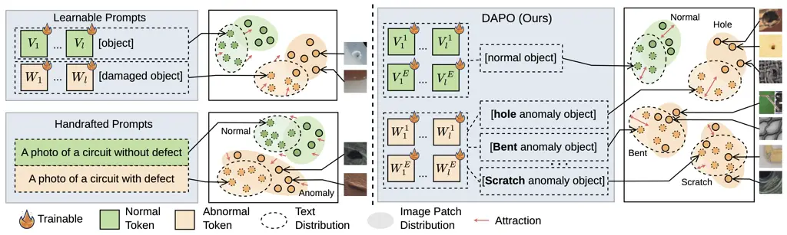

Figure 1: Motivation. Existing CLIP-based prompting often yields coarse
normal–abnormal separation, where different defect types collapse into
overlapping anomaly representations. DAPO uses compositional
defect-aware prompts to align visual cues with defect semantics,
producing better-separated representations across defect types while
avoiding manual prompt enumeration. In particular, the shared learnable
context tokens capture a type-agnostic abnormal context that transfers
across defect categories, while the defect-name anchors provide
type-specific semantics.

Visual inspection is a crucial task in manufacturing, ensuring that the
products are free of defects before reaching customers. Manual efforts
in such inspections incur high labor costs and attention. With
advancements in deep learning and computer vision techniques, these
complex processes are increasingly being automated, reducing manual
involvement and enabling high-precision identification of defects.
Therefore, visual inspection through anomaly detection (AD) and
segmentation is essential in identifying and localizing defective
regions.

Most conventional approaches adopted one-class or unsupervised anomaly
detection \[40, 29, 23, 5, 7\], where they are trained solely on the
volumes of normal (non-defective) images and classify any deviation from
the learned distribution as an anomaly. Although such models perform
well on their training distribution, the domain shift in industrial
settings is large, so that these models often need to be trained
separately on different domains and frequently retrained. Consequently,
recent work increasingly leverages large-scale pre-trained VLMs (e.g.,
CLIP \[22\]), using their broad priors as an adaptable foundation that
mitigates data scarcity and reduces extensive domain-specific
annotation.

Despite their potential, existing approaches remain limited to
coarse-grained anomaly detection, i.e., identifying whether an image is
abnormal without differentiating defect types. This limitation matters
in practice for two reasons. 1) type-level semantics provide an
inductive bias that aligns local features with defect-specific
prototypes, improving robustness under distribution shift \[24\]; 2)
focusing on the nature of anomalies such as stains, holes, or missing
components is essential for industrial operators to trace root causes
and implement preventive measures. Prior work, such as MultiADS \[24\],
attempts to incorporate defect-type knowledge via a curated knowledge
base and hand-crafted prompts, but this process is time-consuming and
difficult to scale as new defect categories emerge. Prompt learning
offers an appealing alternative and has been successfully used in works
like AnomalyCLIP \[37\]. However, relying solely on learnable (soft)
prompt tokens can drift away from the natural-language manifold on which
CLIP generalizes well thanks to its large-scale pretraining, thereby
weakening zero-shot transfer ability when tested on the target domain.

To overcome these challenges, we propose DAPO, Defect-aware Prompt
Optimization, where we learn hybrid prompts for each defect type, which
consist of a set of shared learnable defect token embeddings together
with the literal tokens of specific defect-type descriptions in textual
format (e.g., $`[W_{1}],\ldots,[W_{l}]`$ \[“bent”\] \[“defect”\]).
Sharing learnable tokens across defect categories enables prompt
construction for novel defect types by reusing the same learned abnormal
tokens while simply swapping in the textual description of the new
defect. The main contributions of this work are as follows:

- •
  We propose DAPO, a defect-aware prompt optimization framework that
  composes hybrid prompts from fixed textual anchors and a small set of
  shared learnable defect tokens reused across defect types.
- •
  We design a prompt composition and optimization scheme that explicitly
  bridges the coarse anomaly concept and fine-grained defect semantics,
  improving image-text alignment.
- •
  We conduct comprehensive experiments on five public industrial
  benchmarks and an internal semiconductor dataset under significant
  distribution shifts, demonstrating consistent gains on both zero-shot
  multi-type anomaly segmentation and binary anomaly detection. Our code
  is publicly available.¹¹ 1
  [https://github.com/boschresearch/defect-aware-prompt-optimization](https://github.com/boschresearch/defect-aware-prompt-optimization)

## 2 Related Works

### 2.1 Unsupervised Unimodal Approaches

Such approaches model normal distributions from training data, treating
deviations as anomalies. Reconstruction-based methods \[25, 20, 29\],
leverage architectures of GAN \[8\], Variational AEs \[14\], and
AEs \[16\] to find anomalies. Other approaches, such as
PatchCore \[23\], PaDIM \[5\], and SPADE \[4\], adopt representational
or memory-bank-based strategies by storing normal image features and
measuring distances between test samples and those reference features
using different distance measurement techniques. STPM \[40\] and
RD4AD \[7\] utilize a knowledge distillation-based student-teacher
framework for AD, using feature matching performed utilizing a
pre-trained classification model. Anomalies are detected by measuring
feature discrepancies between the student and teacher networks. However,
these methods face several limitations, including dependence on training
data and a one-class classification focus. These challenges motivated
the development of zero-shot approaches.

### 2.2 Zero-Shot Anomaly Detection

Zero-Shot Anomaly Detection is gaining attention due to advancements in
large-scale vision-language models (VLMs), which have wide application
in robotics \[33, 31, 30\] and autonomous driving \[38, 32\]. CLIP, in
particular, is serving as a widely adopted backbone for this task
because of its strong zero-shot visual recognition capability. Several
approaches emerged, adapting CLIP for AD, such as WinCLIP \[11\], which
uses manually crafted normal and abnormal state prompts with a
window-based segmentation approach. AprilGAN \[3\] introduces additional
trainable linear layers to adapt CLIP for AD. Drawing inspiration from
prompt learning success in NLP, methods such as CoOp \[35\] and CoCoOp
\[34\] learn task-specific prompts. AnomalyCLIP \[37\], replaces
manually defined prompts with learnable object-agnostic tokens to form a
general text representation for normal and abnormal classes. Similarly,
SimCLIP \[6\] uses implicit prompt tuning to refine text embeddings for
better alignment with CLIP’s patch features, and AdaCLIP \[2\] combines
static and dynamic prompts in a hybrid learning framework. More
recently, CLIPSAM \[17\] introduced a novel multi-modal approach by
integrating CLIP with the Segment Anything Model (SAM) \[15\] for
enhanced anomaly segmentation and detection capabilities. However, all
these methods focus on learning or crafting prompts that can capture
only coarse-grained features, failing to identify anomalies with
different specific types. FiLo \[9\] introduces fine-grained anomaly
descriptors generated by LLMs and adaptively learned textual templates,
replacing general “abnormal” semantics with category-specific
descriptions, but it does not learn a shared learnable component reused
across defect types. FAPrompt \[39\] learns compound prompts for
fine-grained feature extraction, yet it has no explicit defect-name
anchor and is formulated for binary AD rather than explicit defect-type
segmentation. Recent work such as LTOAD \[28\] explores the use of
multiple learnable concept-specific prompts, targeting Online AD by
updating prompts at test time to handle long-tailed distributions,
whereas Anomaly-OV \[27\] is a multimodal large language model
(MLLM)-based detection-and-reasoning framework. Both are complementary
to, but not directly comparable with, our lightweight frozen-CLIP
zero-shot setting. Furthermore, a major limitation across the
aforementioned prompt-learning designs is their formulation for binary
normal-vs-anomalous scoring. While MultiADS \[24\] represents a
representative attempt at multi-defect type detection, it relies heavily
on extensive hand-crafted prompts, which are difficult to scale.

Unlike AdaCLIP’s global-vs-dynamic (image-conditioned) prompts, DAPO
composes a fixed defect-name anchor with a set of _shared_ learnable
tokens. Unlike FiLo and FAPrompt, it supports zero-shot instantiation of
previously unseen defect types by simply swapping the textual anchor,
without retraining or updating an external descriptor set. Our approach
mitigates these limitations through hybrid defect-aware prompting, where
learnable tokens are composed with fixed textual anchors, and through
local alignment objectives that couple defect semantics to fine-grained
visual evidence, reducing the discrepancy between visual and textual
representations.

## 3 Preliminaries

We provide the formal definition of three anomaly detection tasks
addressed in this work: (1) binary anomaly detection, (2) binary anomaly
segmentation under distribution shift, and (3) zero-shot multi-type
anomaly segmentation. Note that the task of binary anomaly
detection/segmentation under distribution shift is commonly referred to
as _zero-shot_ anomaly detection/segmentation in the literature.
However, we argue that this term is _misleading_, as the objective is
not to locate new types of anomalies, but to distinguish between normal
and anomalous samples when applied to previously unseen products, which
should be seen as a distribution shift.

##### Common setup.

Let
$`\mathcal{D}_{\text{train}}=\{(\mathbf{x}_{i},\cdot)\}_{i=1}^{N_{1}}`$
and
$`\mathcal{D}_{\text{target}}=\{(\mathbf{x}_{i},\cdot)\}_{i=N_{1}+1}^{N_{1}+N_{2}}`$
be source and target datasets whose images are drawn from different
input distributions: $`\mathbf{x}_{i}\sim\mathcal{P}(\mathcal{X})`$ for
$`i\in\{1,\dots,N_{1}\}`$ and
$`\mathbf{x}_{i}\sim\mathcal{P}(\mathcal{X^{\prime}})`$ for
$`i\in\{N_{1}+1,\dots,N_{1}+N_{2}\}`$, with
$`\mathcal{P}(\mathcal{X})\nsim\mathcal{P}(\mathcal{X^{\prime}})`$ and
each image $`\mathbf{x}\in\mathbb{R}^{H\times W\times 3}`$. A model
$`\hat{f}(\cdot)`$ is trained solely on $`\mathcal{D}_{\mathrm{train}}`$
and, at test time, adapted to $`\hat{f^{\prime}}(\cdot)`$ using
auxiliary target-domain metadata, such as the set of relevant defect
types. The three tasks differ in their label space and prediction
target.

##### Binary anomaly detection under distribution shift.

Each image is labeled with $`y\in\{0,1\}`$ indicating anomaly presence.
For each $`\mathbf{x}\in\mathcal{D}_{\mathrm{target}}`$, the detector
$`\hat{f^{\prime}}(\cdot)`$ classifies it as normal or anomalous.

##### Binary anomaly segmentation under distribution shift.

Each image is paired with a binary mask
$`\mathbf{y}\in\{0,1\}^{H\times W}`$ indicating the presence of
anomalies at each pixel. For each pixel of
$`\mathbf{x}\in\mathcal{D}_{\mathrm{target}}`$, the model
$`\hat{f}^{\prime}(\cdot)`$ classifies it as normal or anomalous.

##### Zero-shot multi-type anomaly segmentation.

In $`\mathcal{D}_{\mathrm{train}}`$, each image is paired with a mask
$`\mathbf{Y}\in\{0,1\}^{H\times W\times(K_{1}+1)}`$ encoding one normal
class and $`K_{1}`$ defect types $`\{d_{1},\dots,d_{K_{1}}\}`$; in
$`\mathcal{D}_{\mathrm{target}}`$, each image is labeled with a mask
over one normal class and a possibly different set of $`K_{2}`$ defect
types. Given the target defect types as external knowledge,
$`\hat{f^{\prime}}(\cdot)`$ predicts, for every
$`\mathbf{x}\in\mathcal{D}_{\mathrm{target}}`$, a mask
$`\hat{\mathbf{Y}}\in\{0,1\}^{H\times W\times(K_{2}+1)}`$ that locates
anomalies of each defect type.

## 4 Methodology

We propose DAPO, a CLIP-based framework for anomaly detection and
defect-type localization. DAPO learns compositional defect-aware prompts
and aligns them with both global image features and patch-level features
through global and local objectives (Fig. 2). At test time, prompts for
unseen defect descriptors are instantiated by replacing the
defect-description anchor $`\langle D\rangle`$.

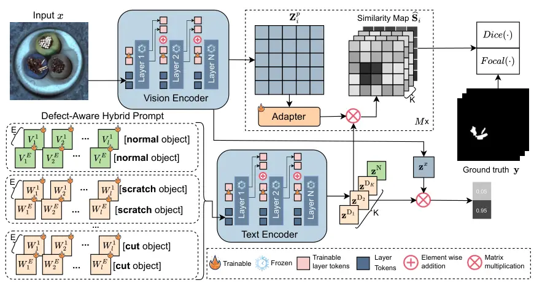

Figure 2: The training pipeline of DAPO. We learn compositional
defect-aware prompts by combining shared learnable context with
defect-name anchors, and align them with global and patch-level visual
features via global and local objectives. Only prompt tokens and
lightweight adapters are updated; CLIP encoders remain frozen.

### 4.1 Defect-Aware Prompt Design

We propose a defect-aware learnable prompts, which contain both
human-readable words and learnable embeddings that can effectively
capture abnormal and normal states (cf. Figure 2). Specifically, a
prompt for the abnormal state is composed as:

```math
\mathbf{P}^{\text{D}}=[W_{1}][W_{2}]...[W_{l}]\langle D\rangle[\text{anomaly}][\text{object}]\text{,} \tag{1}
```

where $`[W_{i}],i\in\{1,2,...,l\}`$ are learnable context tokens that
model a shared, type-agnostic context for abnormality.
$`\langle D\rangle`$ is a placeholder for the defect descriptor, such as
{“bent”, “contamination”, …}. The tokens \[anomaly\] and \[object\] are
fixed literals corresponding to the words “anomaly” and “object”.

A key design choice is to share the learnable tokens $`{[W_{i}]}`$
across all defect types, yielding a single set of parameters that learns
a defect-aware context composable with different descriptors: the
explicit defect word $`\langle D\rangle`$ injects type-specific
semantics (e.g., “scratch”, “crack”), while the shared tokens provide
transferable anomaly knowledge that improves generalization across
defect categories. The fixed anchor $`[\text{anomaly}]`$ grounds the
prompt in CLIP’s pre-trained semantic space, and $`[\text{object}]`$
preserves object-level context while allowing the learnable tokens to
focus on defect cues that generalize across object categories \[37\].
Similarly, the normal prompt can be represented as:

```math
\mathbf{P}^{\text{N}}=[V_{1}][V_{2}]...[V_{l}][\text{normal}][\text{object}]\text{.} \tag{2}
```

where $`[V_{i}],i\in\{1,2,...,l\}`$ are learnable context tokens for
normal state. Building on this foundation, to further enhance the
representation capability, for one normal and $`K`$ abnormal states of
different defect types, we generate $`E`$ prompts, each capturing
different aspects of the anomaly space. For any given defect type, all
$`E`$ prompts are utilized, meaning that a single defect type (e.g.,
“scratch”) is described through $`E`$ different learnable contextual
embeddings. The prompt set can be written as:

```math
\displaystyle\mathcal{B} \displaystyle=\{\mathbf{P}^{\text{N}}_{1},\mathbf{P}^{\text{N}}_{2},\dots\mathbf{P}^{\text{N}}_{E}\}\text{,}
```

```math
\displaystyle\mathcal{A}_{k} \displaystyle=\{\mathbf{P}^{\text{D}_{k}}_{1},\mathbf{P}^{\text{D}_{k}}_{2},\dots\mathbf{P}^{\text{D}_{k}}_{E}\}\text{,} \tag{3}
```

where $`\mathcal{B}`$ is the prompt set for the normal state, while
$`\mathcal{A}_{k}`$ is the prompt set for the abnormal state of the
$`k`$-th defect.

### 4.2 Prompt Optimization

Instead of fine-tuning the parameters of the network, we optimize the
prompt set we defined in Equation (3). In the following section, we
discuss the encoding process of images and texts and the loss function
design for local and global optimization.

#### Image Encoding

Given an input image $`\mathbf{x}\in\mathbb{R}^{H\times W\times 3}`$,
the image encoder generates intermediate image patch embeddings at $`M`$
encoding stages or layers and a single global image embedding
$`\mathbf{z}^{x}`$ in the shared vision-text semantic space
$`\mathcal{Z}`$. For each stage $`i\in\{1,2,\dots,M\}`$, a linear
adapter transforms the corresponding patch embeddings into the
vision-text semantic space $`\mathcal{Z}`$. We denote these adapted
embeddings as
$`\mathbf{Z}^{p}_{i}\in\mathbb{R}^{C\times H^{\prime}\times W^{\prime}}`$.
$`H^{\prime}\times W^{\prime}`$ are the resolution of image patch
embeddings. Formally, the output of the image encoder is defined by:

```math
(\mathbf{z}^{x},\mathbf{Z}^{p}_{1},\dots,\mathbf{Z}^{p}_{M})=f_{\theta}(\mathbf{x})\text{,} \tag{4}
```

where $`f_{\theta}(\cdot)`$ is the parameterized image encoder function.

#### Text Encoding

For each prompt $`\mathbf{P}\in\mathcal{A}_{k}`$, the text encoder
$`f_{\lambda}(\cdot)`$ encodes the prompt to a text embedding. The
embedding representing the $`k`$-th defect state is

```math
\mathbf{z}^{\text{D}_{k}}=\frac{1}{E}\sum_{\mathbf{P}\in\mathcal{A}_{k}}f_{\lambda}(\mathbf{P}),k\in\{1,...,K\} \tag{5}
```

Similarly, the embedding for the normal state is

```math
\mathbf{z}^{\text{N}}=\frac{1}{E}\sum_{\mathbf{P}\in\mathcal{B}}f_{\lambda}(\mathbf{P})\text{.} \tag{6}
```

In total, we have $`K+1`$ embeddings
$`\{\mathbf{z}^{\text{N}},\mathbf{z}^{\text{D}_{1}},...,\mathbf{z}^{\text{D}_{K}}\}`$
represent one normal state and $`K`$ abnormal state.

Following prior work on progressive prompt tuning, we adopt a
progressive prompt injection strategy to stabilize optimization when
inserting learnable tokens into both visual and textual encoders.

### 4.3 Loss Function Design

Our loss function consists of two components: The global loss uses
cosine similarity to align the global image embedding with its
corresponding normal or abnormal state, capturing high-level semantic
differences between samples. This is achieved by calculating the cosine
similarity between the global image embedding $`\mathbf{z}^{x}`$ with
$`\mathbf{z}^{\text{N}}`$ and the averaged defect-aware prompts,
$`\frac{1}{K}\sum_{k=1}^{K}\mathbf{z}^{\text{D}_{k}}`$ to get the
similarity score $`\mathbf{s}\in\mathbb{R}^{2}`$. The global loss is
defined by

```math
\mathcal{L}_{\text{global}}=CE(softmax(\mathbf{s}),y)\text{,} \tag{7}
```

where $`CE(\cdot)`$ represents the cross-entropy calculation.

The local loss aligns image patch embeddings with one of the $`K+1`$
states at a fine-grained spatial resolution. Each adapted image patch
embedding $`\mathbf{Z}_{i}^{p}`$ is compared with $`K+1`$ text
embeddings to get the similarity maps. Since we choose image patch
embeddings at $`M`$ different layers, we get $`M`$ different similarity
maps
$`\hat{\mathbf{S}}_{i}\in\mathbb{R}^{(K+1)\times H^{\prime}\times W^{\prime}}`$.
This allows the model to localize and differentiate between defect types
and normal regions at a finer spatial resolution. The local loss is:

```math
\displaystyle\mathcal{L}_{\text{local}}=\frac{1}{M}\sum_{i=1}^{M}Focal(UP(\hat{\mathbf{S}}_{i}),\mathbf{Y})+Dice(UP(\hat{\mathbf{S}}_{i}[0]),\mathbf{Y}[0])
```

```math
\displaystyle+Dice(\mathbf{1}-UP(\hat{\mathbf{S}}_{i}[0]),\mathbf{1}-\mathbf{Y}[0])\text{,} \tag{8}
```

where $`Focal(\cdot)`$, and $`Dice(\cdot)`$ are focal \[19\] and
dice \[18\] losses, respectively. Focal loss is designed to address the
class imbalance problem, which is especially relevant in AD, where
anomalous samples are significantly fewer than normal ones. Dice loss
encourages the model to learn accurate decision boundaries by measuring
the overlap between the predicted and ground truth segmentation mask.
$`UP(\cdot)`$ is the upsampling function to enlarge the resolution to
the original image size $`H\times W`$. $`\hat{\mathbf{S}}_{i}[0]`$
represents the predicted probability map for the normal state at stage
$`i`$. $`\mathbf{Y}\in\mathbb{R}^{(K+1)\times H\times W}`$ represents
the ground truth of the multi-defect type segmentation and
$`\mathbf{Y}[0]`$ is the layer for the normal part. The final loss is a
weighted combination of the global and local losses:

```math
\mathcal{L}_{\text{total}}=\mathcal{L}_{\text{global}}+\lambda\mathcal{L}_{\text{local}} \tag{9}
```

where $`\lambda`$ is a hyperparameter used for balancing. It is
important to note that the underlying feature spaces of both text and
vision modalities are pre-trained to capture image-text semantics,
rather than anomaly semantics. This motivates refining the embedding
space to better align the modalities within the anomaly detection
domain, as described in the following section.

### 4.4 Training and Inference

At inference, we instantiate $`(K^{\prime}{+}1)`$ prompts (normal plus
the target defect descriptors), aggregate the similarity maps across the
$`M`$ stages, and obtain (i) a binary anomaly map as
$`UP(1-\tilde{\mathbf{S}}[0])`$ and (ii) a multi-type mask by pixel-wise
argmax over the $`(K^{\prime}{+}1)`$ channels.

## 5 Experiments

In this section, we describe the experimental settings and benchmarks,
define the evaluation metrics, and analyze the performance of DAPO
through comparisons, ablations, and qualitative examples.

### 5.1 Datasets

Five public industrial datasets are used: MVTec-AD \[1\], VisA \[41\],
MPDD \[12\], MAD \[36\], and Real-IAD \[26\], as well as an internal
semiconductor (ASIC) inspection dataset. Our internal dataset consists
of Application-Specific Integrated Circuit (ASIC) inspection images
collected from a real manufacturing line. Unlike public benchmarks that
span multiple object categories and defect taxonomies, this dataset
contains one product type and a single defect type (contamination), with
pixel-level annotations of contaminated regions. Samples of this dataset
are exemplified in Figure 3(b). We evaluate both image-level anomaly
detection and pixel-level segmentation and use this dataset as a focused
case study to assess performance under realistic acquisition conditions.
For datasets with defect-type annotations, we report multi-type anomaly
segmentation results using the dataset-provided defect labels.

### 5.2 Implementation Details

We use a frozen OpenCLIP \[10\] ViT-L/14@336 backbone with OpenAI
pre-trained weights, and optimize only the learnable prompts and $`M`$
linear adapters while keeping both the vision and text encoders frozen
throughout training. These trainable components constitute only
$`\sim`$0.15% of the model, allowing training in $`\sim`$25 min on
MVTec-AD and inference in $`\sim`$55 min on the large-scale Real-IAD
dataset on a single NVIDIA H200 GPU. Following a
source$`\rightarrow`$target transfer protocol, we train on MVTec-AD and
evaluate on the remaining benchmarks, and additionally train on VisA to
evaluate on MVTec-AD. Input images are resized to $`518{\times}518`$ and
normalized with the standard CLIP preprocessing pipeline. We optimize
with Adam \[13\] (learning rate $`10^{-3}`$, batch size $`8`$) for $`5`$
epochs, implemented in PyTorch 2.7.0. We extract patch features from
layers $`\{6,12,18,24\}`$ ($`M{=}4`$) and set the prompt length
$`l{=}5`$, the number of prompt instances $`E{=}10`$, and the local-loss
weight $`\lambda{=}4.0`$. We initialize the learnable context tokens
within CLIP’s embedding space, matching its token-embedding mean $`\mu`$
and standard deviation $`\sigma`$, which converges faster and yields
better results than random initialization; empirically, performance
peaks within the first one or two epochs, with later epochs tending to
overfit the source distribution.

### 5.3 Evaluation Metrics

To evaluate the performance, we use the area under the receiver
operating characteristic curve (AUROC), average precision (AP) for AD.
For segmentation, we use pixel-level AUROC and the area under per-region
overlap (AUPRO). For multi-type segmentation, we use AUROC, AP, and F1
by macro-averaging. In addition, for deployment-oriented analysis on the
internal dataset, we report operating-point metrics derived from the
confusion matrix, including true positive rate (TPR) and false positive
rate (FPR), where
$`\mathrm{TPR}=\frac{\mathrm{TP}}{\mathrm{TP}+\mathrm{FN}}`$ and
$`\mathrm{FPR}=\frac{\mathrm{FP}}{\mathrm{FP}+\mathrm{TN}}`$. On the
public benchmarks, all baseline numbers are _reported_ from their
original papers or, where unavailable under our protocol, from
MultiADS \[24\], and DAPO is evaluated under the same
source$`\rightarrow`$target protocol; on the internal ASIC dataset,
AnomalyCLIP and MultiADS are _reproduced_ by us using the authors’
released code.

## 6 Results

We evaluate our approach on two primary tasks: (1) Binary Anomaly
Detection and Segmentation under distribution shift. (2) Multi-Type
Anomaly Detection, a task to evaluate fine-grained localization proposed
in MultiADS \[24\].

### 6.1 Multi-type Anomaly Segmentation

We first evaluate our primary contribution: using prompt-learning for
zero-shot multi-type anomaly segmentation. We compare our method with
the handcrafted prompt baseline, MultiADS \[24\]. The performance
comparison is detailed in Table 1. To the best of our knowledge, we are
among the first to apply a prompt-learning approach to the zero-shot
multi-type anomaly segmentation task. Our approach consistently
outperforms MultiADS, measured by the AP metric, and achieves comparable
or superior pixel-level F1 scores. The performance margin is the largest
in MPDD with a +7.2% on F1-score and a +6.0% on MAD-Real datasets,
showing the strength of our prompt-learning approach for localizing
visually present anomalies such as “scratch” or “crack”. However, our
method shows a slight decrease in the VisA and MAD-Sim dataset with
respect to the AUROC metric, explained by dataset composition: the lower
AUROC on VisA and MAD-Real stems from the high frequency of “missing”
component anomalies, which require object-level semantic priors to
identify. Our method is not guided by such class semantics, while
MultiADS uses class names to gain an advantage on these specific
“absence” defects. In contrast, the superior AP and F1 scores
demonstrate that for visually present anomalies, our defect-aware
prompts improve the alignment between the modalities, leading to more
accurate localization. More generally, the pattern of a high pixel-level
AUROC together with lower AP/F1 reflects the strong class imbalance of
MTAS: AUROC rewards correctly ranking the abundant normal background
pixels, whereas AP and F1 directly penalize false positives within the
predicted defect regions, which favors DAPO’s conservative,
high-precision predictions that concentrate on the most discriminative
abnormal evidence.

|          |          |             |             |      |          |
| -------- | -------- | ----------- | ----------- | ---- | -------- |
| Dataset  |          | Method      | Pixel-Level |      |          |
| Train    | Test     |             | AUROC       | AP   | F1-score |
| MVTec-AD | VisA     | MultiADS    | 93.6        | 24.8 | 22.1     |
|          |          | DAPO (ours) | 88.9        | 25.0 | 22.2     |
|          | MPDD     | MultiADS    | 95.2        | 53   | 42.8     |
|          |          | DAPO (ours) | 95.5        | 53.6 | 50.0     |
|          | MAD-Sim  | MultiADS    | 92.1        | 31.5 | 27.9     |
|          |          | DAPO (ours) | 91.9        | 33.3 | 25.0     |
|          | MAD-Real | MultiADS    | 89.2        | 52.3 | 52.5     |
|          |          | DAPO (ours) | 86.1        | 58.5 | 58.5     |

Table 1: Zero-Shot Multi-type Anomaly Segmentation performance. Best
results are highlighted in bold. MultiADS results are directly reported
from the original paper.

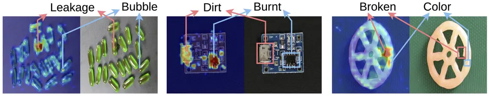

(a) VisA contains multiple defect types (e.g., leakage, bubble, dirt,
burnt, broken, and color). We visualize predicted anomaly heatmaps
(left) and the corresponding RGB images with defect regions highlighted
(right).

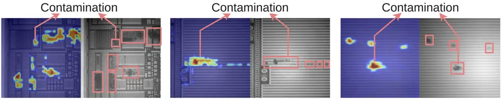

(b) Our internal ASIC dataset focuses on a single defect category
(contamination). We show representative examples with predicted anomaly
heatmaps (left) and corresponding images (right), where red boxes
indicate annotated defect regions.

Figure 3: Qualitative examples of DAPO from VisA and our internal ASIC
dataset.

To better understand the model’s generalization, we analyze individual
defect types (Table 2). DAPO generalizes well to unseen(\*) defects with
a strong, visually-present signal, such as textural or geometric
deviations: it reaches 66.6% F1 on the unseen “flattening” defect in
MPDD, and on MAD-Real and VisA it identifies “stains” (40.4% F1 vs.
6.1%) and “breakage” (20.8% vs. 7.9%). Averaged over MultiADS across the
representative unseen defect types in Table 2, this amounts to a 5.2%
mean improvement in AUROC and F1, underscoring its ability to localize
novel defects in the zero-shot setting. The strength fades for anomalies
lacking a strong local signal. For fine-grained defects such as
“particle” on VisA, detection is high (99% AUROC) but segmentation
precision is low: the model recognizes that something is wrong yet
cannot localize it precisely. It also struggles with “missing”
components: the 1.8% F1 on MAD-Real directly explains the overall AUROC
gap in Table 1, as a missing component leaves a visually normal patch
(e.g., the background) that provides no signal for the patch-based ViT
encoder to align with a text prompt.

|          |              |                 |      |             |      |
| -------- | ------------ | --------------- | ---- | ----------- | ---- |
|          |              | MultiADS \[24\] |      | DAPO (ours) |      |
| Dataset  | Defect Type  | AUROC           | F1   | AUROC       | F1   |
| VisA     | Extra\*      | 94.1            | 2.1  | 95.4        | 3.5  |
|          | Missing\*    | 88.5            | 5.3  | 87.6        | 13.3 |
|          | Particle\*   | 97.2            | 0.2  | 99.0        | 3.1  |
|          | Breakage\*   | 98.5            | 7.9  | 97.1        | 20.8 |
| MPDD     | Flattening\* | 96.7            | 36.1 | 98.8        | 66.6 |
|          | Mismatch\*   | 88.4            | 2.6  | 93.7        | 17.9 |
|          | Rust\*       | 88.4            | 26.1 | 90.1        | 28.4 |
|          | Scratch      | 96.7            | 27.0 | 97.4        | 26.8 |
| MAD-Real | Stains       | 97.0            | 6.1  | 98.7        | 40.4 |
|          | Missing      | 84.1            | 3.7  | 77.7        | 1.8  |
| MAD-Sim  | Burrs\*      | 95.6            | 1.2  | 95.4        | 1.4  |
|          | Stains       | 98.2            | 15.0 | 99.2        | 30.0 |

Table 2: Pixel-level segmentation for representative seen and unseen(\*)
defects across datasets, reported per defect type.

### 6.2 Binary Detection and Segmentation under Distribution Shift

Table 3 reports binary AD performance under distribution shift at both
image and pixel levels. Following prior protocols \[37, 24\], we train
on MVTec-AD and evaluate on VisA, MPDD, and Real-IAD as target domains.
DAPO achieves the strongest image-level performance across all targets,
obtaining the highest AUROC and AP, which indicates robust transfer
under substantial domain shift. Averaged over the two strongest
defect-aware baselines (AnomalyCLIP and MultiADS) across VisA, MPDD, and
Real-IAD, this amounts to a 3.6% mean improvement in image-level AUROC
and AP. For reference, on VisA DAPO attains an image-level AUROC of
84.9, ahead of the recent fine-grained-prompt methods FiLo (83.9) and
FAPrompt (84.6) and well above AdaCLIP (75.4) under the same
source$`\rightarrow`$target protocol (FiLo/FAPrompt as reported in their
original papers). At the pixel level, our results are competitive, while
AUPRO remains below some baselines. Since AUPRO rewards predictions that
expand to cover the entire annotated mask, DAPO’s conservative heatmaps,
which highlight the most discriminative abnormal evidence rather than
the full region, are penalized, especially for large or ambiguous
defects with broad ground-truth masks (Fig. 4). This same conservative
behavior is beneficial in deployment: on the internal ASIC dataset, it
avoids excessive activation on normal regions and helps reduce false
alarms.

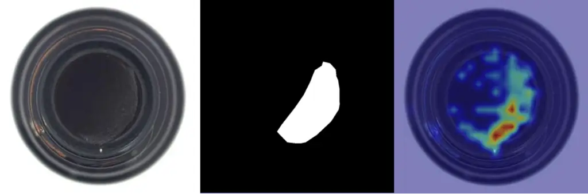

(a) Bottle (MVTec-AD)

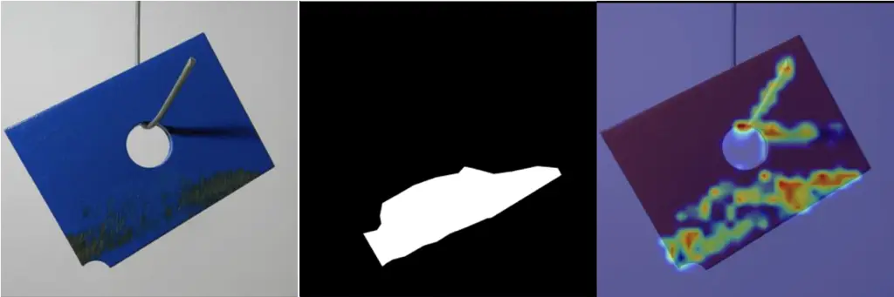

(b) Metal Plate (MPDD)

Figure 4: Visualization of large-area defect predictions. DAPO
highlights the most discriminative abnormal evidence rather than
expanding to the full annotated region, which lowers AUPRO on broad
ground-truth masks while suppressing false positives on normal regions.

|                  |             |             |      |             |       |
| ---------------- | ----------- | ----------- | ---- | ----------- | ----- |
| Binary AD and AS |             | Image-Level |      | Pixel-Level |       |
| Dataset          | Method      | AUROC       | AP   | AUROC       | AUPRO |
| VisA             | CLIP-AC     | 65.0        | 70.1 | 24.8        | 17.3  |
|                  | CoCoOp      | 78.1        | \-   | 93.6        | \-    |
|                  | WinCLIP     | 78.1        | 81.2 | 79.6        | 56.8  |
|                  | AprilGAN    | 78.0        | 81.4 | 94.2        | 86.8  |
|                  | AnomalyCLIP | 82.1        | 85.4 | 95.5        | 87.0  |
|                  | AdaCLIP     | 75.4        | 79.3 | 95.0        | \-    |
|                  | MultiADS    | 83.6        | 86.9 | 95.0        | 89.7  |
|                  | DAPO (ours) | 84.9        | 87.1 | 94.3        | 84    |
| MPDD             | CLIP-AC     | 56.2        | 66.0 | 58.7        | 29.1  |
|                  | CoCoOp      | 61          | \-   | 95.1        | \-    |
|                  | WinCLIP     | 63.6        | 69.9 | 76.4        | 48.9  |
|                  | AprilGAN    | 73.0        | 80.2 | 94.1        | 83.2  |
|                  | AnomalyCLIP | 77.0        | 82.0 | 96.5        | 88.7  |
|                  | AdaCLIP     | 66.3        | 75   | 96.3        | \-    |
|                  | MultiADS    | 78.3        | 78.4 | 95.8        | 89.7  |
|                  | DAPO (ours) | 81.2        | 83.6 | 95.1        | 84.4  |
| Real-IAD         | WinCLIP     | 75          | 72.3 | 87.1        | 59.9  |
|                  | AprilGAN    | 75.7        | 73.5 | 96          | 86.8  |
|                  | AnomalyCLIP | 78.4        | 76.7 | 96.2        | 85.7  |
|                  | AdaCLIP     | 70.1        | 68.5 | 95.3        | \-    |
|                  | MultiADS    | 78.7        | 79.1 | 96.6        | 87.1  |
|                  | DAPO (ours) | 84.3        | 84   | 96.4        | 80.3  |

Table 3: Binary anomaly detection and anomaly segmentation performance
under distribution shift. Best results are in bold. The second-best
results are underlined.

Importantly, we additionally evaluate on an internal ASIC dataset
(Table 4), which reflects a more deployment-realistic setting than
public benchmarks. On this dataset, AnomalyCLIP exhibits a marked
performance degradation (68.2 AUROC / 35.3 AP), whereas defect-aware
approaches (MultiADS and DAPO) remain substantially more stable. This
gap suggests that explicitly incorporating defect semantics can improve
robustness when moving from curated benchmarks to real production data,
consistent with the qualitative examples in Fig. 3.

Fig. 5 further analyzes behavior on the internal dataset. The ROC curves
(Fig. 5(a)) show that DAPO consistently dominates AnomalyCLIP across
operating points, indicating better separability between normal and
contaminated samples under production conditions. At a fixed threshold,
the confusion matrices (Fig. 5(b), 5(c)) reveal a balanced trade-off for
DAPO (TN=4173, TP=404), operating at FPR=4.5% and TPR=74.8%, with low
false alarms and strong defect recall, an important property for
deployment. In contrast, AnomalyCLIP assigns the anomaly label to nearly
all samples, yielding an impractically high false-alarm rate.

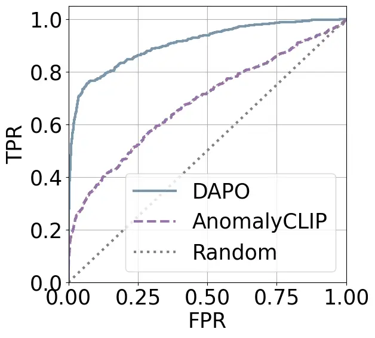

(a) ROC

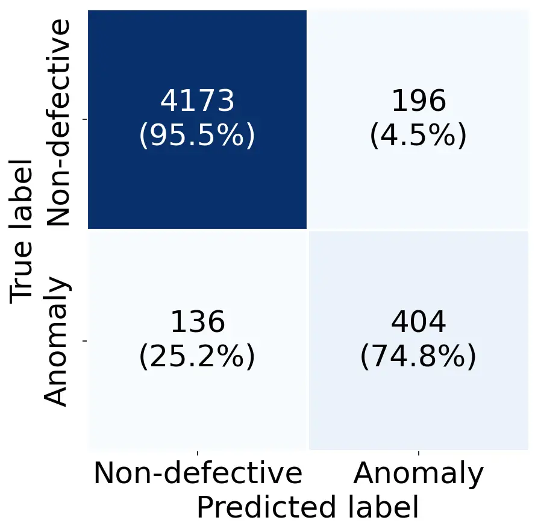

(b) DAPO

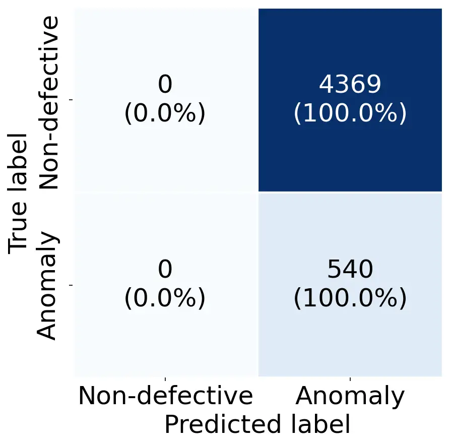

(c) AnomalyCLIP

Figure 5: Binary anomaly detection performance comparison. (a) ROC
curves for DAPO, AnomalyCLIP, and Random Classifier. (b) and (c) are
confusion matrices, demonstrating classification accuracy, with our
approach DAPO.

|                                   |             |             |      |
| --------------------------------- | ----------- | ----------- | ---- |
| Binary Anomaly Detection          |             | Image-Level |      |
| Dataset                           | Method      | AUROC       | AP   |
| Semi-conductor (Internal Dataset) | AnomalyCLIP | 68.2        | 35.3 |
|                                   | MultiADS    | 91.1        | 61.7 |
|                                   | DAPO (ours) | 91.8        | 79.1 |

Table 4: Binary anomaly detection performance under distribution shift
on our internal semiconductor dataset.

### 6.3 Ablation Study

We further conduct a prompt decomposition study to isolate the
contribution of each component in DAPO: (a) fixed defect-name anchors
(text-only), (b) shared learnable context tokens without defect anchors
(soft-only), and (c) their hybrid composition (DAPO). As shown in
Table 5, text-only prompts preserve semantic specificity but remain
limited by the image–text modality gap, leading to weak transfer in
practice. In contrast, soft-only prompts substantially improve binary
anomaly detection by learning task-adaptive context, yet they lack
explicit type cues and therefore fail to produce well-separated decision
regions required for $`(K{+}1)`$-channel multi-type anomaly segmentation
(MTAS). Combining shared context tokens with defect-name anchors yields
the best of both worlds: the anchors provide explicit defect semantics,
while the learnable tokens capture transferable anomaly context and
improve cross-domain alignment, resulting in the strongest AUROC/AP and
enabling MTAS. The lower block of Table 5 isolates three further design
choices. Removing token sharing and learning a separate prompt per
defect type (_per-defect tokens_) drops AUROC to 70.9, confirming that a
shared, type-agnostic context, rather than memorizing individual defect
prompts, is what enables transfer; this directly validates our central
design choice. Disabling the progressive injection of learnable tokens
(_w/o progressive fine-tuning_) reduces AUROC to 79.7, and replacing the
lightweight linear adapters with deeper 2-layer adapters brings no gain
(80.5). Together these confirm that DAPO’s improvements stem from its
compositional, shared-token design rather than from additional trainable
capacity.

|                                          |       |      |      |
| ---------------------------------------- | ----- | ---- | ---- |
| Variant                                  | AUROC | AP   | MTAS |
| Defect-anchor only (text, non-learnable) | 53.8  | 65.0 | ✓    |
| Soft-only (no defect anchor)             | 73.7  | 78.1 | ✗    |
| Per-defect tokens (no sharing)           | 70.9  | 75.6 | ✓    |
| w/o progressive fine-tuning              | 79.7  | 81.5 | ✓    |
| 2-layer adapters                         | 80.5  | 82.3 | ✓    |
| DAPO (shared tokens + anchor)            | 81.2  | 83.6 | ✓    |

Table 5: Component ablations on MPDD (image-level AUROC/AP). The upper
block isolates the prompt composition (defect-name anchor vs. shared
learnable tokens); the lower block ablates token sharing, progressive
fine-tuning, and adapter depth. ✓/✗ indicate whether the variant
supports the $`(K{+}1)`$-channel MTAS task.

## 7 Conclusion

We presented DAPO, a defect-aware prompt optimization framework for
binary anomaly detection/segmentation and zero-shot multi-type anomaly
segmentation. DAPO learns compositional hybrid prompts that combine a
small set of shared learnable context tokens with explicit
defect-descriptor anchors, enabling prompt instantiation for new defect
descriptors at inference. By aligning global and patch-level visual
representations with defect-aware text semantics, it improves
fine-grained localization and robustness under distribution shift,
achieving consistent gains in image-level detection and competitive
segmentation across five public benchmarks and an internal dataset.
Future work includes extending DAPO to other vision-language backbones
and improving localization of absence-based structures via object-level
priors and few-shot adaptation.

## Acknowledgements

The authors thank the International Max Planck Research School for
Intelligent Systems (IMPRS-IS) for supporting Hongkuan Zhou.

## References

- \[1\] P. Bergmann, M. Fauser, D. Sattlegger, and C. Steger (2019)
  MVTec ad–a comprehensive real-world dataset for unsupervised anomaly
  detection. In Proceedings of the IEEE/CVF conference on computer
  vision and pattern recognition, pp. 9592–9600. Cited by: Appendix 0.A,
  §5.1.
- \[2\] Y. Cao, J. Zhang, L. Frittoli, Y. Cheng, W. Shen, and G.
  Boracchi (2024) Adaclip: adapting clip with hybrid learnable prompts
  for zero-shot anomaly detection. In European Conference on Computer
  Vision, pp. 55–72. Cited by: 6th item, §0.C.8, §2.2.
- \[3\] X. Chen, Y. Han, and J. Zhang (2023) April-gan: a zero-/few-shot
  anomaly classification and segmentation method for cvpr 2023 vand
  workshop challenge tracks 1&2: 1st place on zero-shot ad and 4th place
  on few-shot ad. arXiv preprint arXiv:2305.17382. Cited by: 3rd item,
  §2.2.
- \[4\] N. Cohen and Y. Hoshen (2005) Sub-image anomaly detection with
  deep pyramid correspondences. arxiv 2020. arXiv preprint
  arXiv:2005.02357. Cited by: §2.1.
- \[5\] T. Defard, A. Setkov, A. Loesch, and R. Audigier (2021) Padim: a
  patch distribution modeling framework for anomaly detection and
  localization. In International conference on pattern recognition,
  pp. 475–489. Cited by: §1, §2.1.
- \[6\] C. Deng, H. Xu, X. Chen, H. Xu, X. Tu, X. Ding, and Y.
  Huang (2024) SimCLIP: refining image-text alignment with simple
  prompts for zero-/few-shot anomaly detection. In Proceedings of the
  32nd ACM International Conference on Multimedia, pp. 1761–1770. Cited
  by: §2.2.
- \[7\] H. Deng and X. Li (2022) Anomaly detection via reverse
  distillation from one-class embedding. In Proceedings of the IEEE/CVF
  conference on computer vision and pattern recognition, pp. 9737–9746.
  Cited by: §1, §2.1.
- \[8\] I. Goodfellow, J. Pouget-Abadie, M. Mirza, B. Xu, D.
  Warde-Farley, S. Ozair, A. Courville, and Y. Bengio (2020) Generative
  adversarial networks. Communications of the ACM 63 (11), pp. 139–144.
  Cited by: §2.1.
- \[9\] Z. Gu, B. Zhu, G. Zhu, Y. Chen, H. Li, M. Tang, and J.
  Wang (2024) Filo: zero-shot anomaly detection by fine-grained
  description and high-quality localization. In Proceedings of the 32nd
  ACM International Conference on Multimedia, pp. 2041–2049. Cited by:
  §2.2.
- \[10\] G. Ilharco, M. Wortsman, R. Wightman, C. Gordon, N. Carlini, R.
  Taori, A. Dave, V. Shankar, H. Namkoong, J. Miller, et al. (2021)
  Openclip. If you use this software, please cite it as below 7. Cited
  by: §5.2.
- \[11\] J. Jeong, Y. Zou, T. Kim, D. Zhang, A. Ravichandran, and O.
  Dabeer (2023) Winclip: zero-/few-shot anomaly classification and
  segmentation. In Proceedings of the IEEE/CVF Conference on Computer
  Vision and Pattern Recognition, pp. 19606–19616. Cited by: 2nd item,
  §2.2.
- \[12\] S. Jezek, M. Jonak, R. Burget, P. Dvorak, and M. Skotak (2021)
  Deep learning-based defect detection of metal parts: evaluating
  current methods in complex conditions. In 2021 13th International
  congress on ultra modern telecommunications and control systems and
  workshops (ICUMT), pp. 66–71. Cited by: Appendix 0.A, §5.1.
- \[13\] D. P. Kingma and J. Ba (2014) Adam: a method for stochastic
  optimization. arXiv preprint arXiv:1412.6980. Cited by: §0.C.1, §5.2.
- \[14\] D. P. Kingma M. Welling et al. (2013) Auto-encoding variational
  bayes. Banff, Canada. Cited by: §2.1.
- \[15\] A. Kirillov, E. Mintun, N. Ravi, H. Mao, C. Rolland, L.
  Gustafson, T. Xiao, S. Whitehead, A. C. Berg, W. Lo, et al. (2023)
  Segment anything. In Proceedings of the IEEE/CVF international
  conference on computer vision, pp. 4015–4026. Cited by: §2.2.
- \[16\] Y. LeCun et al. (1989) Generalization and network design
  strategies. Connectionism in perspective 19 (143-155), pp. 18. Cited
  by: §2.1.
- \[17\] S. Li, J. Cao, P. Ye, Y. Ding, C. Tu, and T. Chen (2025)
  ClipSAM: clip and sam collaboration for zero-shot anomaly
  segmentation. Neurocomputing 618, pp. 129122. Cited by: §2.2.
- \[18\] X. Li, X. Sun, Y. Meng, J. Liang, F. Wu, and J. Li (2019) Dice
  loss for data-imbalanced nlp tasks. arXiv preprint arXiv:1911.02855.
  Cited by: §4.3.
- \[19\] T. Lin, P. Goyal, R. Girshick, K. He, and P. Dollár (2017)
  Focal loss for dense object detection. In Proceedings of the IEEE
  international conference on computer vision, pp. 2980–2988. Cited by:
  §4.3.
- \[20\] Y. Liu, C. Zhuang, and F. Lu (2021) Unsupervised two-stage
  anomaly detection. arXiv preprint arXiv:2103.11671. Cited by: §2.1.
- \[21\] L. v. d. Maaten and G. Hinton (2008) Visualizing data using
  t-sne. Journal of machine learning research 9 (Nov), pp. 2579–2605.
  Cited by: §0.C.7.
- \[22\] A. Radford, J. W. Kim, C. Hallacy, A. Ramesh, G. Goh, S.
  Agarwal, G. Sastry, A. Askell, P. Mishkin, J. Clark, et al. (2021)
  Learning transferable visual models from natural language supervision.
  In International conference on machine learning, pp. 8748–8763. Cited
  by: 1st item, §1.
- \[23\] K. Roth, L. Pemula, J. Zepeda, B. Schölkopf, T. Brox, and P.
  Gehler (2022) Towards total recall in industrial anomaly detection. In
  Proceedings of the IEEE/CVF conference on computer vision and pattern
  recognition, pp. 14318–14328. Cited by: §1, §2.1.
- \[24\] Y. Sadikaj, H. Zhou, L. Halilaj, S. Schmid, S. Staab, and C.
  Plant (2025) MultiADS: defect-aware supervision for multi-type anomaly
  detection and segmentation in zero-shot learning. arXiv preprint
  arXiv:2504.06740. Cited by: Appendix 0.A, 1st item, 2nd item, 3rd
  item, 4th item, 7th item, §0.C.8, §1, §2.2, §5.3, §6.1, §6.2, Table 2,
  §6.
- \[25\] S. Venkataramanan, K. Peng, R. V. Singh, and A.
  Mahalanobis (2020) Attention guided anomaly localization in images. In
  European Conference on Computer Vision, pp. 485–503. Cited by: §2.1.
- \[26\] C. Wang, W. Zhu, B. Gao, Z. Gan, J. Zhang, Z. Gu, S. Qian, M.
  Chen, and L. Ma (2024) Real-iad: a real-world multi-view dataset for
  benchmarking versatile industrial anomaly detection. In Proceedings of
  the IEEE/CVF Conference on Computer Vision and Pattern Recognition,
  pp. 22883–22892. Cited by: Appendix 0.A, §5.1.
- \[27\] J. Xu, S. Lo, B. Safaei, V. M. Patel, and I. Dwivedi (2025)
  Towards zero-shot anomaly detection and reasoning with multimodal
  large language models. In Proceedings of the IEEE/CVF Conference on
  Computer Vision and Pattern Recognition, Cited by: §2.2.
- \[28\] C. Yang, K. Peng, and R. A. Yeh (2025) Toward long-tailed
  online anomaly detection through class-agnostic concepts. In
  Proceedings of the IEEE/CVF International Conference on Computer
  Vision, pp. 23419–23430. Cited by: §2.2.
- \[29\] J. Yang, Y. Shi, and Z. Qi (2020) Dfr: deep feature
  reconstruction for unsupervised anomaly segmentation. arXiv preprint
  arXiv:2012.07122. Cited by: §1, §2.1.
- \[30\] X. Yao, T. Blei, Y. Meng, Y. Zhang, H. Zhou, Z. Bing, K.
  Huang, F. Sun, and A. Knoll (2025) Long-horizon language-conditioned
  imitation learning for robotic manipulation. IEEE/ASME Transactions on
  Mechatronics (), pp. 1–12. External Links:
  [Document](https://dx.doi.org/10.1109/TMECH.2025.3547047) Cited by:
  §2.2.
- \[31\] H. Zhou, Z. Bing, X. Yao, X. Su, C. Yang, K. Huang, and A.
  Knoll (2024) Language-conditioned imitation learning with base skill
  priors under unstructured data. IEEE Robotics and Automation Letters 9
  (11), pp. 9805–9812. External Links:
  [Document](https://dx.doi.org/10.1109/LRA.2024.3466076) Cited by:
  §2.2.
- \[32\] H. Zhou, S. Schimid, Y. Li, L. Halilaj, X. Yao, and W.
  Cao (2025) Predicting the road ahead: a knowledge graph based
  foundation model for scene understanding in autonomous driving. In The
  Semantic Web, E. Curry, M. Acosta, M. Poveda-Villalón, M. van Erp, A.
  Ojo, K. Hose, C. Shimizu, and P. Lisena (Eds.), Cham, pp. 116–132.
  External Links: ISBN 978-3-031-94575-5 Cited by: §2.2.
- \[33\] H. Zhou, X. Yao, O. Mees, Y. Meng, T. Xiao, Y. Bisk, J. Oh, E.
  Johns, M. Shridhar, D. Shah, J. Thomason, K. Huang, J. Chai, Z. Bing,
  and A. Knoll (2023) Bridging language and action: a survey of
  language-conditioned robot manipulation. CoRR abs/2312.10807. External
  Links: [Link](https://doi.org/10.48550/arXiv.2312.10807) Cited by:
  §2.2.
- \[34\] K. Zhou, J. Yang, C. C. Loy, and Z. Liu (2022) Conditional
  prompt learning for vision-language models. In Proceedings of the
  IEEE/CVF conference on computer vision and pattern recognition,
  pp. 16816–16825. Cited by: 4th item, §2.2.
- \[35\] K. Zhou, J. Yang, C. C. Loy, and Z. Liu (2022) Learning to
  prompt for vision-language models. International Journal of Computer
  Vision 130 (9), pp. 2337–2348. Cited by: 4th item, §2.2.
- \[36\] Q. Zhou, W. Li, L. Jiang, G. Wang, G. Zhou, S. Zhang, and H.
  Zhao (2023) Pad: a dataset and benchmark for pose-agnostic anomaly
  detection. Advances in Neural Information Processing Systems 36,
  pp. 44558–44571. Cited by: Appendix 0.A, §5.1.
- \[37\] Q. Zhou, G. Pang, Y. Tian, S. He, and J. Chen (2024)
  Anomalyclip: object-agnostic prompt learning for zero-shot anomaly
  detection. In International Conference on Learning Representations,
  Cited by: 4th item, 5th item, 5th item, §1, §2.2, §4.1, §6.2.
- \[38\] X. Zhou, M. Liu, E. Yurtsever, B. L. Zagar, W. Zimmer, H. Cao,
  and A. C. Knoll (2024) Vision language models in autonomous driving: a
  survey and outlook. IEEE Transactions on Intelligent Vehicles,
  pp. 1–20. External Links:
  [Document](https://dx.doi.org/10.1109/TIV.2024.3402136) Cited by:
  §2.2.
- \[39\] J. Zhu, Y. Ong, C. Shen, and G. Pang (2025) Fine-grained
  abnormality prompt learning for zero-shot anomaly detection. In
  Proceedings of the IEEE/CVF International Conference on Computer
  Vision, Cited by: §2.2.
- \[40\] M. Zolfaghari and H. Sajedi (2022) Unsupervised anomaly
  detection with an enhanced teacher for student-teacher feature pyramid
  matching. In 2022 27th International Computer Conference, Computer
  Society of Iran (CSICC), pp. 1–4. Cited by: §1, §2.1.
- \[41\] Y. Zou, J. Jeong, L. Pemula, D. Zhang, and O. Dabeer (2022)
  Spot-the-difference self-supervised pre-training for anomaly detection
  and segmentation. In European Conference on Computer Vision,
  pp. 392–408. Cited by: Appendix 0.A, §5.1.

In the appendix, we discuss the key statistics of the five publicly
available datasets and one internal dataset. Additionally, the baselines
we compared are briefly described. Finally, additional experiments with
detailed results, along with visualizations, are listed.

## Appendix 0.A Datasets

In this section, we describe the public benchmark industrial datasets,
MvTec-AD \[1\], VisA \[41\], MPDD \[12\], MAD \[36\], Real-IAD \[26\],
along with an internal dataset. Table 6 summarizes key statistics of
these datasets, including the number of distinct product classes and the
distribution of normal and anomalous samples. Each product may exhibit
multiple defect types, which are categorized into their respective
defect classes as introduced in MultiADS \[24\]. More detailed
defect-level descriptions for each dataset can be found in the
supplementary material of the original MultiADS paper. Our internal
dataset consists of high-resolution semiconductor chip images collected
from an industrial environment, featuring a single known defect type. It
provides realistic, real-world conditions for evaluating the robustness
of the proposed system under distribution shift. For our internal
dataset, only bounding box annotations were available for the
segmentation task, which were used to generate corresponding anomaly
masks. Hence, the pixel-level scores are not accurate for evaluating the
localization performance. The details of the defect types are mentioned
in the Table 6.

[TABLE]

Table 6: Key statistics of the datasets used for industrial anomaly
detection.

|                     |               |               |                  |         |
| ------------------- | ------------- | ------------- | ---------------- | ------- |
| Object              | Defects       | Defect Type   | Test Data (No.s) |         |
|                     |               |               | Normal           | Anomaly |
| Semi-Conductor chip | Contamination | Contamination | 4369             | 540     |

Table 7: Detailed information on the defects of our internal dataset

## Appendix 0.B Baselines

To evaluate the performance of our DAPO, we compare DAPO with several
baseline models. The results of the baselines are taken directly from
the respective papers. Details of the respective baselines are given as
follows:

- •
  CLIP-AC \[22\]: They use an ensemble of text prompts designed for
  normal and abnormal classes, e.g., a photo of a normal \[cls\], and a
  photo of a damaged \[cls\], where \[cls\] denotes the target class
  name. The generated embeddings are averaged to represent the normal
  and abnormal classes respectively. The anomaly scores are computed
  using the contrastive equation from \[22\]. Results are taken
  from \[24\]. For anomaly segmentation, the similarity score checking
  is extended to local embeddings extracted from patch features.
- •
  WinClip \[11\]: WinClip is the primary baseline for anomaly detection
  under distribution shift. It uses a set of handcrafted prompts
  specific to the anomaly detection domain. For segmentation, a
  window-based approach is used due to the inherent limitation of
  pre-trained CLIP. The results are directly taken from the \[24\]
  paper.
- •
  AprilGAN \[3\]: This approach extends the WinClip by introducing an
  additional linear adapter to achieve better accurate segmentation
  results. The results are taken directly from the \[24\].
- •
  CoCoOp \[34\]: CoCoOp extend the CoOp \[35\]. To adapt CoOp for
  anomaly detection, authors of \[37\] extends the learnable text prompt
  templates $`[V_{1}][V_{2}]\dots[V_{n}][\text{cls}]`$ with
  $`[V_{1}][V_{2}]\dots[V_{n}][\text{anomaly}][\text{cls}]`$. Due to the
  sensitivity of the class distribution shift, CocoOp builds a light
  neural network to generate an instance conditional embeddings that
  adapts the learned prompts to the respective test set domains. The
  results are directly taken from the paper \[24\].
- •
  AnomalyCLIP \[37\]: AnomalyCLIP is the primary prompt learning
  baseline for anomaly detection. They learn object-agnostic prompts
  that capture anomaly semantics. The learnable tokens are structured
  similarly to CoOp, but instead of including \[cls\] information, they
  use object-level semantics:
  $`[V_{1}][V_{2}]\dots[V_{n}][\text{anomaly}][\text{object}]`$, where
  \[object\] refers to the object as whole. The results are directly
  taken from their original paper \[37\].
- •
  AdaCLIP \[2\]: AdaCLIP uses a hybrid prompt strategy combining static
  templates and dynamically generated prompts per test instance for CLIP
  adaptation. This hybrid design enables anomaly detection under
  distribution shifts. The results for AdaCLIP are directly taken from
  their original paper.
- •
  MultiADS \[24\]: MultiADS is the key baseline for multi-defect anomaly
  segmentation in zero-shot, and anomaly detection under distribution
  shifts . They use extensive prompt templates associated with each
  defect type and a product class. For e.g., a photo of a \[cls\] having
  a \[D\] defect.. Here the \[cls\], and \[D\] are replaced with class
  and defect information. The embeddings are then compared with the
  patch-level scores to generate local anomaly maps. The anomaly scores
  are computed by aggregating known anomaly scores. The results are
  directly from their paper.

## Appendix 0.C Experiments

Here, we will discuss in detail on DAPO through the experiments, and the
ablation we carried out. We will also display the visualization and
fine-grained results of our approach.

### 0.C.1 Implementation Details

As mentioned in the “implementation details” subsection of main paper,
we use VIT-L/14@336 model pretrained on OpenAI. The model is optimized
using Adam \[13\], with learning rate $`0.001`$, and a batch size of
$`8`$. The number of intermediate patch-level features, $`M`$ is 4,
specifically from layers $`6,12,18,24`$. In line with prior works, we
also follow a transfer learning strategy: training on Mvtec-AD and
evaluating on other datasets, and train on VisA to test on Mvtec-AD.
Input images are resized to $`518`$ and normalized following the CLIP
preprocessing pipeline. All our experiments are conducted for 5 epochs,
with Pytorch-2.7.0, on a single NVIDIA-H200 GPU. Empirically, we found
observed that performance peaks around epoch 1 or 2, with later epochs
exhibiting overfitting to the training dataset.

### 0.C.2 Initialization of Prompts

We study the initialization strategy of the learnable tokens: normal
context tokens $`V`$, abnormal context tokens $`W`$ and layer tokens. We
conducted experiments using three distinct initialization strategies: We
used random initialization and found that the model achieved its best
performance only in later epochs, suggesting the model required a longer
duration to stabilize and find the objective minimum. Secondly, we
initialized the context and layer tokens by aligning them to the mean
($`\mu`$) and standard deviation ($`\sigma`$) of the CLIP’s token
embeddings. We found that when initialized within CLIP’s feature space,
the model converged much faster and yielded better overall results
compared to the random strategy. Finally, in order to explicitly
separate the feature space of normal and abnormal context tokens, we
shifted the initialization of abnormal tokens by an offset 5$`\sigma`$
from the mean of the CLIP space. We and found that this required more
epochs to achieve its best image-level results. However, the pixel level
accuracy over these epochs was lower compared with the non-offset
approach. In Figure 6, we present the Image and Pixel level results on
the VisA and MPDD for each initialization strategy, using the best
performing epoch achieved across 5 training cycles.

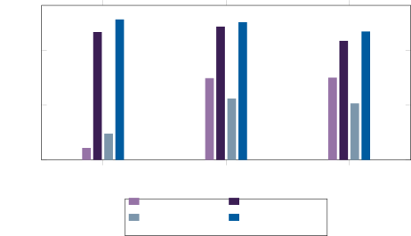

Figure 6: Performance comparison of token initialization strategies:
Random ($`\mathcal{N}(0,1)`$), CLIP-Space (aligned to CLIP’s
$`\mu,\sigma`$), and Offset (abnormal tokens shifted by $`5\sigma`$).
CLIP-Space provides faster convergence and higher pixel-level accuracy.

### 0.C.3 Hyperparameter Study

We investigate the sensitivity of DAPO to the local-loss weight
$`\lambda`$ and the prompt length $`l`$. Fig.8(a) shows that increasing
$`\lambda`$ from small values initially improves performance, indicating
that stronger patch-level (multi-type) supervision helps align
defect-aware semantics and benefits detection under distribution shift.
Fig.8(b) further shows that longer prompts tend to hurt performance. We
attribute this to the increased number of trainable prompt parameters,
which makes optimization more prone to overfitting on the source
training data and reduces cross-domain generalization.


(a) Ablation on the weight term $`\lambda`$

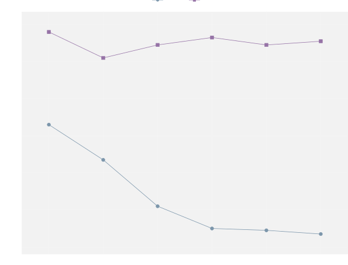

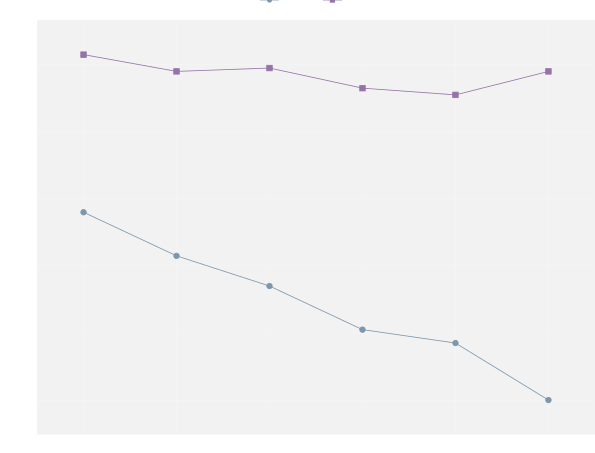

(b) Ablation on learnable prompt length $`l`$

Figure 8: Ablation study on the validation split. We vary (a) the
local-loss weight $`\lambda`$ in Eq. 9 and (b) the learnable prompt
length $`l`$, while keeping all other settings fixed.

### 0.C.4 Prototype Aggregation

To determine the robust representation of the final anomaly prototype,
$`z^{D_{k}}`$, We perform ablation on the aggregation method used to
combine information from multiple defect prompts. Baseline: By default,
we define the anomaly prototype prompt by calculating the simple average
across all $`K`$ defect-type prompts. This treated all defects equally,
which can be noisy if only a few prompts are relevant to a specific
image. Attention-weighted averaging: To filter out redundant or
irrelevant prompts, we experimented with a weighted average based on the
relevance of the prompt on the image. We calculated the attention weight
$`w_{i}`$ associated with each defect prompt embedding and the image
embedding. The final prototype was then calculated as the weighted sum:
$`\frac{1}{K}\sum_{j=1}^{K}w_{j}*\mathbf{z}^{\text{D}_{k}}`$. We found
that using an attention-weighted prototype did not yield significant
performance improvement over the simple baseline mean. Both image, and
pixel level scores showed only marginal gains or decrease in performance
across the dataset, Table 8.

|                                                                                |         |               |                |               |
| ------------------------------------------------------------------------------ | ------- | ------------- | -------------- | ------------- |
| Method                                                                         | Dataset | Image($`\%`$) | Pixel ($`\%`$) | $`\Delta`$ AP |
| Baseline                                                                       | VisA    | 84.9          | 94.3           | $`+3\%`$      |
| Attention                                                                      | VisA    | 79.9          | 93.0           | $`-3\%`$      |
| Baseline                                                                       | MPDD    | 81.2          | 95.1           | $`+3.2\%`$    |
| Attention                                                                      | MPDD    | 78.0          | 91.9           | $`-3.2\%`$    |
| $`\Delta`$ AP is the average change relative to the baseline for that dataset. |         |               |                |               |

Table 8: Prototype Aggregation Ablation: Simple Mean vs. Attention
Weighting. The table display the Pixel and Image level AUROC scores on
VisA and MPDD

### 0.C.5 Prefix tuning approach

In this section, we demonstrate the effectiveness of the progressive
tuning strategy compared to baseline prefix tuning. We train our model
in MVTec-AD and evaluate it in MPDD. MPDD is selected for this
evaluation due to its challenging conditions, including variable spatial
orientations, diverse object positions and distances from the camera.
The image-level AUROC and AP scores using progressive connection and
traditional prefix tuning across different depths are shown in Figure 9.
Detailed results of the best-performing configuration are provided in
Table 9. We observe that with progressive connection, the model
consistently achieves over 80% AP on MPDD, with minor fluctuations in
AUROC, and clearly outperforms the traditional approach. These results
highlight the importance of gradually adapting the encoders to better
align image and text features, thereby improving anomaly detection
performance across datasets. Here we keep the length of the learnable
prompts, $`l`$ as 5, and the number of learnable tokens as 4.

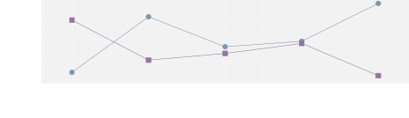

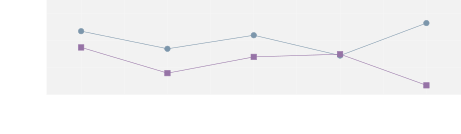


Figure 9: Ablation on the AUROC and AP with different $`N_{d}`$ on MPDD
using progressive and naive prefix tuning.

### 0.C.6 Prefix Depth

We study the impact of learnable tokens injection depth $`N_{d}`$ on
detection performance under distribution shift. The result shows that
the relationship between $`N_{d}`$ and detection performance is
non-monotonic. Specifically, we observed an initial gain in performance
followed by a small dip at intermediate depth, before reaching the
maximum depth, Figure 11. This non-linear trend indicated that maximal
integration is required for stability, as intermediate layers are highly
sensitive. Therefore, for the final configuration, we utilized the full
tested depth to have consistent performance. Please note that this
ablation was performed only on the text encoder side of the
architecture, as the visual prompt tuning was held constant at maximum
layer depth (fully integrated into all visual transformer layers).

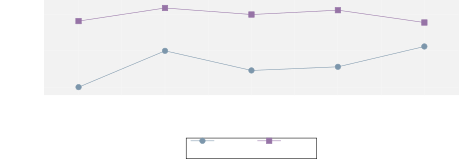

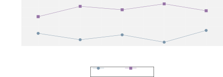

Figure 11: Effect on injecting learnable tokens at different depth of
the text encoder.

### 0.C.7 Analysis of Feature Space

To visually verify the fine-grained feature topology of the learned
embeddings, we utilized t-SNE \[21\] to project the high dimensional
feature space into a 2D space. Our visualization comprises two distinct
projections: a sample of 2 anomaly images (Figure 12 left) from DAPO,
and the same sample of anomaly images (Figure 12 right) from
AnomalyCLIP. In the projection, we observe a clear Euclidean separation
between the normal and defect text anchor (“contamination" defect-type)
in DAPO, as well as reasonable separation between anomaly (red) and
normal (blue) patches, where normal patches are much closer towards the
normal prompt. It shows that for individual samples, the model projects
the normal and anomaly features into regions, creating a high local
margin that facilitates better classification on instances. However, as
in AnomalyCLIP, the topology shifts. The projection is scattered and the
text anchors move into close proximity. This proximity treats defects as
subtle perturbations of the normal classes, rather than as a separate
disjoint domain. This could be the reason we believe that AnomalyCLIP
was classifying every image as an anomaly in our internal dataset.

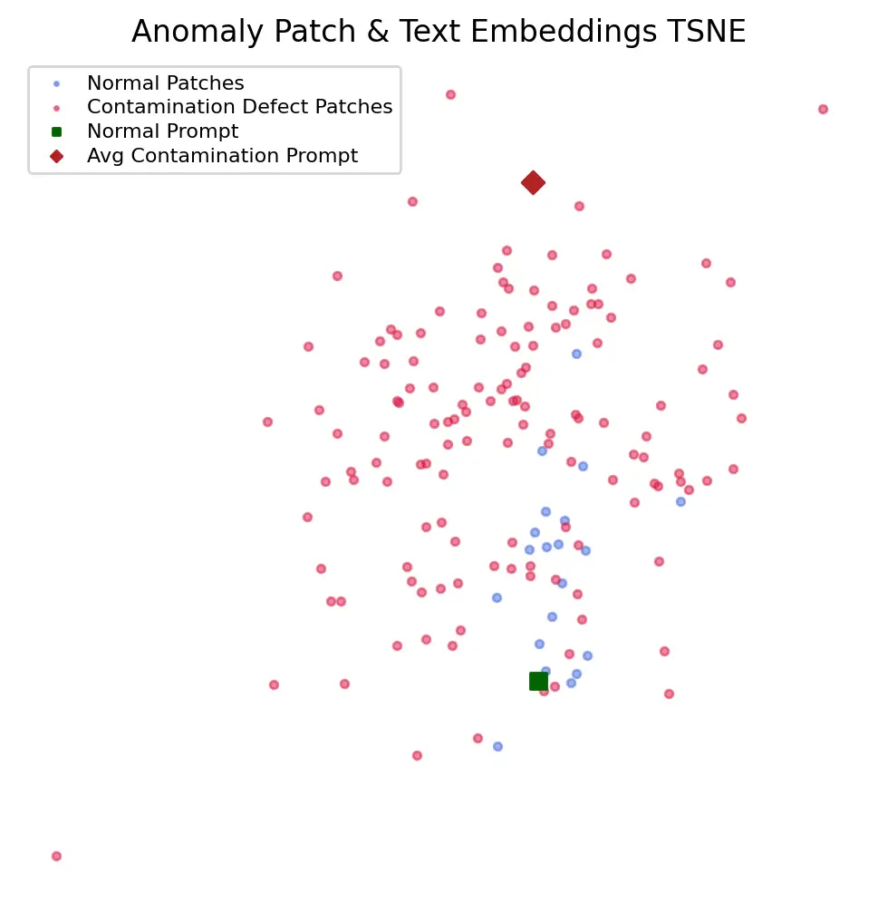

(a) DAPO (2 Images)

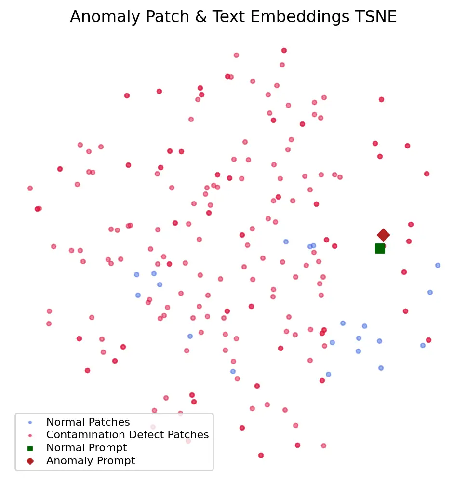

(b) AnomalyCLIP (2 Images)

Figure 12: Comparison of feature topology. (a) Shows how patches are
distributed and closer with the text-embedding in DAPO. (b) Shows how
patches are scattered, with text embeddings in close proximity to each
other in AnomalyCLIP.

### 0.C.8 Additional Results

We demonstrate our model’s fine-grained, data-subset-level performance
under distribution shifts. In Tables 10, we present the image-level and
pixel-level results of our method, DAPO, evaluated on individual subsets
of MPDD and VisA. These results are reported for anomaly detection under
distribution shifts, a setting commonly referred to in the literature as
zero-shot anomaly detection. Tables 11 present the results of our
approach on the simulated datasets. We observe that our model
consistently achieves the best or second-best performance at the image
level, indicating its effectiveness in defect detection. It is important
to note that both datasets contain numerous missing component anomalies,
which contribute to the overall lower performance, particularly for
MAD-Sim, which includes a significantly higher number of product images
compared to MAD-Real. Table 12 shows the performance of our model on the
Real-IAD dataset, a recent benchmark that contains approximately 20,000
test samples. Our method consistently achieves the best performance at
the image level, demonstrating high AUROC and AP, even when compared to
few-shot approaches such as MultiADS \[24\] and AdaCLIP \[2\], our
method achieves near best performance as reported in the supplementary
section of the MultiADS paper.

|                 |               |      |      |               |      |      |               |      |      |           |      |      |             |      |      |       |      |      |       |      |      |
| --------------- | ------------- | ---- | ---- | ------------- | ---- | ---- | ------------- | ---- | ---- | --------- | ---- | ---- | ----------- | ---- | ---- | ----- | ---- | ---- | ----- | ---- | ---- |
| Method          | Bracket Black |      |      | Bracket Brown |      |      | Bracket White |      |      | Connector |      |      | Metal Plate |      |      | Tubes |      |      | Mean  |      |      |
|                 | AUROC         | AP   | F1   | AUROC         | AP   | F1   | AUROC         | AP   | F1   | AUROC     | AP   | F1   | AUROC       | AP   | F1   | AUROC | AP   | F1   | AUROC | AP   | F1   |
| W/O Progressive | 70.3          | 75.7 | 81.8 | 63.2          | 81.5 | 81.0 | 77.9          | 72.9 | 80.0 | 76.9      | 63.0 | 66.7 | 92.1        | 97.2 | 92.6 | 97.5  | 98.8 | 95.0 | 79.7  | 81.5 | 82.8 |
| DAPO            | 73.6          | 78.9 | 81.5 | 59.6          | 77.3 | 80.6 | 85.4          | 83.1 | 81.7 | 75.2      | 65.0 | 63.4 | 96.1        | 98.7 | 93.5 | 97.0  | 98.8 | 95.5 | 81.2  | 83.6 | 82.7 |

Table 9: Comparison of image-level performance on MPDD between
progressive connection (DAPO) and without progressive connection, with
overall mean per method.

### 0.C.9 Internal Dataset

To evaluate our model’s robustness across varying thresholds in
detecting anomalies on our internal semiconductor chip dataset, we
plotted the False Positive Rate (FPR) and True Positive Rate (TPR)
against different thresholds (see Figure 13). As illustrated, our model
consistently outperforms the baseline AnomalyCLIP across all thresholds,
demonstrating a stronger separation between the anomaly and normality
spaces, and highlighting the discriminative power of our approach.

The consistent performance gap between our approach and AnomalyCLIP
across all threshold values indicates the robustness of our progressive
connection mechanism in handling distribution shifts inherent in real
manufacturing environments. This stability is crucial for practical
applications where threshold selection must balance detection
sensitivity with operational efficiency. Furthermore, the smooth ROC
curves demonstrate the reliability of our anomaly scoring mechanism,
suggesting effective feature representations that capture anomaly
patterns while maintaining discriminative power against normal
variations in the manufacturing process.

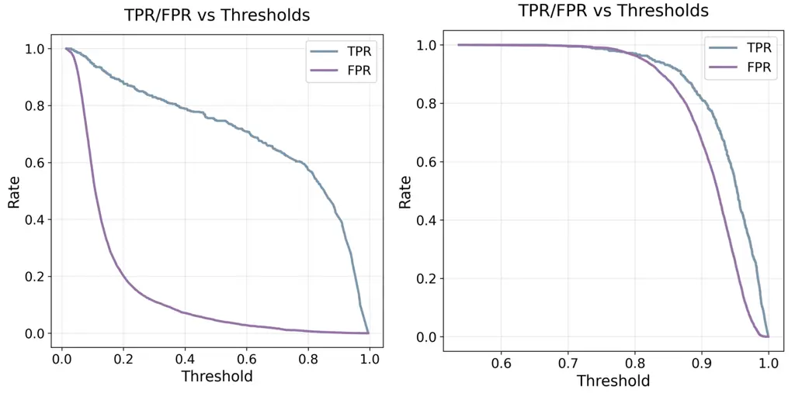

Figure 13: TPR and FPR across different threshold for anomaly detection
under distribution shift. DAPO (ours) on Left, AnomalyClip on Right

### 0.C.10 Exploratory Study: Multi-label defect classification

While the primary focus of the work is binary anomaly detection and
multi-type/binary anomaly segmentation, we extended our framework to
explore multi-label defect classification. In this setting, we aim to
identify the specific defect types present in an image (e.g.,
distinguishing between a scratch, crack, or contamination). Unlike
standard multi-class classification which utilizes a Softmax
distribution, real-world industrial defects are often non-exclusive. To
address this, we treated the problem as a multi-label task. For a given
image features, we computed the similarity logits with all potential
defect text prompts and the normal prompt. To obtain independent
probabilities for each defect type, we utilized a relative scoring
mechanism. We subtracted the logit of the normal class from each defect
class logit to center the scores around the decision boundary, followed
by a Sigmoid activation:

```math
P(d_{i})=\sigma(\text{Sim}(z^{x},z^{D_{k}})-\text{Sim}(z^{x},z^{N})) \tag{10}
```

where $`\sigma`$ is the sigmoid function. A defect $`D_{k}`$ is
predicted if $`P(D_{k})>0.5`$. We evaluated the Precision, Recall, and
F1-Score (Macro-averaged) on the VisA and MPDD datasets. The results are
presented in Table 13. The model exhibits high Recall ($`>90\%`$ in many
categories), indicating that defective images consistently trigger the
defect prompts. Conversely, the Precision scores are consistently low
($`<30\%`$). This indicates a high rate of false positive predictions
for specific defect classes. These results suggest that while the
learnable tokens are effective at distinguishing anomalous samples from
normal ones (driving the high Recall), they do not form mutually
exclusive clusters for fine-grained defect types. The feature
representations of similar defects remain entangled in the latent space,
limiting the model’s ability to perform precise multi-type
classification at the image level. However, for the downstream task of
segmentation, this over-activation ensures that the pixel-level anomaly
maps capture the defect region, regardless of the specific label
ambiguity.

### 0.C.11 Multi Type Anomaly Segmentation

We demonstrate our model’s ability to localize specific defect types,
rather than merely detecting anomalies. In particular, we introduce a
zero-shot setting, where defect types marked with (\*) are unseen during
training. This setting encourages future research on more generalized
and robust defect segmentation. Table 14, 15, 16 present our model’s
performance on the MAD (Simulated and Real), MPDD and VisA datasets,
respectively. These results highlight the model’s effectiveness in
segmenting both seen and unseen defect types.

## Appendix 0.D Visualization

Here, we present the visualization of our anomaly segmentation results.
We present six examples of object from VisA, MPDD, MVTec-AD, and
Real-IAD datasets. Figures 14, 15, and 16 shows the capsule, fryum and
pcb from VisA. Figures 18 and 19 shows the tubes and metal plate from
MPDD dataset. Figures 20, 21, and 22 shows the Phone battery, sim card
set, and fire wood from Real-IAD dataset. All visualizations illustrate
segmentation results under distribution shift, where the model relies
solely on prior knowledge of defect types available in the target set.

|              |       |       |       |      |      |
| ------------ | ----- | ----- | ----- | ---- | ---- |
| VisA Dataset |       |       |       |      |      |
| Object       | P-AUC | P-PRO | I-AUC | I-AP | I-F1 |
| Candle       | 98.3  | 91.5  | 89.3  | 91.9 | 82.0 |
| Capsules     | 96.6  | 73.1  | 86.3  | 92.5 | 84.4 |
| Cashew       | 88.0  | 79.5  | 85.1  | 94.1 | 85.4 |
| Chewinggum   | 99.5  | 89.5  | 95.9  | 98.4 | 95.3 |
| Fryum        | 92.9  | 84.2  | 92.9  | 96.6 | 91.0 |
| Macaroni1    | 98.7  | 90.7  | 74.8  | 79.0 | 71.5 |
| Macaroni2    | 97.0  | 79.6  | 59.5  | 61.1 | 69.1 |
| PCB1         | 90.3  | 86.2  | 75.1  | 79.4 | 71.2 |
| PCB2         | 89.2  | 75.0  | 79.4  | 80.5 | 75.1 |
| PCB3         | 90.4  | 78.3  | 69.4  | 74.6 | 66.9 |
| PCB4         | 94.8  | 86.9  | 97.0  | 97.1 | 91.9 |
| Pipe Fryum   | 96.4  | 93.7  | 99.8  | 99.9 | 98.5 |
| Mean         | 94.3  | 84.0  | 83.7  | 87.1 | 81.9 |

|               |       |       |       |      |      |
| ------------- | ----- | ----- | ----- | ---- | ---- |
| MPDD Dataset  |       |       |       |      |      |
| Object        | P-AUC | P-PRO | I-AUC | I-AP | I-F1 |
| Bracket Black | 96.5  | 90.3  | 73.6  | 78.9 | 81.5 |
| Bracket Brown | 91.1  | 74.4  | 59.6  | 77.3 | 80.6 |
| Bracket White | 97.1  | 87.5  | 85.4  | 83.1 | 81.7 |
| Connector     | 94.7  | 82.9  | 75.2  | 65.0 | 63.4 |
| Metal Plate   | 92.1  | 75.3  | 96.1  | 98.7 | 93.5 |
| Tubes         | 99.0  | 96.1  | 97.0  | 98.8 | 95.5 |
| Mean          | 95.1  | 84.4  | 81.2  | 83.6 | 82.7 |

Table 10: Binary Anomaly Detection and Segmentation: Fine-grained
performance on VisA (top) and MPDD (bottom) datasets.

|                 |       |       |       |      |      |
| --------------- | ----- | ----- | ----- | ---- | ---- |
| MAD-Sim Dataset |       |       |       |      |      |
| Object          | P-AUC | P-PRO | I-AUC | I-AP | I-F1 |
| Elephant        | 67.6  | 57.9  | 61.2  | 91.7 | 94.0 |
| Owl             | 90.0  | 65.6  | 54.9  | 89.4 | 93.0 |
| Obesobeso       | 93.1  | 63.5  | 59.8  | 91.2 | 94.1 |
| Sabertooth      | 88.3  | 56.0  | 53.2  | 87.9 | 93.1 |
| Zalika          | 83.7  | 52.1  | 55.9  | 89.3 | 93.3 |
| Mallard         | 85.2  | 50.0  | 58.1  | 93.7 | 95.6 |
| Bear            | 89.3  | 69.8  | 64.5  | 91.7 | 94.1 |
| Cat             | 92.4  | 56.1  | 48.0  | 89.5 | 94.5 |
| Pig             | 93.3  | 61.6  | 60.0  | 91.7 | 94.0 |
| Puppy           | 85.5  | 60.9  | 60.5  | 90.2 | 92.9 |
| Parrot          | 81.8  | 65.4  | 54.7  | 87.2 | 91.8 |
| Pheonix         | 81.6  | 55.0  | 52.9  | 90.4 | 94.4 |
| Gorilla         | 91.2  | 61.2  | 60.4  | 94.3 | 96.0 |
| Unicorn         | 83.5  | 50.7  | 51.7  | 92.4 | 95.9 |
| Bird            | 89.9  | 47.8  | 55.9  | 92.0 | 94.4 |
| Swan            | 87.2  | 56.4  | 51.9  | 88.5 | 93.3 |
| Whale           | 87.7  | 69.5  | 53.9  | 89.6 | 94.4 |
| Scorpion        | 89.0  | 72.3  | 56.5  | 89.5 | 92.9 |
| Sheep           | 92.8  | 57.9  | 56.9  | 90.6 | 93.7 |
| Turtle          | 89.5  | 61.3  | 76.4  | 97.2 | 95.4 |
| Mean            | 87.1  | 59.5  | 57.4  | 90.9 | 94.0 |

|                  |       |       |       |       |       |
| ---------------- | ----- | ----- | ----- | ----- | ----- |
| MAD-Real Dataset |       |       |       |       |       |
| Object           | P-AUC | P-PRO | I-AUC | I-AP  | I-F1  |
| Bear             | 99.7  | 98.6  | 79.2  | 95.0  | 94.1  |
| Bird             | 78.0  | 40.3  | 54.5  | 85.5  | 89.8  |
| Elephant         | 78.0  | 47.6  | 78.9  | 93.7  | 88.9  |
| Parrot           | 60.7  | 40.1  | 75.7  | 95.1  | 90.2  |
| Pig              | 83.8  | 46.9  | 27.1  | 71.4  | 87.2  |
| Puppy            | 99.6  | 96.4  | 99.0  | 99.8  | 97.6  |
| Scorpion         | 67.8  | 21.5  | 76.5  | 95.0  | 90.2  |
| Turtle           | 99.6  | 97.0  | 100.0 | 100.0 | 100.0 |
| Unicorn          | 83.1  | 52.8  | 68.6  | 91.1  | 89.4  |
| Whale            | 98.8  | 91.4  | 92.5  | 98.8  | 95.2  |
| Mean             | 84.9  | 63.3  | 75.2  | 92.6  | 92.3  |

Table 11: Binary Anomaly Detection and Segmentation: Fine-grained
data-subset wise performance on MAD-Sim and MAD-Real datasets.

|              |       |       |       |      |      |
| ------------ | ----- | ----- | ----- | ---- | ---- |
| Object       | P-AUC | P-PRO | I-AUC | I-AP | I-F1 |
| Audiojack    | 97.3  | 79.5  | 62.2  | 55.1 | 52.5 |
| VCPill       | 98.7  | 89.4  | 90.6  | 88.2 | 78.9 |
| Switch       | 85.6  | 71.1  | 81.3  | 90.2 | 80.7 |
| USB Adaptor  | 94.4  | 57.0  | 76.8  | 73.2 | 69.5 |
| Eraser       | 99.2  | 86.5  | 87.0  | 87.6 | 79.7 |
| Fire Hood    | 99.1  | 93.7  | 95.8  | 90.4 | 85.1 |
| End Cap      | 93.7  | 72.0  | 68.1  | 75.4 | 75.5 |
| Phone Bat.   | 98.4  | 83.4  | 89.1  | 91.9 | 84.9 |
| Wood Beads   | 97.3  | 48.7  | 71.4  | 78.2 | 72.2 |
| PCB          | 95.8  | 78.5  | 79.2  | 85.4 | 81.0 |
| Mint         | 95.3  | 58.2  | 69.9  | 79.0 | 74.8 |
| Plastic Plug | 98.3  | 85.9  | 88.4  | 88.1 | 79.1 |
| Transistor   | 92.8  | 71.8  | 73.0  | 84.0 | 78.3 |
| Regulator    | 96.2  | 73.6  | 64.9  | 38.8 | 39.2 |
| Toy          | 82.6  | 62.9  | 77.3  | 88.7 | 81.2 |
| U-Block      | 97.9  | 81.7  | 88.2  | 80.5 | 71.7 |
| Sim Card     | 99.5  | 93.7  | 96.0  | 97.3 | 92.7 |
| Plastic Nut  | 95.3  | 67.2  | 84.4  | 64.7 | 56.4 |
| Button Bat.  | 97.0  | 76.3  | 79.4  | 86.4 | 77.7 |
| Toothbrush   | 96.3  | 87.6  | 87.7  | 93.0 | 84.3 |
| Mounts       | 99.7  | 97.6  | 91.6  | 85.5 | 82.7 |
| Tape         | 99.6  | 94.9  | 98.5  | 98.0 | 92.7 |
| Woodstick    | 99.1  | 90.5  | 88.3  | 74.2 | 67.9 |
| Bottle Cap   | 97.9  | 84.8  | 86.4  | 87.2 | 77.8 |
| Porcelain    | 97.4  | 85.1  | 93.1  | 89.7 | 81.2 |
| Toy Brick    | 98.8  | 86.6  | 84.7  | 83.9 | 75.0 |
| Rolled Strip | 99.2  | 93.8  | 94.3  | 97.4 | 91.3 |
| Terminal     | 97.8  | 84.6  | 94.4  | 96.8 | 91.6 |
| Zipper       | 93.0  | 83.6  | 97.5  | 99.0 | 95.8 |
| USB          | 97.6  | 88.8  | 90.3  | 91.7 | 83.4 |
| Mean         | 96.4  | 80.3  | 84.3  | 84.0 | 77.8 |

Table 12: Binary Anomaly Detection and Segmentation: Fine-grained
performance on the Real-IAD dataset.

|              |           |        |          |
| ------------ | --------- | ------ | -------- |
| VisA Dataset |           |        |          |
| Category     | Precision | Recall | F1-Score |
| Candle       | 8.2       | 99.1   | 15.1     |
| Capsules     | 88.1      | 81.7   | 83.8     |
| Cashew       | 16.6      | 76.1   | 26.6     |
| Chewinggum   | 25.5      | 97.7   | 39.2     |
| Fryum        | 18.4      | 71.1   | 28.6     |
| Macaroni1    | 11.5      | 99.3   | 20.2     |
| Macaroni2    | 8.8       | 100.0  | 15.5     |
| PCB1         | 13.1      | 80.3   | 21.6     |
| PCB2         | 13.1      | 98.5   | 22.2     |
| PCB3         | 12.0      | 100.0  | 21.1     |
| PCB4         | 5.2       | 100.0  | 9.5      |
| Pipe Fryum   | 19.5      | 99.3   | 32.0     |

|               |           |        |          |
| ------------- | --------- | ------ | -------- |
| MPDD Dataset  |           |        |          |
| Category      | Precision | Recall | F1-Score |
| Bracket Black | 36.0      | 94.3   | 49.5     |
| Bracket Brown | 35.3      | 70.6   | 45.5     |
| Bracket White | 27.4      | 100.0  | 43.0     |
| Connector     | 15.9      | 50.0   | 24.1     |
| Metal Plate   | 24.4      | 100.0  | 38.5     |
| Tubes         | 84.5      | 51.6   | 43.9     |

Table 13: Exploratory Image-Level Classification Results (Macro-Average
%). The high Recall vs. Low Precision trade-off indicates high
sensitivity to anomalies but lower specificity for exact defect types.

|                 |       |      |      |
| --------------- | ----- | ---- | ---- |
| MAD-Sim Dataset |       |      |      |
| Object          | AUROC | F1   | AP   |
| Bear            | 93.7  | 25.0 | 37.6 |
| Bird            | 94.2  | 25.0 | 27.9 |
| Cat             | 94.9  | 25.0 | 27.0 |
| Elephant        | 81.7  | 24.9 | 33.1 |
| Gorilla         | 93.5  | 24.9 | 29.6 |
| Mallard         | 91.4  | 24.9 | 36.8 |
| Obesobeso       | 94.7  | 25.0 | 27.2 |
| Owl             | 93.4  | 24.9 | 34.6 |
| Parrot          | 89.3  | 25.0 | 34.9 |
| Pheonix         | 87.6  | 24.9 | 25.9 |
| Pig             | 95.4  | 24.9 | 32.3 |
| Puppy           | 90.7  | 25.1 | 44.3 |
| Sabertooth      | 93.2  | 24.9 | 30.5 |
| Scorpion        | 92.5  | 25.1 | 32.0 |
| Sheep           | 95.6  | 24.9 | 36.6 |
| Swan            | 92.2  | 24.9 | 27.6 |
| Turtle          | 94.3  | 25.0 | 39.5 |
| Unicorn         | 89.4  | 24.9 | 39.8 |
| Whale           | 92.1  | 25.3 | 38.0 |
| Zalika          | 88.8  | 24.9 | 31.6 |
| Mean            | 91.9  | 25.0 | 33.3 |

|                  |       |      |      |
| ---------------- | ----- | ---- | ---- |
| MAD-Real Dataset |       |      |      |
| Object           | AUROC | F1   | AP   |
| Bear             | 98.7  | 62.3 | 60.6 |
| Bird             | 80.8  | 49.8 | 51.0 |
| Elephant         | 81.2  | 50.8 | 50.9 |
| Parrot           | 69.4  | 49.8 | 50.4 |
| Pig              | 91.0  | 49.9 | 51.5 |
| Puppy            | 98.8  | 75.1 | 77.0 |
| Scorpion         | 65.0  | 49.6 | 50.6 |
| Turtle           | 99.3  | 74.7 | 72.4 |
| Unicorn          | 78.7  | 49.9 | 50.3 |
| Whale            | 98.0  | 72.4 | 70.8 |
| Mean             | 86.1  | 58.5 | 58.5 |

Table 14: Multi-Type Segmentation: Fine-grained data-subset wise results
on MAD dataset.

|                      |       |       |
| -------------------- | ----- | ----- |
| Defect-Wise Results  |       |       |
| Defect Type          | AUROC | F1    |
| Good                 | 95.66 | 99.86 |
| Bent                 | 90.37 | 2.85  |
| Defective painting\* | 93.22 | 0.06  |
| Flattening\*         | 98.79 | 66.57 |
| Hole                 | 98.62 | 1.14  |
| Mismatch\*           | 93.71 | 17.94 |
| Rust\*               | 90.12 | 28.37 |
| Scratch              | 97.35 | 26.79 |

|                     |       |      |      |
| ------------------- | ----- | ---- | ---- |
| Object-Wise Results |       |      |      |
| Object              | AUROC | F1   | AP   |
| Bracket black       | 97.1  | 37.9 | 35.9 |
| Bracket brown       | 91.1  | 33.4 | 34.6 |
| Bracket white       | 97.0  | 38.5 | 37.0 |
| Connector           | 95.2  | 68.2 | 67.4 |
| Metal plate         | 93.7  | 41.6 | 63.5 |
| Tubes               | 98.8  | 80.2 | 83.3 |
| Mean                | 95.5  | 50.0 | 53.6 |

Table 15: Multi-Type Segmentation on MPDD: Detailed defect-wise and
object-wise performance. (\*) indicates defects unseen during training.

|                     |       |      |             |       |      |
| ------------------- | ----- | ---- | ----------- | ----- | ---- |
| Defect-Wise Results |       |      |             |       |      |
| Defect              | AUC   | F1   | Defect      | AUC   | F1   |
| Normal              | 86.79 | 99.9 | Melded      | 95.97 | 9.51 |
| Bent                | 90.83 | 1.08 | Melt        | 93.47 | 7.54 |
| Breakage            | 97.05 | 20.8 | Missing     | 87.62 | 13.3 |
| Bubble              | 77.03 | 1.71 | Particle    | 99.03 | 3.10 |
| Burnt               | 95.64 | 8.46 | Scratch     | 89.73 | 1.89 |
| Chip                | 81.96 | 0.17 | Spot        | 87.96 | 1.11 |
| Crack               | 83.75 | 0.14 | Stuck       | 86.70 | 9.04 |
| Damage              | 93.24 | 1.63 | Weird wick  | 79.04 | 0.05 |
| Extra               | 95.33 | 3.49 | Wrong place | 93.24 | 0.29 |
| Hole                | 95.24 | 1.49 |             |       |      |

|                     |      |      |      |
| ------------------- | ---- | ---- | ---- |
| Object-Wise Results |      |      |      |
| Object              | AUC  | F1   | AP   |
| Candle              | 90.7 | 13.9 | 16.0 |
| Capsules            | 77.0 | 54.8 | 50.9 |
| Cashew              | 89.6 | 18.4 | 25.0 |
| Chewinggum          | 96.7 | 27.2 | 42.4 |
| Fryum               | 91.4 | 18.6 | 20.9 |
| Macaroni1           | 88.2 | 20.0 | 20.1 |
| Macaroni2           | 77.8 | 16.7 | 16.7 |
| PCB1                | 90.3 | 20.1 | 23.5 |
| PCB2                | 88.6 | 20.1 | 21.7 |
| PCB3                | 85.6 | 20.0 | 20.9 |
| PCB4                | 93.9 | 15.7 | 16.2 |
| Pipe fryum          | 97.0 | 20.9 | 26.3 |
| Mean                | 88.9 | 22.2 | 25.0 |

Table 16: Multi-Type Segmentation on VisA: Detailed defect-wise and
object-wise performance. (\*) indicates defects unseen during training.

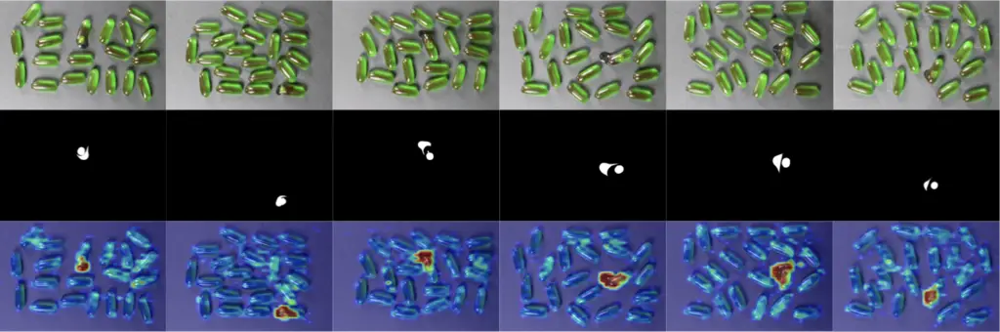

Figure 14: The visualization highlights the capsule object from the VisA
dataset, while the model is trained on the MVTec-AD dataset. The first
row represents the input, the second row shows the ground truth
segmentation mask. The last row presents the segmentation results from
DAPO. Despite the distribution shift, our model accurately localizes
both leak and bubble defects. Notably, the image contains multiple
defects, demonstrating the model’s capability to segment multiple
anomalies within a single sample.

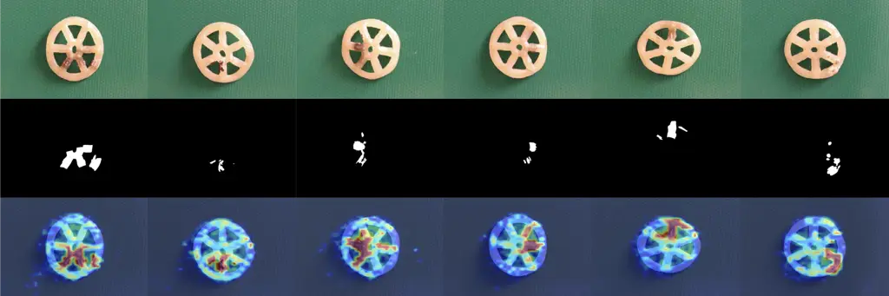

Figure 15: The visualization highlights the Fryum object from the VisA
dataset, with the model trained on MVTec-AD. As shown, DAPO successfully
localizes the burnt defect, however the segmentation slightly
overextends beyond the actual defect region, indicating minor
over-segmentation.

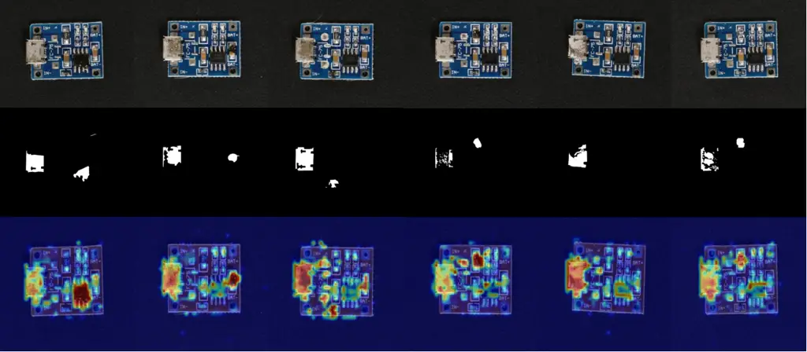

Figure 16: The visualization highlights the PCB4 object from the VisA
dataset, with the model trained on MVTec-AD. As shown, DAPO successfully
localizes both the burnt and dirt defects within the same image.
However, it fails to detect a small scratch defect in the top-right
corner of the first image, likely due to the patch-level features being
unable to effectively capture such fine-grained anomalies.

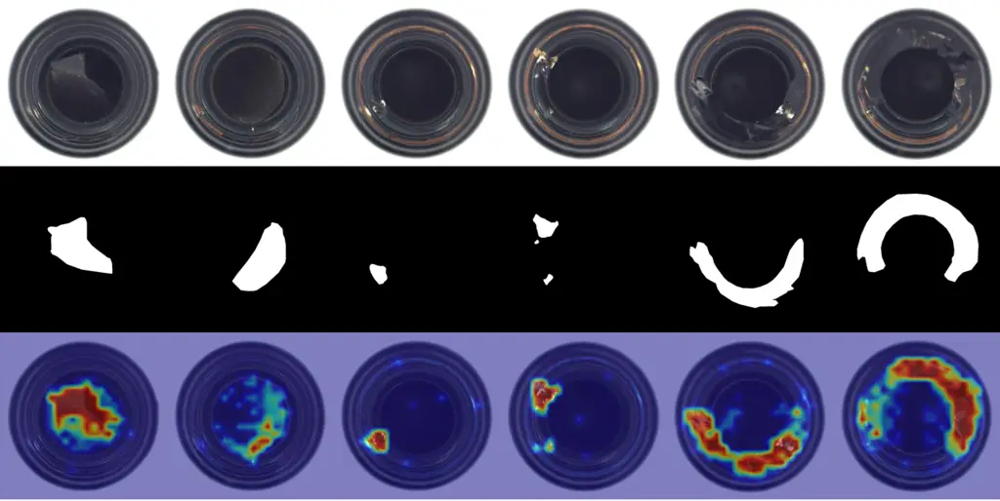

Figure 17: The visualization highlights the Bottle object from the
MVTec-AD dataset, with the model trained on VisA. Columns 1–2 show
localization of the contamination defect, 3–4 capture the small break,
while 5–6 successfully segment large break.

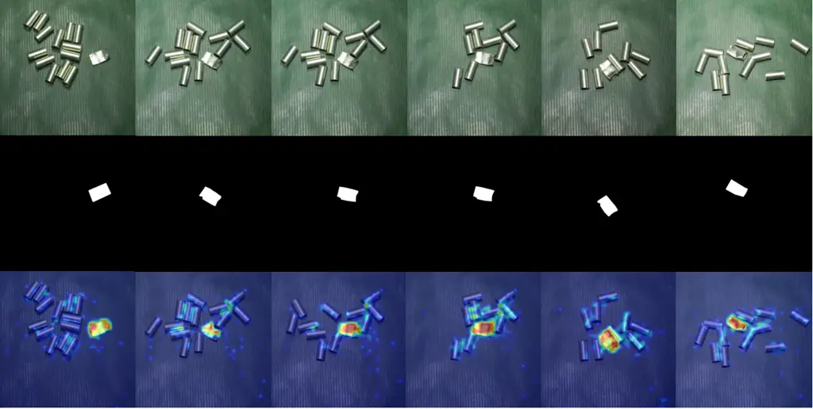

Figure 18: The visualization highlights the Tubes object from the MPDD
dataset. The model, trained on MVTec-AD, accurately localizes the
flattening defect with minimal noise, demonstrating its precision in
segmenting flattening defects, as evident from Table 15.

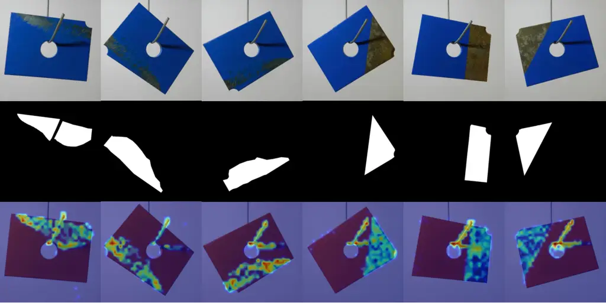

Figure 19: The visualization highlights the Metal Plate object from the
MPDD dataset. Columns 1–3 show accurate localization of the scratch
defect, while columns 4–6 demonstrate precise segmentation of the rust
defect.

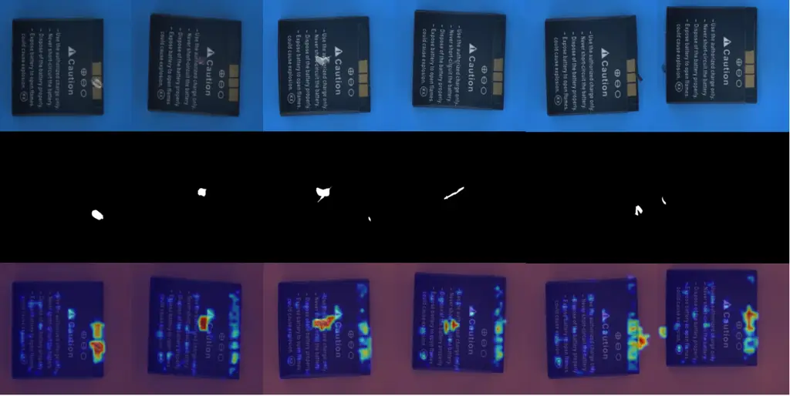

Figure 20: The visualization shows the Phone Battery object from the
Real-IAD dataset. Our model accurately localizes both scratch and damage
defects.

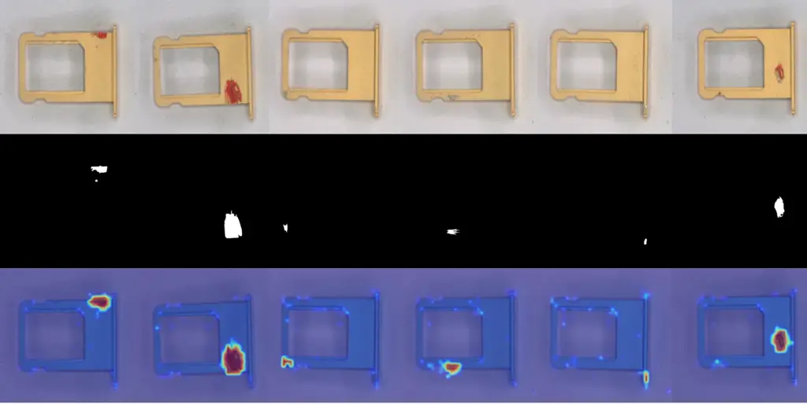

Figure 21: The visualization highlights the SIM Card Set object from the
Real-IAD dataset. DAPO successfully segments the scratch defect with
clear localization.

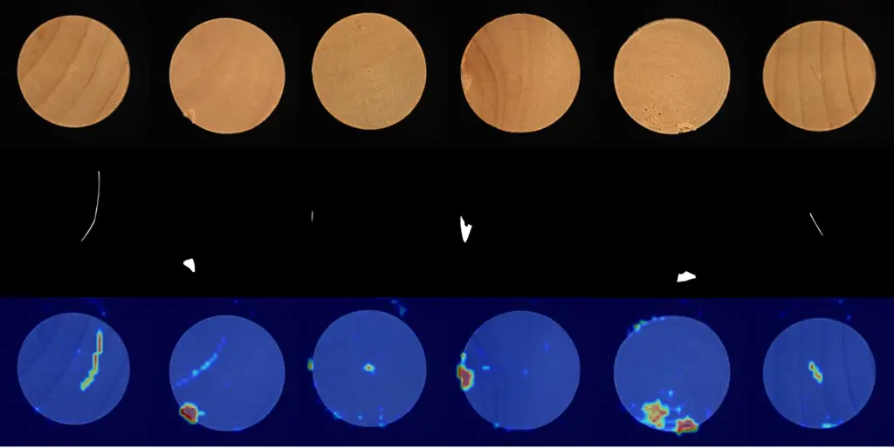

Figure 22: The visualization depicts the Firewood object from the
Real-IAD dataset. Our model effectively localizes both scratch and
damage defects, despite the irregular surface texture.
