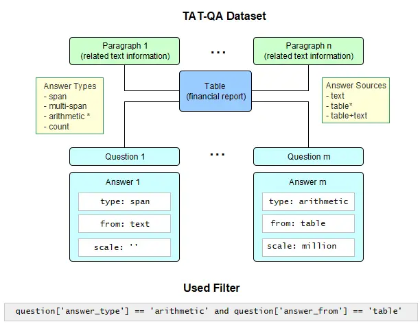
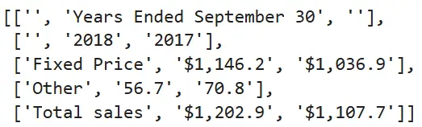
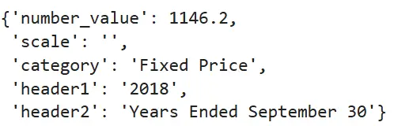
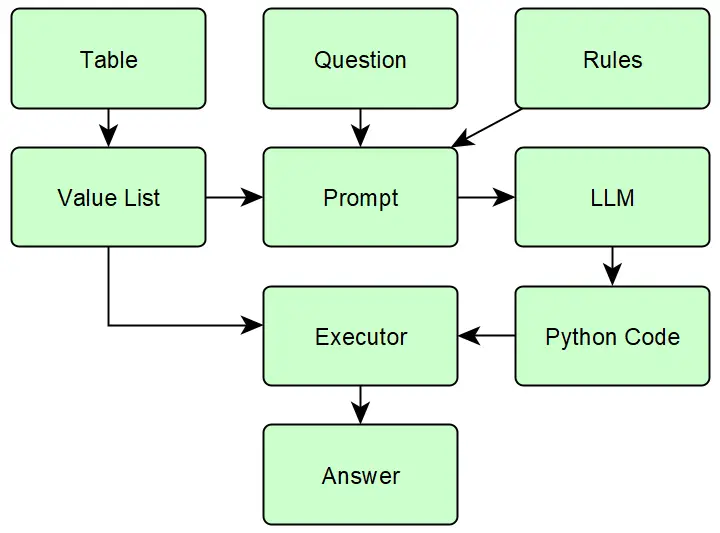
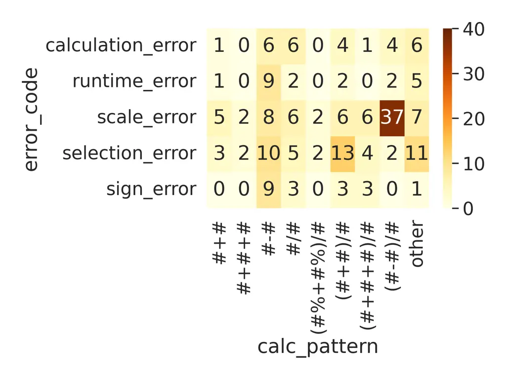
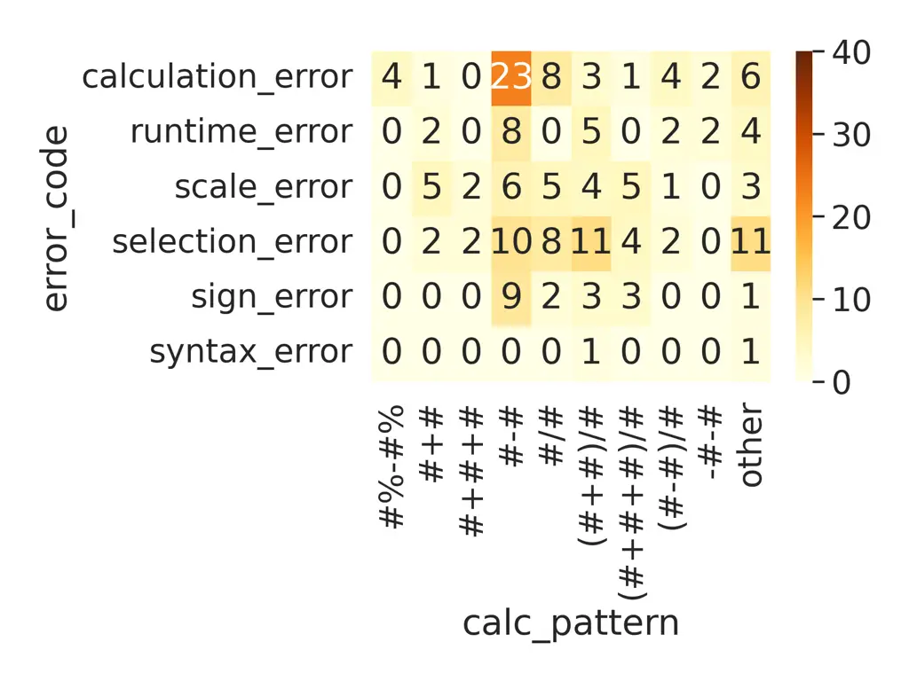
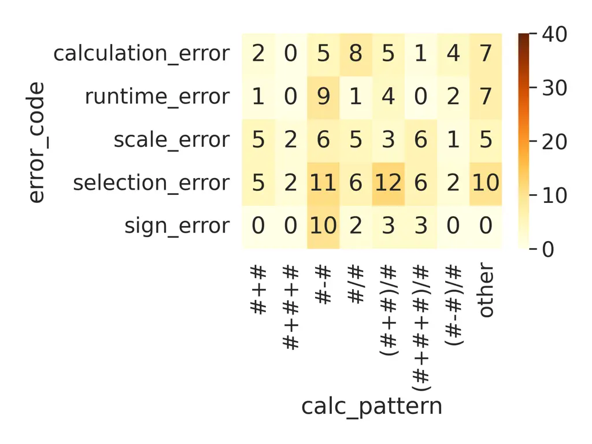
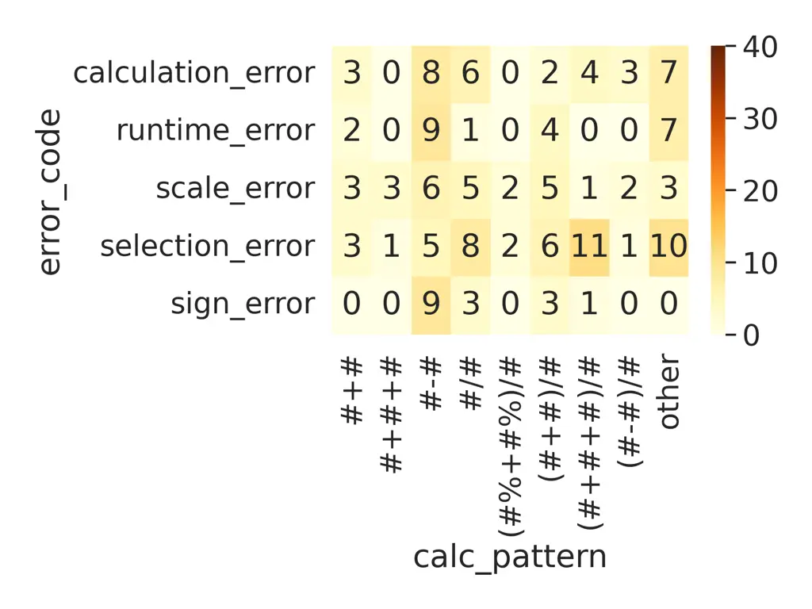
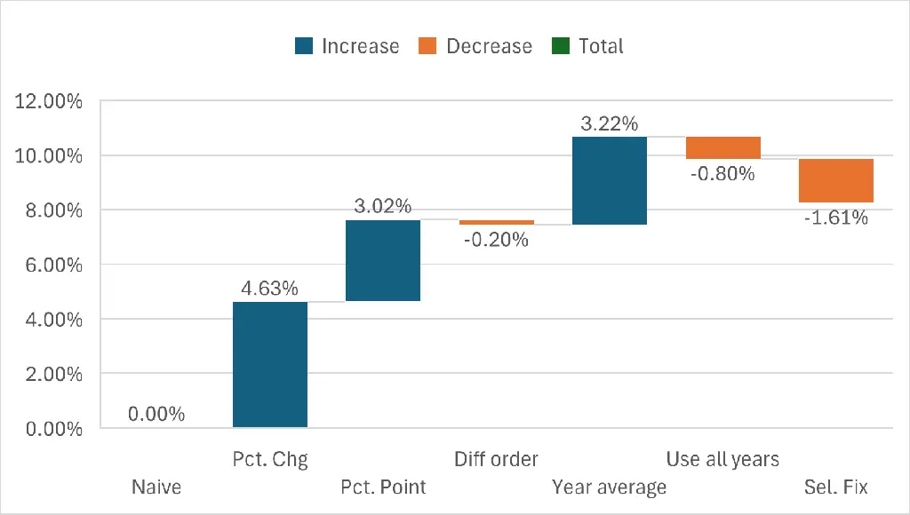

# Error-Driven Prompt Optimization for Arithmetic Reasoning A Code Generation Approach Using On-Premises Small Language Models on Tabular Data

Árpád Pándy    Róbert Lakatos    András Hajdu Affiliation: Deptartment
of Data Science & Visualization, Faculty of Informatics, University of
Debrecen

###### Abstract

Recent advancements in artificial intelligence have sparked interest in
industrial agents capable of supporting analysts in regulated sectors,
such as finance and healthcare, within tabular data workflows. A key
capability for such systems is performing accurate arithmetic operations
on structured data while ensuring sensitive information never leaves
secure, on-premises environments. Here, we introduce an error-driven
optimization framework for arithmetic reasoning that enhances a Code
Generation Agent (CGA), specifically applied to on-premises small
language models (SLMs). Through a systematic evaluation of a leading SLM
(Qwen3 4B), we find that while the base model exhibits fundamental
limitations in arithmetic tasks, our proposed error-driven method, which
clusters erroneous predictions to refine prompt-rules iteratively,
dramatically improves performance, elevating the model’s accuracy to
70.8%. Our results suggest that developing reliable, interpretable, and
industrially deployable AI assistants can be achieved not only through
costly fine-tuning but also via systematic, error-driven prompt
optimization, enabling small models to surpass larger language models
(GPT-3.5 Turbo) in a privacy-compliant manner.

Keywords: Arithmetic calculation, code-generation agent, generative
large-language models, prompt engineering, tabular data.

## 1 Introduction

Tabular data remains a cornerstone of knowledge representation in
domains such as finance, healthcare, and the natural sciences. Yet their
automated interpretation presents persistent challenges for language
models \[3\] \[2\]. Early work has revealed that large language models
(LLMs) perform impressively in natural language understanding. Still,
their arithmetic reasoning is fragile: they often produce inconsistent
or even wrong numerical outputs when faced with structured data. To
overcome this limitation, our previous study (Arithmetic-aware
question-answering on tabular data using a large language model-based
code generation agent) \[6\] reframed question answering as a
code-generation task, in which the model produces executable programs
that perform the required data selection and arithmetic operations. When
coupled with table restructuring and domain-specific rule injection,
this hybrid framework—the Code Generation Agent (CGA)—achieved dramatic
gains, raising exact-match accuracy on financial benchmarks from below
30% to nearly 80%.

Despite these advances, the reliance on API-based large models posed a
critical barrier for regulated sectors, where sensitive data cannot
leave secure environments. A subsequent study \[7\] investigated small
language models (SLMs) in the 1–7B parameter range, which can run
entirely on-premises while requiring more modest computational
resources. Strikingly, the combination of CGA, table restructuring, and
prompt simplification enabled certain SLMs—notably Qwen3 4B \[10\] —to
exceed GPT-3.5 Turbo in numerical accuracy, delivering both
interpretability and privacy preservation. These results pointed to the
feasibility of local, resource-efficient agents capable of robust
tabular reasoning.

However, key questions remained: how to extend such agents beyond
hand-crafted rules, which often fail across model scales, and how to
ground prompting strategies in a theoretical framework that balances
rule number and type.

We present an error-driven framework that clusters mistaken predictions
to derive domain-specific rules, iteratively refining reasoning prompts
so the agent “learns from its mistakes” without costly fine-tuning. We
formalize an optimal rule set ($`K_{\text{opt}}`$) balancing
informativeness and cognitive load, explaining the performance curve.
This method boosts Qwen3 4B to 70.82% accuracy, surpassing GPT-3.5 Turbo
while preserving full data sovereignty.

In this Article, we integrate CGA’s methodological innovations, small
language models’ efficiency, and error-driven rule induction’s
systematic power into a cohesive blueprint for interpretable, auditable,
and industrially deployable agents. We outline in Section 2 the dataset
and the prompt extending algorithm 3. We describe the implementation
details in Section 4 and Experiment 5. Present results and theoretical
insights 6, concluding 7 with a best-practice foundation for trustworthy
tabular reasoning AI.

## 2 Dataset

Although the number of available datasets containing QA test cases on
tabular data with arithmetic calculations is limited, three datasets can
be considered for this task: WikiTableQuestions, OTT-QA, and TAT-QA. We
chose the TAT-QA dataset because it provides the calculation derivation
for each question as metadata. It categorizes questions by reasoning
type, an essential feature for testing a solution designed for
arithmetic calculations. Dataset WikiTableQuestions \[9\] contains
derivation annotations only for a limited set of questions, and no
answer categorization is provided. Dataset OTT-QA \[1\] lacks both of
these features.

Our research used the ”A Question Answering Benchmark on a Hybrid of
Tabular and Textual Content in Finance” (TAT-QA) dataset \[11\] to
evaluate the performance of the models. This data set contains financial
reports in tabular format. It was designed to evaluate complex, hybrid
QA tasks. Each financial report has multiple related text paragraphs and
questions. The questions can be grouped by answer type. The answer can
be a span or a multipart span of text from the table or the related
paragraphs, a number resulting from an arithmetic calculation, or a
counter, if the question is about counting data items.

As our research focused on calculations on tabular data, we applied a
filtering pipeline in the same way described in \[6\]. The filter
selected questions where the answer type was arithmetic calculations,
which can be performed on the tabular data, without the need for the
text in related paragraphs. Using these filters, the number of tables
was reduced from 278 to 215, and the number of questions was reduced
from 1668 to 497. The structure of the dataset and the applied filter
are shown in Figure 1.



Figure 1: Structure of the TAT-QA dataset and the applied filter.

The reference values are composed of two different parts: the predicted
value and its scale. The scale can be one billion, million, thousand, or
percent. It is reasonable to distinguish these two parts, as they can
usually be found in different locations within the table or inferred
from the question. An example of the former is when the financial report
contains millions of dollars, as indicated by the table headers. An
example of the latter is when the question is about a percentage,
because in this case the result scale must be ”percent” by definition.

## 3 Methodology

In this section, we show a method for extending the capabilities of the
Code Generation Agent \[6\]. In the cited research, we developed three
improvement methods on arithmetic reasoning on tabular data. The first
is restructuring the table to a set of annotated values. The original
table format can be seen in Figure 2, while the restructured table is
shown in Figure 3.



Figure 2: Original table format.



Figure 3: A data item after restructuring.

The second improvement method was the introduction of Code Generation
Agent. This LLM based agent generates a Python code based on the table
and the question, and executes the generated code. The third improvement
method was the application of domain specific prompt rules. These rules
are specific for the target domain / dataset. In this paper we show a
method how these rules can be formulaated in a semi-automated way. The
whole process is shown in Figure 4.



Figure 4: Overview of the process in Code Generation Agent.

In our previous work \[7\], we examined the possibilities of applying
CGA to SLMs, created a benchmark on selected small models, using the
TAT-QA dataset, and demonstrated the effectiveness of denser prompts on
small language models. We summarize the results of that research in the
tables below. We used Exact Match (EM) as a metric to compare predicted
and ground truth answer. The EM score for a test instance $`(q,c,y)`$
with model prediction $`\hat{y}`$ is defined as

```math
\text{EM}(q,c,y)=\begin{cases}1&\text{if }\hat{y}=y,\\
0&\text{otherwise.}\end{cases}
```

The effects of different improvement techniques on small and large
models are shown in Table 1. Table 2 shows the performance of selected
small models. As a summary, we can state that the performance of the
smallest models is close to zero, even when applying improvement
methods; in the 3-4B size range, the performance can be improved
significantly by allying CGA, compared to the reference large language
model; and the performance of the top performer in this group achieves
the performance of the reference model. Table 3 shows that with a
simpler prompt, almost 60% exact match can be achieved.

| Model              | Gemma 3n E4B | GPT-3.5-Turbo |
| ------------------ | ------------ | ------------- |
|                    | EM           | EM            |
| Naive              | 5.03%        | 29.38%        |
| Restructuring      | 2.62%        | 21.33%        |
| Codegen Agent      | 7.44%        | 36.42%        |
| CGA + Res.         | 29.78%       | 52.62%        |
| CGA + Res. + Rules | 21.33%       | 59.99%        |

Table 1: Feature Performance comparison between model Gemma 3n E4B and
GPT-3.5-Turbo

| %             | naive | CGA + Res. | Change |
| ------------- | ----- | ---------- | ------ |
| Model         | EM    | EM         | EM     |
| Gemma 3n E4B  | 5.03  | 29.78      | 24.75  |
| Gemma 3 1B    | 0.00  | 1.66       | 1.66   |
| Gemma 3 4B    | 3.02  | 34.81      | 31.79  |
| Llama 3.2 1B  | 0.00  | 1.01       | 1.01   |
| Llama 3.2 3B  | 0.00  | 30.58      | 30.58  |
| Mistral 7B    | 0.60  | 17.91      | 17.31  |
| Qwen3 4B      | 4.83  | 53.72      | 48.89  |
| GPT-3.5 Turbo | 29.38 | 52.62      | 23.24  |

Table 2: Benchmark of model comparison with two setups: the naive model
and when CGA and table restructuring are applied in the pipeline.

[TABLE]

Table 3: Comparison of the models’ performance using original and
simplified prompts in the Code Generation Agent.

In the following, we formulate our hypotheses on introducing prompt
rules into the prompt 3.2, and finally, we describe the Prompt Extending
Algorithm in pseudo-code in Algorithm 1.

Domain-specific Prompt Rules: Domain-specific prompt rules/instructional
constraints (DSPR) are a set of instructions added to the prompt to
enhance the model’s performance. We will describe them in detail in
Section 5.

### 3.1 Task Decomposition Model

In this section, we give a formal description of the task decomposition
method. The method is described in detail in \[6\] and \[7\]. Here, we
aim to formalize this method and provide a theoretical framework for
further improvements.

The experimental results show that in the _naive_ approach

```math
f_{\text{naive}}:(Q,C)\to Y
```

the probability of producing a correct answer

```math
P(A_{\text{correct}}\mid Q,C)
```

It is low, since the model must perform semantic interpretation and
arithmetic computation in a single step.

The _CGA_ (decomposition-based) approach divides the task into two
steps:

```math
f_{\text{CGA}}:(Q,C^{\prime})\to P,\quad\text{e}:P\to Y
```

where $`C^{\prime}`$ is the restructured table, $`P`$ is the generated
code, and e is a deterministic executor.

In this case, the overall success probability can be approximated as:

```math
P(A_{\text{correct}}\mid Q,C^{\prime})\approx P(P_{\text{correct}}\mid Q,C^{\prime}),
```

since e is error-free. Measurements indicate that

```math
P_{\text{CGA}}-P_{\text{naive}}\gg 0,
```

Decomposition and code generation significantly improve accuracy,
especially when combined with table restructuring and the addition of
prompt rules.

### 3.2 Prompt directives

We enumerate our hypotheses about extending the prompt with prompt rules
in the following list.

1.  1.  The performance of code generation can be improved by adding
        domain-specific rules $`\rho_{i}`$, where $`\rho_{i}\in R`$, to the
        prompt. These rules target a subset of questions, and generating the
        correct answer requires instructional constraints or external
        knowledge.
2.  2.  It is possible to algorithmically define such a subset of errors
        that has a common root cause of failure
3.  3.  It is possible to introduce a prompt rule that eliminates this root
        cause
4.  4.  It is possible to apply this rule globally, without additional
        decision logic within the agent.

To prove these assumptions, we implemented Algorithm 1.

1: Test dataset
$`D_{\text{test}}=\{(q_{i},c_{i},p_{i},y_{i})\}_{i=1}^{n}`$

2: $`R\leftarrow\emptyset`$

3: while true do

4:   $`\hat{Y}\leftarrow\textsc{Predict}(D_{\text{test}},R)`$

5:   $`EM\leftarrow\textsc{Score}(\hat{Y},Y)`$

6:   $`E\leftarrow\{(q_{i},c_{i},p_{i},y_{i})\mid EM_{i}<1\}`$

7:   $`F\leftarrow\textsc{ExtractFeatures}(E)`$

8:   $`(m_{1},m_{2})\leftarrow\textsc{HyperparameterTuning}(F)`$

9:   $`\mathcal{K}\leftarrow\textsc{HDBSCAN}(F,m_{1},m_{2})`$

10:
  $`\mathcal{K}_{sorted}\leftarrow\textsc{SortBySizeDesc}(\mathcal{K})`$

11:   $`i\leftarrow 1`$

12:   while $`i\leq 2`$ do

13:    $`\rho\leftarrow\textsc{FormulateRule}(\kappa_{sorted,i})`$

14:    $`\hat{Y_{C}}\leftarrow\textsc{Predict}(E,R\cup\{\rho\})`$

15:    $`EM_{C}\leftarrow\textsc{Score}(\hat{Y_{C}},Y_{C})`$

16:    $`EM_{pairs}\leftarrow\textsc{AlignPairs}(Y_{C},Y,EM_{C},EM)`$

17:    $`p_{exact}\leftarrow\textsc{McNemarTestBinom}(EM_{pairs})`$

18:    $`\Delta EM\leftarrow\sum_{j}EM_{C,j}`$

19:    if $`\Delta EM>50\%`$ and $`p_{exact}<=0.0625`$ then

20:      $`R\leftarrow R\cup\{\rho\}`$

21:      break $`\triangleright`$ re-run outer loop

22:    else

23:      $`i\leftarrow i+1`$

24:    end if

25:   end while

26:   if $`i>2`$ then

27:    break $`\triangleright`$ stop further search

28:   end if

29: end while

30: return $`R`$ $`\triangleright`$ final rule set

Algorithm 1 Prompt Extending Algorithm

Note pseudo function FormulateRule. Here a human-in-the-loop
intervention is required, where the expert formulates a domain-specific
prompt rule (DSPR) to address the identified error cluster.

## 4 Implementation details

We used the OLlama running environment, which was accessed via the
OLlama API interface from Jupyter Notebook. Ollama version was 0.11.4.
Agent source code and a demo application can be found in \[8\].

We selected model Qwen3 4B, the top performer in the previous stage. We
used the version tagged with qwen3:4b-q4_K_M, id: 2bfd38a7daaf. Its size
is 2.6 GB, the context window size is 40k, and it uses a 4-bit,
K-series, mixed quantization scheme. In this version, the thinking and
non-thinking modes were not yet separated into two separate models, and
the thinking behavior was controlled with the /no_think flag within the
prompt.

### 4.1 Feature Extraction

For clustering, we used HDBSCAN \[4\] with a feature matrix. We
extracted the following features:

- •
  calc_pattern
- •
  code_calc_pattern
- •
  scale_mismatch
- •
  value_match
- •
  error_code

#### 4.1.1 calc_pattern

The calculation pattern describes the type of arithmetic calculation
needed to answer the question. We generate this value from the
derivation property of the question, which contains the exact reference
arithmetic calculation required to answer the question. To create groups
from the same expressions, we replaced the numbers with a ’#’ tag and
performed additional data cleaning, such as removing extra parentheses
and whitespace. We also group rare (frequency ¡ 3 ) values into the
category of ’other’ to prevent fragmentation. The frequency of these
calculation patterns is shown in Table 4.

| Calculation pattern     | Frequency |
| ----------------------- | --------- |
| \#-#                    | 134       |
| (#-#)/#                 | 100       |
| (#+#)/#                 | 89        |
| \#/#                    | 49        |
| (#+#+#)/#               | 26        |
| \#+#                    | 21        |
| \#/#-#                  | 9         |
| -#-#                    | 8         |
| \#%-#%                  | 7         |
| -(#+#)/#                | 5         |
| (#%+#%)/#               | 5         |
| \#+#+#                  | 4         |
| \[(#+#)/#\]-\[(#+#)/#\] | 4         |
| other                   | 36        |

Table 4: Frequency of calculation patterns.

#### 4.1.2 code_calc_pattern

This feature has a similar format to calc_pattern, but its extraction is
different. Here, we analyze the abstract syntax tree of the generated
code and extract the arithmetic calculations, including summarization in
loops. We also use the ”other” category here.

#### 4.1.3 scale_mismatch

A simple Boolean value is true if the predicted and ground-truth scales
differ in value.

#### 4.1.4 value_match

This feature compares the predicted and ground-truth numeric value.

- •
  0: the two values are equal
- •
  1: sign error, the two values differ only in sign
- •
  2: predicted value is NaN (usually indicates a runtime error)
- •
  3: else branch, the two values differ in value

#### 4.1.5 error_type

The type of error categorizes the prediction errors based on the
prediction results. We defined six types of error:

- •
  Selection Error: the generated code does not find the expected number
  values in the table, according to the derivation field in the test
  dataset.
- •
  Calculation Error: the generated code has found the expected number
  values in the table, according to the derivation field in the test
  dataset, but the calculation with these values failed.
- •
  Scale Error: the generated code managed to calculate the expected
  value of the number, but responded with an incorrect scale result.
- •
  Sign Error: the generated code managed to calculate the result of the
  expected number value, but with an incorrect sign.
- •
  Syntax Error: the generated code contains a syntax error.
- •
  Runtime Error: the generated code resulted in a runtime error.

The feature matrix has been generated by a DictVectorizer, parametrized
to create a dense matrix. As the features are binary or one-hot encoded
categorical values, we selected the Hamming distance as a metric for
distance calculation.

```math
d_{H}(x,y)=\left|\{\,i\in\{1,\dots,n\}\mid x_{i}\neq y_{i}\,\}\right|
```

```math
d_{H}(x,y)=\sum_{i=1}^{n}\mathbf{1}[x_{i}\neq y_{i}]
```

### 4.2 Hyperparameter Tuning

We implemented an exploration step to find an optimal value for the
HDBSCAN parameters min_cluster_size and min_samples. In this step, we
calculate the cluster count and noise ratio for the permutations of
min_cluster_size = \[2,3,4,5,6,10,15\] and min_samples = \[1,2,3,4,5\].
Then we sort the values by noise ratio, and select the cluster count
close to the first quartile (Q1) of the error set size. This count range
was chosen following an investigation into the usability of the
generated clusters. Here, we must consider that a small cluster count
(large cluster sizes) combines several root causes into one cluster,
whereas a large cluster count splits errors with a common root cause
into separate clusters. Although we executed this exploration after each
iteration in our experiments, the parameter pairs min_cluster_size = 2
and min_samples = 1 were selected in each iteration.

### 4.3 Clustering

After selecting clustering parameters, we run the HDBSCAN to cluster the
errors. It yields a list of error clusters. We selected the most
significant cluster $`\kappa^{\ast}`$ (having the maximal size) for
investigation and to formulate a new prompt rule as described in the
Prompt Extending Algorithm above.

### 4.4 Extended Prompt Performance Evaluation

First, using the new prompt, we calculate the $`EM`$ values for the
questions that were members of the selected error cluster. The
improvement can be easily calculated by averaging the new $`EM`$ values,

```math
\Delta EM=\sum_{i=1}^{n}EM_{extended,i}/n-\sum_{i=1}^{n}EM_{reference,i}/n
```

and we can simplify to

```math
\Delta EM=\sum_{i=1}^{n}EM_{extended,i}
```

as for each question in an error cluster $`\kappa^{\ast}`$, the Exact
Match (EM) score is equal to zero:

```math
\forall(q,c,y)\in\kappa^{\ast}:\text{EM}(q,c,y)=0,
```

which follows directly from the fact that an error cluster contains only
failed test instances. After that, we formed $`EM`$ value pairs from old
and new predictions within the cluster, using the question ID as the key
value.

To compare these pairs and measure the significance of the improvement
in $`EM`$ values, we used the McNemar test \[5\] on these pairs. We
chose the McNemar test because it is suitable for binary-value pairs and
can provide a significance value $`p`$ to use as acceptance criteria for
prompt variants. We used the exact binomial variant of the McNemar test
due to the low $`b`$ and $`c`$ values resulting from the small cluster
size. We used $`p<=0.0625`$ and $`\Delta EM>=0.5`$ for acceptance
criteria. We used a cross-tab heatmap of the calculation pattern by
error type to visualize a prompt’s error distribution.

## 5 Experiments

The following section describes the algorithm’s usage on the TAT-QA
dataset. We begin with a test run using the base prompt, which includes
no specific rule guidelines. It can be seen in Appendix 8.1. The heatmap
for this prompt version is shown in Figure 5.



Figure 5: Cross-tab heatmap of the calculation pattern on error type,
when no rules are present in the prompt.

As a next step, we find an optimal set of HDBSCAN clustering parameters.
We achieve it by running a grid search on min_cluster_size and
min_samples parameters, and sorting the result by noise ratio. Such an
output can be seen on Table 5.

|                  |             |               |             |
| ---------------- | ----------- | ------------- | ----------- |
| min_cluster_size | min_samples | Cluster Count | Noise Ratio |
| 15               | 3           | 4             | 0.130653    |
| 2                | 1           | 45            | 0.140704    |
| 15               | 2           | 4             | 0.140704    |
| 10               | 2           | 5             | 0.140704    |
| 15               | 4           | 3             | 0.145729    |
| 3                | 1           | 25            | 0.165829    |
| 10               | 4           | 6             | 0.195980    |
| 10               | 3           | 6             | 0.195980    |
| 4                | 1           | 19            | 0.206030    |
| 15               | 1           | 4             | 0.216080    |

Table 5: The first 10 HDBSCAN clustering setups as a result of a grid
search

As the error set contains 199 items, the cluster count using parameters
(2,1) is the closest to 50, which is the Q1 quartile of the error count.
So we proceed with this setup. Clusters can be seen in Table 6.

|            |            |
| ---------- | ---------- |
| Cluster ID | Item Count |
| 24         | 34         |
| -1         | 31         |
| 41         | 8          |
| 6          | 7          |
| 9          | 5          |

Table 6: Item counts per cluster for the first 5 clusters

We select the first cluster (ID:24), with the largest item count of 34.
The error subset of this cluster can be seen in Appendix 9. We can see
that all the errors are scale errors, where the scale should be
’percent’, as the question is about ’percentage change’. So we extend
the base prompt with the new rule ”’percentage change’ results ’percent’
scale”. We can run tests on the error cluster using the new prompt to
measure its local performance. The binomial McNemar test yielded a
p-value of $`2.15E-05`$ and a $`\Delta EM`$ of $`90.9\%`$. Thus, we
accept the prompt and calculate the global $`EM`$, which is 64.59%.
Global $`\Delta EM=4.63\%`$. According to this result, we can also
accept the new prompt globally. The crass-tab heatmap of the new run can
be seen in Figure 6.



Figure 6: Cross-tab heatmap of the calculation pattern on error type,
when one rule is added into the prompt that forces a percent scale for
percentage change calculations.

It can be seen that the center of gravity of errors moved from the
percentage change calculation to difference one, while the global error
decreased.

In the second iteration, we create the error clusters the same way as
above. Here, we select the parameter pair min_cluster_size = 2 and
min_samples = 1 again, resulting in a cluster count of 43 and a noise
ratio of 0.164773. After clustering and sorting by cluster size, we
select the largest cluster, which has 22 items and a size of 8. We can
note that the cluster sizes start to drop after the first large cluster,
which grouped scale mismatch as the root cause. The selected cluster
shows a root case in which the language model handles ’change in
percentage’ type questions as a relative change instead of a
subtraction. Using this knowledge, we can formulate a new rule: ”’change
in percentage’ is a subtraction”. The McNemar test yielded a p-value of
$`0.0265`$ and a $`\Delta EM`$ of $`62.50\%`$. We accept the prompt and
calculate the global $`EM`$, which is 67.61%. Global
$`\Delta EM=3.02\%`$. According to this result, we can also accept the
new prompt on a global level. The crass-tab heatmap of the new run can
be seen in Figure 7.



Figure 7: Cross-tab heatmap of the calculation pattern on error type,
when a rule is added to calculate the change in percentage as
subtraction.

After selecting the largest error cluster, we identified the root cause:
the order of the minuend and subtrahend when calculating the difference.
New rule ”If the question is about the ’difference’ or ’change’ between
two values, always subtract the first from the second” yields p-value of
$`0.25`$ and a $`\Delta EM`$ of $`30.50\%`$. We drop this rule because
it is below the algorithm’s limit.

After that, we select the cluster with ID 22 from the previous cluster
set. We identify the root cause: the financial term ”year average” is
unknown to the language model. Thus, we introduce a new rule ”If the
question is about calculating the year average, you must calculate the
average between the given year and the previous one. Ex. 2015 average =
(2015 value + 2014 value)/2.”, which yields a p-value of $`0.0625`$ and
a $`\Delta EM`$ of $`83.33\%`$. Now we can accept the prompt, with
global $`EM=70.82\%`$ and global $`\Delta EM=3.22\%`$. The crass-tab
heatmap of the new run can be seen in Figure 8.



Figure 8: Cross-tab heatmap of the calculation pattern on error type,
when a rule is added to calculate the year average into the prompt.

After new clustering and selecting the largest error cluster, the
cluster contains runtime errors where the category or header selection
had typos or generated code used incorrect JSON identifiers during the
selection process. We can formulate a new rule: ”Use exact category or
header value to select a number value; number value is in property
’number_value’”, which yielded p-value of $`0.5`$ and a $`\Delta EM`$ of
$`28.57\%`$. We drop this rule because it is below the algorithm’s
limit.

In the next iteration, after selecting the next largest error cluster,
the cluster contains errors where the average calculation of more than
two values fails, as the generated code uses only two values for
averages. We can formulate a new rule: ”To calculate the average, use
all relevant years”, which yields a p-value of $`0.125`$ and a
$`\Delta EM`$ of $`57.14\%`$. We drop this rule because it is below the
algorithm’s limit. (Considering the relatively high $`\Delta EM`$, we
can calculate the global $`\Delta EM`$, which is -0. 8% in this case).

As we reach our stop criteria, the algorithm is stopped, and the return
value is the base prompt of the last iteration. The final prompt
contains the following rules:

- •
  ’percentage change’ results ’percent’ scale
- •
  ’change in percentage’ is a subtraction
- •
  If the question is about calculating the year average, you must
  calculate the average between the given year and the previous one. Ex.
  2015_average = (2015_value + 2014_value)/2.

The full final prompt can be seen in Appendix 8.2

## 6 Results

### 6.1 Measurement results

We investigated the effect of transferring the original prompt rules,
used in large language models, to the SLM prompt to further improve the
model performance 5. Compared to our paper \[6\], the main result is
that we defined and presented the performance of a well-defined
algorithm to introduce new prompt rules, which also has the advantage
that it can be automated later. For this experiment, we selected the
best model, Qwen3 4B, from the previous work. The results are presented
in Table 7 and Table 8. In the first row of the table, we can see the
performance of the simplified prompt without added rules. The results of
the experiments described in Section 5 are presented in the following
rows. Figure 9 shows the graphical representation of reaching the
optimal maximum rule count during iterations.

|        |      |              |     |            |         |        |            |
| ------ | ---- | ------------ | --- | ---------- | ------- | ------ | ---------- |
|        |      | McNemar Test |     |            |         |        |            |
| Prompt | Base | N            | +   | $`\Delta`$ | p       | EM     | $`\Delta`$ |
| V1     |      |              | -   |            |         | 59.96% |            |
| V2     | V1   | 22           | 20  | 90.91%     | 2.1E-05 | 64.59% | 4.63%      |
| V3     | V2   | 8            | 5   | 62.50%     | 0.0625  | 67.61% | 3.02%      |
| V4     | V2   | 10           | 3   | 30.00%     | 0.2500  | 67.40% | -0.20%     |
| V5     | V4   | 6            | 5   | 83.33%     | 0.0625  | 70.82% | 3.22%      |
| V6     | V5   | 7            | 4   | 57.14%     | 0.1250  | 70.02% | -0.80%     |
| V7     | V5   | 7            | 2   | 28.57%     | 0.5000  | 69.22% | -1.61%     |

Table 7: Prompt Extending Algorithm iterations summary. Accepted
versions are in bold.

[TABLE]

Table 8: Prompt Extending Algorithm iterations with rules. Accepted
versions are in bold.



Figure 9: Prompt Extending Algorithm iterations with rules. Impact of
rules on global performance

| Model         | Exact Match | Value Match |
| ------------- | ----------- | ----------- |
| GPT 3.5 turbo | 66.27%      | 78.92%      |
| Qwen3 4B      | 70.82%      | 77.06%      |
| Change        | 4.55%       | -1.86%      |

Table 9: Comparison of a large and a small language model’s performance,
using CGA and prompt rules

Table 9 compares the final model Qwen3 4B setup and our reference model
setup with GPT-3.5 Turbo. Both setups apply the same features: table
restructuring, Code Generation Agent, and model-specific prompt rules.
It shows that small models’ performance is comparable to larger models
if we apply the Code Generation Agent and appropriate prompt rules.

An interesting finding in this comparison is that while the Qwen3 4B
agent achieves parity in overall Exact Match, its performance on the
numerical value alone (w/o scale accuracy) remains slightly lower than
that of GPT-3.5 Turbo (78.92% vs 77.06%). This suggests that
model-specific rule tuning can effectively guide the SLM in producing
the correct final format (including the scale). However, the underlying
core reasoning and arithmetic selection may still be less robust than in
a larger model. This highlights a potential trade-off between the
efficiency of SLMs and their reliance on complex, multi-step numerical
reasoning.

### 6.2 Theoretical implication

Let $`K`$ denote the number of prompt rules included in the prompt.
Small language models (SLMs) have limited capacity to process complex
instructions, and empirical evidence suggests they perform better with
more straightforward, more concise prompts. When $`K`$ becomes large,
the model may be ”overloaded”, increasing the risk of misinterpreting or
ignoring some rules.

Furthermore, as $`K`$ increases, the probability of _rule conflict_ also
increases, introducing ambiguity into the task. The marginal gain in
accuracy from each additional rule can be modeled as $`\varepsilon(K)`$,
where:

```math
\varepsilon(K)\quad\text{satisfies}\quad\varepsilon(K)>0\ \text{for}\ K<K_{\text{opt}},
```

and

```math
\varepsilon(K)\leq 0\ \text{for}\ K\geq K_{\text{opt}}.
```

The first few rules fix common errors (large $`\varepsilon`$), while
later rules only address rare edge cases (small $`\varepsilon`$), and
may even harm accuracy.

Thus, there exists an optimal number of rules $`K_{\text{opt}}`$ that
maximizes performance:

```math
K_{\text{opt}}=\arg\max_{K}\ P_{\text{accuracy}}(K).
```

Beyond $`K_{\text{opt}}`$, performance stagnates or decreases, implying
that rule selection should be guided by data-driven fine-tuning rather
than by simply maximizing $`K`$.

### 6.3 Application

Using our presented results, we have created a specialized and
containerized agent for processing tabular data based on the Qwen model
\[10\]. Due to containerization, our solution is simple to deploy,
robust, and easily scalable.

## 7 Conclusion

The perceived arithmetic limitations of small, locally deployable
language models (SLMs) are not fundamental, but rather an artifact of
the inference strategy. This research demonstrates that decomposing
complex, multi-step tabular reasoning into deterministic, verifiable
code generation fundamentally alters the performance landscape.

However, task decomposition alone is insufficient. The critical
breakthrough comes from introducing a systematic, error-driven
optimization cycle: algorithmic clustering of the model’s prediction
errors allows for the precise identification of error root causes (such
as the misunderstanding of ”percentage change” or ”year average”) and
their targeted remediation through domain-specific prompt rules.

The fusion of these two methods—code decomposition and iterative,
error-driven refinement—is potent enough to elevate the accuracy of a
compact 4B-parameter model (Qwen3 4B) from 59.96% to 70.82%, thereby
surpassing the performance of the significantly larger, general-purpose
GPT-3.5 Turbo (66.27%). This finding breaks the dependency on large,
API-based models for highly sensitive, privacy-constrained domains such
as financial analysis.

Our results also outline a new optimization paradigm: peak performance
is achieved not by the accumulation of rules, but by finding an optimal,
concise rule set ($`K_{\text{opt}}`$), beyond which cognitive overload
degrades the results. This confirms that SLM optimization is a distinct
discipline, not a simple downscaling of LLM strategies. The presented
procedure serves as a blueprint for developing auditable,
resource-efficient, and privacy-preserving analytical agents that
operate entirely on-premises.

A critical open question remains, however, as to how these specialized
small models, equipped with a fine-tuned rule-set, can generalize to
new, unseen domains without the iterative error-analysis cycle presented
here.

## 8 Prompt Versions

### 8.1 Base Prompt

system: You will receive the financial report as an annotated value list
and the question. Your task is to generate a Python function that can
calculate a numeric value that is the answer for the received question.

human:

VALUE_LIST: {value_list}

QUESTION: {question}

Generate a Python function ’run(value_list)’ that can answer the
question using the list of annotated values! The function must return a
tuple (number, scale). The resulting number is a float with accuracy to
two decimal places. Scale usually is thousand, million, billion, percent
or an empty string.

Do not generate explanation, nor example code, just the function.

### 8.2 Prompt with Rules - Final Prompt

system: You will receive the financial report as an annotated value list
and the question. Your task is to generate a Python function that can
calculate a numeric value that is the answer for the received question.

human:

VALUE_LIST: {value_list}

QUESTION: {question}

Generate a Python function ’run(value_list)’ that can answer the
question using the list of annotated values! The function must return a
tuple (number, scale). The resulting number is a float with accuracy to
two decimal places. Scale usually is thousand, million, billion, percent
or an empty string.

If the question is about calculating the year average, you must
calculate the average between the given year and the previous one. ex.
2015_average = (2015_value + 2014_value)/2

’percentage change’ results ’percent’ scale

’change in percentage’ is a subtraction

Do not generate an explanation, nor example code, just the function.

## 9 Error Cluster Members

|     |                                                                                                                                             |           |                |         |            |             |       |
| --- | ------------------------------------------------------------------------------------------------------------------------------------------- | --------- | -------------- | ------- | ---------- | ----------- | ----- |
| ID  | question                                                                                                                                    | calc pat. | code calc pat. | scale   | pred scale | err. code   | clus. |
| 1   | What was the percentage change in the amount for Appliances in 2019 from 2018?                                                              | (#-#)/#   | ((#-#)/#)\*#   | percent | million    | scale_error | 24    |
| 31  | What was the percentage change in Total Other operating expenses between 2018 and 2019?                                                     | (#-#)/#   | ((#-#)/#)\*#   | percent | million    | scale_error | 24    |
| 54  | What was the percentage change in Total Other in 2018 from 2017?                                                                            | (#-#)/#   | ((#-#)/#)\*#   | percent |            | scale_error | 24    |
| 67  | What was the percentage change in Adjusted EBITDA between 2018 and 2019?                                                                    | (#-#)/#   | ((#-#)/#)\*#   | percent |            | scale_error | 24    |
| 68  | What was the percentage change in the Total net deferred tax assets between 2018 and 2019?                                                  | (#-#)/#   | ((#-#)/#)\*#   | percent |            | scale_error | 24    |
| 71  | What is the percentage increase in the number of rights ’outstanding at the start of period’ from 2018 to 2019?                             | (#-#)/#   | ((#-#)/#)\*#   | percent |            | scale_error | 24    |
| 86  | What is the percentage change in the value of raw materials between 2018 and 2019?                                                          | (#-#)/#   | ((#-#)/#)\*#   | percent | thousand   | scale_error | 24    |
| 87  | What is the percentage change in the value of work-in-process inventory between 2018 and 2019?                                              | (#-#)/#   | ((#-#)/#)\*#   | percent | thousand   | scale_error | 24    |
| 88  | What is the percentage change in the value of finished goods between 2018 and 2019?                                                         | (#-#)/#   | ((#-#)/#)\*#   | percent | thousand   | scale_error | 24    |
| 113 | What was the percentage change in cash and cash equivalents from 2018 to 2019 year end?                                                     | (#-#)/#   | ((#-#)/#)\*#   | percent | thousand   | scale_error | 24    |
| 182 | What is the percentage change in revenues from 2018 to 2019?                                                                                | (#-#)/#   | ((#-#)/#)\*#   | percent | thousand   | scale_error | 24    |
| 227 | What is the percentage change in the amounts owed to members of Peel from 2018 to 2019?                                                     | (#-#)/#   | ((#-#)/#)\*#   | percent | percent    | scale_error | 24    |
| 252 | What was the percentage change in the average life expectancy for a male member aged 65 in 2019 from 2018?                                  | (#-#)/#   | ((#-#)/#)\*#   | percent |            | scale_error | 24    |
| 256 | What was the percentage change in the Total amount in 2019 from 2018?                                                                       | (#-#)/#   | ((#-#)/#)\*#   | percent | million    | scale_error | 24    |
| 273 | What is the percentage change in the total fair value of consideration transferred at June 30 and December 31, 2019?                        | (#-#)/#   | ((#-#)/#)\*#   | percent |            | scale_error | 24    |
| 283 | What was the percentage change in Net income attributable to American Tower Corporation stockholders between 2018 and 2019?                 | (#-#)/#   | ((#-#)/#)\*#   | percent | million    | scale_error | 24    |
| 284 | What is the percentage increase in cash provided from financing activities between 2018 and 2019?                                           | (#-#)/#   | ((#-#)/#)\*#   | percent |            | scale_error | 24    |
| 285 | What is the percentage change in the total other non-current assets between 2018 and 2019?                                                  | (#-#)/#   | ((#-#)/#)\*#   | percent |            | scale_error | 24    |
| 294 | What is the percentage change in the research and development costs incurred from 2018 to 2019?                                             | (#-#)/#   | ((#-#)/#)\*#   | percent |            | scale_error | 24    |
| 296 | What is the percentage change in the finance costs expensed from 2018 to 2019?                                                              | (#-#)/#   | ((#-#)/#)\*#   | percent |            | scale_error | 24    |
| 298 | What is the percentage change in cash provided by financing activities between 2018 and 2019?                                               | (#-#)/#   | ((#-#)/#)\*#   | percent |            | scale_error | 24    |
| 303 | What is the percentage change of net operating losses and credits from 2018 to 2019?                                                        | (#-#)/#   | ((#-#)/#)\*#   | percent |            | scale_error | 24    |
| 315 | What was the percentage change in Transportation Solutions in 2019 from 2018?                                                               | (#-#)/#   | ((#-#)/#)\*#   | percent | million    | scale_error | 24    |
| 320 | What is the percentage change in the interim dividend from 2018 to 2019?                                                                    | (#-#)/#   | ((#-#)/#)\*#   | percent | thousand   | scale_error | 24    |
| 324 | What is the percentage change in Other for deferred tax assets?                                                                             | (#-#)/#   | ((#-#)/#)\*#   | percent | million    | scale_error | 24    |
| 336 | What was the percentage change in the amount Outstanding at 1 April in 2019 from 2018?                                                      | (#-#)/#   | ((#-#)/#)\*#   | percent |            | scale_error | 24    |
| 343 | What was the percentage change in the number of shares granted in 2019 from 2018?                                                           | (#-#)/#   | ((#-#)/#)\*#   | percent |            | scale_error | 24    |
| 367 | What was the percentage change in the amount Outstanding at 31 March in 2019 from 2018?                                                     | (#-#)/#   | ((#-#)/#)\*#   | percent |            | scale_error | 24    |
| 402 | What is the percentage change in net income between fiscal years 2019 and 2018?                                                             | (#-#)/#   | ((#-#)/#)\*#   | percent |            | scale_error | 24    |
| 409 | What is the percentage change in net cash provided by operating activities between 2017 and 2018?                                           | (#-#)/#   | ((#-#)/#)\*#   | percent |            | scale_error | 24    |
| 410 | What is the percentage change in the net cost of land, property, and equipment in 2019 compared to 2018?                                    | (#-#)/#   | ((#-#)/#)\*#   | percent | thousand   | scale_error | 24    |
| 434 | What is the percentage change in gross deferred tax assets in 2019 compared to 2018?                                                        | (#-#)/#   | ((#-#)/#)\*#   | percent | thousand   | scale_error | 24    |
| 475 | What is the percentage change of revenue from Hong Kong from 2017 to 2018, based on the geographic location of the customer’s headquarters? | (#-#)/#   | ((#-#)/#)\*#   | percent |            | scale_error | 24    |
| 480 | What is the percentage change in the total balance of goodwill of the Network Software & Systems segment in 2019 compared to 2018?          | (#-#)/#   | ((#-#)/#)\*#   | percent |            | scale_error | 24    |

## References

- \[1\] W. Chen, M. Chang, E. Schlinger, W. Wang, and W. Cohen (2021)
  Open question answering over tables and text. Proceedings of ICLR 2021. Cited by: §2.
- \[2\] H. Dong and Z. Wang (2024) Large language models for tabular
  data: progresses and future directions. In Proceedings of the 47th
  International ACM SIGIR Conference on Research and Development in
  Information Retrieval, pp. 2997–3000. Cited by: §1.
- \[3\] W. Lu, J. Zhang, J. Fan, Z. Fu, Y. Chen, and X. Du (2025) Large
  language model for table processing: a survey. Frontiers of Computer
  Science 19 (2), pp. 192350. Cited by: §1.
- \[4\] L. McInnes, J. Healy, and S. Astels (2017) Hdbscan: hierarchical
  density based clustering. Journal of Open Source Software 2 (11),
  pp. 205. External Links:
  [Document](https://dx.doi.org/10.21105/joss.00205),
  [Link](https://doi.org/10.21105/joss.00205) Cited by: §4.1.
- \[5\] Q. McNemar (1947) Note on the sampling error of the difference
  between correlated proportions or percentages. Psychometrika 12 (2),
  pp. 153–157. External Links:
  [Document](https://dx.doi.org/10.1007/BF02295996) Cited by: §4.4.
- \[6\] A. Pandy, R. Lakatos, and A. Hajdu (2025) Arithmetic-aware
  question-answering on tabular data using a large language model-based
  code generation agent. In 2025 IEEE 29th International Conference on
  Intelligent Engineering Systems (INES), Vol. , pp. 000083–000088.
  External Links:
  [Document](https://dx.doi.org/10.1109/INES67149.2025.11078188) Cited
  by: §1, §2, §3.1, §3, §6.1.
- \[7\] A. Pandy, R. Lakatos, and A. Hajdu (2025) Closing the gap: small
  language model-based agent for accurate and privacy-compliant tabular
  arithmetic. Note: 1st IEEE International Conference on Crisp and Soft
  Computing in AI, Modeling and Control (CSC-AIMC) Cited by: §1, §3.1,
  §3.
- \[8\] A. Pandy (2025) Codgen agent demo with ollama. Note: Accessed:
  20251020 External Links:
  [Link](https://github.com/apandyud/codegendemo_ollama) Cited by: §4.
- \[9\] P. Pasupat and P. Liang (2015) Compositional semantic parsing on
  semi-structured tables. External Links: 1508.00305,
  [Link](https://arxiv.org/abs/1508.00305) Cited by: §2.
- \[10\] Q. Team (2025) Qwen3 technical report. External Links:
  2505.09388, [Link](https://arxiv.org/abs/2505.09388) Cited by: §1,
  §6.3.
- \[11\] F. Zhu, W. Lei, Y. Huang, C. Wang, S. Zhang, J. Lv, F. Feng,
  and T. Chua (2021) TAT-QA: a question answering benchmark on a hybrid
  of tabular and textual content in finance. In Proceedings of the 59th
  Annual Meeting of the Association for Computational Linguistics and
  the 11th International Joint Conference on Natural Language Processing
  (Volume 1: Long Papers), pp. 3277–3287. External Links:
  [Link](https://aclanthology.org/2021.acl-long.254),
  [Document](https://dx.doi.org/10.18653/v1/2021.acl-long.254) Cited by:
  §2.

## Acknowledgment

This work was supported by the project TKP2021-NKTA-34, which was
implemented with support provided by the National Research, Development,
and Innovation Fund of Hungary under the TKP2021-NKTA funding scheme.

Furthermore, the authors utilized Grammarly and GPT-5 to enhance the
clarity and coherence of the manuscript’s language.
