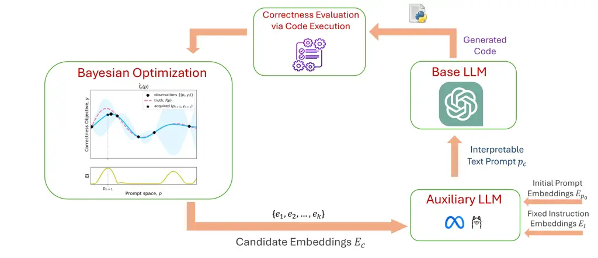
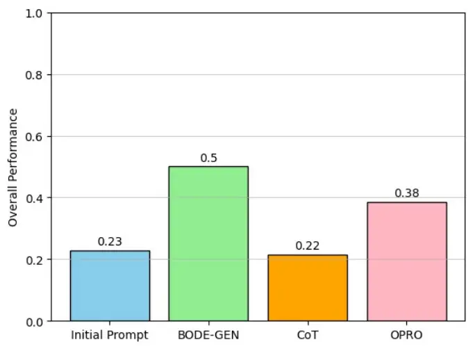
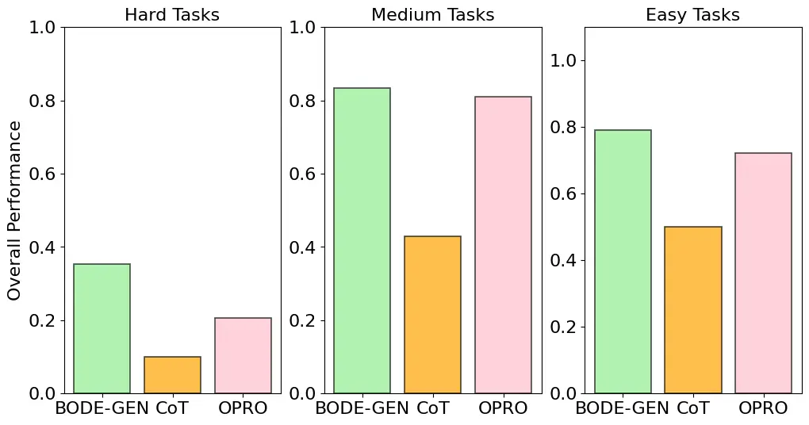
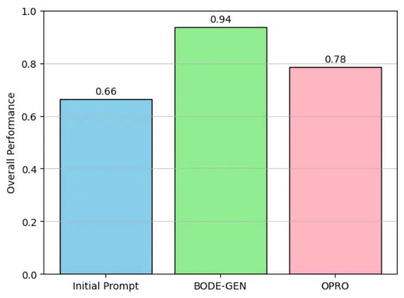
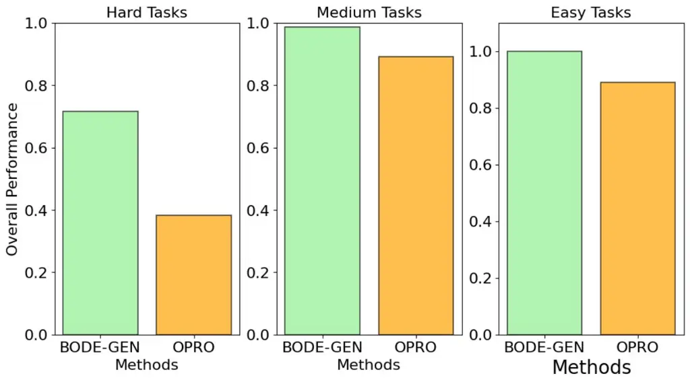

# An Exploratory Study of Bayesian Prompt Optimization for Test-Driven Code Generation with Large Language Models

CCS: Software and its engineering Source code generation

Shlok Tomar Affiliation: Washington State University, USA email:
<shlok.tomar@wsu.edu> , Aryan Deshwal Affiliation: University of
Minnesota, USA email: <adeshwal@umn.edu> , Ethan Villalovoz
Affiliation: Washington State University, USA email:
<ethan.villalovoz@wsu.edu> , Mattia Fazzini Affiliation: University of
Minnesota, USA email: <mfazzini@umn.edu> , Haipeng Cai
Affiliation: University at Buffalo, USA email: <haipengc@buffalo.edu>
and Janardhan Rao Doppa Affiliation: Washington State University, USA
email: <jana.doppa@wsu.edu>

###### Abstract.

We consider the task of generating functionally correct code using large
language models (LLMs). The correctness of generated code is influenced
by the prompt used to query the given base LLM. We formulate the problem
of finding the appropriate prompt as combinatorial search process and
propose a Bayesian optimization (BO) approach referred to as BO for Code
GENeration (BODE-GEN). BODE-GEN performs an adaptive data-driven search
over prompts guided by training data in the form of prompts tried and
the functional accuracy of the generated code over a set of given test
cases. The key insight is to perform BO in continuous embedding space by
using an auxiliary LLM to bridge the gap between discrete prompt space
and continuous embedding space. We leverage two synergistic ideas,
namely, random projections and dimensionality scaled priors, to build
effective Gaussian process based surrogate models over the
high-dimensional embedding space. Our experiments on the HumanEval+
benchmark using multiple base LLMs show that BODE-GEN can improve
performance in terms of code generation accuracy compared to fixed
prompts and manual prompt engineering. Additionally, we demonstrate that
BODE-GEN is sample-efficient, requiring relatively few iterations of BO
to demonstrate improvements in code accuracy.

###### Keywords: 

AI for software development, large language models, program synthesis,
Bayesian optimization

## 1. Introduction

Large language models (LLMs) have emerged as transformative tools in
various domains, including software development. Their ability to assist
with code-related tasks has positioned them as indispensable coding
assistants for software developers today(Nam et al., 2024; Coignion et
al., 2024; Chen et al., 2021). However, as developers increasingly rely
on code generated by LLMs, the functional correctness of this code has
become an important factor in ensuring the overall quality of software
products.

In modern software development, the software supply chain comprises of
various components, including low-level systems software, application
frameworks, third-party libraries, and build tools. These components are
often inter-dependent and any flaw in one can propagate through the
entire system, leading to significant and widespread challenges (Enck
and Williams, 2022; Ellison et al., 2010). When developers incorporate
LLM-generated code into these components, the functional correctness of
the code becomes vital. Incorrect code generated by LLMs can introduce
subtle bugs that are difficult to detect and diagnose, potentially
causing cascading side-effects for the entire software supply
chain (Balayn et al., 2024). Therefore, ensuring the correctness of
LLM-generated code before its incorporation into the software
development process is of paramount importance.

Recent studies have highlighted that LLMs can produce incorrect code,
for various reasons, including hallucinations and insufficient
understanding of coding tasks (Tian et al., 2024; Liu et al., 2024a; Nam
et al., 2024). To address this challenge, some potential solutions
include better pre-training datasets and improved training/fine-tuning
methods to create high-performing LLMs specifically for coding tasks
(Guo et al., 2024). There is also an inherent trade-off between resource
cost and performance of LLMs. On one end of the spectrum, large LLMs
require huge amount of high-quality training data and compute resources
for both training and inference (Wang et al., 2021; Gao et al., 2021).
On the other end, training and inference with smaller LLMs is feasible
and computationally cheap, but these models may struggle to generalize
well to handle the complexities of real-world code synthesis (Touvron et
al., 2023a; Touvron et al., 2023b). In this context, leveraging large
foundational LLMs such as ChatGPT through prompting has emerged as a
promising avenue for developers seeking to generate high-quality code
(Brown et al., 2020; Li et al., 2024; Murr et al., 2023; Ma et al.,
2023). However, recent studies have shown that treating LLMs as
black-boxes and relying on standard/manual prompting can result in the
generation of incorrect code (Austin et al., 2021; Jain et al., 2022;
Sobania et al., 2024; Liu et al., 2024c; Spiess et al., 2024).

Improving automated prompting approaches is complementary to alternative
approaches of improving the code generation capabilities of LLMs. Prior
work in this direction include knowledge augmentation (Ahmed et al.,
2024; Jain et al., 2022) and reasoning elicitation (Ma et al., 2023;
Ahmed and Devanbu, 2023). Enhanced by self-consistency (Wang et al.,
2022), the correctness of generated code repair can be further improved
with CoT (Ahmed and Devanbu, 2023). However, it is not clear if similar
improvement can be achieved for synthesizing programs from scratch.
Increasing the specificity of the code-generating prompts can provide
additional help (Murr et al., 2023), but determining the specificity
level is currently a manual process.

Test-driven software development (Beck, 2003) is an effective software
engineering paradigm where developers write tests before code to write
correct code. Inspired by the practical success of this paradigm, this
paper asks the following question: Given a base LLM and test cases for a
coding task, can we develop an automated prompting approach to generate
correct code by minimizing the number of tried prompts
(sample-efficiency)? There are two key challenges in answering this
question. First, the search space of prompts is combinatorial and huge.
Second, querying the base LLM with a candidate prompt and evaluating the
accuracy of code on test cases is expensive. Therefore, we have a
challenging search problem. This paper answers this question by
proposing a prompt search approach based on the framework of Bayesian
optimization (BO) (Shahriari et al., 2016). The key idea behind BO is to
learn a surrogate model from the past evaluations (prompt and code
accuracy pairs) and use it to intelligently select a sequence of prompts
to achieve our goal (generating code with 100 percent accuracy on the
given test case).

Our proposed BO for Code GENeration (BODE-GEN) approach performs search
in continuous embedding space by using an auxiliary LLM to bridge the
gap between discrete prompt space and continuous embedding space. The
popular Gaussian process (GP) (Rasmussen and Williams, 2006) based
surrogate models work well in low dimensions, but the embedding
dimension for auxiliary LLM such as LLama2 is 4096 which poses
significant challenges. To address this high-dimensional challenge, we
leverage two synergistic ideas, namely, random projections and
dimensionality scaled priors to build effective GP based surrogate
models which are critical for the success of BO. BODE-GEN addresses the
core issue of incorrect code generation using LLMs at its source and
provides a potential solution for developers.

Contributions. The key contributions of this paper include:

- •
  Development of a Bayesian optimization approach (BODE-GEN) to
  iteratively improve prompts for a given base LLM to solve code
  synthesis tasks.
- •
  Demonstrating the effectiveness of BODE-GEN in generating code that
  meets functional requirements with higher correctness (fraction of
  passed test cases).



Figure 1. High-level overview of our BODE-GEN approach. The method
begins with a set of candidate embeddings
$`E_{c}`$=$`\{e_{1},e_{2},\cdots,e_{m}\}`$ proposed by the Bayesian
Optimization algorithm. These embeddings combined with the initial
prompt embeddings $`E_{p_{0}}`$ and fixed instruction embeddings
$`E_{I}`$ are passed to the auxiliary LLM which generates an
interpretable text prompt $`p_{c}`$. Subsequently, the base LLM is
queried with this prompt $`p_{c}`$ to generate the code which is
evaluated for functional correctness through code execution on a set of
developer provided test cases. The percentage of test cases passed by
the code is used as the objective function value for the BO procedure.
This overall procedure is repeated for a fixed number of iterations or
until we find a prompt that generates code with maximizing code
generation accuracy on the given test cases.

## 2. Problem Setup and Challenges

Let $`LLM_{base}`$ denote a base large language model (LLM) that can be
queried using textual prompts to solve coding tasks. Given an initial
prompt $`p_{0}`$ (e.g., _“write Python code for testing whether a given
number is prime or not”_) for a coding task $`T`$ and a set of $`n`$
developer-provided test cases to verify the correctness of the generated
code, our goal is to find a prompt $`\hat{p}`$ that when used with
$`LLM_{base}`$ will generate functionally correct code, i.e., produces
correct outputs on all $`n`$ test cases.

Suppose Accuracy($`LLM_{base}`$, $`p`$) represent the the functional
accuracy of the code generated by the given base LLM using the prompt
$`p`$ on $`n`$ test cases (e.g., 90 percent accuracy means the code
passes 90 percent of the given $`n`$ test cases). Our goal is to find a
prompt $`\hat{p}`$ which maximizes this accuracy and ideally achieves
100 percent accuracy. This problem can be mathematically formulated as
follows.

```math
\displaystyle\hat{p}=\arg\max_{p}\textsc{Accuracy}(LLM,T) \tag{1}
```

Key Challenges. There are two main challenges in solving this
optimization problem.

- •
  Large combinatorial space of prompts. Each prompt is a sequence of
  valid tokens. Given a token vocabulary and maximum size of the
  sequence, the search space of all candidate prompts is combinatorial
  and very large.
- •
  Expensive-to-evaluate objective function. To evaluate the accuracy of
  a candidate prompt $`p`$, we need to query the base LLM to generate
  code and execute it on all $`n`$ test cases. Each query to base LLM is
  expensive in terms of dollar cost or computational cost.

Therefore, our goal is to minimize the number of queries to the
objective function (i.e., the number of tried prompts) to solve this
optimization problem. Random search and trial-and-error approaches are
not compatible with this goal because their exploration strategy doesn’t
incorporate machine learning and decision-theoretic reasoning to achieve
the target goal.

## 3. Bayesian Optimization for Prompt Search

In this section, we describe an approach for sample-efficient prompt
search based on the framework of Bayesian optimization (BO). First, we
provide the necessary background on BO. Next, we describe the key
challenges in using BO for prompt search and our proposed BODE-GEN
approach based on continuous embeddings to address those challenges.

### 3.1. Background on Bayesian Optimization

BO (Shahriari et al., 2016) is a derivative-free method to _adaptively_
and _efficiently_ search a given input space $`X`$ (e.g., search space
of prompts) to optimize expensive-to-evaluate objective function
$`f(x\in X)`$. BO is an adaptive procedure because it intelligently
selects inputs from $`X`$ by iterating between querying the objective
function $`y`$=$`f(x\in X)`$ and making a decision about which input to
query next $`x_{next}`$. BO is sample-efficient because it makes a
data-driven decision to select the next input to query the objective
function by taking into account all input-output pairs from previous
query evaluations.

Each decision to select the next input from $`\mathcal{X}`$ to evaluate
with $`f`$ must trade-off two conflicting goals: 1) Exploitation
suggests to use our current, but uncertain, approximation of the
input-output relationship, based on the past query evaluations, to
select the most promising input in terms of objective function value;
and 2) Exploration suggests to select the input that we are most
uncertain about to improve our approximation of the input-output
relationship.

The key ingredients of BO for data-driven decision making are: 1)
surrogate model that captures our beliefs, based on past objective
function evaluations, about the input-output relationship; and 2)
_acquisition function_ that scores each input according to the utility
of querying the objective function on it next. The acquisition function
uses the surrogate model of the true input-output relationship
$`f(x\in X)`$ to decide which input to evaluate next by trading-off
exploration and exploitation.

The surrogate model $`\hat{f}(x)`$ is a probabilistic model of the
input-output relationship $`f(x)`$ trained on all input-output pairs
from past objective function evaluations. It reflects our current
beliefs about $`f(x)`$ and serves two purposes in BO. First, to guide
exploitation, it allows us to cheaply estimate the objective function
value of all unevaluated inputs. Second, to guide exploration, variance
quantifies the uncertainties in the predicted objective function value
for the unevaluated inputs. This makes us aware of regions in input
space we need to explore to improve our surrogate model and reduce the
uncertainty in our beliefs about $`f(x)`$. Gaussian processes (GPs)
(Rasmussen and Williams, 2006) are the most commonly used surrogate
models in BO owing to their flexibility as function approximators and
principled uncertainty quantification.

The acquisition function scores the utility of evaluating the next input
with the expensive objective function $`f`$. Here, “utility” is defined
in terms of our ultimate goal of finding the optimal input with the
minimum number of objective function evaluation queries. The acquisition
function employs the prediction of the objective function value and the
associated uncertainty from the surrogate model to assign a utility
score to each candidate input that balances exploitation and
exploration, respectively. The decision of which input to evaluate next
is made by maximizing the acquisition function. Importantly, the
acquisition function is cheap to evaluate. Some popular acquisition
functions include expected improvement (EI) and upper confidence bound
(UCB) (Shahriari et al., 2016).

To summarize, BO is an iterative procedure that is executed until we
reach our goal or maximum iterations are reached. In each iteration, we
select the input that maximizes the acquisition function for objective
function evaluation and then update the surrogate model based on new
training example.

### 3.2. BO-based Prompt Search via Continuous Embeddings

Much of the BO success is on continuous spaces with small number of
input dimensions. There are two intertwined surrogate modeling
challenges in applying BO for prompt search. First, as opposed to
continuous inputs, modeling of combinatorial objects (e.g., sequences)
is quite challenging because of a lack of general notion of smoothness
on such objects. This is especially exacerbated in the small-data regime
where we have access to only a small number of supervised examples from
the input space. Second, the search space of prompts is
high-dimensional. We provide principled solutions to address these
challenges as part of our proposed BODE-GEN approach and explain their
details below.

BODE-GEN performs search for optimized prompts in a continuous embedding
space as opposed to the discrete prompt space. The key insight is to
leverage an auxiliary open-source LLM $`LLM_{aux}`$ (e.g., LLaMA 2) to
bridge the gap between continuous embedding space and discrete prompt
space. Specifically, we perform BO (both surrogate modeling and
acquisition function optimization) in the continuous embedding space.
The continuous search space for our BO method is parameterized as a set
of $`d`$-dimensional embeddings $`E`$=$`\{e_{1},e_{2},\cdots,e_{m}\}`$,
where each $`e_{i}\in\mathbb{R}^{d}`$ is a continuous vector in the
$`d`$-dimensional embedding space of a local auxiliary LLM
$`LLM_{aux}`$.

We perform the following sequence of steps in each iteration of BODE-GEN
(see Algorithm 1 for pseudo-code and Figure 1 for illustration) given a
surrogate model trained on the continuous embedding space.

1: Coding task $`T`$ and $`n`$ test cases; Initial prompt $`p_{0}`$;
Base LLM $`LLM_{base}`$; and Auxiliary LLM $`LLM_{aux}`$

2: Optimized prompt $`\hat{p}`$

3: $`E_{p_{0}}\leftarrow`$ Embedding of initial prompt $`p_{0}`$ using
$`LLM_{aux}`$

4: $`E_{I}\leftarrow`$ Embedding of fixed instruction using
$`LLM_{aux}`$

5: Initialize surrogate model $`\mathcal{M}`$ with random projections
and dimensionality-scaled priors (Hvarfner et al., 2024) on a set of
randomly initialized points.

6: for iteration $`t=1`$ to $`T_{max}`$ do

7:
  $`E_{c}\leftarrow\arg\max_{E}\textsc{AcquisitionFunction}(\mathcal{M},E)`$

8:   $`E_{comb}\leftarrow E_{I}\circ E_{c}\circ E_{p_{0}}`$
$`\triangleright`$ Concatenated embedding

9:   $`p_{c}\leftarrow LLM_{aux}(E_{comb})`$ $`\triangleright`$ Generate
discrete prompt

10:   $`C\leftarrow LLM_{base}(p_{c})`$ $`\triangleright`$ Generate code
using prompt $`p_{c}`$

11:   Acc $`\leftarrow\textsc{Evaluate}(C,n)`$ $`\triangleright`$
Accuracy on $`n`$ test cases

12:   Update surrogate model $`\mathcal{M}`$ with $`(E_{c},Acc)`$

13: end for

14: return best found prompt $`\hat{p}`$ in terms of code accuracy

Algorithm 1 BODE-GEN Algorithm for Prompt Optimization

1.  (1)
    Select the candidate input $`E_{c}`$ from the continuous embedding
    space by maximizing the expected improvement (EI) acquisition
    function.
2.  (2)
    The selected embedding $`E_{c}`$ is added as a suffix to the
    continuous embedding $`E_{p_{0}}`$ of the initial prompt $`p_{0}`$.
    We also prepend the embeddings $`E_{I}`$ for a simple instruction
    $`I`$: “Your task is to rephrase/reformulate the code prompt given
    below to achieve a higher score on code generation by a large
    language model. Please provide the rephrased prompt in one block.”
    given to the auxiliary LLM $`LLM_{aux}`$ inorder to rephrase the
    original prompt $`p_{0}`$. The resulting combined embedding
    $`E_{comb}`$=$`E_{I}\circ E_{c}\circ E_{p_{0}}`$ where $`\circ`$
    stands for concatenation operation.
3.  (3)
    The combined continuous embedding input $`E_{comb}`$ is passed to
    the auxiliary LLM $`LLM_{aux}`$ to generate a human-interpretable
    discrete prompt $`p_{c}`$.
4.  (4)
    The discrete prompt $`p_{c}`$ is passed as input to the base LLM
    $`LLM_{base}`$ to generate code $`C`$. The code $`C`$ is executed on
    all $`n`$ test cases to measure the functional accuracy, namely,
    Accuracy($`LLM_{base}`$, $`T`$).
5.  (5)
    If the functional accuracy of code $`C`$ is 100 percent, we return
    code $`C`$ as output. Otherwise, the surrogate model is updated
    using the new training example: input is the continuous embedding
    $`E_{c}`$ and output is code accuracy.

Surrogate Modeling over High-Dimensions. Gaussian Process (GP)
(Rasmussen and Williams, 2006) based surrogate models are commonly used
in real-world BO applications with small number of input dimensions
(typically less than 50). However, the high-dimensional embedding space
of auxiliary LLM poses a significant challenge for standard GP models.
For example, the embedding dimension for LLama2 is 4096. GP models that
are directly fitted on such a high-dimensional continuous space struggle
to generalize, especially when the amount of available supervised data
is limited, as is considered in this paper. We apply two synergistic
techniques to tackle this challenge: random projections followed by
dimensionality-scaled priors (Hvarfner et al., 2024) for kernel
hyper-parameters.

- •
  Random Projections: We employ random projections (Letham et al., 2020)
  to reduce the dimensionality of our search space. The key intuition
  behind this approach is that, in high-dimensional spaces, most of the
  interesting structure in the data lies in a lower-dimensional
  manifold. Random projections can capture this structure while
  preserving important properties of the data, such as pairwise
  distances between points (as formalized by Johnson-Lindenstrauss lemma
  (Larsen and Nelson, 2017)). In the context of our prompt optimization
  setting, random projections allow us to work with a more manageable
  representation of the embedding space without excessively reducing the
  information content. Let $`x\in\mathbb{R}^{d}`$ be a point in our
  original high-dimensional embedding space, where $`d`$ is large (e.g.,
  4096 for LLaMA 2). We aim to project this point onto a
  lower-dimensional space $`\mathcal{Z}\in\mathbb{R}^{k}`$, where
  $`k\ll d`$. The random projection is defined by a matrix
  $`A\in\mathbb{R}^{k\times d}`$, where each entry $`a_{ij}`$ of matrix
  $`A`$ is sampled independently from a standard normal distribution:

  ```math
  a_{ij}\sim\mathcal{N}(0,1) \tag{2}
  ```

  The projected point $`z\in\mathcal{Z}`$ is then obtained by:

  ```math
  z=Ax \tag{3}
  ```

  After applying random projections, our GP surrogate model is defined
  on the low-dimensional space $`\mathcal{Z}`$.

- •
  Dimensionality scaled priors: While random projections effectively
  reduce the dimensionality of our search space, the resulting projected
  space can still have hundreds of dimensions, posing challenges for
  standard GP models. GP surrogate models are entirely characterized by
  the choice of a kernel function (covariance function)
  $`k(z,z^{\prime})`$ that measures the similarity between two input
  points $`z`$ and $`z^{\prime}`$. The choice of kernel function is
  critical as it encodes our prior beliefs about the function we are
  trying to model. Many canonical kernels such as RBF (Radial Basis
  Function) Kernel and Matern Kernel depend on a lengthscale augmented
  squared Euclidean distance $`d(z,z^{\prime})`$ between $`z`$ and
  $`z^{\prime}`$ i.e.

  ```math
  \displaystyle d(z,z^{\prime})=\sum_{i}^{k}\left(\frac{z_{i}-z_{i}^{\prime 2}}{l_{i}^{2}}\right) \tag{4}
  ```

  The lengthscale $`\{l_{i}\}`$ is a critical hyper-parameter that
  captures the smoothness of functions represented by the kernel. In
  small supervised data settings (as in our problem), careful prior
  specification for this parameter is critical to achieve good
  performance on high-dimensional inputs. In order to address this
  challenge, we consider the recently proposed idea of scaling the prior
  on the lengthscale hyper-parameters of the GP kernel with the square
  root of the input dimensionality of the search space (Hvarfner et al.,
  2024). Specifically, for a $`k`$-dimensional input space,
  dimensionality scaled prior for the length-scale parameter $`l_{i}`$
  for $`i\in\{1,2,\cdots,k\}`$ is described as:

  ```math
  l_{i}\sim\text{LogNormal}(\mu=\log(\sqrt{k}),\sigma^{2}=1) \tag{5}
  ```

Overall, after applying random projections, our GP surrogate model is
defined on the reduced space $`\mathcal{Z}`$ with dimensionality scaled
priors on the lengthscale of the kernel $`k(z,z^{\prime})`$.

## 4. Experiments and Results

To evaluate the effectiveness of BODE-GEN, we investigate the following
research questions (RQs):

- •
  RQ1: How effective is BODE-GEN for code generation?
- •
  RQ2: How does BODE-GEN compare with CoT and OPRO prompting methods for
  code generation?
- •
  RQ3: What changes are introduced by BODE-GEN to the intial prompt and
  how do they affect the resulting code?

In what follows, we first describe our experimental setup including
benchmark dataset, details of LLMs, configuration of BODE-GEN and
baseline methods, and evaluation methodology. Next, we discuss the
results to answer the three RQs.

### 4.1. Experimental Setup

Dataset. We benchmark our proposed BODE-GEN approach on the HumanEval+
benchmark (Liu et al., 2024b) which is a recent extension of the
widely-adopted HumanEval benchmark (Chen et al., 2021) for coding tasks.
HumanEval consists of 164 python programming tasks, each containing a
function signature and an initial prompt which is written as a
docstring. The correctness of each task is measured by evaluating it on
a set of pre-specified test cases. HumanEval+ extends the number of test
cases in HumanEval tasks by 80x making it a challenging program
synthesis benchmark.

Large Language Models. We employ three different $`LLM_{\text{base}}`$
for code generation: one closed-source ChatGPT 3.5 (Turbo) (Brown et
al., 2020), and two open source LLMs CodeLlama (7B) (Roziere et al., 2023) and DeepSeek-Coder-33b (Guo et al., 2024). The instruction-tuned
version of LLama2 (7B) (Touvron et al., 2023a) is used as the Auxiliary
LLM $`LLM_{aux}`$ for all the experiments.

Computing Machine. All our experiments were run on a machine featuring
an Nvidia A40 GPU. The system is built on an $`x86\_64`$ architecture
with a 32-core AMD EPYC 7573X processor. The machine has 251 GB of
memory.

Configuration of BODE-GEN. The search space for BODE-GEN is set to four
embeddings, i.e., $`E`$=$`\{e_{1},e_{2},\cdots,e_{4}\}`$ where each
$`e_{i}\in\mathbb{R}^{4096}`$. We randomly project each embedding to a
64 dimensional space resulting in a overall search space of 256 = (4 x 64) dimensions. We ran the BO method for $`T_{max}`$=$`50`$ iterations
after initializing the surrogate model with 20 randomly picked embedding
points (i.e., BO performance curves are shown for 70 iterations).
Expected Improvement was picked as the acquisition function due to its
practical success without any hyper-parameters and optimized over a
discrete set of 10K points. We ran BO for multiple seeds (five) and
present results with mean and error bars.

Baselines. We compare BODE-GEN with two baseline methods for code
generation: Zero-shot Chain of Thought (CoT) (Wei et al., 2022) and
Optimization by PROmpting (OPRO) (Yang et al., 2024). CoT is a popular
prompting approach that is shown to illicit reasoning from LLMs for
complex tasks. Unlike the original formulation which requires providing
multiple intermediate sequence of steps towards solving the problem, we
consider the Zero-shot version where we append the key prompt "Let’s
think step by step" as a suffix to the initial prompt. OPRO is a recent
iterative prompt optimization technique that leverages LLMs to
iteratively suggest better candidates conditioned on previously found
prompts.

Evaluation Metric. For each coding task $`T`$, base language model
$`LLM_{\text{base}}`$ is queried with a candidate prompt to generate
python code. We employ the pass @1 metric defined below (Chen et al., 2021) to evaluate the correctness of the generated code:

```math
\displaystyle\texttt{pass @1}=\mathbb{E}_{\text{tasks}}\left[1-\binom{n-c}{1}/\binom{n}{1}\right] \tag{6}
```

where we generate $`n=3`$ code samples per prompt to reduce the variance
of the metric and $`c`$ is the number of code samples that pass all unit
tests for that task.

\(a\) Results for Base LLM: ChatGPT 3.5(Turbo)



\(b\) Results for Base LLM: CodeLlama-7b

Figure 2. Results comparing the overall performance of BODE-GEN and
baselines with (a) ChatGPT 3.5(Turbo) and (b) CodeLlama-7b as the base
LLM. Here, overall performance is computed as the percentage of tasks
(out of total 164) from HumanEval+ solved to 100% correctness.

### 4.2. RQ1: Effectiveness of BODE-GEN

We measure the effectiveness of BODE-GEN in two ways: the code
generation accuracy aggregated over all coding tasks in the HumanEval+
benchmark (higher the better) and the number of BO iterations to achieve
high code generation accuracy (smaller the better). BODE-GEN
demonstrates improved performance in finding prompts that improve the
generated code’s correctness accuracy compared to the baseline methods.
The results, as depicted in Figure 2a, show that BODE-GEN achieves an
average code generation accuracy of 0.89 on ChatGPT-3.5Turbo(Brown et
al., 2020), which is higher than that of initial prompts (0.61), CoT
(0.63), and OPRO (0.78). Figure 2b, shows that BODE-GEN archives an
average code generation accuracy of 0.5 on CodeLlama-7b(Roziere et al.,
2023), which is higher than that of initial prompts (0.23), CoT (0.22),
and OPRO (0.38).Figure 12b, shows that BODE-GEN archives an average code
generation accuracy of 0.94 on DeepSeker-DeepSeek-Coder-33b(Guo et al., 2024) , which is notably higher than that of initial prompts (0.66), and
OPRO (0.78).This increase in performance (code accuracy) suggests the
utility of BODE-GEN in finding prompts that generate functionally
correct code on the HumanEval+ benchmark.

Figure 3. Results showing BODE-GEN’s performance on ChatGPT 3.5(Turbo)
as base-LLM as a function of number of iterations (number of base LLM
calls with different prompts) on a subset of representative tasks from
HumanEval+ benchmark. Note that the objective value for BO is the
percentage of test cases passed by the generated code for a given coding
task. As shown in the figure, prompts suggested by BODE-GEN are often
able to reach high 100% code generation correctness. Each BO iteration
corresponds to roughly one query to the base LLM (precisely it is three
queries per iteration since we generate three samples for each prompt to
compute pass @1).

Figure 4. Results showing BODE-GEN’s performance on CodeLlama-7b as
base-LLM as a function of number of iterations (number of base LLM calls
with different prompts) on a subset of representative tasks from
HumanEval+ benchmark.

Figure 5. Results showing BODE-GEN’s performance on DeepSeek-Coder as
base-LLM as a function of number of iterations (number of base LLM calls
with different prompts) on a subset of representative tasks from
HumanEval+ benchmark.

We also show the progress of BODE-GEN in terms of the generated code’s
accuracy as a function of number of BO iterations (i.e., number of tried
prompts) in Figure 3, 4, 5 on some representative coding tasks noting
that our findings are similar on other coding tasks. In all cases,
BODE-GEN demonstrates improvement in the objective value (percentage of
test cases passed) within the first 20-30 BO iterations, often achieving
near-optimal performance by the 50th iteration. This convergence
behavior suggests that BODE-GEN is able to explore the prompt space to
find optimized prompts for code generation. As evident from the figures,
BODE-GEN iteratively finds better prompts that are able to reach 100%
correctness accuracy.

Figure 6. Results comparing the overall performance of BODE-GEN with
zero-shot CoT and OPRO with ChatGPT 3.5(Turbo) as base-LLM on a grouping
of HumanEval+ tasks based on a notion of difficulty measured as the
correctness of the code generated by initial prompts given for each
task. For example, the easy/hard class refers to all tasks for which the
code generated via initial prompt achieves correctness (above 67%/below
30%) respectively. The medium class contains all tasks with their
initial prompts’ correctness between 30-67%.



Figure 7. Results of BODE-GEN and baselines with CodeLlama-7b as
base-LLM on a grouping of HumanEval+ tasks based on a notion of
difficulty measured as the correctness of the code generated by initial
prompts given for each task. For example, the easy/hard class refers to
all tasks for which the code generated via initial prompt achieves
correctness (above 67%/below 30%) respectively. The medium class
contains all tasks with their initial prompts’ correctness between
30-67%.

### 4.3. RQ2: Comparison to Baselines CoT and OPRO

In comparison to CoT and OPRO, BODE-GEN outperforms both methods in our
setup as shown in Figure 2a, and 2b. CoT shows only small improvement
over the initial prompt and performs worse than BODE-GEN. OPRO achieves
better results compared to CoT since it is an iterative approach
(similar to BODE-GEN) that finds better prompts iteratively. We define a
notion of task difficulty as the correctness of the generated code
achieved by initial fixed prompt given for each task and create three
groups (easy, medium, and hard) of increasing difficult to evaluate all
three methods. The results are shown in Figure 6, 7 which shows that the
gap between BODE-GEN and the performance of baselines increases as we
increase the difficulty of the task. This means that BODE-GEN is more
effective than baselines for hard coding tasks.

### 4.4. RQ3: Qualitative Analysis

To understand how our BO-based prompt optimization approach mproves
LLM-driven program synthesis in terms of the correctness of the
resulting code, we conducted qualitative analysis on 15 randomly
selected coding task cases among those in which the correctness
improvement was the most substantial (i.e., the most challenging cases
for the LLMs with the original prompts used in the HumanEval+
dataset (Liu et al., 2024c)). By examining these cases, we aim to (1)
identify the key changes in the prompt that our optimization approach
makes, and (2) based on these changes and how the generated code differs
between the initial prompt and optimized prompt, distill common patterns
of and main insights into what makes a prompt effective leading LLMs to
produce correct code.

#### 4.4.1. Key Changes Induced in Prompt Optimizations

For each of these chosen cases, we carefully compare the two versions of
the code-generation prompt, aiming to identify key differences between
them in all possible aspects that may affect the base LLM’s ability to
generate correct code.

Change 1: Use of Examples. While providing (e.g., input/output) examples
generally help LLMs generate correct code, how the examples are used in
the prompt matter. The original prompts typically include examples
within the docstring, which might be less visible. In optimized prompts
from BO, the examples are clearly separated from the main instructions,
making them more prominent and easier to reference. For example, in the
case of the Multiply function, shown in Figure 8, the original prompt
provides examples within the docstring, versus our optimized prompt
listing the examples in plain text after describing the task. By clearly
separating instructions from examples rather than combining them in one
information block, these changes improve LLMs’ code correctness through
separation of concerns.

Figure 8. Original prompt versus BO-optimized prompt for generating the
multiply function (HumanEval+ Case 97).

Change 2: Instruction Clarity and Detail. In several studied cases, the
original prompt often includes instructions within the code’s docstring,
which might be concise but less explicit. In the optimized version, the
prompt provides a detailed, narrative description of the task, often in
plain English, making the instructions clearer and more explicit. For
example, in the case of max_fill function generation, as shown in
Figure 9, the original prompt (left) describes the task as “You are
given a rectangular grid of wells…", while the improved prompt provides
more details and clarity with “Please write a function called max_fill
that takes in a rectangular grid of wells and a capacity as input…".

Figure 9. Original prompt versus BO-optimized prompt for generating the
max_fill function (HumanEval+ Case 115).

Change 3: Structure and Organization. In most of the studied cases, the
original prompts have a less organized structure, while the
optimization-resulted prompts use a more structured, step-by-step
format, often with clear separations between different parts of the
instructions. As seen in Figure 10, for generating the get_closest_vowel
function, our optimized prompt improves how the entire prompt is
structured: both the assumptions and examples are clearly organized in
addition to the task description.

Figure 10. Original prompt versus BO-optimized prompt for generating the
get_closest_vowel function (HumanEval+ Case 118).

Change 4: Language and Readability. Another main prompt change induced
by our optimization lies in the language use in the prompt that affects
its readability. In particular, the original prompts tend to use a
technical and formal style typical of in-code documentation, while the
optimized prompts use plain English and a more narrative style,
improving readability and comprehension. Take the max_fill function
(Figure 9) as an example again, the improved version of the prompt uses
a narrative and explanatory style, versus the more technical style of
the original prompt. Intuitively, LLMs are trained on more natural
language corpus than technical documents, which may justify why these
changes that improve readability help produce LLMs produce more correct
code.

Figure 11. Original prompt versus BO-optimized prompt for generating the
numerical_letter_grade function (HumanEval+ Case 81).

Change 5: Descriptive Guidance. The original prompts often provide
guidance on what the function should do in a general manner. In
contrast, the optimized prompt has more specific guidance on how to
approach the task, including iterative processes or specific logic to
follow. As shown in Figure 9, if we put aside the detailed examples, the
original task description itself is overall general. In the optimized
version, much more specific guidance is included on iterating through
the grid and tracking bucket usage, which helped the LLMs correct the
errors in the code generated with the original prompt, even without
using those examples.

To summarize, the common differences between the two versions of each
prompt in our studied cases highlight the importance of clarity, detail,
explicitness, and structure in writing prompts for code generation. By
ensuring that instructions are clear, detailed, and well-organized, and
by providing explicit guidance and examples, the quality and accuracy of
the generated code can be significantly improved.

#### 4.4.2. Patterns of Correct-Code-Generating Prompts

Based on these prompt changes made by our optimization approach as
summarized above, together with comparing the code generated by the two
prompt versions, we further identified the following major patterns of
correct-code-generating prompts.

Pattern 1: Clear and Detailed Instructions. We observed that providing
detailed and explicit instructions helps LLMs understand the
requirements better, leading to more accurate code generation. In the
case of max_fill function (Figure 9), for example, the original prompt
states “Your task is to use the buckets to empty the wells.", which is
much less elaborate and explicit than the optimized version: “The
function should solve the problem by iterating through the rows of the
grid, keeping track of the number of times each bucket needs to be
lowered to empty each well, and returning the total number of bucket
lowerings needed."

The detailed instructions in the optimized prompt clarify the method to
solve the problem, resulting in better code generation.

Pattern 2: Step-by-Step Breakdown. From multiple cases, it appears clear
that breaking down the task into smaller, clear steps helps the model
generate code that follows the intended logic more closely. One example
is found in the prompt for synthesizing the numerical_letter_grade
function, a shown in Figure 11. The original version simply provides a
context and a list of GPAs, offering no intermediate reasoning. The
optimized version of the prompt clearly describes the function’s
purpose, parameters, expected behavior, and gives a table for GPA to
letter grade mapping. The step-by-step breakdown ensures that the model
accurately follows the logic needed to map GPAs to letter grades.

Pattern 3: Explicit Constraints and Assumptions. Inspection of the
optimized prompts reveals that specifying constraints and assumptions
ensures LLMs adhere to the necessary conditions and edge cases. As
illustrated in Figure 10, the original prompt does provide assumptions
and examples but not explicitly (i.e., within a docstring), while the
optimized version clearly lists the constraints and examples in plain
text (i.e., explicitly). This shows that explicitly mentioning
constraints and assumptions helps the model generate code that respects
those conditions.

Pattern 4: Separation of Examples and Instructions. Almost all of our
studied cases confirm that including (e.g., input/output) examples in
code-generating prompts help LLMs produce correct code, but it is
essential to separate examples from instructions. The separation ensures
clarity and helps the model focus on understanding both the requirements
and the examples. As shown in Figure 10, the optimized prompt, which
lists examples separately after the task description, improves over the
original prompt which combines examples and the task description (within
the docstring). Apparently, clearly separating examples from
instructions enhances LLMs’ ability to parse and understand both parts
effectively.

Pattern 5: Plain English Descriptions. As evidenced in many cases, using
plain English to describe the task makes it easier for LLMs to parse the
requirements and generate correct code. As seen in Figure 9, the
original prompt uses a technical and formal style, while the improved
prompt provides a narrative and explanatory style. Plain English task
descriptions make it easier for the model to understand the task and
generate correct logic.

In summary, to write better prompts for code generation with LLMs, it is
crucial to provide clear, detailed instructions, break down tasks into
smaller steps, specify constraints and assumptions explicitly, use
multiple examples, describe tasks in plain English, and separate
examples from instructions. These patterns help the model understand the
requirements better and generate more accurate and correct code.



Figure 12. Results comparing the overall performance of BODE-GEN with
other baselines on the HumanEval+ benchmark with DeepSeek-Coder as the
base LLM (analogous to Figure 2).



Figure 13. Results comparing the overall performance of BODE-GEN with
OPRO with DeepSeek-Coder as base-LLM on a grouping of HumanEval+ tasks
based on a notion of difficulty measured as the correctness of the code
generated by initial prompts given for each task (analogous to Figure
2).

### 4.5. Additional Results on DeepSeek-Coder

In this section, we present additional results comparing BODE-GEN with
the baseline approaches on DeepSeek-Coder base LLMs. As shown in Figure
12, with DeepSeek-Coder as base LLM, BODE-GEN outperforms OPRO in
finding prompts that generate code with higher correctness and the gap
between the baselines and BODE-GEN increases on difficult tasks as shown
in Figure 13. Since CoT was consistently performing worse than BODE-GEN
and OPRO, we do not include it in this comparison. Similar to Figure 3
in the main paper, we also show the the progress of BODE-GEN as a
function of number of BO iterations with DeepSeek-Coder (Figure 5).

## 5. Threats to Validity

The main internal validity threat lies in possible implementation errors
in our tool and experimental scripts. To minimize this threat, we have
performed careful code reviews of these implementations against
manageable testing scenarios. Another major issue LLMs are commonly
subject to are hallucination (Tian et al., 2024), which in our study may
cause inconsistent and unreliable prompt improvements. To deal with such
issues, we set the temperature of the auxiliary LLM to zero in our
experiments and compute correctness accuracy (pass @1) by generating
multiple samples from the base LLM. We also ran each experiment multiple
times and took results that are consistent among the runs. Nevertheless,
this mitigation may not have entirely ruled out the possibility that
developers may not always get the same correctness improvement when
using our technique for prompt optimization, or they may need slightly
more iterations to get the same improvement as shown in our evaluation.

The main external validity threat concerns the datasets we used, as well
as LLMs and baseline approaches chosen, in our experiments. We used a
benchmark (HumanEval+) that is popularly used in LLM evaluations. Yet
the prompts in it may not represent real-world code-synthesis prompts
developers use. Meanwhile, we chose capable LLMs that are affordable to
use with respect to the scale of our experiments. With the rapid
evolution of LLMs, more advanced models may not guaranteed to be
improved as much as what we present. Similarly, we selected CoT as one
of our baselines, which is a state-of-the-art prompting strategy on
LLMs. Even more advanced prompting could have achieved better
performance (although how to instantiate them for code generation
remains an open problem as of now).

## 6. Related Work

We provided an overview of the broader literature on LLMs for code
generation in the introduction section. Below we discuss closely related
work to our specific problem setting.

LLM-driven Code Generation. To address the challenge that LLMs often
generate incorrect code (Austin et al., 2021; Liu et al., 2024c), prior
work has explored various strategies. One category includes knowledge
augmentation (Ahmed et al., 2024; Jain et al., 2022) and reasoning
elicitation (Ma et al., 2023; Ahmed and Devanbu, 2023).
Chain-of-thoughts (CoT) prompting (Wei et al., 2022) has been shown to
be useful to improve LLM-driven code generation (Ma et al., 2023).
However, our experiments on HumanEval benchmark show that the
improvement with CoT is small. Jigsaw (Jain et al., 2022) performs
post-processing of the generated code to check and calibrate
correctness, by augmenting the LLMs with knowledge about the syntax and
semantics of programs based on program analysis and synthesis
techniques. This approach is not automatic and maybe incomplete for some
coding tasks. Ahmed et al., (Ahmed and Devanbu, 2023) leverage the
self-consistency technique, which has previously been shown promising
for improving the reasoning capabilities of LLMs via CoT, for generating
bug fixes by leveraging associated commit logs as explanations. However,
it is not clear how to apply this method for synthesizing programs from
scratch. Recent work by Murr et al., (Murr et al., 2023) found that the
specificity of prompts has a major impact on the quality of
LLM-generated code: more specific prompts tend to produce accurate code
meeting the functional requirements although compromising the generation
diversity. However, determining the specificity level is currently a
manual process.

A recent prompting technique, AceCoder (Li et al., 2024), is proposed
particularly for code generation with LLMs. It starts with asking the
LLM to analyze the given requirements and output an intermediate
preliminary output (e.g., test cases), which is then utilized to
retrieve similar programs that meet the requirements as exemplars in the
code-generation prompt. However, such code examples may not always be
available for a given arbitrary requirement. Following a different
strategy, AlphaCodium (Ridnik et al., 2024) is proposed to leverage
test-based iterative refinement of the code generation process based on
LLMs, where the tests are from what is already available and generated
by the AI models. The effectiveness of AlphaCodium relies on the quality
and availability of such tests, which itself is an unresolved challenge.
Tao et al. (Tao et al., 2024) employs grammar-guided evolutionary search
to improve LLM-based program synthesis. It uses the LLM-generated code
as an initial input for the evolutionary search process after a
grammar-mapping phase, which allows for program development and fixing
errors. Subsequently, it employs different similarity metrics related to
the LLM-generated code to steer the multi-objective evolutionary search
process. However, the evaluation is only limited to grammar validation
of the generated code as opposed to functional correctness.

Optimization by PROmpting (OPRO) is the state-of-the-art technique for
optimizing tasks specified in natural language. OPRO uses LLMs to
generate new solutions based on previously evaluated solutions and their
scores, iteratively improving the objective function. Our experiments on
HumanEval benchmark demonstrates that OPRO is better than CoT but it is
less effective than our proposed BODE-GEN approach in terms of code
generation accuracy.

In contrast to prior work, our proposed BODE-GEN approach for optimizing
prompts is fully automatic (no manual intervention) and sample-efficient
(minimized the number of prompts tried) by leveraging the test cases for
coding task as per the test-driven software development paradigm (Beck,
2002).

Bayesian Optimization. BO has shown a lot of success in optimizing
continuous spaces with small number of dimensions (typically less than
50). There is relatively less work on BO over discrete spaces which is
significantly challenging than BO over continuous spaces (Deshwal et
al., 2021) and is limited to a small number of dimensions. We solve the
problem of BO over discrete prompt space by reducing it to BO over
high-dimensional continuous embedding space using an auxiliary LLM. We
study algorithmic solutions to build effective surrogate models in the
small training data setting to handle challenges of the high-dimensional
continuous embedding space.

## 7. Summary and Future Work

This paper developed and studied BODE-GEN, a Bayesian optimization
approach for prompt search in large language models (LLMs) for code
generation tasks. We formulate this search as optimization over
high-dimensional continuous embedding space of an auxiliary LLM. By
leveraging random projections and dimensionality-scaled priors, our
method addresses the challenges of high dimensionality in the embedding
space. Experiments on the HumanEval+ benchmark demonstrate BODE-GEN’s
effectiveness to significantly improve code generation accuracy across a
wide variety of coding tasks when compared to strong baselines. As LLMs
continue to play a crucial role in software development, BODE-GEN offers
a framework for improving their reliability and effectiveness,
ultimately improving developer’s productivity. Future work includes
reducing the dependency of BODE-GEN on the requirement of test cases for
coding tasks.

## References

- Ahmed and Devanbu (2023) T. Ahmed and P. Devanbu Better patching using
  llm prompting, via self-consistency. In 2023 38th IEEE/ACM
  International Conference on Automated Software Engineering (ASE),
  pp. 1742–1746. Cited by: §1, §6.
- Ahmed et al. (2024) T. Ahmed, K. S. Pai, P. Devanbu, and E. Barr
  Automatic semantic augmentation of language model prompts (for code
  summarization). In Proceedings of the IEEE/ACM 46th International
  Conference on Software Engineering, pp. 1–13. Cited by: §1, §6.
- Austin et al. (2021) J. Austin, A. Odena, M. Nye, M. Bosma, H.
  Michalewski, D. Dohan, E. Jiang, C. Cai, M. Terry, Q. Le, et al.
  Program synthesis with large language models. arXiv preprint
  arXiv:2108.07732. Cited by: §1, §6.
- Balayn et al. (2024) A. Balayn, M. Yurrita, F. Rancourt, F. Casati,
  and U. Gadiraju An empirical exploration of trust dynamics in llm
  supply chains. arXiv preprint arXiv:2405.16310. Cited by: §1.
- Beck (2002) K. Beck Test-Driven Development by Example. Addison
  Wesley. ISBN 978-0-321-14653-3. Cited by: §6.
- Beck (2003) K. Beck Test-driven development: by example.
  Addison-Wesley Professional. Cited by: §1.
- Brown et al. (2020) T. B. Brown, B. Mann, N. Ryder, M. Subbiah, J. D.
  Kaplan, P. Dhariwal, A. Neelakantan, P. Shyam, G. Sastry, A. Askell,
  et al. Language models are few-shot learners. In Advances in Neural
  Information Processing Systems, pp. 1877–1901. Cited by: §1, §4.1,
  §4.2.
- Chen et al. (2021) M. Chen, J. Tworek, H. Jun, Q. Yuan, H. P. de
  Oliveira Pinto, J. Kaplan, H. Edwards, Y. Burda, N. Joseph, G.
  Brockman, A. Ray, N. Puri, G. Krueger, M. Petrov, H. Khlaaf, G.
  Sastry, P. Mishkin, B. Chan, S. Gray, N. Ryder, M. Pavlov, A.
  Power, L. Kaiser, M. Bavarian, C. Winter, P. Tillet, F. P. Such, D.
  Cummings, M. Plappert, F. Chantzis, E. Barnes, A. Herbert-Voss, W. H.
  Guss, A. Nichol, A. Paino, N. Tezak, J. Tang, I. Babuschkin, S.
  Balaji, S. Jain, A. Saunders, B. Houghton, J. Pfau, D. de Las
  Casas, L. Bottou, C. Choi, A. Coates, S. McCandlish, A. Radford, I.
  Sutskever, and D. Amodei Evaluating large language models trained on
  code. arXiv preprint arXiv:2107.03374. Cited by: §1, §4.1, §4.1.
- Coignion et al. (2024) T. Coignion, C. Quinton, and R. Rouvoy A
  performance study of llm-generated code on leetcode. In Proceedings of
  the 28th International Conference on Evaluation and Assessment in
  Software Engineering, pp. 79–89. Cited by: §1.
- Deshwal et al. (2021) A. Deshwal, S. Belakaria, and J. R. Doppa Mercer
  features for efficient combinatorial bayesian optimization. In
  Proceedings of the AAAI Conference on Artificial Intelligence, Vol.
  35, pp. 7210–7218. Cited by: §6.
- Ellison et al. (2010) R. J. Ellison, J. B. Goodenough, C. B.
  Weinstock, and C. Woody Evaluating and mitigating software supply
  chain security risks. Software Engineering Institute, Tech. Rep.
  CMU/SEI-2010-TN-016. Cited by: §1.
- Enck and Williams (2022) W. Enck and L. Williams Top five challenges
  in software supply chain security: observations from 30 industry and
  government organizations. IEEE Security & Privacy 20 (2), pp. 96–100.
  Cited by: §1.
- Gao et al. (2021) T. Gao, A. Fisch, and D. Chen Making pre-trained
  language models better few-shot learners. In Proceedings of the 59th
  Annual Meeting of the Association for Computational Linguistics (ACL),
  pp. 3816–3830. Cited by: §1.
- Guo et al. (2024) D. Guo, Q. Zhu, D. Yang, Z. Xie, K. Dong, W.
  Zhang, G. Chen, X. Bi, Y. Wu, Y. Li, et al. DeepSeek-coder: when the
  large language model meets programming–the rise of code intelligence.
  arXiv preprint arXiv:2401.14196. Cited by: §1, §4.1, §4.2.
- Hvarfner et al. (2024) C. Hvarfner, E. O. Hellsten, and L. Nardi
  Vanilla bayesian optimization performs great in high dimensions.
  External Links: [Link](https://openreview.net/forum?id=OfT8MgIqHT)
  Cited by: 2nd item, §3.2, 5.
- Jain et al. (2022) N. Jain, S. Vaidyanath, A. Iyer, N. Natarajan, S.
  Parthasarathy, S. Rajamani, and R. Sharma Jigsaw: large language
  models meet program synthesis. In Proceedings of the 44th
  International Conference on Software Engineering, pp. 1219–1231. Cited
  by: §1, §1, §6.
- Larsen and Nelson (2017) K. G. Larsen and J. Nelson Optimality of the
  johnson-lindenstrauss lemma. In 2017 IEEE 58th Annual Symposium on
  Foundations of Computer Science (FOCS), pp. 633–638. Cited by: 1st
  item.
- Letham et al. (2020) B. Letham, R. Calandra, A. Rai, and E. Bakshy
  Re-examining linear embeddings for high-dimensional bayesian
  optimization. Advances in neural information processing systems 33,
  pp. 1546–1558. Cited by: 1st item.
- Li et al. (2024) J. Li, Y. Zhao, Y. Li, G. Li, and Z. Jin AceCoder: an
  effective prompting technique specialized in code generation. ACM
  Transactions on Software Engineering and Methodology. Cited by: §1,
  §6.
- Liu et al. (2024a) F. Liu, Y. Liu, L. Shi, H. Huang, R. Wang, Z. Yang,
  and L. Zhang Exploring and evaluating hallucinations in llm-powered
  code generation. arXiv preprint arXiv:2404.00971. Cited by: §1.
- Liu et al. (2024b) J. Liu, C. S. Xia, Y. Wang, and L. Zhang Is your
  code generated by chatgpt really correct? rigorous evaluation of large
  language models for code generation. Advances in Neural Information
  Processing Systems 36. Cited by: §4.1.
- Liu et al. (2024c) J. Liu, C. S. Xia, Y. Wang, and L. Zhang Is your
  code generated by chatgpt really correct? rigorous evaluation of large
  language models for code generation. Advances in Neural Information
  Processing Systems 36. Cited by: §1, §4.4, §6.
- Ma et al. (2023) Y. Ma, Y. Yu, S. Li, Y. Jiang, Y. Guo, Y. Zhang, Y.
  Xie, and X. Liao Bridging code semantic and llms: semantic
  chain-of-thought prompting for code generation. arXiv preprint
  arXiv:2310.10698. Cited by: §1, §1, §6.
- Murr et al. (2023) L. Murr, M. Grainger, and D. Gao Testing llms on
  code generation with varying levels of prompt specificity. arXiv
  preprint arXiv:2311.07599. Cited by: §1, §1, §6.
- Nam et al. (2024) D. Nam, A. Macvean, V. Hellendoorn, B. Vasilescu,
  and B. Myers Using an llm to help with code understanding. In
  Proceedings of the IEEE/ACM 46th International Conference on Software
  Engineering, pp. 1–13. Cited by: §1, §1.
- Rasmussen and Williams (2006) C. E. Rasmussen and C. K. I. Williams
  Gaussian processes for machine learning. Adaptive computation and
  machine learning, MIT Press. Cited by: §1, §3.1, §3.2.
- Ridnik et al. (2024) T. Ridnik, D. Kredo, and I. Friedman Code
  generation with alphacodium: from prompt engineering to flow
  engineering. arXiv preprint arXiv:2401.08500. Cited by: §6.
- Roziere et al. (2023) B. Roziere, J. Gehring, F. Gloeckle, S.
  Sootla, I. Gat, X. E. Tan, Y. Adi, J. Liu, T. Remez, J. Rapin, et al.
  Code llama: open foundation models for code. arXiv preprint
  arXiv:2308.12950. Cited by: §4.1, §4.2.
- Shahriari et al. (2016) B. Shahriari, K. Swersky, Z. Wang, R. P.
  Adams, and N. De Freitas Taking the human out of the loop: a review of
  bayesian optimization. Proceedings of the IEEE 104 (1), pp. 148–175.
  Cited by: §1, §3.1, §3.1.
- Sobania et al. (2024) D. Sobania, J. Petke, M. Briesch, and F.
  Rothlauf A comparison of large language models and genetic programming
  for program synthesis. IEEE Transactions on Evolutionary Computation.
  Cited by: §1.
- Spiess et al. (2024) C. Spiess, D. Gros, K. S. Pai, M.
  Pradel, M. R. I. Rabin, S. Jha, P. Devanbu, and T. Ahmed Quality and
  trust in llm-generated code. arXiv preprint arXiv:2402.02047. Cited
  by: §1.
- Tao et al. (2024) N. Tao, A. Ventresque, V. Nallur, and T. Saber
  Enhancing program synthesis with large language models using
  many-objective grammar-guided genetic programming. Algorithms 17 (7),
  pp. 287. Cited by: §6.
- Tian et al. (2024) Y. Tian, W. Yan, Q. Yang, Q. Chen, W. Wang, Z. Luo,
  and L. Ma CodeHalu: code hallucinations in llms driven by
  execution-based verification. arXiv preprint arXiv:2405.00253. Cited
  by: §1, §5.
- Touvron et al. (2023a) H. Touvron, T. Lavril, G. Izacard, X.
  Martinet, M. Lachaux, T. Lacroix, B. Rozière, N. Goyal, E. Hambro, F.
  Azhar, et al. Llama: open and efficient foundation language models.
  arXiv preprint arXiv:2302.13971. Cited by: §1, §4.1.
- Touvron et al. (2023b) H. Touvron, L. Martin, K. Stone, P. Albert, A.
  Almahairi, Y. Babaei, N. Bashlykov, S. Batra, P. Bhargava, S. Bhosale,
  et al. Llama 2: open foundation and fine-tuned chat models. arXiv
  preprint arXiv:2307.09288. Cited by: §1.
- Wang et al. (2021) P. Wang, R. Shin, X. Liu, Y. Jin, P. Sharma, N.
  Keskar, G. Fung, M. Naik, and S. Yu Codex: a large-scale neural
  network model for code generation. arXiv preprint arXiv:2106.01482.
  Cited by: §1.
- Wang et al. (2022) X. Wang, J. Wei, D. Schuurmans, Q. Le, E. Chi, S.
  Narang, A. Chowdhery, and D. Zhou Self-consistency improves chain of
  thought reasoning in language models. arXiv preprint arXiv:2203.11171.
  Cited by: §1.
- Wei et al. (2022) J. Wei, X. Wang, D. Schuurmans, M. Bosma, F. Xia, E.
  Chi, Q. V. Le, D. Zhou, et al. Chain-of-thought prompting elicits
  reasoning in large language models. Advances in neural information
  processing systems 35, pp. 24824–24837. Cited by: §4.1, §6.
- Yang et al. (2024) C. Yang, X. Wang, Y. Lu, H. Liu, Q. V. Le, D. Zhou,
  and X. Chen Large language models as optimizers. In The Twelfth
  International Conference on Learning Representations, External Links:
  [Link](https://openreview.net/forum?id=Bb4VGOWELI) Cited by: §4.1.
