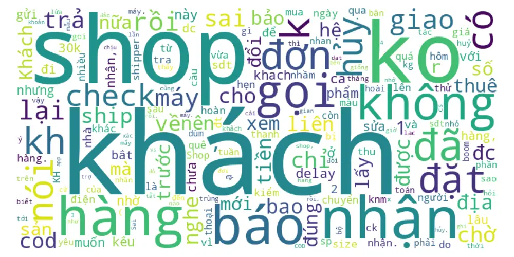
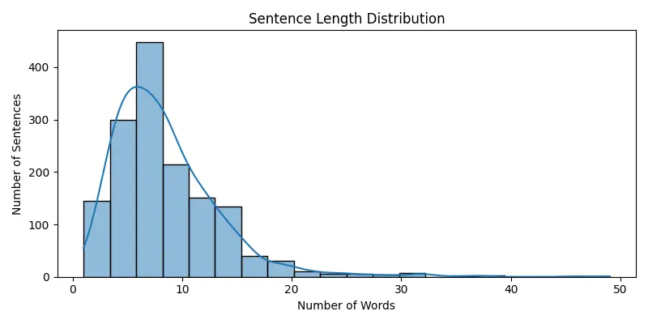
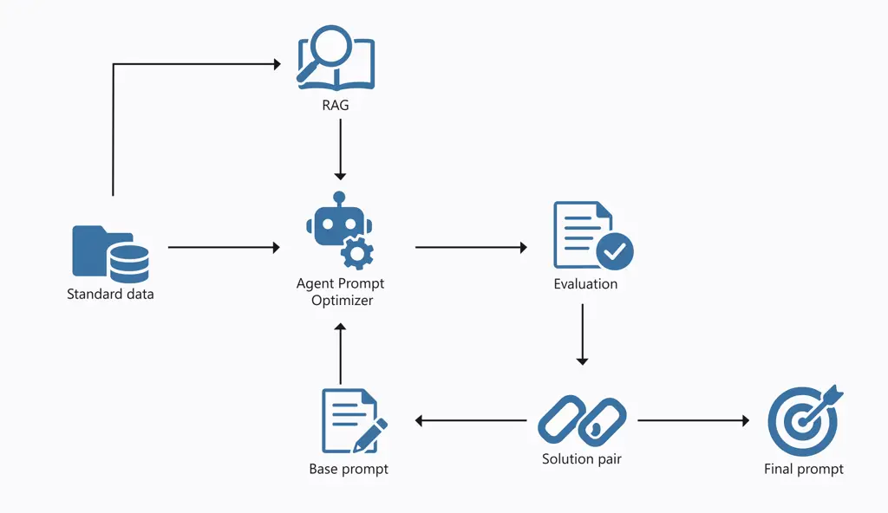

# Auto-Prompting with Retrieval Guidance for Frame Detection in Logistics

Do Minh Duc¹

   Quan Xuan Truong¹

   Nguyen Tat Dat ¹

   Nguyen Van Vinh^(1, \*)

Affiliation: Faculty of Information Technology, VNU University of
Engineering and Technology, Hanoi, Vietnam    \[4pt\]
[dominhduc@vnu.edu.vn](mailto:dominhduc@vnu.edu.vn),
[xuantruongvnuet@gmail.com](mailto:xuantruongvnuet@gmail.com),
[nguyentatdat2811@gmail.com](mailto:nguyentatdat2811@gmail.com),
[vinhnv@vnu.edu.vn](mailto:vinhnv@vnu.edu.vn)

###### Abstract

Prompt engineering plays a critical role in adapting large language
models (LLMs) to complex reasoning and labeling tasks without the need
for extensive fine-tuning. In this paper, we propose a novel prompt
optimization pipeline for frame detection in logistics texts, combining
retrieval-augmented generation (RAG), few-shot prompting,
chain-of-thought (CoT) reasoning, and automatic CoT synthesis (Auto-CoT)
to generate highly effective task-specific prompts. Central to our
approach is an LLM-based prompt optimizer agent that iteratively refines
the prompts using retrieved examples, performance feedback, and internal
self-evaluation. Our framework is evaluated on a real-world logistics
text annotation task, where reasoning accuracy and labeling efficiency
are critical. Experimental results show that the optimized
prompts—particularly those enhanced via Auto-CoT and RAG—improve
real-world inference accuracy by up to 15% compared to baseline
zero-shot or static prompts. The system demonstrates consistent
improvements across multiple LLMs, including GPT-4o, Qwen 2.5 (72B), and
LLaMA 3.1 (70B), validating its generalizability and practical value.
These findings suggest that structured prompt optimization is a viable
alternative to full fine-tuning, offering scalable solutions for
deploying LLMs in domain-specific NLP applications such as logistics.

###### Keywords:

Prompt Optimization, Prompt Engineering, LLMs, Frame Detection,
Logistics Texts

¹¹footnotetext: ^(\*) Corresponding author

## 1 Introduction

The recent breakthroughs in large language models (LLMs), such as
ChatGPT \[1\], Gemini \[18\], and other foundation models, have
significantly reshaped how businesses approach automation. These models
demonstrate remarkable abilities in understanding natural language,
reasoning over complex instructions, and adapting across diverse use
cases without extensive task-specific fine-tuning \[2\]. As a result,
AI-driven automation is being increasingly deployed across industries to
streamline workflows, reduce operational costs, and augment human
decision-making \[19\].

In the logistics sector, where large volumes of informal text such as
shipment updates, incident reports, or customer inquiries must be
processed daily, LLMs have the potential to automate previously manual
workflows \[5\]. A key task in this context is frame detection, which
involves identifying structured semantic events and their roles (e.g.,
“delayed delivery,” “handover responsibility”) from unstructured short
messages. This can be modeled as a multi-level classification task,
where each message may carry nested frame labels representing process
stage, location, and agent responsibility. However, real-world
deployments face two major challenges: (1) extremely low-resource
conditions, with only 1–2 labeled examples per frame type \[7\], and (2)
domain-specific terminology that LLMs are not exposed to during
pretraining \[4\].

Building on the prompting paradigm introduced by McCann et al. \[11\],
LLMs are now widely used via prompt-based interfaces. Prompting has been
enhanced through few-shot learning \[3\], instruction tuning \[12\], and
zero-shot reasoning \[8\]. However, prompting remains sensitive: small
variations in wording, ordering, or formatting can result in large
differences in output quality \[20\], making it difficult for non-expert
users to construct reliable prompts.

To overcome these limitations, Automatic Prompt Optimization (APO)
methods have been proposed to refine prompts in a black-box setting,
without requiring model fine-tuning. Although effective in general
domains, APO remains underexplored in domain-specific, low-resource
contexts such as logistics.

In this work, we introduce Auto-Prompting with Retrieval Guidance, a
retrieval-enhanced APO approach tailored to frame detection in
logistics. Our method:

- •
  Maintains a library of prompt components, including structured
  examples and instruction templates;
- •
  Uses semantic similarity retrieval to dynamically select relevant
  components per input;
- •
  Composes optimized prompts without human intervention;
- •
  Achieves more than 80% accuracy on a proprietary logistics dataset,
  outperforming zero-shot and manually engineered prompts.

In summary, by bridging APO with retrieval-based contextualization
\[10\], our method reduces prompt engineering burden, improves
robustness, and facilitates practical deployment of LLMs for structured
frame detection in specialized domains. Conceptually, the framework can
be viewed as an iterative search in the prompt space, where retrieval
narrows contextual uncertainty and self-evaluation acts as a feedback
signal approximating gradient-free optimization. This provides a
theoretical justification for its effectiveness in black-box settings.

## 2 Related Work

### 2.1 LLMs in Domain-Specific and Low-Resource Scenarios

The unprecedented capabilities of LLMs like GPT-4 \[1\] have spurred
their adoption in various specialized, high-stakes domains that often
suffer from data scarcity. In medicine, models are being developed to
assist with clinical note summarization and diagnostic reasoning \[17\].
Similarly, in the legal sector, LLMs are being explored for contract
analysis and legal question-answering, where domain-specific terminology
and nuanced reasoning are critical. The financial domain has also seen
the emergence of models like FinGPT, trained on financial data to handle
tasks such as sentiment analysis and report generation \[22\].

The logistics sector presents similar challenges: a reliance on
proprietary data formats, a specialized vocabulary, and the need to
process vast streams of unstructured text. Recent surveys suggest that
LLMs hold significant potential for automating logistics workflows, such
as shipment tracking and incident reporting\[20\]. Our work addresses a
core task in this domain: frame detection and many labels we only have 1
or 2 samples.

### 2.2 Automatic Prompt Optimization

The effectiveness of LLMs is heavily dependent on the quality of the
input prompt, a phenomenon that has given rise to the field of "prompt
engineering." However, manual prompt crafting is often brittle and
requires significant expertise \[6, 24\]. To address this, Automatic
Prompt Optimization (APO) has emerged as a key research direction.

APO techniques can be broadly categorized. Gradient-based methods, such
as prompt tuning \[9\], learn continuous "soft prompts" that are
prepended to the input embedding. However, these methods typically
require a moderate amount of labeled data for effective training. In our
case, the dataset is extremely low-resource, with only 1–2 labeled
examples per label, making conventional fine-tuning or even prompt
tuning impractical. Given the large number of distinct labels and the
limited supervision available, we instead leverage the generative
capacity of LLMs themselves to optimize prompts in a data-efficient
manner. A seminal work in this area, Automatic Prompt Engineer (APE)
\[25\], uses an LLM to generate and search for instruction candidates.
More recent approaches have framed this as a reinforcement learning
problem. For instance, Pryzant et al \[13\] employ "gradient-free"
exploration, using an editor model to propose prompt edits and a reward
model to evaluate their efficacy. These methods are particularly
appealing for low-resource settings, as they minimize dependence on
labeled examples while still enabling prompt adaptation to task-specific
semantics.

A critical component of prompting, especially for complex reasoning
tasks, is the Chain-of-Thought (CoT) \[21\]. CoT prompting, which
encourages the model to generate intermediate reasoning steps, has been
shown to significantly improve performance. Research has also focused on
automating the generation of these reasoning chains. Auto-CoT \[23\]
clusters questions and generates reasoning chains for each cluster,
creating a diverse set of exemplars for few-shot prompting. Shum
proposed generating multiple reasoning paths and then selecting the most
consistent one to improve robustness\[16\]. Our approach incorporates
reward-based learning to optimize prompts that may include CoT-style
instructions, but it uniquely integrates a retrieval mechanism to
dynamically select the few-shot examples that form the prompt’s core.

### 2.3 Retrieval-Augmented Language Models

LLMs possess vast parametric knowledge but it is static and may lack
domain-specific or real-time information. Retrieval-Augmented Generation
(RAG) was introduced to mitigate this by augmenting prompts with
relevant information retrieved from an external knowledge corpus \[10\].
This paradigm has proven effective at reducing factual hallucinations
and improving performance on knowledge-intensive tasks.

The synergy between retrieval and in-context learning is particularly
relevant to our work. Instead of retrieving factual passages, recent
methods retrieve entire exemplars (i.e., input-output pairs) to populate
the few-shot context of a prompt. For instance, Ram demonstrated that
retrieving examples that are semantically similar to the test input
significantly improves few-shot performance\[14\]. This dynamic
selection of examples is more effective than using a fixed, randomly
chosen set. These systems typically employ dense retrieval models, such
as Sentence-BERT \[15\], to embed the corpus and query into a shared
vector space for similarity search.

Our method, Auto-Prompting with Retrieval Guidance, builds directly on
this line of research. However, we extend the paradigm in a crucial way:
retrieval is not just a pre-processing step to find examples, but an
integral part of the automatic prompt construction loop. We maintain a
structured library of prompt components—including instruction templates
and domain-specific few-shot examples—and use dense retrieval to
dynamically select the most relevant components for each input instance.
This allows our system to compose highly specialized prompts tailored to
the nuances of hierarchical frame detection in logistics, effectively
bridging the gap between automatic prompt optimization and
retrieval-augmented in-context learning in a challenging, low-resource
industrial setting.

## 3 Dataset

We construct a domain-specific dataset comprising 1,500 text messages
collected from a Vietnamese logistics platform. Each instance is a short
sentence extracted from real-world customer or internal staff
communications. The messages are informal, highly domain-specific, and
often include abbreviations, shorthand expressions, and non-standard
language structures—reflecting the linguistic challenges typically
encountered in operational logistics settings.

Each message is annotated with a three-level hierarchical frame label,
capturing the semantic structure of the logistics issue being described:

- •
  Level 1 (actor): the primary agent or entity responsible for the issue
  (e.g., Customer, Shop, Delivery Service, External Factors),
- •
  Level 2 (reason): the underlying reason or category of the event
  (e.g., Incorrect Information, Unavailable, Changed Address, Refused
  Delivery),
- •
  Level 3 (fine-grained cause): a specific instantiation of the reason
  (e.g., Wrong Product, Out of Stock, Customer on Vacation).

The annotation schema includes 73 unique frame labels in total,
representing the full cross-product of these three hierarchical levels.
The full label space is defined in a structured format such as Shop –
Thay đổi thông tin – Thời gian lấy hàng, which translates to
(Actor=Shop, Reason=Change Info, Detail=Pickup Time).

Annotation was performed manually by domain experts within the logistics
company who possess extensive knowledge of business operations and
customer communication patterns. All annotations were reviewed and
agreed upon through internal consensus to ensure label consistency and
semantic fidelity. Notably, the dataset reflects real-world class
imbalance: while some frame labels are associated with dozens of
instances, others appear only once or twice, creating a naturally
low-resource setting for many categories.

This dataset serves as a valuable resource for developing and evaluating
frame detection methods under conditions that are both semantically
complex and data-scarce, highlighting the practical challenges of
applying large language models in real-world industrial domains.

### 3.1 Dataset Statistics and Characteristics

To better understand the linguistic characteristics of the dataset, we
conducted descriptive statistical analysis on the first 1,500 annotated
messages. The results are summarized in Table 1, while Figure 2 and
Figure 2 provide visual insights.

|                                |            |
| ------------------------------ | ---------- |
| Statistic                      | Value      |
| Total number of sentences      | 1,500      |
| Average sentence length        | 8.48 words |
| Maximum sentence length        | 49 words   |
| Minimum sentence length        | 1 word     |
| Sentences longer than 10 words | 393        |
| Training set (70%)             | 1,050      |
| Validation set (15%)           | 225        |
| Test set (15%)                 | 225        |

Table 1: Sentence-level statistics of the annotated dataset

Figure 1: Word cloud of the most frequent tokens in the dataset

Figure 2: Distribution of sentence lengths (in number of words)

From the analysis, we observe that the dataset contains mostly short
utterances, with a median around 7–9 words. The vocabulary includes many
domain-specific terms such as shop, khách, giao, and informal tokens
like ck, kt, or sđt, which reflect both abbreviation and inconsistency
in natural language usage. These properties further emphasize the
challenges in applying structured learning or fine-tuning methods to the
data, and highlight the importance of robust prompting and retrieval
mechanisms.

## 4 Method

The loop for generating optimized prompts is repeated three times. Each
times we have three prompts using for compare and choose the best
prompt.

Figure 3: Overview of the proposed prompt optimization pipeline.

To enhance the performance of large language models (LLMs) on text
annotation tasks, we propose a prompt optimization pipeline that
integrates retrieval-augmented generation (RAG) with an LLM-based prompt
optimizer. Our method aims to generate effective task-specific prompts
that generalize well during inference. Figure 3 illustrates the
architecture of our system.

### 4.1 Retrieval-Augmented Generation (RAG)

To enrich the prompt context with relevant examples, we utilize a dense
retrieval mechanism. Each input query is used to retrieve semantically
similar examples from a pre-encoded vector database. This process
enables the system to dynamically augment the prompt with high-quality,
context-relevant exemplars, improving the model’s reasoning ability and
robustness.

### 4.2 Prompt Optimizer Agent

At the core of our system is the Prompt Optimizer, an autonomous agent
designed to iteratively improve prompts using a suite of large language
models (LLMs). Specifically, we employ a combination of state-of-the-art
models, including LLaMA 3.1 70B, Qwen 2.5 72B-chat, GPT-4o mini, and
GPT-4o. These models serve both as prompt generators and evaluators,
enabling a powerful closed-loop prompt engineering framework.

The optimizer receives as input a base prompt and a set of retrieved
examples obtained via the RAG module. It applies multiple prompt
engineering techniques to generate candidate prompts optimized for the
downstream task. Among the key strategies used are:

- •
  Few-shot prompting: Retrieved examples are appended to the prompt as
  demonstrations, allowing the model to learn from specific task
  instances and better generalize to unseen inputs.
- •
  Chain-of-Thought (CoT) prompting: Prompts are structured to elicit
  intermediate reasoning steps before final predictions. This is
  particularly effective for tasks involving multi-step logic or weak
  supervision.
- •
  Auto-CoT: Building upon CoT, we apply Auto-CoT methods to
  automatically generate rationales from unlabeled data using a
  two-phase process: (1) reasoning generation with self-consistency
  sampling, and (2) rationale-filtering based on agreement with
  ground-truth or simulated outputs. This allows us to bootstrap
  high-quality CoT-style demonstrations without requiring costly manual
  annotation.

The prompt refinement process operates in a feedback loop. For each
generated candidate prompt, we simulate outputs using one or more of the
aforementioned LLMs and assess performance using a mix of automated
metrics and internal scoring functions. These functions may include
comparisons with expert annotations or meta-evaluation via a scoring
model (e.g., GPT-4o). Poorly performing prompts are discarded, while
promising ones are further refined through transformations such as
reordering examples, adjusting instruction specificity, or modifying CoT
strategy. Through this iterative optimization process, the Prompt
Optimizer acts as a meta-level agent capable of self-evaluating and
improving its prompt generation policy. The final prompt selected from
this pool is the one that consistently yields the best annotation
accuracy and reasoning quality across multiple validation settings. This
prompt is then deployed during inference, forming the backbone of the
downstream system.

### 4.3 Evaluation and Selection

Each candidate prompt generated by the optimizer is evaluated on a
held-out validation set. Evaluation metrics include both automatic
measures (e.g., accuracy) and human-in-the-loop assessments performed by
domain experts. Prompts are compared in terms of their effectiveness in
producing correct annotations.

### 4.4 Solution Pairing and Final Selection

The evaluation phase yields a set of candidate solution pairs, where
each pair consists of a prompt and its associated performance score.
These pairs are ranked and analyzed to determine the best-performing
prompt. The selected Final Prompt is then used for inference in
downstream applications.

The final prompt is deployed for real-world inference scenarios,
enabling the LLM to generate accurate and contextually appropriate
annotations for new inputs. This prompt encapsulates both task-specific
requirements and contextual examples retrieved dynamically during the
optimization process.

## 5 Experiment

The main configuration parameters used across all evaluated models are
summarized in Table 2. To ensure consistent reasoning behavior and fair
comparison, we fixed the sampling and decoding parameters during all
experiments. Specifically, the temperature was set to 0.3 to reduce
randomness in generation and encourage deterministic reasoning chains.
The top-p (nucleus sampling) and top-k values were set to 0.95 and 70,
respectively, balancing diversity and precision in token selection.

Parameter LLaMA 3.1 70B Qwen 2.5 72B GPT-4o mini GPT-4o top_p 0.95 0.95
0.9 0.9 top_k 70 70 50 50 temperature 0.3 0.3 0.3 0.3 max tokens 1024
1024 1024 1024 repetition penalty 0 0 0 0 presence penalty 0 0 0 0
reasoning Yes Yes Yes Yes

Table 2: Model configurations and reasoning capabilities

We categorize prompting strategies as follows:

- •
  Manual Prompt (6-shot): handcrafted prompt and 6 manually selected
  examples.
- •
  Auto Prompt (0-shot): prompt automatically generated by the optimizer,
  no examples.
- •
  Auto Prompt + RAG (k-shot): optimizer-generated prompt with k
  retrieved in-context examples via semantic retrieval.

Model Fine-tuning Strategy Test Accuracy DeBERTa-large Standard 40%
ViDeBERTa-base Standard 45% mDeBERTa Standard 61% DeBERTa-large Soft
Prompt 37% ViDeBERTa-base Soft Prompt 40% mDeBERTa Soft Prompt 57%

Table 3: Comparison of fine-tuning strategies (standard vs. soft prompt)
on the test set.

|               |                            |               |                     |
| ------------- | -------------------------- | ------------- | ------------------- |
| Model         | Prompting Strategy         | Test Accuracy | Real-World Accuracy |
| GPT-4o mini   | Manual Prompt (6-shot)     | 83%           | 83%                 |
| GPT-4o mini   | Auto Prompt (0-shot)       | 82%           | 80%                 |
| GPT-4o mini   | Auto Prompt + RAG (3-shot) | 85%           | 84%                 |
| GPT-4o mini   | Auto Prompt + RAG (6-shot) | 88%           | 88%                 |
| GPT-4o        | Manual Prompt (6-shot)     | 84%           | 84%                 |
| GPT-4o        | Auto Prompt (0-shot)       | 84%           | 84%                 |
| GPT-4o        | Auto Prompt + RAG (3-shot) | 86%           | 88%                 |
| GPT-4o        | Auto Prompt + RAG (6-shot) | 90%           | 92%                 |
| LLaMA 3.1 70B | Manual Prompt (6-shot)     | 72%           | 70%                 |
| LLaMA 3.1 70B | Auto Prompt (0-shot)       | 74%           | 80%                 |
| LLaMA 3.1 70B | Auto Prompt + RAG (3-shot) | 79%           | 81%                 |
| LLaMA 3.1 70B | Auto Prompt + RAG (6-shot) | 87%           | 87%                 |
| Qwen 2.5 72B  | Manual Prompt (6-shot)     | 73%           | 71%                 |
| Qwen 2.5 72B  | Auto Prompt (0-shot)       | 76%           | 80%                 |
| Qwen 2.5 72B  | Auto Prompt + RAG (3-shot) | 79%           | 81%                 |
| Qwen 2.5 72B  | Auto Prompt + RAG (6-shot) | 87%           | 87%                 |

Table 4: Performance of different prompting strategies across models.

Table 4 summarizes performance across several LLMs under varying
prompting strategies. We evaluate zero-shot, manual few-shot, and our
proposed auto-prompting with retrieval-augmented few-shot examples. The
goal is to assess how models adapt with optimized prompts selected
dynamically based on input similarity.

#### Auto Prompt + RAG is Most Effective.

Across all models, the best results are consistently obtained using our
proposed 6-shot Auto Prompt + RAG strategy. For example, GPT-4o reaches
90% test and 92% real-world accuracy, outperforming both manual and
zero-shot prompts. This supports the effectiveness of combining
LLM-based prompt optimization with retrieval-guided example selection.

#### Manual vs. Retrieval-based Prompting.

Manual 6-shot prompts generally underperform. For instance, GPT-4o mini
improves from 83% (manual) to 88% (RAG-6-shot), and similar gains are
seen with Qwen and LLaMA. This shows that automatic retrieval often
selects more relevant demonstrations than handcrafted examples.

#### Model Trends.

GPT-4o and its mini variant show strong, consistent performance. In
contrast, Qwen and LLaMA start lower in zero-shot (74–76%) but improve
markedly with retrieval-augmented prompts (up to 87%). This highlights
the value of prompt quality over raw model size.

#### Real-World Generalization.

High test accuracy correlates well with real-world performance. Models
like GPT-4o and Qwen retain or improve accuracy post-deployment. Slight
drops in LLaMA suggest generalization may depend on alignment and
robustness to input variation.

#### Fine-tuning Baselines.

Table 3 compares standard and soft prompt fine-tuning on encoder-based
models. Even the best result (57% for mDeBERTa with soft prompt) lags
far behind prompting-based LLMs. This reinforces the strength of
in-context learning with optimized prompting pipelines over traditional
fine-tuning approaches.

#### Conclusion.

Our findings show that combining automatic prompt generation with
retrieval-augmented few-shot examples offers a scalable and effective
alternative to fine-tuning. It improves both performance and
generalization, while being model-agnostic and parameter-efficient.

## 6 Limitations

While our method achieves strong performance in both controlled and
real-world settings, it has several notable limitations:

- •
  Domain specificity: Evaluation is confined to the logistics domain,
  which, while enabling precise alignment, limits generalizability to
  other domains or languages.
- •
  Evaluation subjectivity: Real-world performance is assessed by domain
  experts, not NLP researchers, introducing subjectivity and lacking
  formal metrics for reasoning depth or faithfulness.
- •
  RAG sensitivity to informal input: The retrieval component struggles
  with slang, shorthand, or non-standard phrasing, leading to suboptimal
  few-shot selection.
- •
  Fixed iteration prompting: The prompt optimizer performs a fixed
  number of refinement steps, which may fail to converge and adds
  latency, limiting real-time or large-scale applicability.
- •
  Compute requirements: High-performing models (e.g., GPT-4o, Qwen 72B)
  require substantial compute resources, which is impractical for
  low-resource or edge deployment scenarios.
- •
  Limited label diversity: Training data often includes only 1–2
  examples per class, which reduces the system’s ability to select
  representative demonstrations, limiting few-shot generalization even
  with RAG support.

## References

- \[1\] O. J. Achiam, S. Adler, S. Agarwal, L. Ahmad, I. Akkaya, F. L.
  Aleman, D. Almeida, J. Altenschmidt, S. Altman, S. Anadkat, R.
  Avila, I. Babuschkin, S. Balaji, V. Balcom, P. Baltescu, H. Bao, M.
  Bavarian, J. Belgum, I. Bello, J. Berdine, G. Bernadett-Shapiro, C.
  Berner, L. Bogdonoff, O. Boiko, M. Boyd, A. Brakman, G. Brockman, T.
  Brooks, M. Brundage, K. Button, T. Cai, R. Campbell, A. Cann, B.
  Carey, C. Carlson, R. Carmichael, B. Chan, C. Chang, F. Chantzis, D.
  Chen, S. Chen, R. Chen, J. Chen, M. Chen, B. Chess, C. Cho, C.
  Chu, H. W. Chung, D. Cummings, J. Currier, Y. Dai, C. Decareaux, T.
  Degry, N. Deutsch, D. Deville, A. Dhar, D. Dohan, S. Dowling, S.
  Dunning, A. Ecoffet, A. Eleti, T. Eloundou, D. Farhi, L. Fedus, N.
  Felix, S. P. Fishman, J. Forte, I. Fulford, L. Gao, E. Georges, C.
  Gibson, V. Goel, T. Gogineni, G. Goh, R. Gontijo-Lopes, J. Gordon, M.
  Grafstein, S. Gray, R. Greene, J. Gross, S. S. Gu, Y. Guo, C.
  Hallacy, J. Han, J. Harris, Y. He, M. Heaton, J. Heidecke, C.
  Hesse, A. Hickey, W. Hickey, P. Hoeschele, B. Houghton, K. Hsu, S.
  Hu, X. Hu, J. Huizinga, S. Jain, S. Jain, J. Jang, A. Jiang, R.
  Jiang, H. Jin, D. Jin, S. Jomoto, B. Jonn, H. Jun, T. Kaftan, L.
  Kaiser, A. Kamali, I. Kanitscheider, N. S. Keskar, T. Khan, L.
  Kilpatrick, J. W. Kim, C. Kim, Y. Kim, H. Kirchner, J. R. Kiros, M.
  Knight, D. Kokotajlo, L. Kondraciuk, A. Kondrich, A.
  Konstantinidis, K. Kosic, G. Krueger, V. Kuo, M. Lampe, I. Lan, T.
  Lee, J. Leike, J. Leung, D. Levy, C. Li, R. Lim, M. Lin, S. Lin, M.
  Litwin, T. Lopez, R. Lowe, P. Lue, A. Makanju, K. Malfacini, S.
  Manning, T. Markov, Y. Markovski, B. Martin, K. Mayer, A. Mayne, B.
  McGrew, S. M. McKinney, C. McLeavey, P. McMillan, J. McNeil, D.
  Medina, A. Mehta, J. Menick, L. Metz, A. Mishchenko, P. Mishkin, V.
  Monaco, E. Morikawa, D. P. Mossing, T. Mu, M. Murati, O. Murk, D.
  M’ely, A. Nair, R. Nakano, R. Nayak, A. Neelakantan, R. Ngo, H.
  Noh, O. Long, C. O’Keefe, J. W. Pachocki, A. Paino, J. Palermo, A.
  Pantuliano, G. Parascandolo, J. Parish, E. Parparita, A. Passos, M.
  Pavlov, A. Peng, A. Perelman, F. de Avila Belbute Peres, M.
  Petrov, H. P. de Oliveira Pinto, M. Pokorny, M. Pokrass, V. H.
  Pong, T. Powell, A. Power, B. Power, E. Proehl, R. Puri, A.
  Radford, J. W. Rae, A. Ramesh, C. Raymond, F. Real, K. Rimbach, C.
  Ross, B. Rotsted, H. Roussez, N. Ryder, M. D. Saltarelli, T.
  Sanders, S. Santurkar, G. Sastry, H. Schmidt, D. Schnurr, J.
  Schulman, D. Selsam, K. Sheppard, T. Sherbakov, J. Shieh, S.
  Shoker, P. Shyam, S. Sidor, E. Sigler, M. Simens, J. Sitkin, K.
  Slama, I. Sohl, B. Sokolowsky, Y. Song, N. Staudacher, F. P. Such, N.
  Summers, I. Sutskever, J. Tang, N. A. Tezak, M. Thompson, P.
  Tillet, A. Tootoonchian, E. Tseng, P. Tuggle, N. Turley, J.
  Tworek, J. F. C. Uribe, A. Vallone, A. Vijayvergiya, C. Voss, C. L.
  Wainwright, J. J. Wang, A. Wang, B. Wang, J. Ward, J. Wei, C.
  Weinmann, A. Welihinda, P. Welinder, J. Weng, L. Weng, M. Wiethoff, D.
  Willner, C. Winter, S. Wolrich, H. Wong, L. Workman, S. Wu, J. Wu, M.
  Wu, K. Xiao, T. Xu, S. Yoo, K. Yu, Q. Yuan, W. Zaremba, R. Zellers, C.
  Zhang, M. Zhang, S. Zhao, T. Zheng, J. Zhuang, W. Zhuk, and B.
  Zoph (2023) GPT-4 technical report. External Links:
  [Link](https://api.semanticscholar.org/CorpusID:257532815) Cited by:
  §1, §2.1.
- \[2\] E. M. Bender, T. Gebru, A. McMillan-Major, and S.
  Shmitchell (2021) On the dangers of stochastic parrots: can language
  models be too big?. Proceedings of the 2021 ACM Conference on
  Fairness, Accountability, and Transparency. External Links:
  [Link](https://api.semanticscholar.org/CorpusID:262580630) Cited by:
  §1.
- \[3\] T. B. Brown, B. Mann, N. Ryder, M. Subbiah, J. Kaplan, P.
  Dhariwal, A. Neelakantan, P. Shyam, G. Sastry, A. Askell, S.
  Agarwal, A. Herbert-Voss, G. Krueger, T. J. Henighan, R. Child, A.
  Ramesh, D. M. Ziegler, J. Wu, C. Winter, C. Hesse, M. Chen, E.
  Sigler, M. Litwin, S. Gray, B. Chess, J. Clark, C. Berner, S.
  McCandlish, A. Radford, I. Sutskever, and D. Amodei (2020) Language
  models are few-shot learners. ArXiv abs/2005.14165. External Links:
  [Link](https://api.semanticscholar.org/CorpusID:218971783) Cited by:
  §1.
- \[4\] Y. Gu, R. Tinn, H. Cheng, M. R. Lucas, N. Usuyama, X. Liu, T.
  Naumann, J. Gao, and H. Poon (2020) Domain-specific language model
  pretraining for biomedical natural language processing. ACM
  Transactions on Computing for Healthcare (HEALTH) 3, pp. 1 – 23.
  External Links:
  [Link](https://api.semanticscholar.org/CorpusID:220919723) Cited by:
  §1.
- \[5\] S. S. Jamee, M. R. Hossain, M. Hasan, M. K. Sharif, M. S.
  Khan, M. I. Islam, and S. I. Suhan (2025) Enhancing supply chain
  decision-making with large language models: a comparative study of
  ai-driven optimization. International Journal of Economics Finance &
  Management Science. External Links:
  [Link](https://api.semanticscholar.org/CorpusID:277639822) Cited by:
  §1.
- \[6\] Z. Jiang, F. F. Xu, J. Araki, and G. Neubig (2019) How can we
  know what language models know?. Transactions of the Association for
  Computational Linguistics 8, pp. 423–438. External Links:
  [Link](https://api.semanticscholar.org/CorpusID:208513249) Cited by:
  §2.2.
- \[7\] Z. Jiang, M. Y. R. Yang, M. Tsirlin, R. Tang, Y. Dai, and J. J.
  Lin (2023) "Low-resource" text classification: a parameter-free
  classification method with compressors. In Annual Meeting of the
  Association for Computational Linguistics, External Links:
  [Link](https://api.semanticscholar.org/CorpusID:259858947) Cited by:
  §1.
- \[8\] T. Kojima, S. S. Gu, M. Reid, Y. Matsuo, and Y. Iwasawa (2022)
  Large language models are zero-shot reasoners. ArXiv abs/2205.11916.
  External Links:
  [Link](https://api.semanticscholar.org/CorpusID:249017743) Cited by:
  §1.
- \[9\] B. Lester, R. Al-Rfou, and N. Constant (2021) The power of scale
  for parameter-efficient prompt tuning. In Conference on Empirical
  Methods in Natural Language Processing, External Links:
  [Link](https://api.semanticscholar.org/CorpusID:233296808) Cited by:
  §2.2.
- \[10\] P. Lewis, E. Perez, A. Piktus, F. Petroni, V. Karpukhin, N.
  Goyal, H. Kuttler, M. Lewis, W. Yih, T. Rocktäschel, S. Riedel, and D.
  Kiela (2020) Retrieval-augmented generation for knowledge-intensive
  nlp tasks. ArXiv abs/2005.11401. External Links:
  [Link](https://api.semanticscholar.org/CorpusID:218869575) Cited by:
  §1, §2.3.
- \[11\] B. McCann, N. S. Keskar, C. Xiong, and R. Socher (2018) The
  natural language decathlon: multitask learning as question answering.
  ArXiv abs/1806.08730. External Links:
  [Link](https://api.semanticscholar.org/CorpusID:49393754) Cited by:
  §1.
- \[12\] L. Ouyang, J. Wu, X. Jiang, D. Almeida, C. L. Wainwright, P.
  Mishkin, C. Zhang, S. Agarwal, K. Slama, A. Ray, J. Schulman, J.
  Hilton, F. Kelton, L. E. Miller, M. Simens, A. Askell, P.
  Welinder, P. F. Christiano, J. Leike, and R. J. Lowe (2022) Training
  language models to follow instructions with human feedback. ArXiv
  abs/2203.02155. External Links:
  [Link](https://api.semanticscholar.org/CorpusID:246426909) Cited by:
  §1.
- \[13\] R. Pryzant, D. Iter, J. Li, Y. T. Lee, C. Zhu, and M.
  Zeng (2023) Automatic prompt optimization with "gradient descent" and
  beam search. In Conference on Empirical Methods in Natural Language
  Processing, External Links:
  [Link](https://api.semanticscholar.org/CorpusID:258546785) Cited by:
  §2.2.
- \[14\] O. Ram, Y. Levine, I. Dalmedigos, D. Muhlgay, A. Shashua, K.
  Leyton-Brown, and Y. Shoham (2023) In-context retrieval-augmented
  language models. Transactions of the Association for Computational
  Linguistics 11, pp. 1316–1331. External Links:
  [Link](https://api.semanticscholar.org/CorpusID:256459451) Cited by:
  §2.3.
- \[15\] N. Reimers and I. Gurevych (2019) Sentence-bert: sentence
  embeddings using siamese bert-networks. In Conference on Empirical
  Methods in Natural Language Processing, External Links:
  [Link](https://api.semanticscholar.org/CorpusID:201646309) Cited by:
  §2.3.
- \[16\] K. Shum, S. Diao, and T. Zhang (2023) Automatic prompt
  augmentation and selection with chain-of-thought from labeled data. In
  Conference on Empirical Methods in Natural Language Processing,
  External Links:
  [Link](https://api.semanticscholar.org/CorpusID:257205763) Cited by:
  §2.2.
- \[17\] K. Singhal, S. Azizi, T. Tu, S. Mahdavi, J. Wei, H. W.
  Chung, N. Scales, A. K. Tanwani, H. J. Cole-Lewis, S. J. Pfohl, P. A.
  Payne, M. G. Seneviratne, P. Gamble, C. Kelly, N. Scharli, A.
  Chowdhery, P. A. Mansfield, B. A. y Arcas, D. R. Webster, G. S.
  Corrado, Y. Matias, K. H. Chou, J. Gottweis, N. Tomavsev, Y. Liu, A.
  Rajkomar, J. K. Barral, C. Semturs, A. Karthikesalingam, and V.
  Natarajan (2022) Large language models encode clinical knowledge.
  Nature 620, pp. 172 – 180. External Links:
  [Link](https://api.semanticscholar.org/CorpusID:255124952) Cited by:
  §2.1.
- \[18\] G. Team, P. Georgiev, V. I. Lei, R. Burnell, L. Bai, A.
  Gulati, G. Tanzer, D. Vincent, Z. Pan, S. Wang, S. Mariooryad, Y.
  Ding, X. Geng, F. Alcober, R. Frostig, M. Omernick, L. Walker, C.
  Paduraru, C. Sorokin, A. Tacchetti, C. Gaffney, S. Daruki, O.
  Sercinoglu, Z. Gleicher, J. Love, P. Voigtlaender, R. Jain, G.
  Surita, K. Mohamed, R. Blevins, J. Ahn, T. Zhu, K. Kawintiranon, O.
  Firat, Y. Gu, Y. Zhang, M. Rahtz, M. Faruqui, N. Clay, J. Gilmer, J.
  Co-Reyes, I. Penchev, R. Zhu, N. Morioka, K. Hui, K. Haridasan, V.
  Campos, M. Mahdieh, M. Guo, S. Hassan, K. Kilgour, A. Vezer, H.
  Cheng, R. de Liedekerke, S. Goyal, P. Barham, D. Strouse, S. Noury, J.
  Adler, M. Sundararajan, S. Vikram, D. Lepikhin, M. Paganini, X.
  Garcia, F. Yang, D. Valter, M. Trebacz, K. Vodrahalli, C.
  Asawaroengchai, R. Ring, N. Kalb, L. B. Soares, S. Brahma, D.
  Steiner, T. Yu, F. Mentzer, A. He, L. Gonzalez, B. Xu, R. L.
  Kaufman, L. E. Shafey, J. Oh, T. Hennigan, G. van den Driessche, S.
  Odoom, M. Lucic, B. Roelofs, S. Lall, A. Marathe, B. Chan, S.
  Ontanon, L. He, D. Teplyashin, J. Lai, P. Crone, B. Damoc, L. Ho, S.
  Riedel, K. Lenc, C. Yeh, A. Chowdhery, Y. Xu, M. Kazemi, E. Amid, A.
  Petrushkina, K. Swersky, A. Khodaei, G. Chen, C. Larkin, M. Pinto, G.
  Yan, A. P. Badia, P. Patil, S. Hansen, D. Orr, S. M. R. Arnold, J.
  Grimstad, A. Dai, S. Douglas, R. Sinha, V. Yadav, X. Chen, E.
  Gribovskaya, J. Austin, J. Zhao, K. Patel, P. Komarek, S. Austin, S.
  Borgeaud, L. Friso, A. Goyal, B. Caine, K. Cao, D. Chung, M. Lamm, G.
  Barth-Maron, T. Kagohara, K. Olszewska, M. Chen, K. Shivakumar, R.
  Agarwal, H. Godhia, R. Rajwar, J. Snaider, X. Dotiwalla, Y. Liu, A.
  Barua, V. Ungureanu, Y. Zhang, B. Batsaikhan, M. Wirth, J. Qin, I.
  Danihelka, T. Doshi, M. Chadwick, J. Chen, S. Jain, Q. Le, A. Kar, M.
  Gurumurthy, C. Li, R. Sang, F. Liu, L. Lamprou, R. Munoz, N. Lintz, H.
  Mehta, H. Howard, M. Reynolds, L. Aroyo, Q. Wang, L. Blanco, A.
  Cassirer, J. Griffith, D. Das, S. Lee, J. Sygnowski, Z. Fisher, J.
  Besley, R. Powell, Z. Ahmed, D. Paulus, D. Reitter, Z. Borsos, R.
  Joshi, A. Pope, S. Hand, V. Selo, V. Jain, N. Sethi, M. Goel, T.
  Makino, R. May, Z. Yang, J. Schalkwyk, C. Butterfield, A. Hauth, A.
  Goldin, W. Hawkins, E. Senter, S. Brin, O. Woodman, M. Ritter, E.
  Noland, M. Giang, V. Bolina, L. Lee, T. Blyth, I. Mackinnon, M.
  Reid, O. Sarvana, D. Silver, A. Chen, L. Wang, L. Maggiore, O.
  Chang, N. Attaluri, G. Thornton, C. Chiu, O. Bunyan, N. Levine, T.
  Chung, E. Eltyshev, X. Si, T. Lillicrap, D. Brady, V. Aggarwal, B.
  Wu, Y. Xu, R. McIlroy, K. Badola, P. Sandhu, E. Moreira, W.
  Stokowiec, R. Hemsley, D. Li, A. Tudor, P. Shyam, E. Rahimtoroghi, S.
  Haykal, P. Sprechmann, X. Zhou, D. Mincu, Y. Li, R. Addanki, K.
  Krishna, X. Wu, A. Frechette, M. Eyal, A. Dafoe, D. Lacey, J.
  Whang, T. Avrahami, Y. Zhang, E. Taropa, H. Lin, D. Toyama, E.
  Rutherford, M. Sano, H. Choe, A. Tomala, C. Safranek-Shrader, N.
  Kassner, M. Pajarskas, M. Harvey, S. Sechrist, M. Fortunato, C.
  Lyu, G. Elsayed, C. Kuang, J. Lottes, E. Chu, C. Jia, C. Chen, P.
  Humphreys, K. Baumli, C. Tao, R. Samuel, C. N. dos Santos, A.
  Andreassen, N. Rakićević, D. Grewe, A. Kumar, S. Winkler, J. Caton, A.
  Brock, S. Dalmia, H. Sheahan, I. Barr, Y. Miao, P. Natsev, J.
  Devlin, F. Behbahani, F. Prost, Y. Sun, A. Myaskovsky, T. S.
  Pillai, D. Hurt, A. Lazaridou, X. Xiong, C. Zheng, F. Pardo, X. Li, D.
  Horgan, J. Stanton, M. Ambar, F. Xia, A. Lince, M. Wang, B.
  Mustafa, A. Webson, H. Lee, R. Anil, M. Wicke, T. Dozat, A. Sinha, E.
  Piqueras, E. Dabir, S. Upadhyay, A. Boral, L. A. Hendricks, C. Fry, J.
  Djolonga, Y. Su, J. Walker, J. Labanowski, R. Huang, V. Misra, J.
  Chen, R. Skerry-Ryan, A. Singh, S. Rijhwani, D. Yu, A. Castro-Ros, B.
  Changpinyo, R. Datta, S. Bagri, A. M. Hrafnkelsson, M. Maggioni, D.
  Zheng, Y. Sulsky, S. Hou, T. L. Paine, A. Yang, J. Riesa, D.
  Rogozinska, D. Marcus, D. E. Badawy, Q. Zhang, L. Wang, H. Miller, J.
  Greer, L. L. Sjos, A. Nova, H. Zen, R. Chaabouni, M. Rosca, J.
  Jiang, C. Chen, R. Liu, T. Sainath, M. Krikun, A. Polozov, J.
  Lespiau, J. Newlan, Z. Cankara, S. Kwak, Y. Xu, P. Chen, A. Coenen, C.
  Meyer, K. Tsihlas, A. Ma, J. Gottweis, J. Xing, C. Gu, J. Miao, C.
  Frank, Z. Cankara, S. Ganapathy, I. Dasgupta, S. Hughes-Fitt, H.
  Chen, D. Reid, K. Rong, H. Fan, J. van Amersfoort, V. Zhuang, A.
  Cohen, S. S. Gu, A. Mohananey, A. Ilic, T. Tobin, J. Wieting, A.
  Bortsova, P. Thacker, E. Wang, E. Caveness, J. Chiu, E. Sezener, A.
  Kaskasoli, S. Baker, K. Millican, M. Elhawaty, K. Aisopos, C.
  Lebsack, N. Byrd, H. Dai, W. Jia, M. Wiethoff, E. Davoodi, A.
  Weston, L. Yagati, A. Ahuja, I. Gao, G. Pundak, S. Zhang, M.
  Azzam, K. C. Sim, S. Caelles, J. Keeling, A. Sharma, A. Swing, Y.
  Li, C. Liu, C. G. Bostock, Y. Bansal, Z. Nado, A. Anand, J.
  Lipschultz, A. Karmarkar, L. Proleev, A. Ittycheriah, S. H.
  Yeganeh, G. Polovets, A. Faust, J. Sun, A. Rrustemi, P. Li, R.
  Shivanna, J. Liu, C. Welty, F. Lebron, A. Baddepudi, S. Krause, E.
  Parisotto, R. Soricut, Z. Xu, D. Bloxwich, M. Johnson, B.
  Neyshabur, J. Mao-Jones, R. Wang, V. Ramasesh, Z. Abbas, A. Guez, C.
  Segal, D. D. Nguyen, J. Svensson, L. Hou, S. York, K. Milan, S.
  Bridgers, W. Gworek, M. Tagliasacchi, J. Lee-Thorp, M. Chang, A.
  Guseynov, A. J. Hartman, M. Kwong, R. Zhao, S. Kashem, E. Cole, A.
  Miech, R. Tanburn, M. Phuong, F. Pavetic, S. Cevey, R. Comanescu, R.
  Ives, S. Yang, C. Du, B. Li, Z. Zhang, M. Iinuma, C. H. Hu, A. Roy, S.
  Bijwadia, Z. Zhu, D. Martins, R. Saputro, A. Gergely, S. Zheng, D.
  Jia, I. Antonoglou, A. Sadovsky, S. Gu, Y. Bi, A. Andreev, S.
  Samangooei, M. Khan, T. Kocisky, A. Filos, C. Kumar, C. Bishop, A.
  Yu, S. Hodkinson, S. Mittal, P. Shah, A. Moufarek, Y. Cheng, A.
  Bloniarz, J. Lee, P. Pejman, P. Michel, S. Spencer, V. Feinberg, X.
  Xiong, N. Savinov, C. Smith, S. Shakeri, D. Tran, M. Chesus, B.
  Bohnet, G. Tucker, T. von Glehn, C. Muir, Y. Mao, H. Kazawa, A.
  Slone, K. Soparkar, D. Shrivastava, J. Cobon-Kerr, M. Sharman, J.
  Pavagadhi, C. Araya, K. Misiunas, N. Ghelani, M. Laskin, D. Barker, Q.
  Li, A. Briukhov, N. Houlsby, M. Glaese, B. Lakshminarayanan, N.
  Schucher, Y. Tang, E. Collins, H. Lim, F. Feng, A. Recasens, G.
  Lai, A. Magni, N. D. Cao, A. Siddhant, Z. Ashwood, J. Orbay, M.
  Dehghani, J. Brennan, Y. He, K. Xu, Y. Gao, C. Saroufim, J. Molloy, X.
  Wu, S. Arnold, S. Chang, J. Schrittwieser, E. Buchatskaya, S.
  Radpour, M. Polacek, S. Giordano, A. Bapna, S. Tokumine, V.
  Hellendoorn, T. Sottiaux, S. Cogan, A. Severyn, M. Saleh, S.
  Thakoor, L. Shefey, S. Qiao, M. Gaba, S. Chang, C. Swanson, B.
  Zhang, B. Lee, P. K. Rubenstein, G. Song, T. Kwiatkowski, A. Koop, A.
  Kannan, D. Kao, P. Schuh, A. Stjerngren, G. Ghiasi, G. Gibson, L.
  Vilnis, Y. Yuan, F. T. Ferreira, A. Kamath, T. Klimenko, K. Franko, K.
  Xiao, I. Bhattacharya, M. Patel, R. Wang, A. Morris, R. Strudel, V.
  Sharma, P. Choy, S. H. Hashemi, J. Landon, M. Finkelstein, P.
  Jhakra, J. Frye, M. Barnes, M. Mauger, D. Daun, K. Baatarsukh, M.
  Tung, W. Farhan, H. Michalewski, F. Viola, F. de Chaumont
  Quitry, C. L. Lan, T. Hudson, Q. Wang, F. Fischer, I. Zheng, E.
  White, A. Dragan, J. Alayrac, E. Ni, A. Pritzel, A. Iwanicki, M.
  Isard, A. Bulanova, L. Zilka, E. Dyer, D. Sachan, S. Srinivasan, H.
  Muckenhirn, H. Cai, A. Mandhane, M. Tariq, J. W. Rae, G. Wang, K.
  Ayoub, N. FitzGerald, Y. Zhao, W. Han, C. Alberti, D. Garrette, K.
  Krishnakumar, M. Gimenez, A. Levskaya, D. Sohn, J. Matak, I.
  Iturrate, M. B. Chang, J. Xiang, Y. Cao, N. Ranka, G. Brown, A.
  Hutter, V. Mirrokni, N. Chen, K. Yao, Z. Egyed, F. Galilee, T.
  Liechty, P. Kallakuri, E. Palmer, S. Ghemawat, J. Liu, D. Tao, C.
  Thornton, T. Green, M. Jasarevic, S. Lin, V. Cotruta, Y. Tan, N.
  Fiedel, H. Yu, E. Chi, A. Neitz, J. Heitkaemper, A. Sinha, D. Zhou, Y.
  Sun, C. Kaed, B. Hulse, S. Mishra, M. Georgaki, S. Kudugunta, C.
  Farabet, I. Shafran, D. Vlasic, A. Tsitsulin, R. Ananthanarayanan, A.
  Carin, G. Su, P. Sun, S. V, G. Carvajal, J. Broder, I. Comsa, A.
  Repina, W. Wong, W. W. Chen, P. Hawkins, E. Filonov, L. Loher, C.
  Hirnschall, W. Wang, J. Ye, A. Burns, H. Cate, D. G. Wright, F.
  Piccinini, L. Zhang, C. Lin, I. Gog, Y. Kulizhskaya, A. Sreevatsa, S.
  Song, L. C. Cobo, A. Iyer, C. Tekur, G. Garrido, Z. Xiao, R.
  Kemp, H. S. Zheng, H. Li, A. Agarwal, C. Ngani, K. Goshvadi, R.
  Santamaria-Fernandez, W. Fica, X. Chen, C. Gorgolewski, S. Sun, R.
  Garg, X. Ye, S. M. A. Eslami, N. Hua, J. Simon, P. Joshi, Y. Kim, I.
  Tenney, S. Potluri, L. N. Thiet, Q. Yuan, F. Luisier, A.
  Chronopoulou, S. Scellato, P. Srinivasan, M. Chen, V. Koverkathu, V.
  Dalibard, Y. Xu, B. Saeta, K. Anderson, T. Sellam, N. Fernando, F.
  Huot, J. Jung, M. Varadarajan, M. Quinn, A. Raul, M. Le, R.
  Habalov, J. Clark, K. Jalan, K. Bullard, A. Singhal, T. Luong, B.
  Wang, S. Rajayogam, J. Eisenschlos, J. Jia, D. Finchelstein, A.
  Yakubovich, D. Balle, M. Fink, S. Agarwal, J. Li, D. Dvijotham, S.
  Pal, K. Kang, J. Konzelmann, J. Beattie, O. Dousse, D. Wu, R.
  Crocker, C. Elkind, S. R. Jonnalagadda, J. Lee, D. Holtmann-Rice, K.
  Kallarackal, R. Liu, D. Vnukov, N. Vats, L. Invernizzi, M. Jafari, H.
  Zhou, L. Taylor, J. Prendki, M. Wu, T. Eccles, T. Liu, K.
  Kopparapu, F. Beaufays, C. Angermueller, A. Marzoca, S. Sarcar, H.
  Dib, J. Stanway, F. Perbet, N. Trdin, R. Sterneck, A. Khorlin, D.
  Li, X. Wu, S. Goenka, D. Madras, S. Goldshtein, W. Gierke, T. Zhou, Y.
  Liu, Y. Liang, A. White, Y. Li, S. Singh, S. Bahargam, M. Epstein, S.
  Basu, L. Lao, A. Ozturel, C. Crous, A. Zhai, H. Lu, Z. Tung, N.
  Gaur, A. Walton, L. Dixon, M. Zhang, A. Globerson, G. Uy, A. Bolt, O.
  Wiles, M. Nasr, I. Shumailov, M. Selvi, F. Piccinno, R. Aguilar, S.
  McCarthy, M. Khalman, M. Shukla, V. Galic, J. Carpenter, K.
  Villela, H. Zhang, H. Richardson, J. Martens, M. Bosnjak, S. R.
  Belle, J. Seibert, M. Alnahlawi, B. McWilliams, S. Singh, A. Louis, W.
  Ding, D. Popovici, L. Simicich, L. Knight, P. Mehta, N. Gupta, C.
  Shi, S. Fatehi, J. Mitrovic, A. Grills, J. Pagadora, T. Munkhdalai, D.
  Petrova, D. Eisenbud, Z. Zhang, D. Yates, B. Mittal, N.
  Tripuraneni, Y. Assael, T. Brovelli, P. Jain, M. Velimirovic, C.
  Akbulut, J. Mu, W. Macherey, R. Kumar, J. Xu, H. Qureshi, G.
  Comanici, J. Wiesner, Z. Gong, A. Ruddock, M. Bauer, N. Felt, A.
  GP, A. Arnab, D. Zelle, J. Rothfuss, B. Rosgen, A. Shenoy, B.
  Seybold, X. Li, J. Mudigonda, G. Erdogan, J. Xia, J. Simsa, A.
  Michi, Y. Yao, C. Yew, S. Kan, I. Caswell, C. Radebaugh, A.
  Elisseeff, P. Valenzuela, K. McKinney, K. Paterson, A. Cui, E.
  Latorre-Chimoto, S. Kim, W. Zeng, K. Durden, P. Ponnapalli, T.
  Sosea, C. A. Choquette-Choo, J. Manyika, B. Robenek, H. Vashisht, S.
  Pereira, H. Lam, M. Velic, D. Owusu-Afriyie, K. Lee, T. Bolukbasi, A.
  Parrish, S. Lu, J. Park, B. Venkatraman, A. Talbert, L. Rosique, Y.
  Cheng, A. Sozanschi, A. Paszke, P. Kumar, J. Austin, L. Li, K.
  Salama, B. Perz, W. Kim, N. Dukkipati, A. Baryshnikov, C. Kaplanis, X.
  Sheng, Y. Chervonyi, C. Unlu, D. de Las Casas, H. Askham, K.
  Tunyasuvunakool, F. Gimeno, S. Poder, C. Kwak, M. Miecnikowski, V.
  Mirrokni, A. Dimitriev, A. Parisi, D. Liu, T. Tsai, T. Shevlane, C.
  Kouridi, D. Garmon, A. Goedeckemeyer, A. R. Brown, A. Vijayakumar, A.
  Elqursh, S. Jazayeri, J. Huang, S. M. Carthy, J. Hoover, L. Kim, S.
  Kumar, W. Chen, C. Biles, G. Bingham, E. Rosen, L. Wang, Q. Tan, D.
  Engel, F. Pongetti, D. de Cesare, D. Hwang, L. Yu, J. Pullman, S.
  Narayanan, K. Levin, S. Gopal, M. Li, A. Aharoni, T. Trinh, J. Lo, N.
  Casagrande, R. Vij, L. Matthey, B. Ramadhana, A. Matthews, C.
  Carey, M. Johnson, K. Goranova, R. Shah, S. Ashraf, K. Dasgupta, R.
  Larsen, Y. Wang, M. R. Vuyyuru, C. Jiang, J. Ijazi, K. Osawa, C.
  Smith, R. S. Boppana, T. Bilal, Y. Koizumi, Y. Xu, Y. Altun, N.
  Shabat, B. Bariach, A. Korchemniy, K. Choo, O. Ronneberger, C.
  Iwuanyanwu, S. Zhao, D. Soergel, C. Hsieh, I. Cai, S. Iqbal, M.
  Sundermeyer, Z. Chen, E. Bursztein, C. Malaviya, F. Biadsy, P.
  Shroff, I. Dhillon, T. Latkar, C. Dyer, H. Forbes, M. Nicosia, V.
  Nikolaev, S. Greene, M. Georgiev, P. Wang, N. Martin, H. Sedghi, J.
  Zhang, P. Banzal, D. Fritz, V. Rao, X. Wang, J. Zhang, V.
  Patraucean, D. Du, I. Mordatch, I. Jurin, L. Liu, A. Dubey, A.
  Mohan, J. Nowakowski, V. Ion, N. Wei, R. Tojo, M. A. Raad, D. A.
  Hudson, V. Keshava, S. Agrawal, K. Ramirez, Z. Wu, H. Nguyen, J.
  Liu, M. Sewak, B. Petrini, D. Choi, I. Philips, Z. Wang, I. Bica, A.
  Garg, J. Wilkiewicz, P. Agrawal, X. Li, D. Guo, E. Xue, N. Shaik, A.
  Leach, S. M. Khan, J. Wiesinger, S. Jerome, A. Chakladar, A. W.
  Wang, T. Ornduff, F. Abu, A. Ghaffarkhah, M. Wainwright, M. Cortes, F.
  Liu, J. Maynez, A. Terzis, P. Samangouei, R. Mansour, T. Kępa, F.
  Aubet, A. Algymr, D. Banica, A. Weisz, A. Orban, A. Senges, E.
  Andrejczuk, M. Geller, N. D. Santo, V. Anklin, M. A. Merey, M.
  Baeuml, T. Strohman, J. Bai, S. Petrov, Y. Wu, D. Hassabis, K.
  Kavukcuoglu, J. Dean, and O. Vinyals (2024) Gemini 1.5: unlocking
  multimodal understanding across millions of tokens of context. ArXiv
  abs/2403.05530. External Links:
  [Link](https://api.semanticscholar.org/CorpusID:268297180) Cited by:
  §1.
- \[19\] H. Wang, J. Jiang, L. J. Hong, and G. Jiang (2025) LLMs for
  supply chain management. ArXiv abs/2505.18597. External Links:
  [Link](https://api.semanticscholar.org/CorpusID:278904366) Cited by:
  §1.
- \[20\] L. Wang, C. Ma, X. Feng, Z. Zhang, H. Yang, J. Zhang, Z.
  Chen, J. Tang, X. Chen, Y. Lin, W. X. Zhao, Z. Wei, and J. Wen (2023)
  A survey on large language model based autonomous agents. Frontiers
  Comput. Sci. 18, pp. 186345. External Links:
  [Link](https://api.semanticscholar.org/CorpusID:261064713) Cited by:
  §1, §2.1.
- \[21\] J. Wei, X. Wang, D. Schuurmans, M. Bosma, E. H. Chi, F. Xia, Q.
  Le, and D. Zhou (2022) Chain of thought prompting elicits reasoning in
  large language models. ArXiv abs/2201.11903. External Links:
  [Link](https://api.semanticscholar.org/CorpusID:246411621) Cited by:
  §2.2.
- \[22\] H. Yang, X. Liu, and C. Wang (2023) FinGPT: open-source
  financial large language models. ArXiv abs/2306.06031. External Links:
  [Link](https://api.semanticscholar.org/CorpusID:259129734) Cited by:
  §2.1.
- \[23\] Z. Zhang, A. Zhang, M. Li, and A. J. Smola (2022) Automatic
  chain of thought prompting in large language models. ArXiv
  abs/2210.03493. External Links:
  [Link](https://api.semanticscholar.org/CorpusID:252762275) Cited by:
  §2.2.
- \[24\] T. Zhao, E. Wallace, S. Feng, D. Klein, and S. Singh (2021)
  Calibrate before use: improving few-shot performance of language
  models. In International Conference on Machine Learning, External
  Links: [Link](https://api.semanticscholar.org/CorpusID:231979430)
  Cited by: §2.2.
- \[25\] Y. Zhou, A. I. Muresanu, Z. Han, K. Paster, S. Pitis, H. Chan,
  and J. Ba (2022) Large language models are human-level prompt
  engineers. ArXiv abs/2211.01910. External Links:
  [Link](https://api.semanticscholar.org/CorpusID:253265328) Cited by:
  §2.2.

## Appendix 0.A Example Prompt

In this appendix, we present the prompt templates that were employed in
the logistics frame detection task. These prompts were designed to guide
large language models (LLMs) such as GPT-4o, Qwen 2.5, and LLaMA 3.1 in
generating preliminary annotations. We experimented with zero-shot,
few-shot, chain-of-thought, automatic chain-of-thought (Auto-CoT), and
retrieval-augmented prompts.

### 0.A.1 Zero-shot Prompt

Zero-shot Frame Detection Prompt

User: Identify the frame structure in the following logistics message.
The frame label has three levels:

- •
  Actor (Customer, Shop, Delivery Service, External Factor)
- •
  Reason (Incorrect Information, Unavailable, Changed Address, Refused
  Delivery, …)
- •
  Fine-grained Cause (e.g., Wrong Product, Out of Stock, Customer on
  Vacation)

Text: “\<input logistics message\>”

Assistant: { "actor": …, "reason": …, "cause": … }

### 0.A.2 Few-shot Prompt

Few-shot Frame Detection Prompt

User: Here are examples of annotated logistics messages. Please follow
the same format for the new message.

Example 1: Text: “ Khách không nhận vì giao trễ.” Output: ("Customer",
"Refused Delivery", "Late Delivery")

Example 2: Text: “ Shop báo sai địa chỉ nhận.” Output: ("Shop",
"Incorrect Information", "Wrong Address")

Now annotate the following text: “\<input logistics message\>”

Assistant: ("…", "…", "…")

### 0.A.3 Chain-of-Thought Prompt

Chain-of-Thought Frame Detection Prompt

User: Analyze the logistics message step by step.

1.  1.  Identify the main actor.
2.  2.  Identify the reason category.
3.  3.  Determine the fine-grained cause.

Finally, return the structured frame label.

Text: “\<input logistics message\>”

Assistant: Step 1: Actor = … Step 2: Reason = … Step 3: Cause = … Final
Output: { "actor": …, "reason": …, "cause": … }

### 0.A.4 Auto-CoT Prompt

Automatic Chain-of-Thought Prompt

User: “\<input logistics message\>”

Assistant: Reasoning Path A: … $`\rightarrow`$ Candidate frame label.
Reasoning Path B: … $`\rightarrow`$ Candidate frame label. Reasoning
Path C: … $`\rightarrow`$ Candidate frame label.

User: Select the most consistent reasoning path and output the final
annotation.

Assistant: { "actor": …, "reason": …, "cause": … }

### 0.A.5 Retrieval-Augmented Prompt

RAG-Enhanced Few-shot Prompt

User: Given the following retrieved examples from similar logistics
cases, use them to annotate the new message.

Retrieved Example 1: Text: “ Khách đi vắng nên không nhận hàng. ”
Output: ("Customer", "Unavailable", "On Vacation")

Retrieved Example 2: Text: “ Giao hàng thất bại do thiếu số điện thoại.”
Output: ("Delivery Service", "Incorrect Information", "Missing Contact
Info")

New text: “\<input logistics message\>”

Assistant: ("…", "…", "…")

### 0.A.6 Evaluation-Refinement Prompt

Evaluation and Refinement Prompt

User: You previously used the following prompt for frame detection:
\<previous prompt text\>

Here are some annotated cases where the model prediction was incorrect:

Case 1: …

Case 2: …

Assistant: Step 1: Analyze the error in each case and explain why the
prediction was wrong. Step 2: Identify missing or ambiguous instructions
in the current prompt. Step 3: Propose modifications to improve the
prompt. Step 4: Output a refined version of the prompt.

Assistant (Example Reasoning): - Case 1: The model confused “Out of
Stock” with “Wrong Product” because the prompt did not emphasize
distinguishing product mismatch from stock issues. - Case 2: The model
misclassified the actor. The prompt should explicitly instruct to check
who is responsible (Customer vs. Delivery Service).

Refined Prompt: “When detecting frames, always check

\(1\) who is responsible for the issue (actor),

\(2\) whether the problem comes from product mismatch vs. stock shortage

\(3\) if the delivery service failed due to missing information. Return
output as actor, reason, cause.”

### 0.A.7 Multi-Agent Debate and Self-Improvement Prompt

Multi-Agent Debate Prompt

User: You are Agent A. Given the following logistics message, provide
your frame detection output: Text: … Assistant (Agent A): ("Customer",
"Refused Delivery", "Late Delivery") User: Now here are the outputs from
other agents: - Agent B: ("Delivery Service", "Unavailable", "Late
Delivery") - Agent C: ("Customer", "Changed Address", "Wrong Time")
Using these alternative answers, explain step by step which reasoning is
more consistent, identify weaknesses in your own answer, and propose an
improved solution.

Assistant (Agent A Revised): Step 1: Compare outputs: Agent B
incorrectly assigns the actor; Agent C mislabels the reason. Step 2: My
original output is mostly correct, but I need to emphasize actor
detection rules. Step 3: Improved answer: ("Customer", "Refused
Delivery", "Late Delivery")

Self-Improvement Debate Prompt

User: Multiple agents have generated candidate prompts for frame
detection. Here are three prompt variants:

Prompt A: “Identify actor, reason, and cause. Return as JSON.” Prompt B:
“Step by step, decide actor first, then reason, then cause.” Prompt C:
“Focus on who is responsible, why it happened, and the fine-grained
detail.”

Debate with each other to decide which prompt is most effective.
Consider coverage, clarity, and ability to prevent errors seen in past
cases. After the debate, propose a new improved prompt that combines the
strengths of A, B, and C.

Assistant (Consensus): - Agent 1: Prompt A is too general, may cause
confusion. - Agent 2: Prompt B enforces reasoning steps, but might be
verbose. - Agent 3: Prompt C adds clarity on actor responsibility.

Final Improved Prompt: “When analyzing a logistics message: 1. Identify
who is responsible (actor). 2. Identify the general reason category. 3.
Identify the fine-grained cause. Always distinguish product mismatch vs.
stock issues, and customer refusal vs. delivery service error. Return
output in JSON format as "actor": …, "reason": …, "cause": ….”
