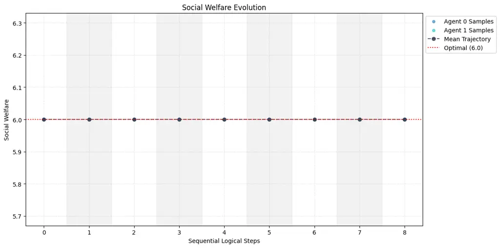
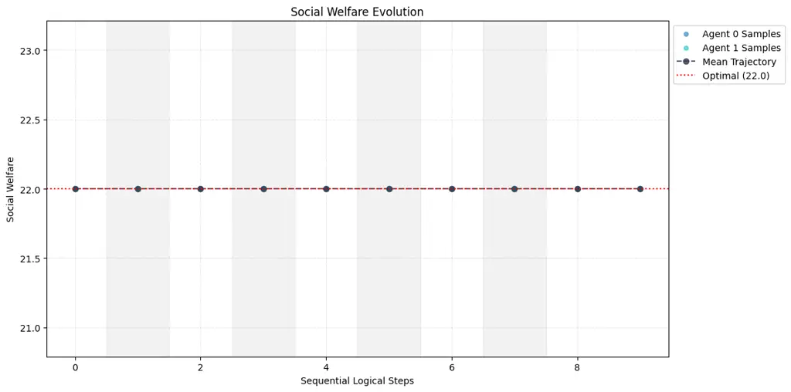
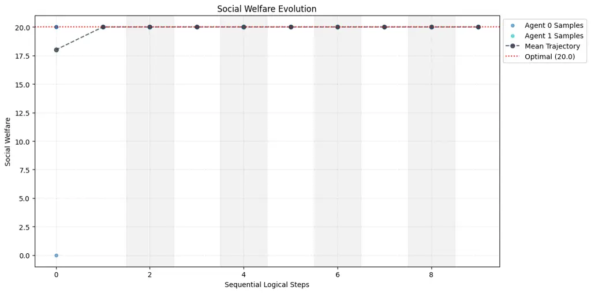
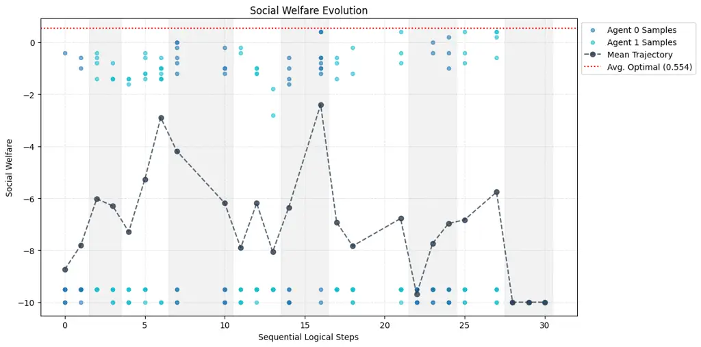

# Policy-Conditioned Policies for Multi-Agent Task Solving

Yue Lin Affiliation: The Chinese University of Hong Kong, Shenzhen   
Shuhui Zhu Affiliation: University of Waterloo    Wenhao Li
Affiliation: Tongji University    Ang Li Affiliation: The Chinese
University of Hong Kong, Shenzhen    Dan Qiao Affiliation: The Chinese
University of Hong Kong, Shenzhen     
Pascal Poupart Affiliation: University of Waterloo Affiliation: Vector
Institute    Hongyuan Zha Affiliation: The Chinese University of Hong
Kong, Shenzhen    Baoxiang Wang
Affiliation: {yuelin,bxiangwang}@link.cuhk.edu.cn Affiliation: The
Chinese University of Hong Kong, Shenzhen Affiliation: Vector Institute

###### Abstract

In multi-agent tasks, the central challenge lies in the dynamic
adaptation of strategies. However, directly conditioning on opponents’
strategies is intractable in the prevalent deep reinforcement learning
paradigm due to a fundamental “representational bottleneck”: neural
policies are opaque, high-dimensional parameter vectors that are
incomprehensible to other agents. In this work, we propose a paradigm
shift that bridges this gap by representing policies as
human-interpretable source code and utilizing Large Language Models
(LLMs) as approximate interpreters. This programmatic representation
allows us to operationalize the game-theoretic concept of Program
Equilibrium. We reformulate the learning problem by utilizing LLMs to
perform optimization directly in the space of programmatic policies. The
LLM functions as a point-wise best-response operator that iteratively
synthesizes and refines the ego agent’s policy code to respond to the
opponent’s strategy. We formalize this process as Programmatic Iterated
Best Response (PIBR), an algorithm where the policy code is optimized by
textual gradients, using structured feedback derived from game utility
and runtime unit tests. We demonstrate that this approach effectively
solves several standard coordination matrix games and a cooperative
Level-Based Foraging environment.

|     |
| --- |
|     |

### 1 Introduction

The study of multi-agent tasks, typically formalized as Markov games (or
stochastic games) (Shapley, 1953), presents a complexity that
fundamentally transcends single-agent decision-making. In these
settings, the environment is non-stationary from the perspective of any
individual agent, as the state transitions and expected rewards are
co-determined by the evolving policies of interacting agents.
Consequently, there is no single optimal policy in isolation; rather, an
agent must continuously compute a best response to the varying
strategies of its opponents.

Canonical approaches to this problem, particularly in Multi-Agent
Reinforcement Learning (MARL), typically rely on opponent modeling (He
et al., 2016). Agents attempt to infer the current policies of their
counterparts from the history of interactions. However, inferring
complex, co-adapting policies from limited, high-dimensional, and
non-stationary historical data remains an exceptionally difficult
problem.

A theoretically more direct alternative is to explicitly condition an
agent’s policy on the actual policy of the opponent. In the domain of
game theory, this ideal is captured by the concept of Program
Equilibrium (Tennenholtz, 2004), where agents delegate decision-making
to programs that can read and condition on each other’s source code.
This framework theoretically enables rich cooperative outcomes (e.g.,
via “mutual cooperation” proofs in the Prisoner’s Dilemma) that are
inaccessible to standard Nash equilibria.

However, Program Equilibrium has remained largely theoretical and
disconnected from modern learning approaches. In the prevalent Deep
Reinforcement Learning (DRL) paradigm, implementing such
policy-conditioning is practically intractable due to a
“representational bottleneck”. Policies are represented as deep neural
networks defined by millions of opaque parameters. Inputting one neural
network’s weights into another is computationally prohibitive and
semantically ill-defined, as the parameter vector is a high-dimensional,
unstructured, and non-unique representation of behavior (Goodfellow
et al., 2016).

The central thesis of this work is that we can overcome this bottleneck
by leveraging Large Language Models (LLMs). We propose representing
policies as programmatic policies, which are executable,
human-interpretable source code. Unlike opaque tensor parameters, source
code is semantically dense and structured. By utilizing LLMs as
approximate interpreters, we can operationalize the game-theoretic
concept of Program Equilibrium within a learning-based framework. This
allows agents to condition on the opponent’s source code, enabling rich
cooperative outcomes that are theoretically inaccessible to standard
Nash equilibria but have previously been difficult to realize in
practice.

This paradigm shift enables us to operationalize policy-conditional
adaptation in a fundamentally new way. Instead of searching for a static
policy via gradient descent on parameters, we shift the optimization
landscape to the code space, where the LLM functions as a point-wise
best-response operator. Given the source code of an opponent’s policy,
the LLM generates and iteratively refines the source code of the
best-response policy.

We formalize this learning process as Programmatic Iterated Best
Response (PIBR). This algorithm proceeds as an iterative dynamic, where
at each step, an agent’s policy code is optimized against the fixed code
of its opponents. The optimization is driven by modern textual gradient
techniques (Yuksekgonul et al., 2024) using structured feedback,
incorporating both (1) utility feedback from game trajectories and (2)
unit test feedback to ensure syntactic and runtime correctness. By doing
so, we present a practical instantiation of Program Equilibrium for
general Markov games, demonstrating efficacy in several standard
coordination matrix games and a cooperative grid-world task named
Level-Based Foraging.

#### 1.1 Relation to Concurrent Work

During the preparation of this manuscript, a contemporaneous work titled
“Evaluating LLMs in Open-Source Games” (Sistla & Kleiman-Weiner, 2025a)
was presented at NeurIPS 2025. The work introduced a framework for
Open-Source Games, evaluating how LLMs perform in game-theoretic
settings when agents have full visibility of each other’s source code.
We acknowledge that both the work and our work share a fundamental
contribution: identifying that LLMs can serve as approximate
interpreters to bridge the gap between theoretical Program Equilibrium
and practical implementation. Both approaches utilize the transparency
of code to enable conditional cooperation that is difficult to achieve
with black-box neural policies. Chronologically, Sistla & Kleiman-Weiner
(2025a) are the first to make this contribution.

However, our work diverges significantly from Sistla & Kleiman-Weiner
(2025a) in motivation, methodology, and experimental scope.

1.  1.  Motivation from MARL Challenges: While Sistla & Kleiman-Weiner
        (2025a) focuses on evaluating LLMs within a game-theoretic context,
        our approach stems fundamentally from the perspective of MARL. We
        identify programmatic policies specifically as a solution to the
        “representational bottleneck” and non-stationarity in MARL. We frame
        this not merely as an evaluation of LLMs, but as a necessary
        paradigm shift to solve the recursive reasoning challenges inherent
        in learning co-adapting policies.
2.  2.  Optimization via Textual Gradients: Sistla & Kleiman-Weiner (2025a)
        primarily relies on the inherent reasoning capabilities of LLMs via
        prompting. In contrast, we propose Programmatic Iterated Best
        Response (PIBR) as a formal optimization algorithm. Our method
        explicitly treats the LLM as a definable operator optimized via
        textual gradients (Yuksekgonul et al., 2024). We incorporate a
        structured feedback loop that combines game utility with runtime
        unit tests, ensuring that the generated policies are not only
        strategically sound but also syntactically robust and executable.
3.  3.  Complexity of Tasks: We extend the validation of programmatic
        policies beyond standard matrix games (which are the primary focus
        of concurrent works) to the Level-Based Foraging environment. This
        is a complex grid-world task requiring spatial coordination and
        sequential decision-making, demonstrating the capability of our
        method to handle higher-dimensional state spaces and more intricate
        coordination dynamics.

Acknowledging the precedence of Sistla & Kleiman-Weiner (2025a), we
refrain from submitting this specific version for formal conference
publication to adhere to novelty standards. Instead, we release this
manuscript as a technical report to establish the timeline of our
independent contribution. We plan to incorporate these findings into
future submissions that feature significant technical improvements or
novel extensions beyond the scope of the current discussion.

### 2 Preliminaries

This section provides the necessary background for our method. We begin
by establishing the formalisms for multi-agent learning, including game
settings and solution concepts. Then we discuss the two fundamental
challenges that motivate our work: non-stationarity and the complexities
of opponent modeling. Finally, we introduce the concept of program
equilibrium and provability logic, which provide the theoretical basis
for agents that can condition their policies on the source code of their
opponents. A detailed discussion of related work is deferred to
Appendix A.

#### 2.1 The Game

In this work, we focus on the multi-agent task which is formulated as a
Markov Game (Littman, 1994), also known as a stochastic game (Shapley,
1953). A Markov Game for $`N`$ agents is defined by a tuple
$`\mathcal{G}=\langle N,\mathbb{S},\{\mathbb{A}^{i}\}_{i=1}^{N},\mathcal{T},\{r^{i}\}_{i=1}^{N},\gamma\rangle`$.
$`\mathbb{S}`$ is the set of global states. $`\mathbb{A}^{i}`$ is the
action space for agent $`i`$, and the joint action space is
$`\bm{\mathbb{A}}=\times_{i=1}^{N}\mathbb{A}^{i}`$. The function
$`\mathcal{T}:\mathbb{S}\times\bm{\mathbb{A}}\to\Delta(\mathbb{S})`$ is
the state transition probability function. Each agent $`i`$ has a reward
function $`r^{i}:\mathbb{S}\times\bm{\mathbb{A}}\to\mathbb{R}`$, and
$`\gamma\in[0,1)`$ is the discount factor. At each timestep $`t`$,
agents simultaneously select actions $`a^{i}_{t}\in\mathbb{A}^{i}`$. The
system transitions to
$`s_{t+1}\sim\mathcal{T}(\cdot\mid s_{t},\bm{a}_{t})`$ and each agent
$`i`$ receives a reward $`r^{i}_{t}=r^{i}(s_{t},\bm{a}_{t})`$, where
$`\bm{a}_{t}`$ is the joint action.

#### 2.2 The Solution Concepts

The objective of each agent $`i`$ is to find an optimal policy
$`\pi^{i*}`$ that, when combined with the policies of all other agents,
maximizes its expected discounted return. This cumulative reward,
denoted $`J^{i}`$, is defined for a joint policy
$`\bm{\pi}=(\pi^{1},\dots,\pi^{N})`$ as:

```math
J^{i}(\bm{\pi})=\mathbb{E}_{\langle\mathcal{G},\bm{\pi}\rangle}\left[\sum_{t=0}^{\infty}\gamma^{t}r^{i}(s_{t},\bm{a}_{t})\right],
```

where $`\mathbb{E}_{\langle\mathcal{G},\bm{\pi}\rangle}[\cdot]`$ denotes
the expectation over the state transitions $`\mathcal{T}`$ and the
agents’ joint actions $`\bm{\pi}`$.

The primary solution concept is the Nash Equilibrium (NE) (Nash Jr,
1950), a joint policy $`\bm{\pi}^{*}=(\pi^{i*},\bm{\pi}^{-i*})`$ from
which no single agent $`i`$ has an incentive to unilaterally deviate.
Formally, $`\bm{\pi}^{*}`$ is a Nash Equilibrium if for all $`i\in N`$
and for all alternative policies $`\pi^{i}`$ available to agent $`i`$
($`\pi^{i}\in\Pi^{i}`$), the following condition holds:

```math
J^{i}(\bm{\pi}^{*})\geq J^{i}(\pi^{i},\bm{\pi}^{-i*}).
```

This general definition is refined based on the game’s temporal horizon
and the class of policies considered.

In the finite-horizon (episodic) setting, equilibria must hold at all
decision points. The history $`h_{t}`$ is defined as
$`h_{t}=(s_{0},\bm{a}_{0},\dots,s_{t-1},\bm{a}_{t-1},s_{t})`$, and
$`\mathbb{H}`$ is the space of all such histories. One refinement is the
Subgame Perfect Equilibrium (SPE) (Bielefeld, 1988), which applies when
players use history-dependent policies,
$`\pi^{i}:\mathbb{H}\to\Delta(\mathbb{A}^{i})`$, denoted
$`\Pi^{i}_{\mathbb{H}}`$. An SPE $`\bm{\pi}^{*}`$ requires the NE
condition to hold in every subgame, i.e., beginning from any possible
history $`h_{t}`$. For all $`i\in N`$, $`h_{t}\in\mathbb{H}`$, and
$`\pi^{i}\in\Pi^{i}_{\mathbb{H}}`$:

```math
J^{i}(\bm{\pi}^{*}\mid h_{t})\geq J^{i}((\pi^{i},\bm{\pi}^{-i*})\mid h_{t}),
```

where
$`J^{i}(\bm{\pi}\mid h_{t})=\mathbb{E}_{\langle\mathcal{G},\bm{\pi}\rangle}\left[\sum_{k=t}^{\infty}\gamma^{k-t}r^{i}(s_{k},\bm{a}_{k})\mid h_{t}\right]`$
is the expected future discounted reward given history $`h_{t}`$. A
second refinement is the Markov Perfect Equilibrium (MPE) (Fudenberg &
Tirole, 1991), which restricts policies to be Markovian and
time-dependent,
$`\pi^{i}:\mathbb{S}\times\mathbb{T}\to\Delta(\mathbb{A}^{i})`$, denoted
$`\Pi^{i}_{\mathbb{M}}`$. An MPE $`\bm{\pi}^{*}`$ requires the NE
condition to hold at every state-time pair $`(s,t)`$. For all
$`i\in N`$, $`s\in\mathbb{S}`$, $`t\in\mathbb{T}`$, and
$`\pi^{i}\in\Pi^{i}_{\mathbb{M}}`$:

```math
J^{i}(\bm{\pi}^{*}\mid s,t)\geq J^{i}((\pi^{i},\bm{\pi}^{-i*})\mid s,t),
```

where
$`J^{i}(\bm{\pi}\mid s,t)=\mathbb{E}_{\langle\mathcal{G},\bm{\pi}\rangle}\left[\sum_{k=t}^{\infty}\gamma^{k-t}r^{i}(s_{k},\bm{a}_{k})\mid s_{t}=s\right]`$
is the expected future discounted reward from state $`s`$ at time $`t`$.
Both SPE and finite-horizon MPE can be computed via backward
induction (Farina, 2024).

In the infinite-horizon discounted setting, a foundational result
establishes that a Nash Equilibrium exists in stationary, Markovian
policies, $`\pi^{i}:\mathbb{S}\to\Delta(\mathbb{A}^{i})`$ (Fink, 1964;
Takahashi, 1964). Formally, a joint stationary policy
$`\bm{\pi}^{*}=(\pi^{1*},\dots,\pi^{N*})`$ is an equilibrium if for all
$`i\in N`$ and for all alternative policies
$`\pi^{i\prime}\in\Pi^{i}_{\text{all}}`$ (where $`\Pi^{i}_{\text{all}}`$
includes arbitrary history-dependent policies):

```math
J^{i}(\bm{\pi}^{*})\geq J^{i}(\pi^{i\prime},\bm{\pi}^{-i*}).
```

This demonstrates that the stationary equilibrium policy $`\pi^{i*}`$ is
robust against deviations to any non-Markovian strategy.

#### 2.3 Learning Methods for Markov Games

The advancement of DRL has enabled the use of deep neural networks to
approximate complex policies and value functions, greatly extending the
applicability of RL to high-dimensional state and action spaces. MARL
extends this DRL framework to environments with multiple interacting
agents ($`N>1`$). These agents may be cooperative, competitive, or
operate in a mixed setting.

In a MARL setting, each agent $`i`$ learns its own policy $`\pi^{i}`$.
As defined in the previous section, this policy can be a mapping from
the current state (a stationary, Markovian policy
$`\pi^{i}:\mathbb{S}\to\Delta(\mathbb{A}^{i})`$) or from the full
history (a history-dependent policy
$`\pi^{i}:\mathbb{H}\to\Delta(\mathbb{A}^{i})`$). In practice, policies
are frequently history-dependent. Agents require history for two
principal reasons: (1) First, in partially observable environments, an
agent must utilize its history to infer the current underlying state. We
assume a fully observable environment, so this point does not apply. (2)
Second, history is employed to estimate the policies of other agents.
Notably, even in fully observable environments where the state is known,
history remains essential for decision-making if the policies of other
players are not directly accessible. This necessity for opponent
modeling will be further discussed in Section 2.5.

The policy learning rule dictates how the agent updates its policy
parameters, $`\theta^{i}`$ (when $`\pi^{i}`$ is a parameterized function
$`\pi^{i}_{\theta^{i}}`$), to maximize this objective. The general
learning rule involves an iterative update mechanism, typically derived
from gradient-based optimization:

```math
\theta_{k+1}^{i}\leftarrow\theta_{k}^{i}+\alpha\nabla_{\theta^{i}}J^{i}(\bm{\pi}),
```

where $`k`$ is the iteration index and $`\alpha`$ is the learning rate.
We can abstract this update step for agent $`i`$ as a learning dynamics
$`\mathcal{L}^{i}`$, such that:

```math
\theta_{k+1}^{i}=\mathcal{L}^{i}(\theta_{k}).
```

This is a vanilla learning dynamics in an independent learning style,
which considers its own parameters only. The gradient
$`\nabla_{\theta^{i}}J^{i}(\bm{\pi})`$ is estimated using various
techniques such as policy gradient methods (e.g., REINFORCE (Williams,
1992; Sutton et al., 1999), Actor-Critic (Konda & Tsitsiklis, 1999)) or
Q-learning variants, where the form of the gradient estimate strongly
depends on the specific MARL algorithm employed.

#### 2.4 Non-Stationarity

The fundamental challenge that distinguishes multi-agent learning from
single-agent learning is non-stationarity (Hernandez-Leal et al., 2017).
In a single-agent system, the environment is governed by a stationary
MDP. In contrast, in a multi-agent system, the effective environmental
dynamics from the perspective of an ego agent $`i`$ are co-determined by
the changing policies $`\bm{\pi}^{-i}=(\pi^{j})_{j\neq i}`$ of all other
agents. We can denote the subjective view of the environment and
opponents from agent $`i`$ as the perspective environment
$`\mathcal{G}^{i}`$:

```math
\mathcal{G}^{i}=\langle\mathcal{G},\bm{\pi},\{\mathcal{L}^{j}\}_{j\in N}\rangle,
```

and this perspective environment is non-stationary, i.e., even if the
objective environment $`\mathcal{G}`$ and the ego agent’s policy remain
static, the ego agent’s expected discounted return $`J^{i}`$ may change,
due to the updates of other agents’ policies.

Specifically, consider the vanilla learning rule as described above
(i.e., the independent learning style), when any opponent $`j\neq i`$
updates its policy parameters via its learning rule $`\mathcal{L}^{j}`$
(i.e., $`\theta^{j}_{k+1}=\mathcal{L}^{j}\left(\theta^{j}_{k}\right)`$,
this results in a change to its policy $`\pi^{j}_{k}\to\pi^{j}_{k+1}`$
(where $`\pi^{j}_{k}`$ is shorthand for $`\pi^{j}_{\theta^{j}_{k}}`$).
This, in turn, changes the joint policy of all opponents,
$`\bm{\pi}^{-i}_{k}\to\bm{\pi}^{-i}_{k+1}`$. Consequently, even if agent
$`i`$’s policy $`\pi^{i}`$ remains static, its expected discounted
return $`J^{i}`$ is no longer stationary:

```math
J^{i}(\pi^{i},\bm{\pi}^{-i}_{k})\neq J^{i}(\pi^{i},\bm{\pi}^{-i}_{k+1}).
```

This instability invalidates the convergence guarantees of standard
single-agent RL algorithms.

#### 2.5 Opponent Modeling

To succeed in this non-stationary landscape, an agent $`i`$ must adapt
its policy to the changing policies of its opponents. The goal shifts
from finding a single optimal policy to dynamically computing a best
response (BR) to the current policies of the other agents.

Calculating a BR presupposes that the agent possesses an estimate of its
opponents’ policies, $`\hat{\bm{\pi}}^{-i}`$. This inevitably leads to
the need for opponent modeling (He et al., 2016): the process of
defining a function $`m`$ that maps available data (e.g., interaction
history) to an estimate of the opponent policies:

```math
\hat{\bm{\pi}}^{-i}=m(h_{t}).
```

To best respond to a hypothesized opponent policy, $`\hat{\pi}^{j}`$,
the opponent modeling component $`m(h_{t})`$ serves as a direct input to
the agent’s response policy. For example, a history-dependent
best-response policy is defined as
$`\pi^{i}_{\text{br}}:\Pi^{-i}\times\mathbb{H}\to\Pi^{i}`$. With this
policy, player $`i`$ takes an action $`a^{i}_{t}`$ at timestep $`t`$ as:

```math
a^{i}_{t}\sim\pi^{i}_{\text{br}}(\cdot\mid\hat{\bm{\pi}}^{-i},h_{t})=\pi^{i}_{\text{br}}(\cdot\mid m(h_{t}),h_{t}).
```

It is important to note that inferring an opponent’s policy from the
interaction history $`h_{t}`$ presents two primary challenges. (1)
First, the challenge of policy drift: all policies are constantly
updating, meaning the interaction data is not sampled from a stable
joint policy distribution. (2) Second, all agents are simultaneously
trying to model each other, which introduces a complex hierarchy of
beliefs (Gmytrasiewicz & Doshi, 2005; Rabinowitz et al., 2018). For
example, agent $`i`$ must not only model what agent $`j`$ will do, but
also model what agent $`j`$ guesses agent $`i`$ will do, and so on,
leading to an arbitrary-level recursive reasoning
challenge (Gmytrasiewicz & Doshi, 2005).

#### 2.6 Program Equilibrium and Provability Logic

In canonical game theory, players select actions or strategies directly.
The concept of Program Equilibrium (Tennenholtz, 2004) departs from this
by assuming that players delegate decision-making to computer programs.
Crucially, these programs are capable of reading and conditioning their
execution on the source code of their opponent’s program.

Formally, let $`\mathbb{A}^{i}`$ denote the action space for player
$`i`$. Let $`\Pi_{\text{prog}}`$ denote the set of all valid computer
programs in a given Turing-complete language. A policy for player $`i`$
is a program $`\pi^{i}\in\Pi_{\text{prog}}`$. To be rigorous, we
explicitly distinguish between the program’s execution logic (semantics)
and its representation (syntax):

- •
  Semantics ($`\pi^{i}`$): We identify the policy $`\pi^{i}`$ directly
  with the computable function it implements upon execution.
- •
  Syntax ($`\ulcorner\pi^{i}\urcorner`$): The Gödel number or string
  representation of the program, where
  $`\ulcorner\cdot\urcorner:\Pi_{\text{prog}}\to\{0,1\}^{*}`$ is the
  encoding mapping.

Since $`\pi^{i}`$ acts as a function that takes the opponent’s source
code as input and maps it to a probability distribution over actions,
the interaction is formally defined by:

```math
\pi^{i}:\{0,1\}^{*}\to\Delta(\mathbb{A}^{i})
```

Specifically, in a game, player $`i`$ executes $`\pi^{i}`$ on input
$`\ulcorner\bm{\pi}^{-i}\urcorner`$ to determine their action
$`a^{i}\sim\pi^{i}(\ulcorner\bm{\pi}^{-i}\urcorner)`$. This meta-game
structure enables outcomes that are inaccessible in standard Nash
equilibria. For example, in the one-shot Prisoner’s Dilemma, mutual
cooperation becomes sustainable if players submit programs that verify
whether the opponent’s source code is functionally equivalent to their
own (or satisfies a specific cooperative predicate) before cooperating.

A rigorous treatment of this self-referential structure, where program
$`A`$ analyzes program $`B`$ analyzing program $`A`$, requires the
machinery of Provability Logic. In this context, agents are modeled as
searching for proofs within a formal system (e.g., Peano Arithmetic).
Let $`\square P`$ denote that the statement $`P`$ is provable. A
canonical example is FairBot (Barasz et al., 2014), an agent that
cooperates if and only if it can prove that the opponent cooperates
against it. Formally, let $`\pi_{\text{FB}}`$ denote the FairBot
program. It seeks a proof that the opponent’s execution on its own
source code yields cooperation:

```math
\pi_{\text{FB}}(\ulcorner\bm{\pi}^{-i}\urcorner)=\text{``Cooperation''}\iff\square(\bm{\pi}^{-i}(\ulcorner\pi_{\text{FB}}\urcorner)=\text{``Cooperation''})
```

While this creates a potential circular dependency, consistency is
resolved via Löb’s Theorem from mathematical logic, which states that
for any formula $`P`$:

```math
\square(\square P\to P)\to\square P
```

This theorem implies that if an agent can prove “if my cooperation is
provable, then it is true,” it can indeed prove its own cooperation.
This mechanism creates a modal fixed point, allowing mutual cooperation
to be the provable outcome between two logical agents. This effectively
establishes a Folk Theorem for program games, implying that any feasible
and individually rational payoff profile can be sustained in a one-shot
setting through conditional code commitment, achieving outcomes that are
typically restricted to repeated interactions. An illustrative analysis
of the program equilibrium within the Prisoner’s Dilemma is provided in
Appendix B.

Despite its theoretical power, canonical Program Equilibrium faces
significant practical hurdles. Formal verification of arbitrary
Turing-complete policies is computationally undecidable (by Rice’s
Theorem) and brittle to trivial syntactic variations. Our work can be
viewed as a relaxation of this rigorous requirement. By utilizing LLMs
as approximate interpreters, we operationalize a practical form of
program equilibrium. Here, policies condition on the inferred semantics
of the opponent’s code rather than requiring formal deductive proofs,
thereby bridging the gap between theoretical game-theoretic commitments
and modern multi-agent learning.

### 3 Method

This section presents our methodology. We first articulate the
“representational bottleneck” in deep MARL, which inhibits conditioning
on opponent policies. We then introduce our core solution: a paradigm
shift to programmatic policies. This shift enables us to lift
optimization from policy space to operator space, where the objective
becomes learning a point-wise best-response operator, $`\varphi^{i}`$,
that maps opponent policy-code to ego-agent policy-code. Finally, we
introduce the Programmatic Iterated Best Response (PIBR) algorithm, a
learning framework designed to optimize this operator.

#### 3.1 The Representational Bottleneck of Deep Reinforcement Learning

To address the two mentioned challenges in opponent modeling (the
challenges of policy drift and arbitrary-level recursive reasoning), it
is helpful to introduce the communication perspective. If an opponent
$`j`$ directly transmits its policy $`\pi^{j}`$ via a signal
$`\sigma^{j}=\phi(\pi^{j})`$, the modeling task for agent $`i`$ becomes:

```math
\hat{\pi}^{j}=m(\sigma^{j})=m(\phi(\pi^{j})),
```

where $`\phi`$ is $`j`$’s policy encoder and $`m`$ is $`i`$’s opponent
modeling component which serves as a policy decoder. Notice that the
opponent modeling for agents no longer needs to be inferred from
historical data, but is instead communicated through signals between the
agents.

Agent $`i`$ takes an action sampled from its policy
$`\pi^{i}_{\text{br}}`$, which is conditional on its estimation of
opponents’ policies:

```math
a^{i}_{t}\sim\pi^{i}_{\text{br}}\left(\cdot\mid h_{t},\hat{\pi}^{j}\right)=\pi^{i}_{\text{br}}\left(\cdot\mid h_{t},m(\sigma^{-i})\right)=\pi^{i}_{\text{br}}\left(\cdot\mid h_{t},m(\phi(\pi^{j}))\right).
```

The signal, conceptualized as a latent variable, must satisfy two
critical and often competing constraints: (1) it must encapsulate and
preserve maximal information pertaining to the policy of agent $`j`$;
(2) it must be encoded in a representational format that is
simultaneously tractable and parsable by the decoder or actor-network of
agent $`i`$. Consequently, the selection of an appropriate signal space
is a pivotal design consideration. In canonical MARL frameworks, this
signal is often implicitly defined as the shared interaction history
among agents.

In this work, we consider an extreme case in which $`j`$’s policy
encoder $`\phi`$ is a source code extractor and $`i`$’s policy decoder
$`m`$ is a identity function (i.e.,
$`\phi(\pi^{j})=\ulcorner\pi^{j}\urcorner`$ and $`m=\mathcal{I}`$),
yielding a perfect observation
$`\hat{\pi}^{j}=\ulcorner\pi^{j}\urcorner`$. We denote this setting as
the unprocessed policy-communication setting. This setting is possible
and can be justified in fully cooperative environments where there is no
incentive for deception, or in zero-sum games under self-play (Silver
et al., 2017) where the multi-agent system serves as an equilibrium
solver.

A key advantage of this setting is that it inherently avoids any
information loss that might arise from the communication process and
obviates the need for learning a dedicated encoding mechanism. This
setting also avoids the policy drift and recursive reasoning challenges
in opponent modeling, since agents can accurately obtain each other’s
policies through communication before acting, rather than having to
guess.

The critical drawback, however, is that this approach places a
substantial, perhaps prohibitive, parsing burden on the ego agent, which
must now interpret the source code of policy directly:

```math
a^{i}_{t}\sim\pi^{i}\left(\cdot\mid h_{t},\ulcorner\bm{\pi}^{-i}\urcorner\right).
```

This means that $`\pi^{i}`$ will take other
$`\ulcorner\bm{\pi}^{-i}\urcorner`$ as input. If all agents’ policies
are implemented by neural networks as in MARL, this means that
$`\pi^{i}`$’s neural network must parse the entire neural network of
$`\pi^{j}`$ (i.e., its complete parameter vector $`\theta^{j}`$) as
input. This leads to two insurmountable obstacles: (1) Curse of
Dimensionality. A modern policy network can have millions or billions of
parameters. The requirement for $`\pi^{i}`$’s input layer to accommodate
and process this magnitude of parameters is computationally prohibitive.
It also creates a recursive loop: $`\pi^{i}`$ must grow to parse
$`\pi^{j}`$, and $`\pi^{j}`$ must in turn grow to parse the now-larger
$`\pi^{i}`$. (2) Curse of Representation. This is not just a problem of
dimensionality, but of representation. The parameter vector
$`\theta^{j}`$ is a brittle and non-unique representation of the policy
function. A neural network’s function is invariant to permutations of
its hidden nodes; different random initializations lead to functionally
similar policies with drastically different parameter vectors.
$`\pi^{i}`$ would need to learn a complex, permutation-invariant
representation over this unstructured, high-dimensional vector, which is
a task for which there is currently no viable solution.

#### 3.2 A Paradigm Shift: Programmatic Policies by LLMs

We posit that, while DRL faces challenges in realizing the unprocessed
policy-communication Setting, the use of recently flourishing LLMs to
generate code as policies does possess the capacity to handle such
policy-input. Its objective is to supplant the opaque, “black box”
nature of conventional DRL with policy representations that are
structured, interpretable, and more amenable to formal verification.

This paradigm shift is facilitated by the advent of LLMs. LLMs are
inherently designed to process structured text and source code. Modern
architectures are not only proficient code generators but also feature
extensive context windows, capable of managing inputs equivalent to
hundreds of thousands of tokens.

This framework directly addresses the aforementioned intractability
challenges: (1) Solving Dimensionality: While a neural network policy
may require millions or billions of parameters to capture complex
behaviors, its programmatic equivalent offers a highly compressed,
semantically dense representation. Modern LLMs, with their extensive
context windows, are capable of processing and reasoning over such
complex programmatic structures, thus effectively managing the high
intrinsic dimensionality of the policy space. (2) Solving
Representation: Unlike the unstructured parameter vectors of a neural
network, source code is a semantically rich and structured artifact.
This representation aligns precisely with the data modalities that LLMs
are trained to comprehend, analyze, and generate, enabling high-level
reasoning about, and manipulation of, the policy itself.

#### 3.3 Refined Formalization: Meta-Programming and Mathematical Operators

We leverage this new paradigm to reformalize the best-response
computation. Mathematically, this process is most precisely described
using the terminology of functional analysis. The space of all policies
$`\Pi`$ constitutes a function space. An operator maps one function
space to another; a canonical example is the differential operator
$`D`$, which maps a function $`f`$ to its derivative $`f^{\prime}`$,
i.e., $`D(f)=f^{\prime}`$.

Following this definition, our proposed process (denoted as
$`\varphi^{i}`$) is formally a best-response operator. It constitutes a
mapping $`\varphi^{i}:\{0,1\}^{*}\to\{0,1\}^{*}`$ that takes an opponent
policy function as input and yields a new ego-agent policy function as
output. This operator, $`\varphi^{i}`$, thus computes the “best
response” to an input policy function.

From an implementation perspective, this abstract operator
$`\varphi^{i}`$ is realized through a meta-programming interpreter.
Meta-programming is formally defined as the act of a program treating
other programs as its data; in this context, it manifests as a
code-input, code-output process. This operation is implemented by
querying a LLM. Agent $`i`$ provides its opponent’s policy source code
$`\bm{\pi}^{-i}`$ as input (i.e., as part of the prompt), and the LLM,
embodying the operator $`\varphi`$, generates the best-response policy
source code $`\pi^{i}`$ as output. Policy adaptation is thus rendered as
an interpretable meta-programming task.

Formally, given opponents’ policies $`\pi^{-i}`$, the ego agent will
take an action as follows:

```math
\displaystyle\ulcorner\bm{\pi}^{-i}\urcorner=m\left(\phi\left(\bm{\pi}^{-i}\right)\right),
```

```math
\displaystyle\ulcorner\pi^{i}\urcorner=\varphi^{i}(\ulcorner\bm{\pi}^{-i}\urcorner\mid\text{prompt}),
```

```math
\displaystyle\pi^{i}=\text{CodeInterpreter}(\ulcorner\pi^{i}\urcorner),
```

```math
\displaystyle a^{i}\sim\pi^{i},
```

where $`\varphi^{i}`$ is implemented by an LLM in our method. Note that
the policy of ego agent $`\pi^{i}`$ does not take opponents’ source code
$`\ulcorner\bm{\pi}^{-i}\urcorner`$ as inputs, but it still has the
dependency since the generation of $`\pi^{i}`$ is dependent on
$`\ulcorner\bm{\pi}^{-i}\urcorner`$.

While any generated $`\pi^{i}`$ constitutes a valid response, it is not
inherently a best response; we therefore seek the optimal $`\pi^{i}`$ by
optimizing the operator $`\varphi^{i}`$ through prompt refinement.
Crucially, since we optimize the operator specifically for a fixed input
$`\bm{\pi}^{-i}`$, this constitutes a point-wise optimization of the
best-response mapping.

#### 3.4 Learning

We optimize the LLM best-response operators $`\varphi`$ in prompt space.
This optimization is driven by structured feedback losses and can be
automated using gradient-based methods adapted for text. A notable
framework in this domain is TextGrad (Yuksekgonul et al., 2024),which
enables automatic differentiation through text-based models by
conceptualizing the text generation process as a computational graph.
This allows for the definition of textual feedback and the
backpropagation of gradients to update the LLM’s guiding prompts or
parameters. Once we rigorously define the loss functions, the
optimization of the operator $`\varphi^{i}`$ can proceed automatically.

##### Textual Loss Functions.

The feedback provided to the operator $`\varphi^{i}`$ is structured
around two primary loss signals: (1) Unit Test Feedback. A significant
challenge in this paradigm is ensuring the syntactic and runtime
correctness of the generated policy code. To mitigate this, we employ an
automated unit testing phase. The ego policy code
$`\pi^{i}=\text{CodeInterpreter}(\ulcorner\pi^{i}\urcorner)`$ is
instantiated and executed within a sandboxed environment. If the code
produces any runtime exceptions (e.g., syntax errors, out-of-bounds
access) or fails predefined assertions, the resulting error trace and
stack information are captured. This error data serves as a direct,
high-priority feedback signal, prompting the LLM operator
$`\varphi^{i}`$ to debug and revise the code, akin to automated
debugging workflows. (2) Utility Feedback. The central objective is to
ensure the generated policy $`\pi^{i}`$ constitutes a best response to
the opponents’ policies $`\bm{\pi}^{-i}`$. This is evaluated via utility
feedback. The policy $`\pi^{i}`$ is executed against $`\bm{\pi}^{-i}`$
in the game environment for several episodes. The complete episode
trajectory, including all states, joint actions, and rewards for both
agents
$`(s_{t},a^{i}_{t},\bm{a}^{-i}_{t},r^{i}_{t},\bm{r}^{-i}_{t})_{t=0}^{T}`$,
is collected. This detailed trajectory information is provided as
feedback to the operator $`\varphi^{i}`$. This allows the operator to
assess the performance of its generated policy and refine its
meta-programming logic to maximize the expected utility
$`J^{i}(\pi^{i},\bm{\pi}^{-i})`$.

The overall algorithm follows an iterative best-response
dynamic (Robinson, 1951), but lifted to the operator space. The
computation of the best response for each agent is not an atomic
operation but an inner optimization loop guided by feedback. This
two-agent version of this process is formally described in Algorithm 1.

Input: Game $`G`$, Agents $`A=\{A^{0},A^{1}\}`$, Outer loops $`K`$,
Inner loops $`T`$

Output: Final policy profile $`\bm{\pi}^{*}=(\pi^{0,*},\pi^{1,*})`$

// Initialize policies and history

1 $`\pi^{0}\leftarrow\text{InitialPolicy}()`$;
$`\pi^{1}\leftarrow\text{InitialPolicy}()`$

2 $`\mathcal{H}\leftarrow\emptyset`$ // History of (profile, social
welfare)

3 $`i\leftarrow 0`$ // Agent index

// Main training phase (Outer Loop)

4 for _$`k=1`$ to $`K`$_ do

    5 $`\pi^{-i}\leftarrow\pi^{1-i}`$

   // Compute BR via operator optimization (Inner Loop)

    6
$`\pi^{i}\leftarrow\text{ComputeBestResponse}(A^{i},G,\pi^{-i},T)`$

    7 $`\bm{\pi}_{k}\leftarrow(\pi^{0},\pi^{1})`$

    8
$`J_{sw}(\bm{\pi}_{k})\leftarrow\text{EvaluateSocialWelfare}(G,\bm{\pi}_{k})`$

    9
$`\mathcal{H}\leftarrow\mathcal{H}\cup\{(\bm{\pi}_{k},J_{sw}(\bm{\pi}_{k}))\}`$

    10 $`i\leftarrow 1-i`$ // Alternate agent

// Select best profile from history

11
$`(\bm{\pi}^{*},J^{*})\leftarrow\arg\max_{(\bm{\pi},J)\in\mathcal{H}}J`$

12 return $`\bm{\pi}^{*}`$

13 Procedure _ComputeBestResponse($`A^{i},G,\pi^{-i},T`$)_

    14 $`\varphi^{i}\leftarrow A^{i}.\text{operator}`$ // Get
optimizable operator

    15 $`\text{Opt}\leftarrow\text{TextGradOptimizer}(\varphi^{i})`$

    16 for _$`t=1`$ to $`T`$_ do

       17 $`\text{Opt.zero\_grad}()`$

       18
$`\ulcorner\pi^{i}_{t}\urcorner=\varphi^{i}\left(\ulcorner\pi^{-i}\urcorner\mid\text{prompt}(A^{i},G,t,T)\right)`$
// Forward pass

      // Compute composite loss

       19
$`(\pi^{i}_{t},\mathcal{L}_{\text{test}})\leftarrow\text{ComputeUnitTestLoss}(\ulcorner\pi^{i}_{t}\urcorner)`$

       20
$`\mathcal{L}_{\text{utility}}\leftarrow-J(G,\pi^{i}_{t},\pi^{-i})`$
$`\mathcal{L}\leftarrow\mathcal{L}_{\text{test}}+\mathcal{L}_{\text{utility}}`$

       21 $`\mathcal{L}.\text{backward}()`$

       22 $`\text{Opt.step}()`$

    23 return $`\pi^{i}_{t}`$

Algorithm 1 Programmatic Iterated Best Response (PIBR)

### 4 Experiments

All experiments were powered by OpenAI’s o4-mini model (OpenAI, 2025),
as it provides a particularly effective balance between cost efficiency
and code generation performance. The complete codebase, experimental
results, and execution logs will be released as open source after the
paper is accepted.

#### 4.1 Tasks

##### Matrix Games.

We consider three representative coordination matrix games that vary in
their payoff structures and coordination difficulty. In each game, two
agents simultaneously choose an action (row and column respectively),
and both receive the same payoff corresponding to the selected matrix
entry. (a) The Vanilla Coordination Game is a simple setting with three
pure coordination equilibria of different rewards, testing whether
agents can align on the optimal coordination point. (b) The Climbing
Game (Claus & Boutilier, 1998) introduces strong miscoordination
penalties and uneven reward gradients, making it a challenging variant
where naive exploration can easily lead to suboptimal equilibria.
Finally, (c) the Penalty Game (Claus & Boutilier, 1998) includes
negative diagonal payoffs ($`p<0`$) that discourage coordination on
certain actions, requiring agents to learn to avoid detrimental
equilibria while still maximizing joint payoff. Together, these games
provide a controlled yet diverse testbed for studying coordination
behaviors in multi-agent learning.

|     |     |     |
| --- | --- | --- |

|

```math
\begin{array}[]{c|ccc}\hfil\hfil\lx@intercol\vrule\lx@intercol&&a^{j}&\\
\cline{1-4}\cr&2&0&0\\
a^{i}&0&1&0\\
&0&0&3\end{array}
```

(a) Vanilla Coordination Game |

```math
\begin{array}[]{c|ccc}\hfil\hfil\lx@intercol\vrule\lx@intercol&&a^{j}&\\
\cline{1-4}\cr&11&-30&0\\
a^{i}&-30&7&0\\
&0&6&5\end{array}
```

(b) Climbing Game |

```math
\begin{array}[]{c|ccc}\hfil\hfil\lx@intercol\vrule\lx@intercol&&a^{j}&\\
\cline{1-4}\cr&p&0&10\\
a^{i}&0&2&0\\
&10&0&p\end{array}
```

(c) Penalty Game ($`p<0`$) |

Figure 1: Three $`3\times 3`$ coordination matrix games used in our
experiments. Each game defines payoffs for two agents (row agent’s
action $`a^{i}\in\{0,1,2\}`$, column agent’s action
$`a^{j}\in\{0,1,2\}`$): after they simultaneously choose a row and a
column action, both receive the utility indicated by the selected matrix
entry.

##### Level-Based Foraging.

Level-Based Foraging (LBF) (Christianos et al., 2020) is a grid-world
environment for studying multi-agent coordination. Agents are to collect
food items to gain rewards. Each agent can take one of six actions:
\[stay_idle, move_up, move_down, move_left, move_right, load_food\]. In
the original environment, food items can only be collected when the sum
of the levels of agents performing the load action adjacent to the food
meets or exceeds the food’s level, making it a mixed-motive task. ¹¹ 1
E.g., collecting Level 1 foods in the grid-world is competitive among
Level 1 agents, but they must cooperate to collect Level 2 foods. We
consider a fully cooperative variant here: each food is assigned a level
such that it always requires both agents to perform the load action
simultaneously to be collected. Rewards are shared between agents
proportionally to their skill levels and normalized. An episode ends
when all foods are collected or the maximum length is reached. We
further modify the environment by introducing a terminal penalty that is
inversely proportional to the episode length, making the improvement of
food collection efficiency the optimization objective for the agents.

#### 4.2 Results

The experimental results, summarized in Figure 2, demonstrate the
effectiveness of PIBR across distinct game types. In these plots, the
horizontal axis represents the sequential optimization steps, where each
step corresponds to a policy update step driven by textual gradients.
The vertical axis denotes the Social Welfare, calculated as the sum of
cumulative rewards obtained by the agents. For every optimization step,
we sample multiple episodes to evaluate the current policy profile;
these individual episodes are visualized as scattered points, while the
dashed line traces the mean reward trajectory across optimization steps.
The absence of data points at certain optimization steps indicates that
the generated policy code contained syntax or runtime errors, failing to
execute in the environment. (1) Results of Coordination Games: across
all three coordination tasks, the agents exhibit rapid and robust
convergence to the global optima. In Vanilla Coordination and Climbing
Game, the social welfare instantaneously stabilizes at the optimal
values of $`6.0`$ and $`22.0`$, respectively. In the Penalty Game,
despite the risk of substantial penalties, the agents successfully
coordinate on the optimal equilibrium within a single update step. (2)
Results of Cooperative Foraging: In this complex grid-world task, while
individual samples occasionally approach the empirical optimum
($`\approx 0.554`$). The mean trajectory exhibits significant variance
and instability. The performance drop in later stages indicates the
challenge of maintaining consistent coordination in complicated tasks.
Following Line $`11`$ of Algorithm 1, the procedure returns the agents’
strategies from the $`16`$-th optimization step, since it yields the
highest social welfare. We recognize that the current results are not
yet fully stabilized, and further improvements to the method’s
robustness are under active development.



(a) Vanilla Coordination Game



(b) Climbing Game



(c) Penalty Game ($`p=-2`$)



(d) Cooperative Foraging

Figure 2: Experimental results.

### 5 Conclusion

In this work, we address the challenge of non-stationarity in solving
Markov games by proposing a paradigm shift from opaque neural policies
to interpretable programmatic policies, thereby overcoming the
“representational bottleneck” that hinders direct conditioning on
opponent strategies. We reformulate the learning problem by lifting
optimization from the policy space to the operator space, employing LLMs
as point-wise best-response operators that dynamically synthesize policy
code based on the opponent’s source code. We operationalize this via the
Programmatic Iterated Best Response algorithm, which optimizes the
meta-programming logic through textual gradients derived from both game
utility and runtime unit test feedback. The proposed method seeks
program equilibria rather than black-box Nash equilibria, facilitating a
broader scope of cooperation. Our experiments in coordination matrix
games and Level-Based Foraging demonstrate that PIBR effectively bridges
the gap between theoretical Program Equilibrium and modern learning,
enabling the discovery of robust, coordinated strategies through the
exchange and analysis of executable code.

### References

- Akata et al. (2025) Elif Akata, Lion Schulz, Julian Coda-Forno,
  Seong Joon Oh, Matthias Bethge, and Eric Schulz. Playing repeated
  games with large language models. _Nature Human Behaviour_, pp.
  1–11, 2025.
- Aravindan et al. (2025) Ashwath Vaithinathan Aravindan, Zhisheng Tang,
  and Mayank Kejriwal. Code-driven planning in grid worlds with large
  language models. _arXiv preprint arXiv:2505.10749_, 2025.
- Bachrach et al. (2025) Yoram Bachrach, Edan Toledo, Karen
  Hambardzumyan, Despoina Magka, Martin Josifoski, Minqi Jiang, Jakob
  Foerster, Roberta Raileanu, Tatiana Shavrina, Nicola Cancedda, et al.
  Combining code generating large language models and self-play to
  iteratively refine strategies in games. In _Proceedings of the
  Thirty-Fourth International Joint Conference on Artificial
  Intelligence, IJCAI-25_, pp. 10999–11003, 2025.
- Barasz et al. (2014) Mihaly Barasz, Paul Christiano, Benja
  Fallenstein, Marcello Herreshoff, Patrick LaVictoire, and Eliezer
  Yudkowsky. Robust cooperation in the prisoner’s dilemma: Program
  equilibrium via provability logic. _arXiv preprint
  arXiv:1401.5577_, 2014.
- Berger (2007) Ulrich Berger. Brown’s original fictitious play.
  _Journal of Economic Theory_, 135(1):572–578, 2007.
- Bielefeld (1988) R Selten Bielefeld. Reexamination of the perfectness
  concept for equilibrium points in extensive games. In _Models of
  strategic rationality_, pp. 1–31. Springer, 1988.
- Brohan et al. (2023) Anthony Brohan, Yevgen Chebotar, Chelsea Finn,
  Karol Hausman, Alexander Herzog, Daniel Ho, Julian Ibarz, Alex Irpan,
  Eric Jang, Ryan Julian, et al. Do as i can, not as i say: Grounding
  language in robotic affordances. In _Conference on robot learning_,
  pp. 287–318. PMLR, 2023.
- Chen et al. (2023) Wenhu Chen, Xueguang Ma, Xinyi Wang, and William W
  Cohen. Program of thoughts prompting: Disentangling computation from
  reasoning for numerical reasoning tasks. _Transactions on Machine
  Learning Research_, 2023.
- Christianos et al. (2020) Filippos Christianos, Lukas Schäfer, and
  Stefano V Albrecht. Shared experience actor-critic for multi-agent
  reinforcement learning. In _Advances in Neural Information Processing
  Systems_, 2020.
- Claus & Boutilier (1998) Caroline Claus and Craig Boutilier. The
  dynamics of reinforcement learning in cooperative multiagent systems.
  _AAAI/IAAI_, 1998(746-752):2, 1998.
- Costarelli et al. (2024) Anthony Costarelli, Mat Allen, Roman
  Hauksson, Grace Sodunke, Suhas Hariharan, Carlson Cheng, Wenjie Li,
  Joshua Clymer, and Arjun Yadav. Gamebench: Evaluating strategic
  reasoning abilities of llm agents. _arXiv preprint
  arXiv:2406.06613_, 2024.
- Critch (2016) Andrew Critch. Parametric bounded l$`\backslash`$" ob’s
  theorem and robust cooperation of bounded agents. _arXiv preprint
  arXiv:1602.04184_, 2016.
- Critch et al. (2022) Andrew Critch, Michael Dennis, and Stuart
  Russell. Cooperative and uncooperative institution designs: Surprises
  and problems in open-source game theory. _arXiv preprint
  arXiv:2208.07006_, 2022.
- DiGiovanni & Clifton (2023) Anthony DiGiovanni and Jesse Clifton.
  Commitment games with conditional information disclosure. In
  _Proceedings of the AAAI Conference on Artificial Intelligence_,
  volume 37, pp. 5616–5623, 2023.
- Du et al. (2023) Yilun Du, Shuang Li, Antonio Torralba, Joshua B
  Tenenbaum, and Igor Mordatch. Improving factuality and reasoning in
  language models through multiagent debate. In _Forty-first
  International Conference on Machine Learning_, 2023.
- Farina (2024) Gabriele Farina. Lecture 16: Markov (aka stochastic)
  games. Lecture notes for 6.S890 Topics in Multiagent Learning,
  November 2024. URL
  [https://www.mit.edu/~gfarina/2024/6S890f24_L16_sg/L16.pdf](https://www.mit.edu/~gfarina/2024/6S890f24_L16_sg/L16.pdf).
  Accessed: 2025-11-16.
- Fink (1964) Arlington M Fink. Equilibrium in a stochastic $`n`$-person
  game. _Journal of science of the hiroshima university, series ai
  (mathematics)_, 28(1):89–93, 1964.
- Foerster et al. (2017) Jakob N Foerster, Richard Y Chen, Maruan
  Al-Shedivat, Shimon Whiteson, Pieter Abbeel, and Igor Mordatch.
  Learning with opponent-learning awareness. _arXiv preprint
  arXiv:1709.04326_, 2017.
- Fortnow (2009) Lance Fortnow. Program equilibria and discounted
  computation time. In _Proceedings of the 12th Conference on
  Theoretical Aspects of Rationality and Knowledge_, pp. 128–133, 2009.
- Fudenberg & Tirole (1991) Drew Fudenberg and Jean Tirole. _Game
  theory_. MIT press, 1991.
- Gmytrasiewicz & Doshi (2005) Piotr J Gmytrasiewicz and Prashant Doshi.
  A framework for sequential planning in multi-agent settings. _Journal
  of Artificial Intelligence Research_, 24:49–79, 2005.
- Goodfellow et al. (2016) Ian Goodfellow, Yoshua Bengio, Aaron
  Courville, and Yoshua Bengio. _Deep learning_. MIT press
  Cambridge, 2016.
- Guo et al. (2024) Taicheng Guo, Xiuying Chen, Yaqi Wang, Ruidi Chang,
  Shichao Pei, Nitesh V Chawla, Olaf Wiest, and Xiangliang Zhang. Large
  language model based multi-agents: A survey of progress and
  challenges. In _IJCAI_, 2024.
- Han et al. (2024) Shanshan Han, Qifan Zhang, Yuhang Yao, Weizhao Jin,
  and Zhaozhuo Xu. Llm multi-agent systems: Challenges and open
  problems. _arXiv preprint arXiv:2402.03578_, 2024.
- He et al. (2016) He He, Jordan Boyd-Graber, Kevin Kwok, and Hal
  Daumé III. Opponent modeling in deep reinforcement learning. In
  _International conference on machine learning_, pp. 1804–1813.
  PMLR, 2016.
- Hernandez-Leal et al. (2017) Pablo Hernandez-Leal, Michael Kaisers,
  Tim Baarslag, and Enrique Munoz De Cote. A survey of learning in
  multiagent environments: Dealing with non-stationarity. _arXiv
  preprint arXiv:1707.09183_, 2017.
- Hong et al. (2023) Sirui Hong, Mingchen Zhuge, Jonathan Chen, Xiawu
  Zheng, Yuheng Cheng, Jinlin Wang, Ceyao Zhang, Zili Wang, Steven
  Ka Shing Yau, Zijuan Lin, et al. Metagpt: Meta programming for a
  multi-agent collaborative framework. In _The Twelfth International
  Conference on Learning Representations_, 2023.
- Konda & Tsitsiklis (1999) Vijay Konda and John Tsitsiklis.
  Actor-critic algorithms. _Advances in neural information processing
  systems_, 12, 1999.
- Kovarik et al. (2023) Vojtech Kovarik, Caspar Oesterheld, and Vincent
  Conitzer. Game theory with simulation of other players. _arXiv
  preprint arXiv:2305.11261_, 2023.
- LaVictoire et al. (2014) Patrick LaVictoire, Benja Fallenstein,
  Eliezer Yudkowsky, Mihaly Barasz, Paul Christiano, and Marcello
  Herreshoff. Program equilibrium in the prisoner’s dilemma via löb’s
  theorem. In _AAAI workshop on multiagent interaction without prior
  coordination_, 2014.
- Li et al. (2023) Guohao Li, Hasan Hammoud, Hani Itani, Dmitrii
  Khizbullin, and Bernard Ghanem. Camel: Communicative agents for" mind"
  exploration of large language model society. _Advances in Neural
  Information Processing Systems_, 36:51991–52008, 2023.
- Li et al. (2025) Wenhao Li, Yue Lin, Xiangfeng Wang, Bo Jin, Hongyuan
  Zha, and Baoxiang Wang. Verbalized bayesian persuasion. _arXiv
  preprint arXiv:2502.01587_, 2025.
- Liang et al. (2023) Jacky Liang, Wenlong Huang, Fei Xia, Peng Xu,
  Karol Hausman, Brian Ichter, Pete Florence, and Andy Zeng. Code as
  policies: Language model programs for embodied control. In _2023 IEEE
  International Conference on Robotics and Automation (ICRA)_, pp.
  9493–9500. IEEE, 2023.
- Liang et al. (2024) Yaobo Liang, Chenfei Wu, Ting Song, Wenshan Wu,
  Yan Xia, Yu Liu, Yang Ou, Shuai Lu, Lei Ji, Shaoguang Mao, Yun Wang,
  Linjun Shou, Ming Gong, and Nan Duan. Taskmatrix.ai: Completing tasks
  by connecting foundation models with millions of apis. _Intelligent
  Computing_, 3:0063, 2024.
- Lin et al. (2023) Yue Lin, Wenhao Li, Hongyuan Zha, and Baoxiang Wang.
  Information design in multi-agent reinforcement learning. _Advances in
  Neural Information Processing Systems_, 36:25584–25597, 2023.
- Lin et al. (2025) Yue Lin, Shuhui Zhu, William A Cunningham, Wenhao
  Li, Pascal Poupart, Hongyuan Zha, and Baoxiang Wang. Bayesian
  persuasion as a bargaining game. _arXiv preprint
  arXiv:2506.05876_, 2025.
- Littman (1994) Michael L Littman. Markov games as a framework for
  multi-agent reinforcement learning. In _Machine learning proceedings
  1994_, pp. 157–163. Elsevier, 1994.
- Liu et al. (2025) Max Liu, Chan-Hung Yu, Wei-Hsu Lee, Cheng-Wei Hung,
  Yen-Chun Chen, and Shao-Hua Sun. Synthesizing programmatic
  reinforcement learning policies with large language model guided
  search. In _The Thirteenth International Conference on Learning
  Representations_, 2025.
- Liu et al. (2024) Shaoteng Liu, Haoqi Yuan, Minda Hu, Yanwei Li,
  Yukang Chen, Shu Liu, Zongqing Lu, and Jiaya Jia. Rl-gpt: Integrating
  reinforcement learning and code-as-policy. _Advances in Neural
  Information Processing Systems_, 37:28430–28459, 2024.
- Lowe et al. (2017) Ryan Lowe, Yi I Wu, Aviv Tamar, Jean Harb, OpenAI
  Pieter Abbeel, and Igor Mordatch. Multi-agent actor-critic for mixed
  cooperative-competitive environments. _Advances in neural information
  processing systems_, 30, 2017.
- Luo et al. (2024) Hanbin Luo, Jianxin Wu, Jiajing Liu, and
  Maxwell Fordjour Antwi-Afari. Large language model-based code
  generation for the control of construction assembly robots: A
  hierarchical generation approach. _Developments in the Built
  Environment_, 19:100488, 2024.
- Madaan et al. (2023) Aman Madaan, Niket Tandon, Prakhar Gupta, Skyler
  Hallinan, Luyu Gao, Sarah Wiegreffe, Uri Alon, Nouha Dziri, Shrimai
  Prabhumoye, Yiming Yang, et al. Self-refine: Iterative refinement with
  self-feedback. _Advances in Neural Information Processing Systems_,
  36:46534–46594, 2023.
- Nash Jr (1950) John F Nash Jr. Equilibrium points in n-person games.
  _Proceedings of the national academy of sciences_, 36(1):48–49, 1950.
- Oesterheld & Conitzer (2022) Caspar Oesterheld and Vincent Conitzer.
  Safe pareto improvements for delegated game playing. _Autonomous
  Agents and Multi-Agent Systems_, 36(2):46, 2022.
- OpenAI (2025) OpenAI. Introducing openai o3 and o4-mini, 2025. URL
  [https://openai.com/index/introducing-o3-and-o4-mini/](https://openai.com/index/introducing-o3-and-o4-mini/).
- Park et al. (2023) Joon Sung Park, Joseph O’Brien, Carrie Jun Cai,
  Meredith Ringel Morris, Percy Liang, and Michael S Bernstein.
  Generative agents: Interactive simulacra of human behavior. In
  _Proceedings of the 36th annual acm symposium on user interface
  software and technology_, pp. 1–22, 2023.
- Peters & Szentes (2012) Michael Peters and Balázs Szentes. Definable
  and contractible contracts. _Econometrica_, 80(1):363–411, 2012.
- Qian et al. (2024) Chen Qian, Wei Liu, Hongzhang Liu, Nuo Chen, Yufan
  Dang, Jiahao Li, Cheng Yang, Weize Chen, Yusheng Su, Xin Cong, et al.
  Chatdev: Communicative agents for software development. In
  _Proceedings of the 62nd Annual Meeting of the Association for
  Computational Linguistics (Volume 1: Long Papers)_, pp.
  15174–15186, 2024.
- Rabinowitz et al. (2018) Neil Rabinowitz, Frank Perbet, Francis Song,
  Chiyuan Zhang, SM Ali Eslami, and Matthew Botvinick. Machine theory of
  mind. In _International conference on machine learning_, pp.
  4218–4227. PMLR, 2018.
- Rashid et al. (2020) Tabish Rashid, Mikayel Samvelyan,
  Christian Schroeder De Witt, Gregory Farquhar, Jakob Foerster, and
  Shimon Whiteson. Monotonic value function factorisation for deep
  multi-agent reinforcement learning. _Journal of Machine Learning
  Research_, 21(178):1–51, 2020.
- Robinson (1951) Julia Robinson. An iterative method of solving a game.
  _Annals of mathematics_, 54(2):296–301, 1951.
- Schmidgall et al. (2025) Samuel Schmidgall, Yusheng Su, Ze Wang,
  Ximeng Sun, Jialian Wu, Xiaodong Yu, Jiang Liu, Zicheng Liu, and Emad
  Barsoum. Agent laboratory: Using llm agents as research assistants.
  _arXiv preprint arXiv:2501.04227_, 2025.
- Shapley (1953) Lloyd S Shapley. Stochastic games. _Proceedings of the
  national academy of sciences_, 39(10):1095–1100, 1953.
- Shinn et al. (2023) Noah Shinn, Federico Cassano, Ashwin Gopinath,
  Karthik Narasimhan, and Shunyu Yao. Reflexion: Language agents with
  verbal reinforcement learning. _Advances in Neural Information
  Processing Systems_, 36:8634–8652, 2023.
- Silver et al. (2017) David Silver, Julian Schrittwieser, Karen
  Simonyan, Ioannis Antonoglou, Aja Huang, Arthur Guez, Thomas Hubert,
  Lucas Baker, Matthew Lai, Adrian Bolton, et al. Mastering the game of
  go without human knowledge. _nature_, 550(7676):354–359, 2017.
- Sistla & Kleiman-Weiner (2025a) Swadesh Sistla and Max Kleiman-Weiner.
  Evaluating llms in open-source games. _arXiv preprint
  arXiv:2512.00371_, 2025a.
- Sistla & Kleiman-Weiner (2025b) Swadesh Sistla and Max Kleiman-Weiner.
  Evaluating llms in open-source games. In _The Thirty-ninth Annual
  Conference on Neural Information Processing Systems_, 2025b.
- Song et al. (2023) Chan Hee Song, Jiaman Wu, Clayton Washington,
  Brian M Sadler, Wei-Lun Chao, and Yu Su. Llm-planner: Few-shot
  grounded planning for embodied agents with large language models. In
  _Proceedings of the IEEE/CVF international conference on computer
  vision_, pp. 2998–3009, 2023.
- Sun et al. (2023) Xinyuan Sun, Davide Crapis, Matt Stephenson, Barnabé
  Monnot, Thomas Thiery, and Jonathan Passerat-Palmbach. Cooperative ai
  via decentralized commitment devices. _arXiv preprint
  arXiv:2311.07815_, 2023.
- Sunehag et al. (2017) Peter Sunehag, Guy Lever, Audrunas Gruslys,
  Wojciech Marian Czarnecki, Vinicius Zambaldi, Max Jaderberg, Marc
  Lanctot, Nicolas Sonnerat, Joel Z Leibo, Karl Tuyls, et al.
  Value-decomposition networks for cooperative multi-agent learning.
  _arXiv preprint arXiv:1706.05296_, 2017.
- Sutton et al. (1999) Richard S Sutton, David McAllester, Satinder
  Singh, and Yishay Mansour. Policy gradient methods for reinforcement
  learning with function approximation. _Advances in neural information
  processing systems_, 12, 1999.
- Takahashi (1964) Masayuki Takahashi. Equilibrium points of stochastic
  non-cooperative $`n`$-person games. _Journal of Science of the
  Hiroshima University, Series AI (Mathematics)_, 28(1):95–99, 1964.
- Tennenholtz (2004) Moshe Tennenholtz. Program equilibrium. _Games and
  Economic Behavior_, 49(2):363–373, 2004.
- Wang et al. (2023a) Guanzhi Wang, Yuqi Xie, Yunfan Jiang, Ajay
  Mandlekar, Chaowei Xiao, Yuke Zhu, Linxi Fan, and Anima Anandkumar.
  Voyager: An open-ended embodied agent with large language models. In
  _Intrinsically-Motivated and Open-Ended Learning Workshop@
  NeurIPS2023_, 2023a.
- Wang et al. (2023b) Zihao Wang, Shaofei Cai, Guanzhou Chen, Anji Liu,
  Xiaojian Shawn Ma, and Yitao Liang. Describe, explain, plan and
  select: interactive planning with llms enables open-world multi-task
  agents. _Advances in Neural Information Processing Systems_,
  36:34153–34189, 2023b.
- Williams (1992) Ronald J Williams. Simple statistical
  gradient-following algorithms for connectionist reinforcement
  learning. _Machine learning_, 8(3):229–256, 1992.
- Willis et al. (2025) Richard Willis, Yali Du, Joel Z Leibo, and
  Michael Luck. Will systems of llm agents cooperate: An investigation
  into a social dilemma. _arXiv preprint arXiv:2501.16173_, 2025.
- Xu et al. (2023) Yuzhuang Xu, Shuo Wang, Peng Li, Fuwen Luo, Xiaolong
  Wang, Weidong Liu, and Yang Liu. Exploring large language models for
  communication games: An empirical study on werewolf. _arXiv preprint
  arXiv:2309.04658_, 2023.
- Yang et al. (2020) Jiachen Yang, Ang Li, Mehrdad Farajtabar, Peter
  Sunehag, Edward Hughes, and Hongyuan Zha. Learning to incentivize
  other learning agents. _Advances in Neural Information Processing
  Systems_, 33:15208–15219, 2020.
- Yuksekgonul et al. (2024) Mert Yuksekgonul, Federico Bianchi, Joseph
  Boen, Sheng Liu, Zhi Huang, Carlos Guestrin, and James Zou. Textgrad:
  Automatic “differentiation” via text. _arXiv preprint
  arXiv:2406.07496_, 2024.
- Zhang et al. (2024) Ceyao Zhang, Kaijie Yang, Siyi Hu, Zihao Wang,
  Guanghe Li, Yihang Sun, Cheng Zhang, Zhaowei Zhang, Anji Liu,
  Song-Chun Zhu, et al. Proagent: building proactive cooperative agents
  with large language models. In _Proceedings of the AAAI Conference on
  Artificial Intelligence_, volume 38, pp. 17591–17599, 2024.
- Zhuge et al. (2024) Mingchen Zhuge, Wenyi Wang, Louis Kirsch,
  Francesco Faccio, Dmitrii Khizbullin, and Jürgen Schmidhuber.
  Gptswarm: Language agents as optimizable graphs. In _Forty-first
  International Conference on Machine Learning_, 2024.

## Appendix

### Appendix A Related Works

#### A.1 Opponent Modeling

A large body of MARL research can be categorized by how it approaches
this modeling function $`m`$. (1) Implicit Modeling. A dominant branch
of research, particularly within the CTDE framework, models opponents
implicitly. In methods like Value-Decomposition Networks (VDN) (Sunehag
et al., 2017), QMIX (Rashid et al., 2020), and MADDPG (Lowe et al.,
2017), a centralized critic is provided with global state and action
information from all agents during training. This critic implicitly
learns the interaction dynamics, conveys information by parameter
sharing, and uses this knowledge to guide the decentralized actors. The
resulting actors themselves do not have an explicit mechanism at
execution time to adapt to novel opponent policies not seen during
training. (2) Explicit Modeling. An alternative approach attempts to
learn $`\hat{\pi}^{-i}`$ explicitly. Works like He et al. (2016) design
neural architectures aimed explicitly at predicting the opponent’s
behavior or encoding it into a latent space. While theoretically more
adaptive, these methods face the challenge of learning a
high-dimensional mapping from history to the policy, which is also a
high-dimensional object.

There is also some work that goes a step further by being aware of the
other agent’s learning dynamics to better predict the ego agent’s
expected value (Foerster et al., 2017), or even leverages mechanisms to
alter the other agent’s behavior (Yang et al., 2020; Lin et al., 2023).

#### A.2 Commitment

A central challenge in committing on other agents’ source code is
ensuring credible, robust, and non-exploitative cooperation when agents
can read, simulate, or reason about each other’s programs. Classical
program equilibrium (Tennenholtz, 2004) shows that full cooperation in
one-shot games is achievable when programs condition on opponents’ code,
but these early constructions are brittle and depend on exact code
matching. Logical approaches using Löb’s theorem demonstrate that agents
can instead cooperate when they can prove that the opponent will
reciprocate, yielding robust program equilibria without requiring
identical code (LaVictoire et al., 2014; Barasz et al., 2014), though
still vulnerable to issues of exploitation and representational
fragility. Follow-up work extends these results to resource-bounded
agents via parametric bounded Löb reasoning (Critch, 2016). When agents
can simulate each other at a cost, cooperation can emerge when distrust
is the only barrier, but simulation can also reduce welfare by enabling
new threats (Kovarik et al., 2023). Under incomplete information,
conditional information disclosure provides commitment devices that
sustain efficient outcomes (DiGiovanni & Clifton, 2023). Similarly, Lin
et al. (2025) frame the selection of these information structures as a
bargaining game, enabling both sender and receiver agents to commit to
signaling schemes that enforce cooperative equilibria. This parallels
formal contracting frameworks in which agents write enforceable
program-like contracts (Peters & Szentes, 2012). In practice,
decentralized cryptographic mechanisms provide commitment infrastructure
but introduce new security and integrity risks (Sun et al., 2023).
Open-source game theory reveals counterintuitive or unstable outcomes
even under full transparency (Critch et al., 2022), highlighting
unresolved robustness challenges. Recent work on safe Pareto
improvements addresses some of these risks by identifying commitment
restrictions that are guaranteed not to harm any party (Oesterheld &
Conitzer, 2022), while empirical studies of LLM agents in open-source
games show both cooperative and deceptive behaviors, underscoring the
need for practical safeguards when commitments rely on program
inspection (Sistla & Kleiman-Weiner, 2025b).

#### A.3 Fictitious Play

Fictitious play (FP) (Robinson, 1951; Berger, 2007) is a classical
game-theoretic learning dynamic in which each agent iteratively
best-responds to the empirical frequency of others’ past actions, often
converging to a Nash equilibrium in certain classes of games (Bachrach
et al., 2025). FP has been foundational in multi-agent learning and has
been extended to richer settings where agents explicitly model or
inspect their opponents’ decision-making procedures. In the extreme case
of open-source or program games (Tennenholtz, 2004), each player submits
an algorithm that can read the other’s source code, enabling novel
equilibria based on mutual transparency (e.g. two programs mutually
cooperating in a one-shot dilemma) (Fortnow, 2009). Tennenholtz (2004)’s
program equilibrium framework formalized how agents conditioning on
opponents’ code can achieve such outcomes beyond standard game-theoretic
limits. These ideas are relevant to modern AI: LLM-based agents can
simulate or infer an opponent’s policy or reasoning process, effectively
building a theory-of-mind. For instance, prompting an LLM to reason
about an opponent’s likely action via a social chain-of-thought markedly
improves coordination in repeated games (Akata et al., 2025). The
intersection of fictitious-play-style adaptation with LLMs’ capacity for
modeling other agents thus points to a promising avenue for multi-agent
systems, where agents dynamically learn and adapt by reasoning about
each other’s strategies.

#### A.4 LLMs for Multi-Agent Tasks

Recently, due to the powerful reasoning capabilities and extensive
intrinsic knowledge of LLMs, research on LLM-based multi-agent systems
has progressed rapidly (Guo et al., 2024; Han et al., 2024). This line
of work can be broadly divided into two categories: social simulation
and task collaboration. Social simulation research utilizes the natural
language interaction capabilities of LLMs to analyze and calibrate
emergent behaviors in different social interactions, benchmarking them
against human society. Park et al. (2023) develops the first sandbox
environment driven by generative LLM agents to simulate a small-scale
community of 25 agents and provides a user-interactive interface for
engagement. CAMEL (Li et al., 2023) provides an scalable framework to
support dialogue-intensive scenarios and keep consistency of agents
during role playing, which is suitable for studying conversational
behaviors. Xu et al. (2023) investigates emergent strategic
behaviors—such as trust, confrontation, camouflage, and leadership—of
LLMs in Werewolf, revealing the strong potential of LLMs in
communication games. Beyond simple interaction, Li et al. (2025) explore
strategic verbal communication, utilizing LLMs to operationalize
Bayesian persuasion and influence recipients’ beliefs through natural
language.

In task collaboration, the objective is to develop algorithmic
frameworks that coordinate multiple LLMs to complete complex tasks,
including natural-language tasks and text-based games (Costarelli
et al., 2024; Schmidgall et al., 2025; Qian et al., 2024). MetaGPT (Hong
et al., 2023) incorporates standardized operating procedures (SOPs) into
multi-LLM workflows to improve coordination and the accuracy of
intermediate processes, which decomposes software development task dinto
multiple subtasks and roles. ProAgent (Zhang et al., 2024) proposes a
modular planning framework to facilitate coordination with arbitrary
opponents, including belief, plan, memory, self-reflection, and action.
GPTswarm (Zhuge et al., 2024) represents multi-agent LLM systems as
computational graphs, where each LLM agent is represented as a node and
the communication among agents is represented as the edges. This
flexible structure enables ensembling diverse LLM functions and
optimizing workflow topologies. Multi-Agent Debate Du et al. (2023)
draws inspiration from debate and voting mechanisms in human society,
using multiple rounds of reasoning and opinion exchange to improve
accuracy on mathematical and QA problems.

However, these approaches often rely on natural-language dialogue to
exchange information and intent, or treat LLM as executable policies
with huge parameters. This leads to a lack of game-theoretic guarantees
and commitment constraints in communication, which can introduce
ambiguity and hallucinations into the messages. Furthermore, the large
parameter space poses severe challenges for policy optimization and
coordination. Our approach effectively improves policy interpretability
and reduces the search space by expressing the policy as executable code
and communicating it explicitly.

#### A.5 Code Policies by LLMs

A growing body of work investigates using large language models to
generate executable programs that function directly as control policies,
offering interpretability and compositional structure absent in neural
actors. Code as Policies (CaP) (Liang et al., 2023) generates Python
programs that compose motion primitives and conditional rules, producing
explicit and adaptable robot-control policies. Code-driven
planning (Aravindan et al., 2025) formulates policy generation as
program synthesis, producing loops and state-handling logic that act as
executable decision policies in grid-world environments. Hierarchical
program generation (Luo et al., 2024) creates both high-level and
low-level control code for construction-robot tasks, encoding sequencing
and safety constraints as explicit policy logic. RL-GPT (Liu et al., 2024) integrates reinforcement learning with LLM-generated program
structures, allowing reward-driven refinement of high-level policy code.
Voyager (Wang et al., 2023a) continuously synthesizes and improves
executable skill programs, treating each program as a reusable policy
component for lifelong embodied learning. Reflexion (Shinn et al., 2023)
iteratively updates code-like decision rules after execution failures,
forming a self-improving program-structured policy. Self-Refine (Madaan
et al., 2023) applies critique-and-correct refinement to improve
generated code, yielding progressively stronger programmatic decision
rules. Program-of-Thought prompting (Chen et al., 2023) generates
executable intermediate programs that act as explicit policies in
sequential decision-making tasks. LLM-Planner (Song et al., 2023)
synthesizes executable planning scripts whose encoded procedures serve
as interpretable multi-step policies. SayCan (Brohan et al., 2023)
outputs structured action sequences resembling policy scripts, using
affordance constraints to guide task-level decision making. DEPS (Wang
et al., 2023b) produces decomposed control programs that function as
hierarchical policies for navigation and manipulation tasks. LLM-Guided
Search (LLM-GS) (Liu et al., 2025) uses LLM priors to guide the
synthesis of discrete programmatic RL policies, though DSL compliance
remains a core limitation. TaskMatrix.AI (Liang et al., 2024) generates
API-calling scripts that orchestrate multi-tool operations, serving as
high-level executable policies. LLM-driven strategy generation (Willis
et al., 2025) translates LLM-produced strategies into executable code
for iterated social-dilemma settings, enabling systematic evaluation of
cooperative and adversarial policies.

### Appendix B Program Equilibrium in the Prisoner’s Dilemma

In this appendix, we explicitly derive the Program Equilibrium for the
Prisoner’s Dilemma (PD) using the formalism of Provability Logic. Recall
that the standard PD payoffs satisfy $`r_{T}>r_{R}>r_{P}>r_{S}`$.

We analyze the stability of the FairBot program, denoted as
$`\pi_{\text{FB}}`$. The source code of $`\pi_{\text{FB}}`$ is defined
as follows:

```math
\pi_{\text{FB}}(\ulcorner\pi^{-i}\urcorner)=\begin{cases}\text{``Cooperation''}&\text{if }\mathcal{T}\vdash\pi^{-i}(\ulcorner\pi_{\text{FB}}\urcorner)=\text{``Cooperation''}\\
\text{``Defect''}&\text{otherwise}\end{cases} \tag{1}
```

where $`\mathcal{T}\vdash\mathcal{P}`$ denotes that the statement
$`\mathcal{P}`$ is provable in the base theory $`\mathcal{T}`$ (e.g.,
Peano Arithmetic), denoted by $`\square\mathcal{P}`$ in modal logic.

To demonstrate that the profile $`(\pi_{\text{FB}},\pi_{\text{FB}})`$
constitutes a Nash equilibrium, we examine both on-path feasibility and
off-path stability.

#### B.1 Feasibility: Mutual Cooperation via Löb’s Theorem

Consider the case where two agents both submit $`\pi_{\text{FB}}`$. Let
$`\mathcal{P}`$ be the sentence asserting that FairBot cooperates
against itself:

```math
\mathcal{P}:=(\pi_{\text{FB}}(\ulcorner\pi_{\text{FB}}\urcorner)=\text{``Cooperation''})
```

By the definition of the program, $`\pi_{\text{FB}}`$ cooperates if and
only if it finds a proof that its opponent (which is itself) cooperates.
Therefore, we have the fixed-point equivalence:

```math
\mathcal{T}\vdash(\mathcal{P}\leftrightarrow\square\mathcal{P}) \tag{2}
```

To prove that cooperation actually occurs ($`\mathcal{P}`$), we invoke
Löb’s Theorem, which states that for any sentence $`A`$, if
$`\mathcal{T}\vdash(\square A\to A)`$, then $`\mathcal{T}\vdash A`$.

We verify the condition for Löb’s Theorem as follows:

1.  1.  From the program definition (2), we have the implication
        $`\mathcal{T}\vdash(\square\mathcal{P}\to\mathcal{P})`$. Intuitive
        explanation of the above implication: Inside the formal system, if
        we hypothetically assume that a proof of cooperation exists
        ($`\square\mathcal{P}`$), the program’s condition is satisfied, and
        it will output “Cooperation” ($`\mathcal{P}`$).
2.  2.  Since $`\mathcal{T}\vdash(\square\mathcal{P}\to\mathcal{P})`$ holds,
        Löb’s Theorem implies $`\mathcal{T}\vdash\mathcal{P}`$.

Thus, the system proves that FairBot cooperates. Assuming the formal
system $`\mathcal{T}`$ is sound (i.e., proven statements are true in
reality), both programs output “Cooperation”, yielding the payoff
$`r_{R}`$.

#### B.2 Stability: Robustness against Deviations

We check for Nash equilibrium by considering a unilateral deviation.
Suppose player $`-i`$ adheres to $`\pi_{\text{FB}}`$. We analyze whether
player $`i`$ can gain by deviating to an arbitrary program
$`\pi^{\prime}\in\Pi_{\text{prog}}`$.

The equilibrium payoff is
$`u^{i}(\pi_{\text{FB}},\pi_{\text{FB}})=r_{R}`$.

Case 1: Cooperative Deviation. Suppose player $`i`$ submits a program
$`\pi^{\prime}`$ such that
$`\mathcal{T}\vdash\pi^{\prime}(\ulcorner\pi_{\text{FB}}\urcorner)=\text{``Cooperation''}`$.
Since $`\pi_{\text{FB}}`$ searches for precisely this proof,
$`\pi_{\text{FB}}`$ will cooperate. The outcome is $`(C,C)`$, yielding
payoff $`r_{R}`$. The deviation does not strictly increase the payoff.

Case 2: Defecting Deviation. Suppose player $`i`$ submits a program
$`\pi^{\prime}`$ that actually defects against $`\pi_{\text{FB}}`$,
i.e.,
$`\pi^{\prime}(\ulcorner\pi_{\text{FB}}\urcorner)=\text{``Defect''}`$.
FairBot will only cooperate if it finds a proof of $`\pi^{\prime}`$
cooperating:

```math
\square(\pi^{\prime}(\ulcorner\pi_{\text{FB}}\urcorner)=\text{``Cooperation''})
```

Assuming the base theory $`\mathcal{T}`$ is consistent, it cannot prove
a false statement. Since $`\pi^{\prime}`$ actually defects, the
statement “$`\pi^{\prime}`$ cooperates” is false. Therefore, no proof
exists ($`\neg\square(\text{``}\pi^{\prime}\text{ cooperates''})`$).
Consequently, the condition for $`\pi_{\text{FB}}`$ fails, and
$`\pi_{\text{FB}}`$ outputs “Defect”.

The resulting outcome is $`(D,D)`$, yielding payoff $`r_{P}`$. Since
$`r_{R}>r_{P}`$ in the Prisoner’s Dilemma, this deviation results in a
strictly lower payoff.

```math
u^{i}(\pi_{\text{FB}},\pi_{\text{FB}})\geq u^{i}(\pi^{\prime},\pi_{\text{FB}})\quad\forall\pi^{\prime}
```

Thus, $`(\pi_{\text{FB}},\pi_{\text{FB}})`$ is a Nash equilibrium.

### Appendix C Generated Code-Policies

#### C.1 Generated Code-Policies for the Climbing Game

Here we show the result from a single run of the task Climbing Game. The
detailed description is in Section 4.1.

Agent 0’s final policy is shown as below.

1 from typing import List, Dict, Any, Callable, TypedDict, Union,
Optional

2

3 class MatrixGameHistory(TypedDict):

4 state: List\[int\]

5 action: List\[List\[int\]\]

6

7 def history_dependent_policy_0(game_history: MatrixGameHistory) -\>
List\[float\]:

8 \# The opponent always plays action 0 with probability 1.0 (committed
cooperation).

9 \# Best response is to also play action 0 to secure the 11-point
payoff.

10 \# I am matching your cooperation. Please keep playing 0.

11 return \[1.0, 0.0, 0.0\]

Agent 1’s final policy is shown as below.

1 from typing import List, TypedDict

2

3 class MatrixGameHistory(TypedDict):

4 state: List\[int\]

5 action: List\[List\[int\]\]

6

7 def history_dependent_policy_1(game_history: MatrixGameHistory) -\>
List\[float\]:

8 \# Opponent commits to playing action 0 with probability 1.0.

9 \# Best response to secure the 11-point payoff is to also play action 0.

10 \# I am committing to cooperation. Please match me.

11 return \[1.0, 0.0, 0.0\]

#### C.2 Generated Code-Policies for the Cooperative Foraging Task

Here we show the result from a single run of the task
Foraging-5x5-2p-2f-coop-v3. This corresponds to a Level-Based Foraging
environment on a $`5\times 5`$ grid with two players and up to two food
items. The setting is fully cooperative, meaning that each food item
requires both players to load it jointly.

Agent 0’s history-dependent policy is shown as below.

1 from typing import List, Dict, Any, TypedDict, Union, Optional

2 import math, random

3

4 class GridWorldHistory(TypedDict):

5 state: List\[List\[Union\[int, float\]\]\]

6 action: List\[List\[Optional\[int\]\]\]

7

8 def history_dependent_policy_0(game_history: GridWorldHistory) -\>
List\[float\]:

9 \# Enhanced policy: probabilistic loading, softmax move selection,
opponent intent, minimal exploration

10 step = len(game_history\[’action’\])

11 max_steps = 50

12 last_state = game_history\[’state’\]\[-1\]

13 parsed = parse_grid_state(last_state)

14 foods = \[f for f in parsed\[’foods’\] if f.get(’alive’, True)\]

15 agents = parsed\[’agents’\]

16 me, other = agents\[0\], agents\[1\]

17 grid_h = grid_w = 5

18

19 \# No foods =\> no-op

20 if not foods:

21 return \[1.0, 0.0, 0.0, 0.0, 0.0, 0.0\]

22

23 \# Immediate joint-load if possible

24 if can_joint_load_any_food_two_agents(me, other, foods).get(’can’,
False):

25 probs = \[0.0\]\*6

26 probs\[5\] = 1.0

27 return probs

28

29 \# Track opponent intent (visit counts)

30 window = 5

31 opp_visit = {i: 0 for i in range(len(foods))}

32 start = max(0, step - window)

33 for t in range(start, step):

34 opp_act = game_history\[’action’\]\[t\]\[1\]

35 if opp_act in (1,2,3,4):

36 prev =
parse_grid_state(game_history\[’state’\]\[t\])\[’agents’\]\[1\]

37 nxt =
parse_grid_state(game_history\[’state’\]\[t+1\])\[’agents’\]\[1\]

38 for i,f in enumerate(foods):

39 d0 = abs(prev\[’x’\]-f\[’x’\]) + abs(prev\[’y’\]-f\[’y’\])

40 d1 = abs(nxt\[’x’\]-f\[’x’\]) + abs(nxt\[’y’\]-f\[’y’\])

41 if d1 \< d0:

42 opp_visit\[i\] += 1

43

44 \# Score foods with share, distance, level, and opp_visit; then
softmax-sample target

45 scores = \[\]

46 total_level = me\[’level’\] + other\[’level’\]

47 for i,f in enumerate(foods):

48 if total_level \< f\[’level’\]:

49 scores.append(-1e9)

50 else:

51 d = abs(me\[’x’\]-f\[’x’\]) + abs(me\[’y’\]-f\[’y’\])

52 share = me\[’level’\] / total_level

53 level_bonus = 1.0 / f\[’level’\]

54 visit_bonus = opp_visit.get(i, 0) \* 0.1

55 scores.append(share/(d+1) + level_bonus + visit_bonus)

56 T_food = max(0.1, (1.0 - step/max_steps))

57 exp_s = \[math.exp(s/T_food) for s in scores\]

58 sum_s = sum(exp_s) or 1.0

59 weights = \[e/sum_s for e in exp_s\]

60 r = random.random()

61 cum = 0.0

62 for idx,w in enumerate(weights):

63 cum += w

64 if r \<= cum:

65 target = foods\[idx\]

66 break

67 else:

68 target = foods\[weights.index(max(weights))\]

69

70 \# If adjacent: probabilistic loading

71 if is_adjacent((me\[’x’\],me\[’y’\]), (target\[’x’\],target\[’y’\])):

72 \# partner-adjacent =\> always load

73 if is_adjacent((other\[’x’\],other\[’y’\]),
(target\[’x’\],target\[’y’\])):

74 probs = \[0.0\]\*6

75 probs\[5\] = 1.0

76 return probs

77 \# time-aware load probability

78 share = me\[’level’\] / total_level

79 load_p = min(1.0, share + (step/max_steps)\*0.5)

80 if me\[’level’\] \>= target\[’level’\]:

81 load_p = min(1.0, load_p + 0.1)

82 \# build movement vs load distribution

83 valid_moves = get_valid_moves(me, foods, other, grid_h, grid_w,
include_load=False)

84 move_p = (1.0 - load_p) / max(len(valid_moves),1)

85 probs = \[0.0\]\*6

86 for a in valid_moves:

87 if a != 5:

88 probs\[a\] = move_p

89 probs\[5\] = load_p

90 tot = sum(probs) or 1.0

91 return \[p/tot for p in probs\]

92

93 \# Movement: softmax over neighbor moves toward target + small
exploration

94 occ = build_occupied_positions(foods, agents, exclude_agent_idx=0)

95 neighbor_actions = \[\]

96 for a, (dx,dy) in {1:(-1,0), 2:(1,0), 3:(0,-1), 4:(0,1)}.items():

97 nx, ny = me\[’x’\]+dx, me\[’y’\]+dy

98 if 0 \<= nx \< grid_h and 0 \<= ny \< grid_w and (nx,ny) not in occ:

99 neighbor_actions.append((a, (nx,ny)))

100 if not neighbor_actions:

101 return \[1.0, 0.0, 0.0, 0.0, 0.0, 0.0\]

102 T_move = max(0.1, (1.0 - step/max_steps)\*0.5)

103 nb_scores = \[ - (abs(pos\[0\]-target\[’x’\]) +
abs(pos\[1\]-target\[’y’\])) for \_,pos in neighbor_actions \]

104 exp_nb = \[math.exp(s/T_move) for s in nb_scores\]

105 sum_nb = sum(exp_nb) or 1.0

106 nb_probs = \[e/sum_nb for e in exp_nb\]

107 \# epsilon-greedy exploration

108 epsilon = 0.05

109 probs = \[0.0\]\*6

110 for (a,\_), p_nb in zip(neighbor_actions, nb_probs):

111 probs\[a\] = (1-epsilon)\*p_nb + epsilon/len(neighbor_actions)

112 return probs

Agent 1’s history-dependent policy is shown as below.

1 from typing import List, Dict, Any, Callable, TypedDict, Union,
Optional

2 import math, random

3

4 class GridWorldHistory(TypedDict):

5 state: List\[List\[Union\[int, float\]\]\]

6 action: List\[List\[Optional\[int\]\]\]

7

8 def history_dependent_policy_1(game_history: GridWorldHistory) -\>
List\[float\]:

9 \# Improved policy with softmax targeting, partner tracking,
time-aware loading, and randomness to avoid deadlocks.

10 step = len(game_history\[’action’\])

11 max_steps = 50

12 last_state = game_history\[’state’\]\[-1\]

13 parsed = parse_grid_state(last_state)

14 foods = \[f for f in parsed\[’foods’\] if f.get(’alive’, True)\]

15 agents = parsed\[’agents’\]

16 other, me = agents\[0\], agents\[1\]

17 grid_h = grid_w = 5

18

19 \# no foods -\> no-op

20 if not foods:

21 return \[1.0,0.0,0.0,0.0,0.0,0.0\]

22

23 \# seed randomness once

24 if step == 0:

25 random.seed(hash(tuple(last_state)))

26

27 \# immediate joint-load if possible

28 if can_joint_load_any_food_two_agents(other, me, foods).get(’can’,
False):

29 return \[0.0,0.0,0.0,0.0,0.0,1.0\]

30

31 \# track opponent moves towards foods

32 window = 5

33 opp_visit = {i:0 for i in range(len(foods))}

34 start = max(0, step - window)

35 for t in range(start, step):

36 opp_act = game_history\[’action’\]\[t\]\[0\]

37 if opp_act in (1,2,3,4):

38 prev =
parse_grid_state(game_history\[’state’\]\[t\])\[’agents’\]\[0\]

39 nxt =
parse_grid_state(game_history\[’state’\]\[t+1\])\[’agents’\]\[0\]

40 for i,f in enumerate(foods):

41 d0 = abs(prev\[’x’\]-f\[’x’\])+abs(prev\[’y’\]-f\[’y’\])

42 d1 = abs(nxt\[’x’\]-f\[’x’\])+abs(nxt\[’y’\]-f\[’y’\])

43 if d1 \< d0:

44 opp_visit\[i\] += 1

45

46 \# scoring foods with softmax

47 T_food = max(0.05, (1.0 - step/max_steps)\*\*2)

48 scores = \[\]

49 for i,f in enumerate(foods):

50 if me\[’level’\]+other\[’level’\] \< f\[’level’\]:

51 scores.append(-math.inf)

52 else:

53 d = abs(me\[’x’\]-f\[’x’\])+abs(me\[’y’\]-f\[’y’\])

54 share = me\[’level’\]/(me\[’level’\]+other\[’level’\])

55 level_bonus = 1.0/f\[’level’\]

56 visit_bonus = opp_visit.get(i,0)\*0.1

57 score = share/(d+1) + level_bonus + visit_bonus

58 scores.append(score)

59 exp_s = \[math.exp(s/T_food) if s\>-math.inf else 0.0 for s in
scores\]

60 total_s = sum(exp_s) or 1.0

61 weights = \[e/total_s for e in exp_s\]

62

63 \# choose target by probability distribution

64 r = random.random()

65 cum = 0.0

66 for idx,w in enumerate(weights):

67 cum += w

68 if r \<= cum:

69 target = foods\[idx\]

70 break

71 else:

72 target = foods\[weights.index(max(weights))\]

73

74 \# if adjacent: time-aware load probability

75 if is_adjacent((me\[’x’\],me\[’y’\]), (target\[’x’\],target\[’y’\])):

76 share = me\[’level’\]/(me\[’level’\]+other\[’level’\])

77 load_p = min(1.0, share + (step/max_steps)\*0.5)

78 if me\[’level’\]\>=target\[’level’\]:

79 load_p = min(1.0, load_p+0.1)

80 if step/max_steps \< 0.3:

81 load_p \*= (step/max_steps)/0.3

82 valid = get_valid_moves(me, foods, other, grid_h, grid_w,
include_load=False)

83 move_p = (1.0-load_p)/max(len(valid),1)

84 probs = \[0.0\]\*6

85 for a in valid:

86 probs\[a\] = move_p

87 probs\[5\] = load_p

88 tot = sum(probs) or 1.0

89 return \[p/tot for p in probs\]

90

91 \# movement: softmax over neighbor cells of target

92 occ = build_occupied_positions(foods, agents, exclude_agent_idx=1)

93 neighbor_cells = \[(target\[’x’\]+dx, target\[’y’\]+dy)

94 for dx,dy in \[(-1,0),(1,0),(0,-1),(0,1)\]

95 if 0\<=target\[’x’\]+dx\<grid_h and 0\<=target\[’y’\]+dy\<grid_w\]

96 valid_nb = \[nb for nb in neighbor_cells if nb not in occ\] or
neighbor_cells

97 T_move = max(0.1, (1.0-step/max_steps)\*0.5)

98 nb_scores = \[\]

99 for nb in valid_nb:

100 d = abs(me\[’x’\]-nb\[0\])+abs(me\[’y’\]-nb\[1\])

101 nb_scores.append(-d)

102 exp_nb = \[math.exp(s/T_move) for s in nb_scores\]

103 total_nb = sum(exp_nb) or 1.0

104 nb_probs = \[e/total_nb for e in exp_nb\]

105

106 \# map neighbor probs to action probs

107 action_map = {

108 1:(me\[’x’\]-1,me\[’y’\]), 2:(me\[’x’\]+1,me\[’y’\]),

109 3:(me\[’x’\],me\[’y’\]-1), 4:(me\[’x’\],me\[’y’\]+1)

110 }

111 valid_moves = get_valid_moves(me, foods, other, grid_h, grid_w,
include_load=False)

112 probs = \[0.0\]\*6

113 for nb,p_nb in zip(valid_nb,nb_probs):

114 for a,pos in action_map.items():

115 if a in valid_moves and pos==nb:

116 probs\[a\] += p_nb

117

118 \# fallback: random valid move if stuck

119 if sum(probs)==0:

120 moves = \[a for a in valid_moves if a!=5\]

121 if not moves:

122 return \[1.0,0.0,0.0,0.0,0.0,0.0\]

123 rnd = random.choice(moves)

124 probs\[rnd\] = 1.0

125 return probs

126

127 tot = sum(probs)

128 return \[p/tot for p in probs\]

### Appendix D Glossary

| Symbol                           | Meaning                                 | Note                                                                            |
| -------------------------------- | --------------------------------------- | ------------------------------------------------------------------------------- |
| Markov Games & Environment       |                                         |                                                                                 |
| $`\mathcal{G}`$                  | Markov Game tuple                       | $`\langle N,\mathbb{S},\{\mathbb{A}^{i}\},\mathcal{T},\{r^{i}\},\gamma\rangle`$ |
| $`N`$                            | Set of agents                           | Index $`i\in N`$                                                                |
| $`\mathbb{S}`$                   | Global state space                      | $`s\in\mathbb{S}`$                                                              |
| $`\mathbb{A}^{i}`$               | Action space for agent $`i`$            | $`\bm{\mathbb{A}}=\times\mathbb{A}^{i}`$ (Joint space)                          |
| $`\mathcal{T}`$                  | State transition function               | $`\mathcal{T}:\mathbb{S}\times\bm{\mathbb{A}}\to\Delta(\mathbb{S})`$            |
| $`r^{i}`$                        | Reward function                         | $`r^{i}:\mathbb{S}\times\bm{\mathbb{A}}\to\mathbb{R}`$                          |
| $`\gamma`$                       | Discount factor                         | $`\gamma\in[0,1)`$                                                              |
| $`s_{t},a^{i}_{t}`$              | State and Action at timestep $`t`$      | $`\bm{a}_{t}`$ denotes joint action                                             |
| $`h_{t}`$                        | Interaction history                     | Sequence $`(s_{0},\bm{a}_{0},\dots,s_{t})`$                                     |
| $`\mathbb{H}`$                   | Space of all histories                  |                                                                                 |
| $`\mathcal{G}^{i}`$              | Perspective environment                 | Agent $`i`$’s subjective view                                                   |
| $`J^{i}`$                        | Expected discounted return              | Cumulative reward objective                                                     |
| $`J_{sw}`$                       | Social Welfare                          | Sum of all agents’ returns                                                      |
| Policies & Representations       |                                         |                                                                                 |
| $`\pi^{i}`$                      | Policy (Semantics)                      | Executable function $`\pi^{i}:\mathbb{H}\to\Delta(\mathbb{A}^{i})`$             |
| $`\ulcorner\pi^{i}\urcorner`$    | Policy (Syntax)                         | Source code string / Gödel number                                               |
| $`\bm{\pi}`$                     | Joint policy                            | $`(\pi^{i},\bm{\pi}^{-i})`$                                                     |
| $`\Pi`$                          | General policy space                    |                                                                                 |
| $`\Pi_{\text{prog}}`$            | Space of programmatic policies          | Set of valid programs in the language                                           |
| $`\theta^{i}`$                   | Neural network parameters               | Used in standard DRL                                                            |
| $`\Delta(\mathbb{X})`$           | Probability simplex over $`\mathbb{X}`$ |                                                                                 |
| $`m`$                            | Opponent modeling function              | Decoder $`m:\text{Signal}\to\Pi`$                                               |
| $`\phi`$                         | Policy encoder                          | $`\phi:\Pi\to\text{Signal}`$                                                    |
| Method (PIBR) & Optimization     |                                         |                                                                                 |
| $`\varphi^{i}`$                  | Best-Response Operator                  | Meta-function $`\{0,1\}^{*}\to\{0,1\}^{*}`$                                     |
| $`\mathcal{L}^{i}`$              | Learning dynamics                       | Update rule $`\theta_{k+1}=\mathcal{L}(\theta_{k})`$                            |
| $`K`$                            | Outer loop iterations                   | Number of mutual adaptation rounds                                              |
| $`T`$                            | Inner loop iterations                   | Number of operator optimization steps                                           |
| $`\mathcal{L}_{\text{utility}}`$ | Utility Feedback Loss                   | Based on game trajectories                                                      |
| $`\mathcal{L}_{\text{test}}`$    | Unit Test Loss                          | Based on runtime/syntax correctness                                             |
| prompt                           | LLM Instruction                         | Input to operator $`\varphi`$                                                   |
| Logic & Game Theory (Appendix)   |                                         |                                                                                 |
| $`\pi_{\text{FB}}`$              | FairBot Program                         | Cooperates iff proved opponent cooperates                                       |
| $`\mathcal{T}`$                  | Base Theory                             | Formal system (e.g., Peano Arithmetic)                                          |
| $`\vdash`$                       | Provability relation                    | $`\mathcal{T}\vdash P`$ means $`P`$ is provable in $`\mathcal{T}`$              |
| $`\square P`$                    | Modal operator                          | “It is provable that P”                                                         |
| $`r_{T},r_{R}`$                  | Temptation/Reward payoffs               | Prisoner’s Dilemma parameters                                                   |
| $`r_{P},r_{S}`$                  | Punishment/Sucker payoffs               | Prisoner’s Dilemma parameters                                                   |

Table 1: Comprehensive Glossary of Symbols
