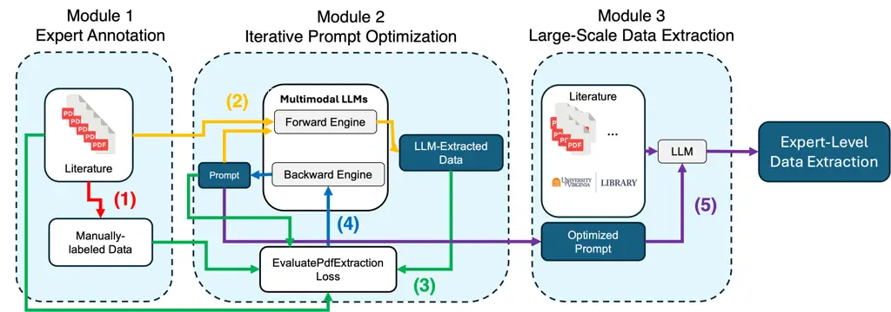
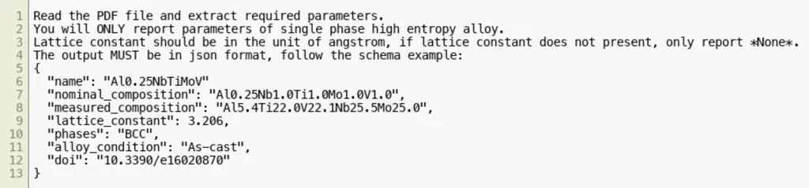
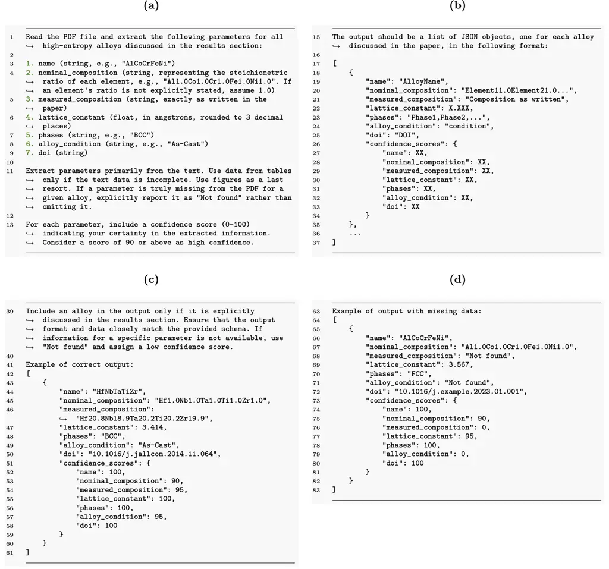
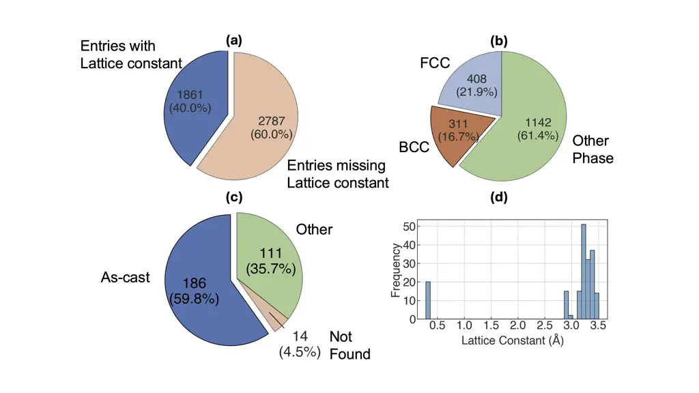

# Expert-Grounded Automatic Prompt Engineering for Extracting Lattice Constants of High-Entropy Alloys from Scientific Publications using Large Language Models

Shunshun Liu Affiliation: Department of Materials Science and
Engineering, University of Virginia, Charlottesville, 22903, VA, USA   
Talon R. Booth Affiliation: Department of Materials Science and
Engineering, University of Virginia, Charlottesville, 22903, VA, USA   
Yangfeng Ji Affiliation: Department of Computer Science, University of
Virginia, Charlottesville, 22903, VA, USA    Wesley Reinhart
Affiliation: Department of Materials Science and Engineering,
Pennsylvania State University, State College, 16802, PA, USA
Affiliation: Institute for Computational and Data Sciences, Pennsylvania
State University, State College, 16802, PA, USA    Prasanna V.
Balachandran Email: <pvb5e@virginia.edu> Affiliation: Department of
Materials Science and Engineering, University of Virginia,
Charlottesville, 22903, VA, USA

###### Abstract

Large language models (LLMs) have shown promise for scientific data
extraction from publications, but rely on manual prompt refinement. We
present an expert-grounded automatic prompt optimization framework that
enhances LLM entity extraction reliability. Using high-entropy alloy
lattice constant extraction as a testbed, we optimized prompts for
Claude 3.5 Sonnet through feedback cycles on seven expert-annotated
publications. Despite a modest optimization budget, recall improved from
0.27 to $`>`$ 0.9, demonstrating that a small, expert-curated dataset
can yield significant improvements. The approach was applied to extract
lattice constants from 2,267 publications, yielding data for 1,861
compositions. The optimized prompt transferred effectively to newer
models: Claude 4.5 Sonnet, GPT-5, and Gemini 2.5 Flash. Analysis
revealed three categories of LLM mistakes: contextual hallucination,
semantic misinterpretation, and unit conversion errors, emphasizing the
need for validation protocols. These results establish feedback-guided
prompt optimization as a low-cost, transferable methodology for reliable
scientific data extraction, providing a scalable pathway for complex
LLM-assisted research tasks.

###### keywords

Large language models, prompt optimization, high-entropy alloys, lattice
constants, scientific data extraction

## Introduction

Materials informatics studies based on experimental data have
historically relied on manual data extraction from scientific
publications. This process is tedious and time-consuming. Consequently,
scaling this approach to extract data from thousands of publications
remains impractical. Over the past decade, researchers have focused on
automating data extraction from unstructured sources, such as journal
publications. Initially, natural language processing (NLP) techniques
were developed that relied on expert annotation Kim et al. (2017);
Venugopal et al. (2019); Olivetti et al. (2020); Shetty and Ramprasad
(2021); Wang et al. (2022), and more recently, there has been a shift
toward leveraging large language models (LLMs) for this purpose Zheng
et al. (2023); Gilligan et al. (2023); Sayeed et al. (2024); Dagdelen
et al. (2024); Polak and Morgan (2024); Jiang et al. (2025); Foppiano
et al. (2024); Liu et al. (2024); Ekuma (2025); Biswajeet and Kadkhodaei
(2025); Liu et al. (2025); Turan and Sparks (2025); Polak and Morgan
(2025). Our survey of LLM applications in materials science literature
(Figure S1 in the Supplementary Information, SI) identified automated
knowledge and data extraction as the most prevalent use cases. These
studies have demonstrated that LLM-based data extraction from scientific
publications can achieve reasonable accuracy, but performance depends
critically on prompt quality. A prompt is a structured set of
instructions provided to an LLM that specifies the task, defines
constraints, and outlines output format and content White et al. (2023);
Schulhoff et al. (2024). Effective prompts typically include four
elements Zheng et al. (2023); Polak and Morgan (2024); White et al.
(2023); Schulhoff et al. (2024); Giray (2023): (1) _Instructions_ that
define the task and desired behavior, (2) _Context_ that provides
relevant background information, (3) _Input Data_ to be processed, and
(4) _Output Indicators_ that specify the desired format and structure of
the response.

Our literature survey identified several recent publications that
provide systematic approaches to prompt engineering for extracting
materials science data from scientific publications. We discuss two
representative studies in detail below. Zheng et al. Zheng et al. (2023)
developed a human-in-the-loop prompt engineering strategy for
chemistry-focused applications based on three core principles: ($`i`$)
well-formulated prompts designed to minimize hallucination by avoiding
queries that may produce fabricated content, ($`ii`$) detailed
instructions that convey context and the desired response format, and
($`iii`$) structured output requirements using well-defined templates to
facilitate extraction. Their workflow first identified relevant sections
in publications (those containing metal-organic framework, MOF,
synthesis conditions), confirmed data presence, and then extracted MOF
synthesis parameters from those sections. The utilization of GPT-3.5 and
GPT-4, coupled with an interactive prompt refinement strategy enhanced
by human feedback, demonstrated significant efficacy in achieving robust
performance metrics, which the authors discussed in terms of the
precision, recall, and F1 score. Polak and Morgan Polak and Morgan
(2024) developed a two-stage zero-shot prompt engineering strategy.
Stage 1 employed a relevancy prompt to identify sentences containing
target data, while Stage 2 used question-and-answer prompts to extract
specific information. They demonstrated this approach by constructing
two databases: critical cooling rates of metallic glasses and yield
strengths of high-entropy alloys (HEAs). Using GPT-3.5
(gpt-3.5-turbo-0301), GPT-4 (gpt-4-0314), and LLaMA2-chat (70B), they
also evaluated extraction accuracy through precision and recall metrics.
Additional studies by Ha et al. Ha et al. (2025) (nanotoxicity), Zhang
et al. Zhang et al. (2024) (magnetic materials), Liu et al. Liu et al.
(2024) (metallic glasses), Gupta et al. Gupta et al. (2024) (polymers),
and Prasad et al. Prasad et al. (2024) (titanium-based alloys) further
demonstrated the value of carefully structured prompts for large-scale
data extraction from scientific texts.

Current prompt engineering methods, despite advancements, have a
significant limitation. They require considerable human involvement for
refining prompts and are typically optimized based on individual
publications rather than across a collection of publications. To address
this limitation, we introduce a prompt engineering strategy that
integrates domain expert-constructed data into an automated optimization
process, rather than relying on post-hoc, human-in-the-loop refinement.
Our workflow is shown in Figure 1. Building on the TextGrad
framework Yuksekgonul et al. (2025), which enables prompt optimization
through backpropagation of LLM-generated “textual gradients”, our
workflow leverages a small, expert-grounded dataset carefully curated
from multiple scientific publications to automatically and iteratively
refine prompts without human-in-the-loop. These optimized prompts can
then be used for large-scale automated data extraction from thousands of
scientific publications. We demonstrate this methodology using HEAs as a
test case, which are an emerging class of materials with significant
technological interest Miracle and Senkov (2017); George et al. (2020);
Han et al. (2024). In our prompts, we use the term “high entropy
alloys”, which the LLM interprets as encompassing multi-principal
element alloys (MPEAs) and compositionally complex alloys (CCAs), as
these terms are used interchangeably in the literature. For consistency,
we use HEAs throughout this manuscript, with the understanding that it
broadly encompasses MPEAs and/or CCAs.

Our objective is to develop an expert-grounded, automatic prompt
optimization framework for extracting experimentally measured, room
temperature lattice constant data from thousands of HEA publications
using LLMs. Current HEA databases, such as the one by Borg et al. Borg
et al. (2020), which includes mechanical properties and phase
information, and the database constructed by Polak and Morgan Polak and
Morgan (2024), which contains yield strength data along with annotated
source passages, do not provide lattice constant data for experimentally
synthesized alloys. It is essential to construct an HEA dataset that
includes lattice constant data from the experimental HEA literature to
advance alloy development efforts  Tandoc et al. (2025). They are
important inputs for predicting solid-solution strengthening effects
using mechanistic models Maresca and Curtin (2020); Liu et al. (2022)
and help estimate the coherency strain relationships between the matrix
and precipitate phases in precipitation-hardened systems Li et al.
(2023). However, the manual extraction of lattice constant data from the
rapidly expanding HEA scientific publications is impractical, creating a
bottleneck for materials design and discovery efforts.



Figure 1: Schematic workflow for expert-grounded prompt optimization and
large-scale data extraction. Numbers in parentheses indicate the
sequential workflow steps, with corresponding arrow colors. The details
of each module are described in the main text.

Our expert-grounded prompt optimization framework consists of three
modules, as illustrated schematically in Figure 1. Additional details
can be found in the Methods section. Module 1 (Expert Annotation):
Domain experts manually create a prompt training dataset by surveying a
small subset of scientific publications. This step establishes the named
entities to be extracted, the required data fields, and the structured
format that guides subsequent prompt optimization. Module 2 (Iterative
Prompt Optimization): The focus is on iterative prompt optimization
using an LLM and TextGrad framework Yuksekgonul et al. (2025). This
module uses the same publications that were annotated by domain experts
in Module 1. It takes two inputs: ($`i`$) scientific publications in the
PDF format that were used to construct the expert-annotated dataset from
Module 1 and ($`ii`$) an initial prompt. Through a multimodal LLM system
and a workflow that utilizes forward and backward engines, the initial
prompt is iteratively and automatically refined. Claude 3.5 Sonnet
Anthropic (2024) serves as both the forward engine for data extraction
and the backward engine for generating improvement suggestions. The
EvaluatePdfExtractionLoss function, implemented using the TextGrad loss
module, compares LLM-extracted data against expert-labeled ground truth
to compute “textual gradients”. This optimization loop continues until
the iteratively refined prompts yield satisfactory extraction
performance. Module 3 (Large-Scale Data Extraction): The optimized
prompts from Module 2 are deployed to extract data from thousands of
scientific publications. This sequential, three module approach enables
systematic prompt refinement using limited expert-curated data, followed
by large-scale extraction across thousands of scientific literature.
While this paper demonstrated the approach using Claude 3.5 Sonnet, any
combination of commercial or open-source LLMs can also function as
forward or backward engines.

Applying this approach to 2,267 scientific publications, we extracted
lattice constant data for 1,861 HEA compositions. Beyond lattice
constants, we also captured chemical compositions (both nominal and
measured, if available), phase information, and processing techniques.
Following established techniques in the literature, we evaluated
extraction performance using precision, recall, and F1 score metrics.
Analysis of these 1,861 entries identified 186 materials that exhibited
single-phase body-centered cubic (BCC) structure in the as-cast
processing condition. To demonstrate the utility of the extracted
dataset for downstream applications, we built data-driven ML models that
predict lattice constants as a function of as-cast, single-phase BCC HEA
compositions, which are promising candidates for high-temperature
structural applications Feng et al. (2021); Lee and Balachandran (2022);
Karumuri et al. (2025).

Although the Claude 3.5 Sonnet LLM excelled at large-scale data
extraction, we also discuss three challenges that posed risks to
extraction reliability: ($`i`$) contextual hallucination, where the
model generated physically plausible but textually unsupported values
Zhang et al. (2025); Huang et al. (2025); ($`ii`$) semantic
misinterpretation Zhang et al. (2025); Huang et al. (2025), where
technical terminology or implicit context was misunderstood; and
($`iii`$) unit inconsistencies that complicated downstream processing.
An in-depth analysis of these limitations offers insight into the
current challenges related to LLM-based data extraction from scientific
literature.

Finally, while newer LLMs demonstrate strong zero-shot reasoning,
certain scientific tasks, such as synthesizing information across
modalities, remain challenging Polak and Morgan (2025); Turan and Sparks
(2025). Consequently, systematic and automated prompt optimization
procedures are essential for pushing model performance to its practical
ceiling. Here, we have implemented such a procedure and validated it
using HEA lattice constant extraction as a representative benchmark.
While the prompt optimization workflow was based on the Claude 3.5
Sonnet model, the optimized prompt showed excellent transferability when
tested on current LLM models, including Claude 4.5 Sonnet, Gemini 2.5
Flash, and GPT-5. Our results suggest a path forward for domain
scientists in light of the rapidly advancing capability of frontier
models.

## Results

### Initial Prompt vs Optimized Prompt

The initial and optimized prompts are shown in Figure 2 and Figure 3,
respectively. The initial prompt was constructed based on the domain
expertise of the authors; no LLM consultation or systematic prompt
engineering principles were employed in its design. Analysis of initial
extraction attempts revealed three deficiencies that degraded output
quality: ($`i`$) ambiguous instructions and incomplete extraction rules,
($`ii`$) inconsistent output formatting, and ($`iii`$) poorly defined
extraction scope. We discuss each limitation and the corresponding
improvements incorporated into the optimized prompt below.



Figure 2: Full initial prompt. A machine-readable version is provided in
the Figure S2 in SI.



Figure 3: A condensed and streamlined visualization of the complete
optimized prompt, broken down into four panels: (a) Task instructions,
the scope of extraction, and the definition of the data extraction
scheme. (b) An example of the extracted data in JSON format. (c)
Additional instructions along with a JSON example demonstrating the
correct output. (d) A JSON example illustrating how to handle missing
values. A machine-readable version is provided in the Figure S3 in SI.

One of the sources for ambiguity in the initial prompt stemmed from
undefined technical terminology and missing handling rules. For example,
the phrase “single phase” was not explicitly defined and there were no
clear instructions provided for materials with multiple reported phases.
The optimized prompt addresses this problem by broadening the scope to
all HEAs (Figure 3, line 1) while removing the ambiguous “single phase”
constraint. This refinement is acceptable because single phase HEAs are
a subset of the complex HEA phase space, which can be filtered during
post-processing based on the extracted phase information. Additionally,
the initial prompt lacked rules for handling missing data or multiple
entries per publication. The optimized prompt explicitly addresses these
cases through both textual instructions (lines 11, 39) and concrete
formatting examples: lines 15–37 demonstrate handling multiple material
entries, while lines 63–83 illustrate proper missing value notation.

The second weakness involved output formatting. The initial prompt
defined the data schema, but omitted formatting specifications for
individual values. Without explicit guidance, the LLM was found to be
prone to produce inconsistent outputs. The optimized prompt eliminates
this weakness through detailed formatting requirements (lines 3–7),
ensuring uniform outputs that match the desired schema.

The third weakness concerns undefined extraction scope. Without explicit
boundaries, the LLM can extract spurious data from reference lists or
citations, capturing materials mentioned but not experimentally
investigated in the paper. To address this weakness, the optimized
prompt establishes clear scope priorities (lines 11, 39): “Extract
information from results, focus on text first, then table, use figure at
last.”

### Data Retrieval Performance on the Expert-Labeled Training Set

We evaluated the data extraction performance of the initial and the
optimized prompts on the expert-labeled training set, which included
seven research papers containing data for 22 single-phase HEAs. The
Claude 3.5 Sonnet model with the initial prompt was only able to extract
seven entries from the seven publications. Extraction metrics for the
initial prompt are given in Table 1, which reveal severe recall
limitations: only 0.273 (27.3%) of expert-identified HEA entries were
successfully extracted. This indicates that approximately 73% of
relevant data remained undetected, highlighting the need for systematic
prompt engineering. One of the reasons for the low recall is attributed
to the incomplete extraction rules in the initial prompt. Specifically,
the prompt implicitly restricted extraction to one HEA composition per
publication, despite many papers reporting multiple HEA compositions.
Among the seven extracted entries, one of the HEA compositions includes
AlHfNbTaTiZr, which was taken from the work of Lin et al. Lin et al.
(2015). This HEA composition was deliberately excluded from our
expert-constructed training set because the authors reported two
different BCC lattice constants, suggesting a multi-phase microstructure
instead of a single-phase BCC. We interpreted this as evidence of a
two-phase BCC composition rather than the single-phase condition. With
one incorrect extraction entry out of seven total extractions, the
initial prompt achieved an overall precision of 0.857.

In contrast, the optimized prompt extracted 23 single-phase HEA
composition entries from the seven publications, exceeding the 22
expert-labeled single-phase HEA compositions. Two out of 23 extracted
entries were HEAs referenced in the papers, but not experimentally
characterized in those studies, representing false positives (FPs).
Additionally, the optimized prompt also extracted AlHfNbTaTiZr from Lin
et al. Lin et al. (2015) and classified it as single-phase BCC, despite
the two different lattice constants discussed earlier.

The optimized prompt achieved a precision of 0.870 (20/23) and a recall
of 0.909 (20/22) when evaluated against the specific single-phase HEA
criterion. However, the instruction from the optimized prompt to extract
“all high-entropy alloys discussed in the results section” expanded the
effective scope beyond single-phase compositions. When evaluated against
all HEA entries (regardless of single-phase vs multi-phase), the
optimized prompt extracted 36 of 37 total compositions with only two
FPs, yielding precision of 0.944 and recall of 0.919. This broader
evaluation better reflects the actual behavior of the optimized prompt
as specified in its instructions.

Entity-level performance (Table 1) shows that nominal composition and
processing condition maintained perfect precision (1.000), while lattice
constant precision decreased slightly (0.912). Upon further analysis, we
found that the reduction was caused by issues related to multi-phase
handling. For instance, Zuo et al. Zuo et al. (2014) investigated a
series of Al$`{}_{\textrm{x}}`$CoFeNi HEA compositions. They found that
when $`\textrm{x}=0.5`$ and $`0.75`$, the alloys exhibited a dual-phase
microstructure consisting of both FCC and BCC phases (Table 1 in Zuo et
al. Zuo et al. (2014)). Additionally, in Table 2 (in Zuo et al. Zuo
et al. (2014)), the authors reported distinct lattice constants for the
FCC and BCC phases corresponding to $`\textrm{x}=0.5`$ and $`0.75`$.
However, the optimized prompt did not accurately associate each lattice
parameter with its respective phase, which resulted in incorrect lattice
constant extraction. This resulted in a slightly low precision for the
lattice constants and phase in Table 1.

| Named Entity               | Initial prompt |           |           | Optimized prompt |           |           |
| -------------------------- | -------------- | --------- | --------- | ---------------- | --------- | --------- |
|                            | Precision      | Recall    | F1 Score  | Precision        | Recall    | F1 Score  |
| Nominal composition        | $`1.0`$        | $`0.273`$ | $`0.429`$ | $`1.0`$          | $`0.919`$ | $`0.958`$ |
| Lattice constant           | $`1.0`$        | $`0.273`$ | $`0.429`$ | $`0.912`$        | $`0.838`$ | $`0.873`$ |
| Phase                      | $`1.0`$        | $`0.273`$ | $`0.429`$ | $`0.971`$        | $`0.892`$ | $`0.930`$ |
| Alloy processing condition | $`1.0`$        | $`0.273`$ | $`0.429`$ | $`1.0`$          | $`0.919`$ | $`0.958`$ |

Table 1: Comparison of entity-level extraction performance between the
initial prompt and the optimized prompt using the Claude 3.5 Sonnet
model.

### Large-Scale Data Extraction

Out of the 2,267 publications that were processed through the Module 3
of the data extraction workflow (Figure 1), 142 were rejected by the
Claude 3.5 Sonnet model. These rejections occurred because these
publications were either review articles that exceeded the context
length limits or were classified as irrelevant to HEAs in the assessment
conducted by the LLM. The large-scale data extraction module found a
total of 4,648 alloy entries from 2,125 publications. Of these, 2,787
entries (60.0%) contained no lattice constant data, while 1,861 entries
(40.0%) contained lattice constants, as visualized in Figure 4(a). Among
the 1,861 entries with lattice constants data, 408 were face-centered
cubic (FCC) alloys, 311 were BCC alloys, and 1,146 belonged to other
phases (including multi-phase mixtures and other ordered structure
types). This is shown in Figure 4(b). Out of the 311 single-phase BCC
alloys, 186 were in the as-cast condition and 111 were processed or
post-processed using other methods (e.g., powder processing, selective
laser melting, annealing). Additionally, 14 entries lacked any reported
processing information, as shown in Figure 4(c).



Figure 4: Overview of extracted HEA data from 2,267 publications. (a) A
pie-chart showing the relative count of entries with and without lattice
constant data: of 4,648 total extracted compositions, 1,861 (40.0%)
contained lattice constant while 2,787 (60.0%) lacked this data. (b) A
pie-chart showing the phase distribution among the 1,865 entries with
lattice constants: 311 single-phase BCC (16.7%), 408 single-phase FCC
(21.9%), and 1,142 other phases (61.4%), including multi-phase mixtures,
ordered structures, and amorphous structures. (c) A pie-chart showing
the processing condition distribution for the 311 single-phase BCC
alloys: 186 as-cast (59.8%), 111 processed by other methods, such as
selective laser melting and powder processing, or included
post-processing heat treatments, such as annealing (35.7%), and 14 with
unreported processing information (4.5%). (d) Histogram showing lattice
constant distribution for the 186 as-cast single-phase BCC alloys. Most
values fall within the range of 2.8–3.5 Å for BCC structures. There were
21 entries near 0.3 Å that represents a systematic unit conversion error
where the LLM failed to convert nanometer values to Å unit.

Figure 4(d) shows the lattice constants distribution for as-cast
single-phase BCC alloys. The majority of values fall between 2.8 and
3.5 Angstroms (Å), consistent with the expected BCC lattice parameters
range. However, there were 21 entries with lattice constants around
0.3 Å, indicating that the Claude 3.5 Sonnet model failed to convert
lattice constants reported in nanometers to Å during extraction. We
identified a total of 327 entries with physically unreasonable lattice
constants: 17 entries (from seven publications) with values $`>`$10 Å
and 310 entries (from 166 publications) with values $`<`$1 Å. Manual
inspection of all seven publications with anomalously large values plus
ten randomly sampled papers with anomalously small values revealed that
most outliers originated from lattice constants reported in nanometers
or picometers in the source literature. Despite explicit instructions in
the prompt to report values in Å, the Claude 3.5 Sonnet model failed to
perform the necessary unit conversions, representing a systematic
formatting error. Along with the unit conversion errors, manual
validation identified two additional categories representing systematic
LLM extraction challenges: (1) contextual hallucination and (2) semantic
misinterpretation. These challenges are summarized in Table 2, along
with representative examples.

| Type                            | Explanation                                                                                                                                       | Specific Example                                                                                                                                                                        |
| ------------------------------- | ------------------------------------------------------------------------------------------------------------------------------------------------- | --------------------------------------------------------------------------------------------------------------------------------------------------------------------------------------- |
| Contextual hallucination        | The model assigned a correct-looking number to the wrong entity due to mis-linking or mis-attribution.                                            | The LLM mistakenly interpreted the lattice constant of the Ni₁₆Ti₆Si₇ precipitate phase as that of the host matrix, which has a different composition. (Yang et al. Yang et al. (2023)) |
|                                 |                                                                                                                                                   |                                                                                                                                                                                         |
| Semantic misinterpretation      | The model mixed up semantically related crystallographic parameters because it lacked a strong understanding of their distinct physical meanings. | The LLM incorrectly identified Burgers vector as the lattice constant. (Moon et al. Moon et al. (2021))                                                                                 |
|                                 |                                                                                                                                                   |                                                                                                                                                                                         |
| Format or Unit conversion error | Skipped required unit conversion, despite explicit instructions in the prompt.                                                                    | The LLM failed to convert units to Angstrom (Å) in a few instances. (Piorunek et al. Piorunek et al. (2020), Jiang et al. Jiang et al. (2022))                                          |

Table 2: Summary of the three LLM scientific data extraction challenges
that we encountered in this work.

To assess the performance of our data extraction, we randomly sampled 46
different publications, concentrating primarily on as-cast single-phase
BCC alloy entries, which is our focus for the downstream task. We
excluded outlier entries with anomalous lattice constants from this
assessment. From the 46 publications sampled, we manually identified 44
as-cast single-phase BCC HEA compositions. Instead of treating phase and
alloy processing conditions as separate entities, we combined them into
a single composite criterion referred to as “As-cast single-phase BCC.”
This simplification was essential because our current assessment focuses
on alloys that exhibit a single-phase BCC structure under as-cast
conditions. Therefore, we integrated phase identity and processing
conditions into the composite criterion “As-cast single-phase BCC” to
accurately represent this combined entity. This means if the LLM made a
mistake on either phase or alloy processing condition, the entire entry
was considered as FP or false negative (FN). For example, if the LLM
extracted an as-cast dual-phase (BCC $`+`$ secondary phase) alloy but
mislabeled it as single-phase BCC, the entire entry was counted as a FP.
This entry contributed to the FP count when calculating precision and
recall for the composite criterion “As-cast single-phase BCC,” and its
associated nominal composition and lattice constant were also classified
as FPs because they corresponded to a composition outside our scope or
non-relevant. Conversely, if the LLM misclassified an as-cast
single-phase BCC alloy as a dual-phase (BCC $`+`$ FCC) alloy, the entire
entry was counted as a FN. Its nominal composition and lattice constant
were classified as “Not retrieved” for our target category, regardless
of whether those individual values were correctly extracted, because the
alloy failed to meet our selection criteria.

Manual verification against the source publications showed high
extraction accuracy in all fields, as measured by precision, recall, and
F1 score (data given in Table 3). Among the 47 extracted as-cast
single-phase BCC entries, validation revealed five errors: three entries
with incorrect alloy processing conditions, one computational result
misclassified as experimental as-cast data, and one missed entry (FN).
This yielded precision of 0.915 (43/47) and recall of 0.977 (43/44) for
the composite criterion “As-cast single-phase BCC.” For the lattice
constant field, we identified two additional errors, resulting in
precision of 0.872 (41/47) and recall of 0.932 (41/44). The nominal
composition field extraction performance matched the composite criterion
exactly (precision = 0.915 and recall = 0.977). This indicates that the
Claude 3.5 Sonnet model extracted compositions accurately whenever it
correctly identified an entry as as-cast single-phase BCC. The precision
and recall metrics use different denominators because precision is
calculated as the ratio of true positives (TP) to the sum of TP and FP,
whereas recall is calculated as the ratio of TP to the sum of TP and FN
(additional details given in the Methods section).

| Named Entity             | Precision | Recall | F1 Score |
| ------------------------ | --------- | ------ | -------- |
| As-cast single-phase BCC | 0.915     | 0.977  | 0.945    |
| Nominal composition      | 0.915     | 0.977  | 0.945    |
| Lattice constant         | 0.872     | 0.932  | 0.901    |

Table 3: Precision and recall of the Claude 3.5 Sonnet LLM model were
calculated through manual verification of a randomly sampled 46
publications. The named entities specified in the LLM prompt include the
nominal composition, lattice constant, phase, and alloy processing
conditions. Since we focused on HEA compositions that were processed
as-cast and exhibit a single-phase BCC structure, we have combined phase
and alloy processing conditions into one entity: As-cast single-phase
BCC. We first filtered the extracted dataset to single-phase BCC alloys
only, then calculated precision and recall metrics on the filtered
dataset. It is important to note that the measured composition was not
included in the assessment due to the complexity of its evaluation
because not every publication reports measured composition.

### Outliers Discussion

Out of the 17 extracted entries with lattice constants $`>`$10 Å, two
publications (Yang et al. Yang et al. (2023) and Pan et al. Pan et al.
(2022)) were not about HEAs, but were nevertheless returned by both the
publisher API search and the Claude 3.5 Sonnet relevance classification
step. Yang et al. Yang et al. (2023) investigated G-phase strengthened
ferritic Fe-Cr model alloys with minor additions of Ni, Ti, and Si. The
Claude 3.5 Sonnet model appears to have misclassified this as an HEA due
to the presence of multiple constituent elements, demonstrating
confusion between multi-component and HEA compositions. On closer
examination, we found that the Claude 3.5 Sonnet had correctly recorded
the alloy composition. However, it misunderstood the lattice constant of
the Ni₁₆Ti₆Si₇ precipitate as that of the matrix. Interestingly, for
this specific alloy, the LLM was able to perform unit conversion from
nanometer to Å, indicating that the error was not formatting-related but
rather a semantic confusion about which phase the lattice constant
described. This discussion is an example for contextual hallucination,
where the LLM generates a plausible but incorrect extraction by
combining information from different contexts. We confirmed this
hallucination using the EvaluatePdfOutputLoss function. The loss
function analysis (Figure S4 in SI) reveals that the LLM correctly
identified the lattice constant as belonging to the G-phase, but
incorrectly associated it with the bulk alloy composition. This
indicates the LLM mistakenly attributed the lattice constant of the
precipitate to the host alloy, failing to distinguish between matrix and
precipitate phases.

A second contextual hallucination example occurred in Pan et al. Pan
et al. (2022), who investigated a CoCrNiVC medium-entropy alloy. While
the Claude 3.5 Sonnet correctly extracted the composition, phase, and
processing condition, it erroneously reported the lattice constant as
10.9 Å, which corresponds to that of the Cr₂₃C₆ precipitate and not the
FCC matrix. Notably, the text loss analysis (Figure S5 in SI) revealed
that the Claude 3.5 Sonnet recognized the lattice constant was
associated with the carbide. However, it mistakenly attributed it to the
alloy. This indicates that while the model was aware of the correct
context, it failed to apply that knowledge accurately. A similar error
occurred in Wu et al. Wu et al. (2017), where the Claude 3.5 Sonnet
incorrectly extracted 11.303 Å as the lattice constant of HEA matrix,
when this value actually describes the Ti₂Ni intermetallic phase. The
loss function analysis (Figure S6 in SI) confirmed this mis-attribution.

In one case, the Claude 3.5 Sonnet model misidentified a Burgers vector
magnitude as a lattice constant. Moon et al. Moon et al. (2021)
investigated low-temperature deformation behavior of CoCrFeNiMo, but did
not report lattice constants. Instead, the authors reported a Burgers
vector magnitude of 0.255 nanometer (nm). The Claude 3.5 Sonnet model
incorrectly extracted this value (converting to 2.55 Å) as the HEA
lattice constant. This error likely stems from the semantic similarity
between Burgers vectors and lattice constants. The loss function
analysis (Figure S7 in SI) confirmed that the model recognized this
error: “No, the value given (0.255) appears to be the Burgers vector
magnitude, not the lattice constant.”

Unit conversion failures represented a major source of outliers in the
extracted dataset. Despite explicit prompt instructions to report
lattice constants in Å, the Claude 3.5 Sonnet model frequently extracted
values in their original units (nanometers or picometers) without
conversion during large-scale extraction. Two examples illustrate this
systematic formatting error. In Piorunek et al. Piorunek et al. (2020),
the source reported a lattice constant of 3.19 Å, but the Claude 3.5
Sonnet model extracted 0.319 Å (loss analysis is discussed in Figure S8
in SI). Similarly, for Jiang et al. Jiang et al. (2022), the Claude 3.5
Sonnet model extracted 0.323 Å instead of 3.23 Å (Figure S9 in SI). The
loss function outputs revealed a concerning pattern: rather than
acknowledging the unit conversion error, the Claude 3.5 Sonnet model
insisted the extracted values (e.g., 0.319 Å, 0.323 Å) were correct in
Å. This represents a form of post-hoc rationalization where the model
justifies an incorrect extraction rather than recognizing the error.
Notably, the Jiang et al. case also illustrates a HEA relevance
classification failure. The paper investigated Mg-Gd-Y-Zr alloys, not
HEAs, yet passed both retrieval and extraction filters.

### Testing Prompt Transferability

To assess prompt transferability across models, we evaluated the initial
unoptimized and optimized prompts on three recent commercial LLMs:
($`i`$) Claude 4.5 Sonnet, ($`ii`$) Gemini 2.5 Flash, and ($`iii`$)
GPT-5. Claude 4.5 Sonnet and GPT-5 are models optimized for performance,
whereas Gemini 2.5 Flash is a cheaper lightweight model optimized for
efficiency and speed. Among these three new models, Gemini 2.5 Flash and
GPT-5 enabled extended reasoning by default; on the contrary, the
default setting of Claude 4.5 Sonnet is to disable extended reasoning.
The default reasoning parameter in Gemini 2.5 Flash and GPT-5 were set
as “dynamic” (thinking_budget=-1), and “medium”
(reasoning_effort="medium"), respectively. We evaluated all three models
on two distinct publication sets using their default temperature
settings: ($`i`$) the seven-publication expert-labeled training set used
for prompt optimization (Module 1, Figure 1), containing 22 manually
extracted single-phase HEA entries, and ($`ii`$) a 46-publication
validation set randomly selected to assess large-scale extraction
performance, containing 44 manually verified as-cast single-phase BCC
HEA entries (discussed in the previous section). Performance metrics for
extraction, specifically precision, recall, and F1 scores, are estimated
for the initial prompt applied to the expert-labeled training set (Table
S1 in the SI), as well as for the optimized prompt assessed on the
46-publication validation set (Table S2a and Table S2b in the SI). All
three recent LLM models (with or without extended reasoning)
significantly outperformed Claude 3.5 Sonnet on the expert-labeled
training set, even when using the initial unoptimized prompt. Notably,
Claude 4.5 Sonnet with the initial unoptimized prompt outperformed
Claude 3.5 Sonnet with the fully optimized prompt on the expert-labeled
training set. Similarly, GPT-5 with minimal reasoning and initial
unoptimized prompt also achieved performance on the expert-labeled
training set comparable to Claude 3.5 Sonnet model with the fully
optimized prompt.

For the 46-publication validation set using optimized prompts, Claude
4.5 Sonnet without extended thinking achieved the best overall
performance with zero FPs and four errors: one missed entry, one nominal
composition error, and two lattice constant errors. It attained the
highest F1 scores across all extracted fields, demonstrating that
prompts optimized on Claude 3.5 Sonnet generalize effectively to newer
models within the same LLM architecture family. Claude 4.5 Sonnet with
extended reasoning achieved performance comparable to the default
configuration, where the extended reasoning is disabled. While recall
remained similar, precision decreased due to two FPs caused by
over-interpretation of indirect information during extended reasoning.
Additionally, the model missed two entries and produced one lattice
constant error.

Gemini 2.5 Flash and GPT-5 showed similar performance, with F1 score
differences of less than 0.04 across all fields. Gemini 2.5 Flash
extracted 41 entries with two FPs, while GPT-5 produced 42 entries with
three FPs and one nominal composition error. Both models achieved
consistently high F1 scores despite differences in architecture, with
only minor performance degradation relative to the Claude models.
Although Gemini 2.5 Flash is a lightweight model compared to Claude
Sonnet 4.5 and GPT-5, its performance is comparable to that of GPT-5,
demonstrating successful prompt transferability across the LLM model
families. The data given in Table S2a and Table S2b also includes the
cost (in USD) for processing the 46-publication set with each LLM, along
with the cost-effectiveness ratio (average F1 score per dollar). Higher
ratios indicate better extraction performance per unit cost. Although
Gemini 2.5 Flash had a relatively low average F1 score, it exhibited the
best cost-effectiveness ratio.

Among the FPs from Gemini 2.5 Flash and GPT-5, one notable case involved
the TiVNbMoTa alloy from Zhang et al. Zhang et al. (2020). In the
original publication, the lattice constant of TiVNbMoTa was not
explicitly reported by the authors but described through indirect
comparison via average atomic volume. The Claude 3.5 Sonnet and Claude
4.5 Sonnet (without reasoning) models correctly recognized that the
lattice constant was not directly provided and did not extract a value.
In contrast, both Gemini 2.5 Flash (with dynamic reasoning) and GPT-5
(with medium reasoning) inferred values of 3.195 Å and 3.194 Å,
respectively, for the TiVNbMoTa alloy. While these inferred values
appear mathematically reasonable, suggesting extended reasoning
capabilities, we classified them as FPs because they represent model
inference rather than direct text extraction.

To further confirm the role of reasoning, we re-ran the data extraction
task on this specific publication Zhang et al. (2020) using Gemini 2.5
Flash and GPT-5 with various extended reasoning budgets. In the case of
the Gemini 2.5 Flash model, when the dynamic reasoning capability was
turned off (i.e., thinking_budget=0), the model became consistent with
the publication and reported the lattice constant as “Not Found”. We
repeated this test three times and the Gemini 2.5 Flash model
consistently reported the lattice constant as “Not Found”. When the
thinking budget was set to default (dynamic reasoning), two independent
runs returned the inferred result, while two additional runs reported
the lattice constant as “Not Found.” This outcome is consistent with our
expectation that extended reasoning can make responses less predictable
but more robust because the model argues for multiple correct solutions.
Upon reviewing the thought summaries of the output alongside the
inferred results, we gained additional insights into the reasoning
behind lattice constant inference. The extended reasoning for the Gemini
2.5 Flash model is given in Section S5 in the SI. The Gemini 2.5 Flash
model begins by noting that the TiVNbTa and TiVNbMoTa alloys are
discussed in the Results and Discussion section of the paper. Further
along the reasoning process, the following sentence can be found: “I see
comparisons between the two, which provide a lattice constant for
TiVNbMoTa.”

In the minimal reasoning mode of the GPT-5 model, the performance was
comparable to that of Gemini 2.5 Flash with dynamic reasoning; two out
of four results indicated an inferred lattice constant. When the Claude
4.5 Sonnet model utilized extended reasoning with a token budget of
1024, its performance became similar to both Gemini with dynamic
reasoning and GPT-5 with medium reasoning. In one of the four re-runs,
it showed an inferred value of 3.194 Å, and two instances of thinking
history explicitly detailed the calculations for this value. A
representative example for the extended reasoning associated with the
Claude 4.5 Sonnet model is given in Section S6 in the SI. Conversely,
when the extended reasoning was disabled, the Claude 4.5 Sonnet model
consistently returned “Not found” across three re-runs for this specific
publication. This confirms that the presence of the inferred lattice
parameter was a result of the extended reasoning process rather than a
case of LLM hallucination.

The Table S2b gives the model performance of Claude 4.5 Sonnet,
comparing optimized prompts with and without extended reasoning. Using a
1024-token budget for extended reasoning, the F1 scores for all entities
showed a slight reduction, though they remained comparable. This
observation suggests that, with an optimized prompt, the use of extended
reasoning does not lead to further improvements in data extraction
results.

Our comparison demonstrates that recent advancements in extended
thinking and reasoning can significantly enhance performance on an
unoptimized prompt. The reasoning process aims to analyze the intentions
of the user and provide the expected result without the need for
explicit prompt optimization. This approach proved effective for the
relatively simple extraction task studied here, which involved only four
primary entities (nominal composition, alloy processing condition,
phase, and lattice constant). The validity of this result for more
complex data extraction tasks (i.e., extraction of $`>`$10 named
entities) requires additional work that is beyond the scope of this
study. However, our case study also highlights a key risk: models with
stronger reasoning capabilities may over-interpret indirect information.
While such inferred values may appear plausible, they represent model
interpretation rather than direct extraction from the source text. This
observation reinforces the necessity of systematic prompt optimization
frameworks, such as the TextGrad Yuksekgonul et al. (2025), which can
establish explicit constraints against over-interpretation. This ensures
that advanced reasoning capabilities improve rather than compromise
faithfulness to source material.

Overall, although frontier models achieve high accuracy even with the
base prompt, this reinforces, rather than invalidates, the need for
systematic prompt optimization. The Claude-optimized prompt improved the
Gemini 2.5 Flash F1 score from 0.900 to 0.917 without re-optimization,
demonstrating that optimization signals transfer across model families
and model generation. Moreover, Gemini 2.5 Flash delivered similar
accuracy at four to six times the cost efficiency of the other models.
These results indicate that our prompt optimization distills
model-agnostic features, such as unambiguous formatting rules, explicit
handling for missing data, and clear scoping instructions, that
generalize across model families and can be deployed flexibly, according
to the available budget. Drawing on these results and observed failure
modes, we identify four strategies to further improve extraction
reliability. These strategies are discussed in Section S7 in the SI.

Furthermore, prompt optimization introduces a fixed, one-time cost that
is easily amortized over large-scale deployments. In our workflow,
optimization required only 21 article evaluations (seven articles across
three epochs), which is approximately 1% of the cost of the full
2,097-document extraction, yet yielded a 3$`\times`$ recall improvement
in Claude 3.5 Sonnet. For small, exploratory tasks, direct use of the
strongest available model remains cost-effective. However, for repeated
or large-corpus extractions, it is almost certainly more economical to
optimize on a capable mid-tier model and deploy on a lower-cost model,
achieving comparable accuracy at substantially reduced expense.

### Machine Learning for Predicting Lattice Constants

The next step involves developing ML models to establish a quantitative
relationship between lattice constants and HEA compositions of the
as-cast, single-phase BCC alloys. The Figure S13a in the SI compares the
ensemble of support vector regression (eSVR) model predictions against
LLM-extracted experimentally measured lattice constant values, showing
good agreement between the predicted and reported experimental data.
Uncertainty for each composition was determined by calculating the
standard deviation of the 100 individual SVR predictions that make up
the ensemble, which serves as a measure of model confidence. The
$`R^{2}`$ of training and test set were $`0.989`$ and $`0.969`$,
respectively. Some scatter is evident, particularly in the lower and
higher lattice constant regions ($`\sim`$2.8–3.0 Å and
$`\sim`$3.4-3.6 Å, respectively). The larger uncertainty estimates in
these ranges suggest either fewer training examples or greater
compositional complexity relative to the mid-range values. Alloys in the
lower lattice constant region were predominantly
AlCoCrFeNiM$`{}_{\textrm{x}}`$-based compositions, where M is Si Zhu
et al. (2010), Nb Ma and Zhang (2012), or Mo Zhu et al. (2010). Similar
to the eSVR models, the linear ensemble of LASSO models (eLASSO) also
showed strong predictive performance. As shown in Figure S13b in the SI,
the predicted lattice constants closely follow the experimentally
measured values. The model uncertainty, estimated from the standard
deviation of 1000 individual LASSO estimators, is small and therefore
not visible on the plot. The eLASSO model achieved $`R^{2}`$ = 0.974 on
both training and test sets, demonstrating good generalization
performance.

## Discussion

We developed an expert-grounded, feedback-guided, automatic prompt
optimization framework inspired by TextGrad and validated it using HEA
lattice-constant extraction as a representative testbed. The workflow
improved the recall of the Claude 3.5 Sonnet model from 0.27 to
$`>`$ 0.90 over only three epochs with seven hand-annotated documents,
demonstrating that effective feedback-guided tuning can be achieved with
minimal cost and human effort. The optimized prompt transferred across
model families (Claude 4.5 Sonnet, GPT-5, and Gemini 2.5 Flash) with
high fidelity, yielding modest additional gains on Gemini 2.5 Flash and
enabling deployment on lower-cost architectures without re-optimization.
These results establish feedback-guided prompt optimization as a
scalable, transferable, and economically efficient methodology for
future, more complex LLM-assisted scientific tasks.

When applied to a HEA lattice constant extraction problem, this approach
enabled large-scale data retrieval from 2,267 publications. The
optimized prompt achieved precision and recall exceeding 0.90 for
as-cast single-phase BCC compositions, extracting lattice constant data
for 1,861 HEA compositions. From this corpus, we curated a dataset of
166 as-cast single-phase BCC HEA compositions for ML validation. Models
trained on this LLM-extracted data achieved test $`R^{2}>0.95`$ for
lattice constant prediction, demonstrating that properly validated
LLM-extracted data can support quantitative materials modeling with
performance comparable to manually curated databases.

While the optimized prompt transfers successfully across different LLM
families, we observed that models with stronger reasoning capabilities
occasionally introduced plausible but unreported values through
over-inference. This behavior underscores that increasing reasoning
effort does not guarantee epistemic reliability and reinforces the need
for systematic validation protocols. Therefore, prompt optimization is
not just about improving recall, but also about constraining model
output to ensure faithfulness to the source material.

Detailed error analysis further revealed three typical LLM failure
modes: contextual hallucination, semantic misinterpretation, and
unit-conversion errors. These highlight the continuing need for rigorous
validation before quantitative use. Recommended safeguards include
compositional consistency checks, physical plausibility filters, and
random-sampling verification prior to downstream modeling. Looking
ahead, extraction quality may be further improved by: ($`i`$) expanding
the diversity of training documents, ($`ii`$) exploring limited forms of
output-level optimization, ($`iii`$) favoring original publisher PDFs
over XML reconstructions, and ($`iv`$) periodically reassessing
performance with the most powerful current-generation frontier models.
Further instructions for conducting any downstream task based on the
data extracted from this work can be found in Section S9 in the SI.

Overall, this study demonstrates that prompt optimization can achieve
considerable performance gains with minimal cost and effort; optimized
prompts generalize across architectures yet require validation to
prevent reasoning-induced over-inference; and validated LLM-extracted
datasets can facilitate high-fidelity scientific data mining in the
materials science domain.

## Methods

### Expert-Grounded Prompt Optimization Workflow

The workflow for expert-grounded LLM-based data extraction is shown in
Figure 1. The approach comprises of three modules. The first module
includes expert annotation of selected literature to define the target
data structure and extraction schema that informs prompt engineering.
For instance, to extract the lattice constant, we label each HEA with
the following information: alloy name, nominal composition, measured
composition, phase, alloy processing condition (such as as-cast,
annealed, or powder processing), and the corresponding lattice constant.
This information was compiled from a small selection of research papers.
In this work, we considered seven publications (chosen randomly) and
extracted 22 data points.

The second module performs automated, iterative prompt optimization via
the TextGrad framework Yuksekgonul et al. (2025). The pseudocode for the
prompt optimization procedure is shown in Figure S14 in SI. Beginning
with an initial natural language prompt describing the extraction task,
we query a PDF-compatible multimodal LLM
(Claude-3.5-Sonnet-20240620) Anthropic (2024) to extract structured data
from the same publications annotated by domain experts in Module 1.
Extraction quality is assessed using a custom loss function,
EvaluatePdfExtractionLoss, which computes the discrepancy between the
LLM-generated output and expert-curated ground truth dataset from
Module 1. The EvaluatePdfExtractionLoss function takes four inputs: the
current prompt, scientific publication in PDF format, expert-constructed
data, and the corresponding data generated by the LLM. The loss function
uses a customized evaluation prompt (detailed in Figure S15 in SI) that
instructs an LLM to assess whether the generated output aligns with both
the extraction prompt requirements and the PDF content. After this
analysis, it provides a clear statement indicating whether the generated
data is in alignment with the prompt. The feedback generated by this
function is then used by the backward engine to create modifications to
the prompt, enabling an iterative refinement process. In this work, the
optimization was performed with three epochs according to our budget for
this module. Publications are batched in groups of three to remain
within token limits.

The third module performs large-scale data extraction across the HEA
literature using the optimized prompt from Module 2. We applied this
prompt to extract the following named entities: alloy name, nominal
composition, measured composition, phase, alloy processing condition
(e.g., as-cast, annealed, powder processing), and lattice constant. We
used a total of 2,267 publications obtained from multiple sources, which
include full-text XML files retrieved via Elsevier application
programming interfaces (APIs) and PDF documents from other publishers.
More specifically, we retrieved 2,093 full-text XML files and
reconstructed to PDFs (text + table, no figures) from the digital object
identifiers (DOIs) reported in Polak and Morgan’s work Polak and Morgan
(2024), and in addition, 174 downloaded full PDFs (text + table +
figures) from various publishers. In Module 2, the Claude 3.5 Sonnet
model used a default temperature value of 0.0 as specified in TextGrad
for both forward and backward engine. In Module 3, we used the default
temperature value of 1.0 with the Claude 3.5 Sonnet model. Similarly,
for the Claude 4.5 Sonnet, Gemini 2.5 Flash, and GPT-5 models, we
maintained the same default temperature of 1.0.

### Data Extraction Performance Evaluation

Our workflow requires two independent evaluation schemes to assess
prompt performance: ($`i`$) validation against the expert-grounded
reference dataset used during prompt optimization, and ($`ii`$)
assessment of large-scale extraction quality after deployment on unseen
publications. To quantitatively assess the performance, we calculated
precision, recall, and F1 score using Equation 1, Equation 2, and
Equation 3 , respectively, based on the confusion matrix given in Table
S3 in SI Wang et al. (2025); Manning et al. (2008).

```math
\displaystyle=\frac{\text{Relevant Retrieved}}{\text{All Retrieved}}=\frac{\textrm{TP}}{\textrm{TP}+\textrm{FP}} \tag{1}
```

```math
\displaystyle=\frac{\text{Relevant Retrieved}}{\text{All Relevant}}=\frac{\textrm{TP}}{\textrm{TP}+\textrm{FN}} \tag{2}
```

```math
\displaystyle=\frac{2\times\text{Precision}\times\text{Recall}}{\text{Precision}+\text{Recall}} \tag{3}
```

Our HEA data extraction workflow functions on two hierarchical levels:
($`i`$) material identification and ($`ii`$) property extraction. For a
retrieval to be classified as a True Positive (TP), both levels must be
correct: the material must be an HEA discussed in the paper, _and_ its
properties must be accurately extracted. If the identified material does
not correspond to an HEA as referenced in the paper, all associated
parameters are classified as False Positives (FP). This classification
holds true even if the extracted property values are accurate.

In addition to precision and recall, we performed consistency checks to
validate extraction quality prior to downstream tasks. These sanity
checks verify agreement among three related fields: alloy name, nominal
composition, and measured composition. These fields should exhibit
consistency in constituent elements and approximate agreement in atomic
ratios, as they represent different notations for the same material. We
quantified agreement between composition fields using L1 distance
($`D_{\mathrm{L1}}`$ in Equation 4) and cosine similarity
($`\mathrm{CosSim}`$ in Equation 5). In these equations,
$`\mathbf{v}_{1}`$ and $`\mathbf{v}_{2}`$ represent composition vectors
for the two fields being compared (e.g., nominal vs. measured), with
each element $`i`$ corresponding to one of the $`n`$ unique constituent
elements present in either composition.

```math
\displaystyle D_{\mathrm{L1}}(\mathbf{v}_{1},\mathbf{v}_{2}) \displaystyle=\sum_{i=1}^{n}\left|v_{1,i}-v_{2,i}\right|, \tag{4}
```

```math
\displaystyle\mathrm{CosSim}(\mathbf{v}_{1},\mathbf{v}_{2}) \displaystyle=\frac{\displaystyle\sum_{i=1}^{n}v_{1,i}v_{2,i}}{\sqrt{\displaystyle\sum_{i=1}^{n}v_{1,i}^{2}}\,\sqrt{\displaystyle\sum_{i=1}^{n}v_{2,i}^{2}}}. \tag{5}
```

After calculating $`D_{\mathrm{L1}}`$ and $`\mathrm{CosSim}`$, we
manually inspected entries with high compositional disagreement (large
$`D_{\mathrm{L1}}`$, low $`\mathrm{CosSim}`$) among the alloy name,
nominal composition, and measured composition fields, as these
inconsistencies suggest material misidentification or incorrect data
association. Separately, we excluded entries with lattice constants
greater than 10 Å and smaller than 1 Å, which likely resulted from unit
conversion errors during LLM data extraction.

We defined a second text loss function, EvaluatePdfOutputLoss, to assess
the faithfulness of the extracted outputs. Inspired by Polak and
Morgan’s observation Polak and Morgan (2024) that follow-up questions
can improve extraction quality, we formulated several questions as
validation instructions within the loss function (see Figure S16 in SI).
This function takes both the LLM-generated output and the original PDF
as inputs, then evaluates accuracy through fact-checking queries such
as, “Are the lattice constants in the output truly the lattice constant
of the material not others?”. We primarily use this loss function to
diagnose errors in outlier data, as discussed in Section S3 in the SI.

### Downstream Task: Machine Learning To Predict Lattice Constants

After data cleaning and quality control, 159 single-phase BCC HEA
compositions were filtered to perform the downstream ML task. For each
composition, we computed descriptors using the Magpie tool Ward et al.
(2016), which generates composition-weighted averages of elemental
properties (e.g., atomic volume, covalent radius). A descriptor
selection pipeline based on recursive feature elimination method Wang
et al. (2023); Sheikh et al. (2024); Farrar and Grayson (2022) was
implemented to identify the most important descriptors for training ML
models (see Section S13 in SI). Feature selection identified six
composition-weighted descriptors, which include: atomic volume
(“meanAtomicVolume”), covalent radius (“meanColaventRadius”), Mendeleev
number (“meanMendeleev”), Electronegativity (“meanElectronegativity”),
number of valence electron in the $`d`$-orbital (“meanNdValence”), and
number of unfilled valence orbitals (“meanNUnfilled”).

The dataset of 159 compositions was split into training and test sets
using an 80:20 ratio (127 training, 32 test samples). We trained two ML
models: ($`i`$) an ensemble of non-linear support vector regression
(eSVR) models with radial basis function (RBF) kernels Smola and
Schölkopf (2004); Meyer et al. (2015); Balachandran (2020) and ($`ii`$)
an ensemble of linear least absolute shrinkage and selection operator
(eLASSO) models Tibshirani (1996); Holleis et al. (2019). The
hyperparameters (gamma and cost) for individual SVR estimator within the
ensemble were independently optimized via grid search. The optimal
ensemble size was selected from {10, 20, 30, 40, 50, 75, 100} estimators
based on maximum test set $`R^{2}`$ performance. The eLASSO model was
trained using 1,000 bootstrap resamples that were generated from the
training data. For each resample, the regularization parameter
(shrinkage penalty) was optimized using grid search by selecting the
value that minimized 10-fold cross-validation error. Both eSVR and
eLASSO used identical train-test splits to enable direct performance
comparison.

#### Supplementary information

The \[URL\] will be inserted by the publisher.

#### Funding

S.L. and P.V.B. acknowledge funding support from the University of
Virginia Research Innovation Award.

#### Acknowledgements

S.L. and P.V.B. acknowledge funding support from the University of
Virginia Research Innovation Award. Y.J. and P.V.B. thank the University
of Virginia Research Interest Group initiative for fostering
collaboration and exchange of ideas. S.L., T.R.B. and P.V.B thank
Sunidhi Garg and Yifei Duan for insightful comments on the manuscript.

## Author contribution

The study was designed by S.L., Y.J., W.R., and P.V.B. The manuscript
was prepared by S.L., T.R.B., Y.J., W.R., and P.V.B. The
expert-constructed dataset was created by S.L. and T.R.B. under the
supervision of P.V.B. Literature for data extraction was gathered by
S.L., T.R.B., and P.V.B. The data extraction workflow was developed by
S.L. with guidance from Y.J., W.R., and P.V.B. Manual verification of
the extracted data was conducted by S.L., T.R.B., and P.V.B. All authors
participated in discussing the results, writing, and providing feedback
on the manuscript.

## Competing interests

The authors declare no competing interests.

## Data Availability

The expert-constructed dataset, extracted lattice constant dataset, the
dataset sampled for evaluation in Table 3, prompts, and text losses are
archived on Github at
[https://github.com/Shunl1996/expert-paper-extract](https://github.com/Shunl1996/expert-paper-extract)
and provided with the paper. The DOIs for papers used in large-scale
data extraction is provided as a dataset. Raw JSON outputs from LLMs for
each paper, and thought summaries for selected papers are archived in
the UVA Dataverse Liu et al. (2025) for reproducibility.

## Code availability

Codes for prompt optimization, large-scale data extraction, and
composition verifications are available at
[https://github.com/Shunl1996/expert-paper-extract](https://github.com/Shunl1996/expert-paper-extract)
and also archived with the data described above.

## References

- Kim et al. (2017) Kim, E., Huang, K., Saunders, A., McCallum, A.,
  Ceder, G., Olivetti, E.: Materials synthesis insights from scientific
  literature via text extraction and machine learning. Chemistry of
  Materials 29(21), 9436–9444 (2017)
- Venugopal et al. (2019) Venugopal, V., Broderick, S.R., Rajan, K.: A
  picture is worth a thousand words: applying natural language
  processing tools for creating a quantum materials database map. MRS
  Communications 9(4), 1134–1141 (2019)
- Olivetti et al. (2020) Olivetti, E.A., Cole, J.M., Kim, E., Kononova,
  O., Ceder, G., Han, T.Y.-J., Hiszpanski, A.M.: Data-driven materials
  research enabled by natural language processing and information
  extraction. Applied Physics Reviews 7(4) (2020)
- Shetty and Ramprasad (2021) Shetty, P., Ramprasad, R.: Automated
  knowledge extraction from polymer literature using natural language
  processing. Iscience 24(1) (2021)
- Wang et al. (2022) Wang, W., Jiang, X., Tian, S., Liu, P., Dang, D.,
  Su, Y., Lookman, T., Xie, J.: Automated pipeline for superalloy data
  by text mining. NPJ Computational Materials 8(1), 9 (2022)
- Zheng et al. (2023) Zheng, Z., Zhang, O., Borgs, C., Chayes, J.T.,
  Yaghi, O.M.: ChatGPT chemistry assistant for text mining and the
  prediction of MOF synthesis. Journal of the American Chemical Society
  145(32), 18048–18062 (2023)
- Gilligan et al. (2023) Gilligan, L.P., Cobelli, M., Taufour, V.,
  Sanvito, S.: A rule-free workflow for the automated generation of
  databases from scientific literature. npj Computational Materials
  9(1), 222 (2023)
- Sayeed et al. (2024) Sayeed, H.M., Mohanty, T., Sparks, T.D.:
  Annotating materials science text: A semi-automated approach for
  crafting outputs with gemini pro. Integrating Materials and
  Manufacturing Innovation 13(2), 445–452 (2024)
- Dagdelen et al. (2024) Dagdelen, J., Dunn, A., Lee, S., Walker, N.,
  Rosen, A.S., Ceder, G., Persson, K.A., Jain, A.: Structured
  information extraction from scientific text with large language
  models. Nature communications 15(1), 1418 (2024)
- Polak and Morgan (2024) Polak, M.P., Morgan, D.: Extracting accurate
  materials data from research papers with conversational language
  models and prompt engineering. Nature Communications 15(1),
  1569 (2024)
  [https://doi.org/10.1038/s41467-024-45914-8](https://doi.org/10.1038/s41467-024-45914-8)
- Jiang et al. (2025) Jiang, X., Wang, W., Tian, S., Wang, H., Lookman,
  T., Su, Y.: Applications of natural language processing and large
  language models in materials discovery. npj Computational Materials
  11(1), 79 (2025)
- Foppiano et al. (2024) Foppiano, L., Lambard, G., Amagasa, T., Ishii,
  M.: Mining experimental data from materials science literature with
  large language models: an evaluation study. Science and Technology of
  Advanced Materials: Methods 4(1), 2356506 (2024)
- Liu et al. (2024) Liu, S., Wen, T., Pattamatta, A.S., Srolovitz, D.J.:
  A prompt-engineered large language model, deep learning workflow for
  materials classification. Materials Today 80, 240–249 (2024)
- Ekuma (2025) Ekuma, C.E.: Dynamic in-context learning with
  conversational models for data extraction and materials property
  prediction. APL Machine Learning 3(1), 016119 (2025)
- Biswajeet and Kadkhodaei (2025) Biswajeet, D.D., Kadkhodaei, S.:
  Leveraging Large Language Models to Address Data Scarcity in Machine
  Learning: Applications in Graphene Synthesis. arXiv preprint
  arXiv:2503.04870 (2025)
- Liu et al. (2025) Liu, N., Jafarzadeh, S., Lattimer, B.Y., Ni, S.,
  Lua, J., Yu, Y.: Harnessing large language models for data-scarce
  learning of polymer properties. Nature Computational Science 5(3),
  245–254 (2025)
- Turan and Sparks (2025) Turan, I., Sparks, T.: Revolutionizing
  Scientific Figure Decoding: Benchmarking LLM Data Extraction
  Performance. ChemRxiv. 2025 (2025)
  [https://doi.org/10.26434/chemrxiv-2025-pcq8d](https://doi.org/10.26434/chemrxiv-2025-pcq8d)
- Polak and Morgan (2025) Polak, M.P., Morgan, D.: Leveraging Vision
  Capabilities of Multimodal LLMs for Automated Data Extraction from
  Plots. arXiv preprint arXiv:2503.12326 (2025)
- White et al. (2023) White, J., Fu, Q., Hays, S., Sandborn, M., Olea,
  C., Gilbert, H., Elnashar, A., Spencer-Smith, J., Schmidt, D.C.: A
  prompt pattern catalog to enhance prompt engineering with chatgpt.
  arXiv preprint arXiv:2302.11382 (2023)
- Schulhoff et al. (2024) Schulhoff, S., Ilie, M., Balepur, N., Kahadze,
  K., Liu, A., Si, C., Li, Y., Gupta, A., Han, H., Schulhoff, S., et
  al.: The prompt report: a systematic survey of prompt engineering
  techniques. arXiv preprint arXiv:2406.06608 (2024)
- Giray (2023) Giray, L.: Prompt engineering with ChatGPT: a guide for
  academic writers. Annals of biomedical engineering 51(12),
  2629–2633 (2023)
- Ha et al. (2025) Ha, E., Ha, S.M., Gerelkhuu, Z., Kim, H.-Y., Yoon,
  T.H.: AI-based nanotoxicity data extraction and prediction of
  nanotoxicity. Computational and Structural Biotechnology Journal 29,
  138–148 (2025)
- Zhang et al. (2024) Zhang, Y., Itani, S., Khanal, K., Okyere, E.,
  Smith, G., Takahashi, K., Zang, J.: GPTArticleExtractor: An automated
  workflow for magnetic material database construction. Journal of
  Magnetism and Magnetic Materials 597, 172001 (2024)
- Gupta et al. (2024) Gupta, S., Mahmood, A., Shetty, P., Adeboye, A.,
  Ramprasad, R.: Data extraction from polymer literature using large
  language models. Communications materials 5(1), 269 (2024)
- Prasad et al. (2024) Prasad, D., Pimpude, M., Alankar, A.: Towards
  development of automated knowledge maps and databases for materials
  engineering using large language models. arXiv preprint
  arXiv:2402.11323 (2024)
- Yuksekgonul et al. (2025) Yuksekgonul, M., Bianchi, F., Boen, J., Liu,
  S., Lu, P., Huang, Z., Guestrin, C., Zou, J.: Optimizing generative AI
  by backpropagating language model feedback. Nature 639(8055),
  609–616 (2025)
- Miracle and Senkov (2017) Miracle, D.B., Senkov, O.N.: A critical
  review of high entropy alloys and related concepts. Acta materialia
  122, 448–511 (2017)
- George et al. (2020) George, E.P., Curtin, W.A., Tasan, C.C.: High
  entropy alloys: A focused review of mechanical properties and
  deformation mechanisms. Acta Materialia 188, 435–474 (2020)
- Han et al. (2024) Han, L., Zhu, S., Rao, Z., Scheu, C., Ponge, D.,
  Ludwig, A., Zhang, H., Gutfleisch, O., Hahn, H., Li, Z., et al.:
  Multifunctional high-entropy materials. Nature Reviews Materials
  9(12), 846–865 (2024)
- Borg et al. (2020) Borg, C.K., Frey, C., Moh, J., Pollock, T.M.,
  Gorsse, S., Miracle, D.B., Senkov, O.N., Meredig, B., Saal, J.E.:
  Expanded dataset of mechanical properties and observed phases of
  multi-principal element alloys. Scientific Data 7(1), 430 (2020)
- Tandoc et al. (2025) Tandoc, C., Qi, L., Hu, Y.-J.: A bond-based model
  for accurate prediction of lattice parameters of bcc solid solution
  alloys. Materialia 40, 102410 (2025)
- Maresca and Curtin (2020) Maresca, F., Curtin, W.A.: Mechanistic
  origin of high strength in refractory BCC high entropy alloys up to
  1900K. Acta Materialia 182, 235–249 (2020)
- Liu et al. (2022) Liu, S., Lee, K., Balachandran, P.V.: Integrating
  machine learning with mechanistic models for predicting the yield
  strength of high entropy alloys. Journal of Applied Physics
  132(10) (2022)
- Li et al. (2023) Li, J., Fu, X., Feng, H., Liu, B., Liaw, P.K., Fang,
  Q.: Evaluating the solid solution, local chemical ordering, and
  precipitation strengthening contributions in multi-principal-element
  alloys. Journal of Alloys and Compounds 938, 168521 (2023)
- Anthropic (2024) Anthropic: Claude 3.5 Sonnet.
  [https://www.anthropic.com/claude](https://www.anthropic.com/claude).
  Large language model (2024)
- Feng et al. (2021) Feng, R., Feng, B., Gao, M.C., Zhang, C.,
  Neuefeind, J.C., Poplawsky, J.D., Ren, Y., An, K., Widom, M., Liaw,
  P.K.: Superior high-temperature strength in a supersaturated
  refractory high-entropy alloy. Advanced materials 33(48),
  2102401 (2021)
- Lee and Balachandran (2022) Lee, K., Balachandran, P.V.: Explainable
  artificial intelligence approach for yield strength prediction in
  as-cast multi-principal element alloys. Materialia 26, 101628 (2022)
- Karumuri et al. (2025) Karumuri, S., Hernandez, A., Mishra, S.,
  McClure, Z., Tucker, V., Flanagan, J.C., Hwang, S., Sandhage, K.H.,
  Bilionis, I., Titus, M.S., et al.: Design of high-hardness complex
  concentrated alloys from physics, machine learning, and experiments.
  Journal of Applied Physics 138(8) (2025)
- Zhang et al. (2025) Zhang, Y., Li, Y., Cui, L., Cai, D., Liu, L., Fu,
  T., Huang, X., Zhao, E., Zhang, Y., Chen, Y., et al.: Siren’s Song in
  the AI Ocean: A Survey on Hallucination in Large Language Models.
  Computational Linguistics, 1–46 (2025)
- Huang et al. (2025) Huang, L., Yu, W., Ma, W., Zhong, W., Feng, Z.,
  Wang, H., Chen, Q., Peng, W., Feng, X., Qin, B., et al.: A survey on
  hallucination in large language models: Principles, taxonomy,
  challenges, and open questions. ACM Transactions on Information
  Systems 43(2), 1–55 (2025)
- Lin et al. (2015) Lin, C.-M., Juan, C.-C., Chang, C.-H., Tsai, C.-W.,
  Yeh, J.-W.: Effect of Al addition on mechanical properties and
  microstructure of refractory Al$`{}_{\textrm{x}}`$HfNbTaTiZr alloys.
  Journal of Alloys and Compounds 624, 100–107 (2015)
  [https://doi.org/10.1016/j.jallcom.2014.11.064](https://doi.org/10.1016/j.jallcom.2014.11.064)
- Zuo et al. (2014) Zuo, T.T., Li, R.B., Ren, X.J., Zhang, Y.: Effects
  of Al and Si addition on the structure and properties of CoFeNi equal
  atomic ratio alloy. Journal of Magnetism and Magnetic Materials 371,
  60–68 (2014)
  [https://doi.org/10.1016/j.jmmm.2014.07.023](https://doi.org/10.1016/j.jmmm.2014.07.023)
- Yang et al. (2023) Yang, M., Huang, C., Han, J., Wu, H., Zhao, Y.,
  Yang, T., Jin, S., Wang, C., Li, Z., Shu, R., Wang, C., Lu, H., Sha,
  G., Liu, X.: Development of the high-strength ductile ferritic alloys
  via regulating the intragranular and grain boundary precipitation of
  G-phase. Journal of Materials Science & Technology 136, 180–199 (2023)
  [https://doi.org/10.1016/j.jmst.2022.07.029](https://doi.org/10.1016/j.jmst.2022.07.029)
- Moon et al. (2021) Moon, J., Tabachnikova, E., Shumilin, S.,
  Hryhorova, T., Estrin, Y., Brechtl, J., Liaw, P.K., Wang, W., Dahmen,
  K.A., Zargaran, A., Bae, J.W., Do, H.-S., Lee, B.-J., Kim, H.S.:
  Deformation behavior of a co-cr-fe-ni-mo medium-entropy alloy at
  extremely low temperatures. Materials Today 50, 55–68 (2021)
  [https://doi.org/10.1016/j.mattod.2021.08.001](https://doi.org/10.1016/j.mattod.2021.08.001)
- Piorunek et al. (2020) Piorunek, D., Frenzel, J., Jöns, N., Somsen,
  C., Eggeler, G.: Chemical complexity, microstructure and martensitic
  transformation in high entropy shape memory alloys. Intermetallics
  122, 106792 (2020)
  [https://doi.org/10.1016/j.intermet.2020.106792](https://doi.org/10.1016/j.intermet.2020.106792)
- Jiang et al. (2022) Jiang, Y., Tang, H., Li, Z., Zheng, D., Tu, Y.:
  Additive manufactured Mg-Gd-Y-Zr alloys: Effects of Gd content on
  microstructure evolution and mechanical properties. Additive
  Manufacturing 59, 103136 (2022)
  [https://doi.org/10.1016/j.addma.2022.103136](https://doi.org/10.1016/j.addma.2022.103136)
- Pan et al. (2022) Pan, S., Zhang, J.Q., He, B.B., Huang, M.X.: High
  strain gradient induced nanograin in a cocrnivc medium entropy alloy
  with lamellar carbide. Materials Science and Engineering: A 852,
  143692 (2022)
  [https://doi.org/10.1016/j.msea.2022.143692](https://doi.org/10.1016/j.msea.2022.143692)
- Wu et al. (2017) Wu, C.L., Zhang, S., Zhang, C.H., Zhang, H., Dong,
  S.Y.: Phase evolution and cavitation erosion-corrosion behavior of
  fecocralniti$`{}_{t}extrm{x}`$ high entropy alloy coatings on 304
  stainless steel by laser surface alloying. Journal of Alloys and
  Compounds 698, 761–770 (2017)
  [https://doi.org/10.1016/j.jallcom.2016.12.196](https://doi.org/10.1016/j.jallcom.2016.12.196)
- Zhang et al. (2020) Zhang, F.X., Tong, Y., Kirkham, M., Huq, A., Bei,
  H., Weber, W.J., Zhang, Y.: Structural disorder, phase stability and
  compressibility of refractory body-centered cubic solid-solution
  alloys. Journal of Alloys and Compounds 847, 155970 (2020)
  [https://doi.org/10.1016/j.jallcom.2020.155970](https://doi.org/10.1016/j.jallcom.2020.155970)
- Zhu et al. (2010) Zhu, J.M., Fu, H.M., Zhang, H.F., Wang, A.M., Li,
  H., Hu, Z.Q.: Synthesis and properties of multiprincipal component
  AlCoCrFeNiSix alloys. Materials Science and Engineering: A 527(27),
  7210–7214 (2010)
  [https://doi.org/10.1016/j.msea.2010.07.049](https://doi.org/10.1016/j.msea.2010.07.049)
- Ma and Zhang (2012) Ma, S.G., Zhang, Y.: Effect of Nb addition on the
  microstructure and properties of AlCoCrFeNi high-entropy alloy.
  Materials Science and Engineering: A 532, 480–486 (2012)
  [https://doi.org/10.1016/j.msea.2011.10.110](https://doi.org/10.1016/j.msea.2011.10.110)
- Zhu et al. (2010) Zhu, J.M., Fu, H.M., Zhang, H.F., Wang, A.M., Li,
  H., Hu, Z.Q.: Microstructures and compressive properties of
  multicomponent AlCoCrFeNiMo$`{}_{\textrm{x}}`$ alloys. Materials
  Science and Engineering: A 527(26), 6975–6979 (2010)
  [https://doi.org/10.1016/j.msea.2010.07.028](https://doi.org/10.1016/j.msea.2010.07.028)
- Wang et al. (2025) Wang, X., Raj, A., Luebbe, M., Wen, H., Xu, S., Lu,
  K.: Reliable End-to-End Material Information Extraction from the
  Literature with Source-Tracked Multi-Stage Large Language Models
  (2025).
  [https://arxiv.org/abs/2510.05142](https://arxiv.org/abs/2510.05142)
- Manning et al. (2008) Manning, C.D., Raghavan, P., Schütze, H.:
  Introduction to Information Retrieval. Cambridge University Press,
  NY (2008)
- Ward et al. (2016) Ward, L., Agrawal, A., Choudhary, A., Wolverton,
  C.: A general-purpose machine learning framework for predicting
  properties of inorganic materials. npj Computational Materials 2(1),
  16028 (2016)
- Wang et al. (2023) Wang, J., Xu, P., Ji, X., Li, M., Lu, W.: Feature
  Selection in Machine Learning for Perovskite Materials Design and
  Discovery. Materials 16 (2023)
- Sheikh et al. (2024) Sheikh, S., Vela, B., Attari, V., Huang, X.,
  Morcos, P., Hanagan, J., Acemi, C., Karaman, I., Elwany, A., Arroyavé,
  R.: Exploring chemistry and additive manufacturing design spaces: a
  perspective on computationally-guided design of printable alloys.
  Materials Research Letters 12, 235–263 (2024)
- Farrar and Grayson (2022) Farrar, E.H.E., Grayson, M.N.: Machine
  learning and semi-empirical calculations: a synergistic approach to
  rapid, accurate, and mechanism-based reaction barrier prediction.
  Chemical Science 13, 7594–7603 (2022)
- Smola and Schölkopf (2004) Smola, A.J., Schölkopf, B.: A tutorial on
  support vector regression. Statistics and computing 14(3),
  199–222 (2004)
- Meyer et al. (2015) Meyer, D., Dimitriadou, E., Hornik, K.,
  Weingessel, A., Leisch, F.: e1071: Misc Functions of the Department of
  Statistics, Probability Theory Group (Formerly: E1071), TU Wien. R
  package version 1.6-7.
  [http://CRAN.R-project.org/package=e1071](http://CRAN.R-project.org/package=e1071)
- Balachandran (2020) Balachandran, P.V.: Adaptive machine learning for
  efficient materials design. MRS Bulletin 45(7), 579–586 (2020)
- Tibshirani (1996) Tibshirani, R.: Regression shrinkage and selection
  via the lasso. Journal of the Royal Statistical Society Series B:
  Statistical Methodology 58(1), 267–288 (1996)
- Holleis et al. (2019) Holleis, L., Shivaram, B.S., Balachandran, P.V.:
  Machine learning guided design of single-molecule magnets for
  magnetocaloric applications. Applied Physics Letters 114(22),
  222404 (2019)
  [https://doi.org/10.1063/1.5094553](https://doi.org/10.1063/1.5094553)
- Liu et al. (2025) Liu, S., Booth, T.R., Ji, Y., Reinhart, W.,
  Balachandran, P.V.: Replication Data For: Expert-Grounded Prompt
  Engineering for Extracting Lattice Constants of High Entropy Alloys
  from Scientific Publications Using Large Language Models.
  [https://doi.org/10.18130/V3/ABITMJ](https://doi.org/10.18130/V3/ABITMJ)
  .
  [https://doi.org/10.18130/V3/ABITMJ](https://doi.org/10.18130/V3/ABITMJ)
