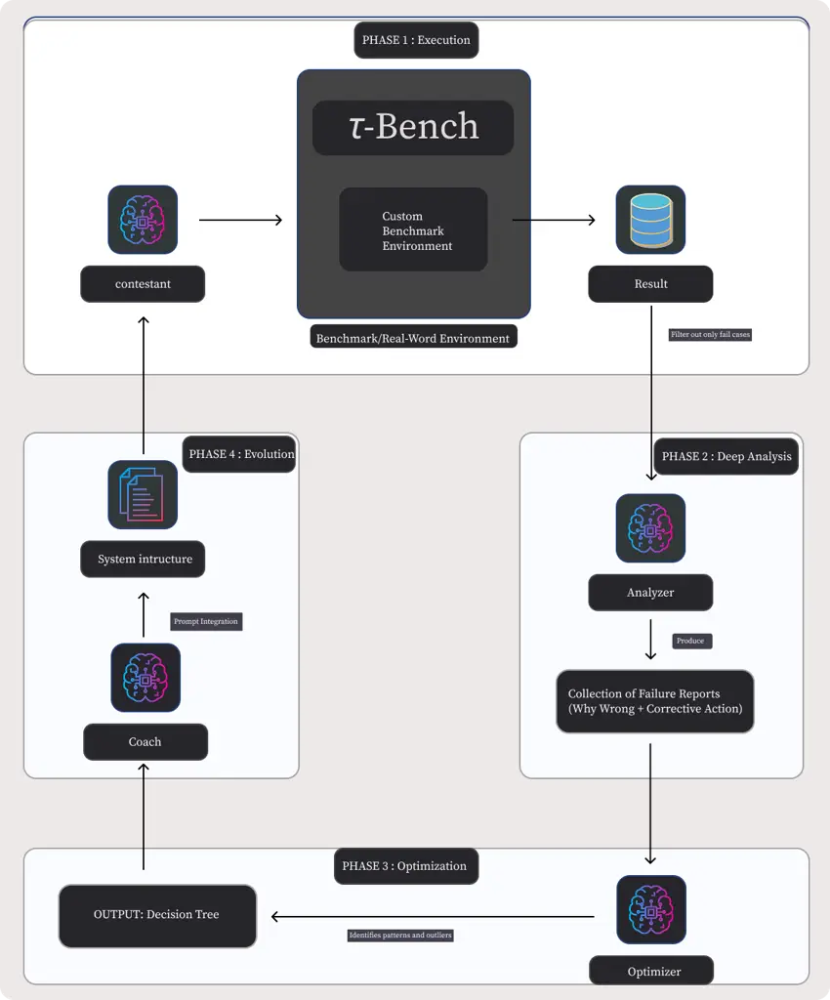
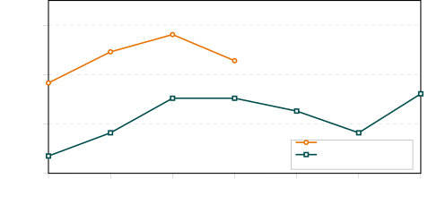
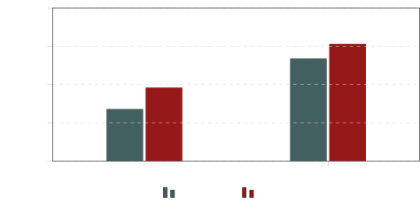

# ROAD: Reflective Optimization via Automated Debugging for Zero-Shot Agent Alignment

Natchaya Temyingyong    Daman Jain    Neeraj Kumarsahu    Prabhat Kumar
   Rachata Phondi    Wachiravit Modecrua    Krittanon Kaewtawee   
Krittin Pachtrachai    Touchapon Kraisingkorn

###### Abstract

Automatic Prompt Optimization (APO) has emerged as a critical technique
for enhancing Large Language Model (LLM) performance, yet current
state-of-the-art methods typically rely on large, labeled gold-standard
development sets to compute fitness scores for evolutionary or
Reinforcement Learning (RL) approaches. In real-world software
engineering, however, such curated datasets are rarely available during
the initial cold start of agent development, where engineers instead
face messy production logs and evolving failure modes. We present ROAD
(Reflective Optimization via Automated Debugging), a novel framework
that bypasses the need for refined datasets by treating optimization as
a dynamic debugging investigation rather than a stochastic search.
Unlike traditional mutation strategies, ROAD utilizes a specialized
multi-agent architecture, comprising an Analyzer for root-cause
analysis, an Optimizer for pattern aggregation, and a Coach for strategy
integration to convert unstructured failure logs into robust, structured
Decision Tree Protocols. We evaluated ROAD across both a standardized
academic benchmark and a live production Knowledge Management engine.
Experimental results demonstrate that ROAD is highly sample-efficient,
achieving a 5.6% increase in Success Rate (73.6% to 79.2%) and a 3.8%
increase in Search Accuracy within just three automated iterations.
Furthermore, on complex reasoning tasks in the Retail domain, ROAD
improved agent performance by approximately 19% relative to the
baseline. These findings suggest that mimicking the human engineering
loop of the fail analysis patch offers a viable, data-efficient
alternative to resource-intensive RL training for deploying reliable LLM
agents.

¹¹footnotetext: Co-first authors¹¹footnotetext: Amity AI Research and
Application Center, {natchaya, rachata.pho,
wachiravit}@amitysolutions.com²²footnotetext: Tollring, {daman.jain,
neeraj.kumarsahu, prabhat.kumar}@tollring.com

## 1 Introduction

The integration of Large Language Models (LLMs) into complex software
systems has necessitated a shift from traditional coding to prompt
engineering \[1, 2\]. However, optimizing these LLM systems is rarely a
straightforward path. While recent academic research has introduced
powerful algorithms for Automatic Prompt Optimization (APO)—utilizing
evolutionary strategies or Reinforcement Learning (RL) to refine agent
behaviors \[8, 4, 9, 3\]—applying these methods within the constraints
of an active engineering organization reveals a critical bottleneck: the
data itself.

Standard optimization methodologies, such as those relying on
gradient-like feedback or declarative compilation \[5, 6\], typically
operate on the assumption that a “gold-standard” dataset exists. These
approaches require a curated training set ($`D_{train}`$) consisting of
high-quality inputs paired with verifiable evaluation metadata, such as
correct answers or unit tests, to drive the evolutionary loop. In
academic settings, such datasets are often readily available \[17\].
However, in the rapid “fail-fix-deploy” cycles of real-world software
development, engineers rarely have the luxury of curating a refined
dataset upfront. Instead, development teams are frequently confronted
with the “Cold Start” problem, working with messy production logs,
evolving edge cases, and complex failure modes that do not fit neatly
into a static Question-and-Answer format \[19, 18\]. The cost of pausing
development to manually label thousands of examples creates a friction
that renders traditional data-heavy optimization algorithms impractical
for many production environments.

To bridge the gap between academic optimization algorithms and the
iterative needs of real-world software development, we introduce ROAD
(Reflective Optimization via Automated Debugging). ROAD is a novel
framework designed to automate the failure analysis loop without
requiring a perfect dataset from day one. Unlike traditional approaches
that rely on static training data or stochastic text mutations, ROAD
treats optimization as a dynamic debugging investigation. By analyzing
the “messy” logs of failed interactions, the framework utilizes a
multi-agent architecture to identify root causes and systematically
evolve the agent’s core instructions, drawing inspiration from automated
fault localization and self-correction techniques \[21, 20, 11, 10,
12\].

The ROAD framework diverges from conventional prompt engineering by
shifting the output format from unstructured natural language to
structured Decision Tree Protocols. By mapping out the logic gaps where
models fail, ROAD generates rigorous operational frameworks that enforce
strict sequencing and safety guardrails, effectively reducing
hallucination and logic errors \[23, 32\].

We validated the ROAD workflow across two distinct environments: the
standardized academic benchmark and a live production Knowledge
Management (KM) engine. Our experiments demonstrate that ROAD achieves
significant performance gains with high sample efficiency. In a
real-world deployment, the framework delivered a 5.6% increase in
Success Rate and a 3.8% boost in Search Accuracy within just three
automated iterations. Furthermore, on complex retail domain tasks using
the Qwen3-4B model \[29\], ROAD improved performance by approximately
19% relative to the baseline. These results confirm that by “trading
tokens for time”—utilizing LLMs to automate the role of a lead engineer
\[30\]—ROAD offers a scalable solution for building robust,
self-correcting agents in data-scarce environments.

## 2 Related Work

Prior work on aligning and optimizing LLM-based agents has largely
relied on large, curated datasets and heavy training. Early approaches
framed agent behavior as a reinforcement learning (RL) problem, tuning
policies based on scalar rewards or human feedback. For example, Ziegler
et al. (2020) demonstrated RL from human preferences to align language
models, but it required tens of thousands of labeled comparisons to
achieve good performance. Similarly, automated prompt engineering
methods have emerged: soft prompt tuning uses gradient descent on
embedding vectors, but these prompts lack interpretability and
portability across models. Discrete prompt optimization is more
challenging. Shin et al. (2020) introduced AutoPrompt, a gradient-guided
search to generate fill-in-the-blank prompts, but this method suffered
from training instability and limited gains in practice. More recently,
RLPROMPT (Deng et al., 2022) used reinforcement learning to train a
policy network that directly generates optimized discrete prompts,
achieving state-of-the-art results on few-shot classification and
style-transfer tasks. Notably, these methods still assume a fixed reward
signal or labeled evaluation set for training.

Other work has shown that prompting strategies which elicit reasoning or
self-analysis can improve LLM performance. Chain-of-Thought prompting
(Wei et al., 2022) demonstrated that providing a sequence of
intermediate reasoning steps dramatically boosts reasoning accuracy on
arithmetic and symbolic reasoning tasks. Independent of reward tuning,
instructing a model to reflect on its outputs has been shown to improve
problem solving. Renze and Guven (2024) found that LLM agents
significantly improve when asked to analyze and correct their own
mistakes. In the code generation domain, Song et al. (2024) proposed a
best-first tree search (BESTER) framework in which an LLM generates
multiple self-reflection comments on its buggy code and then repairs
each variant; this iterative debugging yielded state-of-the-art results
on code benchmarks.

The Genetic-Pareto (GEPA) approach is another recent development: it
treats prompts as “genetic” candidates that are iteratively mutated and
tested, learning high-level rules via natural language reflection. GEPA
showed that optimizing prompts through language-based mutation and
selection can outperform RL methods by $`\sim`$10% on average while
using orders of magnitude fewer evaluations. However, like other
methods, GEPA still relies on a gold-standard training set to evaluate
prompt fitness. In contrast, our ROAD framework automates a human-like
debugging loop, extracting corrections from raw failure logs. To our
knowledge, no prior work has combined multi-agent LLM pipelines to
perform automated root-cause analysis and policy-guided prompt rewriting
in a data-scarce setting.

## 3 Methodology

We propose ROAD (Reflective Optimization via Automated Debugging), a
framework designed to reconcile the theoretical efficacy of evolutionary
algorithms with the data-constrained reality of production software
engineering. While standard optimization methods rely on curated,
“gold-standard” datasets ($`\mathcal{D}_{train}`$) to compute dense
reward signals, ROAD operates on the premise that high-entropy
production failures offer a higher-density learning signal than
successful executions.

Our approach shifts the optimization paradigm from stochastic search to
structured, semantic debugging. We implement this as a Multi-Agent
System (MAS) comprising three specialized Large Language Models
(LLMs)—the Analyzer, Optimizer, and Coach—which collaborate to
iteratively refine the instructions of a primary agent, the Contestant.

### 3.1 System Architecture

The ROAD framework orchestrates a closed-loop interaction between the
following modules:

- •
  The Contestant ($`\mathcal{A}`$): The primary agent parameterized by a
  system prompt $`P`$. It interacts with an environment $`\mathcal{E}`$
  (e.g., a benchmark or live production engine) to generate interaction
  trajectories.
- •
  The Analyzer ($`\mathcal{M}_{analysis}`$): A diagnostic agent
  responsible for Semantic Root Cause Analysis (RCA). It transforms raw
  error logs into structured causal explanations.
- •
  The Optimizer ($`\mathcal{M}_{opt}`$): A pattern-recognition agent
  that aggregates discrete failure reports into global strategy updates.
- •
  The Coach ($`\mathcal{M}_{coach}`$): An integration agent that maps
  abstract strategies into concrete prompt syntax, modifying $`P`$ to
  strictly enforce new logic.

### 3.2 The Optimization Pipeline

The workflow proceeds through a cyclical pipeline formalized in
Algorithm 1.

#### 3.2.1 Phase 1: Execution and Selective Filtering

The cycle initiates with the deployment of the Contestant
$`\mathcal{A}`$ on a dataset $`\mathcal{D}`$. Unlike traditional
Reinforcement Learning (RL), which updates policies based on scalar
rewards across all trajectories, ROAD employs a Selective Filtering
mechanism. We define a filter function $`\Phi`$ that discards successful
interactions and explicitly retains only failure cases
($`\mathcal{F}`$). This focuses computational resources on “hard
negatives”—such as hallucinations, loops, or retrieval failures—thereby
maximizing sample efficiency.

#### 3.2.2 Phase 2: Semantic Root-Cause Analysis

Raw execution logs (e.g., stack traces) lack the semantic context
required for high-level reasoning adjustments. In this phase, the
Analyzer $`\mathcal{M}_{analysis}`$ performs deep-dive diagnosis on each
$`f\in\mathcal{F}`$. For each failure, it generates a structured report
$`r`$ containing:

1.  1.  Diagnosis: A natural language explanation of the logic gap (e.g.,
        “Context loss regarding user’s previous request”).
2.  2.  Prescription: A corrective instruction (e.g., “Merge context from
        turns $`t_{-1}`$ and $`t_{0}`$ before querying”).

#### 3.2.3 Phase 3: Pattern Recognition and Decision Tree Synthesis

To mitigate regression cycles, the Optimizer $`\mathcal{M}_{opt}`$
aggregates the set of failure reports $`\mathcal{R}`$ to identify
holistic patterns\[cite: 26\]. A critical innovation of ROAD is the
output format: rather than unstructured prose, the Optimizer synthesizes
a formal Decision Tree Protocol ($`\mathcal{T}`$). This tree enforces
deterministic reasoning paths, including:

- •
  Ambiguity Resolution: Decomposing high-level goals into strict
  sub-routines (e.g., mapping “authenticate” to steps 1.1–1.3).
- •
  Sequencing Rules: Explicitly ordering operations to prevent state
  conflicts (e.g., “Modify Address $`\rightarrow`$ Modify Items”).
- •
  Safety Guardrails: Introducing binary check-nodes (e.g., requiring
  literal “YES” tokens) to preclude probabilistic hallucinations.

#### 3.2.4 Phase 4: Targeted Prompt Evolution

Finally, the Coach $`\mathcal{M}_{coach}`$ integrates $`\mathcal{T}`$
into the system prompt $`P`$. The integration strategy is adaptive: the
Coach may append the tree as a reasoning framework or rewrite core
instructions to align with the new logic. The evolved prompt $`P_{new}`$
is then evaluated in the next epoch.

### 3.3 Algorithmic Formalization

The complete iterative process is formalized in Algorithm 1. The
algorithm initializes with a base prompt and iteratively refines it by
converting unstructured error patterns into rigid logical frameworks.

1: Pre-trained agent $`\mathcal{A}`$, initial prompt $`P_{0}`$,
validation dataset $`\mathcal{D}`$, max iterations $`T_{max}`$, patience
limit $`K`$

2: $`P\leftarrow P_{0}`$

3: $`t\leftarrow 0`$

4: $`k\leftarrow 0`$ $`\triangleright`$ Counter for consecutive
non-improvements

5: while $`t<T_{max}`$ do

6:   $`t\leftarrow t+1`$

7:   Execution: Run $`\mathcal{A}`$ with $`P`$ on $`\mathcal{D}`$,
collect outputs $`\mathcal{O}`$

8:   Filtering:
$`\mathcal{F}\leftarrow\text{FilterFailures}(\mathcal{O})`$

9:   if $`\mathcal{F}=\emptyset`$ then break

10:   end if

11:   $`\mathcal{R}\leftarrow\emptyset`$

12:   for each failure $`f\in\mathcal{F}`$ do

13:    $`r\leftarrow\mathcal{M}_{analysis}(f)`$

14:    $`\mathcal{R}.\text{append}(r)`$

15:   end for

16:   Optimization:

17:   $`patterns\leftarrow\mathcal{M}_{opt}(\mathcal{R})`$

18:   $`\mathcal{T}\leftarrow\text{BuildDecisionTree}(patterns)`$

19:   Evolution:

20:   $`P_{new}\leftarrow\mathcal{M}_{coach}(P,\mathcal{T})`$

21:   if
$`\text{Eval}(\mathcal{A},P_{new},\mathcal{D})>\text{Eval}(\mathcal{A},P,\mathcal{D})`$
then

22:    $`P\leftarrow P_{new}`$

23:    $`k\leftarrow 0`$ $`\triangleright`$ Reset patience on
improvement

24:   else

25:    $`k\leftarrow k+1`$

26:    if $`k\geq K`$ then

27:      break $`\triangleright`$ Stop after $`K`$ failed attempts

28:    end if

29:   end if

30: end while

31: return $`P`$

Algorithm 1 Reflective Multi-Agent Prompt Optimization (ROAD)

To illustrate the data flow and agent interaction, Figure 1 depicts the
full pipeline. The diagram highlights the transformation of raw failure
logs into the structured Decision Tree Protocol.

Figure 1: The ROAD Framework Pipeline. (1) The Contestant executes
tasks; (2) Failures are filtered; (3) The Analyzer diagnoses root
causes; (4) The Optimizer synthesizes a Decision Tree ($`\mathcal{T}`$);
(5) The Coach updates the system prompt ($`P`$).

## 4 Experiments

To evaluate the efficacy and robustness of the ROAD framework, we
designed a dual-environment experimental protocol. We tested the
methodology across two distinct settings: a rigorous, standardized
academic benchmark to ensure theoretical soundness, and a live
production environment to validate real-world applicability. This
dual-validation strategy allows us to assess the framework’s performance
in both controlled, “clean” scenarios and the noisy, unstructured data
regimes typical of active software engineering.

### 4.1 Experimental Setup 1: Academic Benchmarking ($`\tau^{2}`$-bench)

#### 4.1.1 Benchmark Selection

For our controlled evaluation, we utilized $`\tau^{2}`$-bench, a
state-of-the-art framework designed to test conversational agents in
dynamic, persistent-state environments. Unlike static Q&A benchmarks
where the user acts as a passive interrogator, $`\tau^{2}`$-bench
employs a goal-oriented user simulator that interacts with the agent
over multiple turns. This setup creates a highly interactive scenario
where the conversation evolves based on the agent’s tool execution and
the user’s hidden constraints.

#### 4.1.2 Domain Specifics (Retail)

We specifically focused our experiments on the Retail Domain within
$`\tau^{2}`$-bench. This domain was selected because it demands complex
tool usage and multi-step reasoning, presenting a high difficulty curve
for standard prompting techniques. The tasks involved intricate
workflows such as:

- •
  Order Modifications: Users requesting changes to shipping addresses or
  item quantities for pending orders.
- •
  Refund Processing: Handling financial logic and policy checks.
- •
  Authentication Protocols: Managing user verification via multiple
  lookup methods (Email vs. Name + Zip) before granting account access.

#### 4.1.3 Model Configuration

Our experimental design distinguishes between the Target Agents (the
models being optimized) and the Optimization Backbone (the model
powering the ROAD framework’s internal agents).

##### Target Agents (The Contestants)

To test the generality of the ROAD framework across different model
architectures, we benchmarked performance using two primary Large
Language Models (LLMs):

1.  1.  o4-mini: Representing a highly capable, efficient reasoning model.
2.  2.  Qwen3-4B-Thinking-2507: A specialized, smaller-parameter model
        designed for chain-of-thought reasoning.

##### Optimization Backbone (GPT-5)

We utilized GPT-5 as the foundational LLM to instantiate the three
meta-agents defined in our System Architecture: the Analyzer
($`\mathcal{M}_{analysis}`$), the Optimizer ($`\mathcal{M}_{opt}`$), and
the Coach ($`\mathcal{M}_{coach}`$). We selected this frontier-class
model for these distinct roles due to its high-fidelity context window
and superior reasoning capabilities, which are essential for:

- •
  Performing deep root cause analysis on failure logs (Analyzer).
- •
  Aggregating failure patterns into global strategies (Optimizer).
- •
  Synthesizing strict prompt syntax without regression (Coach).

#### 4.1.4 Baseline vs. ROAD

- •
  Baseline: The models were initialized with a “Base Prompt” written in
  standard natural language prose. These instructions were
  conversational and open to interpretation (e.g., “At the beginning,
  you have to authenticate the user”).
- •
  ROAD Implementation: We applied the ROAD workflow over a course of 6
  iterations. In each iteration, the GPT-5 driven Optimizer diagnosed
  failure cases from the validation set and injected structured Decision
  Trees back into the system prompt to resolve logic gaps.

### 4.2 Experimental Setup 2: Real-World Production (Industrial RAG)

#### 4.2.1 System Environment: The Accentix KM Engine

To validate the ROAD framework in a data-scarce “Cold Start” scenario,
we deployed it within a live production environment. We utilized an
industrial Retrieval-Augmented Generation (RAG) system, internally
referred to as the Accentix Knowledge Management (KM) Engine.

Functionally, this engine operates as an autonomous retrieval agent. It
interfaces with a vector database containing extensive proprietary
documentation. For each user interaction, the agent performs a two-step
logic process:

1.  1.  Query Generation: The agent analyzes the user’s question and context
        to formulate a specific search query (e.g., converting a natural
        language question into database keywords).
2.  2.  Retrieval & Synthesis: The system executes this query to retrieve
        specific document segments (identified by a unique Chunk ID). The
        agent then synthesizes a final answer based solely on these
        retrieved chunks.

#### 4.2.2 Data Characteristics

Unlike the academic benchmark, the interaction data in this environment
is characterized by high entropy and noise. The input queries often
include:

- •
  Multi-turn Context Dependencies: Users frequently provide partial
  information across multiple messages (e.g., specifying “private
  hospital” in a second turn after mentioning “disability” in the
  first), requiring the agent to maintain state.
- •
  Speculative Queries: Users asking out-of-scope or opinion-based
  questions (e.g., predicting future financial solvency), which require
  the agent to trigger “no-answer” guardrail.

#### 4.2.3 Implementation Strategy

We operated under strict resource constraints with zero pre-labeled
training data, using production failure logs as the sole optimization
signal. The evaluation metric focused on the agent’s precision in the
retrieval step. Specifically, we measured the alignment between the
Actual Chunk ID retrieved by the agent’s generated query and the
Expected Chunk ID required to answer the question correctly.

The ROAD pipeline (powered by GPT-5) was executed for 3 automated
iterations to optimize the following behaviors:

1.  1.  Intent Detection: Distinguishing between answerable domain questions
        and out-of-scope chatter.
2.  2.  Query Reformulation: Converting vague user terms into precise search
        queries that target the correct Chunk ID in the vector database.

### 4.3 Evaluation Metrics

For both environments, we tracked performance using the following key
metrics:

- •
  Success Rate (Task Completion): The percentage of interactions where
  the agent successfully resolved the user’s intent without
  hallucination or logic errors.
- •
  Search Accuracy (Retrieval Precision): Specifically for the KM
  environment, we measured the “Search Found Result” rate—the frequency
  with which the agent retrieved valid, relevant document chunks from
  the vector database.
- •
  Iteration Efficiency: The number of optimization cycles required to
  reach convergence or significant performance improvement.

## 5 Results

We evaluated the performance of the ROAD framework across two distinct
dimensions: standardized capability improvement on the
$`\tau^{2}`$-bench academic benchmark, and operational reliability
enhancement within the live Accentix KM production engine. In both
scenarios, the automated loop of failure analysis and decision tree
evolution yielded significant quantitative gains over the baseline
prompts.

### 5.1 Quantitative Analysis: $`\tau^{2}`$-bench (Retail Domain)

Our primary evaluation utilized the $`\tau^{2}`$-bench framework,
specifically focusing on the Retail domain which requires agents to
navigate complex, multi-step workflows such as refund processing and
order modification. We benchmarked two models: the lightweight o4-mini
and the specialized chain-of-thought model Qwen3-4B-Thinking-2507.

#### 5.1.1 Performance Gains

Figure 2: Trajectory of performance improvements over ROAD iterations.
While o4-mini peaked early at Iteration 2, Qwen3-4B exhibited
non-monotonic learning behavior before converging to a higher maxima at
Iteration 6.

As illustrated in Figure 2, the application of the ROAD framework
yielded significant quantitative gains, though the optimization dynamics
differed between architectures.

- •
  o4-mini (Rapid Convergence): The model demonstrated immediate
  responsiveness to the framework, jumping from a baseline of 68.3% to a
  peak of 78.1% by Iteration 2. However, performance regressed to 72.8%
  in Iteration 3, suggesting that further constraint injection beyond
  the second round may yield diminishing returns or over-constrain the
  model’s reasoning flexibility.
- •
  Qwen3-4B-Thinking (Exploratory Learning): The smaller model exhibited
  a more volatile learning curve. Starting at 53.5%, it quickly climbed
  to 65.2% (Iterations 2–3). The subsequent dip in Iterations 4–5
  (dropping to 58.2%) indicates a phase of exploration or instability as
  the Analyzer adjusted its feedback logic. Crucially, the system
  self-corrected in Iteration 6, recovering to reach a global maximum of
  66.1%.

These results suggest that while ROAD is effective for both classes of
models, larger models like o4-mini may require fewer optimization rounds
(early stopping), whereas smaller models benefit from extended feedback
loops to stabilize their reasoning.

### 5.2 Real-World Application: Accentix KM Engine

While academic benchmarks required six iterations to mature, our
deployment in the Accentix Knowledge Management (KM) engine demonstrated
rapid convergence, achieving optimal results within just 3 iterations.
This efficiency validates the “Zero-Shot Data Curation” hypothesis,
suggesting that production failure logs provide a high-density learning
signal.

#### 5.2.1 Metric Improvements

We observed measurable improvements across primary Key Performance
Indicators (KPIs) in the real-world deployment environment. As
demonstrated in Figure 3, the system achieved consistent gains in both
resolution accuracy and retrieval efficacy.

Figure 3: Performance comparison on real-world knowledge management
cases. The ROAD framework (Iteration 3) outperformed the baseline in
both overall task success and document retrieval accuracy.

- •
  Success Rate (+5.6%): The overall task completion rate improved from
  73.6% (Base Prompt) to 79.2% (Iteration 3). This metric indicates that
  the decision trees generated by the Optimizer effectively resolved
  ambiguity in user intents that had previously resulted in
  conversational dead ends.
- •
  Search Hit Rate (+3.8%): The agent’s ability to retrieve valid
  documentation chunks increased from 86.8% to 90.6%. This improvement
  confirms that the failure analysis successfully diagnosed suboptimal
  query patterns—such as the use of overly specific keywords—allowing
  the Coach to implement broader, more robust search strategies.

### 5.3 Qualitative Analysis: Evolution of Logic

To understand the mechanism behind the quantitative gains, we analyzed
the specific semantic shifts in the system instructions. The ROAD
framework successfully transitioned the agent from interpreting vague
conversational prose to executing strict operational protocols. This
evolution is visualized below, comparing the initialization state
against the output of Iteration 6.

#### 5.3.1 Baseline State: Vague Prose (Before)

The initial instructions were written in standard natural language. They
were conversational and open to interpretation, often leading to
execution errors because the agent lacked specific guidance on the order
of operations for complex tasks.

Critique: The phrase “just make sure to update them” is
non-deterministic. It fails to specify which update should happen first,
leading to potential database locking errors or logical conflicts.

#### 5.3.2 Optimized State: Strict Decision Tree (After Iteration 6)

By the sixth iteration, the Coach LLM had completely restructured the
prompt. It injected a numbered Decision Tree Protocol, enforcing rigid
branching logic and safety checks that were absent in the baseline.

Key Structural Improvements:

- •
  Ambiguity Removal: The vague instruction to “authenticate the user”
  was converted into a precise step-by-step workflow (Steps 1.1–1.3),
  covering specific edge cases like missing last names.
- •
  Logic Injection: The optimized prompt explicitly enforces a Sequencing
  Rule (Step 5B.5), dictating that address modifications must precede
  item modifications, resolving the “order of operations” failure mode.
- •
  Safety Guardrails: The generic requirement for confirmation was
  tightened into a Safety Check (Step 5C.4) that rejects ambiguous
  affirmations like “Okay” in favor of a literal “YES” token,
  significantly reducing accidental executions.

#### 5.3.3 Case Study 1: Contextual Query Reformulation

A primary failure mode in the baseline was the loss of context across
conversational turns. In the KM engine, the agent often failed to carry
over the subject (e.g., “disability”) to subsequent queries (e.g.,
“private hospital”), resulting in irrelevant searches for the generic
term “Private”.

As shown in Table 1, the ROAD-optimized agent correctly merged the
context, reformulating the query to “Disability case outpatient cost
private hospital” to retrieve the correct document chunk.

[TABLE]

Table 1: Case Study 1, Contextual Query Reformulation. Comparison of
retrieval performance before and after implementing ROAD logic.

#### 5.3.4 Case Study 2: Hallucination Prevention & Scope Management

The baseline agent frequently hallucinated answers to speculative
questions, such as predicting the future bankruptcy of the Social
Security fund. The ROAD optimization introduced a “No Data / Out of
Scope” decision node. As detailed in Table 2, the optimized agent
correctly identified the query as speculative and returned a standard
disclaimer rather than fabricating a prediction.

| State  | Agent Response                                                                                                                        | Result                                                                                                                                                      |
| ------ | ------------------------------------------------------------------------------------------------------------------------------------- | ----------------------------------------------------------------------------------------------------------------------------------------------------------- |
| Before | Returns a long, generic explanation about how the Social Security fund works, how contributions are calculated, and pension formulas. | Fail: The answer is factually correct but does not answer the specific question about the fund’s future bankruptcy risk. It creates a “soft hallucination”. |
| After  | “Apologies, this information is not currently available in the system database.”                                                      | Success: The agent correctly triggered the “No Data / Out of Scope” decision node, preventing the spread of unverified information.                         |

Table 2: Case Study 2, Hallucination Prevention & Scope Management.
Comparison of agent behavior on out-of-scope queries.

## 6 Discussion

The experimental results presented in the previous section suggest a
paradigm shift in how we approach the optimization of agentic systems.
By moving away from stochastic search methods and towards a structured,
reflective debugging process, the ROAD framework addresses the critical
friction points of real-world software engineering. In this section, we
analyze the mechanisms behind these gains, discuss the economic
trade-offs of the multi-agent architecture, and acknowledge the
boundaries of the methodology.

### 6.1 The Efficiency of Semantic Debugging

Traditional Automatic Prompt Optimization (APO) often mimics
evolutionary biology: generating a large population of prompts and
selecting the fittest survivors. While theoretically robust, this
approach is inherently wasteful, often requiring thousands of inference
calls to converge. ROAD diverges from this “black box” optimization by
adopting a “glass box” approach we term Semantic Debugging.

By explicitly analyzing why an agent failed—rather than simply noting
that it failed—ROAD converts low-fidelity error signals into
high-fidelity logic updates. The rapid convergence observed in our
experiments (3 iterations for the KM engine) indicates that a single
“debugged” failure often provides more information gain than hundreds of
successful rollouts. The shift from vague prose to Decision Tree
Protocols effectively reduces the search space for the model, forcing it
into a deterministic reasoning path that prevents the recurrence of
known error patterns.

### 6.2 Strategic Leverage: The “Token Tax” Trade-off

A potential criticism of the ROAD framework is the computational
overhead, or “Token Tax,” incurred by utilizing three distinct LLMs
(Analyzer, Optimizer, Coach) to refine a single agent. In a purely
academic vacuum, this might appear inefficient compared to
gradient-based updates. However, in the context of an engineering
organization, we argue this represents Strategic Leverage.

We are effectively trading commoditized computational credits for
invaluable engineering hours. In a traditional workflow, a lead engineer
would spend days manually reviewing logs, hypothesizing root causes, and
tweaking prompts—a process that is both expensive and unscalable. ROAD
automates this “lead engineer” loop, identifying logic gaps and patching
errors in hours. The cost of the additional tokens is negligible
compared to the velocity gained by removing humans from the debugging
loop. Thus, the “Token Tax” should be viewed not as an expense, but as
an investment in deployment velocity.

### 6.3 Solving the “Cold Start” Problem

Perhaps the most significant contribution of ROAD is its ability to
operate in Zero-Shot Data Curation environments. Standard Reinforcement
Learning (RL) techniques, such as GRPO, often require curated datasets
($`D_{train}`$) with verifiable gold standards to drive the reward
function. In the “Cold Start” phase of product development, such
datasets rarely exist.

ROAD bypasses this bottleneck by learning directly from “messy”
production logs and partial failures. By treating the failure itself as
the training signal, it eliminates the need for manual data labeling.
This capability is what allowed the Accentix KM deployment to achieve
production-grade improvements without a pre-existing “gold” dataset,
proving that we no longer have to choose between deploying fast and
deploying smart.

### 6.4 Limitations and Future Work

While ROAD demonstrates high sample efficiency, it is important to
acknowledge its theoretical limits. As an in-context learning optimizer,
it likely cannot reach the theoretical performance ceiling of a massive,
20,000-rollout Reinforcement Learning training run. For domains
requiring hyper-optimization at the limit of a model’s capabilities,
traditional fine-tuning remains superior.

However, for the vast majority of business applications, the goal is not
to reach the theoretical global maximum, but to deploy a reliable,
high-quality agent quickly. ROAD serves as the bridge that takes a
prototype from “messy” to “robust,” solving the immediate problem that
matters to businesses: getting a working agent into production now.
Future work will explore hybrid approaches, using ROAD to bootstrap a
high-quality dataset that can subsequently be used for fine-tuning
smaller, more efficient models.

## 7 Conclusion

The rapid integration of Large Language Models (LLMs) into industrial
software engineering has exposed a fundamental disconnect between
academic optimization theory and the practical realities of deployment.
While the literature is rich with algorithms for prompt tuning, the
majority operate under the assumption of data abundance—specifically,
the existence of “gold-standard” datasets for calculating reward
functions. In the “Cold Start” phase of real-world development, such
data is conspicuously absent. This paper presented ROAD (Reflective
Optimization via Automated Debugging), a framework designed to bridge
this chasm. By inverting the optimization paradigm—focusing on the
“messy” signal of production failures rather than the clean signal of
curated benchmarks—ROAD demonstrates that we no longer have to choose
between deploying fast and deploying smart.

### 7.1 Synthesis of Contributions

Our primary contribution is the validation of Zero-Shot Data Curation.
While foundational algorithms like GEPA revolutionized academic
benchmarks by reducing sample requirements, they still necessitated a
curated training set ($`D_{train}`$). ROAD takes the next evolutionary
leap by proving that a system can effectively “bootstrap” its own
intelligence using only its failure logs.

Through the implementation of a multi-agent architecture—comprising an
Analyzer, Optimizer, and Coach—we successfully automated the semantic
debugging loop. In our live deployment on the Accentix Knowledge
Management engine, this approach yielded a 5.6% increase in Success Rate
and a 3.8% boost in Search Accuracy. Crucially, these gains were
realized in just three automated iterations, confirming the hypothesis
that analyzing specific logic gaps (failures) provides a higher-density
learning signal than reinforcing general successes.

### 7.2 The Shift to Deterministic Protocols

Methodologically, ROAD advances the field by shifting the target of
optimization from unstructured prose to structured Decision Tree
Protocols. Our qualitative analysis revealed that standard
“conversational” prompts are prone to interpretation errors and
hallucinations. By utilizing the Optimizer agent to aggregate failure
patterns into rigid branching logic (e.g., explicit sequencing rules and
binary safety checks), ROAD effectively reduces the search space for the
model. This ensures that the agent’s reasoning path becomes
deterministic and auditable, a critical requirement for enterprise
software that is often missing in stochastic “black box” optimization
methods.

### 7.3 Economic Implications: The “Token Tax” as Strategic Leverage

A significant portion of this research focused on the economic viability
of the framework. Critics may argue that the “Token Tax”—the
computational cost of utilizing three distinct LLMs to refine a single
agent—is prohibitive. However, when viewed through the lens of
organizational velocity, this cost represents Strategic Leverage.

In a traditional engineering workflow, the “Human-in-the-Loop” is the
bottleneck; senior engineers must spend days manually reviewing logs,
hypothesizing root causes, and iteratively tweaking prompts. ROAD
effectively trades commoditized compute credits for these invaluable
engineering hours. By identifying logic gaps and patching “stupid”
errors in hours rather than days, the framework transforms prompt
engineering from a manual operational expense into an automated
investment in velocity.

### 7.4 Limitations and Future Trajectories

We acknowledge that ROAD is not a replacement for full-scale
Reinforcement Learning (RL) in all contexts. As an in-context learning
optimizer, it likely cannot reach the theoretical performance ceiling of
a massive, 20,000-rollout RL training run, which remains superior for
squeezing the final percentage points of performance out of a frozen
task.

However, ROAD solves the problem that defines the majority of business
needs: the “Cold Start.” It acts as the bridge that carries a system
from a fragile, unrefined prototype to a robust, self-correcting agent.
Future work will explore hybrid architectures, where ROAD is used to
rapidly bootstrap a high-quality dataset which is subsequently used to
fine-tune smaller, cheaper models, effectively combining the speed of
in-context learning with the efficiency of weights-based training.

In conclusion, we are moving beyond the era of manual prompt grinding.
With frameworks like ROAD, we are not just building better agents; we
are building systems that possess the agency to build themselves.

## References

- \[1\] Yongchao Zhou, Andrei Ioan Muresanu, Ziwen Han, Keiran Paster,
  Silviu Pitis, Harris Chan, and Jimmy Ba. Large language models are
  human-level prompt engineers, 2023. URL
  [https://arxiv.org/abs/2211.01910](https://arxiv.org/abs/2211.01910).
- \[2\] Chengrun Yang, Xuezhi Wang, Yifeng Lu, Hanxiao Liu, Quoc V. Le,
  Denny Zhou, and Xinyun Chen. Large language models as
  optimizers, 2024. URL
  [https://arxiv.org/abs/2309.03409](https://arxiv.org/abs/2309.03409).
- \[3\] Lakshya A. Agrawal, Shangyin Tan, Dilara Soylu, Noah Ziems,
  Rishi Khare, Krista Opsahl-Ong, Arnav Singhvi, Herumb Shandilya,
  Michael J. Ryan, Meng Jiang, Christopher Potts, Koushik Sen,
  Alexandros G. Dimakis, Ion Stoica, Dan Klein, Matei Zaharia, and Omar
  Khattab. GEPA: Reflective Prompt Evolution Can Outperform
  Reinforcement Learning, 2025. URL
  [https://arxiv.org/abs/2507.19457](https://arxiv.org/abs/2507.19457).
- \[4\] Qingyan Guo, Rui Wang, Junliang Guo, Bei Li, Kaitao Song, Xu
  Tan, Guoqing Liu, Jiang Bian, and Yujiu Yang. Connecting large
  language models with evolutionary algorithms yields powerful prompt
  optimizers, 2024. URL
  [https://arxiv.org/abs/2309.08532](https://arxiv.org/abs/2309.08532).
- \[5\] Mert Yuksekgonul, Federico Bianchi, Joseph Boen, Sheng Liu, Zhi
  Huang, Carlos Guestrin, and James Zou. TextGrad: Automatic
  “differentiation” via text, 2024. URL
  [https://arxiv.org/abs/2406.07496](https://arxiv.org/abs/2406.07496).
- \[6\] Omar Khattab, Arnav Singhvi, Paridhi Maheshwari, Zhiyuan Zhang,
  Keshav Santhanam, and Matei Zaharia. DSPy: Compiling declarative
  language model calls into self-improving pipelines, 2024. URL
  [https://arxiv.org/abs/2310.03714](https://arxiv.org/abs/2310.03714).
- \[7\] Krista Opsahl-Ong, Michael J. Ryan, Josh Purtell, David Broman,
  Christopher Potts, Matei Zaharia, and Omar Khattab. Optimizing
  instructions and demonstrations for multi-stage language model
  programs, 2024. URL
  [https://arxiv.org/abs/2406.11695](https://arxiv.org/abs/2406.11695).
- \[8\] Reid Pryzant, Dan Iter, Jerry Li, Yin Lee, Chenguang Zhu, and
  Michael Zeng. Automatic prompt optimization with “gradient descent”
  and beam search, 2023. URL
  [https://arxiv.org/abs/2305.03495](https://arxiv.org/abs/2305.03495).
- \[9\] Chrisantha Fernando, Dylan Banarse, Henryk Michalewski, Simon
  Osindero, and Tim Rocktäschel. Promptbreeder: Self-referential
  self-improvement via prompt evolution, 2023. URL
  [https://arxiv.org/abs/2309.16797](https://arxiv.org/abs/2309.16797).
- \[10\] Aman Madaan, Niket Tandon, Prakhar Gupta, Skyler Hallinan, Luyu
  Gao, and others. Self-refine: Iterative refinement with
  self-feedback, 2023. URL
  [https://arxiv.org/abs/2303.17651](https://arxiv.org/abs/2303.17651).
- \[11\] Noah Shinn, Federico Cassano, Edward Berman, Ashwin Gopinath,
  Karthik Narasimhan, and Shunyu Yao. Reflexion: Language agents with
  verbal reinforcement learning, 2023. URL
  [https://arxiv.org/abs/2303.11366](https://arxiv.org/abs/2303.11366).
- \[12\] Zhibin Gou, Zhihong Shao, Yeyun Gong, Yelong Shen, Yujiu Yang,
  Nan Duan, and Weizhu Chen. CRITIC: Large language models can
  self-correct with tool-interactive critiquing, 2024. URL
  [https://arxiv.org/abs/2305.11738](https://arxiv.org/abs/2305.11738).
- \[13\] Long Ouyang, Jeff Wu, Xu Jiang, Diogo Almeida, and others.
  Training language models to follow instructions with human
  feedback, 2022. URL
  [https://arxiv.org/abs/2203.02155](https://arxiv.org/abs/2203.02155).
- \[14\] Rafael Rafailov, Archit Sharma, Eric Mitchell, Stefano Ermon,
  Christopher D. Manning, and Chelsea Finn. Direct preference
  optimization: Your language model is secretly a reward model, 2023.
  URL
  [https://arxiv.org/abs/2305.18290](https://arxiv.org/abs/2305.18290).
- \[15\] Zhihong Shao, Peiyi Wang, Qihao Zhu, Runxin Xu, and others.
  DeepSeekMath: Pushing the limits of mathematical reasoning in open
  language models, 2024. URL
  [https://arxiv.org/abs/2402.03300](https://arxiv.org/abs/2402.03300).
- \[16\] Shunyu Yao, Noah Shinn, Pedram Razavi, and Karthik Narasimhan.
  $`\tau^{2}`$-bench: A benchmark for tool-agent-user interaction in
  real-world domains, 2024. URL
  [https://arxiv.org/abs/2406.12045](https://arxiv.org/abs/2406.12045).
- \[17\] Xiao Liu, Hao Yu, Hanchen Zhang, Yifan Xu, and others.
  AgentBench: Evaluating LLMs as agents, 2024. URL
  [https://arxiv.org/abs/2308.03688](https://arxiv.org/abs/2308.03688).
- \[18\] Shuyan Zhou, Frank F. Xu, Hao Zhu, and others. WebArena: A
  realistic web environment for building autonomous agents, 2024. URL
  [https://arxiv.org/abs/2307.13854](https://arxiv.org/abs/2307.13854).
- \[19\] Carlos E. Jimenez, John Yang, Alexander Wettig, Shunyu Yao,
  Kexin Pei, Ofir Press, and Karthik Narasimhan. SWE-bench: Can language
  models resolve real-world GitHub issues?, 2024. URL
  [https://arxiv.org/abs/2310.06770](https://arxiv.org/abs/2310.06770).
- \[20\] Sungmin Kang, Gabin An, and Shin Yoo. A quantitative and
  qualitative evaluation of LLM-based explainable fault
  localization, 2024. URL
  [https://arxiv.org/abs/2308.05487](https://arxiv.org/abs/2308.05487).
- \[21\] Yihao Qin and others. AgentFL: Scaling LLM-based fault
  localization to project-level context, 2024. URL
  [https://arxiv.org/abs/2403.16362](https://arxiv.org/abs/2403.16362).
- \[22\] Jialun Cao, Meiziniu Li, Xiao Chen, and others. DeepFD:
  Automated fault diagnosis and localization for deep learning
  programs, 2022. URL
  [https://arxiv.org/abs/2205.01938](https://arxiv.org/abs/2205.01938).
- \[23\] Shunyu Yao, Dian Yu, Jeffrey Zhao, Izhak Shafran, Thomas L.
  Griffiths, Yuan Cao, and Karthik Narasimhan. Tree of thoughts:
  Deliberate problem solving with large language models, 2023. URL
  [https://arxiv.org/abs/2305.10601](https://arxiv.org/abs/2305.10601).
- \[24\] Jason Wei, Xuezhi Wang, Dale Schuurmans, Maarten Bosma, and
  others. Chain-of-thought prompting elicits reasoning in large language
  models, 2022. URL
  [https://arxiv.org/abs/2201.11903](https://arxiv.org/abs/2201.11903).
- \[25\] Takeshi Kojima, Shixiang Shane Gu, Machel Reid, Yutaka Matsuo,
  and Yusuke Iwasawa. Large language models are zero-shot
  reasoners, 2022. URL
  [https://arxiv.org/abs/2205.11916](https://arxiv.org/abs/2205.11916).
- \[26\] Xuezhi Wang, Jason Wei, Dale Schuurmans, Quoc Le, Ed Chi, and
  others. Self-consistency improves chain of thought reasoning in
  language models, 2023. URL
  [https://arxiv.org/abs/2203.11171](https://arxiv.org/abs/2203.11171).
- \[27\] Patrick Lewis, Ethan Perez, Aleksandra Piktus, Fabio Petroni,
  Vladimir Karpukhin, and others. Retrieval-augmented generation for
  knowledge-intensive NLP tasks, 2020. URL
  [https://arxiv.org/abs/2005.11401](https://arxiv.org/abs/2005.11401).
- \[28\] Yunfan Gao, Yun Xiong, Xinyu Gao, and others.
  Retrieval-augmented generation for large language models: A
  survey, 2024. URL
  [https://arxiv.org/abs/2312.10997](https://arxiv.org/abs/2312.10997).
- \[29\] An Yang, Anfeng Li, Baosong Yang, and others. Qwen3 technical
  report, 2025. URL
  [https://arxiv.org/abs/2505.09388](https://arxiv.org/abs/2505.09388).
- \[30\] Aaron Jaech and others. OpenAI o1 system card, 2024. URL
  [https://arxiv.org/abs/2412.16720](https://arxiv.org/abs/2412.16720).
- \[31\] Tianyang Zhong and others. Evaluation of OpenAI o1:
  Opportunities and challenges of AGI, 2024. URL
  [https://arxiv.org/abs/2409.18486](https://arxiv.org/abs/2409.18486).
- \[32\] Lei Huang, Weijiang Yu, and others. A survey on hallucination
  in large language models, 2024. URL
  [https://arxiv.org/abs/2311.05232](https://arxiv.org/abs/2311.05232).
- \[33\] Potsawee Manakul, Adian Liusie, and Mark J. F. Gales.
  SelfCheckGPT: Zero-resource black-box hallucination detection for
  generative language models, 2023. URL
  [https://arxiv.org/abs/2303.08896](https://arxiv.org/abs/2303.08896).

## Appendix A Optimized Logic for $`\tau^{2}`$-bench (Retail Domain)

This appendix illustrates the structural transformation of the agent’s
core instructions. The ROAD framework replaced the ambiguous natural
language of the baseline prompt with a strict, generated Decision Tree
to resolve logic sequencing errors.

### A.1 Baseline Prompt (Before)

The initial instructions were written in conversational prose. As
highlighted in the snippet below, critical operations like updating both
address and items were described vaguely ("just make sure to update
them"), lacking a defined order of operations.

### A.2 Generated Decision Tree (After)

The ROAD framework synthesized the following Decision Tree to govern the
agent’s behavior. This logic enforces strict sequential execution (e.g.,
Step 5B.5) and explicit safety verifications, replacing the open-ended
prose of the baseline.

## Appendix B Optimized Search Strategy for Accentix KM Engine

This appendix details the optimization performed on the live Accentix
Knowledge Management engine (Thai Social Security Office chatbot). The
focus shifted from logic sequencing to search strategy refinement to
improve retrieval efficacy.

### B.1 Baseline Prompt (Before)

The baseline prompt (translated below) focused heavily on persona
(Tone/Voice) and strict retrieval boundaries. It contains the full
original specification but lacks the advanced decision logic found in
the optimized version.

### B.2 ROAD Optimized Prompt (After)

After 3 iterations, the ROAD framework significantly expanded the prompt
to include a Decision Tree Procedure. This added specific logic for
intent classification, retrieval validation checklists, and fallback
paths which were absent in the baseline.

