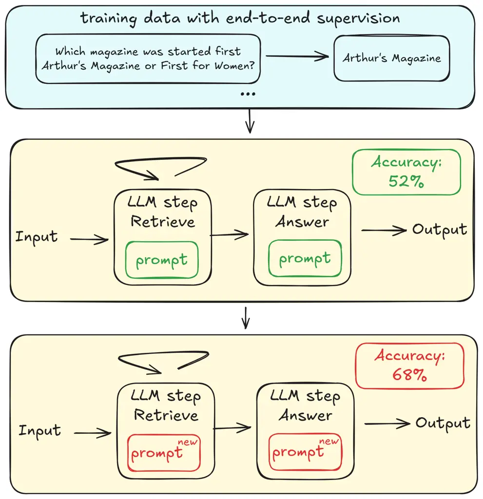
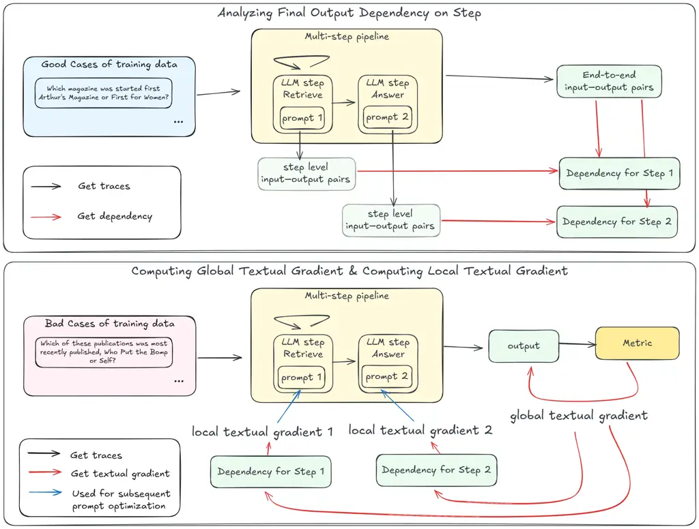

# ADOPT: Adaptive Dependency-Guided Joint Prompt Optimization for Multi-Step LLM Pipelines

Minjun Zhao    Xinyu Zhang    Shuai Zhang    Deyang Li    Ruifeng Shi
Affiliation: Huawei Poisson Lab Affiliation: {zhaominjun1, zhangxinyu35,
zhangshuai117, lideyang2, shiruifeng}@huawei.com

###### Abstract

Multi-step LLM pipelines can solve complex tasks, but jointly optimizing
prompts across steps remains challenging due to missing step-level
supervision and inter-step dependency. We propose ADOPT, an adaptive
dependency-guided joint prompt optimization framework for multi-step LLM
pipelines. ADOPT analyzes the dependency between each LLM step and the
final output, constructs a global textual gradient from final-task
errors, and decomposes it into step-level local textual gradients,
providing more precise optimization signals for local prompt updates. It
further decouples signal estimation from prompt updating, enabling
flexible integration of single-prompt optimizers, and uses a
Shapley-based strategy to adaptively allocate optimization resources to
high-impact steps. Experiments on real-world datasets and structurally
diverse pipelines demonstrate that ADOPT is effective and robust,
consistently outperforming strong prompt optimization baselines.

## 1 Introduction

Background and Motivation. Recent years have witnessed large language
models (LLMs) achieving remarkable performance across a broad spectrum
of tasks Yang et al. (2024a); Bubeck et al. (2023); Achiam et al.
(2023); Touvron et al. (2023). However, despite the continuous
advancement of individual LLMs, they still exhibit notable limitations
when solving complex, multi-faceted problems. To address these
limitations, recent research has explored multi-step LLM pipelines
(i.e., workflows) Lin et al. (2025); Yao et al. (2022); Shen et al.
(2023); Ku et al. (2025); Dong et al. (2025); Liu et al. (2025), where a
task is decomposed into multiple steps and executed through programs
composed of coordinated LLM calls and codes. Such multi-step approaches
extend the capability boundaries of LLM systems and improve robustness
and success rates when tackling intricate real-world tasks Ma et al.
(2025); Lei et al. (2025); He et al. (2025).



Figure 1: An illustration of the prompt optimization problem in a
multi-step LLM pipeline for HotPotQA.

Nevertheless, current multi-step LLM pipelines still face several
challenges, particularly in optimizing multiple prompts. Since the
prompts used at each step directly shape intermediate outputs and error
propagation throughout the pipeline, effective prompt optimization is
crucial for improving the end-to-end success rate of such systems. On
the one hand, manual prompt optimization is highly heuristic,
labor-intensive, and difficult to scale, practitioners often need to
iteratively refine prompts across many steps, and modifying the prompt
for one step may alter the intermediate outputs passed to later steps.
Because upstream steps often cannot observe which intermediate signals
are most useful for downstream components, prompts that appear well
optimized in isolation can still work poorly together, so local
improvements do not necessarily yield better end-to-end
performance Opsahl-Ong et al. (2024). On the other hand, existing
automated prompt optimization methods Pryzant et al. (2023); Prasad et
al. (2023); Guo et al. (2025); Fernando et al. (2023) are primarily
designed for optimizing prompts in single LLM calls. In multi-step LLM
pipelines, only end-to-end supervision is available, and intermediate
outputs are further processed before producing the final result, making
it difficult to obtain labels for individual LLM calls within the
pipeline.

Limitations of Existing Studies. Recently, several data-driven,
end-to-end multi-prompt optimization methods have been proposed to
address the aforementioned challenges, such as Dspy-MIPRO Opsahl-Ong et
al. (2024), TextGrad Yüksekgönül et al. (2025), Trace Cheng et al.
(2024), and GEPA Agrawal et al. (2025). These approaches have
demonstrated certain capabilities in enabling the automatic optimization
of multi-step LLM pipelines. However, they also exhibit notable
limitations. First, some methods Opsahl-Ong et al. (2024) fail to
effectively utilize feedback from erroneous cases, resulting in unclear
optimization directions and inefficient exploration of the prompt search
space. Second, although methods using backpropagation textual
gradients Yüksekgönül et al. (2025); Cheng et al. (2024) can propagate
feedback signals across steps, they rely on LLMs to perform the backward
reasoning, which introduces model-induced interpretations that often
distort or attenuate the gradients. Not only that, these methods
struggle to determine whether an error stems from the current step or
from upstream steps, leading to unstable and unreliable optimization
suggestions. Besides, these methods are difficult to apply to pipelines
containing looping structures, which are commonly used in complex tasks.
As a result, the improvements achieved by existing end-to-end
multi-prompt optimization methods are limited.

Our Solutions. Motivated by these limitations, we propose ADOPT, an
adaptive dependency-guided joint prompt optimization framework for
multi-step LLM pipelines. ADOPT consists of three components. (1) First,
it analyzes execution traces to identify how each LLM step in the
pipeline influences the final outcome. Based on these dependencies,
ADOPT examines erroneous cases from a global perspective and distributes
the high-level improvement signals to individual steps, producing a
step-level adjustment direction that plays a role similar to a partial
derivative with respect to each prompt. This process is analogous to
computing an analytic gradient based on the functional relationship
between the parameters and the final output. It avoids relying on LLMs
to reason backward about where an error originates, a process that often
introduces interpretation bias or severely weakens the signal. The
mechanism resembles a team receiving general suggestions for
improvement, where each member naturally identifies the part relevant to
their own responsibilities. (2) Second, ADOPT separates the generation
of these adjustment directions from the optimization procedure. Each LLM
step can independently apply an appropriate single-prompt optimizer, and
the system then searches for an effective combination of these local
updates at the pipeline level. This design makes ADOPT flexible and
compatible with a broad range of optimization strategies. (3) Third,
ADOPT allocates optimization effort according to the estimated
contribution of each step. Using a Shapley-based measure, LLM steps that
provide greater improvement receive more optimization resources in
subsequent iterations. Through dependency-guided adjustment signals,
flexible local optimization, and principled resource allocation, ADOPT
offers a stable and effective solution for optimizing multiple prompts
in complex multi-step LLM pipelines.

Contributions. Our main contributions are as follows. (1) We introduce
ADOPT, an adaptive dependency-guided joint prompt optimization framework
that derives step-level adjustment directions in multi-step LLM
pipelines based on dependencies. (2) We decouple adjustment-direction
estimation from prompt optimization, enabling flexible use of
single-prompt optimizers and effective combination of local updates. (3)
We design a Shapley-based strategy that allocates optimization resources
according to each step’s contribution. (4) Experiments on five
real-world datasets and diverse pipelines show that ADOPT consistently
improves end-to-end performance over existing methods.



Figure 2: Overview of dependency-aware textual gradient estimation in
ADOPT, including final output dependency analysis, global textual
gradient construction, and dependency-guided local textual gradient
derivation.

## 2 Preliminaries

### 2.1 Multi-Step LLM Pipelines

We formalize a multi-step LLM system as

```math
\Phi=(C,\mathcal{E},\Pi), \tag{1}
```

where $`C`$ denotes the non-LLM program logic of the system, including
control flow, tool calls, preprocessing and postprocessing, and other
operations that orchestrate the pipeline. The set
$`\mathcal{E}=\{\mathcal{E}_{1},\dots,\mathcal{E}_{m}\}`$ denotes the
fixed LLMs used by the $`m`$ LLM steps, and
$`\Pi=\{p_{1},\dots,p_{m}\}`$ denotes the corresponding prompts.

Given an input $`x`$, the system executes $`C`$, which invokes LLM steps
$`(\mathcal{E}_{i},p_{i})`$ as needed under the pipeline logic, and
produces a final output $`\Phi(x)`$. When $`C`$ and $`\mathcal{E}`$ are
fixed and only the prompts are treated as learnable parameters, we write
$`\Phi(x;\Pi)`$.

### 2.2 Problem Formulation

The multi-step LLM system $`\Phi`$ takes an input $`x`$ and produces a
final output $`\Phi(x;\Pi)`$, where the prompts
$`\Pi=\{p_{1},\dots,p_{m}\}`$ serve as the learnable parameters and all
other system components remain fixed. Intermediate results generated
during execution are not supervised, and only the end-to-end output is
available for evaluation.

Given a training set $`D_{\mathrm{train}}=\{(x_{j},y_{j})\}`$ and a task
metric $`\mathcal{M}(\hat{y},y)\in[0,1]`$ that evaluates a predicted
final output $`\hat{y}`$ against the ground-truth label $`y`$, where
larger values indicate better performance, the goal is to optimize the
prompts so that the overall system performance is maximized on the
training set. Formally, we define the optimization problem as

```math
\Pi^{*}=\arg\max_{\Pi\in S^{m}}\sum_{(x,y)\in D_{\mathrm{train}}}\mathcal{M}\big(\Phi(x;\Pi),y\big), \tag{2}
```

where $`S`$ denotes the space of natural-language strings. This problem
is challenging because the search space $`S^{m}`$ is combinatorial and
extremely large, supervision is available only at the end-to-end level,
and the execution of $`\Phi`$ is non-differentiable, making it difficult
to determine which LLM steps are responsible for end-to-end errors and
how their prompts should be adjusted.

## 3 Methodology

In this section, we introduce ADOPT, an adaptive dependency-guided
end-to-end optimization framework for multi-step LLM pipelines. ADOPT
addresses the challenge of end-to-end prompt optimization by explicitly
modeling how the outputs of individual steps contribute to the final
result of the pipeline and using these dependencies to guide step-wise
prompt updates.

The framework operates in three stages. First, ADOPT analyzes execution
traces to derive step-specific adjustment directions, which approximate
analytical partial derivatives with respect to individual prompts and do
not rely on backward reasoning by LLMs. Second, it decouples the
estimation of these adjustment directions from the update procedure,
allowing each step to employ an appropriate single-prompt optimizer
while the system searches for an effective combination of local updates
at the pipeline level. Third, ADOPT allocates optimization resource
dynamically using Shapley value, focusing computation on the LLM steps
that contribute most to performance improvement.

Together, these components enable stable, targeted, and scalable
optimization of prompts in complex multi-step LLM pipelines. We use
LLM-based optimizers to optimize multi-step LLM pipelines. To avoid
ambiguity, we will hereafter refer to LLM-based optimizers simply as
“optimizers.”

For clarity, we provide the complete ADOPT training procedure in
Appendix A (Algorithm 1).

### 3.1 Dependency-aware Textual Gradient Estimation

A central challenge in optimizing multi-step LLM pipelines is
determining how end-to-end supervision should be decomposed into
step-level update directions. ADOPT first analyzes how each step
influences the final output and derives the final output dependency on
every step. Based on the feedback produced by the optimizers, which
describes the loss in textual form, ADOPT then generates a global
optimization direction. Finally, using the inferred dependencies, ADOPT
decomposes this global direction into step-level update directions.

During each training iteration, ADOPT first samples a batch of inputs
from the training set and executes the pipeline
$`\Phi(x;\,p_{1},\dots,p_{m})`$ on them. Based on the task metric
$`\mathcal{M}`$, the resulting executions are categorized into good
cases and bad cases, from which up to a fixed number of examples from
each category are selected to form a minibatch used in the current
optimization step. Figure 2 provides an overview of the dependency-aware
textual gradient estimation stage.

Analyzing Final Output Dependency on Step. To simulate the effect of
computing analytical partial derivatives, ADOPT must first determine how
each LLM step functionally influences the final pipeline output. ADOPT
begins with a direct analysis stage, in which an optimizer $`E_{1}`$
examines the workflow code together with the prompts of all steps to
infer the overall task and the intended role of each step within the
pipeline.

Building on this structural understanding, ADOPT then performs a
data-driven analysis using the traces collected from good cases. For
each LLM step, optimizer $`E_{2}`$ is provided with the direct-analysis
results, the step’s input–output pairs, and the corresponding end-to-end
traces. The optimizer analyzes how variations in the step’s output
affect the final result, yielding a final output _dependency_ on that
step. This dependency characterizes the step’s functional contribution
to successful execution and its influence on the end-to-end behavior.

Computing Global Textual Gradient. For each bad case, ADOPT first uses
optimizer $`E_{3}`$ to construct a textual discrepancy $`\mathcal{L}`$
between the pipeline output and the ground truth, guided by the task
metric $`\mathcal{M}`$. This discrepancy, referred to as _textual loss_
or _feedback_ in our setting, explicitly enumerates the errors
responsible for the score reduction and provides a fine-grained and
interpretable description of the mismatch, serving as the
natural-language counterpart of an error signal.

ADOPT then invokes optimizer $`E_{4}`$ to transform this textual loss
into a _global textual gradient_. $`E_{4}`$ performs a diagnostic
analysis that explains why each discrepancy arises, producing a global
description of the failure mode of the final output. This yields a
distilled correction direction expressed at the level of the final
output itself. The resulting global textual gradient functions as an
analogue of the derivative of $`\mathcal{L}`$ with respect to the
textual loss, that is,
$`g^{\text{global}}=\nabla_{\text{Output}}^{\text{text}}\mathcal{L}.`$

Computing Local Textual Gradient. Given the global textual gradient and
the final output dependencies inferred for each step, ADOPT uses
optimizer $`E_{5}`$ to compute a _local textual gradient_ for every
node. For each step, $`E_{5}`$ receives the global textual gradient, the
step’s final output dependency, the step-level input–output pair, and
the final output, and then produces a step-specific natural-language
optimization direction that constitutes the local textual gradient.
Formally, this direction serves as the textual analogue of an analytical
partial derivative,
$`g^{\text{local}}_{i}=\nabla_{p_{i}}^{\text{text}}\mathcal{L}.`$

### 3.2 Prompt Optimization for Pipeline

After deriving step-level local textual gradients, the remaining
challenge is to convert these textual optimization signals into
executable prompt updates while achieving effective coordination across
a multi-step LLM pipeline. Pipeline-level prompt optimization requires
not only that each step independently updates its prompt according to
its local signal, but also that the resulting prompts interact
coherently in an end-to-end manner. To address this, ADOPT adopts a
prompt optimization strategy that combines step-level prompt
optimization guided by local textual gradients with pipeline-level
prompt selection based on search algorithms.

Decoupled Step-level Prompt Optimization. For each bad case, ADOPT uses
the local textual gradient of step $`i`$ to generate a _revised step
output_ that represents the desired behavior of this step under the
given input. This revised output specifies how the step’s output should
change in order to reduce the end-to-end loss and correct the final
pipeline error. Formally, for step $`i`$ with input $`x_{i}`$, the
revised output $`\hat{y}_{i}`$ is generated by optimizer $`E_{6}`$
guided by the local textual gradient.

Across multiple bad cases, ADOPT aggregates pairs of step-level inputs
and their corresponding revised step outputs, forming a step-specific
dataset

```math
\mathcal{D}_{i}=\{(x_{i}^{(k)},\hat{y}_{i}^{(k)})\}_{k=1}^{K}. \tag{3}
```

This dataset serves as supervision for updating the prompt $`p_{i}`$ of
LLM step $`i`$ using a single-prompt optimization procedure.

Crucially, ADOPT decouples the generation of optimization directions
from the choice of the prompt optimization algorithm. For each LLM step,
any existing single-prompt optimizer can be applied to
$`\mathcal{D}_{i}`$ to update $`p_{i}`$, without modifying the
dependency analysis or textual gradient computation stages. This design
makes the framework modular and extensible, allowing different prompt
optimizers to be incorporated as interchangeable components.

In this work, we consider two representative optimizers. The first is an
instruction optimizer that updates only the instruction component of the
prompt. The second jointly optimizes the instruction and automatically
selects representative examples to be included as in-context learning
demonstrations. Each round of step-level optimization produces multiple
candidate prompts for each LLM step, which are subsequently evaluated
and coordinated at the pipeline level.

Global Prompt Selection. The step-level prompt optimization procedure
produces multiple candidate prompts for each LLM step, which gives rise
to a pipeline-level selection problem. Let
$`\mathcal{P}_{i}=\{p_{i}^{(1)},\dots,p_{i}^{(n_{i})}\}`$ denote the
candidate prompt set generated for step $`i`$. The objective is to
select a prompt configuration
$`(p_{1},\dots,p_{m})\in\mathcal{P}_{1}\times\cdots\times\mathcal{P}_{m}`$
that maximizes the end-to-end performance of the pipeline. Since the
effect of a prompt at one step may depend on the prompts chosen at other
steps, this problem cannot be decomposed into independent per-step
decisions and instead constitutes a combinatorial optimization problem
over the joint prompt space.

We formulate pipeline-level prompt selection as a search problem and
apply Bayesian Optimization Snoek et al. (2012) to efficiently explore
prompt configurations under a limited budget.

### 3.3 Shapley-based Resource Allocation

Prompt updates in multi-step LLM pipelines typically yield uneven
returns across steps. After several optimization rounds, certain steps
may become saturated and contribute little additional improvement, while
other steps remain critical to the end-to-end metric. Treating all steps
equally, therefore, wastes optimization budget. ADOPT addresses this
issue by allocating step-level optimization resources according to each
step’s estimated contribution to end-to-end performance, and adopts
Shapley-style attribution as a principled measure of contribution.

Before optimization begins, each step has the same optimization
resources, i.e., how many candidates can be generated during step-level
optimization. At the end of each round, the global prompt selector
evaluates a set of prompt configurations and records their end-to-end
scores under the task metric $`\mathcal{M}`$. For each step $`i`$, we
consider two prompt states, a _weak_ prompt $`p_{i}^{\mathrm{weak}}`$
representing the prompt used in the previous round, and a _strong_
prompt $`p_{i}^{\mathrm{strong}}`$ representing the best-performing
prompt selected from the current candidate set $`\mathcal{P}_{i}`$.
Among all evaluated configurations, ADOPT considers only those in which
each step adopts either its weak or strong prompt. These configurations
can thus be represented by a coalition $`S\subseteq\{1,\dots,m\}`$,
where $`i\in S`$ indicates that step $`i`$ uses
$`p_{i}^{\mathrm{strong}}`$ and $`i\notin S`$ uses
$`p_{i}^{\mathrm{weak}}`$. Let $`P(S)`$ denote the corresponding prompt
assignment, and define the value function

```math
v(S)=\mathcal{M}\big(\Phi(x;P(S))\big). \tag{4}
```

The Shapley value for step $`i`$ measures its average marginal
contribution across all coalitions,

```math
\phi_{i}=\sum_{S\subseteq[m]\setminus\{i\}}w(S)\,\big(v(S\cup\{i\})-v(S)\big), \tag{5}
```

where $`w(S)=\frac{|S|!(m-|S|-1)!}{m!}`$. Computing $`\{\phi_{i}\}`$
exactly requires evaluating $`v(S)`$ for an exponential number of
coalitions, which is prohibitively expensive because each evaluation
corresponds to running the full pipeline. ADOPT therefore estimates step
contributions using Kernel SHAP Lundberg and Lee (2017), which
approximates Shapley values from a limited number of observed
coalitions. Concretely, ADOPT applies Kernel SHAP to the prompt
configurations that have already been evaluated during the
pipeline-level search. Each evaluated configuration provides a binary
indicator vector $`z\in\{0,1\}^{m}`$ for its coalition membership and an
observed score $`v(z)`$. Kernel SHAP then fits a weighted linear model
over these samples and uses the fitted coefficients as efficient
approximations of Shapley-style contributions.

The resulting contribution estimates are used only for resource
allocation in subsequent rounds. Steps with larger estimated
contributions are assigned larger candidate budgets, while steps with
smaller contributions receive fewer candidates. This reallocation
preserves the overall evaluation budget. The number of pipeline-level
prompt configurations evaluated per round is kept fixed, and no
additional pipeline executions are introduced for contribution
estimation. In this way, ADOPT concentrates optimization effort on the
steps that most influence end-to-end performance while maintaining
stable computational cost across rounds.

We further report token and time consumption in Appendix B, showing that
adaptive allocation improves the cost-effectiveness of optimization.

## 4 Experiments

[TABLE]

Table 1: Information of five diverse multi-step pipelines on real-world
datasets.

|           |        |      |          |       |       |      |       |
| --------- | ------ | ---- | -------- | ----- | ----- | ---- | ----- |
| Dataset   | No-COT | COT  | TextGrad | Trace | MIPRO | GEPA | ADOPT |
| Amazon    | 0.88   | 0.89 | 0.90     | 0.92  | 0.91  | 0.92 | 0.94  |
| HotPotQA  | 0.52   | 0.58 | /        | /     | 0.62  | 0.63 | 0.69  |
| HoVer     | 0.55   | 0.57 | 0.58     | 0.59  | 0.62  | 0.65 | 0.71  |
| Emergency | 0.71   | 0.73 | /        | /     | 0.78  | 0.83 | 0.89  |
| Harmful   | 0.58   | 0.61 | /        | /     | 0.67  | 0.71 | 0.75  |

Table 2: Overall performance of ADOPT and baselines on different
real-world datasets.

### 4.1 Experimental Setup

We compare ADOPT with six methods: Chain-of-Thought (CoT) Wei et al.
(2022), no COT, Trace Cheng et al. (2024), TextGrad Yuksekgonul et al.
(2024), MIPRO Opsahl-Ong et al. (2024), GEPA Agrawal et al. (2025). For
CoT, we add "let’s think step by step" to the prompt of each agent in
the tested programs.

We implement five multi-step pipelines to thoroughly evaluate the
effectiveness of our proposed ADOPT and baselines. And we use five
real-world datasets, i.e., Amazon Hou et al. (2024), HotPotQA Yang et
al. (2018), HoVer Jiang et al. (2020), Emergency Zhu et al. (2025), and
Harmful Khanna et al. (2024) as benchmarks for different multi-step
pipelines separately. We show the information of our diverse multi-step
pipelines in Table 1, and we show the implementation details in the
Appendix D. Since different programs run on different datasets and
measure the performance on different values, we introduce each metric
used in the experiments. For Amazon dataset, the metric is
$`1-MAE`$ Wang et al. (2024), where MAE is normalized Mean Absolute
Error of rating. For other datasets, we use accuracy as the metric.

In the main experiments, we use Qwen2.5-72B-Instruct Team (2024) as the
default model configuration. For all LLM calls, the temperature is set
to 0 and top-$`p`$ is set to 1. Each training iteration executes the
pipeline on a batch of 50 cases sampled from the training set, from
which up to 5 good cases and 5 bad cases are subsampled to form the
minibatch used for prompt optimization. All reported metrics are
evaluated on the test set. Unless otherwise specified, all experiments
are repeated three times with different random seeds, and the reported
results are averaged over these runs.

We also analyze optimization efficiency, cross-model robustness, and a
step-level case study in the appendix, which provide further evidence
for the proposed dependency-guided optimization mechanism.

### 4.2 Main Results

Table 2 reports the overall performance of ADOPT and baseline methods on
two real-world multi-step benchmarks. We do not report results for
TextGrad and Trace on HotPotQA, Emergency, and Harmful datasets because
these methods are designed primarily for LLM workflows with directed
acyclic graph (DAG) structures and do not naturally support pipelines
with looping or iterative control flow.

(a) HotPotQA

(b) HoVer

Figure 3: Convergence analysis of ADOPT on HotPotQA and HoVer.

Across all evaluated datasets, ADOPT consistently achieves the strongest
end-to-end performance, demonstrating its effectiveness for optimizing
multi-step LLM pipelines under end-to-end supervision. Compared with
prompting-based baselines such as CoT, ADOPT yields substantial
performance gains, indicating that simply encouraging step-by-step
reasoning is insufficient to address errors arising from complex
interactions among multiple pipeline steps. ADOPT also outperforms
existing multi-prompt optimization methods, including TextGrad, Trace,
MIPRO, and GEPA. TextGrad and Trace rely on LLMs to perform backward
reasoning in order to generate step-level optimization signals, which
introduces model-induced interpretations that can distort or attenuate
the feedback after several steps. Moreover, these methods often struggle
to disentangle whether an error originates from a specific step or from
upstream dependencies, leading to unstable or inconsistent optimization
behavior. MIPRO generates candidate prompts only from correctly solved
examples and selects an optimal combination among them, without
iteratively refining prompts based on bad cases. GEPA incorporates
feedback from bad cases, but directly optimizes prompts using only
final-output feedback, analogous to the textual loss in our framework,
without explicitly modeling how individual steps should be adjusted. In
contrast, ADOPT leverages textual loss to derive global textual gradient
and uses dependencies to decompose end-to-end supervision into
step-specific optimization signals, i.e., local textual gradients,
enabling more precise and coordinated step-level optimization across the
pipeline, which leads to consistently better end-to-end performance.
Taken together, these results indicate that ADOPT provides a more
effective mechanism for improving end-to-end performance in multi-step
LLM systems than existing methods.

### 4.3 Convergence Analysis

To examine the convergence behavior of ADOPT, we use 300 validation
cases from HotPotQA and HoVer, respectively, and track the end-to-end
accuracy over successive optimization iterations. As shown in Figure 3,
ADOPT improves steadily from the initial iterations, with accuracy
increasing rapidly in the early stage and continuing to improve in later
iterations. Although minor fluctuations appear in the later stage, the
overall trend remains stable, and the performance does not degrade as
optimization proceeds. This suggests that the step-level optimization
signals derived by ADOPT are sufficiently informative to support
effective iterative updates in multi-step pipelines. In addition, ADOPT
with resource allocation converges faster than the variant without it,
indicating that contribution-aware budget allocation helps improve
optimization efficiency.

### 4.4 Ablation Studies

|          |                |             |
| -------- | -------------- | ----------- |
| Dataset  | ADOPT-Instruct | ADOPT-Joint |
| HotPotQA | 0.67           | 0.69        |
| HoVer    | 0.69           | 0.71        |

Table 3: Comparison of different step-level prompt optimizers on two
datasets.

Effect of Different Step-level Prompt Optimizers. ADOPT decouples
dependency-aware textual gradient estimation from the choice of the
step-level prompt optimization algorithm, allowing different
single-prompt optimizers to be applied without modifying the upstream
analysis. To assess the effect of this design, we instantiate ADOPT with
two representative optimizers at the step level: an instruction-only
optimizer (i.e., ADOPT-Instruct) that updates the natural-language
instruction in each prompt, and a joint instruction-and-example
optimizer (i.e., ADOPT-Joint) that additionally selects representative
in-context learning examples.

The results are shown in Table 3. From the table, both optimizers
consistently improve end-to-end performance over the baselines, while
the joint optimizer achieves further gains, indicating that enriching
step prompts with selected examples can better capture step-specific
behaviors when accurate local supervision is available. These results
demonstrate that ADOPT’s performance is not tied to a particular prompt
optimizer and that its decoupled formulation enables the framework to
benefit from more expressive optimization strategies as they become
available.

|                             |          |       |
| --------------------------- | -------- | ----- |
| Method                      | HotPotQA | HoVer |
| ADOPT                       | 0.69     | 0.71  |
| w/o Dependency-guided Est.  | 0.64     | 0.67  |
| w/o Global Prompt Selection | 0.62     | 0.66  |
| w/o Resource Allocation     | 0.68     | 0.71  |

Table 4: Fine-grained ablation of ADOPT. All variants are run for 10
optimization iterations, and we report the best accuracy achieved across
iterations.

Fine-grained Component Ablation. Table 4 shows a fine-grained ablation
of ADOPT on HotPotQA and HoVer. We study three key components:
dependency-guided estimation, global prompt selection, and resource
allocation. All variants are run for 10 optimization iterations, and we
report the best accuracy across iterations.

Removing dependency-guided estimation degrades performance on both
datasets, dropping from 0.69 to 0.64 on HotPotQA and from 0.71 to 0.67
on HoVer. This shows that dependency-aware decomposition provides more
effective step-level optimization signals.

Removing global prompt selection further reduces performance to 0.62 on
HotPotQA and 0.66 on HoVer. This is because candidate generation is
stochastic, and locally improved prompts do not always yield the best
pipeline-level combination. In some cases, keeping the current prompt is
better than updating it with a newly optimized candidate.

In contrast, removing resource allocation has little impact on the final
best accuracy, with results of 0.68 on HotPotQA and 0.71 on HoVer. This
suggests that resource allocation mainly improves optimization
efficiency rather than final accuracy.

## 5 Related Work

Prompt Optimization for Single-Step Tasks. Prompt optimization for
single-step tasks typically refines a static prompt for a single LLM
call. Representative methods include search-based approaches such as
APE Zhou et al. (2022) and OPRO Yang et al. (2023), evolutionary methods
such as EvoPrompt Guo et al. (2025), and gradient-inspired approaches
such as ProTeGi Pryzant et al. (2023). AMPO Yang et al. (2024b) further
improves robustness by exploring multiple optimization trajectories in
parallel. While effective for single-step settings, these methods do not
directly address prompt optimization in multi-step LLM pipelines with
inter-step dependencies.

Prompt Optimization in Multi-Step Pipelines. Recent work has extended
prompt optimization to multi-step LLM workflows. TextGrad Yuksekgonul et
al. (2024) and Trace Cheng et al. (2024) assume structured workflows and
propagate feedback backward to produce step-level update signals.
MIPRO Opsahl-Ong et al. (2024) optimizes module-level instructions and
demonstrations by selecting prompt configurations from candidate sets.
GEPA Agrawal et al. (2025) leverages erroneous cases and final-output
feedback to refine prompts. In contrast, ADOPT explicitly decomposes
end-to-end supervision into dependency-aware, step-specific optimization
directions, enabling more reliable prompt updates in multi-step
pipelines.

## 6 Conclusion

We propose ADOPT, an adaptive dependency-guided joint prompt
optimization framework for multi-step LLM pipelines. ADOPT decomposes
end-task supervision into step-level optimization signals through
dependency analysis, supports flexible integration of existing
single-prompt optimizers, and improves optimization efficiency with
Shapley-based resource allocation. Experiments show that ADOPT
consistently improves end-to-end performance.

## Limitations

Although ADOPT demonstrates strong performance in optimizing multi-step
pipelines, it inevitably incurs a relatively high number of LLM calls
due to its iterative optimization process. To mitigate this, we design a
Shapley value-based resource allocation module that prioritizes
optimization efforts toward the most impactful LLM step. This allows
ADOPT to reduce redundant computations and achieve the same level of
performance with fewer LLM calls compared to uniform optimization
strategies. Despite these improvements, the overall resource consumption
remains non-trivial, especially for large-scale or real-time
applications. Reducing this cost further, for example through more
efficient search and resource allocation strategies, remains an
important direction for future work.

## References

- Achiam et al. (2023) J. Achiam, S. Adler, S. Agarwal, L. Ahmad, I.
  Akkaya, F. L. Aleman, D. Almeida, J. Altenschmidt, S. Altman, S.
  Anadkat, et al. Gpt-4 technical report. arXiv preprint
  arXiv:2303.08774. Cited by: §1.
- Agrawal et al. (2025) L. A. Agrawal, S. Tan, D. Soylu, N. Ziems, R.
  Khare, K. Opsahl-Ong, A. Singhvi, H. Shandilya, M. J. Ryan, M. Jiang,
  et al. Gepa: reflective prompt evolution can outperform reinforcement
  learning. arXiv preprint arXiv:2507.19457. Cited by: §1, §4.1, §5.
- Bubeck et al. (2023) S. Bubeck, V. Chandrasekaran, R. Eldan, J.
  Gehrke, E. Horvitz, E. Kamar, P. Lee, Y. T. Lee, Y. Li, S. Lundberg,
  et al. Sparks of artificial general intelligence: early experiments
  with gpt-4. arXiv preprint arXiv:2303.12712. Cited by: §1.
- Cheng et al. (2024) C. Cheng, A. Nie, and A. Swaminathan Trace is the
  next autodiff: generative optimization with rich feedback, execution
  traces, and llms. In Advances in Neural Information Processing Systems
  38: Annual Conference on Neural Information Processing Systems 2024,
  NeurIPS 2024, Vancouver, BC, Canada, December 10 - 15, 2024, Cited by:
  §1, §4.1, §5.
- Dong et al. (2025) G. Dong, J. Jin, X. Li, Y. Zhu, Z. Dou, and J. Wen
  Rag-critic: leveraging automated critic-guided agentic workflow for
  retrieval augmented generation. In Proceedings of the 63rd Annual
  Meeting of the Association for Computational Linguistics (Volume 1:
  Long Papers), pp. 3551–3578. Cited by: §1.
- Fernando et al. (2023) C. Fernando, D. Banarse, H. Michalewski, S.
  Osindero, and T. Rocktäschel Promptbreeder: self-referential
  self-improvement via prompt evolution. arXiv preprint
  arXiv:2309.16797. Cited by: §1.
- Guo et al. (2025) Q. Guo, R. Wang, J. Guo, B. Li, K. Song, X. Tan, G.
  Liu, J. Bian, and Y. Yang EvoPrompt: connecting llms with evolutionary
  algorithms yields powerful prompt optimizers. arXiv preprint
  arXiv:2309.08532. Cited by: §1, §5.
- He et al. (2025) Y. He, G. Huang, P. Feng, Y. Lin, Y. Zhang, H. Li,
  and W. E PaSa: an LLM agent for comprehensive academic paper search.
  In Proceedings of the 63rd Annual Meeting of the Association for
  Computational Linguistics (Volume 1: Long Papers), pp. 11663–11679.
  Cited by: §1.
- Hou et al. (2024) Y. Hou, J. Li, Z. He, A. Yan, X. Chen, and J.
  McAuley Bridging language and items for retrieval and recommendation.
  arXiv preprint arXiv:2403.03952. Cited by: §4.1.
- Jiang et al. (2020) Y. Jiang, S. Bordia, Z. Zhong, C. Dognin, M.
  Singh, and M. Bansal HoVer: a dataset for many-hop fact extraction and
  claim verification. arXiv preprint arXiv:2011.03088. Cited by: §4.1.
- Khanna et al. (2024) M. Khanna, R. Ramrakhya, G. Chhablani, S.
  Yenamandra, T. Gervet, M. Chang, Z. Kira, D. S. Chaplot, D. Batra,
  and R. Mottaghi GOAT-bench: A benchmark for multi-modal lifelong
  navigation. In IEEE/CVF Conference on Computer Vision and Pattern
  Recognition, CVPR 2024, Seattle, WA, USA, June 16-22, 2024,
  pp. 16373–16383. Cited by: §4.1.
- Ku et al. (2025) M. Ku, C. H. Chong, J. Leung, K. Shah, A. Yu, and W.
  Chen Theoremexplainagent: towards video-based multimodal explanations
  for llm theorem understanding. In Proceedings of the 63rd Annual
  Meeting of the Association for Computational Linguistics (Volume 1:
  Long Papers), pp. 6663–6684. Cited by: §1.
- Lei et al. (2025) C. Lei, Y. Chang, N. Lipovetzky, and K. A. Ehinger
  Planning-driven programming: a large language model programming
  workflow. In Proceedings of the 63rd Annual Meeting of the Association
  for Computational Linguistics (Volume 1: Long Papers),
  pp. 12647–12684. Cited by: §1.
- Lin et al. (2025) X. Lin, C. Jia, J. Ji, H. Han, and U. Naseem Ask,
  acquire, understand: A multimodal agent-based framework for social
  abuse detection in memes. In Proceedings of the ACM on Web Conference
  2025, WWW 2025, Sydney, NSW, Australia, 28 April 2025- 2 May 2025,
  pp. 4734–4744. Cited by: §1.
- Liu et al. (2025) Z. Liu, C. Fan, H. Lou, Y. Wu, and K. Deng Mind: a
  multi-agent framework for zero-shot harmful meme detection. In
  Proceedings of the 63rd Annual Meeting of the Association for
  Computational Linguistics (Volume 1: Long Papers), pp. 923–947. Cited
  by: §1.
- Lundberg and Lee (2017) S. M. Lundberg and S. Lee A unified approach
  to interpreting model predictions. Advances in neural information
  processing systems 30. Cited by: §3.3.
- Ma et al. (2025) J. Ma, L. Hu, R. Li, and W. Fu LoCal: logical and
  causal fact-checking with llm-based multi-agents. In Proceedings of
  the ACM on Web Conference 2025, WWW 2025, Sydney, NSW, Australia, 28
  April 2025- 2 May 2025, pp. 1614–1625. Cited by: §1.
- Opsahl-Ong et al. (2024) K. Opsahl-Ong, M. J. Ryan, J. Purtell, D.
  Broman, C. Potts, M. Zaharia, and O. Khattab Optimizing instructions
  and demonstrations for multi-stage language model programs. In
  Proceedings of the 2024 Conference on Empirical Methods in Natural
  Language Processing, EMNLP 2024, Miami, FL, USA, November 12-16, 2024,
  pp. 9340–9366. Cited by: §1, §1, §4.1, §5.
- Prasad et al. (2023) A. Prasad, P. Hase, X. Zhou, and M. Bansal Grips:
  gradient-free, edit-based instruction search for prompting large
  language models. In Proceedings of the 17th Conference of the European
  Chapter of the Association for Computational Linguistics,
  pp. 3845–3864. Cited by: §1.
- Pryzant et al. (2023) R. Pryzant, D. Iter, J. Li, Y. T. Lee, C. Zhu,
  and M. Zeng Automatic prompt optimization with" gradient descent" and
  beam search. arXiv preprint arXiv:2305.03495. Cited by: §1, §5.
- Shen et al. (2023) Y. Shen, K. Song, X. Tan, D. Li, W. Lu, and Y.
  Zhuang Hugginggpt: solving ai tasks with chatgpt and its friends in
  hugging face. Advances in Neural Information Processing Systems 36,
  pp. 38154–38180. Cited by: §1.
- Snoek et al. (2012) J. Snoek, H. Larochelle, and R. P. Adams Practical
  bayesian optimization of machine learning algorithms. Advances in
  neural information processing systems 25. Cited by: §3.2.
- Team (2024) Q. Team Qwen2.5 technical report. arXiv preprint
  arXiv:2412.15115. Cited by: §4.1.
- Touvron et al. (2023) H. Touvron, T. Lavril, G. Izacard, X.
  Martinet, M. Lachaux, T. Lacroix, B. Rozière, N. Goyal, E. Hambro, F.
  Azhar, et al. Llama: open and efficient foundation language models.
  arXiv preprint arXiv:2302.13971. Cited by: §1.
- Wang et al. (2024) Y. Wang, Z. Jiang, Z. Chen, F. Yang, Y. Zhou, E.
  Cho, X. Fan, Y. Lu, X. Huang, and Y. Yang RecMind: large language
  model powered agent for recommendation. In Findings of the Association
  for Computational Linguistics: NAACL 2024, Mexico City, Mexico, June
  16-21, 2024, pp. 4351–4364. Cited by: §4.1.
- Wei et al. (2022) J. Wei, X. Wang, D. Schuurmans, M. Bosma, B.
  Ichter, F. Xia, E. H. Chi, Q. V. Le, and D. Zhou Chain-of-thought
  prompting elicits reasoning in large language models. In Advances in
  Neural Information Processing Systems 35: Annual Conference on Neural
  Information Processing Systems 2022, NeurIPS 2022, New Orleans, LA,
  USA, November 28 - December 9, 2022, Cited by: §4.1.
- Yang et al. (2023) C. Yang, X. Wang, Y. Lu, H. Liu, Q. V. Le, D. Zhou,
  and X. Chen Large language models as optimizers. arXiv preprint
  arXiv:2309.03409. Cited by: §5.
- Yang et al. (2024a) J. Yang, H. Jin, R. Tang, X. Han, Q. Feng, H.
  Jiang, S. Zhong, B. Yin, and X. Hu Harnessing the power of llms in
  practice: a survey on chatgpt and beyond. ACM Transactions on
  Knowledge Discovery from Data 18 (6), pp. 1–32. Cited by: §1.
- Yang et al. (2024b) S. Yang, Y. Wu, Y. Gao, Z. Zhou, B. Zhu, X.
  Sun, J. Lou, Z. Ding, A. Hu, Y. Fang, et al. AMPO: automatic
  multi-branched prompt optimization. In Proceedings of the 2024
  Conference on Empirical Methods in Natural Language Processing,
  pp. 20267–20279. Cited by: §5.
- Yang et al. (2018) Z. Yang, P. Qi, S. Zhang, Y. Bengio, W. Cohen, R.
  Salakhutdinov, and C. D. Manning HotpotQA: a dataset for diverse,
  explainable multi-hop question answering. In Proceedings of the 2018
  conference on empirical methods in natural language processing,
  pp. 2369–2380. Cited by: §4.1.
- Yao et al. (2022) S. Yao, J. Zhao, D. Yu, N. Du, I. Shafran, K. R.
  Narasimhan, and Y. Cao React: synergizing reasoning and acting in
  language models. In The eleventh international conference on learning
  representations, Cited by: §1.
- Yuksekgonul et al. (2024) M. Yuksekgonul, F. Bianchi, J. Boen, S.
  Liu, Z. Huang, C. Guestrin, and J. Zou Textgrad: automatic"
  differentiation" via text. arXiv preprint arXiv:2406.07496. Cited by:
  §4.1, §5.
- Yüksekgönül et al. (2025) M. Yüksekgönül, F. Bianchi, J. Boen, S.
  Liu, P. Lu, Z. Huang, C. Guestrin, and J. Zou Optimizing generative AI
  by backpropagating language model feedback. Nature 639 (8055),
  pp. 609–616. Cited by: §1.
- Zhou et al. (2022) Y. Zhou, A. I. Muresanu, Z. Han, K. Paster, S.
  Pitis, H. Chan, and J. Ba Large language models are human-level prompt
  engineers. In The Eleventh International Conference on Learning
  Representations, Cited by: §5.
- Zhu et al. (2025) Z. Zhu, Q. Xu, and A. Beheshti HEAL: healthcare
  emergency assistants leveraging large language models. In Companion
  Proceedings of the ACM on Web Conference 2025, pp. 2959–2962. Cited
  by: §4.1.

## Appendix A Overall ADOPT Procedure

Algorithm 1 presents the overall procedure of ADOPT. At each
optimization round, ADOPT runs the current pipeline on a minibatch,
collects execution traces, and separates the cases into good and bad
ones according to the end-to-end metric. For bad cases, it estimates
final-output dependencies, constructs a global textual gradient from
end-to-end errors, and decomposes it into local textual gradients for
individual steps. These local gradients are used to build step-level
supervision, which enables each step prompt to be updated by a
single-prompt optimizer under an adaptive budget. ADOPT then performs
pipeline-level search to select the best prompt combination and applies
Kernel SHAP to estimate step contributions, which are further used to
reallocate optimization resources in the next round.

Input: Pipeline $`\Phi=(C,M,\Pi)`$, training set $`D_{\mathrm{train}}`$,
metric $`\mathcal{M}`$, rounds $`R`$, per-round budget $`B`$

Output: Optimized prompts $`\Pi^{*}`$

1 Initialize prompts $`\Pi^{(0)}`$, candidate allocation
$`\{b_{i}^{(0)}\}_{i=1}^{m}`$ with $`\sum_{i}b_{i}^{(0)}=B`$

2 for _$`r=1`$ to $`R`$_ do

    3 Sample minibatch and execute $`\Phi(x;\Pi^{(r-1)})`$ to collect
traces

    4 Partition traces into good/bad cases by metric $`\mathcal{M}`$

    5 Estimate final-output dependencies for each bad case

    6 Construct global textual gradients from end-to-end errors

    7 Decompose global gradients into local textual gradients per step

    8 Generate revised step outputs and build step datasets
$`\{\mathcal{D}_{i}\}`$

    9 Optimize each step prompt with single-prompt optimizer under
budget $`b_{i}^{(r-1)}`$ to get candidate sets $`\{\mathcal{P}_{i}\}`$

    10 Run pipeline-level search over combinations in
$`\mathcal{P}_{1}\times\cdots\times\mathcal{P}_{m}`$ and select best
prompt set $`\Pi^{(r)}`$

    11 Estimate step contributions with Kernel SHAP from evaluated
combinations

    12 Update allocation $`\{b_{i}^{(r)}\}`$ for next round based on
contribution estimates

13 return _$`\Pi^{(R)}`$_

Algorithm 1 ADOPT: Adaptive Dependency-Guided Joint Prompt Optimization
for Multi-Step LLM Pipelines

|          |                            |           |            |           |               |
| -------- | -------------------------- | --------- | ---------- | --------- | ------------- |
| Dataset  | Method                     | Input (M) | Output (M) | Total (M) | Opt. Time (h) |
| HotPotQA | MIPRO                      | 11.21     | 0.57       | 11.79     | 2.32          |
|          | GEPA                       | 3.98      | 0.67       | 4.65      | 3.88          |
|          | ADOPT                      | 4.86      | 0.66       | 5.52      | 2.20          |
|          |    w/o Resource Allocation | 7.42      | 1.13       | 8.56      | 3.82          |
| HoVer    | MIPRO                      | 71.71     | 3.82       | 75.53     | 15.34         |
|          | GEPA                       | 27.13     | 3.99       | 31.11     | 25.67         |
|          | ADOPT                      | 36.92     | 6.38       | 43.31     | 10.89         |
|          |    w/o Resource Allocation | 52.11     | 10.21      | 62.32     | 16.97         |

Table 5: Token consumption and optimization time of different methods on
HotPotQA and HoVer, using parallelism of 10. Token counts are reported
in millions (M).

## Appendix B Efficiency and Overhead Analysis

To address concerns about practical overhead, we compare ADOPT with
MIPRO and GEPA on HotPotQA and HoVer using total token consumption and
end-to-end optimization wall-clock time. All methods use the same
backbone model and the same parallelism level (10 threads). We also
include ADOPT w/o Resource Allocation to evaluate the impact of the
Shapley-based resource allocation module on optimization efficiency.

As shown in Table 5, ADOPT achieves a favorable efficiency and
effectiveness trade-off. Compared with GEPA, it consistently reduces
optimization time while maintaining comparable token consumption.
Compared with MIPRO, it requires much fewer tokens and is also faster on
both datasets. In addition, removing the resource allocation module
increases both token consumption and optimization time, showing that
contribution-aware resource allocation further reduces practical
optimization overhead. We attribute this advantage to the design of
ADOPT. The dependency-aware optimization produces more accurate
step-level update signals, which reduces ineffective prompt exploration,
and the resource allocation module allocates more budget to the steps
that have larger impact on final performance.

## Appendix C Case Study

We present a case study on HotPotQA to illustrate how ADOPT optimizes a
_non-final_ LLM step using only end-to-end supervision. Specifically, we
examine the first LLM step, generate_query, in one optimization
iteration. This step does not directly produce the final answer;
instead, it generates retrieval queries that influence downstream
evidence collection and ultimately affect answer quality. Therefore,
this example is particularly suitable for demonstrating the central
challenge addressed by ADOPT: _how to optimize an intermediate LLM node
when only the final workflow output is supervised_.

As described in Appendix D, the HotPotQA pipeline contains two LLM
steps: generate_query and generate_answer. The former iteratively
generates retrieval queries conditioned on the current context and the
question, while the latter produces the final answer based on the
accumulated retrieved context. In this case study, the supervision
signal comes only from the mismatch between the final answer and the
gold answer; no gold query or step-level target is available for
generate_query. ADOPT addresses this challenge by deriving
dependency-aware local optimization signals from the final error.

We first show the original prompt of the generate_query step before
optimization.


To optimize this step without direct supervision, ADOPT first analyzes
how the output of generate_query functionally contributes to the final
answer. This dependency analysis is inferred from good execution traces
and serves as the basis for decomposing end-to-end feedback into
step-specific update directions.


After establishing the dependency of the final output on this step,
ADOPT examines a bad case through the discrepancy between the workflow
output and the ground-truth answer. This discrepancy is the textual
loss, which remains defined only at the final-output level.


However, the textual loss alone does not specify how an intermediate
node should change. ADOPT therefore converts this final discrepancy into
a _global textual gradient_, which explains the failure mode of the
end-to-end output at the workflow level.


The key step of ADOPT is then to combine the workflow-level diagnosis
above with the dependency of generate_query on the final answer, and
derive a _local textual gradient_ for this specific non-final node.
Unlike the global textual gradient, which characterizes the failure mode
at the workflow-output level, the local textual gradient is
step-specific, which attributes the relevant portion of the end-to-end
error to generate_query and specifies how the behavior of this node
should change in order to improve the final answer. In other words, it
transforms a final-output error signal into an optimization direction
for an intermediate retrieval-oriented step.


However, the local textual gradient is still an abstract update
direction expressed in natural language. To make it usable by a
step-level prompt optimizer, ADOPT further converts this gradient into a
_revised step output_, i.e., a task-specific target output describing
what generate_query should have produced for this bad case. This revised
output serves as pseudo-supervision for the intermediate node, even
though no gold query is available in the original training data.


The revised step output shown above serves as an illustrative example of
how ADOPT transforms the local textual gradient for a single bad case
into a target output for generate_query. In the actual optimization
process, this transformation is performed for multiple bad cases,
yielding a collection of step-level input and output pairs that together
form a step-specific dataset for the node. ADOPT then applies a
single-prompt optimization procedure to this aggregated dataset to
update the prompt of generate_query. The optimized prompt shown below is
obtained from the full set of revised outputs collected across cases.


This example highlights the core advantage of ADOPT. Even though the
system does not observe any intermediate supervision for generate_query,
it can still optimize this non-final LLM step by: (1) identifying,
through dependency analysis, how this node contributes to end-to-end
success; (2) converting the final-answer error into a global textual
gradient that captures the workflow-level failure mode; (3) decomposing
that signal into a local textual gradient; and (4) converting this local
gradient into a revised step output that serves as pseudo-supervision
for prompt updating. As a result, optimization is not restricted to the
final answer module, but can effectively improve upstream
retrieval-oriented steps whose outputs only influence the task
indirectly through later pipeline execution.

## Appendix D Implementation Details

Specifically, as shown in Table 1, each multi-step pipelines is
implemented as follows:

Multi-step Pipeline for Amazon. For Amazon, we use 3 LLM steps in the
pipeline. Two LLM steps are used for summarizing information from an
item and a user, and the other LLM step is used to generate the possible
rating based on the summarization of the item and user.


Multi-step Pipeline for HotPotQA. We use a two-step LLM pipeline for
HotPotQA. The generate_query module iteratively generates retrieval
queries based on the question and current context for multi-hop
retrieval, while the generate_answer module produces the final answer
using the question and all retrieved context.


Multi-step Pipeline for HoVer. For HoVer, we use a multi-step LLM
pipeline with explicit stages. The pipeline first summarizes initial
retrieved evidence using summarize_hop1. Based on this summary,
create_query_hop2 generates a refined query for second-hop retrieval,
whose results are further condensed by summarize_hop2. Next,
create_query_hop3 produces an expanded query to retrieve additional
evidence. Finally, the judge module verifies the claim by reasoning over
all retrieved documents.


Multi-step Pipeline for Emergency. For Emergency, we design an iterative
dialogue-based pipeline with four explicit LLM components. The chatbot
module generates clinically relevant questions based on the dialogue
history and current patient information to interact with a simulated
patient. Patient responses are processed by extract_patient_info to
extract and update structured clinical information. The
check_info_sufficiency module continuously evaluates whether the
collected information is sufficient to make a triage decision and
identifies missing required information to guide further questioning.
Once sufficient information is obtained, the triage_classifier assigns
the final ATS category based on the extracted patient information.


Multi-step Pipeline for Harmful. For harmful meme detection, we adopt a
multi-step discussion-based pipeline with four explicit LLM components.
The internet_user and internet_supervisor modules iteratively discuss
and query different aspects of the meme based on structured image
descriptions, jointly exploring potentially harmful content. Their
interaction is coordinated by check_info_sufficiency, which determines
when sufficient information has been gathered to terminate the
discussion. Finally, the summary module analyzes the complete discussion
history and aggregated meme information to produce the final harmfulness
assessment. All image-related information is obtained by calling an
independent VQA module based on Qwen3-VL-Plus through the
describe_image, extract_text, recognize_celebrities, and
get_answer_from_image functions.


## Appendix E Prompts of Optimizers


